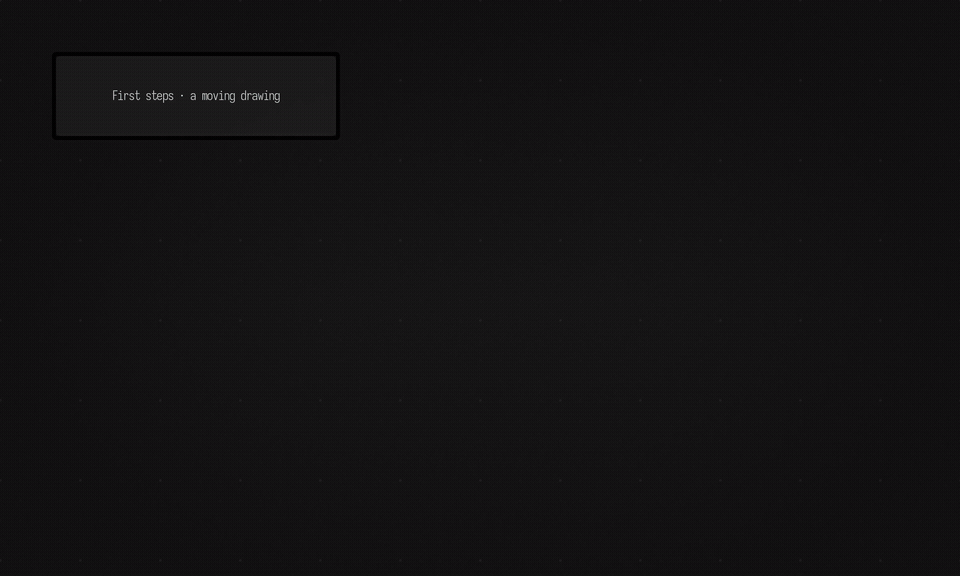

# Field 4

Field 4 is a Kotlin-based live-coding environment for graphics, exploratory
data visualization, and new media art.

Edit a number, launch the code, and watch a drawing change. Inspect values beside the code,
stop the animation, and keep the edited document. The first example runs without a GPU driver,
Python or an AI key.

[](https://openendedgroup.com/field4/first_steps/)

[Watch the short recording](https://openendedgroup.com/field4/assets/first_steps/first-look.mp4) ·
[Your first five minutes](public/docs/first_steps.md)

**AGPL-3.0-or-later.** See [LICENSE](LICENSE). Field runs locally; optional AI uses your own
provider/account. [What stays local and what leaves](public/docs/privacy.md).

Project site and user documentation: https://openendedgroup.com/field4

## Status

Field 4 is being prepared for its first public source release. Expect some
sharp edges while the repository is being cleaned up, especially around native
graphics/audio dependencies and developer tooling.

## Requirements

- Apple silicon macOS, glibc Linux (x86-64; ARM64 experimental), or Windows x64
- Linux desktop launch: `curl`, C/C++ compiler, Make, CMake, and Electron desktop libraries
- macOS desktop launch: Apple Command Line Tools (`xcode-select --install`)
- A shell that can run the Gradle wrapper
- **Git LFS, installed before you clone.** `libs/kotlin-compiler-embeddable-*.jar`
  (~180MB) is stored with LFS. Clone without it and Git silently leaves a 134-byte
  text pointer in the jar's place; the build then fails partway through
  `:compileKotlinJvm` with `zip END header not found`, which does not obviously
  point back here. Install it (`apt install git-lfs`, `brew install git-lfs`, or
  the Windows Git installer's LFS option) and run `git lfs install` once per
  machine. If you have already cloned without it, you do not need to re-clone —
  install Git LFS and run `git lfs pull`.
- Internet access on the first build so Gradle can download toolchains and
  dependencies
- Several GB of downloads/build storage; allow 10 GB free and 16 GB RAM for the source build
- For browser use, a browser that can accept the local development HTTPS certificate

See the [installation guide](public/docs/installation.md) for package commands and platform limits.
Java, Gradle and Node are provisioned by the launchers. Python, AI keys and optional submodules
are not required for the default launch.

## Quickstart

On macOS and Linux:

```bash
git lfs install
git clone --depth 1 https://github.com/OpenEndedGroup/Field4.git
cd Field4
./field.sh
```

On Windows:

```powershell
git lfs install
git clone --depth 1 https://github.com/OpenEndedGroup/Field4.git
cd Field4
.\field.bat
```

This is the one command you need: it builds Field (compiling the Kotlin/JVM
backend and the JavaScript front end via the Gradle wrapper), then launches the
backend and the Electron window together.

The **first run compiles the whole project and downloads large native
dependencies** (LWJGL graphics/audio, Lucene, ONNX Runtime, and others), so
allow time and bandwidth for the initial build. Fresh Windows and Apple-silicon
macOS CI launches took about 20–25 minutes; your machine and connection will affect
that time. Subsequent launches reuse the dependency cache and incremental compiler output.
If the build fails, the script stops and prints the Gradle errors instead of launching a stale build —
fix them and re-run.

The backend runs in the terminal you launched from, with a live status console
pinned at the top (startup progress, frame rate, GPU uploads, compile/evaluate
timings, and front-end network traffic); everything else scrolls below it. You
can scroll back through the log with PageUp/PageDown or the mouse wheel, and
press End to return to following the latest output.

Once you know your build is current, you can skip the build check for a faster
relaunch:

```bash
AFIELD_SKIP_BUILD=1 ./field.sh
```

```powershell
$env:AFIELD_SKIP_BUILD = "1"; .\field.ps1
```

The first interactive launch runs a small Kotlin welcome tool: choose desktop/browser mode and
optional Python prerequisites or Vulkan diagnostics. It prints a package installation plan and
requires explicit confirmation before running commands. Reopen it with `./field.sh --setup`
(Windows: `field.bat --setup`). Noninteractive launches skip the questions; automation may set
`AFIELD_FIRST_RUN=skip`.

When Welcome opens, click **Start here: a moving drawing**. It gives you an editable copy with
launch, edit, inspect, stop and reopen instructions. **Next: native graphics** opens a small
Vulkan example when you are ready for a native window.

Check prerequisites without downloading or building with `./field.sh --check-install`.
For browser/SSH use without Electron or native UI bridge compilers, use `./field.sh --server-only`.
Windows accepts the same options through `field.bat`.

The server binds localhost and enables browser-origin protection by default. Remote devices
such as Vision Pro require an explicit `AFIELD_BIND_HOST=0.0.0.0` setting and a trusted network
or firewall: the LAN API has no authentication. See [server access](public/docs/server_surface.md).

## OpenAI Features

Some experimental AI-assisted editing, documentation search, and autocomplete
features use the OpenAI API. Field reads the standard `OPENAI_API_KEY`
environment variable through the OpenAI client libraries.

Create an API key in the OpenAI Platform dashboard, then export it before
starting Field. On macOS and Linux:

```bash
export OPENAI_API_KEY="sk-..."
./field.sh
```

On Windows PowerShell:

```powershell
$env:OPENAI_API_KEY = "sk-..."
.\field.ps1
```

For a persistent local setup, add the export line to your shell profile, such
as `~/.zshrc`, or to your PowerShell profile, and restart your terminal. Do
not commit API keys to the repository.

Optional model override environment variables:

- `AFIELD_AI_MACRO_MODEL`
- `AFIELD_KOTLIN_AUTOCOMPLETE_MODEL`
- `AFIELD_SHADER_AUTOCOMPLETE_MODEL`
- `AFIELD_GLSL_AUTOCOMPLETE_MODEL`
- `AFIELD_DOCS_SEARCH_MODEL`
- `AFIELD_DOCS_SEARCH_FALLBACK_MODEL`
- `AFIELD_COMPLETION_DOC_MODEL`

## Workspace

Field documents are stored on disk in a workspace directory. Name one when you
launch:

```bash
./field.sh /path/to/AFieldWorkspace
```

A relative path resolves against the directory you are standing in, and `-w` or
`--workspace` say the same thing explicitly. Pointing at a single document — a
folder holding a `metadata.edn`, or that file itself — opens the folder above it,
which is the workspace that document lives in, and opens that document.

With no argument, Field reopens the workspace it used last. That choice is
recorded once per machine, in `~/.afield/last-workspace.txt`, so another clone or
worktree of this repository can be what last wrote it; `./field.sh` prints the
workspace it settled on, and where that came from, before it starts building. To
ask without launching:

```bash
./field.sh --print-workspace
```

Naming a workspace also makes it the remembered one, so the next bare `./field.sh`
comes back to it. The Gradle entry points take the same flag:

```bash
./gradlew runDesktop --args="--workspace /path/to/AFieldWorkspace"
```

## Opening a document

`-d` (or `--document`) goes straight into a document, instead of the welcome page
and instead of whatever was open last:

```bash
./field.sh -d myDocument
```

That looks `myDocument` up in whichever workspace this launch settled on — the
remembered one, above, unless you name another. All of these mean the same thing:

```bash
./field.sh /path/to/AFieldWorkspace -d myDocument
./field.sh /path/to/AFieldWorkspace/myDocument
./field.sh /path/to/AFieldWorkspace/myDocument/metadata.edn
```

The document has to exist. Field creates one that does not, so a name it does not
recognise is reported rather than opened as a new empty document — before the
build, not minutes into it. The Gradle entry points take the flag too:

```bash
./gradlew runDesktop --args="--workspace /path/to/AFieldWorkspace --document myDocument"
```

On Windows, `.\field.ps1` (and `field.bat`, which forwards to it) takes the same
arguments.

The default development server port is `9092`. Override it with `PORT`:

```bash
PORT=9477 ./gradlew runDesktop
```

## Developer Checks

Compile the JVM sources:

```bash
./gradlew compileKotlinJvm
```

Run the Field smoke-test catalog:

```bash
uv run --project . --group backdoor python tools/run_field_tests.py --refresh-catalog
```

Run browser UI regressions:

```bash
uv run --project . --group backdoor python tools/run_ui_regressions.py --port 9490 --timeout 45
```

Browser screenshots and UI regressions use Field's JVM/server-owned Playwright
through the backdoor. The Python `playwright` package is not required in the
repo `uv` environment for these checks.

Build the documentation site without regenerating screenshots:

```bash
FIELD_DOCS_RUNNER_MODE=never uv run --project . --group docs python tools/build_zensical_docs.py --clean
```

That one command is the supported Zensical path: `uv` resolves the docs
dependencies from `pyproject.toml`/`uv.lock`, `tools/build_zensical_docs.py`
preprocesses Field's runnable docs fences, and the wrapper then invokes
Zensical. Do not create a separate virtualenv or install Zensical
packages by hand.

Regenerate every screenshot and video through a fresh Field-backed docs run:

```bash
FIELD_DOCS_RUNNER_MODE=always FIELD_DOCS_RUNNER_PORT=9477 uv run --project . --group docs python tools/build_zensical_docs.py --clean
```

That run starts (or reuses) this checkout's completion sidecar on the same port
`./field.sh` uses, because completion figures otherwise capture the K1 fallback
rather than the default backend — a `capture="ui"` completion fence now fails if
Field's log says its completion fell back. `FIELD_DOCS_RUNNER_SIDECAR=off` skips
the sidecar, at the cost of failing those fences.

The consolidated testing guide is `dev_docs/testing/TESTING_STRATEGY.md`.

## License

Field 4 is licensed under the GNU Affero General Public License, version 3.0 or later.
See `LICENSE`.

## Repository Map

- `src/commonMain`: shared RPC payloads and message dispatch
- `src/jvmMain`: Ktor server, live-code execution, persistence, rendering, and
  runtime support
- `src/jsMain`: browser UI, canvas/editor integration, output areas, and
  commands
- `public/docs`: Zensical source for the user documentation
- `metadata_store` and `templates`: example documents and document templates
- `tools`: automation utilities for Agents, including the Field backdoor test runner
- `dev_docs`: internal design notes and agent-facing development notes

See `AGENTS.md` for a deeper repo guide and automation workflow.
