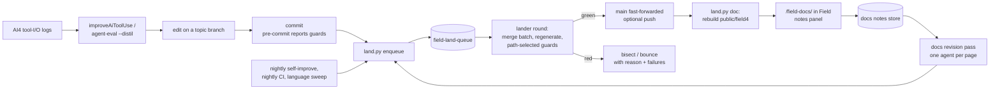

# Build infrastructure: the whole machine on one page

Everything that turns an edit into a verified commit on `main`, a rebuilt documentation site, and
the next round of improvements, in one place: the Gradle build, the git hooks, the landing queue,
the test suites and their registers, the backdoor and its harnesses, the browser UI regressions,
the documentation build, the agent-transcript materializer, and the loops that feed work back in
(the docs revision pass, the AI tool-use improvement loop, and the scheduled nightlies).

Each section says what a piece does, how to drive it, and where its code lives. The deep
references stay where they are; this page links to them. Every number below was measured on
2026-10-09 at `main` a83b482e4, and the table in [Measured](#measured-2026-10-09) gives the command
behind each one, so a stale number can be recounted rather than trusted.

---

## 1. The map

Three ideas hold it together:

- **Only the lander writes `main`.** A `reference-transaction` hook refuses every other move of
  the ref, so the queue is the single road in ([section 4](#4-the-landing-queue)).
- **A green verdict must be computed from the current bytes.** Gates declare non-Kotlin inputs so
  Gradle cannot hand back a cached pass over old Markdown; tests may not write into the tree;
  captures run the real code or are omitted; expected failures live in registers enforced in both
  directions.
- **Generated files are regenerated, never hand-merged.** Merge drivers keep "ours" for generated
  trees and settle derived prose counts; `merge_regen.py` and the lander then regenerate from
  both sides' sources.

---

## 2. The Gradle build

**Files.** `settings.gradle.kts`, a single `build.gradle.kts` (4161 lines), `gradle.properties`.
No `buildSrc`, no version catalog. Gradle 9.5.1 through the wrapper, which the
`me.filippov.gradle.jvm.wrapper` plugin patches to fetch Corretto 17 into `~/.field4/gradle-jvm`
to run Gradle itself. Field's own toolchain is pinned GraalVM 25.0.2 (`fieldLauncher()` pins the
vendor for every launcher, because `-XX:+EnableJVMCI` kills a non-Graal JDK 25 before `main()`);
`field.sh` downloads and checksums that exact release into `~/.field4/toolchains`.

**Targets.** Kotlin Multiplatform 2.5.0-Beta1:

- `jvm` (`mainClass = afield.Server`, `jvmTarget` 24, `-Xcollection-literals`).
- `js` (ES modules, webpack output `afield.mjs`, copied into the jar's `static/` by `jvmJar`).
  Two workarounds keep incremental JS builds alive: `-Xklib-ir-inliner=disabled`
  (`dev_docs/KOTLIN_2_5_JS_IC_INLINER.md`) and a sweep that deletes Finder `.DS_Store` files from
  `build/klib/cache`.
- Source sets `commonMain`, `jvmMain` (plus `src/generatedLinalg/kotlin`), `jsMain`, `jvmTest`.
- An optional `personal` compilation when `src/personal/` exists, built to
  `build/personal/afield-personal.jar` and handed over via `-Dafield.personal.classpath`.

**The Kotlin fork.** `libs/*-2.5.255-SNAPSHOT.jar` (compiler-embeddable, scripting, analysis API,
and a stdlib-js klib) are "gently customized" for completion and the REPL; they live in Git LFS.
`jvmRuntimeClasspath` excludes the seven Maven Kotlin modules they would otherwise collide with.
Other local jars: a 2.5-compatible ktfmt, the Wither plugin, the DataFrame compiler plugin (passed
with `-Xplugin`, kept off the classpath), JEP, Nashorn, Ableton Link FFM.

**Pinning.** Every configuration gets `failOnDynamicVersions()` and `failOnChangingVersions()`,
which is what lets `./field.sh --offline` build from the cache without a daily re-check stalling
it. `kotlin("reflect")` is declared explicitly so a transitive bump cannot move it.

**Caching.** `org.gradle.caching=true` with a build cache shared across worktrees; several tasks
keep absolute paths out of their inputs so worktrees hit each other's entries.

**Launching.** `./field.sh` builds `jvmJar dumpFieldLaunch` and then execs
`java @build/field-launch/args` itself, so stdout stays a TTY (`field.ps1` does the same on
Windows). `./gradlew runJvm` is what the backdoor and the smoke runner start; its `doFirst` merges
`requiredRunJvmArgs()`, opt-in JDWP (`AFIELD_JDWP_PORT`), AI4 trace properties and AOT-cache
arguments. `runDesktop` starts backend plus Electron; `generateFieldAotCache` trains a JDK 25 AOT
cache.

### Task inventory

104 tasks are registered in the root build (54 `JavaExec`, 21 `Exec`, 24 untyped, 3 `Test`, one
`Jar`, one `Sync`), plus 5 in the `tools/linalg-*` and `tools/imaging-bench` subprojects and two
standalone builds (`tools/code-use-semantic-sidecar`, `tools/first-run`). By purpose:

| Group | Tasks |
| --- | --- |
| Aggregates | `check`, `docsGates` (`check` minus `allTests`), `certify` (`check` with continue-on-failure), `warningGates` (forced recompiles of jvm, js, jvmTest and the sidecar) |
| Generators (write committed files) | `generateCodebaseReference` (`public/docs/reference/`, `dev_docs/kdoc_worklist.md`), `regenerateAgentTranscriptStartingPoints`, `regenerateAgentDemos`, `generateLinalg`, `generateCsoundVocabulary`, `runAgentToolDemo`, `formatBoxCode` |
| Drift checks and guards | `checkCodebaseReference`, `checkKDocAttachment`, `checkSourcePartition`, `checkSourcePages`, `checkAgentTranscripts`, `checkAgentTranscriptIndex`, `checkAgentTranscriptLayouts`, `checkAgentDemos`, `checkBoxOutputChannels`, `checkCompletionCorpusFixtures`, `checkGeneratedLinalg`, `checkPythonTools`, `checkBoxIdioms`, `checkBoxCodeCompiles`, `checkExpectedTestFailures`, `recordTestTreeBaseline` / `checkTestTreeWrites` |
| Test tasks | `jvmTest`, `citationGates`, `expectedFailureTests`, `jvmMeasurements` (opt-in) |
| Natives | `buildCeresRedistributable`, `buildTetgenNative`, `buildLibpdNative`, `buildCsoundNative`, `buildLorisNative`, `buildPaintNative`, `buildSyphonNative`, `buildSlugNative`, `fetchSteamAudioNatives`, `fetchDocsDirtSamples`, `buildLearnedShaders`, `buildOpenDlssNr*`, and the umbrella `buildDocsNativePrerequisites` |
| Smokes, studies, demos | eight `smokeCeres*`, `smokeManifold`, `runGpuSkinningSmoke`, Steam Audio demos, Ceres studies, `runKratosStudy`, ... (none in `check`) |
| App and packaging | `runDesktop`, `dumpFieldLaunch`, `electronInstall`, `buildFieldBrowserBridge`, `generateLocalKeystore`, `prepareSmileNative`, `generateFieldAotCache` |
| AI | `improveAiToolUse`, `improveAiToolUseDryRun` ([section 10](#10-the-improvement-loops)) |

`check` depends on thirteen of the drift checks in the third row (all but `checkBoxIdioms`,
`checkBoxCodeCompiles` and the tree-write pair, which wraps every Test task instead), plus
`citationGates` and `allTests`.

**Natives** download through `tools/native_download_cache.py` into a per-user checksummed cache
(`~/Library/Caches/Field4/native-downloads/` on macOS, `AFIELD_NATIVE_DOWNLOAD_CACHE` to move it),
outside `build/` so `clean` does not force a re-download. `tools/check_native_selfcontained.py`
reads Mach-O, ELF and PE headers directly and fails a Ceres build that links outside the OS
allowlist; `.github/workflows/ceres-abi.yml` runs the ABI check in CI.

### The verification lock

One verification per checkout: two builds in one tree corrupt shared Kotlin class output. The
Python harnesses (`run_field_tests.py`, `run_ui_regressions.py`, `build_zensical_docs.py`) take an
exclusive `flock` on `.field-backdoor/verification.lock` (`verification_lock()` in
`tools/verification_runtime.py`) and export `AFIELD_VERIFICATION_LOCK_OWNER` so their own child
Gradle passes through. Raw `./gradlew` reads the lock in a `settings.gradle.kts` block: while a
live, non-reused PID holds it, Gradle prints `WAIT gradle: verification lock held by ...` every
15 s for up to `AFIELD_VERIFICATION_LOCK_WAIT_SEC` (1800). `AFIELD_VERIFICATION_LOCK=fail` throws
instead, `=off` skips the check. Gradle only reads the lock; it does not take it, so two bare
`./gradlew` invocations are not serialized against each other.

---

## 3. Git hooks and merge drivers

`uv run python tools/install_git_hooks.py` copies `tools/hooks/{pre-commit,post-merge,reference-transaction}`
into the hooks directory, chaining any foreign hook it finds as `<name>.local` (Git LFS's
`post-merge` lives on that way), and registers two merge drivers.

| Hook | What it does |
| --- | --- |
| `pre-commit` | Runs `tools/check_staged_generated_artifacts.py --report`: prints which guards the staged paths select and the `./gradlew --continue ...` line that would run them, then exits. A commit takes about two seconds. `FIELD_PRECOMMIT_FULL=1` runs the guards for real. |
| `post-merge` | LFS first, then the same report `--since ORIG_HEAD`. Advisory. |
| `reference-transaction` | In the `prepared` phase, refuses any move of `refs/heads/main` unless `FIELD_LANDER=1` (set by the lander) or `FIELD_ALLOW_MAIN_WRITE=1`. On a refused merge or pull it also undoes the files already written into the checkout. |

**The guard selector.** `check_staged_generated_artifacts.py` maps changed paths to eleven Gradle
guards: `checkCodebaseReference`, `checkKDocAttachment`, `checkAgentTranscripts`,
`checkAgentTranscriptIndex`, `checkAgentTranscriptLayouts`, `checkAgentDemos`, `checkPythonTools`,
`checkCompletionCorpusFixtures`, `checkBoxIdioms`, `checkBoxCodeCompiles`, `citationGates`. It reads
its path lists from the code that owns them (the reference generator's `SOURCE_ROOTS`, the
`PersonalBoundaryTest` scan roots, the citation registries) rather than keeping copies, and hands
the changed paths to Gradle in `AFIELD_GUARD_CHANGED_PATHS_FILE`.

**Merge drivers** (`.gitattributes`):

- `merge=field-generated` (driver `true`, keep ours) for `public/docs/reference/**`,
  `dev_docs/kdoc_worklist.md`, `public/docs/assets/agent_transcripts/**`,
  `tools/completion-corpus/boxes/**`, `dev_docs/GUARD_CORPORA.md`. The regenerate step rebuilds
  them afterwards.
- `merge=field-counts` for `public/docs/**/*.md` and `dev_docs/**/*.md`:
  `tools/merge_derived_counts.py` settles every derived-count numeral (`N` followed by a
  `count:key` HTML comment) on all three sides, taking theirs if only they moved it and ours
  otherwise, then runs `git merge-file`. A conflict that was only a recomputed number disappears;
  prose conflicts still stop the merge.

---

## 4. The landing queue

Nobody merges into `main` by hand. Commit on a topic branch, run
`uv run python tools/land.py enqueue`, and stop. The lander does the rest, one batch at a time.
User-facing guide: `public/docs/landing_queue.md`.

**Commands** (`tools/land.py`):

| Command | What it does |
| --- | --- |
| `enqueue [branch] [--note] [--push]` | Pins the branch's current commit. Refuses `main` and a dirty worktree. Re-enqueueing replaces an unstarted item and keeps its place. Prints the `status` / `wait` / `mine` lines to use next. |
| `status [id] [--watch] [--plain]` | Live TUI on a terminal; plain text otherwise. Lander, items landing, queue with ETA from the median of recent landings, recent pushes, bounces (marked `resolved` once that branch later landed). |
| `wait <id>` | Blocks; exit 0 landed, 1 bounced. Run it as a background command. |
| `mine [branch]` | Every attempt for a branch, newest first. |
| `sync [--push]` | Fetches `origin/main`; if behind, lands it through the queue on `sync/origin-main-<stamp>`. |
| `doc` | Queues a documentation rebuild as a barrier: earlier items land first, then `public/field4/` is rebuilt in the checkout holding `main` with existing captures. |
| `huh`, `bouncy` | Hand the queue state, logs and stranded bounces to `claude -p` for a diagnosis and a paste-able fix message. |
| `run [--once] [--batch N]` | The lander loop itself. |

**Storage.** JSON items in `$(git rev-parse --git-common-dir)/field-land-queue/{pending,landed,bounced}/`,
shared by every worktree of the clone, plus `logs/` (batch logs, `<id>.failures.txt`),
`lander.lock` (an `flock`, so status asks the kernel whether a lander is alive), `events.jsonl`.
Items sort by a nanosecond `seq`.

**A round.**

1. Take up to 8 ready items (`--batch`, `FIELD_LAND_BATCH`). A `doc` item is a barrier. An item
   whose files are uncommitted in `main`'s checkout waits as `blocked` instead of bouncing.
2. In the lander's own worktree (`<repo>-worktrees/lander`, branch `land/lander`, its own Gradle
   home cloned from `~/.gradle`), merge each item `--no-ff` and commit `Land <branch> (<by>)`. A
   conflict on the first member bounces it; on a later member, defers it.
3. Run `tools/merge_regen.py --regen-since <main>` once for the batch: regenerate
   (`generateCodebaseReference`, `regenerateAgentTranscriptStartingPoints`, the completion corpus
   with `AFIELD_HARVEST_WRITE=1`, derived prose counts via `ProseNumeralContractTest` with
   `AFIELD_WRITE_DERIVED_COUNTS=1`, and `tools/guard_corpora.py --write`), commit
   `Regenerate generated artifacts after landing N branch(es)`, then run the guards the batch's
   paths select, skipping the pure drift checks it just regenerated.
4. **Green:** fast-forward `main` with `FIELD_LANDER=1` (via `merge --ff-only` in whichever
   worktree holds `main`, which refuses rather than overwrite dirty files), then push if any member
   asked. **Red:** a single item bounces with the failing test's message from the JUnit XML; a
   batch is halved and retried from the oldest on the current `main` until the culprit bounces
   alone ("found by bisecting a red batch of N").
5. A watchdog (`FIELD_LAND_WATCHDOG_MIN`, 30, on the monotonic clock) kills a build that goes
   silent; the first wedge requeues, the second bounces.

The lander runs under launchd (`~/Library/LaunchAgents/com.field4.lander.plist`, `KeepAlive`,
`ProcessType` `Standard` because background QoS starved its builds; log
`~/Library/Logs/field4-lander.log`). After changing `land.py`, restart it with
`launchctl kickstart -k gui/$(id -u)/com.field4.lander`. The docs flows start a `run --once`
lander themselves when none is running.

**Bringing `main` into a branch** is `uv run python tools/merge_regen.py main`: it merges,
regenerates over both sides' changes, runs the full staged guard and commits.

**Track record.** 256 `Land` commits on `main` (232 first-parent), all but one since the queue
went in on 2026-10-03. The queue directory holds 238 landed and 67 bounced items. Median landing
time is 9.2 minutes (p90 34 minutes); 144 items landed in a batch of one and 24 in a batch of
eight. Bounce reasons, in order: guard or compile failures, merge conflicts, test failures with a
failures file, watchdog, refused fast-forwards; 16 culprits were found by bisection. Tests:
`tools/test_land.py`, `tools/test_merge_regen.py`.

**Worktree cleanup.** `tools/reap_merged_worktrees.py` (dry run by default, `--apply` to act,
`--explain-policy`) removes worktrees that are clean, merged, idle at least 12 hours and not the
cwd of any live process, in four families (nightly, docs, agent sessions, any merged), archiving
precious files such as `NIGHTLY_WORKLOG.md` first. Policy: `dev_docs/worktree_retention_policy.md`.

---

## 5. The test suites

### JVM unit tests

`src/jvmTest/kotlin/afield/`: 662 files, 5664 `@Test` methods, `kotlin.test` on JUnit 4. The
biggest packages are stdlib (about 1450 tests), `four` (about 920), the top-level engine package
(about 700), graphics, ai, ml, stacksl, petri and docs. Families worth knowing by name:

- **Engine and box runtime:** `EngineExecutionReceiptTest`, `ExecutionVerdictTest`,
  `BoxRetireAndReplaceKiTest`, `LaunchStopBarrierTest`, `RendererTeardownOrderTest`,
  `OutputBackPressureTest`.
- **Completion:** `CompletionTypeFitTest`, `InfixCompletionTest`, `GeneratedCompletionDocSweepTest`,
  and `FieldSuggestPresentationTest`, which runs the real browser `fieldSuggest.js` under node.
- **Characterization tests** pin behaviour with golden files regenerated by a `-Dafield.*=write`
  property (`RectSLTrackCharacterizationTest`, `ContextResolutionCharacterizationTest`,
  `GraphQueryCharacterizationTest`).
- **Measurements:** six `*Measurements` classes that report and do not assert; they run only in
  `jvmMeasurements`.

Every Test task gets 4 GB of heap, the vector/JVMCI arguments, Smile's native BLAS, AI logs
redirected under `build/test-ai-logs/`, and all `-Dafield.*` properties forwarded. `jvmTest`
declares `public/docs/**/*.md` and a few other non-classpath files as inputs, so a docs edit
re-runs it.

### `citationGates`: the documentation contracts

A separate Test task running exactly 14 classes (111 tests), kept out of `jvmTest` so its inputs
(all of `dev_docs/**.md`, `public/docs/**.md`, transcript YAML, `docs_hooks.py`, ...) can be
declared and a Markdown-only edit can never be served a cached verdict. It prints
`citationGates: [k/14]` progress lines that `land.py status` displays.

| Class | Holds |
| --- | --- |
| `CitationContractTest` | `path:line#anchor` citations on the guarded pages resolve, by symbol |
| `ProseNumeralContractTest` | a numeral marked `count:key` equals the population derived from code |
| `DerivedArithmeticContractTest` | a numeral marked `derive:` equals its own stated arithmetic, across all Markdown |
| `ImpossibilityClaimContractTest` | dev_docs claims of impossibility, and claims that a suspected cause was excluded, carry a reproducer, citation or dated conjecture |
| `PersonalBoundaryTest` | no committed file reaches into `src/personal/` or imports a private root |
| `DocsFenceTreatmentTest` | published fences use `diffstatic`/`diff`, never bare `kotlin` |
| `ServerSurfaceLedgerTest` | `dev_docs/server_surface_inventory.md` matches the routes and `/ws` commands |
| `DocumentedApiEvaluationTest` | every transcript carries a verification level; documented APIs compile |
| `TranscriptStackAutoCompileTest` | StackSL programs inside transcripts compile |
| `GateInputDeclarationTest` | every file a gate reads is a declared Gradle input (parses `build.gradle.kts`) |
| `LanguagesCategoryTest` | reference-only labels never reach completion; every reference page is in the nav |
| `DocsGatesWiringTest` | `docsGates` keeps depending on `citationGates` |
| `SmallLanguageAnatomyTest`, `CloseNodeCitationDriftTest` | per-page citation ledgers |

The map of every contract is `dev_docs/citation_contracts.md`; the claim rules are in
`dev_docs/impossibility_claims.md`.

### Registers of accepted failures

`dev_docs/testing/expected_test_failures.json` (JVM selectors) and
`dev_docs/testing/expected_smoke_failures.json` (smoke ids) are the only place a red may be
accepted. Each entry needs an exact selector, a reason and an existing documentation path; no
wildcards. `jvmTest` excludes the registered selectors, `expectedFailureTests` runs only them, and
`tools/check_expected_test_failures.py` fails on an unregistered failure *and* on a registered test
that passed or did not run. The smoke runner enforces the same both ways. **Both registers are
currently empty.**

### Tests may not write into the tree

`recordTestTreeBaseline` and `checkTestTreeWrites` wrap every Test task.
`tools/check_test_tree_writes.py` snapshots git status plus the size and mtime of every tracked
file, and fails on new files, modified files, and files rewritten with identical bytes. Regenerators
opt in explicitly through nineteen escape variables (`AFIELD_DOCS_ASSETS`, `FIELD_CITATIONS_WRITE`,
`AFIELD_HARVEST_WRITE`, `AFIELD_WRITE_DERIVED_COUNTS`, `AFIELD_PROOF_DIR`, ...); tests write proofs
through `proofDir()` / `docsAssetDir()` in `src/jvmTest/kotlin/afield/TestProofDir.kt`.

### The smoke catalog

Smoke tests are annotations next to the code they exercise: a `FIELD_TEST` block in a Kotlin
comment or a Markdown HTML comment, giving `id`, `runner` (`jvm-main` with an `entrypoint`, or
`backdoor-box` bound to the next code string or fence), `timeoutSec`, `tags`, `graphicsContext`,
`requiresDisplay`, and `expect` clauses (exit code, stdout/output text, event kinds, screenshot and
image-region checks). Format: `dev_docs/testing/SMOKE_TEST_ANNOTATION_STRATEGY.md`; parser:
`tools/discover_field_tests.py`.

325 committed annotations: 235 in `src/jvmMain` (213 `jvm-main`, 22 `backdoor-box`) and 90
`backdoor-box` fences in `public/docs`. Tags: smoke 197, docs 108, cpu 46, gpu 23. The timeouts
add up to about 19 hours of worst-case budget.

`tools/run_field_tests.py` (`--refresh-catalog`, `--id`, `--tag`, `--runner`) holds the
verification lock, monitors disk, power and display every 15 s (`tools/verification_environment.py`),
reaps stale Field JVMs that belong to this checkout, prewarms one `runJvm` per run (recycled after
each graphics-context test), and orders an unfiltered run unseen-first, then least recently run
(`build/field-tests/coverage-state.json`). Exit 1 means failures, 2 means the environment was
incomplete (not run, interrupted). `jvm-main` tests go through `run-jvm-main`: the server spawns
`java <requiredAgentJvmArgs()> afield.AgentJvmMainLauncher <entry>`, and the launcher refuses
(exit 4) if the required JVM arguments did not take effect.

### Python and JS tool tests

`./gradlew checkPythonTools` runs `tools/run_python_tests.py`, which imports every top-level
`tools/test_*.py` (72 suites, about 1085 tests) under `unittest`; an import failure or zero suites
is a failure. The largest are `test_field_backdoor` (pins the backdoor's documented capture
signatures to its parser), `test_reap_merged_worktrees` and `test_docs_notes`. The eleven
`.mjs`/`.cjs`/`.js` tests under `tools/` are run by hand with `node`; no task calls them.

### Guard corpora

`dev_docs/GUARD_CORPORA.md` records the population each guard scans (12 `check_*.py`, 72 Python
suites, 31 guard/contract classes, 206/232 transcripts, 49 demo directories, 200 materialized
bundles, ...) in a block regenerated by `tools/guard_corpora.py --write` at every landing, so a
guard that silently stops seeing its corpus shows up as a changed row.

### First run and hardware

- `tools/first-run/` (standalone Gradle build, 31 JUnit 5 tests) and `tools/ci_first_run.py`
  (launches the real `field.sh`/`field.ps1 --server-only` and checks health, identity, `/welcome`,
  the editor bundle, two starting points and a cross-site 403) run in the manual
  `.github/workflows/first-run.yml` on Linux, Windows and macOS.
- GPU checks are `jvm-main` smokes on `four/util/GpuProbe.kt`; JVM tests that need LuaJIT, Pd,
  mosquitto, Python and similar skip through `Assume`.

---

## 6. The automation harness

Agents drive Field through the same protocol as the browser. References:
`dev_docs/agents/FIELD_BACKDOOR.md`, `AGENT_QUICK_REF.md`, `FIELD_MCP.md`.

### `tools/field_backdoor.py`

A WebSocket client on `wss://localhost:<port>/ws` speaking the frontend's JSON messages plus 23
`agent-*` handlers in `src/jvmMain/kotlin/afield/agent_backdoor.kt` (installed in every Field via
the `@RunsAt(installHandlers)` scan; the server binds to loopback). It acknowledges output messages
the way the frontend does, so a long session keeps receiving output under back-pressure.

- **Managed server.** It checks `/health`, then `/api/instance-info`, and reuses a server only when
  `repoRoot` is this checkout and nothing under `src/` or the build files is newer than the server's
  start (`field_instance_problem` in `verification_runtime.py`). Otherwise it starts
  `./gradlew runJvm` on the first free port from 9477 (never 9092; the HTTP mirror at port + 10000
  must also be free), in the checkout-local workspace `build/field-automation-workspace`, with
  automation logs and keybindings redirected under `build/`. The startup watch distinguishes a slow
  build from a lock wait. The server dies with the backdoor process. `--attach-existing` skips only
  the freshness check.
- **Commands.** 49: session (`status`, `snapshot`, `open`, ...), graph (`new-box`, `connect`, `set`,
  `macro`/`transcript`), execution (`run`, `launch`, `continue`, `launch-batch`, `stop`,
  `run-jvm-main`), output waits, graphics (`wait-native-renderer`), browser (`playwright-open
  [--electron]`, `editor-open`, `page-eval`, `input-key`, `click-box`, `drag-box`), captures
  (`screenshot-{window,editor,box}`, `native-screenshot`, `record-{window,editor,box}`), diagnostics
  (`lifecycle-census`, `why`), geometry review, and the in-Field agent (`agent-task`, `agent-eval`,
  `ai-chat`). Execution verbs return the box's own verdict.
- **Logs.** One JSONL per invocation under `.field-backdoor/logs/`, size-capped and pruned.
- The entry points re-exec under the repo `.venv` or `uv run` when their dependencies are missing
  (`tools/field_python_env.py`).

### `tools/field_session.py` (warm daemon, experimental)

Holds one backdoor connection, a scratch document and Playwright open behind a Unix socket, so
docs captures skip the per-capture process start. Opt-in through `FIELD_DOCS_RUNNER_SESSION=1`; it
measured 2.0 to 2.4 times faster on a 56-capture build and falls back to the per-process path on
the first miss.

### `tools/field_mcp.py` (MCP bridge)

A stdio MCP server (configured in `.mcp.json`, port from `$PORT`, default 9092) exposing 22 native
tools (status, open documents, snapshot/outline/read, notes, create box, run transcript, macros,
`field_screenshot_box`, `field_debug_probe`, lifecycle census, geometry review) plus every in-Field
AI4 tool, discovered at attach time and flattened to `field_*` names. `field_debug_probe` samples a
symbol at a source line or a box line through JDWP. The bridge attaches to whatever Field is on the
port; it does not start one.

### Playwright and Electron

Playwright is JVM-owned (`com.microsoft.playwright` 1.57.0): one shared Chromium, headless unless
`AFIELD_PLAYWRIGHT_VISIBLE=true`, GPU-accelerated through ANGLE/Metal on macOS (about 2.5 times
faster docs builds than SwiftShader), 2200 by 2800 at device scale 2. `playwright-open --electron`
launches this checkout's Electron with a CDP port and connects over it
(`afield/docs/ElectronCaptureBrowser.kt`), which is how the `macos-electron` docs captures see the
RTT view.

---

## 7. Browser UI regressions

`uv run --project . --group backdoor python tools/run_ui_regressions.py` (`--id <name>` for one).
60 regressions, each a `UiRegression(id, description, commands, screenshot)` in the runner's
`tests()` function: a list of backdoor command lines ending in a screenshot, with page-eval bodies
and box code in `tools/ui_regressions/` (57 fixtures) or generated into
`build/ui-regressions/generated/`.

A regression passes when every backdoor result is `ok` and every `page-eval` returns
`{ok: true}`: DOM and JavaScript assertions written as try/catch bodies returning a reason. The
final screenshot must decode and be at least 96 by 80 pixels; there is no golden-image comparison.
Families: the three.js viewer, the command palette and Monaco, output panels, controllers,
selection, profiling, AI chat, canvas and split panes, completion (which starts the K2 semantic
sidecar and checks it serves this checkout), and singles for the macro panel, toasts, keyframes,
the document guide and more.

Each test gets its own port from 9490 upward and cold-starts its own Field. The suite holds the
verification lock, retries only infrastructure failures that happen before any assertion, and keeps
`latest-pass.png`, `latest-failure.png` and the last five passes per test under
`build/ui-regressions/artifacts/<id>/`. Two specs carry an explicit `--no-fail-on-error`, and a
wiring test keeps that list from growing.

---

## 8. The documentation build

Sources are `public/docs/` (203 top-level pages, 21 generated reference pages, plus assets);
output is `public/field4/` (about 1.1 GB, 929 HTML pages including 578 generated source pages).
Entry point: `tools/build_zensical_docs.py`, which holds the verification lock and calls
`public/docs_hooks.py` directly (Zensical has no hook key).

**Order of a build.**

1. Preflight native prerequisites named by `requires="..."` on fences (Ceres, Manifold, TetGen,
   Pd, Csound, Loris, Electron, the Dirt samples, JEP, `python:<module>`; build them with
   `./gradlew buildDocsNativePrerequisites`).
2. `./gradlew generateSourcePages`: line-numbered source pages that citations link into.
3. Preprocess every page through `docs_hooks.process_markdown`: run its executable fences, rewrite
   citations, check duplicate embeds.
4. Write `public/zensical.generated.yml` (the config to `zensical serve`) and
   `public/zensical.generated.build.yml` (the same, rendering into the staging dir
   `public/.zensical-generated/site/`), check assets, run `zensical build`. The build is stopped
   if it prints nothing and uses under a CPU-second for `FIELD_DOCS_ZENSICAL_STALL_SEC` (120 s),
   or prints its issue report and never "Build finished"; an interrupted zensical, which exits 0,
   counts as failed too.
5. Refuse the staging site if more than 1% of the generated pages have no built page. Post-process
   it (repo paths to GitHub links), emit the offline viewer, write `field-docs-build.json` (the
   commit the site was built from, which the notes panel records), then swap it in for
   `public/field4/` by renaming, so a failed build leaves the previous site whole. Last, check
   every rendered link against the `/Field4/` prefix (gating under `--strict` or
   `--gate-site-links`, which the lander's docs job passes).

Zensical watches its inputs with FSEvents even for `build`, and finishes only after its file monitor
sees 100 ms with no event. A process that keeps writing under the docs, theme or site dir holds the
build at "Build started" at 0% CPU with no error. On 2026-10-09 that was Finder writing `.DS_Store`
files into the open `public/field4/`; the staging dir removed that writer, and a stalled build lists
the files that changed under watched dirs.

**Executable fences.** A `diffstatic_runner` or `diff_runner` fence is box code that the build runs
against a live Field through the backdoor and captures: `screenshot=`, `video=`, `audio=`, with
`capture=` box, window, editor, native-window or `ui` (a generated transcript with one `drive` op),
`graphics-context=true` for renderer-backed scenes, `macro-file=`/`transcript=` to set up a
document first, `expect-error` (checked both ways), and about seventy more attributes. 909 such
fences on 140 pages, about 830 cached captures (743 PNG, 61 WAV, 30 MP4). Every capture is checked
for execution errors, missing output, and degenerate pixels, and is published atomically by
`tools/capture_transaction.py`.

**Modes** (`FIELD_DOCS_RUNNER_MODE`):

| Mode | Behaviour |
| --- | --- |
| `never` | No captures; committed assets are used. The lander's `doc` step uses this. |
| `incremental` (default) | Reuses a capture whose code, options and reachable sources are unchanged; adopts committed assets in a fresh worktree; a failed capture falls back to the committed one and is counted. |
| `strict` | Exact digest match only, so a change to the runner logic invalidates captures. |
| `always` | Recaptures everything. `--page <page.md>` limits capture to named pages. |

The digest covers page, block, script version, the code, the options, and a hash of twelve runner
source files (`docs_hooks.py` hashed as an AST without docstrings and logging, so editing a comment
does not invalidate 830 captures). Hardware-specific captures carry `capture-profile`
(`linux-nvidia`, `macos-electron`) and are retained unless that platform is named in
`FIELD_DOCS_CAPTURE_PROFILES`; a missing retained asset fails the build. The runner reuses a Field
server only when it proves the same checkout and no newer source, and restarts it after every
graphics capture, every failure, and every 50 captures.

**The principle.** A capture exercises the real code, or it does not exist. No synthesized,
mocked or hand-edited images; if a capture will not come out, fix the code or the capture system,
or omit it and say why (`dev_docs/DOCS_RUNNER_GPU_CAPTURES.md`). Twenty-six captures the runner
cannot make are declared with their owning generator in `dev_docs/docs_capture_owners.json`.
`tools/docs_capture_audit.py` recaptures and diffs pixels to find stale assets
(`dev_docs/docs_capture_staleness.md`).

**Reference and KDoc.** `./gradlew generateCodebaseReference` turns KDoc from 17 source roots into
`public/docs/reference/` and `dev_docs/kdoc_worklist.md` (10016 of 16926 public symbols documented
today); `checkCodebaseReference` is the same generator as a byte-exact drift check, and the lander
regenerates rather than merging it. Contract: `dev_docs/kdoc_reference_contract.md`.

**Docs inside Field.** `/field-docs/` serves this checkout's `public/field4/` when built and
proxies the published site otherwise (`afield/server/docsAnnotations.kt`), injecting the notes
panel that feeds [the revision pass](#docs-revision-pass).

---

## 9. Agent transcripts and the materializer

Two formats with two jobs: `metadata.edn` is what a document *is*; operation-transcript YAML is a
script that builds, edits and runs one (`dev_docs/agents/OPERATION_TRANSCRIPT.md`). The engine is
`object OperationTranscript` in `src/jvmMain/kotlin/afield/operation_transcript.kt`.

**Verbs.** `create`, `edit`, `move`, `connect`/`disconnect` (with `nested`), `delete`, `execute`,
`launch`, `stop`, `wait`, `await` (pump frames until nothing is executing), `save`, and `drive` (a
Kotlin script against a `DocsUiDriver`, generated by the docs build for `capture="ui"` fences).
Operations apply in order and the first error stops the rest, so a failed prerequisite never
launches dependent code; consecutive launches are resolved together and none start if any target
is missing. Run one with `field_backdoor.py --command 'macro write N --file F' --command 'macro run
N'`, or through MCP `field_run_transcript`. Field also records UI edits into `<doc>/operations.yaml`,
which `macro page` and `save-selection` turn back into macros. The reverse direction,
`afield.examples.DocumentToTranscript`, writes one `create` per box and one `connect` per edge and
round-trips every demo as a smoke test.

**The corpus.** 206 top-level transcripts in `dev_docs/agents/transcripts/` (232 counting the 26
`docs_capture/` setups), every one classified in `DemoTranscriptExecSmokeTest`: 105 `EXECUTE`
(replayed for real, failing on any error output), 94 `COMPILE_ONLY` (built and K2-compiled), 7
`KOTLINJS`. That smoke test runs from the catalog (`examples.demo-transcript.exec`); at landing,
`checkBoxCodeCompiles` compiles just the transcripts a branch changed.

**The materializer.** `AgentTranscriptMaterializer` replays only the graph verbs of each top-level
transcript (no execution, so no GPU), saves the result, and strips nondeterministic bytes, producing
200 committed starting-point documents under `public/docs/assets/agent_transcripts/<name>/` (six
are excluded by name). Field's welcome screen, the completion corpus and the gallery's "Open" links
read that bundle. `./gradlew checkAgentTranscripts` materializes to a temporary directory and
byte-compares; `regenerateAgentTranscriptStartingPoints` writes it, and the lander does so
automatically.

**Guards around the corpus.**

| Guard | Holds |
| --- | --- |
| `AgentTranscriptIndexGuard` (`checkAgentTranscriptIndex`) | `public/docs/agent_transcripts.md` has exactly one entry per transcript (206), an Open link exactly when materialized (200), section markers that match the registry, and no hand-written totals |
| `AgentTranscriptLayoutGuard` (`checkAgentTranscriptLayouts`) | positive frames inside the canvas, ordinary boxes at most 620 by 170, unique ids; exceptions in `transcript_layout_exceptions.yaml`, and a stale exception fails |
| `AgentDemoRegistrationTest` | every demo document under `dev_docs/agents/demos/` has a transcript and a verification level or a written reason; every docs-asset document is a starting point or on a list that may only shrink |
| `AgentDemoDriftGuard` (`checkAgentDemos`) | demo `metadata.edn` is byte-for-byte codec output and inline code equals its sidecar |
| `check_box_idioms.py` (`checkBoxIdioms`) | published box code avoids known non-idioms (redundant renderer lookups and similar) |

**Conversation demos.** The AI4 "talk a study into existence" demos (function, StackSL, RectSL,
StackAuto; 12 documents) are recordings, not transcripts, because they need a model key:
`tools/conversation_demo.py` records real turns against a running Field,
`tools/capture_*_conversation.py` restores and screenshots them without model calls (checking the
restored chat is byte-identical), and `tools/package_*_conversation.py` builds the starter zips and
per-turn pages under `public/docs/assets/<x>_conversation/`. `tools/test_conversation_demos.py`
runs every packager's `--check`.

---

## 10. The improvement loops

### Docs revision pass

Reading the docs inside Field, select text and press `Ctrl+Shift+A` to leave a note
(`docsAnnotations.js`; store `~/.afield/docs-annotations.json`). `tools/docs_notes.py` turns notes
into a revision queue (user guide: `public/docs/docs_notes.md`):

- **Anchoring by blame.** Each note records the commit the site was built from. `sync` finds the
  quote in that version of the page, then stores `git blame` origins for those lines, so later
  syncs follow the lines through edits and moves. Notes on generated reference pages are traced to
  the KDoc in the `.kt` file.
- **`revise`** partitions notes so each file belongs to exactly one agent (union-find over page and
  owned file), then runs one `claude -p` (or `codex exec`) per partition, `--jobs` at a time, with
  `dev_docs/agents/DOCS_WRITING_RULES.md` in the prompt. Agents never write the store: their
  `resolve`/`question`/`memory` calls go to a journal that the harness validates and applies.
  Usage limits requeue the remaining notes and wait for the reset; edits outside every partition
  are reported as strays and never committed.
- **`pass create|revise|rebuild|commit|land|finish`** runs the whole loop in a
  `docs-pass/<stamp>` worktree, rebuilds the site there for review, and `pass land` enqueues the
  branch (starting a lander if none is running). The `/docs-pass.html` page drives the same
  commands from Field's welcome screen.
- **Handoffs.** Work too big for a page agent becomes a document under `dev_docs/handoffs/` (107
  today), grouped into batches; `handoff-session <batch>` creates a worktree with a brief for a
  separate session, which enqueues its own branch.
- **Completion KDoc drafts.** `import-drafts` turns completion's cached generated docs into
  `kdoc-draft` notes on the declaration line, worked by the same agents; a declined draft stops
  being offered. (This replaced the `polishCompletionDocs` task, which wrote straight into `src/`.)

`tools/docs_voice/` holds about two dozen read-only detectors (`score_voice.py` and boards for
table cells, alt text, self-narration, section leads, heading case, build machinery on user
pages, KDoc mirrors, anchors, links, fence ordinals, ...). They report and never fail; the gate is
only that every board still runs over the real tree.

### AI tool-use improvement

AI4 is Field's in-editor assistant; one tool registry feeds the chat panels, headless
`agent-task`/`agent-eval`, the backdoor and MCP (`dev_docs/ai/IN_FIELD_AGENT_HARNESS.md`). Every
session's tool calls are logged to `~/.afield/logs/ai4_tool_io/*.jsonl`.

- **`./gradlew improveAiToolUse`** (`AiToolUseImprovementCli.kt`) digests recent tool-I/O logs and
  a manifest of `src/`, asks a model for one small improvement, and lets it edit files under `src/`
  only (`improveAiToolUseDryRun` writes a patch instead). Reports land in
  `build/ai-tool-use-improvement-*.md` and `.patch`. Pass `--log-dir` with tool-rich logs: most
  logs are chat-only, and the default picks the newest twelve.
- **The welcome-screen card** (Review logs, Generate proposal, Mark reviewed) runs the same task for
  one to eight proposals, each in its own `agent/ai-tool-use/<id>` worktree under
  `<repo>-agent-worktrees/`, with Try (restart Field from that worktree), Merge and Delete.
- **Measured loop: evals and lessons.** `agent-eval --mode scripted|live` runs 17 tasks
  (`InFieldAgentEvals.kt`). `agent-eval --distil` turns recurring tool misuse mechanically (no
  model) into the `## Distilled` section of `src/jvmMain/resources/ai4/agent_lessons.md`, which is
  injected into every AI4 turn that has the graph tools; `## Curated` is for people.
  `AFIELD_AI4_LESSONS=off` disables it.
- **Evidence.** `tools/ai_tool_usage.py` (per-tool usage and bursts, for deciding what to defer or
  fold into a tool program), `tools/ai_usage.py` (the request ledger by provider and model), the
  code-use telemetry database behind `/code-use` (`dev_docs/agents/CODE_USE_TELEMETRY.md`), and the
  `aiTool` pool with `tools/verify_tool_pool.py` (`dev_docs/agents/tool-pool/`). The longer-range
  plan is `dev_docs/agents/TRANSCRIPT_SELF_IMPROVEMENT_LOOPS.md`.

### Scheduled loops (outside the repo)

Defined as Claude scheduled tasks in `~/.claude/scheduled-tasks/`; each `SKILL.md` is a thin
bootstrap and the real playbook lives with its state.

| Task | When | State | Output |
| --- | --- | --- | --- |
| `field4-nightly-selfimprove` | about 02:30 daily | `ORCHESTRATOR.md`, `SCRATCHPAD.md`, `reports/` on the orphan branch `nightly/journal` | three agents each build one upgrade on `nightly/<date>/N-slug`, then a judge writes verdicts; Marc enqueues the keepers |
| `field4-nightly-ci` | about 06:00 daily | the same on `nightly/ci-journal`, plus `warnings-baseline.json` | clean build of `main`, new Kotlin warnings fixed (never suppressed) on `nightly/ci/<date>-warnings`, then `docsGates`, `check`, the full docs recapture and the smoke catalog |
| `documentation-language-improvement` | every 3 h | `LEDGER.md` (cursor in nav order) | three pages a run against `DOCS_WRITING_RULES.md` on `docs/language-<stamp>`, code fences untouched; enqueues itself and waits |
| `documentation-voice-pass`, `kdoc-reference-debt` | disabled | their ledgers | |

Both nightlies are local-only, keep disk floors (5 GB and 8 GB), and finish with
`tools/reap_merged_worktrees.py --clean-builds --apply`.

---

## 11. Which gate runs where

| Gate | Commit | Landing | `check` | Nightly CI | By hand |
| --- | --- | --- | --- | --- | --- |
| The eleven path-selected guards | reported | run if selected | yes (nine of them) | yes | |
| `jvmTest` | | | yes | yes | |
| `checkSourcePartition`, `checkSourcePages`, `checkGeneratedLinalg`, `checkExpectedTestFailures`, `checkBoxOutputChannels` | | | yes | yes | |
| Regenerators and `guard_corpora.py` | | always | | | |
| Smoke catalog (including the transcript exec smoke) | | | | yes | `run_field_tests.py` |
| Full docs recapture | | | | yes | `build_zensical_docs.py` |
| Docs rebuild from committed captures | | `land.py doc` | | | |
| UI regressions | | | | | `run_ui_regressions.py` |
| First-run workflow | | | | | GitHub `workflow_dispatch` |
| `warningGates` | | | | warnings diffed | |
| JS tool tests, `lint_tautological_guards.py` | | | | | `node`, `python` |

Landing runs only what a branch's paths select. A branch that touches only `tools/*.py` or
`AGENTS.md` selects no Gradle guard at all, so the Python suites covering the lander itself run in
`check` and nightly, not at landing.

---

## 12. Gaps and stale notes found while writing this

Places where the code and its documentation disagree, or a check could reach further, listed so
they can be fixed or turned into handoffs:

- **The landing guard is not `check`.** `AGENTS.md`, the `land.py` docstring and
  `public/docs/landing_queue.md` say "the full guard"; the code runs the path-selected set, and the
  docstring's step 3 still describes per-item `merge_regen.py` calls. `checkAgentTranscriptLayouts`
  is selected only by demo paths, so a transcript-only edit reaches the layout guard nightly, not
  at landing.
- **`field.sh`** builds `jvmJar dumpFieldLaunch` and execs `java` directly; `AGENTS.md` says it
  wraps `./gradlew runJvm`.
- **Bare `uv`.** `checkPythonTools`, `checkBoxIdioms` and the `fieldAudio*` tasks call `"uv"`
  instead of `resolvedUvExecutable`, which exists because a long-lived daemon's PATH lacked `uv`.
  `checkPythonTools`' description still says "three suites".
- **Stale build comments:** a "2.4.255-SNAPSHOT" fork, "seven non-test gates", "the default Adoptium
  toolchain"; `-Dorg.lwjgl.system.stackSize` is set to 257 in one place and 256 in another.
- **Smoke catalog doc** lists four discovery roots (the code has five) and calls duplicates errors
  (the code skips them unless `--strict`).
- **Docs runner docs:** `docs_capture_staleness.md` says there is no continue-on-error path
  (incremental mode has one); `DOCS_RUNNER_GPU_CAPTURES.md` says every `video=` becomes an editor
  recording (box video exists now); `tools/docs_voice/README.md` calls the language task retired and
  mentions a `KNOWN_RED` board (the register is empty).
- **UI regression roadmap** lists 25 of the 60 regressions.
- **MCP:** the `field_debug_probe` tool description says the probe never pauses and JDWP is on by
  default (it suspends the event thread; JDWP is opt-in), and the bridge does no checkout-identity
  check.
- **Transcript gallery prose** says five transcripts are not materialized (six are excluded) and
  that the exec harness runs on every build (it runs from the catalog).
  `transcripts/gpu_probe_bench.yaml` contains a `save` op pointing at a committed demo directory.
  `AgentDemoRegistrationTest` lists demo directories with `File.listFiles()`, so a gitignored local
  demo directory makes it red in that checkout.
- **AI tool-use proposals** merge with a direct `git merge --ff-only` in the primary checkout,
  which the `main` hook will refuse; they should enqueue like every other branch.
- **Unpruned logs:** the backdoor prunes `*.jsonl` and `*.managed-server.log` only, so smoke
  prewarm, docs-session and desktop-Playwright logs accumulate in `.field-backdoor/logs/`, and
  scratch documents accumulate under the automation workspace's `.agent-scratch/`.

---

## Measured (2026-10-09)

| Number | Value | Command |
| --- | --- | --- |
| `build.gradle.kts` lines | 4161 | `wc -l build.gradle.kts` |
| Registered root tasks | 104 | `grep -oE 'tasks\.register(<[^>]*>)?\("[^"]+"' build.gradle.kts \| wc -l` |
| JVM test files / `@Test` methods | 662 / 5664 | `find src/jvmTest -name '*.kt' \| wc -l`; `grep -rhE '^\s*@Test\b' src/jvmTest --include='*.kt' \| wc -l` |
| `citationGates` classes | 14 | the `citationGuardTestClasses` list in `build.gradle.kts` |
| `FIELD_TEST` annotations | 325 | `grep -rIhE '^\s*FIELD_TEST\s*$' src/jvmMain public/docs \| wc -l` |
| Python tool suites | 72 | `ls tools/test_*.py \| wc -l` |
| Transcripts (top level / recursive) | 206 / 232 | `ls dev_docs/agents/transcripts/*.yaml`; `find dev_docs/agents/transcripts -name '*.yaml'` |
| Materialized starting points | 200 | `find public/docs/assets/agent_transcripts -name metadata.edn \| wc -l` |
| Runner fences / pages | 909 / 140 | fence-opening lines naming `diffstatic_runner` or `diff_runner` under `public/docs/*.md` |
| Top-level docs pages / reference pages | 203 / 21 | `ls public/docs/*.md`; `ls public/docs/reference/*.md` |
| UI regressions | 60 | `grep -c 'UiRegression(' tools/run_ui_regressions.py` |
| MCP native tools | 22 | the `TOOLS` list in `tools/field_mcp.py` |
| `Land` commits (all / first-parent) | 256 / 232 | `git log --oneline [--first-parent] --grep '^Land ' main \| wc -l` |
| Queue items landed / bounced | 238 / 67 | `ls $(git rev-parse --git-common-dir)/field-land-queue/{landed,bounced}` |
| Handoff documents | 107 | `ls dev_docs/handoffs \| wc -l` |

## Where to read more

- Testing: `dev_docs/testing/TESTING_STRATEGY.md`, `SMOKE_TEST_ANNOTATION_STRATEGY.md`,
  `UI_REGRESSION_ROADMAP.md`
- Automation: `dev_docs/agents/README.md`, `FIELD_BACKDOOR.md`, `FIELD_MCP.md`,
  `OPERATION_TRANSCRIPT.md`, `AGENT_QUICK_REF.md`
- Docs: `AGENTS.md` sections 3 and 8, `dev_docs/DOCS_RUNNER_GPU_CAPTURES.md`,
  `dev_docs/docs_capture_staleness.md`, `dev_docs/citation_contracts.md`,
  `dev_docs/kdoc_reference_contract.md`, `dev_docs/agents/DOCS_WRITING_RULES.md`,
  `dev_docs/DOCS_IMPROVEMENT_AGENT.md`
- Landing: `public/docs/landing_queue.md`, `dev_docs/worktree_retention_policy.md`
- Guards: `dev_docs/GUARD_CORPORA.md`, `dev_docs/impossibility_claims.md`,
  `dev_docs/agent_transcript_index.md`
