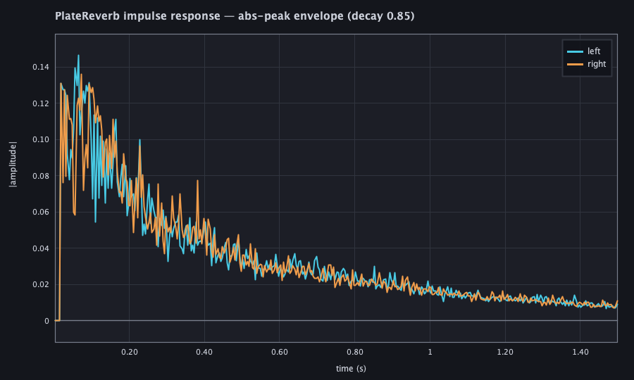
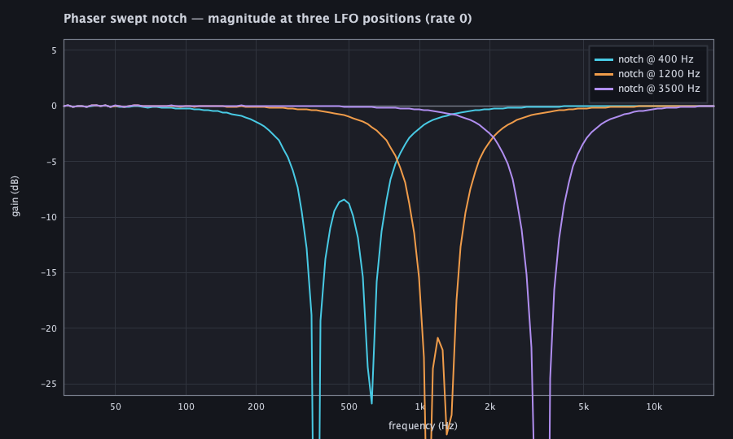
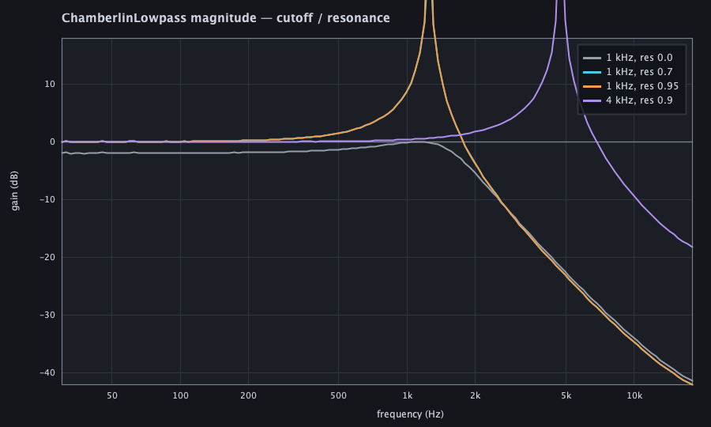
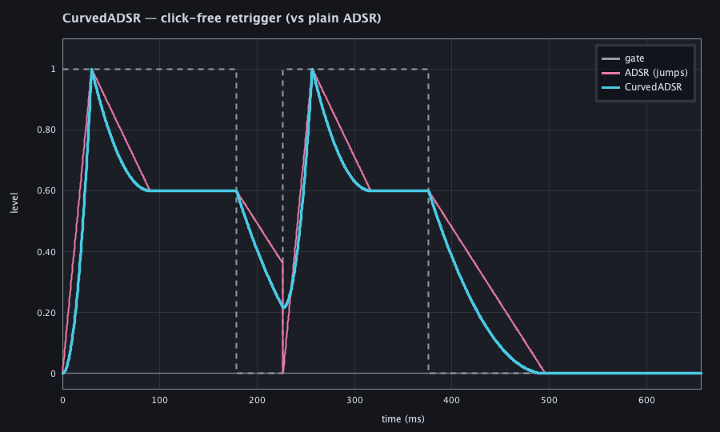
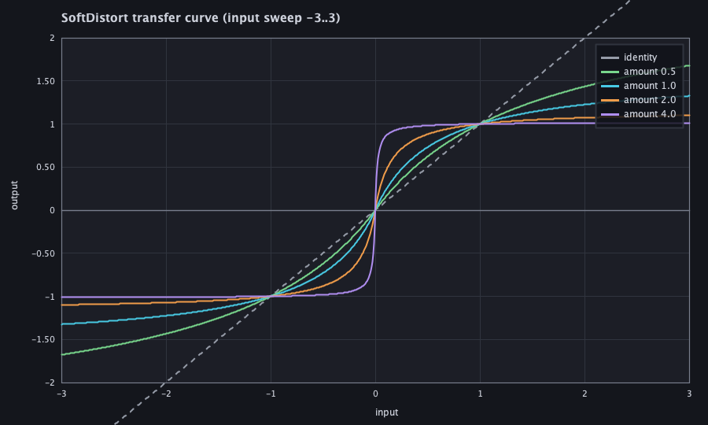
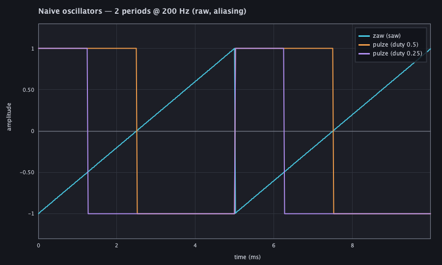

# Dough DSP plot-capture harness

`afield.four.synth.DoughDspPlotGallery` is the headless **response-gallery / plot-capture
harness** for the dough DSP ports in `DoughDsp.kt` (`PlateReverb`, `Phaser`,
`ChamberlinLowpass`, `CurvedADSR`, `SoftDistort`, `ZawOsc`/`PulzeOsc`). It is the visual
companion to `DoughDspSmokeTest` (`synth.dough-dsp.smoke`), which asserts the same behaviour
numerically. The primitives landed with a numeric smoke but no rendered proof; this closes
that gap, mirroring `FunctionsPlotGallery` and `RectSLDataVizProof`.

## Rendering path (and why it is honest)

Pure-CPU AWT `Graphics2D` → `BufferedImage` → `ImageIO` PNG, run under
`java.awt.headless=true` — the same headless path `run_field_tests.py` already drives for the
other galleries. No browser, no GPU, no Vulkan, no Field window.

Every plotted point is **real primitive output**, computed by actually running the DSP on the
CPU (`SynthContext` + block loop, exactly as the smoke test drives it):

- an impulse into `PlateReverb`, plotted as the per-bucket abs-peak decay envelope of each
  channel;
- a swept sine into `Phaser` and `ChamberlinLowpass`, measured as steady-state output/input
  RMS per frequency (a real magnitude response);
- a ramp into `SoftDistort` (its transfer curve);
- a gated `CurvedADSR` (and plain `ADSR` under the same gating, for contrast);
- raw `ZawOsc` / `PulzeOsc` periods.

Only the "draw a line between real samples" step is synthetic. Nothing is faked or
hand-drawn.

## Running

```
# official pass/fail (starts a Field server, applies the JVM args):
python3 tools/run_field_tests.py --id synth.dough-dsp.gallery --port 9611

# regenerate committed captures into a chosen dir:
DOUGH_DSP_PLOT_DIR=dev_docs/assets/dough_dsp_gallery \
  python3 tools/run_field_tests.py --id synth.dough-dsp.gallery --port 9611
```

As a FIELD_TEST it renders to a temp dir and asserts real correctness — painted fraction,
finite samples, and per-plot sanity (the reverb tail decays and L≠R, the resonant filter
peaks above its flat setting, each phaser notch dips, the ADSR retrigger has no
discontinuity, the soft-clip is monotonic and tightens with drive). It writes no committed
assets during the test.

## Adding a plot (reusable)

Append one `Plot` to `PLOTS`. Each plot builds a `PlotSpec` of named `Series` (sampled from
real primitive runs) with an optional deeper `verify`; everything else — axes, gridlines,
log-x, zero-line, legend, PNG write, painted-fraction guard — is shared.

## Captures

**PlateReverb impulse response.** A single-sample impulse; the abs-peak decay envelope of the
left (cyan) and right (orange) channels. The tail decays, and the two channels diverge — the
seven-tap-per-side decorrelation that makes the plate a stereo image rather than a panned
mono tail.



**Phaser swept notch.** Magnitude response with the LFO parked (`rate = 0`) at three `center`
settings — the frequencies the sweep moves the notch through. Each curve shows the two
cascaded notches (the second offset 282 Hz above the first). The nulls bottom out around
−18 dB, as documented, because the coefficients are recomputed with `DoughMath.parSin`.



**ChamberlinLowpass magnitude.** A flat setting (res 0.0) that simply rolls off above cutoff,
and three resonant settings whose peak sits at the cutoff and sharpens as resonance climbs
toward self-oscillation.



**CurvedADSR click-free retrigger.** The gate (grey), plain `ADSR` (pink) and `CurvedADSR`
(cyan) under a schedule that drops the gate mid-release then retriggers. Plain ADSR restarts
the attack from zero — a discontinuity. CurvedADSR retriggers from the current level, so the
line stays continuous.



**SoftDistort transfer curves.** A ramp `-3..3` through the `expm1` k-curve soft clipper at
four drive amounts. Each is the S-shape the shaper imposes; more drive = a harder knee, and
the output stays bounded.



**Naive oscillators.** Two periods of the raw (deliberately aliasing) `zaw` saw and `pulze`
pulse at two duty cycles — the un-band-limited waveforms `SawOsc` / `PulseOsc` clean up.


