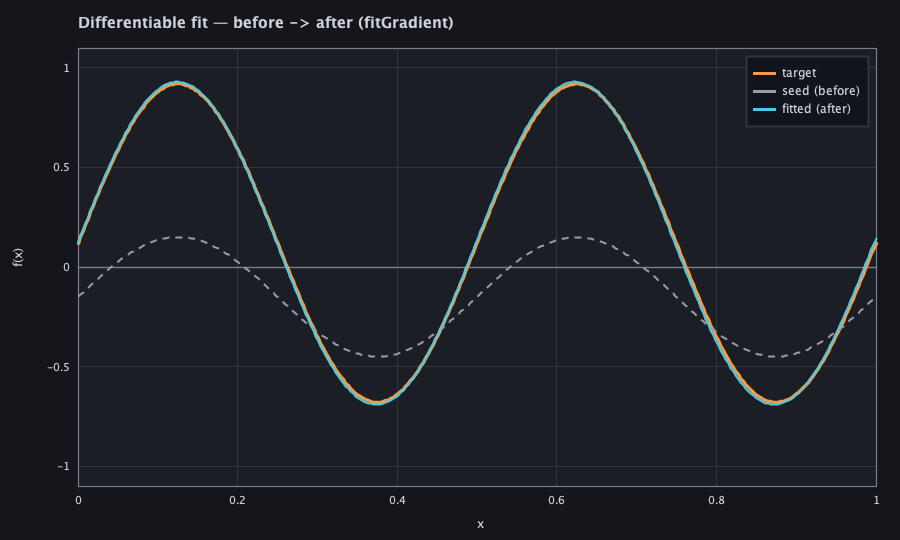
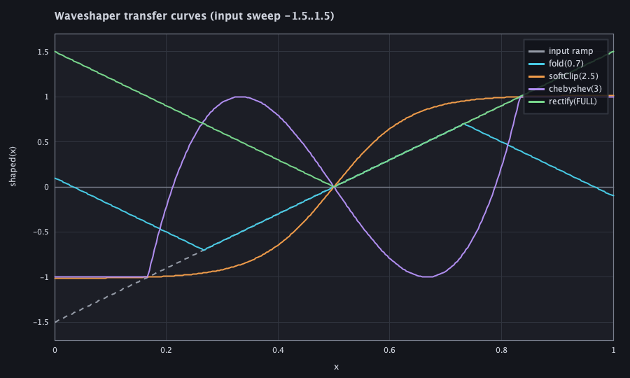
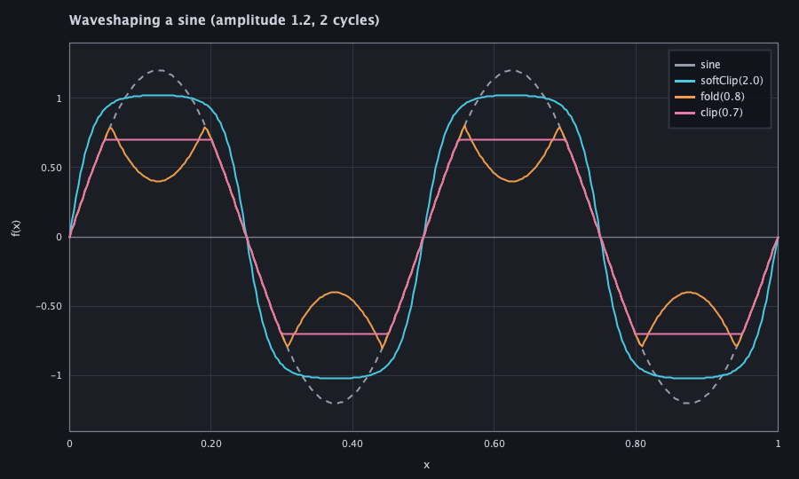
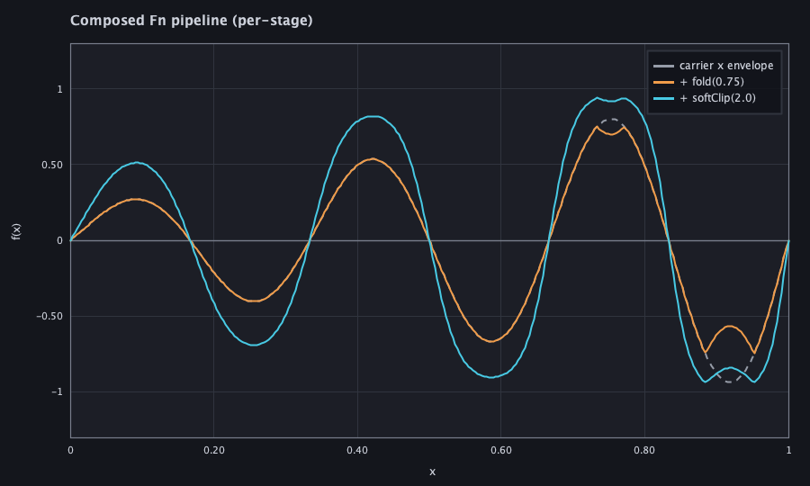

# Functions plot-capture harness

`afield.examples.functions.FunctionsPlotGallery` is the headless **plot-capture harness**
for the `afield.stdlib.Functions` library — the honest vehicle to render `Functions.Fn`
results (differentiable-fit, waveshaper, composed pipelines) to REAL raster images at
test/docs time. RectSL and StackSL already had gallery/capture harnesses
(`RectSLDataVizProof`, `RectSL/StackSLGalleryHarness`); Functions had none, so its worked
examples shipped CPU-only numbers with no rendered proof. This closes that gap.

## Rendering path (and why it is honest)

Pure-CPU AWT `Graphics2D` → `BufferedImage` → `ImageIO` PNG, run under
`java.awt.headless=true`. This is the same headless path `RectSLDataVizProof` drives through
`tools/run_field_tests.py` — no browser, no GPU, no Vulkan, no Field window.

The pixels are honest: every plotted `(x, y)` is a real `Fn.evalSafe(...)` of a genuine
Functions graph, and the fit series is the output of a real `fitGradient` run. Only the
"draw a line between real samples" step is synthetic — exactly as RectSL CPU-rasterizes its
real sampled scene (only the GPU shader is skipped). Nothing here is faked or hand-drawn.

## Running

```
# official pass/fail (starts a Field server, applies the JVM args):
python3 tools/run_field_tests.py --id functions.plot-gallery --port 9402

# regenerate committed captures into a chosen dir:
FUNCTIONS_PLOT_DIR=dev_docs/assets/functions_plot_gallery \
  python3 tools/run_field_tests.py --id functions.plot-gallery --port 9402
```

As a FIELD_TEST it renders to a temp dir and asserts real correctness — painted fraction,
finite samples, that the fit genuinely converges (`finalError < 0.25 * initialError`) and
that the fitted curve tracks its target (max pointwise deviation `< 0.15`). It writes no
committed assets during the test.

## Adding a plot (reusable)

Append one `Plot` to `PLOTS`. Each plot builds a `PlotSpec` of named `Series` (sampled from
real `Fn`s) and everything else — axes, gridlines, zero-line, legend, PNG write, painted-
fraction guard — is shared:

```kotlin
Plot("my-plot") {
    val dom = Functions.Domain.of(0.0, 1.0)
    PlotSpec(
        title = "…", xLabel = "x", yLabel = "f(x)",
        series = listOf(sample("label", someFn, dom, CYAN)),
        yRange = -1.1 to 1.1
    )
}
```

## Captures

**Differentiable fit — before → after.** A sine seed with the right *structure* but wrong
numeric leaves (grey), the target (orange), and the `fitGradient`-fitted result (cyan). The
fitted curve lands on the target — the numbers moved, the shape converged.



**Waveshaper transfer curves.** A rising ramp pushed through `fold` / `softClip` /
`chebyshev` / `rectify`, so each plotted result *is* the shape that transform imposes on its
input.



**Waveshaping a sine.** The same shapers applied to an actual sine — `softClip` compresses
the peaks, `fold` folds them back, `clip` hard-limits.



**Composed Fn pipeline.** A carrier × envelope, then `fold`, then `softClip`, plotted per
stage so the composition reads visually.



**Animated fit convergence** (`functions-fit-convergence.mp4`; `ffmpeg` is optional — a missing
encoder is skipped with a printed note and does not fail the run, per
`FunctionsPlotGallery.kt:442`).
Each frame is the fitted curve after *k* real Adam steps; Adam is deterministic in the seed
and step count, so re-running to *k* iterations reproduces the exact trajectory — no faked
interpolation.
