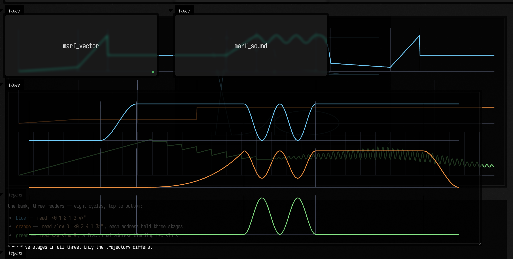
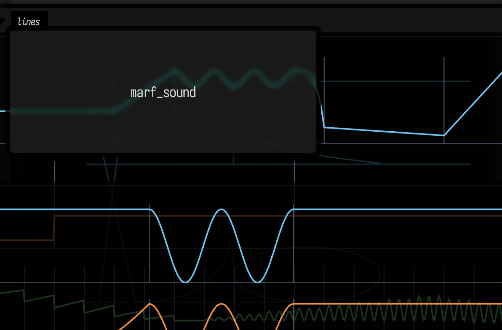
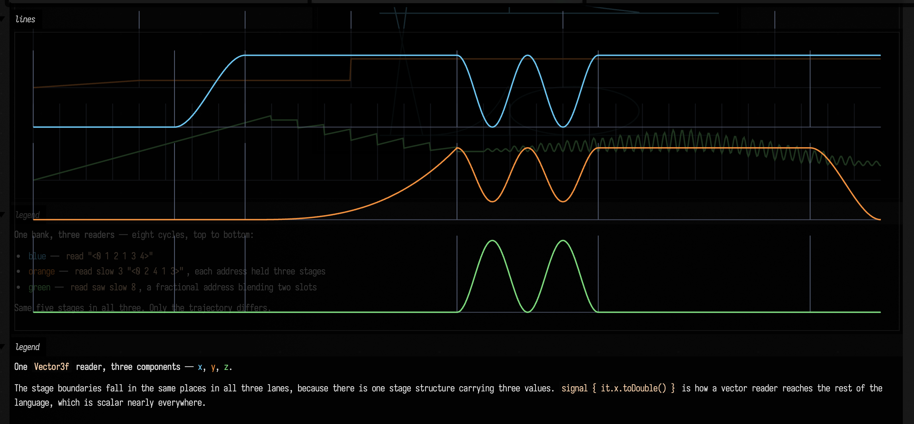

# `marf_demo`: the function-generation layer, running

A saved document that opens and runs, showing what `Marf.kt` is for. Four boxes over **one bank**:
three that draw it and one that plays it.

```bash
./field.sh dev_docs/agents/demos -d marf_demo
```

The layer itself is documented on [A pattern as a function generator](../public/docs/marf.md); this
note is about the document, and about the two things that only show up when you run it.

Every box is self-contained: each builds its own copy of the same five-stage bank, so any one of
them runs alone and editing one leaves the others alone. The bank is uneven in both stage length
and stage shape, because a bank of five equal ramps makes the separation of content from timing
invisible:

```kotlin
val b = marfBank(
    rampTo(0.1, 1.0), rampTo(0.9, 0.5), holdAt(0.4, 2.0),
    oscTo(0.7, 1.0, cycles = 3.0), curveTo(0.2, 0.25, amount = 4.0)
)
```

---

## `marf_readers`: one bank, three readers



Eight cycles, three lanes at one shared time scale, so reading down a column compares the same
instant. The verticals are stage boundaries.

- **blue** `read "<0 1 2 1 3 4>"` walks the bank a slot per stage
- **orange** `read slow 3 "<0 2 4 1 3>"` holds each address for three stages, hence the long flats
- **green** `read saw slow 8` is a *fractional* address, which you can watch turn from a ramp into
  the `osc:3` wiggle as it glides from slot 0 toward slot 3

Same five stages in all three. Only the trajectory differs, and that is the whole claim of the
layer in one picture.

---

## `marf_path`: two readers as two coordinates



The same bank read as `x` and `y`. The path stays coherent without the coordinates being
synchronised, because both are reading the same material on their own clocks, which is harder to
arrange with two independent envelopes and free here.

---

## `marf_vector`: a stage's value need not be a number



One `Vector3f` reader, drawn as its three components. The stage boundaries fall in the same places
in all three lanes, because there is one stage structure carrying three values: the `osc:2` stage
puts its double bump into every component at once, and each component arrives somewhere different
because the stage targets differ.

`signal { it.x.toDouble() }` is how a vector reader reaches the rest of the language, which is
scalar nearly everywhere.

---

## `marf_sound`: MARF as control voltage

Launch this one; it is the only box that makes a noise. `pat(...)` → `DoughEngine` → Steam Audio
HRTF, realtime, via `patSpatial`. Three readers of one bank become three audible dimensions:

```kotlin
val voice = pat("bd ~ sd ~, hh*8").with(
    param("az",   azR.signal().range(-80.0, 80.0)),
    param("lpf",  cutoff.signal().rangex(250.0, 7000.0)),
    param("dist", near.signal().range(1.0, 5.0)),
    gain(0.9)
)
patSpatial(voice, cps = 2.0)
```

- `az` comes from the fractional-address reader, so the source **glides** around the listener rather
  than stepping between positions
- `lpf` comes from the blue reader above, so its ramp, its step onto the hold and its `osc:3` wiggle
  are all audible as filter movement
- `dist` comes from the orange one, so distance moves in steps and then sits still

Three of `patSpatial`'s six spatial tags take *continuous* patterns, which is why a MARF reader
fits it without any adaptation: a reader **is** a signal.

---

## Before you edit it

**Use Dough, not `patVoice`.** The obvious first spelling is `patSynth(voice, cps = 2.0)`, and it
works, but `patVoice` is the documented *stand-in* synth: a sine for `bd`, filtered noise for `sd`
and `hh`. It exists so docs figures regenerate on a clean checkout with no assets, and it is not
worth listening to. `patSpatial` runs the same pattern through Dough, which synthesises `bd`/`sd`/`hh`
itself and needs no sample library, and it forwards every non-spatial annotation (`lpf`, `room`,
`crush`, `fmi`, …) to Dough untouched.

**A `patSynth` launch outlives `stop`.** Switching this box from `patSynth` to `patSpatial` left the
old `pat-synth-feeder` daemon thread alive: it survived `stop` on the box *and* having the box's
code replaced, and was still holding the audio engine two minutes later, so the noise was still
mixed under the new sound. `patSpatial` behaves differently: it registers a launchable that holds the
box open, so `wait-running` reports it and disposing the box disposes the render thread, the Dough
engines and the Steam Audio handles. If you have been running the `patSynth` spelling, restart Field
before trusting what you hear.

---

## Figures

The three PNGs under `assets/marf_demo/` are `field_backdoor.py screenshot-box` captures of these
boxes at 2×, taken from this document's own committed code. They are not part of the published
docs' capture pipeline; the equivalent published figures are drawn by `MarfGallery` and live under
`public/docs/assets/marf/`.

One trap if you re-capture them: **a box run with no browser attached leaves its outputs closed.**
`displayOpen(...)` sends an output-control message to a client, so running these boxes from the
backdoor before a page exists renders the figure into a collapsed panel and `screenshot-box` returns
a 48×48 image. Run them with `--with-playwright` attached, or open the document first.
