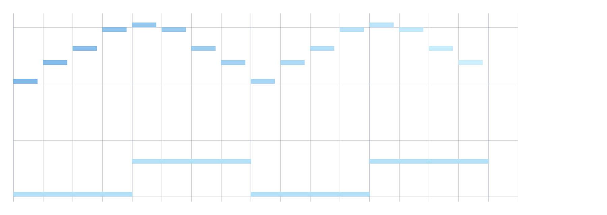

# MIDI: reading and writing Standard MIDI Files

*2026-09-04.*

Before tonight Field could not read or write a MIDI file as a product feature, and the shape of the
gap was unusually specific: **both directions already worked in this JVM, and neither was reachable
from a box.**

The predicate, run over all 4976 tracked files at `c3a920e1f`:

```bash
git grep -l 'javax\.sound\.midi' | wc -l      # 2
git ls-files | grep -ci midi                  # 0
```

The two were `AbletonSet.kt` and `AbletonSetSmokeTest.kt`. `MidiSystem.getSequence` was called
exactly once, to read a `.mid` that an **external** `basic-pitch` process had produced;
`MidiSystem.write` was called exactly once, in a test, purely to build a fixture. So the work was
never "make MIDI I/O possible" — it was "make the MIDI I/O that already runs in production into a
surface, without writing it a second time".

That distinction set the shape of the change. The five pieces a real MIDI surface needs were already
written and `private` inside `AbletonSet.kt`, so they were **lifted** rather than reimplemented, and
`AbletonSet` became a caller. Net, `AbletonSet.kt` went 1643 → 1561 lines while gaining a feature it
does not itself use.

## The files

| file | lines | what it is |
|---|---|---|
| `src/jvmMain/kotlin/afield/four/synth/Midi.kt` | 653 | the note/clip model, the SMF reader and writer, quantize/swing, General MIDI |
| `src/jvmMain/kotlin/afield/four/synth/MidiPat.kt` | 362 | `PatPattern` ↔ `MidiClip`, the transcription bridge, the piano roll as FLines |
| `src/jvmMain/kotlin/afield/four/synth/MidiDevices.kt` | 445 | live device enumeration and I/O, offline WAV rendering |
| `src/jvmMain/kotlin/afield/four/synth/MidiSmokeTest.kt` | 222 | `synth.midi-file.smoke`, and the generator for the figure below |
| `src/jvmTest/kotlin/afield/four/synth/MidiRoundTripTest.kt` | 481 | thirteen cases: round trips, the live loopback, the audio render |
| `src/jvmTest/kotlin/afield/four/synth/AbletonMidiReadCharacterizationTest.kt` | 183 | the fence that made the lift a measurement |

Zero new dependencies. `javax.sound.midi` is in the JDK.

## Verifying it

```bash
# the official pass/fail
./gradlew jvmTest --tests 'afield.four.synth.MidiRoundTripTest'
./gradlew jvmTest --tests 'afield.four.synth.AbletonMidiReadCharacterizationTest'
uv run --project . --group backdoor python tools/run_field_tests.py --id synth.midi-file.smoke
# the production consumer of the lifted code, which must stay green
uv run --project . --group backdoor python tools/run_field_tests.py --id examples.ableton-set.smoke

# regenerate the figure's HTML (the smoke test writes it only when given an output directory)
uv run --project . --group backdoor python tools/field_backdoor.py --json \
  --command 'run-jvm-main afield.four.synth.MidiSmokeTest --arg /tmp/midi-figure'
```

## The lift, and why it was fenced first

Five declarations moved out of `AbletonSet.kt` with their bodies unchanged: `ActiveMidiNote`,
`MidiTempoEvent`, `Sequence.tempoEvents()`, `tickToSeconds` and `ticksToSeconds`. They are now
`Midi.kt:41#data class MidiTempoEvent(`, `Midi.kt:321#fun Sequence.tempoEvents()`,
`Midi.kt:356#fun tickToSeconds(`, `Midi.kt:373#fun ticksToSeconds(` and
`Midi.kt:382#internal data class ActiveMidiNote(`.

The sixth, `closeActiveNote`, could not move unchanged: it emitted `AbletonPitchEstimate`, an
Ableton-specific type. It was generalised to emit `MidiTimedNote`
(`Midi.kt:473#private fun closeActiveNote(`), which is what let one note-pairing loop serve both
callers. `AbletonSet.kt`'s reader is now nine lines
(`AbletonSet.kt:946#private fun readPitchNotes(`) calling
`Midi.kt:405#fun Sequence.readTimedNotes()`.

`AbletonSet.kt` is production code on a path the human uses, so the refactor was made a measurement
rather than a hope. `AbletonMidiReadCharacterizationTest.kt:53#expected exactly three paired notes`
was written and run green **before** the lift, then run again after. Its fixture is hand-assembled
SMF *bytes* rather than a file written by Field, because what is being characterised is how Field
reads a file it did not write. Those bytes exercise the four things a naive reader gets wrong:

- **running status**, where two note-offs omit their status byte and inherit the previous `0x90`;
- **a zero-velocity note-on used as a note-off**, which is how most sequencers encode one;
- **two overlapping same-pitch notes on one channel**, which must pair FIFO rather than both
  collapsing onto the first note-off;
- **a mid-file tempo change** plus an **unterminated note**, which must be closed at `tickLength`
  rather than dropped.

Every expected value in that test is arithmetic done by hand in its own comments, and all of it
matched the existing implementation first try — 480 ticks at 120 BPM then 480 at 60 BPM puts the
second middle C's release at 2.0 s, not 1.5 s. The test also asserts its own premise (PPQ, track
count, `tickLength`) before asserting behaviour, so a JDK parser change fails loudly instead of
quietly turning the note assertions into a tautology over an empty list.

## Time: three representations, deliberately

| where | unit | type |
|---|---|---|
| the pattern algebra | cycles | `PatQ`, exact rationals |
| `MidiClip` / `MidiNote` | beats (quarter notes) | `Double` |
| a Standard MIDI File | ticks, at some PPQ | `Long` |

`MidiClip` sits in the middle on purpose. Ticks and PPQ are a file-format detail and appear only at
the edges; cycles are the algebra's business. `beatsPerCycle` bridges the top two and defaults to 4,
so one cycle is one bar of 4/4 — which is what mini-notation reads like.

It is an `Int` rather than a `Double`, and that is load-bearing for import but not for export:
`MidiClip.toPat` builds each note's extent as the exact rational `tick / (ppq * beatsPerCycle)`
(`MidiPat.kt:151#val denominator = ppq.toLong() * beatsPerCycle`) using `PatQ.of`. `PatQ.fromDouble`
**truncates**, so routing a long clip through it would drift.

## Pattern export: two things the Pat vocabulary does not have

`PatAlgebra.kt` defines `gain` (0..1 amplitude) and reserves `note` for MIDI pitch. It defines no
`velocity` key and no `channel` key — I grepped for both across the synth package and found none.
Rather than add two named parameters only this file would ever set,
`MidiPat.kt:85#private fun <A> PatEvent<A>.toMidiNote(` reads velocity from an explicit `velocity`
annotation if present, else from `gain` scaled to 1..127, else a caller-supplied default. Import
(`MidiPat.kt:149#fun MidiClip.toPat(`) writes both, so a round trip through the algebra keeps its
dynamics either way.

The other thing worth knowing is not a design choice but a correctness trap.
`MidiPat.kt:90#if (!hasOnset) return null` is why export does not double-strike notes: a
`PatPattern` clips events to the arc it was queried with, so an event whose `whole` began before the
window is a *continuation*, and striking it again would fire the note twice. Lengths therefore come
from `extent`, never from `arc`. `FaustPattern.kt` follows the same rule for the same reason.

One convention will surprise anyone coming from notation software: `patNoteNumber` uses **Tidal's**
octave numbering, where `c5` is MIDI 60, not scientific pitch notation's `C4`. That is asserted
rather than assumed in both test suites, because getting it wrong shifts everything an octave and
still round-trips perfectly cleanly.

### The transcription bridge

`PatTranscription` turns audio into notes and, before this, had nowhere to send them. Its only
export was `miniNotation`, a grid-quantized string that cannot express an off-grid onset and which
drops `centsOffset` outright. `MidiPat.kt:197#fun PatTranscription.toMidiClip(` keeps the detected
onsets exactly as detected and never touches the grid.

It carries the detector's `confidence` in the velocity field, scaled to 1..127. That is **not** a
dynamic marking — nothing in the pitch tracker measures loudness — so a quiet, confidently-detected
note comes out loud. This is documented rather than implied because the field is called `velocity`
and a reader would otherwise reasonably assume it meant one.

## The piano roll is geometry, so it is FLines



`MidiPat.kt:260#fun MidiClip.toFLines(` emits one filled rectangle per note plus a beat/bar grid and
a horizontal rule at every C. It is not an SVG string: `PatPianoRollGallery` and
`Iterable<ScheduledNote>.pianoRollSvg` both build SVG text by hand, which is right for a headless
gallery and wrong for something meant to be drawn in a box. Each note line carries
`properties["midi.pitch"]`, `["midi.velocity"]`, `["midi.startBeats"]` and `["midi.track"]`, on the
identity-tagging pattern `AbletonSetDebugDrawing.kt` established, so a caller can hit-test back to
the note.

The figure above is that function's output through Field's own `linesToHTML`, rasterized. It was
generated by `MidiSmokeTest.kt:170#private fun writeRollFigure(` and then **looked at**, against the
numbers the generator prints — 24 notes, pitch 36..72, beats 0..16, velocity 48..123:

- the melody contour is `60 64 67 71 72 71 67 64` twice, and the roll rises to a peak and falls
  twice, symmetrically;
- the bass is `c3 c3 g3 g3` per cycle at two beats each, so adjacent equal pitches abut and read as
  four long bars alternating between two heights, which is what appears;
- **higher pitch is higher on screen.** Field's y grows *downward*, so a higher pitch must get a
  *smaller* y. Both test suites assert this, because an upside-down roll is not obviously wrong to
  look at;
- the four C rules are evenly spaced twelve semitones apart, and the empty middle octave is honest
  to the data — nothing is written between pitch 44 and 59.

Two things about the image that are artifacts of how it was made, not of the code: the background is
white because the standalone HTML has none and Field's output panel supplies its own dark one, and
higher velocities render *paler* rather than darker, which reads as "brighter" against that dark
panel and as "washed out" here.

## Live devices, and one hazard worth stating plainly

`MidiDevices.list()` (`MidiDevices.kt:66#object MidiDevices {`) reports what the JVM sees. On this
machine, tonight, that was four devices:

| name | vendor | implementation | direction |
|---|---|---|---|
| Gervill | OpenJDK | `SoftSynthesizer` | Field can send |
| Real Time Sequencer | Oracle Corporation | `RealTimeSequencer` | send and listen |
| Bus 1 | Apple Inc. | `MidiOutDevice` | Field can send |
| Bus 1 | Apple Inc. | `MidiInDevice` | Field can listen |

The JDK always contributes the first two, so **"the list is non-empty" is not evidence of
hardware**; `MidiDevices.kt:106#fun hardware()` is the filter that answers that question. Note also
that macOS surfaces its IAC bus as two entries with the *same name*, one per direction — a name
alone does not identify a device.

`MidiDevices.kt:265#fun knob(` is the control-source shape: a controller value normalised to 0..1,
returning a caller-supplied default until the controller has moved, because MIDI controllers are
stateless and report nothing until touched.

> **Opening a MIDI input stops the JVM exiting.** A CoreMIDI input device spawns a *non-daemon*
> thread named `Java Sound MidiInDevice Thread`, and it survives both `Transmitter.close()` and
> `MidiDevice.close()`. Measured, not assumed: after closing both, that thread was still listed as
> non-daemon, `main` returned, and the process had to be killed after a 20-second wait. An
> output-only device closes cleanly and the JVM exits normally.

That fact decided where the live loopback test lives.
`MidiDevices.kt:222#class MidiInput internal constructor(` carries the warning, the `jvm-main` smoke
opens an **output only** — because a smoke test is required to exit naturally — and the loopback
that must open an input is a `jvmTest`, where Gradle tears the worker down regardless.

## Audio: verified, with the flag; honest, without it

`MidiDevices.kt:353#fun renderToWav(` renders a clip through Gervill offline and faster than real
time. It needs `com.sun.media.sound.AudioSynthesizer.openStream`, which is the only way to capture
Gervill's output headlessly — every public alternative writes to an audio line. `java.desktop` does
not export that package, so the call fails at **invoke** time (not at method lookup) with
`IllegalAccessException` unless the JVM was started with
`--add-exports=java.desktop/com.sun.media.sound=ALL-UNNAMED`.

`MidiDevices.kt:313#fun midiRenderUnavailableReason()` probes this by actually invoking it and
returns a reason string, so a caller skips with a stated cause rather than failing. The flag is
added to the Gradle `Test` tasks and **deliberately not** to `requiredRunJvmArgs()`: the shipping
application has no reason to render MIDI to a file, and the degraded path is correct. So
`MidiRoundTripTest` asserts the audio, and the smoke test — which runs without the flag — prints
`offline WAV render: NOT VERIFIED in this JVM` and names the missing flag.

What the assertion is on matters. **A WAV of pure silence is exactly as large as a loud one**, so
file size proves nothing; `MidiDevices.kt:287#data class MidiRenderResult(` carries measured peak and
RMS amplitude. Measured on this machine, a C-major triad at velocity 110 through Gervill's
`Emergency GM sound set` renders 1.50 s at **peak 0.600, RMS 0.0787**. The floors in
`MidiRoundTripTest.kt:418#rendered WAV is silent or near-silent`
are 0.05 and 0.005 — about a twelfth and a fifteenth of those, loose enough to survive a different
soundbank, since the "Emergency" set is itself a fallback, but tight enough that silence fails.

## What the tests floor, and why floors rather than differences

Every count assertion in `MidiRoundTripTest` is floored at a number rather than compared for
inequality. The reason is that a writer which silently emitted an empty track and an importer which
dropped every note would both satisfy "the round trip did not differ" — both sides empty, no
difference, green.

- `MidiRoundTripTest.kt:126#expected at least 3 tempo events`
  floors the tempo-event count at 3, and separately checks that wall-clock length reflects the map
  rather than a single tempo: 4 beats at 60 plus 4 at 120 plus 8 at 90 reaches beat 16 at 11.333 s.
- `MidiRoundTripTest.kt:143#val random = Random(20260904)` compares
  200 seeded random notes as multisets keyed on pitch, velocity, channel, start tick and duration
  tick — multisets because two notes can share a start tick and the reader owes no relative order.
- `MidiRoundTripTest.kt:374#assertNotNull(got, "sent a note to`
  really ran: it opened both directions of `Bus 1` and asserted a `NOTE_ON` survived the wire with
  channel, pitch and velocity intact. Where no bidirectional hardware port exists it prints a skip
  naming the devices it *did* see. It does not fake a device and it does not fail.

## A validation decision the figure forced

`MidiNote` validates in its `init` (`Midi.kt:103#require(velocity in 0..127)`) rather than clamping
at write time. `toSequence` does still coerce, but silently — and silence is the problem. The first
version of the figure generator climbed velocity by 8 per note across 16 notes from a base of 50,
reached **170**, and would have written 127 to the file with no complaint while the arithmetic that
produced 170 stayed wrong. The generator printed its own velocity range, which is how it was caught.
Constructing an illegal note is now an error at the point of authorship.

## The loadable demo

`dev_docs/agents/demos/midi_clip/` — four boxes: write a file, read it back, enumerate devices,
audition. Open it with:

```bash
./field.sh dev_docs/agents/demos/midi_clip
```

Box 4 reports which audition route it took rather than assuming one, so in Field's own JVM — which
does not carry the `--add-exports` — it says offline rendering is unavailable and points at
`clip.playTo("Gervill")` instead of claiming to have rendered audio.

## Deliberately not covered

- **MIDI clock and transport.** `MidiOutput.play`
  (`MidiDevices.kt:141#class MidiOutput internal constructor(`) is a sleep-and-send loop for
  auditioning, and says so: it is not sample-accurate and is not a musical clock. Anything needing
  real timing should drive a `javax.sound.midi.Sequencer`.
- **SMPTE division.** `tickToSeconds` returns 0.0 when `resolution <= 0`, which is the guard a real
  SMPTE-division file reaches, since `Sequence.resolution` is then frames-per-second and not PPQ.
  That guard is inherited unchanged from `AbletonSet` and is not a claim that SMPTE files work.
- **Control-change curves from the keyframe layer.** `MidiControlChange` exists and round-trips, but
  nothing connects it to keyframes yet.
- **Sysex, pitch bend, aftertouch.** Not read, not written.
