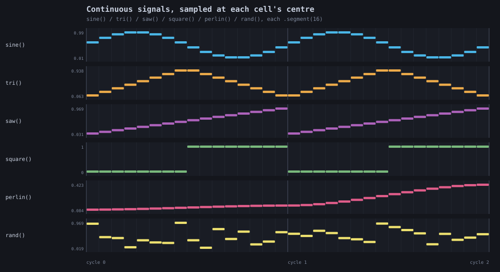
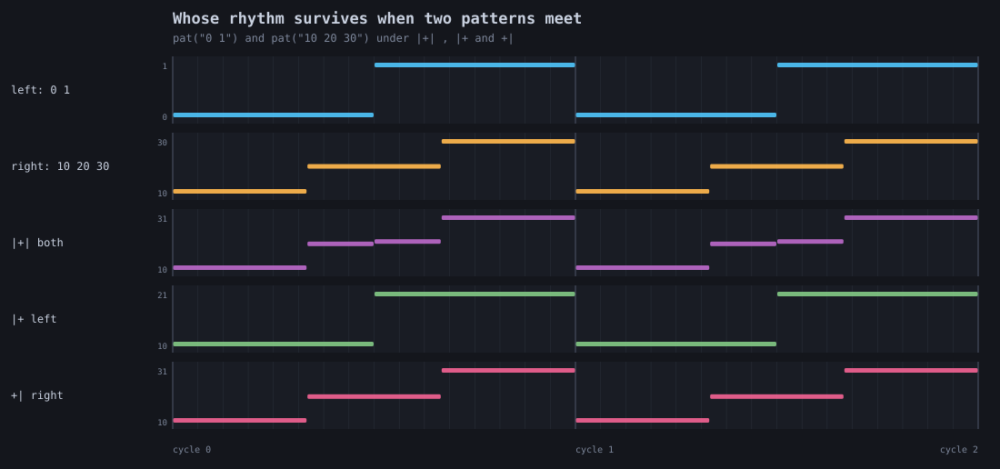
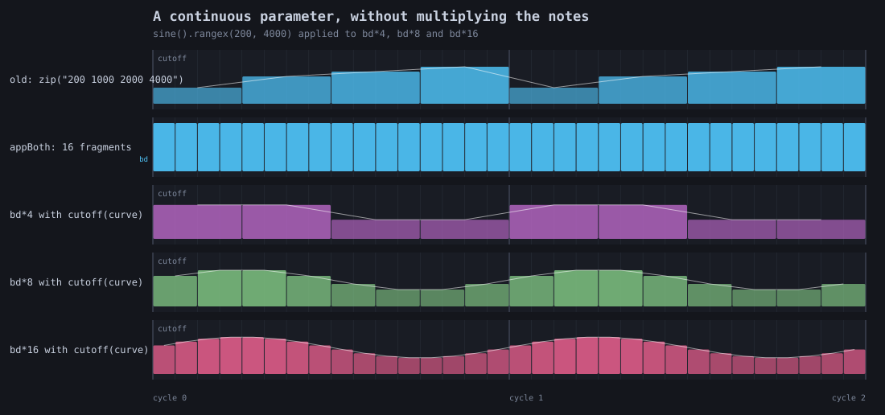
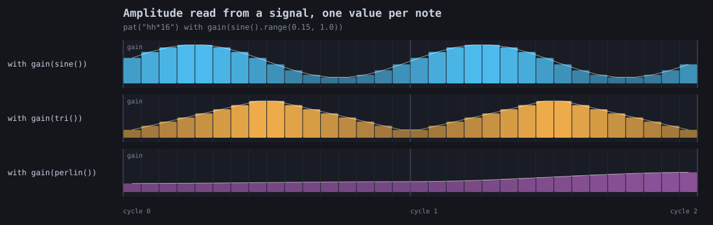
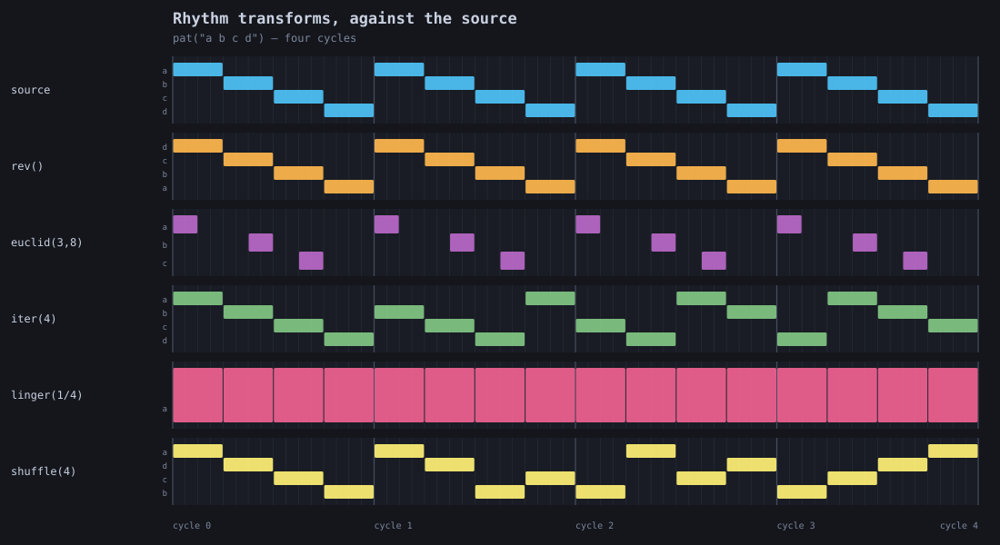
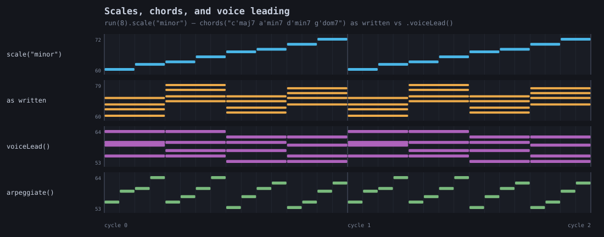
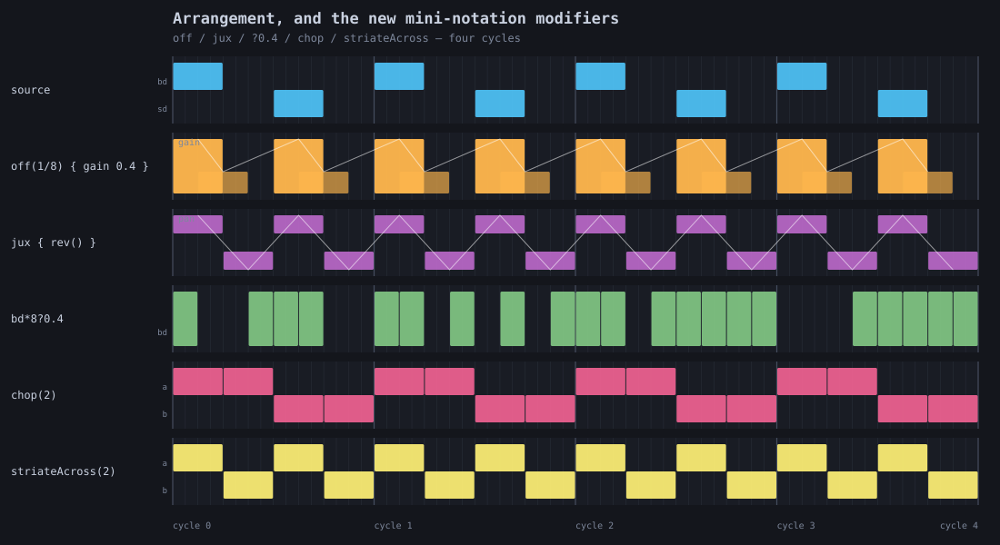
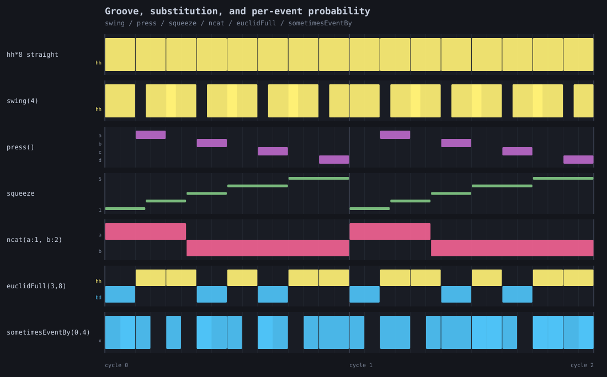

# Pattern-language capture harnesses — piano rolls and `.wav`s

Two headless harnesses prove the `pat(...)` surface documented in
[PATTERN_LANGUAGE.md](PATTERN_LANGUAGE.md). They follow the contract set by
[DOUGH_DSP_PLOT_GALLERY.md](DOUGH_DSP_PLOT_GALLERY.md): pure CPU, no browser, no GPU, no Vulkan, no
Field window, deterministic output, and a `FIELD_TEST` that renders to a temp dir and asserts real
correctness while writing no committed assets.

| harness | id | output |
| --- | --- | --- |
| `afield.four.synth.PatPianoRollGallery` | `synth.pat.gallery` | 8 piano rolls, **SVG** |
| `afield.four.synth.PatSoundDocs` | `synth.pat.sound` | 7 stereo **`.wav`**s |

```
# official pass/fail (starts a Field server, applies the JVM args):
python3 tools/run_field_tests.py --id synth.pat.gallery --id synth.pat.sound --port 9631

# regenerate the committed captures:
python3 tools/field_backdoor.py --port 9631 run-jvm-main \
  afield.four.synth.PatPianoRollGallery --arg "$PWD/dev_docs/assets/pat_gallery"
python3 tools/field_backdoor.py --port 9631 run-jvm-main \
  afield.four.synth.PatSoundDocs --arg "$PWD/dev_docs/assets/pat_sound"
```
(`PAT_ROLL_DIR` / `PAT_SOUND_DIR` do the same thing, but the backdoor's JVM does not inherit your
shell environment, so pass `--arg`.)

---

## Why the piano rolls are SVG

House rule: geometry and plots are FLines/SVG; raster is for genuine per-pixel data. A piano roll is
line art — rectangles, gridlines, a parameter polyline — so it is emitted as vector geometry, built
as plain strings with no AWT at all. The side benefit matters as much: a changed operator shows up in
`git diff` as a changed **rectangle**, not as a changed PNG blob.

Every rectangle is a real event. Each lane queries an actual pattern over actual whole cycles through
`PatPattern.events(...)`; the only synthetic step is the choice of colours and the map from cycle time
to pixels. The FIELD_TEST enforces that directly:

```
rects in the SVG == events + one lane backdrop per lane + one page background
```

so the figure cannot contain a rectangle no event produced, and cannot silently omit one.

### Lane layout, and a bug worth remembering

A lane whose atoms all parse as numbers is drawn on a **value axis**; anything else gets one row per
distinct atom. Getting that wrong is visible rather than subtle: laid out by row, `rand()` reads as a
smooth descending line, because rows are assigned in order of first appearance and a fresh random
value appears at every step. The first draft of this gallery had exactly that bug and it was caught by
looking at the figure.

`pan` is drawn as vertical **position** (top is left, bottom is right); every other parameter is drawn
as rectangle height plus a polyline. A hard-left event under the height convention is an invisible
sliver.

### Adding a roll

Append one `Roll` to `ROLLS`. Each builds a `PatRollSpec` of named `Lane`s and an optional `verify`
that receives the resolved `LaneEvents`; axes, gridlines, cycle labels, the value/row layout choice,
the SVG write and the rect-count guard are all shared.

Write the `verify` against the *musical* claim, not against "something rendered". The existing ones
check that `rev` really mirrors, that `euclid(3,8)`'s onset gaps really are 3-2-3, that `iter(4)`
really rotates cycle by cycle, that `shuffle(4)` is a permutation in every cycle, that `voiceLead`
really reduces movement while preserving pitch-class sets, and that each note's `cutoff` equals the
curve evaluated analytically at that note's own midpoint.

---

## The rolls

**Continuous signals, sampled at each cell's centre.** Six signals through `segment(16)` over two
cycles. Read it as a check on the sampling convention: `sine()` peaks a quarter of the way in,
`tri()` at the half, `saw()` rises monotonically, `square()` switches exactly on the half-cycle
boundary, `perlin()` drifts smoothly and `rand()` jumps.



**Whose rhythm survives when two patterns meet.** `pat("0 1")` and `pat("10 20 30")` under `|+|`,
`|+` and `+|`. The intersection grid (4 events at 0, 1/3, 1/2, 2/3), then exactly the left's 2, then
exactly the right's 3. Before this work only structure-from-left existed, and only for string atoms
via `zip`.



**A continuous parameter, without multiplying the notes.** The counterfactual figure. Lane 1 is the
whole of what the old surface could do: a cutoff staircase typed out by hand, one literal per note.
Lane 2 is `appBoth`, which shatters four kicks into sixteen. Lanes 3–5 are `with(cutoff(curve))` over
4, 8 and 16 notes — the same `sine().rangex(200, 4000)`, sampled at whatever density the rhythm
happens to be, note count untouched. A sine on four quarter-cells is symmetric, so lane 3 aliases
down to two levels and the curve only resolves as the rhythm gets finer; the test asserts that too,
so a coarse lane cannot read as a bug.



**Amplitude read from a signal, one value per note.** Sixteen hats a cycle with the gain following
`sine()`, `tri()` and `perlin()`. Rectangle height is the gain each note actually latched.



**Rhythm transforms, against the source.** `pat("a b c d")` and five transforms over four cycles, so
the cycle-to-cycle ones are visible: `rev` mirrors, `euclid(3,8)` spaces three onsets over eight
slots, `iter(4)` advances a quarter each cycle and comes back round, `linger(1/4)` holds the head,
`shuffle(4)` permutes differently every cycle.



**Scales, chords, and voice leading.** A pitched roll. Eight degrees of C minor, then the same
four-chord progression as written and voice-led, then the voice-led version arpeggiated. The
as-written lane spans 60–79 and leaps between chords; the voice-led lane sits inside 53–64 with
near-horizontal lines where common tones are held. 83 semitones of movement becomes 9.



**Arrangement, and the new mini-notation modifiers.** `off(1/8)` with a quieter ghost, `jux { rev() }`
across the stereo field, `bd*8?0.4` degrading deterministically and differently each cycle, `chop(2)`
slicing in place next to `striateAcross(2)` interleaving.



**Groove, substitution, and per-event probability.** The second operator batch. `swing(4)` pushes
every off-beat exactly a third of an eighth late — still exactly quantised, just not straight.
`press()` moves every event onto the second half of its own slot. `squeeze` replaces each event with
a whole pattern compressed into that event's arc — mini-notation nesting, from Kotlin values. `ncat`
splits the cycle by weight. `euclidFull` fills the off-beats too. `sometimesEventBy` transforms a
random subset of the *notes*, where the pre-existing `sometimesBy` transforms whole cycles.



---

## The sound harness

Each scene schedules a pattern and runs its events through `patRenderStereo` + `patVoice`: one
oscillator (`SINE SAW SQUARE TRIANGLE NOISE`), one one-pole lowpass, one exponential-decay envelope,
all driven by the event's own `gain` / `pan` / `cutoff` / `sustain` / `note` / `speed` parameters.
Pitch comes from the atom when it parses as a number (a MIDI note) and otherwise from a small drum
map, so `pat("bd sd hh cp")` makes a recognisable kit.

The voice knows nothing about any operator. It asks the pattern for its events, reads their
parameters, and adds one voice per event — which is what makes the `.wav` a proof rather than an
illustration. Everything is deterministic: the degrade scene asserts that a second render is
bit-identical.

Output is **stereo**, via `WavFloatArrayWriter.writeStereo16` (added for this). A `jux` demo folded to
mono destroys the only thing it demonstrates. Both channels share one normalisation factor, so
normalising cannot move the stereo image.

Two scenes are **before/after in one file** — the first two cycles are what the pre-tonight surface
could produce, the last two are the same pattern with the new operator — using `whenCycle`, which is
the existing operator for "from cycle 2 on, play this instead". (`cat(a, b).slow(2)` looks like it
would do the same and does not: `slow` is anchored per cycle, so it doubles the density.)

### What is actually verified

Every scene: a valid RIFF/WAVE header on disk with two declared channels and the right declared
sample rate, a data chunk of exactly `frames × 4` bytes, the expected duration, non-silence, a
plausible peak and RMS with `rms < peak`, all-finite samples, and the expected number of onsets. Then
per scene:

| scene | claim, and the number the test prints |
| --- | --- |
| `gain-lfo-before-after` | per-note level CV **0.044** across the flat half, **0.601** across the modulated half, with exactly **2** humps over two cycles |
| `cutoff-sweep` | brightest note **11.2×** the dullest, brightness peaking near the quarter and troughing near the three-quarter in every cycle |
| `voice-leading` | each of **64** notes' pitch estimated from the audio by autocorrelation and compared with the scheduled MIDI number — worst error **0.094 semitones**. Register span **19** semitones as written, **11** voice-led |
| `jux-stereo` | L/R correlation **−0.006**; the reversal measured in the onset grid (left fires at 0, 1/2, 3/4; right at 0, 1/4, 3/4) |
| `off-echo` | echo level **0.20** of the source, **0.108** cycles late against a scheduled 1/8 |
| `degrade-shuffle` | 30–58 hats survive of 64 slots, every cycle a different count, and a second render is bit-identical |
| `swing-before-after` | straight gap **0.1251** cycles (an eighth); swung gaps alternate **0.1651** and **0.0849** (1/6 and 1/12), ratio **1.94**, and the straight half is at least three times more even than the swung half |

The onset counter is the part that took the most iteration, and it is worth not re-deriving:

- "any sample above a threshold" counts a single noise hat **several hundred** times;
- non-overlapping abs-peak buckets found **67** onsets where 64 were scheduled — a noise burst's peak
  jitters bucket to bucket and fakes rising edges;
- non-overlapping RMS buckets found **9** of 64 on a 110 Hz sawtooth — a bucket shorter than the
  waveform's period ripples with the waveform, not with the envelope;
- **overlapping** 12 ms windows hopped every 2 ms, with the rise test comparing against the window a
  full window-length earlier, a level test relative to the loudest window in the file, and re-arming
  only below half the last onset's peak: counts all six scenes exactly right.

Two consequences to keep in mind when writing a new scene. Onset *timestamps* carry up to one
analysis window of level-dependent bias, so timing assertions want a tolerance of about one window
(0.03 cycles at cps 2). And a noise voice's per-note **peak** is stochastic even at a fixed `gain` —
measured spread 0.22 across sixteen identical hats — so any claim about *level* must read `Onset.rms`,
and any claim about modulation depth wants the coefficient of variation rather than the min-to-max
range.

### Adding a sound

Append one `Scene` to `SCENES` with its own `cycles` and `cps` (percussive scenes want 2; a chord
scene wants 1 so each note has enough periods of its own waveform for the pitch check to be a real
measurement). Keep the envelope short enough that consecutive notes actually separate — the first
draft's 220 ms decay over 31 ms notes made a continuous drone that no onset detector could read, and
that is a real property of the material, not a harness limitation.

### The committed audio

`dev_docs/assets/pat_sound/*.wav` — seven stereo 16-bit 44.1 kHz files, 2 s each (4 s for the chord
scene). Open them; that is the point.

| file | what you hear |
| --- | --- |
| `pat-gain-lfo-before-after.wav` | sixteen hats a cycle: two cycles flat, then two breathing with `gain(sine())` |
| `pat-cutoff-sweep.wav` | a 110 Hz saw opening and closing once a cycle under `cutoff(sine().rangex(300, 6000))` |
| `pat-voice-leading.wav` | the same progression arpeggiated twice: leaping from its roots, then voice-led |
| `pat-jux-stereo.wav` | forwards in one ear, backwards in the other |
| `pat-off-echo.wav` | two onsets a cycle, each shadowed an exact eighth later at a fifth the level |
| `pat-degrade-shuffle.wav` | `hh*16?0.35` over shuffled quarters — deterministic, but no two cycles alike |
| `pat-swing-before-after.wav` | eight hats a cycle: two cycles dead straight, then two swung |
