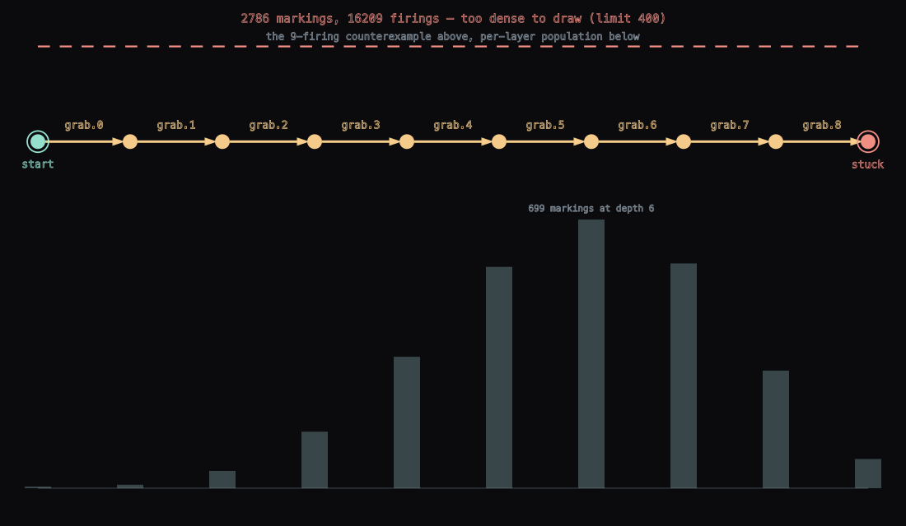
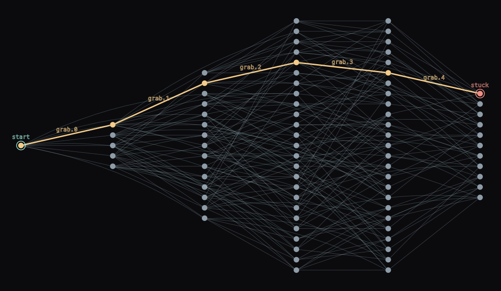
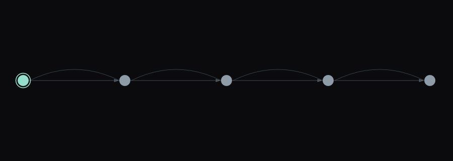

# The node bound on the state-graph drawing

`PetriStateGraph.toFLines` used to draw one dot per reachable marking however many there were. At
eighty-two markings that is dense and readable. At a few thousand it is a grey rectangle with an
orange line somewhere in it, and a grey rectangle is not information, it is ink: `nodeRadius` has
already bottomed out at its two-pixel floor and the breadth-first layers are overlapping each other.

`PETRI_STATE_DRAW_LIMIT` (400) is where the drawing stops trying. `PetriStateGraph.tooDenseToDraw()`
answers the question in advance, and every entry point — `toFLines`, `toSvg`,
`Box.showPetriStateSpace`, `summaryHtml` — takes a `maxNodes` you can raise, with `Int.MAX_VALUE`
giving back the old behaviour exactly.

## What it draws instead

Two panels and a caption, not a thinner hairball.



- **Top band: the counterexample, laid out on its own terms.** One column per firing across the full
  width, so a nine-firing trace gets a ninth of the picture per step rather than whatever the
  barycentre heuristic left over. It is a different drawing, not a zoom.
- **Bottom band: one bar per breadth-first layer**, height proportional to that layer's population
  against the widest, from a baseline so it reads as a histogram. This is the one thing the fan of
  dots was really saying — how wide the net's future gets, and where — and it survives being
  summarised. The widest layer carries its number, because a shape without a scale only half answers
  the question. Bars have a two-pixel floor so a layer of one marking is a visible nub: "no bar" and
  "one marking" must not look alike.
- **A caption, and a dashed rule under it.** The caption is drawn whatever `labels` says, because it
  is about the *figure* rather than about the transition names. The dashed rule is there because
  `label` returns nothing rather than throwing when no font resolves — which is a real case, and it
  is the case a headless docs or smoke run is in, so words alone would have made the refusal vanish
  in exactly the environment that generates figures. A broken line across the top of a figure reads
  as "cut" with no font at all.

## The two regimes that are unchanged

Eighty-two markings — five philosophers, the case the limit is tuned to allow — still draws in full:



And a small graph is untouched:



## Where the figures come from, and how to regenerate them

`PetriGallery.checkStateFigures` builds all three, asserts the bound behaved in both directions and
writes the SVGs. It runs inside the `petri.gallery` smoke, so a change that breaks the drawing rather
than the numbers still fails something:

```
python3 tools/run_field_tests.py --id petri.gallery --port <your port>
```

To get the files, pass an output directory through the backdoor:

```
python3 tools/field_backdoor.py --port <your port> \
    run-jvm-main afield.examples.petri.PetriGallery --arg /tmp/petri-figures
```

**One caveat, and it is worth knowing before you trust the output of that command.** The JVM that
`run-jvm-main` forks resolves no font, so `label` returns nothing and every SVG it writes — these
three and the twelve net figures beside them — comes out with *no text on it at all*. The committed
PNGs above were rendered from the same `PetriGallery.runTests` call driven from the Gradle test JVM,
which does resolve one. The box and docs-runner paths resolve fonts too (see
`public/docs/assets/petri_nets/state_space.png`, which has its labels), so this is a property of the
`agent-run-jvm-main` child JVM rather than of the drawing.

`PetriStateDrawingTest` is the half a picture cannot check: that the summary is structurally a
different picture, that neither panel has quietly stopped being drawn, that it costs under a
twentieth of what it replaces, and that it is not blank. It counts FLines by *thickness* — 2.2 for
the dashed rule, 1.0 for the baseline, 3.0 for a path arrow, 1.8 for an end ring, 0.7 for a glyph —
so each assertion names a piece of the figure rather than a total, and a total is what a change to
one piece would hide.
