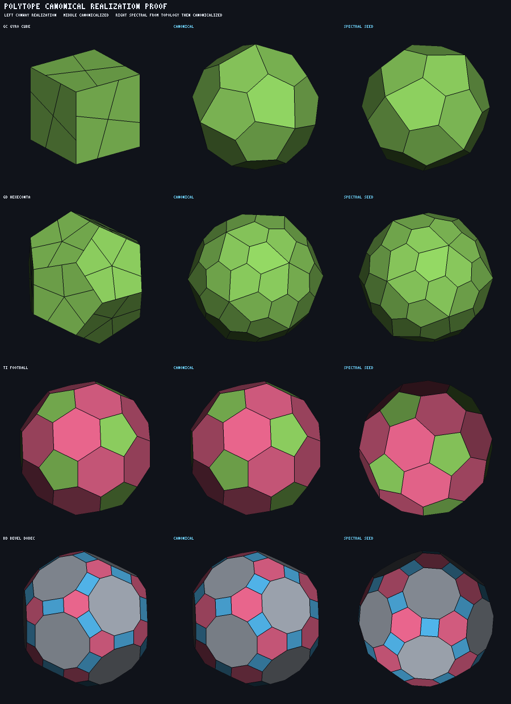
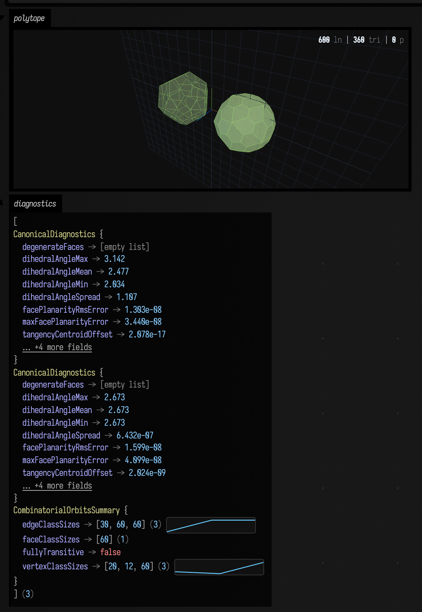

# Polytope algebra: current architecture and next work

The first complete vertical slice of `afield.stdlib.polytope` is now in place: immutable incidence
topology, realized solids, Conway transforms, realization repair, Field-native polygon output, and
provenance-preserving triangle output. The loadable worked example is
`dev_docs/agents/transcripts/polytope_conway_demo.yaml`.

## Architectural boundary

The dependency direction is deliberate:

```text
Conway expression / element selectors / deployed parameters
                         ↓
immutable ranked incidence topology + ordered face cycles
                         ↓
optional Realization3 using Field Vec3
                         ↓
Field adapters
    ├── one polygonal FLine per face
    └── flat-normal TriMesh + polygon provenance
```

Topology owns identity and incidence. It does not own coordinates, FLine, triangles, normals, or a
renderer. `Realization3` is an immutable ownership boundary around Field's mutable `Vec3`; public
reads return copies. Triangles are derived late and duplicate corners between polygon faces so a
flat normal can differ across a crease without corrupting the abstract vertex identity.

The new value-printer registrations preserve this boundary too. The topology classes contain no
HTML. `PolytopeVisualizers.kt` reduces the larger values to public data-class summaries and hands
those summaries to Field's ordinary value visualizer. Consequently any of these is a useful final
expression in a live box:

```kotlin
polyhedron
polyhedron.topology
result
result.deployments.first()
polyhedron.triangulate()
polyhedron.solveRealization()
```

The last value is already a data class; the other larger wrappers have registered printers. The
summary functions are also ordinary public Kotlin APIs, so `println(result.summary())` and
`viz("inspection", result)` report the same underlying facts.

## What is implemented

### Incidence topology

- Arbitrary rank and globally scoped `ElementId` values.
- Immutable elements-by-rank, adjacent-rank up/down incidence, and defensive array copies.
- Explicit ordered vertex cycles for rank-2 faces.
- Structured validation, with closed-manifold checking as an optional stricter pass.
- Euler characteristic over proper ranks, excluding the whole-polytope element.
- Abstract dualization and a small combinatorial-isomorphism checker.
- Tetrahedron, cube, octahedron, icosahedron, and dodecahedron seeds.

### Conway algebra and provenance

- Primitive `dual`, `ambo`, `kis`, `truncate`, and genuine `gyro` topology transforms.
- Named composites `join`, `needle`, `zip`, `ortho`, `expand`, `snub`, `meta`, and `bevel`.
- Prefix parser over `T`, `C`, `O`, `I`, and `D`, including indexed `kN` and `tN` selection.
- Full lineage from every output element back to source elements.
- Explicit deployment records containing selected source elements and resolved scalar parameters.
- Element selectors by rank, id, degree, attribute, and provenance role, with boolean composition.
- Scalar parameters from constants, attributes, or selector-controlled fields.
- Selective/non-uniform `kis` and `truncate`; edge-varying `gyro`.
- Attribute propagation kept behind a policy rather than embedded in each operator.

### Realization

The three verbs are separate calls with separate promises.

```text
realize(policy)      construct coordinates for a topology that has none
relax(plan)          improve an existing embedding under a declared set of constraints
canonicalize(...)    seek the symmetry-respecting representative, with stated guarantees
```

**Per-transform policies.** The topology transform and realization policy are separate calls.
Centroid dual, edge-midpoint ambo, face-normal kis, along-edge truncation, and gyro subdivision
policies cover the implemented primitive transforms. These are local heuristics, and the pictures
say so: `gyro` leaves every group of new faces coplanar with the source face it subdivided.

**`realize(...)`.** `RealizationConstruction` builds coordinates from combinatorics alone.
`SpectralRealization` uses the three eigenvectors of the vertex graph Laplacian with the smallest
non-zero eigenvalues, optionally projected to the unit sphere. For a vertex-transitive graph those
three modes span one degenerate eigenspace and the embedding *is* the symmetric solid; otherwise it
is a good starting point, and the KDoc says that rather than claiming a finished object.

**`relax(...)`.** A run is a `RelaxationPlan`: a list of named, immutable `RealizationConstraint`
values, a least-squares configuration, and an optional gauge. The families are `edge-length`,
`face-planarity`, `centroid`, `common-radius`, `proximity`, `edge-tangency`, `tangency-centroid`
and `symmetry-orbit`. Because a plan is data it prints, diffs and reweights
(`plan.withWeight("edge-length", 0.0)`), and every result reports each family's *unweighted*
geometric error before and after, so a reader can see which constraint gave way. `solveRealization`
survives unchanged as a wrapper that compiles its five weights into `RelaxationPlan.regularize()`.

**`canonicalize(...)`.** The canonical form: every edge tangent to one common sphere, the centroid
of those tangency points at the origin, every face planar. Two methods behind one policy —
`RECIPROCAL` (Hart's dual reciprocation, whose fixed point is exactly the mutual polar reciprocity
of primal and dual about one midsphere; tens of iterations) and `LOCAL_RELAXATION`
(planarize / tangentify / recentre; thousands of iterations, but bounded local moves) — with the
default running the first and polishing with the second. `CanonicalDiagnostics` reports the three
defining conditions numerically — tangency-radius min/max/mean/spread, tangency-centroid offset,
max and rms planarity error — plus a dihedral summary.

Guarantees, stated: for a convex polyhedron — by Steinitz, for any 3-connected planar graph — the
canonical form exists and is unique up to Möbius transformations of the sphere; pinning the tangency
centroid at the origin picks one representative, and the gauge removes the remaining rigid and scale
freedom. That covers every Conway operator over a Platonic seed. Nothing is guaranteed for
non-convex, self-intersecting, higher-genus or non-3-connected input; the run returns `converged`
plus the diagnostics and expects the caller to look. `kkC` is the worked counter-example: neither
iteration finds its canonical form, and the library reports the failure rather than returning a
smoothed lie.

Because the canonical form is determined by the *combinatorics*, a starting embedding the iteration
cannot use is not by itself a reason to fail. When an attempt diverges or plateaus above
`acceptableSpread`, the run restarts from `SpectralRealization`, and `CanonicalizeResult.reseeded`
records which embedding the answer came from. This is what rescues every `gyro` expression.

**Symmetry.** `combinatorialOrbits()` refines the ranked incidence structure by iterated
incidence-colour relabelling. Every automorphism preserves colours, so each class is a *union* of
true orbits and constraining a class is at least as strong as constraining an orbit. Refinement is
not a complete invariant, and where a class is strictly coarser than its orbits the `symmetry-orbit`
family simply reports a real residual. `symmetryDeviation()` is the readout: largest within-class
relative spread of vertex radius, edge length and face-plane distance.

**Normalization.** `RigidGauge` removes the rigid-motion and scale null spaces explicitly: a
declared centre (the vertex centroid, or the tangency centroid iterated to its fixed point, because
tangency points are not translation-equivariant) to the origin, a declared measured length to a
target, and optionally the Horn/Kabsch rotation onto a reference embedding. The rotation gauge is
anchored to a reference rather than to the inertia tensor, whose principal axes are degenerate for
exactly the symmetric solids this library produces.

**Precision.** `Realization3` stores Field's single-precision `Vec3`, so the achievable residual
floor is about `1e-7` relative however good the iteration is. Tests assert an order of magnitude
above that.

### Evidence



`PolytopeCanonicalRenderProofTest` rasterises the solids with a self-contained z-buffered
flat-shading rasteriser that lives in the test and not in the library — the rendering-free boundary
is not something a proof harness gets to break. The columns are the Conway realization, the same
object canonicalized, and the same topology re-realized spectrally and then canonicalized. `gC`'s
realization is visibly a cube with subdivided faces; canonicalized it is the pentagonal
icositetrahedron. `tI` is already canonical, so its three panels agree — and the test requires such
a row not to get *worse* rather than pretending it improved. Regenerate with

```bash
AFIELD_POLYTOPE_PROOF_DIR=$PWD/dev_docs/assets ./gradlew jvmTest \
    --tests 'afield.stdlib.polytope.PolytopeCanonicalRenderProofTest'
```

The same result through the real Field/browser path, captured from
`polytope_canonical_gallery.yaml` running headless on the backdoor — the on-canvas Three.js viewer
with the lumpy `gD` realization beside its canonical form, and the registered value visualizer
showing the before/after diagnostics and the orbit summary underneath:



```bash
python3 tools/field_backdoor.py --scratch --with-playwright \
    --command "macro write polytope_canonical_gallery --file dev_docs/agents/transcripts/polytope_canonical_gallery.yaml --scope document" \
    --command "macro run polytope_canonical_gallery --scope document" \
    --command "sleep 8" \
    --command "screenshot-box polytope_canonical_gallery /tmp/gallery.png"
```

### Field output

- `toFaceFLines()` produces one closed, outward-wound 3D path per authoritative polygon face.
- Face id/rank and propagated face attributes stay attached to each line.
- Field's `filled`, `stroked`, hover, and click properties work without a parallel rendering model.
- `triangulate()` defaults to Field's existing `FloatEarcut`, after projecting each face from its
  actual 3D plane. The old GLU tessellator is not involved.
- The same dominant-axis projection was added to central `FLine.tessellate`, so filled FLine faces
  are no longer accidentally treated as XY polygons.
- `TriangulatedGeometry` retains render positions/indices, flat normals, source polygon per
  triangle, source abstract vertex per render vertex, and propagated attributes.
- Fan triangulation remains available as an explicitly convex-only strategy.
- Minimal OFF output remains a diagnostic, not an architectural dependency.

## The worked Field boxes

Both transcripts intentionally have one small `440 × 72` code box. Output areas grow from that box;
the operation transcript does not reserve a fake desktop-sized rectangle for them.

### `polytope_canonical_gallery.yaml`

The Conway-expression gallery. One string at the top of the box —

```kotlin
val expression = "gD"
```

— is the only thing to change. Editing it re-parses the notation, re-evaluates the operator chain,
canonicalizes the result, and redraws both forms side by side in the on-canvas Three.js viewer: on
the left the raw per-operator realization, on the right its canonical representative, both put
through the same rigid gauge so the only difference on screen is shape. The printed block reports
element counts, the tangency-radius spread and planarity error before and after, the iteration
counts for each phase, whether the run had to re-seed, and the combinatorial orbit sizes. Clicking a
face reports its degree, its symmetry orbit, and its face-plane distance from the centre — which is
constant within an orbit exactly when the embedding is canonical.

Try `"gD"`, `"ktC"`, `"bD"`, `"sD"`, `"dkD"`, `"tI"`, `"eC"`. `"kkC"` is the honest failure: the
diagnostics stay large and the run reports `max iterations`.

### `polytope_conway_demo.yaml`

The box:

1. creates a cube;
2. marks two opposite faces with `raise` and different `height` attributes;
3. selects those faces and deploys non-uniform `kis`;
4. triangulates once to expose polygon-to-triangle provenance;
5. prints data-class summaries using a triple-quoted debug block;
6. converts the polygon faces to styled, pickable FLines;
7. sends them to the on-canvas `threeLines(...)` viewer; and
8. displays the registered transform and triangulation visualizers beneath the 3D view.

Hovering identifies a polygon. Clicking it opens a multiline provenance card with the output face,
transform role, deployed height, source elements, and 3D hit position.

## What should come next

### 1. Generalize face boundaries

Replace the single `IntArray` face cycle with an oriented boundary value that can hold an outer
cycle plus zero or more holes. This should be a topology type, not an Earcut-shaped array. It is the
prerequisite for faces with holes, annuli, and robust propagation of orientation through transforms.

Decide separately how star/self-intersecting polygons are represented. They are not merely concave
simple polygons, and pretending that Earcut handles them would make their winding and filling rules
ambiguous.

### 2. Turn transform parameters into a typed field algebra

The selector and scalar-parameter interfaces establish the right execution boundary, but named
parameters are currently maps of strings to doubles in deployment records. Add typed parameter
descriptors, domains, defaults, units, and composition. Then extend Conway syntax without hiding
selection or parameter deployment inside parser special cases.

Attribute work belongs here too: typed keys, explicit interpolation/merge policies, and tests for
face/edge/vertex attributes surviving long transform chains into both FLine and triangles.

### 3. Canonical and symmetry-aware realization — **done**, except for two named pieces

The residual families are composable constraints, the three verbs are separate calls with separate
promises, symmetry-orbit equality exists, the null spaces are removed by an explicit gauge, and the
canonical form is a real algorithm with stated guarantees. See "Realization" above.

Not done, and deliberately left:

- **Wythoff construction.** It should eventually supply both the symmetry specification and a
  high-quality initial realization rather than asking a numerical method to rediscover the symmetry.
  `SpectralRealization` is the interim answer and it is honest about being an interim answer: it
  recovers a symmetric embedding when the low eigenspace happens to be three-dimensional, and a
  starting point otherwise. Wythoff would also replace `combinatorialOrbits()`'s colour refinement
  with actual group orbits, removing the "classes are unions of orbits" caveat.
- **Self-intersection diagnostics.** `CanonicalDiagnostics` reports tangency, planarity, centring
  and dihedral spread; it does not detect a face passing through another face. Adding it would let
  `canonicalize` distinguish "did not converge" from "converged to something self-intersecting",
  which is currently the reader's job.
- **Coplanarity groups** as a first-class constraint. The vocabulary can express "these faces are
  each planar" but not "these faces share one plane". That is the natural home for the star and
  compound polyhedra, and it is blocked on item 1's boundary model more than on the solver.

`kkC` is the standing reminder that item 3 is not finished as a *guarantee*: a 3-connected planar
graph has a canonical form, and neither implemented iteration finds this one. A convergent method
for spiky Catalan-like solids — Möbius-normalized reciprocation, or a proper second-order solve on
the tangency conditions — is the piece that would close it.

### 4. Complete the rendering bridge

- Add smooth and crease-aware normal generation while preserving abstract vertex provenance.
- Provide a direct upload/emission helper for Field graphics buffers when repeated rendering makes
  the library-local `TriangulatedGeometry` intermediate unnecessarily expensive.
- Preserve stable face/edge/vertex picking ids through the triangle path, as the FLine demo already
  does through callbacks.
- Define update semantics for animated realizations so topology and buffers can be retained while
  only coordinates change.

### 5. Broaden the topology domain

Add explicit tests and policies for boundaries, disconnected objects, and legal non-manifold
incidence rather than quietly treating every surface as a closed 2-manifold. Then add periodic
quotient topology, finite patches of periodic structures, and dimension-general realizations.

Higher-rank support should first exercise the existing incidence core with concrete rank-4 seeds,
sections, facets, and duals. Rendering a rank-4 object is a projection policy above realization, not
a reason to flatten the topology into triangles.

### 6. Grow the demos alongside those capabilities

The next public demo set should remain small-box and one-question-per-box:

- ~~a Conway-expression gallery with editable notation~~ — `polytope_canonical_gallery.yaml`;
- ~~a realization before/after comparison with diagnostics left as the final value~~ — the same box
  draws both forms side by side and leaves the before/after `CanonicalDiagnostics` as its final
  value;
- a concave face and, once represented, a face with a hole;
- a non-uniform parameter field painted onto its output faces; and
- a topology-only dual whose lack of coordinates is shown honestly before a realization policy is
  applied. The pieces now exist — `PolyhedralObject(topology)` has a null realization and
  `realize(SpectralRealization())` gives it one — but no demo box shows it yet.

Each belongs in the transcript execution harness. Visible Three.js screenshots should continue to
come from the real Field/browser path rather than from a parallel documentation renderer.
