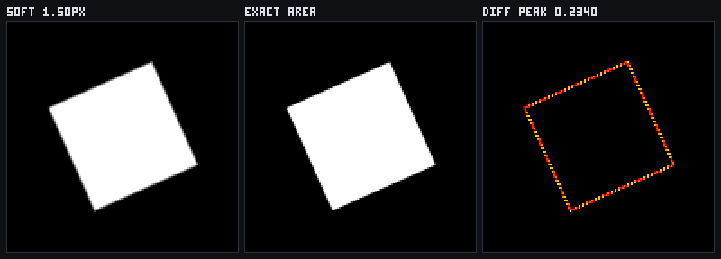
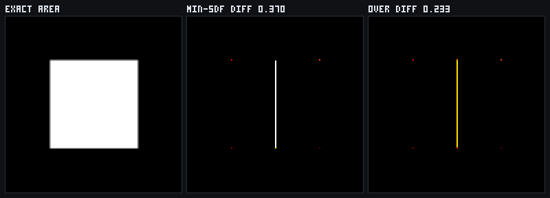
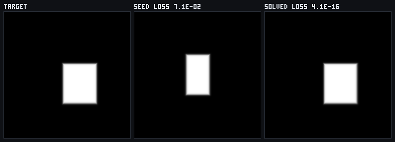

# RectSL soft rasterization, and its coverage bias

A RectSL scene now lowers a **third** time: past the CPU sampler and past the GLSL SDF, into a
differentiable raster, so a scene's `free-param`s can be solved against a target *image* rather than
against track values at instants.

The deliverable of this page is not the fit. It is the **bias**: how far soft coverage is from real
area coverage, where, and by how much. A differentiable renderer's job is to be a gradient source;
believing it is also a renderer is how a fit quietly absorbs the difference into its answer.

- Lowering, soft raster and gradient: `src/jvmMain/kotlin/afield/rectsl/RectSLSoftRaster.kt`
- Exact reference and the bias measurement: `src/jvmMain/kotlin/afield/rectsl/RectSLCoverage.kt`
- Figures: `src/jvmMain/kotlin/afield/rectsl/RectSLSoftRasterFigure.kt`
- Ratchet (in `check`): `src/jvmTest/kotlin/afield/rectsl/RectSLSoftRasterTest.kt`
- Survey (opt-in): `src/jvmTest/kotlin/afield/rectsl/RectSLSoftRasterMeasurements.kt`

## Why the differentiable layer is `AD`, not `Fn`

The natural plan is "lower the scene to an `Fn`-valued signed distance field over (x, y, t)".
`Functions.Fn` cannot be that. It is a `(Double) -> Double` — one input, one output
(`functions.kt:598`) — and every existing consumer of a lowered track reads its θ-vector as *the
track's own numeric leaves*: `freeParameterSlots`, `Track.substituteParameters`,
`Track.fitParameters`. Smuggling x and y in as two more leaves would make all of them quietly wrong
about what they are solving for.

So the differentiable layer here is `AD` on an `ADTape`, which is what `Fn`'s own gradient is built
out of anyway:

| layer | who does it |
|---|---|
| every **track** → a symbolic graph | the existing `Track.toFn`, unchanged |
| that graph → `AD` at the frame's time | the existing `FnAutoDiff.interpret` |
| ancestor-group composition, rotate-to-local, exact box field, `min` union | new, in `AD`, transcribed from `Transform2d.then` and `RectSLGlsl.PRELUDE` |
| coverage kernel, image loss | new, on the same tape |

One backward sweep then yields `d(loss)/dθ` for every parameter in the scene, with nothing
finite-differenced anywhere in the chain.

### The scene-level θ ledger

`Track.fitParameters` masks θ inside **one** `Fn`. A scene has eight tracks per rect and 183 rects in
the largest gallery scene, so it has hundreds of independent θ-vectors and "index *i*" means nothing
until they are concatenated. `SceneAdField` concatenates them once — one contiguous block per
channel — and re-maps each `free-param` **name** to its *global* slots, unioned across the channels
that use it. A rect is lowered all-or-nothing, and a skipped rect's block is rolled back, because a
hole in θ makes every index after it a lie.

### Cost

An `ADTape` never shrinks, and a 128² raster over a 30-rect scene taped in one go is ~14M nodes. A
shape's transform does not vary per pixel, so `SceneAdField.frameAt` evaluates it once and hands back
only centre / rotation / half-extent / alpha; per-pixel cost drops to about twenty nodes per rect.
An image loss is a sum over pixels, so `softRasterLossAndGradient` walks the image in row chunks, one
tape each, and accumulates the gradients.

## The exact reference

Bias is measured against **area** coverage in closed form, not against a supersampled raster. A rect
is a convex quadrilateral and a pixel is a convex box, so one rect's coverage is Sutherland–Hodgman
plus shoelace (`CoverageRect.exactCoverage`). A *union* of rects is not convex, so that case goes to
JTS (`exactUnionCoverage`) — an external implementation of the same quantity, i.e. an oracle rather
than a second opinion from the same author. Where both apply they are cross-checked.

Area coverage is only defined for **opaque** geometry, so `measureCoverageBias` refuses a translucent
scene rather than comparing two different quantities.

## The kernels, normalised

Three kernels, each reading 0.5 at the surface with slope `1/β` there. The normalisation is the whole
reason a comparison between them means anything: a sigmoid with a free temperature can be made to
look like any of the others.

| kernel | coverage | slope at 0 | reach |
|---|---|---|---|
| `LINEAR` | `clamp(0.5 - d/β, 0, 1)` | `1/β` | `β/2` |
| `SMOOTHSTEP` | the ramp through `3u² - 2u³` | `1/β` | `β/2` |
| `SIGMOID` | `sigmoid(-4d/β)` | `1/β` | ≈ `4.2β` |

## The four biases, separated

Lumping them together produces a number that means nothing, so each has its own column in
`CoverageBiasRow` and its own population count beside it.

### 1. Obliquity — and the sharp optimum at one pixel

For an axis-aligned edge the exact area of a unit pixel on one side of it **is** `clamp(0.5 - d)`, so
`LINEAR` at β = one pixel is not an approximation there at all. Measured: `1.03e-13`, which is
double-precision rounding in the shoelace, against `9.62e-02` for smoothstep and `2.99e-02` for the
sigmoid on the same geometry.

As the edge rotates the true coverage curve becomes piecewise quadratic and the ramp cannot follow
it. At 45° the worst departure is at `d = ½`, where the ramp has reached zero and coverage has not:
`½(1 - √2/2)² = 4.28932e-02`. That is a *prediction*; the measurement is `4.237e-02`, and the test
brackets it above by the bound and below at 90% of it.

Worst edge bias (corners excluded), 128² raster:

| kernel | β/px | 0° | 15° | 30° | 45° | reach/px |
|---|---|---|---|---|---|---|
| LINEAR | 0.50 | 1.900e-01 | 2.393e-01 | 2.153e-01 | 1.599e-01 | 0.25 |
| LINEAR | **1.00** | **1.030e-13** | **2.501e-02** | **3.830e-02** | **4.287e-02** | 0.50 |
| LINEAR | 2.00 | 2.250e-01 | 2.251e-01 | 2.126e-01 | 2.067e-01 | 1.00 |
| LINEAR | 4.00 | 3.475e-01 | 3.547e-01 | 3.428e-01 | 3.379e-01 | 2.00 |
| SMOOTHSTEP | 0.50 | 2.703e-01 | 2.650e-01 | 2.414e-01 | 2.293e-01 | 0.25 |
| SMOOTHSTEP | 1.00 | 8.128e-02 | 8.622e-02 | 6.731e-02 | 6.706e-02 | 0.50 |
| SMOOTHSTEP | 2.00 | 1.353e-01 | 1.329e-01 | 1.237e-01 | 1.218e-01 | 1.00 |
| SMOOTHSTEP | 4.00 | 2.841e-01 | 2.924e-01 | 2.789e-01 | 2.738e-01 | 2.00 |
| SIGMOID | 0.50 | 1.305e-01 | 1.255e-01 | 1.014e-01 | 8.945e-02 | 2.25 |
| SIGMOID | 1.00 | 9.185e-02 | 9.411e-02 | 8.053e-02 | 7.628e-02 | 4.32 |
| SIGMOID | 2.00 | 2.391e-01 | 2.441e-01 | 2.305e-01 | 2.261e-01 | 8.29 |
| SIGMOID | 4.00 | 3.521e-01 | 3.581e-01 | 3.467e-01 | 3.425e-01 | 15.89 |

**β must equal the pixel pitch.** It is a sharp optimum, not a trend: below a pixel the band clips
coverage that is really there, above one it spreads coverage that is not, and both are worse than the
middle by an order of magnitude or more. The ordering of the two *curved* kernels is
geometry-dependent — smoothstep is the worst of the three on an axis-aligned edge and better than the
sigmoid at 30° — so only the ramp's primacy is a stable claim, and both halves of the crossover are
asserted in the test where they hold.



### 2. Corners — the source that dominates, and was not predicted

Two edges meet inside one pixel and no function of a *single* signed distance can be right there. It
is not obliquity bias with a worse constant, it is a different failure, and it is the larger one:
`1.57e-01` at a right angle and up to `2.47e-01` at 20°, against the `4.29e-02` edge bound. It is
also *not* a constant — it depends on how close a pixel centre happens to land to the corner, so
across rotations it wanders between about `0.09` and `0.25`. Reported as a range on purpose.

In the figure above it is the corners of the difference fringe that are brightest.

### 3. Feature scale

A feature thinner than the band never lets coverage saturate. Axis-aligned bar, `LINEAR`, β = 1px:

| width/px | 0.125 | 0.25 | 0.375 | 0.5 | 0.75 | ≥ 1 |
|---|---|---|---|---|---|---|
| worst edge bias | 3.08e-01 | 2.45e-01 | 1.83e-01 | 1.20e-01 | at rounding | at rounding |

The cliff is between half a pixel and three quarters of one. Below it, soft coverage is not an
approximation of the picture — the error is a large fraction of the feature's whole coverage.

### 4. Union seams — and why there is no "right" composite

`min(sdf_a, sdf_b)` is the union's distance *outside* the union and an under-estimate *inside* it, so
where two rects abut the field reads about zero across a region that is entirely covered.

| gap/px | −2 | −1 | −0.5 | **0** | 0.5 | 1 | ≥ 2 |
|---|---|---|---|---|---|---|---|
| `UNION_SDF` worst | 1.57e-01 | 9.14e-02 | 1.60e-01 | **3.70e-01** | 1.22e-01 | 9.14e-02 | 1.57e-01 |
| `OVER` worst | 2.16e-01 | 2.16e-01 | 2.16e-01 | **2.33e-01** | 1.78e-01 | 9.14e-02 | 1.57e-01 |

The two do **not** rank. At a seam `UNION_SDF` is 1.6× worse; at *overlap* the ranking flips, because
the over-composite double-counts where rects cover each other. Pick per scene, and know which one you
picked.



## On the real corpus

Fixtures are built to be measurable; the gallery is not. At β = 1px and 64², over
`public/docs/assets/rectsl_gallery`:

- **22** scenes measured, **15** refused as translucent, **0** with no differentiable rect.
- **Zero rects skipped for non-differentiability in any measured scene** — the lowering covers the
  corpus.
- Worst-pixel bias: **median 2.39e-01, maximum 4.67e-01** (`phase-fan`).

That is the honest headline. The lowering is complete over the corpus and the *bias is not small* on
it, because real scenes are made of many small rects — which is to say mostly corners and seams.
**Where the bias is acceptable:** a single large, near-axis-aligned feature at β = 1px, where it is at
rounding, and any regime where the fit only needs the gradient's *direction*. **Where it is not:**
anywhere the fitted quantity is a coverage value itself, any scene of small or touching rects, and any
feature under three quarters of a pixel.

## The fit

Which does work, when the loss is the soft raster on both sides. A scene with three `free-param`s
(`bar-x`, `bar-y`, `bar-w`) against a target raster, `SIGMOID` at β = 2px, 320 Adam steps:

- loss `7.08e-02` → `3.88e-16`
- parameters recovered to `5.8e-08` of truth



The measured reach numbers say why the sigmoid, and say what to do in general: the ramp is the
accurate kernel and the sigmoid is the far-sighted one, so the recipe is coarse-to-fine — acquire with
a wide sigmoid, refine with `LINEAR` at exactly one pixel. That two-stage schedule is **implied by
the table above and not yet implemented or measured here.**

## How it is checked

| what | oracle | observed |
|---|---|---|
| `AD` SDF vs sampled geometry | `track_characterization.txt`, 64,452 rows, the first 37,023 of them dumped from **pre-refactor** code | worst 1.325e-13 over 301,417 comparisons; 35,137 / 35,908 *visible* golden rects (97.9%) in 37 programs |
| exact coverage | convex clip vs **JTS** | worst 7.27e-14 over 4,000 cases, 2,347 strictly partial |
| untracked box field vs tracked | bit equality | 0.0 over >5,000 points |
| kernel slope | central difference of its own coverage | worst relative 3.69e-10, 191 non-zero slopes |
| raster loss gradient | central difference of the loss | worst relative 4.02e-10 |

The gallery differential lowers over the golden's own span — 1.25× each program's duration — so every
golden instant is inside the window the lowering was declared valid on. That refuses more tracks than
a `[0, duration]` window would, and the refusals show up as the 97.9% coverage figure rather than as
silence.

That figure is taken over the golden rects the golden itself says are **visible**, which is a change
made on 2026-08-30 rather than a different measurement. It used to be taken over all 64,452 rows, and
once `0d875cc63` added four musicality examples it read 54.5% — because a rhythm spends most of every
bar at `alpha == 0` on purpose, and an invisible rect has no distance to compare. Of the 35,908
visible rows, the 771 that are not compared are the visible instants of 21 rects with a pattern track
in their own transform or an ancestor group's, which is the one thing the `Fn` lowering refuses
permanently. `RectSLSoftRasterTest` asserts that classification in both directions rather than
asserting a percentage: every skipped rect must be pattern-built, and every pattern-built track must
be refused.

## The mistake worth recording

The first version of the bias sweep put every fixture on a whole number of wall units. Every edge
therefore landed exactly on a pixel boundary, no pixel was ever partially covered, and **every bias in
the table came out at exactly zero** — a measurement that could not have failed. It was caught only
because the partial-pixel counts are asserted alongside the biases. Every fixture now carries a
deliberately non-dyadic sub-pixel jitter, and every population `CoverageBiasRow` summarises is
counted in the row.

## Regenerating

```
./gradlew jvmTest --tests 'afield.rectsl.RectSLSoftRasterTest'          # the ratchet
./gradlew jvmMeasurements --tests '*RectSLSoftRasterMeasurements*' \
    -Dafield.rectsl.softRasterOut=dev_docs/assets/rectsl_soft_raster    # the survey + figures
```

Without `-Dafield.rectsl.softRasterOut` the figures go to a temp directory and nothing in the
repository is touched.
