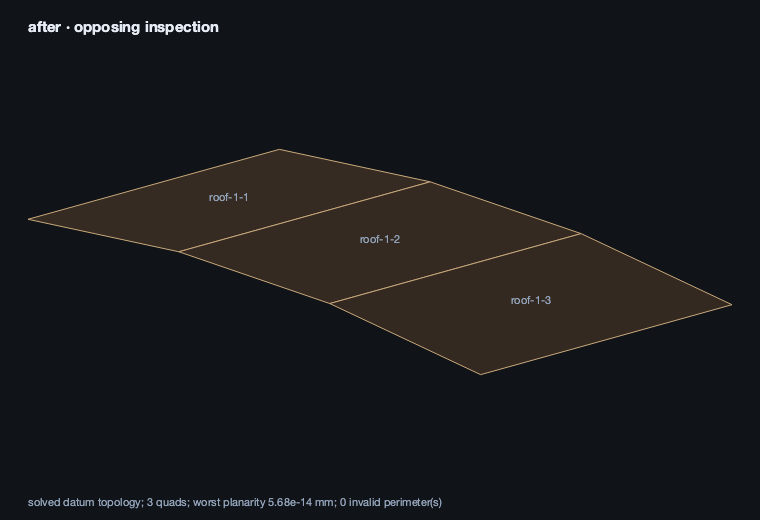

# Astra and the building conversation — 5 September 2026

The direct OpenAI flagship default is now `gpt-6-astra`. A real four-turn AI4 conversation created, subdivided, raised and thickened a roof to canonical revision 4. The project and its four user messages reopened after a full Field JVM restart. This is a bounded design result, not a completed building or fabrication certification.

Implementation is present in both `/Users/marc/field4` and the authoritative housing worktree `/Users/marc/field4/.claude/worktrees/serene-panini-93b3ca`. The housing interaction repair stays in the latter: the saved project does not contain that personal housing layer. No CAM geometry sources were changed by this work. The audit run itself committed and pushed nothing; the four core files were committed to `main` afterwards in a separate triage, and the personal housing layer was not.

## Model routing and compatibility

[Official Astra model documentation](https://developers.openai.com/api/docs/models/gpt-6-astra) and [migration guidance](https://developers.openai.com/api/docs/guides/latest-model) were read on 5 September. Field already uses Responses, a string-valued model identifier and medium reasoning. Those request and reasoning choices remain in place; prompts were not rewritten for the upgrade. The installed Java SDK is 4.29.0.

| Construction surface | Effective role after this change |
| --- | --- |
| AI4 inline/edit and general chat, via installer → provider factory | Direct OpenAI default `gpt-6-astra` |
| Direct `OpenAiIdeCodexBridge()` and `HouseAgentRun` | Same flagship default |
| Docs search, filestore CLI, completion-doc polish and tool-use improvement CLIs | Their existing flagship default, with their explicit options/env overrides retained |
| Kotlin/GLSL autocomplete, completion-doc generation and auto-naming | Existing fast role, `gpt-5.6-luna` |
| Fallback setting | `gpt-5.4`, unchanged; the flagship bridge does not automatically substitute it |
| OpenRouter default | `openai/gpt-5.6-sol`, deliberately retained pending a separate provider evaluation |
| Anthropic default | Existing Opus/Sonnet/Haiku roles, unchanged |
| Welcome model picker | Free-text input; direct OpenAI placeholder updated to Astra |

Precedence remains environment → persisted `~/.afield/ai-models.properties` → provider default. At audit time there was no provider/model override, and an OpenAI credential was available. Credentials and persisted AI settings were neither printed nor changed.

Rollback: set `AFIELD_AI_MODEL=gpt-5.6-sol` for a new Field process, or explicitly select that model in the existing settings UI. An already-created bridge keeps its selected model until recreated. The old-model evaluation is retained in the evidence directory.

Safe tool telemetry now records provider and reasoning at turn start, and the model returned by the API alongside the request model and response ID. This distinguishes a UI label from a provider response. Streaming transport failure still has the existing logged retry through non-streaming **with the same model**. New local protocol tests verify that a 404 cannot silently select another model.

## Actual conversation evidence

Workspace: `/Users/marc/field4/.claude/worktrees/serene-panini-93b3ca/build/astra-audit/run-2/workspace`  
Document: `astra-design-audit`  
Box: `aefef220-2886-408b-9cda-b76390972b8d` (`Building`)  
Canonical project: `astra-design`  
Isolated HTTPS port: 9786; browser captures used Field's server-owned Playwright.

The paid Sol baseline uses the real bridge but a smaller harness prompt. It is a compatibility baseline, **not a controlled latency/model-quality comparison** against the UI agent. It previewed and committed one roof with two returned inspection images in approximately 14 seconds.

| Turn | Requested work | Checked result | AI turn elapsed, before screenshot |
| --- | --- | --- | --- |
| 1 | One 10,000 × 5,000 mm roof, elevation 3,000 mm, thickness 5 mm | Revision 1; one panel, four points; preview and token commit | 25.1 s |
| 2 | Three connected strips along the long dimension | Revision 2; three panels, eight shared points; preview and token commit | 27.3 s |
| 3 | Raise the middle 300 mm; keep four outer corners fixed | Revision 3; eight explicit point constraints; outer corners retained and seams at 3,300 mm | 46.2 s |
| 4 | Three panels at 240 mm towards B; retain datum geometry and select middle | Revision 4; all three thicknesses/side values correct, unchanged point positions and constraints; selected `roof-1-2` | 48.7 s |

Exact timings and prompts: [turns.json](astra_housing_audit_2026-09-05/turns.json). Full conversation with original tool images: [conversation.md](astra_housing_audit_2026-09-05/conversation.md). Canonical state: [project.json](astra_housing_audit_2026-09-05/project.json).

The final tool inspection reports three convex planar datum quads, two planar mitres, minimum shared contact 1,201,209.495 mm², residual overlap 1.35104e-6 mm³, maximum resolved-face planarity deviation 6.11e-13 mm, and no design issues. Stage remains `DESIGN`; `readyForFabrication` remains false. No openings, services or joints were introduced.

This image was decoded unchanged from the actual tool image delivered in the conversation. It shows datum topology; it does **not** demonstrate panel thickness or fabrication tool access. The mismatch between datum images and physical-thickness inspection is an outstanding image-tool capability gap.

Twenty-two tool images were present in the saved and reopened UI. The protocol test intercepts the actual Java SDK HTTP body and verifies `input_image`, high detail, matching function `call_id`, medium reasoning and continuation. Live API records confirm OpenAI returned Astra for all 17 responses in the four UI turns. API usage totals: 490,062 input tokens, including 403,637 cached, and 3,673 output tokens. At the cited model page's standard rates this is approximately **$1.45** for those four turns, excluding baseline and interrupted setup attempts. See [api-usage.json](astra_housing_audit_2026-09-05/api-usage.json).

Astra recovered from an initial `HouseInspectProject` call on the not-yet-created project. Tool failure was returned through the function-output boundary and the model then created the requested project. No clarification or continuation prompt beyond the four design instructions was needed.

Turn 3 previewed a graph patch, then reissued it with `commit=true` instead of consuming the returned token. The produced state is checked, but strict exact-token commit behavior is **not established** by this run.

## Reopen repair and limits

Before repair, a fresh JVM restored revision 4 and nonempty chat, but `HouseInspectProjectSelection` returned empty arrays. `HouseProjectSelections` held only process-local state. The repair saves normalized point/panel IDs as a separate JSON property on the owning box, uses the same persistence/resynchronization registration as canonical project properties, and scopes its in-memory cache to the project store as well as project name. It does not change geometry or increment the project revision.

The first repair attempt registered persistence but omitted resynchronization. A real restart caught the missing sidecar. That omission was fixed before the final verification; compile success was not treated as persistence proof. Final verification: [final-reopen.json](astra_housing_audit_2026-09-05/final-reopen.json), [actual UI capture](astra_housing_audit_2026-09-05/final-reopen.png), [15 independent checks](astra_housing_audit_2026-09-05/checks.json), and [stale/undo outcomes](astra_housing_audit_2026-09-05/revision-recovery.json). The exact personal-source delta is not in this repository, because `src/personal/` is not: it is `HouseProjectInteraction.kt` in the authoritative housing worktree, whose post-repair hash is recorded in [personal-source-manifest.json](astra_housing_audit_2026-09-05/personal-source-manifest.json).

The existing dirty chat-persistence and tool-registration repairs in the authoritative worktree were preserved. They are dependencies of this successful UI evaluation and were **not** copied wholesale into saved-project main. In particular, visible chat reopening on that housing worktree is not proof that unmodified main has the same history behavior.

## Capability/failure census

The live boundary exposed 37 tools in this context, of which 24 are canonical house tools. [tools.json](astra_housing_audit_2026-09-05/tools.json) records actual schemas. The older HouseModel tool cluster was gated off for this canonical-only project; an old comment's tool count was not used.

| Task/capability | Evidence and remaining gap |
| --- | --- |
| Empty project → roof → subdivision → constrained movement | Live Astra and UI checked; stable shared topology and fixed corners retained |
| Physical-face planarity | Independent numeric result checked for this roof; no claim about general corners or fabrication |
| Thickness and selected panels | Actual canonical change checked; datum image does not visually expose thickness |
| Selection after restart | Reproduced loss, then implemented persistent selection; final fresh-JVM restart passed with `roof-1-2` selected |
| Stale revision | Tested against revision 4 after restart; rejected without canonical changes |
| Save/reopen and visible chat | Same document/box/revision, four visible user turns and 22 images; original transcript preserved |
| Whole-change undo after restart | In-memory project history is not restored; API reports no committed revision to undo |
| Model conversation after restart | UI history persists, but `chatThreadFor` creates a new API conversation and does not replay the stored transcript. Prior user intent is not proven retained in model context |
| Cancellation / mid-turn steering | No verified UI cancellation path: installer job is not registered with box stop, streaming uses a blocking completion join. Async tool calling and mid-turn steering remain unimplemented |
| Errors and explicit fallback | Real tool-error recovery and protocol 404 checked; no silent model substitution. The UI has a request-failure handler; its live failure presentation was not exercised |
| Exact preview-token commits | Used in turns 1, 2 and 4; bypassed by the model's direct patch commit in turn 3 |
| Electrical, plumbing, route alternatives | Existing canonical tools discovered; no live services conversation run in this slice |
| Interior dimensions under thickness change | Not exercised; this request retained datum geometry instead |
| Panel schedule / parameter propagation | Tool/source surfaces exist; schedule UI and downstream invalidation remain unevaluated |
| Underfloor heating | No dedicated heating-zone/loop tool found in the live canonical tool census; no thermal/hydraulic analysis claimed |
| Original long housing discussion | Candidate historical tool logs found; correct original visible transcript has not been located/opened |

Historical log candidates include `house-project-ai` (21 logged turns, Aug 11–22), `house-project-ai-h2` (37, Aug 14–15), `house-building-conversation` (22, Aug 22–24), and `house-building-conversation-fresh-2` (10, Aug 23). These counts describe log files, not complete saved transcripts. The inspected `house-project-ai` document has no durable `ai_chat` sidecar; fresh/fresh-2 folders contain only introductory files. No replacement discussion was manufactured.

## Verification and reproducibility

Saved-project main also passed all three `AstraBridgeContractTest` cases after delivery. The authoritative worktree's five targeted JVM tests passed: three `AstraBridgeContractTest` cases, existing chat-property persistence registration, and late extension-tool registration. The first test compilation caught and fixed a test-only collection assignment error. These local protocol fixtures contain synthetic HTTP responses by design; all housing images and conversation evidence came from real Field execution.

The first paid setup attempt failed honestly with `ceres-unavailable`. This worktree had no redistributable native library. Subsequent isolated runs used the existing saved-project library through `ORG_GRADLE_PROJECT_ceresLibrary=/Users/marc/field4/build/ken-ceres-redistributable/libken_ceres_jvm.dylib`; the native header matched, and real Ceres solves then passed. No substitute solver or fabricated capture was used. Later verification used `AFIELD_SKIP_WORKSPACE_PERSIST=1` to avoid replacing the launcher workspace preference.

Gradle/backdoor/render runs in the housing checkout were coordinated with the CAM task and serialized. The [personal source manifest](astra_housing_audit_2026-09-05/personal-source-manifest.json) identifies the existing coupled housing sources and personal dependency declarations. The selection patch depends on that complete authoritative layer; it is not a standalone housing installation for main. The full services/heating agenda, cancellation lifecycle, model-history restoration and strict token-only commits remain follow-up work.
