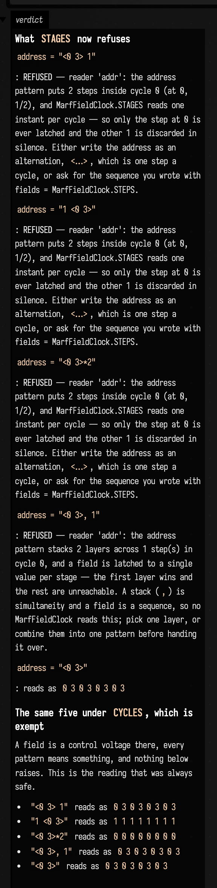
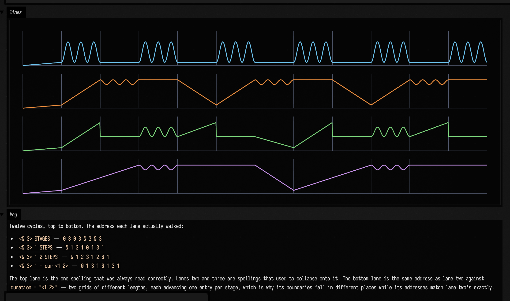
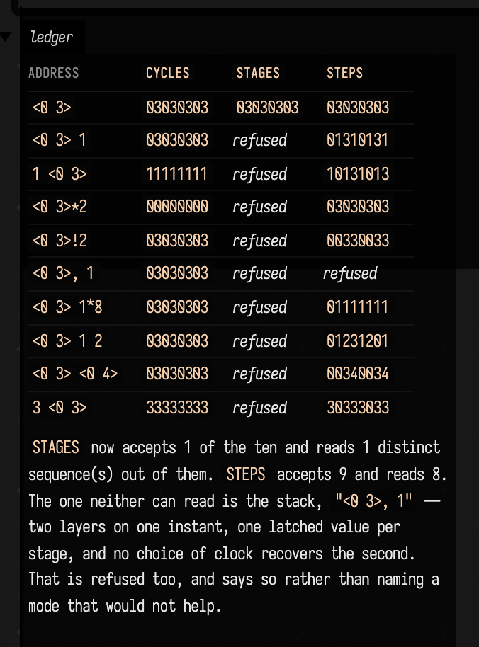

# MARF field clocks — a refusal you can watch fire

Three pure-CPU boxes on `MarfFieldClock`. No `Window`, no `Renderer`, no audio device, no external
asset. The point is the pair: one box whose patterns are **refused at construction** with the new
message printed in its own output, and one whose patterns are **accepted and drawn**.

## Replay it

```bash
uv run --project . --group backdoor python tools/field_backdoor.py --json --scratch --with-playwright --port 9101 \
  --command 'macro write marf_field_clocks --file dev_docs/agents/transcripts/marf_field_clocks.yaml' \
  --command 'macro run marf_field_clocks'
```

Drop `--with-playwright` if you only want to read the output events; the boxes run either way.
For screenshots, attach the browser before execution: without it the output DOM never exists.
The capture guard now rejects that missing output instead of accepting the historical 48×48
handle-only placeholder. Or open a real Field and paste the three box bodies in.

## What each box shows

| box | what it does |
| --- | --- |
| `marf_clocks_refused` | Five address spellings under `STAGES`. Four are refused; the fifth reads. Then the same five under `CYCLES`, which is exempt — and that second list is the *old* behaviour, so you can read the silence next to the refusal. |
| `marf_clocks_steps` | Four lanes of line art over one bank, twelve cycles. Lane 1 is the one spelling that was always read right; lanes 2 and 3 are spellings that used to collapse onto it; lane 4 is lane 2's address against `duration = "<1 2>"`, so its boundaries fall elsewhere while its addresses match lane 2 exactly. |
| `marf_clocks_ledger` | All ten spellings × all three clocks as one table, with the counts computed live rather than typed. |







Those three PNGs were captured from this transcript on 2026-09-21 at 05:56 with
`--with-playwright` on port 9101 — 576×2348, 2176×1286 and 676×914. Every box was executed
individually (backdoor `run <box>`) as well as through the macro, and all three returned
`kind: ok` with no error events.

## Where the material comes from

Not invented. `dev_docs/agents/demos/marf_demo/operations.yaml` records thirty-eight edit-and-run
cycles on one box between 03:38:58 and 03:42:10 UTC on 2026-09-21, about five seconds apart, working
through these ten address spellings. Under `STAGES` as it then was, eight of the ten produced a
sequence byte-identical to something strictly simpler than what had been typed — `"1 <0 3>"` was the
constant `1`, `"<0 3>*2"` was the constant `0` — and nothing raised, warned or logged. The `CYCLES`
column of the last box is that behaviour, still there, still correct for that reading.

## Registration

Promoted on 2026-09-21 after the sibling Marf demo landed. The canonical YAML now lives in
`dev_docs/agents/transcripts/marf_field_clocks.yaml`, is in `DemoTranscriptExecSmokeTest.EXECUTE`,
and has a gallery entry and generated starting point. Every box is pure-CPU, self-contained,
and finishes on its own. This directory retains the original, real capture evidence; it no
longer carries an unregistered copy of the runnable source.
