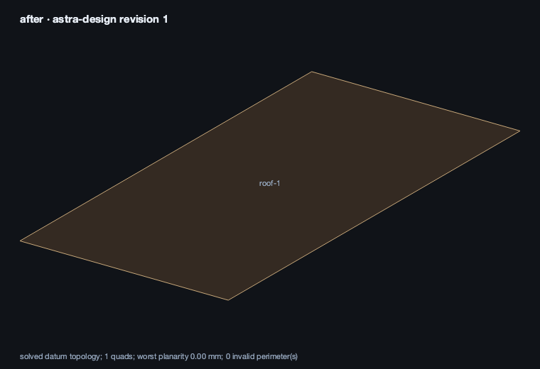
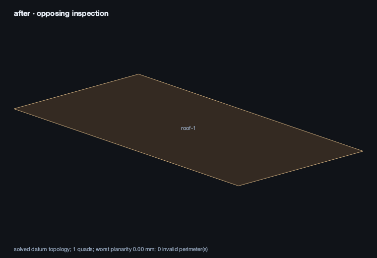
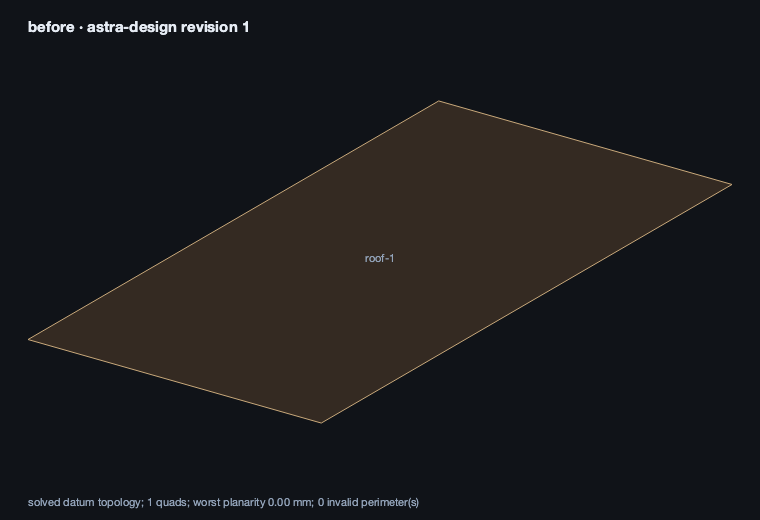
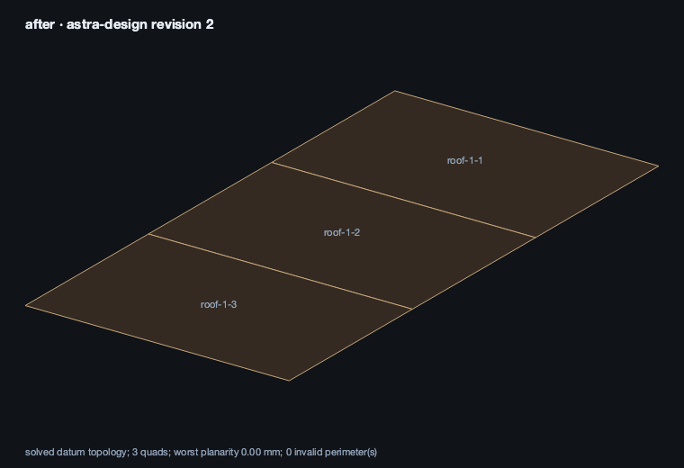
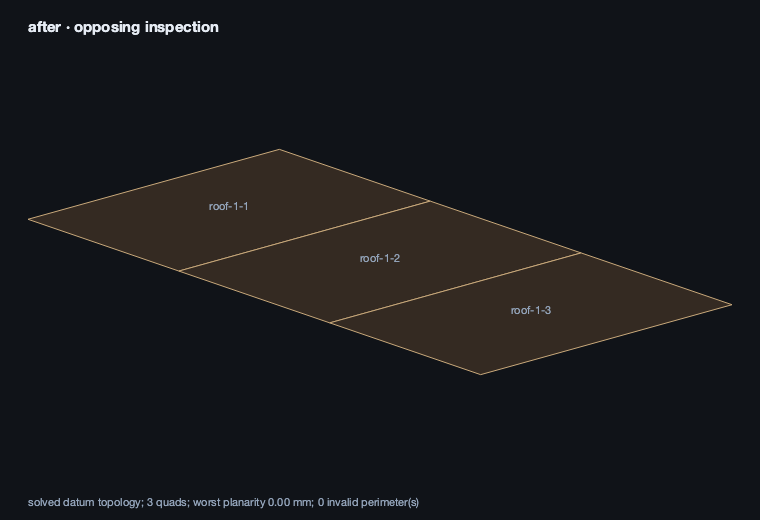
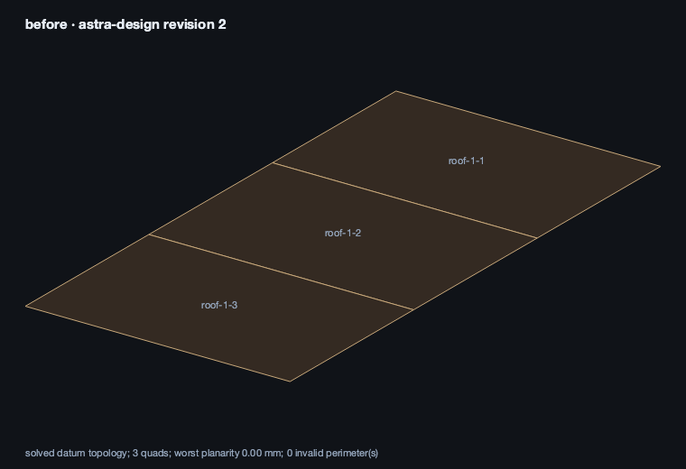
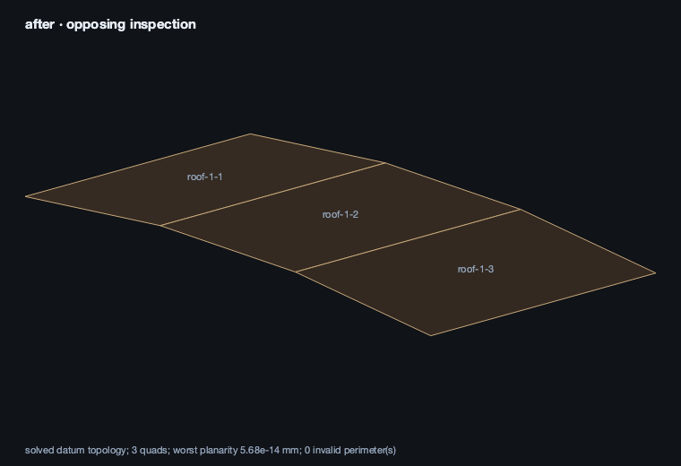
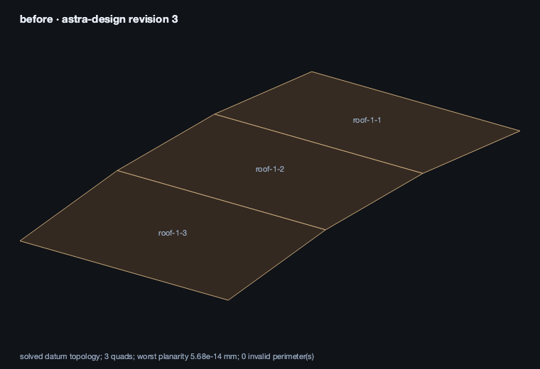

<<you>>
Work only on canonical project astra-design using the house project tools. Start with one roof panel, 10000 by 5000 mm, at 3000 mm elevation, 5 mm thick. Preview with BOTH views, inspect the returned images, then commit that exact preview. Describe what is visible and the revision. Do only this edit: no walls, services, joints or code edits.
<<progress>>
Starting AI conversation
Preparing context and tools.
<<progress>>
Planning tool use
Next tool: `HouseInspectProject`
<<progress>>
Using HouseInspectProject
{"project":"astra-design","render":"NONE"}
<<progress>>
HouseInspectProject finished
keys=error,tool,message
<<progress>>
Planning tool use
Next tool: `HouseStartRectangularPanel`
<<progress>>
Using HouseStartRectangularPanel
{"commit":false,"elevationMm":3000,"expectedRevision":0,"intent":"One rectangular roof panel, 10000 by 5000 mm, at elevation 3000 mm, 5 mm thick; no other elements.","lengthMm":10000,"panelId":"roof-1","project":"astra-design","render":"BOTH","role":"ROOF","thicknessMm":5,"widthMm":5000}
<<progress>>
HouseStartRectangularPanel finished
ok=true committed=false project=astra-design revision=1 ready=false issues=0 images=2
<<progress>>
Planning tool use
Next tool: `HouseCommitProjectPreview`
<<progress>>
Using HouseCommitProjectPreview
{"expectedRevision":0,"previewToken":"9ddc7673-35b6-4311-b636-f2f36b2a12ab","project":"astra-design","render":"BOTH"}
<<progress>>
HouseCommitProjectPreview finished
ok=true committed=true project=astra-design revision=1 ready=false issues=0 images=2
<<tool>>
_after: solved design, southwest inspection_

_after: solved design, opposing inspection_

<<tool>>
_after: solved design, southwest inspection_

_after: solved design, opposing inspection_

<<ai model="gpt-6-astra">>
Committed the exact reviewed preview to **`astra-design`, revision 1**.

- One roof panel, `roof-1`: **10000 × 5000 mm**
- Elevation: **3000 mm**
- Thickness: **5 mm**

Inspected both preview and committed views: they show a single flat, brown rectangular face with a gold outline, without seams or additional elements. Elevation and thickness are confirmed by the canonical data, rather than visually measurable in these views.

Validation returned **no issues**. No walls, services, joints, or code edits were made.
<<you>>
Divide that roof into three equal shared-topology strips along its long dimension. Preview, inspect both images and commit the exact token. Keep the outer dimensions and elevation. Do only this edit.
<<progress>>
Starting AI conversation
Preparing context and tools.
<<progress>>
Planning tool use
Next tool: `HouseInspectProject`
<<progress>>
Using HouseInspectProject
{"project":"astra-design","render":"NONE"}
<<progress>>
HouseInspectProject finished
ok=true committed=false project=astra-design revision=1 ready=false issues=0 images=0
<<progress>>
Planning tool use
Next tool: `HouseSubdivideProjectPanel`
<<progress>>
Using HouseSubdivideProjectPanel
{"commit":false,"divisions":3,"expectedRevision":1,"panelId":"roof-1","project":"astra-design","render":"BOTH","stripDirection":"AUTO_LONG"}
<<progress>>
HouseSubdivideProjectPanel finished
ok=true committed=false project=astra-design revision=2 ready=false issues=0 images=3
<<progress>>
Planning tool use
Next tool: `HouseCommitProjectPreview`
<<progress>>
Using HouseCommitProjectPreview
{"expectedRevision":1,"previewToken":"24cbf3ed-319b-498d-bb90-90ccc8c24846","project":"astra-design","render":"BOTH"}
<<progress>>
HouseCommitProjectPreview finished
ok=true committed=true project=astra-design revision=2 ready=false issues=0 images=3
<<tool>>
_before: committed design revision 1_

_after: solved design, southwest inspection_

_after: solved design, opposing inspection_

<<tool>>
_before: committed design revision 1_

_after: solved design, southwest inspection_

_after: solved design, opposing inspection_

<<ai model="gpt-6-astra">>
Committed the exact preview to **`astra-design`, revision 2**.

Both inspected views show three flat, adjoining roof strips with two full-width seams and an unchanged outer rectangle.

- **Each strip:** 3333⅓ × 5000 mm
- **Overall dimensions:** 10000 × 5000 mm
- **Elevation:** 3000 mm
- **Thickness:** unchanged at 5 mm
- **Topology:** two shared edges using shared seam vertices

Validation reported **no issues**. Only the roof subdivision was changed.
<<you>>
Raise the middle strip by 300 mm while keeping all panels connected and every physical face planar. Preserve the four outer corners. Use stable seam point IDs and explicit constraints. Preview, inspect and commit if the independent checks pass. Do only this edit.
<<progress>>
Starting AI conversation
Preparing context and tools.
<<progress>>
Planning tool use
Next tool: `HouseInspectProject`
<<progress>>
Using HouseInspectProject
{"project":"astra-design","render":"NONE"}
<<progress>>
HouseInspectProject finished
ok=true committed=false project=astra-design revision=2 ready=false issues=0 images=0
<<progress>>
Planning tool use
Next tool: `HousePatchProjectGraph`
<<progress>>
Using HousePatchProjectGraph
{"commit":false,"constraints":[{"areaMm2":0,"axes":"XYZ","direction":[],"edge":[],"firstEdge":[],"kind":"POINT_AT","lengthMm":0,"panel":"","point":"roof-1-p0","secondEdge":[],"sideA":"","sideB":"","targetCos":1,"targetMm":[-5000,-2500,3000],"weight":1000},{"areaMm2":0,"axes":"XYZ","direction":[],"edge":[],"firstEdge":[],"kind":"POINT_AT","lengthMm":0,"panel":"","point":"roof-1-p1","secondEdge":[],"sideA":"","sideB":"","targetCos":1,"targetMm":[5000,-2500,3000],"weight":1000},{"areaMm2":0,"axes":"XYZ","direction":[],"edge":[],"firstEdge":[],"kind":"POINT_AT","lengthMm":0,"panel":"","point":"roof-1-p2","secondEdge":[],"sideA":"","sideB":"","targetCos":1,"targetMm":[5000,2500,3000],"weight":100...
<<progress>>
HousePatchProjectGraph finished
ok=true committed=false project=astra-design revision=3 ready=false issues=0 images=3
<<progress>>
Planning tool use
Next tool: `HousePatchProjectGraph`
<<progress>>
Using HousePatchProjectGraph
{"commit":true,"constraints":[{"areaMm2":0,"axes":"XYZ","direction":[],"edge":[],"firstEdge":[],"kind":"POINT_AT","lengthMm":0,"panel":"","point":"roof-1-p0","secondEdge":[],"sideA":"","sideB":"","targetCos":1,"targetMm":[-5000,-2500,3000],"weight":1000},{"areaMm2":0,"axes":"XYZ","direction":[],"edge":[],"firstEdge":[],"kind":"POINT_AT","lengthMm":0,"panel":"","point":"roof-1-p1","secondEdge":[],"sideA":"","sideB":"","targetCos":1,"targetMm":[5000,-2500,3000],"weight":1000},{"areaMm2":0,"axes":"XYZ","direction":[],"edge":[],"firstEdge":[],"kind":"POINT_AT","lengthMm":0,"panel":"","point":"roof-1-p2","secondEdge":[],"sideA":"","sideB":"","targetCos":1,"targetMm":[5000,2500,3000],"weight":1000...
<<progress>>
HousePatchProjectGraph finished
ok=true committed=true project=astra-design revision=3 ready=false issues=0 images=3
<<tool>>
_before: committed design revision 2_

_after: solved design, southwest inspection_

_after: solved design, opposing inspection_

<<tool>>
_before: committed design revision 2_

_after: solved design, southwest inspection_

_after: solved design, opposing inspection_

<<ai model="gpt-6-astra">>
Committed to **`astra-design`, revision 3**.

Both inspected views show a raised horizontal middle strip, with the two end strips sloping down to the preserved outer corners. All three panels remain connected.

- **Middle elevation:** 3300 mm — raised exactly 300 mm
- **Outer corners:** unchanged at 3000 mm
- **Footprint / thickness:** unchanged at 10000 × 5000 mm / 5 mm
- **Constraints:** eight explicit XYZ `POINT_AT` constraints, retaining the four stable seam point IDs

Independent checks passed with **no issues**: both seams retain physical contact, and maximum physical-face planarity deviation is **4.53 × 10⁻¹³ mm**—effectively zero.

Only this roof geometry and its constraints were changed.
<<you>>
Make only those three roof panels 240 mm thick towards side B while preserving the datum geometry and prior constraints. Preview both opposing views and check the physical faces and contact. Commit if valid. Select the middle panel, and tell me the revision and what is still unverified. Do not add anything else.
<<progress>>
Starting AI conversation
Preparing context and tools.
<<progress>>
Planning tool use
Next tool: `HouseInspectProject`
<<progress>>
Using HouseInspectProject
{"project":"astra-design","render":"NONE"}
<<progress>>
HouseInspectProject finished
ok=true committed=false project=astra-design revision=3 ready=false issues=0 images=0
<<progress>>
Planning tool use
Next tool: `HouseSetProjectPanelThickness`
<<progress>>
Using HouseSetProjectPanelThickness
{"commit":false,"expectedRevision":3,"panelIds":["roof-1-1","roof-1-2","roof-1-3"],"project":"astra-design","render":"BOTH","thickenTowards":"B","thicknessMm":240}
<<progress>>
HouseSetProjectPanelThickness finished
ok=true committed=false project=astra-design revision=4 ready=false issues=0 images=3
<<progress>>
Planning tool use
Next tool: `HouseCommitProjectPreview`
<<progress>>
Using HouseCommitProjectPreview
{"expectedRevision":3,"previewToken":"fc39ce8e-7bcf-4406-ac96-ee9b538bb679","project":"astra-design","render":"BOTH"}
<<progress>>
HouseCommitProjectPreview finished
ok=true committed=true project=astra-design revision=4 ready=false issues=0 images=3
<<progress>>
Planning tool use
Next tool: `HouseSelectProjectElements`
<<progress>>
Using HouseSelectProjectElements
{"panelIds":["roof-1-2"],"pointIds":[],"project":"astra-design"}
<<progress>>
HouseSelectProjectElements finished
project=astra-design revision=4 points=[] panels=[roof-1-2]
<<tool>>
_before: committed design revision 3_

_after: solved design, southwest inspection_

_after: solved design, opposing inspection_

<<tool>>
_before: committed design revision 3_

_after: solved design, southwest inspection_

_after: solved design, opposing inspection_

<<ai model="gpt-6-astra">>
Committed the exact preview to **`astra-design`, revision 4** and selected the middle panel, **`roof-1-2`**.

- All three roof panels are **240 mm thick toward side B**.
- Datum geometry, shared seam IDs, and all **eight prior constraints** are unchanged.
- Both opposing views retain the raised-middle shape and continuous seams.
- Physical checks passed with **no issues**: face planarity deviation ≤ **6.11 × 10⁻¹³ mm**, minimum shared contact **1,201,209.495 mm²**, and negligible numerical overlap.

**Still unverified:** the images display datum faces, so full-thickness sides and undersides were not visually verified. This remains a **DESIGN-stage** project, not fabrication-approved; structural capacity and manufacturing readiness have not been established.

Nothing else was added or edited.