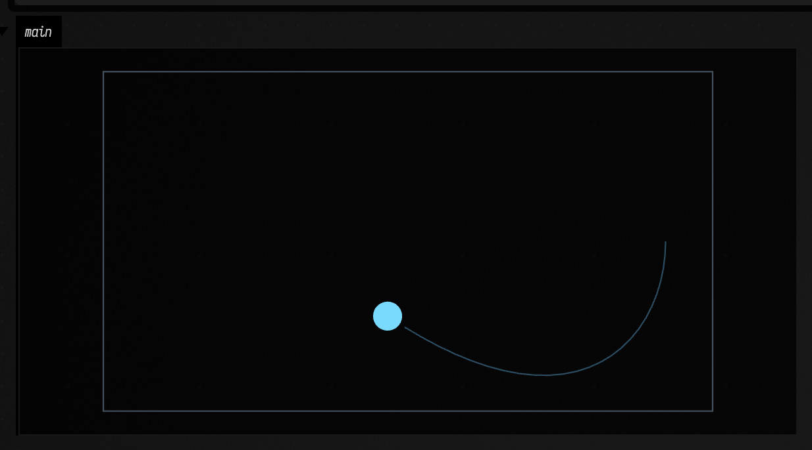
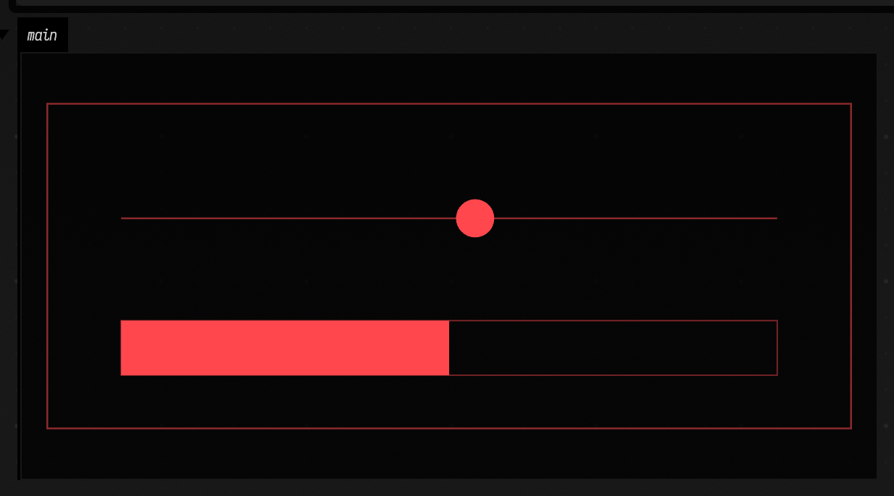

# Box code revision: second rehearsal

2026-10-15, `codex/box-code-revision-batch-2`, based on `c51633025`.

## Applied edits

| Source | Reading and editing improvement |
| --- | --- |
| [frames_lifecycle](../transcripts/frames_lifecycle.yaml) | Four rectangle outlines use `rect(...)`; the trail uses `breakNext()` for its first point. Comments explain the redraw budget, rerun gesture and cleanup order. Named drawing lambdas and the per-launch cleanup list retain their roles. |
| [dataframe_typed_columns](../transcripts/dataframe_typed_columns.yaml) | The live box explains the named schema and why the next fragment compiles after preamble re-entry. Its existing `//%-` break and name/age row pairs remain in place. |

The descriptions, box graph, operation lists and each box's execution-marker list compare equal
with the baseline. Generated starting points came from the normal materializer.

## A formatter defect exposed by replay

The first mechanical pass merged the comment above `//%-` with the marker itself. Its output
contained a block comment with a bare `%-` line; the DataFrame box then failed at `cast<Peach>()`.
The formatter now treats a fragment marker as a boundary between prose runs. Two regression tests
exercise adjacent paragraphs and ordinary, spaced and labelled markers through repeated formatting.

(reproducer: `src/jvmTest/kotlin/afield/runtime/kotlin/KotlinFormatterCommentTest.kt#fragmentBreaksBesideProseSurviveFormattingTwice`)

The corrected formatter's DataFrame output was replayed successfully. The reviewed source keeps
its authored table rows: the generic formatter expands each name and age onto separate lines,
which makes these tiny records harder to scan. That deliberate layout exception is recorded in
[evidence.json](evidence.json) and the [helper/convention list](../BOX_CODE_HELPER_IDEAS.md).

## Runtime evidence

This used a private Field JVM and a separate browser, with scratch documents.

| Check | Result |
| --- | --- |
| Fixed-time trail, `draw(1.5)` | Original and revised 1,234 × 686 captures are pixel-identical. |
| Fixed-time progress, `draw(3.0, true)` | Original and revised 1,234 × 686 captures are pixel-identical. |
| Relaunch each continuous example | One owned job after each launch and relaunch; zero running ownerships after stop. |
| Six-second animation | Reaches the stopped state and releases its running ownerships. |
| Stop the settled cleanup example | Notes are `.end`, then `finally`. |
| Let the cleanup body return | Notes are `returned`, then `finally`. |
| Formatted DataFrame probe | All four boxes execute with the marker preserved. |
| Reviewed DataFrame source | All four boxes execute; two further fragments assert ages `[15, 30, 45]` and adult names `[Bob, Cara]`; full-box rerun passes. |





The stop checks require a settled running state and one owned job before issuing stop. The
harness uses a separate macro name for each assertion, since writing unchanged macro content
returns a mutation verdict of false. These harness adjustments are retained in the replay driver.
The initial failed formatter output and command results are under
`build/box-code-revision/batch-2/` alongside the final successful run.

## Verification

- `KotlinFormatterCommentTest`: 24 tests passed, including both new regressions.
- The first test invocation's tree-write guard detected our concurrent restoration of the
  DataFrame source. The confirmed rerun passed with the source held steady.
- `checkBoxCodeCompiles`: both selected transcripts passed their compile/replay classification.
- `checkAgentTranscriptLayouts`: passed across 264 transcripts, 38 demo documents and 10 demo
  transcripts, covering 1,107 create frames.
- `regenerateAgentTranscriptStartingPoints`: 224 documents materialized; changed output is limited
  to the two reviewed documents.
- Idiom check: both source files clean.

To replay from the repository root, start a private warm session, then run the driver in a second
terminal:

```sh
uv run --project . --group backdoor python tools/field_session.py serve --port 9486 --with-playwright --timeout 180
uv run --project . --group backdoor python dev_docs/agents/box_code_revision_batch_2/rehearse.py
```

The driver retrieves its original sources from `c51633025`, formats private probe copies, and
writes raw results under `build/box-code-revision/batch-2/`.

## Helper follow-up

This batch uses the existing `rect` and `breakNext` helpers. The approved `markdownAppend`
proposal remains an implementation follow-up beside `Box.markdown`; its run lifetime and cleanup
ordering need verification when replacing this example's per-launch list. The helper list now
points at the current package paths for drawing and argument labels.
