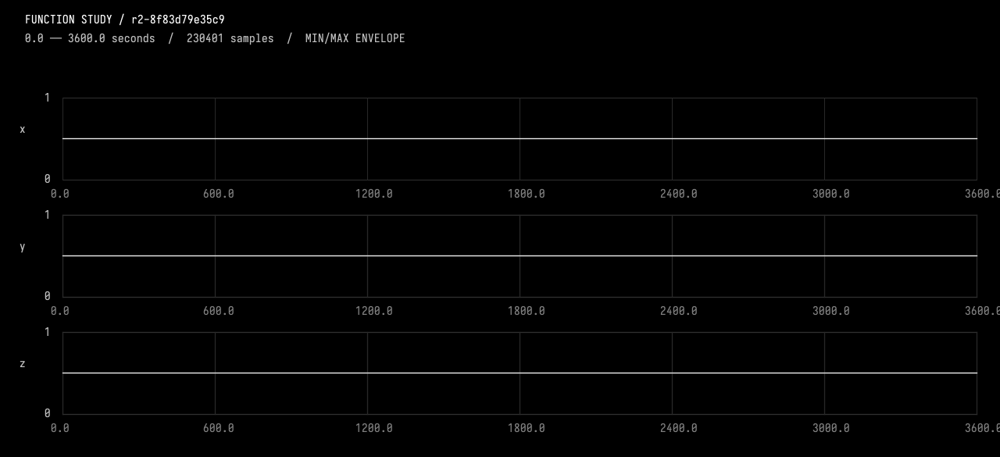
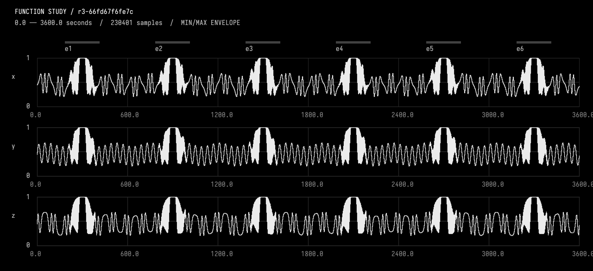
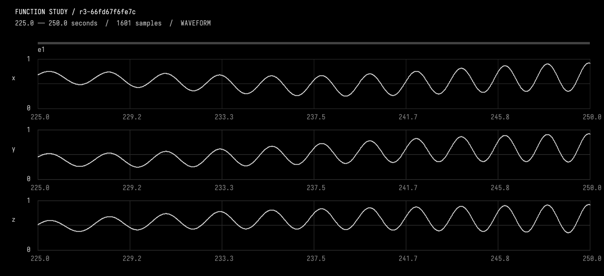
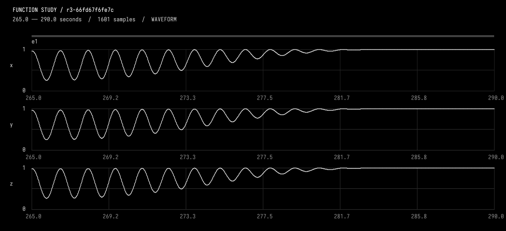

# 01-create

<<you>>
We are experimenting with talking a multivariate Functions.kt function into existence. Use the document-defined function study tools. Start by reading guides/working.md with DocumentGuideReadRequest and inspecting InspectFunctionStudy. The source box is function_source. Use EditFunctionStudy for candidate transactions (complete Kotlin source, expected revision and live source hash); this compiles and checks before activation. Do not edit this box via generic edit tools. All tool names and StudyComposition/StudyEvent API contracts are in the guide. Keep the Kotlin readable and self-contained.

I'd like a 3d function that lasts 1 hour. The function is generally smooth, and the dimensions vary in and out of phase smoothly over the order of 100 seconds. Six evenly spaced crescendos and decrescendos interrupt this, consisting of pulses that increase in frequency and amplitude until they remain at (1,1,1) for 30 seconds.

Interpret 3d as three time-dependent channels. Make reversible artistic assumptions, recording them separately from my requirements in StudyChoice. Use stable event IDs e1 through e6. The background continues below events and returns afterward; keep events away from boundaries. Please use integrated instantaneous frequency for the pulses, explicit exact constant holds, and smooth joins. Preserve named parameters so follow-up moves and rise changes are small edits. Inspect actual overview pixels plus a resolved <=25-second rise window and a plateau join. Check holds and join measurements, repair any concrete issue, then explain briefly what you chose. Do not keep optimising after a checked candidate.
<<progress>>
Starting AI conversation
Preparing context and tools.
<<progress>>
Planning tool use
Next tool: `DocumentGuideReadRequest`
<<progress>>
Using DocumentGuideReadRequest
{"lineCount":250,"path":"guides/working.md","startLine":1}
<<progress>>
DocumentGuideReadRequest finished
Read [guides/working.md](field://guide/guides/working.md) lines 1–82
<<progress>>
Planning tool use
Next tool: `InspectFunctionStudy`
<<progress>>
Using InspectFunctionStudy
{"revision":""}
<<progress>>
InspectFunctionStudy finished
keys=error,tool,message
<<progress>>
Planning tool use
Next tool: `InspectFunctionStudy`
<<progress>>
Using InspectFunctionStudy
{"revision":"current"}
<<progress>>
InspectFunctionStudy finished
r2-8f83d79e35c9 parent, description, durationSeconds, channels, events, choices, source, liveSourceHash, dirty, selectedIds, selectionSeconds, history, semantics images=0
<<progress>>
Planning the pulse amplitude
**Planning the pulse amplitude**

I'm trying to figure out how to construct a good pulse crescendo amplitude while keeping a close eye on my time budget. It's essential that I hold the right amplitude to ensure everything works harmoniously. I want to make sure the design meets whatever expectations there are while being time-efficient. I need to balance quality and time constraints effectively, which is always a challenge worth tackling! **Designing the pulse envelope**

I'm aiming to create a smooth increase in amplitude until it flattens near a documented plateau. The formula will blend a base and a pulse target with a smooth rise. For the pulse envelope, I'll work with specific values while avoiding bounds. I need to factor in a pulse signal that adjusts as the floor rises and the amplitude reduces towards zero. The final value should reflect a balance between the base and pulse, making sure everything integrates smoothly. I'll also consider frequency adjustments and phase excursions for alignment. **Determining the baseline capture**

I'm thinking about how to choose the right measurement, aiming for a baseline value around 0.45 with some sine wave adjustments. I want to ensure the capture process involves counting actual pixels, which should satisfy any visual requests. It's interesting to note that while the math function prefers using an overview, I should focus on capturing an accurate baseline first. There’s no need to render if it’s unrelated, so I’ll observe the conditions before proceeding with tools.

Next tool: `ObserveFunctionStudy`
<<progress>>
Using ObserveFunctionStudy
{"compareTo":"","endSeconds":3600,"revision":"r2-8f83d79e35c9","startSeconds":0}
<<progress>>
ObserveFunctionStudy finished
r2-8f83d79e35c9 intervalSeconds, comparedTo, sourceHash, channels, events, choices, selectedIds, sampling, extrema, holdChecks, joins, difference, imageFile, guarantees images=1
<<progress>>
Planning tool use
Next tool: `EditFunctionStudy`
<<progress>>
Using EditFunctionStudy
{"description":"One-hour drifting three-channel background with six evenly spaced, smooth chirp crescendos, exact holds and mirrored decrescendos.","expectedRevision":"r2-8f83d79e35c9","expectedSourceHash":"8f83d79e35c9d46b2a3c840be91a336958a3420904135dd1df01e2408d0f722a","source":"import afield.stdlib.Functions\nimport afield.stdlib.StudyComposition\nimport afield.stdlib.StudyEvent\nimport afield.stdlib.StudyChoice\nimport kotlin.math.*\n\nwith(Functions) {\n    val durationSeconds = 3600.0\n    val carrierPeriodSeconds = 40.0\n    val relativePhasePeriodSeconds = 100.0\n    val phaseExcursionRadians = 2.0 * PI / 3.0\n    val backgroundCenter = 0.45\n    val backgroundAmplitude = 0.20\n    ...
<<progress>>
EditFunctionStudy finished
keys=error,tool,message
<<progress>>
Planning tool use
Next tool: `InspectFunctionStudy`
<<progress>>
Using InspectFunctionStudy
{"revision":"current"}
<<progress>>
InspectFunctionStudy finished
r2-8f83d79e35c9 parent, description, durationSeconds, channels, events, choices, source, liveSourceHash, dirty, selectedIds, selectionSeconds, history, semantics images=0
<<progress>>
Planning tool use
Next tool: `EditFunctionStudy`
<<progress>>
Using EditFunctionStudy
{"description":"One-hour drifting three-channel background with six smooth chirp crescendos, exact holds and mirrored decrescendos; qualify scalar trigonometry.","expectedRevision":"r2-8f83d79e35c9","expectedSourceHash":"8f83d79e35c9d46b2a3c840be91a336958a3420904135dd1df01e2408d0f722a","source":"import afield.stdlib.Functions\nimport afield.stdlib.StudyComposition\nimport afield.stdlib.StudyEvent\nimport afield.stdlib.StudyChoice\nimport kotlin.math.PI\n\nwith(Functions) {\n    val durationSeconds = 3600.0\n    val carrierPeriodSeconds = 40.0\n    val relativePhasePeriodSeconds = 100.0\n    val phaseExcursionRadians = 2.0 * PI / 3.0\n    val backgroundCenter = 0.45\n    val backgroundAmplitu...
<<progress>>
EditFunctionStudy finished
r3-66fd67f6fe7c Compiled, checked and activated images=0
<<progress>>
Planning tool use
Next tool: `ObserveFunctionStudy`
<<progress>>
Using ObserveFunctionStudy
{"compareTo":"","endSeconds":3600,"revision":"r3-66fd67f6fe7c","startSeconds":0}
<<progress>>
ObserveFunctionStudy finished
r3-66fd67f6fe7c intervalSeconds, comparedTo, sourceHash, channels, events, choices, selectedIds, sampling, extrema, holdChecks, joins, difference, imageFile, guarantees images=1
<<progress>>
Planning tool use
Next tool: `ObserveFunctionStudy`
<<progress>>
Using ObserveFunctionStudy
{"compareTo":"","endSeconds":250,"revision":"r3-66fd67f6fe7c","startSeconds":225}
<<progress>>
ObserveFunctionStudy finished
r3-66fd67f6fe7c intervalSeconds, comparedTo, sourceHash, channels, events, choices, selectedIds, sampling, extrema, holdChecks, joins, difference, imageFile, guarantees images=1
<<progress>>
Planning tool use
Next tool: `ObserveFunctionStudy`
<<progress>>
Using ObserveFunctionStudy
{"compareTo":"","endSeconds":290,"revision":"r3-66fd67f6fe7c","startSeconds":265}
<<progress>>
ObserveFunctionStudy finished
r3-66fd67f6fe7c intervalSeconds, comparedTo, sourceHash, channels, events, choices, selectedIds, sampling, extrema, holdChecks, joins, difference, imageFile, guarantees images=1
<<progress>>
Clarifying compilation needs
**Clarifying compilation needs**

It seems I don't need any more tools for this task. The user has made it clear they want a specialized and explicit compilation. I should focus on this and avoid any unnecessary generic candidate compilations. Once I finalize, I'll ensure the details are concise and verified — no extra information needed. I think this approach should meet the user's requirements effectively!
<<ai>>
_r2-8f83d79e35c9; 0.0..3600.0 seconds. White=current; dashed grey=none. Inspect local waveforms before judging pulse rate; wide views are min/max envelopes._

<<ai>>
_r3-66fd67f6fe7c; 0.0..3600.0 seconds. White=current; dashed grey=none. Inspect local waveforms before judging pulse rate; wide views are min/max envelopes._

<<ai>>
_r3-66fd67f6fe7c; 225.0..250.0 seconds. White=current; dashed grey=none. Inspect local waveforms before judging pulse rate; wide views are min/max envelopes._

<<ai>>
_r3-66fd67f6fe7c; 265.0..290.0 seconds. White=current; dashed grey=none. Inspect local waveforms before judging pulse rate; wide views are min/max envelopes._

<<ai>>
Implemented and activated **`r3-66fd67f6fe7c`**.

- **Background:** three smooth channels with a 40-second carrier and relative phases drifting together and apart over 100 seconds.
- **Six events:** plateau centers at minutes **5, 15, 25, 35, 45, 55**. Each has a 100-second rise, exact **30-second `(1,1,1)` hold**, and 100-second fall.
- **Pulses:** integrated frequency sweeps from **0.06 to 0.8 Hz**, with growing pulse depth. During the final 20 seconds, troughs smoothly fill into the plateau; the fall reverses this gesture.
- The background continues underneath and returns without restarting. Named parameters and IDs **e1–e6** remain editable; artistic assumptions are recorded separately in `StudyChoice`.

**Verified:** compilation and admission checks passed. I inspected the hour overview, a resolved 25-second rise, and the plateau transition. All six holds measured **zero target error**; plateau slopes were effectively zero, and boundary slope measurements matched closely. No further tuning applied.