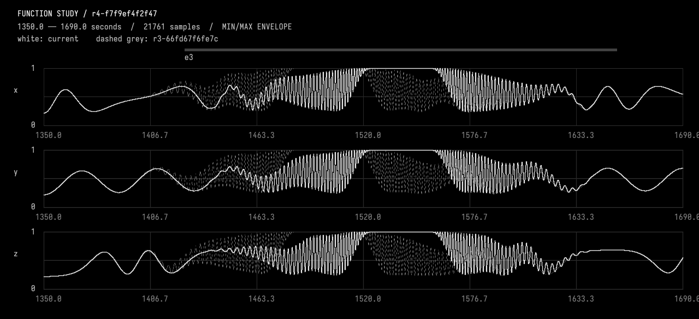
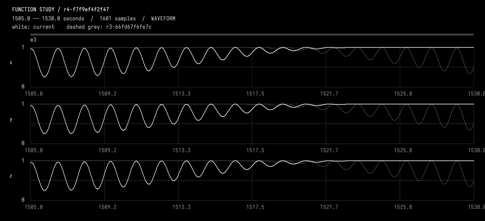
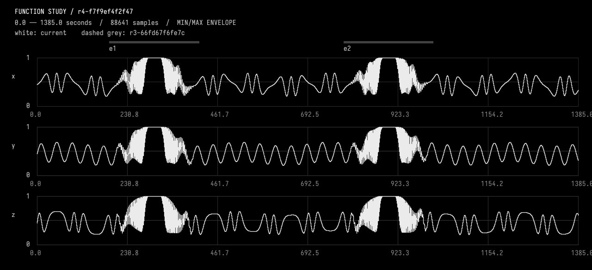
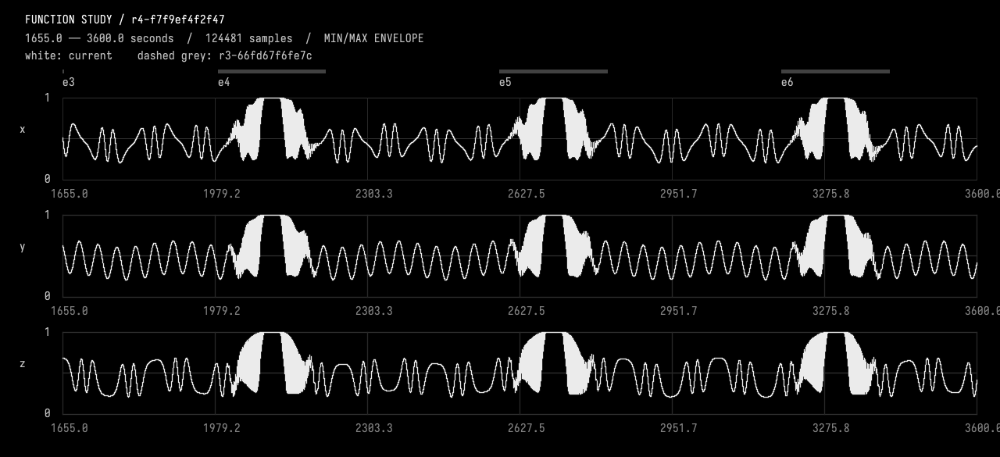

# 02-move

<<you>>
Move the third crescendo 40 seconds later. Preserve its identity and all its internal timing; keep every other event and the continuing background unchanged. Resolve "third" to a stable ID and select it before editing. Use the function study transaction tool, inspect the moved region and a resolved waveform, and numerically compare all regions outside the union of its old and new supports to the parent revision. Record that this request supersedes even spacing for that one event. Keep the response brief.
<<progress>>
Starting AI conversation
Preparing context and tools.
<<progress>>
Planning tool use
Next tool: `InspectFunctionStudy`
<<progress>>
Using InspectFunctionStudy
{"revision":"current"}
<<progress>>
InspectFunctionStudy finished
r3-66fd67f6fe7c parent, description, durationSeconds, channels, events, choices, source, liveSourceHash, dirty, selectedIds, selectionSeconds, history, semantics images=0
<<progress>>
Planning tool use
Next tool: `SelectFunctionStudy`
<<progress>>
Using SelectFunctionStudy
{"endSeconds":1615,"eventIds":["e3"],"startSeconds":1385}
<<progress>>
SelectFunctionStudy finished
r3-66fd67f6fe7c parent, description, durationSeconds, channels, events, choices, source, liveSourceHash, dirty, selectedIds, selectionSeconds, history, semantics images=0
<<progress>>
Planning tool use
Next tool: `EditFunctionStudy`
<<progress>>
Using EditFunctionStudy
{"description":"Move selected e3 40 seconds later; preserve all internal timing, other events and absolute-time background. Supersede even spacing for e3 only.","expectedRevision":"r3-66fd67f6fe7c","expectedSourceHash":"66fd67f6fe7cd2f7ebe0547d6d89386fc1fa418b54c419ea3fd590536ce5de19","source":"import afield.stdlib.Functions\nimport afield.stdlib.StudyComposition\nimport afield.stdlib.StudyEvent\nimport afield.stdlib.StudyChoice\nimport kotlin.math.PI\n\nwith(Functions) {\n    val durationSeconds = 3600.0\n    val carrierPeriodSeconds = 40.0\n    val relativePhasePeriodSeconds = 100.0\n    val phaseExcursionRadians = 2.0 * PI / 3.0\n    val backgroundCenter = 0.45\n    val backgroundAmplitud...
<<progress>>
EditFunctionStudy finished
r4-f7f9ef4f2f47 Compiled, checked and activated images=0
<<progress>>
Planning tool use
Next tool: `ObserveFunctionStudy`
<<progress>>
Using ObserveFunctionStudy
{"compareTo":"r3-66fd67f6fe7c","endSeconds":1690,"revision":"r4-f7f9ef4f2f47","startSeconds":1350}
<<progress>>
ObserveFunctionStudy finished
r4-f7f9ef4f2f47 intervalSeconds, comparedTo, sourceHash, channels, events, choices, selectedIds, sampling, extrema, holdChecks, joins, difference, imageFile, guarantees images=1
<<progress>>
Planning tool use
Next tool: `ObserveFunctionStudy`
<<progress>>
Using ObserveFunctionStudy
{"compareTo":"r3-66fd67f6fe7c","endSeconds":1530,"revision":"r4-f7f9ef4f2f47","startSeconds":1505}
<<progress>>
ObserveFunctionStudy finished
r4-f7f9ef4f2f47 intervalSeconds, comparedTo, sourceHash, channels, events, choices, selectedIds, sampling, extrema, holdChecks, joins, difference, imageFile, guarantees images=1
<<progress>>
Planning tool use
Next tool: `ObserveFunctionStudy`
<<progress>>
Using ObserveFunctionStudy
{"compareTo":"r3-66fd67f6fe7c","endSeconds":1385,"revision":"r4-f7f9ef4f2f47","startSeconds":0}
<<progress>>
ObserveFunctionStudy finished
r4-f7f9ef4f2f47 intervalSeconds, comparedTo, sourceHash, channels, events, choices, selectedIds, sampling, extrema, holdChecks, joins, difference, imageFile, guarantees images=1
<<progress>>
Planning tool use
Next tool: `ObserveFunctionStudy`
<<progress>>
Using ObserveFunctionStudy
{"compareTo":"r3-66fd67f6fe7c","endSeconds":3600,"revision":"r4-f7f9ef4f2f47","startSeconds":1655}
<<progress>>
ObserveFunctionStudy finished
r4-f7f9ef4f2f47 intervalSeconds, comparedTo, sourceHash, channels, events, choices, selectedIds, sampling, extrema, holdChecks, joins, difference, imageFile, guarantees images=1
<<ai>>
_r4-f7f9ef4f2f47; 1350.0..1690.0 seconds. White=current; dashed grey=r3-66fd67f6fe7c. Inspect local waveforms before judging pulse rate; wide views are min/max envelopes._

<<ai>>
_r4-f7f9ef4f2f47; 1505.0..1530.0 seconds. White=current; dashed grey=r3-66fd67f6fe7c. Inspect local waveforms before judging pulse rate; wide views are min/max envelopes._

<<ai>>
_r4-f7f9ef4f2f47; 0.0..1385.0 seconds. White=current; dashed grey=r3-66fd67f6fe7c. Inspect local waveforms before judging pulse rate; wide views are min/max envelopes._

<<ai>>
_r4-f7f9ef4f2f47; 1655.0..3600.0 seconds. White=current; dashed grey=r3-66fd67f6fe7c. Inspect local waveforms before judging pulse rate; wide views are min/max envelopes._

<<ai>>
Moved **e3**, selected before editing, **40 seconds later**:
- Start: **1425 s**
- Hold: **1525–1555 s**
- End: **1655 s**

Its identity and 100/30/100-second timing are preserved. `StudyChoice` records that this supersedes even spacing for **e3 only**.

Compiled and activated successfully. Inspected the moved region and a resolved 25-second waveform; hold error is zero and joins remain smooth. Against the parent revision, all three channels have **zero sampled difference** throughout **0–1385 s** and **1655–3600 s**, covering everything outside the old/new support union.