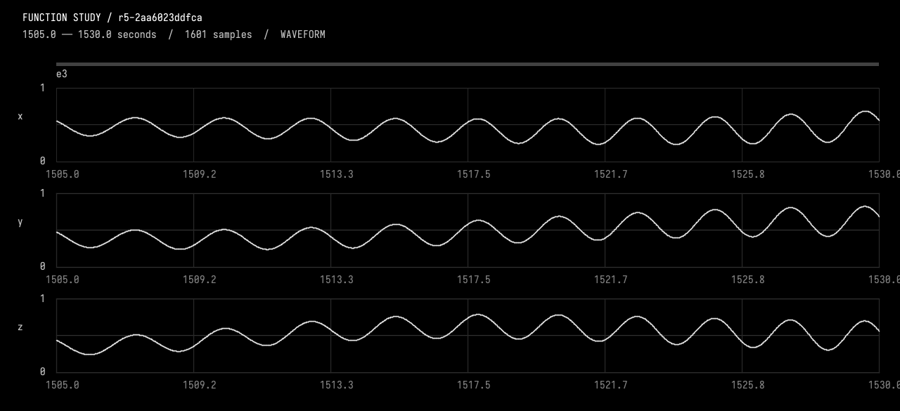
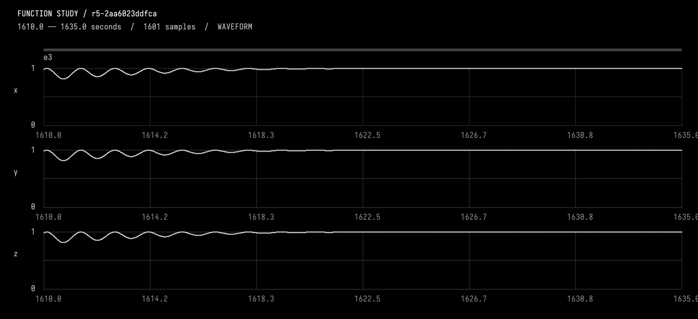
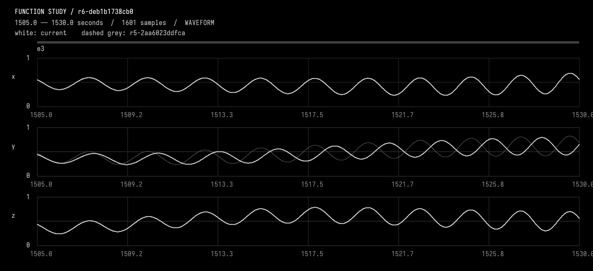
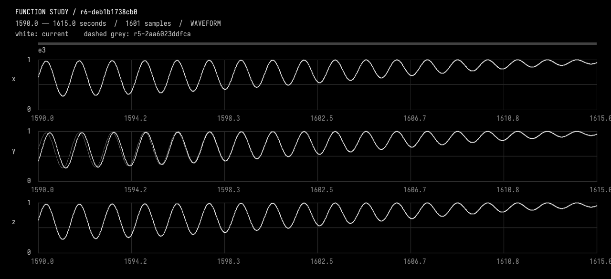
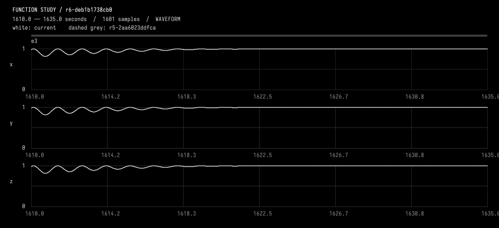

# 04-lag

<<you>>
We are resuming the saved function experiment after a runtime restart. The previous attempt was interrupted; neither failed candidate was activated. Working revision is r5-2aa6023ddfca; e3 is the intended event. Read guides/working.md and inspect current state. The CodeUse diagnostic stall is repaired. We identified a Wither compiler-plugin pitfall: a call to a LOCAL function as the last statement of a brace block can produce has no callableId. Verified workaround: use `val result = shoulder(base, localAge, event.rise)` followed by `result` instead of ending that branch with the bare call. Do not change the compiler/plugin. Use the existing function study tools and actual observations; write the candidate yourself.

Let the second dimension lag during that event, then catch up smoothly. Keep the other two channels exactly as they are, keep the 30-second shared all-ones hold, and preserve everything outside e3. Use a smooth, monotonic local-time lag during its rise which returns to zero lag with matching endpoint slopes before the hold; choose and state a modest peak lag. Treat this as an instance-specific override, not a change to all events. Inspect before editing. Use CompareFunctionStudy with only y allowed inside e3, inspect before/after local waveform pixels and the plateau join, and report the actual timing policy and measured preservation.
<<progress>>
Starting AI conversation
Preparing context and tools.
<<progress>>
Planning tool use
Next tool: `DocumentGuideReadRequest`
<<progress>>
Using DocumentGuideReadRequest
{"lineCount":250,"path":"guides/working.md","startLine":1}
<<progress>>
DocumentGuideReadRequest finished
Read [guides/working.md](field://guide/guides/working.md) lines 1–92
<<progress>>
Planning tool use
Next tool: `InspectFunctionStudy`
<<progress>>
Using InspectFunctionStudy
{"revision":""}
<<progress>>
InspectFunctionStudy finished
r5-2aa6023ddfca parent, description, durationSeconds, channels, events, choices, source, liveSourceHash, dirty, selectedIds, selectionSeconds, history, semantics images=0
<<progress>>
Planning tool use
Next tool: `SelectFunctionStudy`
<<progress>>
Using SelectFunctionStudy
{"endSeconds":1755,"eventIds":["e3"],"startSeconds":1425}
<<progress>>
SelectFunctionStudy finished
r5-2aa6023ddfca parent, description, durationSeconds, channels, events, choices, source, liveSourceHash, dirty, selectedIds, selectionSeconds, history, semantics images=0
<<progress>>
Planning tool use
Next tool: `ObserveFunctionStudy`
<<progress>>
Using ObserveFunctionStudy
{"compareTo":"","endSeconds":1530,"revision":"r5-2aa6023ddfca","startSeconds":1505}
<<progress>>
ObserveFunctionStudy finished
r5-2aa6023ddfca intervalSeconds, comparedTo, sourceHash, channels, events, choices, selectedIds, sampling, extrema, holdChecks, joins, difference, imageFile, guarantees, localPeaks images=1
<<progress>>
Planning tool use
Next tool: `ObserveFunctionStudy`
<<progress>>
Using ObserveFunctionStudy
{"compareTo":"","endSeconds":1635,"revision":"r5-2aa6023ddfca","startSeconds":1610}
<<progress>>
ObserveFunctionStudy finished
r5-2aa6023ddfca intervalSeconds, comparedTo, sourceHash, channels, events, choices, selectedIds, sampling, extrema, holdChecks, joins, difference, imageFile, guarantees, localPeaks images=1
<<progress>>
Planning tool use
Next tool: `EditFunctionStudy`
<<progress>>
Using EditFunctionStudy
{"description":"Instance-specific e3 y shoulder-clock lag: C2 bump peaking at 6 seconds, strictly advancing local time, recovered at 1605 before unchanged shared hold; preserve x/z and all other times.","expectedRevision":"r5-2aa6023ddfca","expectedSourceHash":"2aa6023ddfca13fa20c7c678abd282b93b2ccd10d9a1b68f6ac789a127ef91de","source":"import afield.stdlib.Functions\nimport afield.stdlib.StudyComposition\nimport afield.stdlib.StudyEvent\nimport afield.stdlib.StudyChoice\nimport kotlin.math.PI\n\nwith(Functions) {\n    val durationSeconds = 3600.0\n    val carrierPeriodSeconds = 40.0\n    val relativePhasePeriodSeconds = 100.0\n    val phaseExcursionRadians = 2.0 * PI / 3.0\n    val backgroun...
<<progress>>
EditFunctionStudy finished
r6-deb1b1738cb0 Compiled, checked and activated images=0
<<progress>>
Planning tool use
Next tool: `CompileKotlinRequest`
<<progress>>
Using CompileKotlinRequest
{"file":"afield://function_conversation/function_source/code","runSetupBlocks":false,"source":""}
<<progress>>
CompileKotlinRequest finished
success=true diagnostics=0 setupChanges=0
<<progress>>
Planning tool use
Next tool: `CompareFunctionStudy`
<<progress>>
Using CompareFunctionStudy
{"afterRevision":"r6-deb1b1738cb0","allowedChannels":["y"],"beforeRevision":"r5-2aa6023ddfca","changedEndSeconds":1755,"changedStartSeconds":1425}
<<progress>>
CompareFunctionStudy finished
r6-deb1b1738cb0 before, allowedIntervalSeconds, allowedChannels, preservedScope, changedEventIds, method images=0
<<progress>>
Planning tool use
Next tool: `ObserveFunctionStudy`
<<progress>>
Using ObserveFunctionStudy
{"compareTo":"r5-2aa6023ddfca","endSeconds":1530,"revision":"r6-deb1b1738cb0","startSeconds":1505}
<<progress>>
ObserveFunctionStudy finished
r6-deb1b1738cb0 intervalSeconds, comparedTo, sourceHash, channels, events, choices, selectedIds, sampling, extrema, holdChecks, joins, difference, imageFile, guarantees, localPeaks images=1
<<progress>>
Planning tool use
Next tool: `ObserveFunctionStudy`
<<progress>>
Using ObserveFunctionStudy
{"compareTo":"r5-2aa6023ddfca","endSeconds":1615,"revision":"r6-deb1b1738cb0","startSeconds":1590}
<<progress>>
ObserveFunctionStudy finished
r6-deb1b1738cb0 intervalSeconds, comparedTo, sourceHash, channels, events, choices, selectedIds, sampling, extrema, holdChecks, joins, difference, imageFile, guarantees, localPeaks images=1
<<progress>>
Planning tool use
Next tool: `ObserveFunctionStudy`
<<progress>>
Using ObserveFunctionStudy
{"compareTo":"r5-2aa6023ddfca","endSeconds":1635,"revision":"r6-deb1b1738cb0","startSeconds":1610}
<<progress>>
ObserveFunctionStudy finished
r6-deb1b1738cb0 intervalSeconds, comparedTo, sourceHash, channels, events, choices, selectedIds, sampling, extrema, holdChecks, joins, difference, imageFile, guarantees, localPeaks images=1
<<progress>>
Planning tool use
Next tool: `CompareFunctionStudy`
<<progress>>
Using CompareFunctionStudy
{"afterRevision":"r6-deb1b1738cb0","allowedChannels":["y"],"beforeRevision":"r5-2aa6023ddfca","changedEndSeconds":1605,"changedStartSeconds":1425}
<<progress>>
CompareFunctionStudy finished
r6-deb1b1738cb0 before, allowedIntervalSeconds, allowedChannels, preservedScope, changedEventIds, method images=0
<<progress>>
Planning tool use
Next tool: `DocumentGuideAppendRequest`
<<progress>>
Using DocumentGuideAppendRequest
{"path":"guides/working.md","revision":"10694df3cd888ee8ef1985f132d55407f4b059ee97a644dad236303b314ac329","text":"\n## Resumed experiment: e3 y lag (activated)\n\n- Restart inspection confirmed clean r5-2aa6023ddfca; selected e3, support 1425..1755 s, rise 200 s, shared hold 1625..1655 s. New working revision: **r6-deb1b1738cb0**, parent r5.\n- Instance-specific override only for e3/y: shoulder age `a - L`, where `L = 6*64*u^3*(1-u)^3`, `u=a/180`, for age 0..180 s; identity thereafter. Peak local-clock lag 6 s at absolute time 1515; zero lag by 1605, 20 s before hold. Local clock is strictly increasing: analytic rate bounds approximately 0.8855..1.1145, endpoint rate 1 and curvature 0. Lag i...
<<progress>>
DocumentGuideAppendRequest finished
Guide changed or already exists. Read guides/working.md again and reconcile; nothing was overwritten.
<<progress>>
Planning tool use
Next tool: `DocumentGuideReadRequest`
<<progress>>
Using DocumentGuideReadRequest
{"lineCount":200,"path":"guides/working.md","startLine":85}
<<progress>>
DocumentGuideReadRequest finished
Read [guides/working.md](field://guide/guides/working.md) lines 85–98
<<progress>>
Planning tool use
Next tool: `DocumentGuideReadRequest`
<<progress>>
Using DocumentGuideReadRequest
{"lineCount":100,"path":"guides/working.md","startLine":1}
<<progress>>
DocumentGuideReadRequest finished
Read [guides/working.md](field://guide/guides/working.md) lines 1–98
<<progress>>
Planning tool use
Next tool: `DocumentGuideAppendRequest`
<<progress>>
Using DocumentGuideAppendRequest
{"path":"guides/working.md","revision":"5765f50f427d1caea99704e3075839818a5f72329cb89fe9f60dbac9a5db380a","text":"\n## Resumed experiment: e3 y lag (activated)\n\n- Restart inspection confirmed clean r5-2aa6023ddfca; selected e3. New working revision: **r6-deb1b1738cb0**, parent r5. Event metadata unchanged: e3 support 1425..1755 s, rise 200 s, shared hold 1625..1655 s.\n- Instance-specific e3/y shoulder age is `a - L`, with `L = 6*64*u^3*(1-u)^3`, `u=a/180`, for age 0..180 s; identity thereafter. Peak local-clock lag 6 s at absolute time 1515; recovered by 1605, 20 s before hold. Analytic clock-rate bounds approximately 0.8855..1.1145, endpoint rate 1 and curvature 0: local time strictly ad...
<<progress>>
DocumentGuideAppendRequest finished
Saved [guides/working.md](field://guide/guides/working.md)
<<ai>>
_r5-2aa6023ddfca; 1505.0..1530.0 seconds. White=current; dashed grey=none. Inspect local waveforms before judging pulse rate; wide views are min/max envelopes._

<<ai>>
_r5-2aa6023ddfca; 1610.0..1635.0 seconds. White=current; dashed grey=none. Inspect local waveforms before judging pulse rate; wide views are min/max envelopes._

<<ai>>
_r6-deb1b1738cb0; 1505.0..1530.0 seconds. White=current; dashed grey=r5-2aa6023ddfca. Inspect local waveforms before judging pulse rate; wide views are min/max envelopes._

<<ai>>
_r6-deb1b1738cb0; 1590.0..1615.0 seconds. White=current; dashed grey=r5-2aa6023ddfca. Inspect local waveforms before judging pulse rate; wide views are min/max envelopes._

<<ai>>
_r6-deb1b1738cb0; 1610.0..1635.0 seconds. White=current; dashed grey=r5-2aa6023ddfca. Inspect local waveforms before judging pulse rate; wide views are min/max envelopes._

<<ai>>
Activated **r6-deb1b1738cb0**, changing only **e3’s y rise**.

### Timing policy
- **Peak local-time lag: 6 seconds at 1515 s.**
- Lag follows \(6\cdot64u^3(1-u)^3\), with \(u=(t-1425)/180\).
- The local clock always advances: its rate stays approximately **0.8855–1.1145**.
- Fully caught up at **1605 s**, with matching slope and curvature—20 seconds before the unchanged **1625–1655 s shared all-ones hold**.
- Only the pulse phase and shoulder envelopes use delayed time; the background continues on absolute time.

### Verification
- Kotlin compiled successfully using the local-result workaround; **no compiler/plugin changes**.
- Inspected before/after waveform pixels, catch-up, and the plateau join.
- Whole-hour comparisons at ≤20 ms spacing plus event joins measured **zero maximum and RMS error** for:
  - **x and z everywhere**
  - **y outside e3**
  - Additionally, **y outside the tighter 1425–1605 s interval**, preserving the recovered rise, hold, and fall.
- Hold target error was **0**; plateau-entry slope was numerically zero (~\(5.6\times10^{-12}\)).

These are sampled measurements, supported by the instance-specific source restriction. Saved the timing policy and evidence in [working notes](field://guide/guides/working.md).