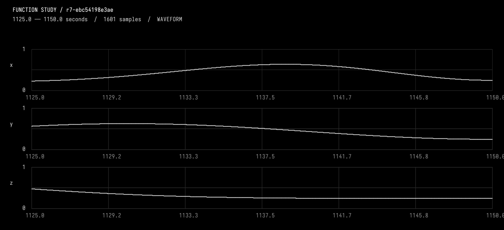
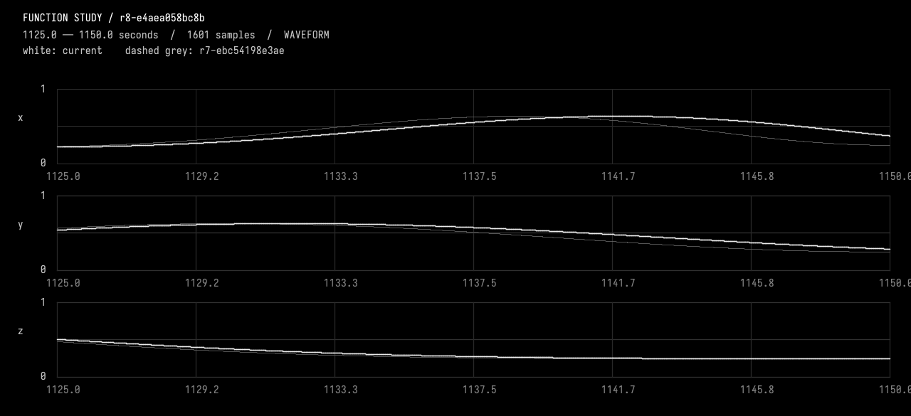
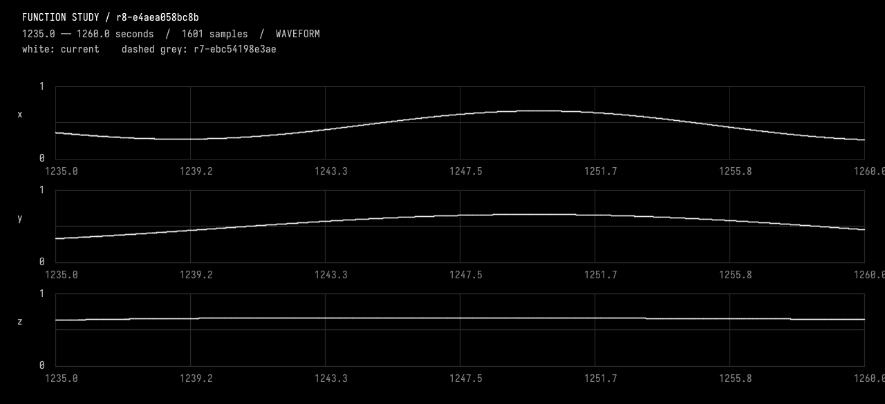

# 06-warp

<<you>>
In the background-only passage from 1100 to 1250 seconds, slow the first half and catch up in the second half without moving either neighbouring event. Use a strictly monotonic time warp pinned at both endpoints with derivative 1 there; keep all other times and the current event instances unchanged. Treat the endpoints as my selected interval. State the map and show why its derivative stays positive. Use a modest reversible strength, inspect a resolved before/after detail, and verify the whole preserved domain with CompareFunctionStudy. Do not warp event metadata or move the held plateaus.
<<progress>>
Starting AI conversation
Preparing context and tools.
<<progress>>
Planning tool use
Next tool: `InspectFunctionStudy`
<<progress>>
Using InspectFunctionStudy
{"revision":""}
<<progress>>
InspectFunctionStudy finished
r7-ebc54198e3ae parent, description, durationSeconds, channels, events, choices, source, liveSourceHash, dirty, selectedIds, selectionSeconds, history, semantics images=0
<<progress>>
Planning tool use
Next tool: `SelectFunctionStudy`
<<progress>>
Using SelectFunctionStudy
{"endSeconds":1250,"eventIds":[],"startSeconds":1100}
<<progress>>
SelectFunctionStudy finished
r7-ebc54198e3ae parent, description, durationSeconds, channels, events, choices, source, liveSourceHash, dirty, selectedIds, selectionSeconds, history, semantics images=0
<<progress>>
Planning tool use
Next tool: `ObserveFunctionStudy`
<<progress>>
Using ObserveFunctionStudy
{"compareTo":"","endSeconds":1150,"revision":"r7-ebc54198e3ae","startSeconds":1125}
<<progress>>
ObserveFunctionStudy finished
r7-ebc54198e3ae intervalSeconds, comparedTo, sourceHash, channels, events, choices, selectedIds, sampling, extrema, holdChecks, joins, difference, imageFile, guarantees, localPeaks images=1
<<progress>>
Planning tool use
Next tool: `EditFunctionStudy`
<<progress>>
Using EditFunctionStudy
{"description":"Warp only background passage 1100..1250 with a 6-second C2 delay bump: slow first half, catch up second, positive clock rate and pinned endpoints; preserve all events and other times.","expectedRevision":"r7-ebc54198e3ae","expectedSourceHash":"ebc54198e3aea15a0ca6ce900be84524d3d9ea946a54fd81939f042ac0616f42","source":"import afield.stdlib.Functions\nimport afield.stdlib.StudyComposition\nimport afield.stdlib.StudyEvent\nimport afield.stdlib.StudyChoice\nimport kotlin.math.PI\n\nwith(Functions) {\n    val durationSeconds = 3600.0\n    val carrierPeriodSeconds = 40.0\n    val relativePhasePeriodSeconds = 100.0\n    val phaseExcursionRadians = 2.0 * PI / 3.0\n    val backgroundC...
<<progress>>
EditFunctionStudy finished
r8-e4aea058bc8b Compiled, checked and activated images=0
<<progress>>
Planning tool use
Next tool: `CompileKotlinRequest`
<<progress>>
Using CompileKotlinRequest
{"file":"afield://function_conversation/function_source/code","runSetupBlocks":false,"source":""}
<<progress>>
CompileKotlinRequest finished
success=true diagnostics=0 setupChanges=0
<<progress>>
Planning tool use
Next tool: `CompareFunctionStudy`
<<progress>>
Using CompareFunctionStudy
{"afterRevision":"r8-e4aea058bc8b","allowedChannels":["x","y","z"],"beforeRevision":"r7-ebc54198e3ae","changedEndSeconds":1250,"changedStartSeconds":1100}
<<progress>>
CompareFunctionStudy finished
r8-e4aea058bc8b before, allowedIntervalSeconds, allowedChannels, preservedScope, changedEventIds, method images=0
<<progress>>
Planning tool use
Next tool: `ObserveFunctionStudy`
<<progress>>
Using ObserveFunctionStudy
{"compareTo":"r7-ebc54198e3ae","endSeconds":1150,"revision":"r8-e4aea058bc8b","startSeconds":1125}
<<progress>>
ObserveFunctionStudy finished
r8-e4aea058bc8b intervalSeconds, comparedTo, sourceHash, channels, events, choices, selectedIds, sampling, extrema, holdChecks, joins, difference, imageFile, guarantees, localPeaks images=1
<<progress>>
Planning tool use
Next tool: `ObserveFunctionStudy`
<<progress>>
Using ObserveFunctionStudy
{"compareTo":"r7-ebc54198e3ae","endSeconds":1260,"revision":"r8-e4aea058bc8b","startSeconds":1235}
<<progress>>
ObserveFunctionStudy finished
r8-e4aea058bc8b intervalSeconds, comparedTo, sourceHash, channels, events, choices, selectedIds, sampling, extrema, holdChecks, joins, difference, imageFile, guarantees, localPeaks images=1
<<progress>>
Calculating derivatives and endpoints
**Calculating derivatives and endpoints**

I need to get the correct derivative! I had an earlier maximum at u .276. The derivative of \( u^2 v^2(1-2u) \) simplifies to \( 2uv(1-2u)^2 - 2u^2v^2 \). This leads to a final proof and a coarse bound of .52, which should be enough for the exact values. I also want to sample endpoints and examine the differences with earlier results. I’ll append those to my saved notes for reference.

Next tool: `SampleFunctionStudy`
<<progress>>
Using SampleFunctionStudy
{"revision":"r7-ebc54198e3ae","timesSeconds":[1100,1250]}
<<progress>>
SampleFunctionStudy finished
r7-ebc54198e3ae timesSeconds, channelNames, values, method images=0
<<progress>>
Planning tool use
Next tool: `SampleFunctionStudy`
<<progress>>
Using SampleFunctionStudy
{"revision":"r8-e4aea058bc8b","timesSeconds":[1100,1250]}
<<progress>>
SampleFunctionStudy finished
r8-e4aea058bc8b timesSeconds, channelNames, values, method images=0
<<progress>>
Planning tool use
Next tool: `DocumentGuideReadRequest`
<<progress>>
Using DocumentGuideReadRequest
{"lineCount":100,"path":"guides/working.md","startLine":99}
<<progress>>
DocumentGuideReadRequest finished
Read [guides/working.md](field://guide/guides/working.md) lines 99–106
<<progress>>
Planning tool use
Next tool: `DocumentGuideAppendRequest`
<<progress>>
Using DocumentGuideAppendRequest
{"path":"guides/working.md","revision":"928435b69837055f6b2f994d58cada7adbc7ebd648de9b0f5c6022ae4d28db16","text":"\n## Background passage warp (activated after e4 deletion)\n\n- r7-ebc54198e3ae removed only e4 (1985..2215 s), retaining r6 in history. Compare r6 -> r7: all channels outside that support have maxAbs/RMS 0 across 168500 samples each. Current event IDs remain e1/e2/e3/e5/e6.\n- New working revision **r8-e4aea058bc8b**, parent r7. Selected interval is 1100..1250 s with no event IDs. It lies between e2 end 1015 and e3 start 1425.\n- All background components/channels use T(t)=t-A*64*u^3*(1-u)^3, u=(t-1100)/150, A=6 seconds, only inside that interval; identity elsewhere. Peak delay ...
<<progress>>
DocumentGuideAppendRequest finished
Saved [guides/working.md](field://guide/guides/working.md)
<<ai>>
_r7-ebc54198e3ae; 1125.0..1150.0 seconds. White=current; dashed grey=none. Inspect local waveforms before judging pulse rate; wide views are min/max envelopes._

<<ai>>
_r8-e4aea058bc8b; 1125.0..1150.0 seconds. White=current; dashed grey=r7-ebc54198e3ae. Inspect local waveforms before judging pulse rate; wide views are min/max envelopes._

<<ai>>
_r8-e4aea058bc8b; 1235.0..1260.0 seconds. White=current; dashed grey=r7-ebc54198e3ae. Inspect local waveforms before judging pulse rate; wide views are min/max envelopes._

<<ai>>
Activated **r8-e4aea058bc8b**, with **1100–1250 s selected**.

### Time map
All three background channels now use
\[
T(t)=t-6\cdot64u^3(1-u)^3,\qquad u=\frac{t-1100}{150}
\]
inside the interval, and \(T(t)=t\) everywhere else.

This gives a **6-second maximum delay at 1175 s**, slowing the first half and catching up in the second. Both endpoints are fixed, with \(T'=1\) and \(T''=0\).

Its derivative is
\[
T'(t)=1-\frac6{150}\,192u^2(1-u)^2(1-2u).
\]
Since the absolute polynomial factor is bounded by \(192/(25\sqrt5)\), **\(0.8626\le T'\le1.1374\)**: time always advances. The map is invertible; setting `backgroundWarpPeakDelaySeconds` to zero restores the original clock.

### Verified
- Inspected resolved before/after waveforms at **1125–1150 s**, plus recovery at **1235–1260 s**.
- Exact endpoint values match the previous revision.
- `CompareFunctionStudy`: **zero maximum and RMS error outside the selected interval**, over **172,500 samples per channel**, with **no changed event metadata**.
- All event instances, held plateaus, and **e3’s timing and y lag** remain unchanged.
- Kotlin compilation passed.

Saved the map and evidence in [working notes](field://guide/guides/working.md).