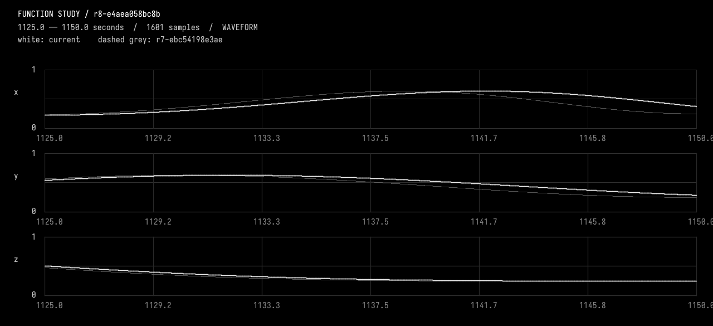
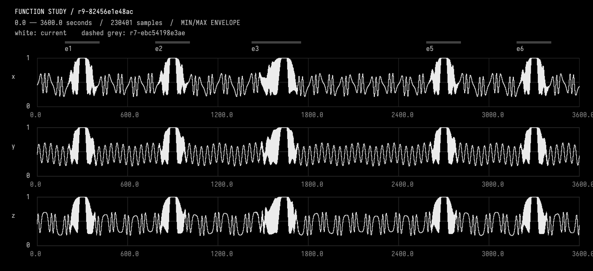

# 07-restore-background

<<you>>
Restore the previous unwarped background, but keep all current event timings, e3's second-channel lag, and the deletion of e4. Use the historical source as a reference and create a new checked revision, not a rollback that loses the event work. Compare the result against the revision just before the background warp and demonstrate equality over the whole hour. Show the current overview, and give a concise summary of what this conversation has preserved.
<<progress>>
Starting AI conversation
Preparing context and tools.
<<progress>>
Planning tool use
Next tool: `InspectFunctionStudy`
<<progress>>
Using InspectFunctionStudy
{"revision":""}
<<progress>>
InspectFunctionStudy finished
r8-e4aea058bc8b parent, description, durationSeconds, channels, events, choices, source, liveSourceHash, dirty, selectedIds, selectionSeconds, history, semantics images=0
<<progress>>
Planning tool use
Next tool: `InspectFunctionStudy`
<<progress>>
Using InspectFunctionStudy
{"revision":"r7-ebc54198e3ae"}
<<progress>>
InspectFunctionStudy finished
r7-ebc54198e3ae parent, description, durationSeconds, channels, events, choices, source, liveSourceHash, dirty, selectedIds, selectionSeconds, history, semantics images=0
<<progress>>
Planning tool use
Next tool: `ObserveFunctionStudy`
<<progress>>
Using ObserveFunctionStudy
{"compareTo":"r7-ebc54198e3ae","endSeconds":1150,"revision":"r8-e4aea058bc8b","startSeconds":1125}
<<progress>>
ObserveFunctionStudy finished
r8-e4aea058bc8b intervalSeconds, comparedTo, sourceHash, channels, events, choices, selectedIds, sampling, extrema, holdChecks, joins, difference, imageFile, guarantees, localPeaks images=1
<<progress>>
Planning tool use
Next tool: `EditFunctionStudy`
<<progress>>
Using EditFunctionStudy
{"description":"Restore unwarped background using historical r7 source passage; new child of r8 preserving all current events, e3 y lag and e4 deletion; retain warp experiment in history.","expectedRevision":"r8-e4aea058bc8b","expectedSourceHash":"e4aea058bc8b7496a7f4c8856f8a4b23ebf7aa9c283bfa35aaaf48d235938152","source":"import afield.stdlib.Functions\nimport afield.stdlib.StudyComposition\nimport afield.stdlib.StudyEvent\nimport afield.stdlib.StudyChoice\nimport kotlin.math.PI\n\nwith(Functions) {\n    val durationSeconds = 3600.0\n    val carrierPeriodSeconds = 40.0\n    val relativePhasePeriodSeconds = 100.0\n    val phaseExcursionRadians = 2.0 * PI / 3.0\n    val backgroundCenter = 0.45...
<<progress>>
EditFunctionStudy finished
r9-82456e1e48ac Compiled, checked and activated images=0
<<progress>>
Planning tool use
Next tool: `CompileKotlinRequest`
<<progress>>
Using CompileKotlinRequest
{"file":"afield://function_conversation/function_source/code","runSetupBlocks":false,"source":""}
<<progress>>
CompileKotlinRequest finished
success=true diagnostics=0 setupChanges=0
<<progress>>
Planning tool use
Next tool: `CompareFunctionStudy`
<<progress>>
Using CompareFunctionStudy
{"afterRevision":"r9-82456e1e48ac","allowedChannels":[],"beforeRevision":"r7-ebc54198e3ae","changedEndSeconds":0,"changedStartSeconds":0}
<<progress>>
CompareFunctionStudy finished
r9-82456e1e48ac before, allowedIntervalSeconds, allowedChannels, preservedScope, changedEventIds, method images=0
<<progress>>
Planning tool use
Next tool: `ObserveFunctionStudy`
<<progress>>
Using ObserveFunctionStudy
{"compareTo":"r7-ebc54198e3ae","endSeconds":3600,"revision":"r9-82456e1e48ac","startSeconds":0}
<<progress>>
ObserveFunctionStudy finished
r9-82456e1e48ac intervalSeconds, comparedTo, sourceHash, channels, events, choices, selectedIds, sampling, extrema, holdChecks, joins, difference, imageFile, guarantees, localPeaks images=1
<<progress>>
Planning tool use
Next tool: `DocumentGuideReadRequest`
<<progress>>
Using DocumentGuideReadRequest
{"lineCount":80,"path":"guides/working.md","startLine":107}
<<progress>>
DocumentGuideReadRequest finished
Read [guides/working.md](field://guide/guides/working.md) lines 107–115
<<progress>>
Planning tool use
Next tool: `DocumentGuideAppendRequest`
<<progress>>
Using DocumentGuideAppendRequest
{"path":"guides/working.md","revision":"11c6f0120cec3de59c6e122c19efbc7acfb9e84409be8a0677d58fe87f308cac","text":"\n## Unwarped background restored; event work preserved\n\n- Current working revision **r9-82456e1e48ac**, a new checked child of r8-e4aea058bc8b. Inspected historical r7-ebc54198e3ae and restored its direct `background(seconds, index)` evaluation, removing only the background warp constants/map. Current event declarations and evaluators were retained; historical warp choices are explicitly superseded by the restoration choice. No history was discarded.\n- CompareFunctionStudy against pre-warp r7 with **allowedChannels=[]**: whole-hour 0..3600 evaluation at <=20 ms plus declared ...
<<progress>>
DocumentGuideAppendRequest finished
Saved [guides/working.md](field://guide/guides/working.md)
<<ai>>
_r8-e4aea058bc8b; 1125.0..1150.0 seconds. White=current; dashed grey=r7-ebc54198e3ae. Inspect local waveforms before judging pulse rate; wide views are min/max envelopes._

<<ai>>
_r9-82456e1e48ac; 0.0..3600.0 seconds. White=current; dashed grey=r7-ebc54198e3ae. Inspect local waveforms before judging pulse rate; wide views are min/max envelopes._

<<ai>>
Restored the unwarped background in **r9-82456e1e48ac**, a new checked child of r8—not a rollback. I used historical **r7-ebc54198e3ae** to restore direct absolute-time background evaluation.

### Whole-hour equality
Compared against pre-warp r7 with **no channels allowed to change**:
- **180,001 samples per channel**, covering 0–3600 s at ≤20 ms spacing plus event joins.
- **Maximum error: 0; RMS error: 0** for x, y, and z.
- No event metadata differences.

The overview above also overlays r7 exactly at the sampled points. Kotlin compilation passed.

### Preserved through this conversation
- **e3:** start **1425 s**, 200-second rise, shared all-ones hold **1625–1655 s**, end **1755 s**.
- **e3’s y lag:** 6-second peak, smoothly recovered by **1605 s**.
- **e4 remains deleted**, revealing the continuing background.
- **e1, e2, e5, e6** retain their timings and stable IDs.
- All five **30-second holds** remain intact.
- Revision history retains both the background-warp experiment and the version containing e4.

Recorded in [working notes](field://guide/guides/working.md).