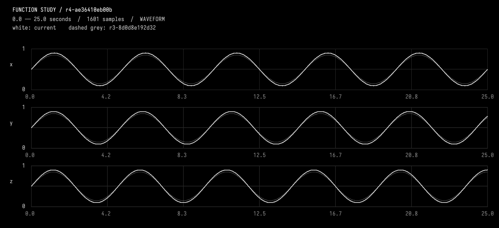

# Compact edit and export replay — 22 September 2026

This actual AI4 conversation ran on a separate 60-second fixture, not the main
composition. It used InspectFunctionStudy, PatchFunctionStudy, ExportFunctionStudy
in that order; no extra CompileKotlin or ObserveFunctionStudy call.

- Total bridge time: 15.506 s; model requests: 13.402 s; tools: 1.541 s.
- The patch returned compilation/check evidence and a real before/after image.
- Export wrote and verified a, b, c at 100 Hz, scaled by 100, without headers.
- Each file has 6,001 rows including the exact 60-second endpoint.
- The previous replay took 16.269 s with the same three-tool sequence.
- These are small-edit measurements, not a claimed speedup for arbitrary changes.

**User**
Increase gain from 0.35 to 0.4, keeping the duration and frequencies unchanged, and re-export a, b and c with the same 100 Hz, signal times 100 format.

*Progress*
Starting AI conversation

*Progress*
InspectFunctionStudy finished (222 ms)

*Progress*
PatchFunctionStudy finished (1254 ms)

*Progress*
ExportFunctionStudy finished (65 ms)

*Progress*
Completed
**AI4 — gpt-6-astra / OpenAI**
_r4-ae36410eb00b; 0.0..25.0 seconds. White=current; dashed grey=r3-8d0d8e192d32. Inspect local waveforms before judging pulse rate; wide views are min/max envelopes._

**AI4 — gpt-6-astra / OpenAI**
Updated gain to **0.4**, leaving the **60-second duration** and frequencies **0.2, 0.205, and 0.21 Hz** unchanged.

Re-exported and verified `files/a`, `files/b`, and `files/c`:
- **100 Hz**, with columns `time in seconds, signal × 100`
- No header; **6,001 rows each**, including the endpoint

Compilation and checks passed; the waveform preview confirms increased amplitude with unchanged timing.