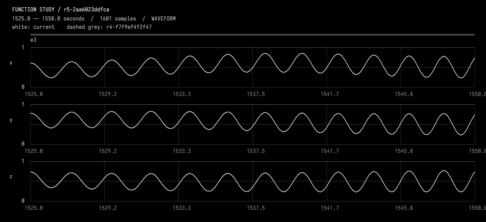
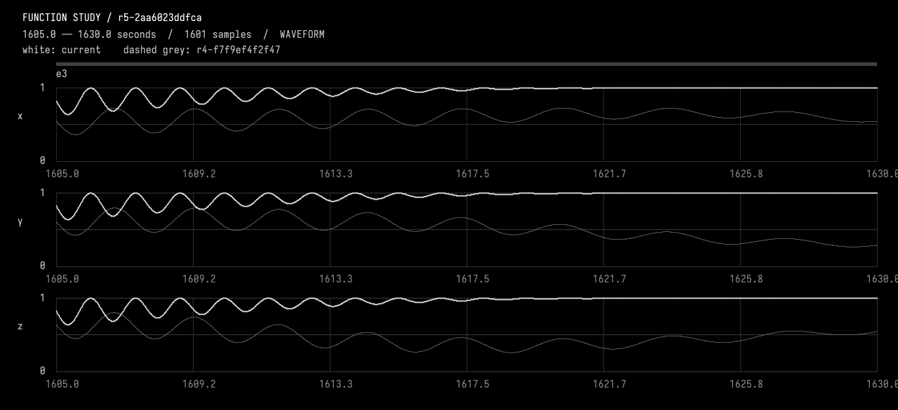

# 03-stretch

<<you>>
Make that event's rise twice as long, but keep its hold at 30 seconds. Keep its start pinned at the new position, move only its own later joins, and preserve every other event and the background. Continue using its selected stable ID rather than re-resolving the ordinal. Inspect current source first; use EditFunctionStudy. The tools have just gained CompareFunctionStudy for a compact whole-domain preservation check and local peak measurements in ObserveFunctionStudy. Compare only the affected union of supports, inspect a resolved pulse window and the new plateau join, and report the resulting times and checks briefly. This changes the frequency ramp duration but keeps the low/high Hz endpoints; do not ripple neighbouring events.
<<progress>>
Starting AI conversation
Preparing context and tools.
<<progress>>
Planning tool use
Next tool: `InspectFunctionStudy`
<<progress>>
Using InspectFunctionStudy
{"revision":"current"}
<<progress>>
InspectFunctionStudy finished
r4-f7f9ef4f2f47 parent, description, durationSeconds, channels, events, choices, source, liveSourceHash, dirty, selectedIds, selectionSeconds, history, semantics images=0
<<progress>>
Planning tool use
Next tool: `EditFunctionStudy`
<<progress>>
Using EditFunctionStudy
{"description":"Double selected e3 rise to 200 seconds with start pinned at 1425; keep 30-second hold, 100-second fall and Hz endpoints; no changes to other events or background.","expectedRevision":"r4-f7f9ef4f2f47","expectedSourceHash":"f7f9ef4f2f47f0097bb2a400927fdc601a1d8ea9a0fdd0defafa07c47c8a2abf","source":"import afield.stdlib.Functions\nimport afield.stdlib.StudyComposition\nimport afield.stdlib.StudyEvent\nimport afield.stdlib.StudyChoice\nimport kotlin.math.PI\n\nwith(Functions) {\n    val durationSeconds = 3600.0\n    val carrierPeriodSeconds = 40.0\n    val relativePhasePeriodSeconds = 100.0\n    val phaseExcursionRadians = 2.0 * PI / 3.0\n    val backgroundCenter = 0.45\n    val...
<<progress>>
EditFunctionStudy finished
r5-2aa6023ddfca Compiled, checked and activated images=0
<<progress>>
Planning tool use
Next tool: `CompareFunctionStudy`
<<progress>>
Using CompareFunctionStudy
{"afterRevision":"r5-2aa6023ddfca","allowedChannels":["x","y","z"],"beforeRevision":"r4-f7f9ef4f2f47","changedEndSeconds":1755,"changedStartSeconds":1425}
<<progress>>
CompareFunctionStudy finished
r5-2aa6023ddfca before, allowedIntervalSeconds, allowedChannels, preservedScope, changedEventIds, method images=0
<<progress>>
Planning tool use
Next tool: `ObserveFunctionStudy`
<<progress>>
Using ObserveFunctionStudy
{"compareTo":"r4-f7f9ef4f2f47","endSeconds":1550,"revision":"r5-2aa6023ddfca","startSeconds":1525}
<<progress>>
ObserveFunctionStudy finished
r5-2aa6023ddfca intervalSeconds, comparedTo, sourceHash, channels, events, choices, selectedIds, sampling, extrema, holdChecks, joins, difference, imageFile, guarantees, localPeaks images=1
<<progress>>
Planning tool use
Next tool: `ObserveFunctionStudy`
<<progress>>
Using ObserveFunctionStudy
{"compareTo":"r4-f7f9ef4f2f47","endSeconds":1630,"revision":"r5-2aa6023ddfca","startSeconds":1605}
<<progress>>
ObserveFunctionStudy finished
r5-2aa6023ddfca intervalSeconds, comparedTo, sourceHash, channels, events, choices, selectedIds, sampling, extrema, holdChecks, joins, difference, imageFile, guarantees, localPeaks images=1
<<ai>>
_r5-2aa6023ddfca; 1525.0..1550.0 seconds. White=current; dashed grey=r4-f7f9ef4f2f47. Inspect local waveforms before judging pulse rate; wide views are min/max envelopes._

<<ai>>
_r5-2aa6023ddfca; 1605.0..1630.0 seconds. White=current; dashed grey=r4-f7f9ef4f2f47. Inspect local waveforms before judging pulse rate; wide views are min/max envelopes._

<<ai>>
Updated selected **e3** and activated the checked candidate.

| Segment | Time |
|---|---|
| Rise — now 200 s | **1425–1625 s** |
| Hold — unchanged 30 s | **1625–1655 s** |
| Fall — unchanged 100 s | **1655–1755 s** |

The integrated rise ramp retains **0.06–0.80 Hz** endpoints. No neighbouring events moved.

**Checks:** compilation passed; whole-domain comparison found **zero sampled max/RMS error** outside the affected union **1425–1755 s**, with only e3’s metadata changed. Inspected two resolved 25-second windows: pulse spacing decreases as expected, the plateau joins smoothly, and hold error is **zero**. Recorded the change in `StudyChoice`.