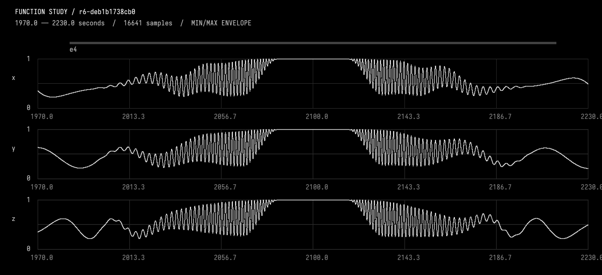
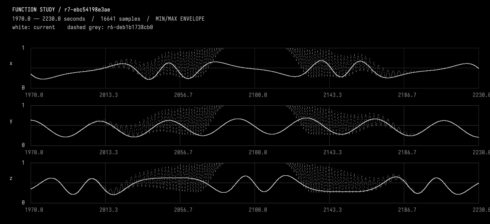

# 05-delete

<<you>>
Delete the fourth interruption and let the continuing background show through. Resolve it to its stable ID from the current event inventory, remove only that event instance, and keep e3's new timing and second-channel lag. Verify preservation outside the deleted event's support with CompareFunctionStudy, inspect the recovered region, and retain the deleted revision in history. Explain the result briefly.
<<progress>>
Starting AI conversation
Preparing context and tools.
<<progress>>
Planning tool use
Next tool: `InspectFunctionStudy`
<<progress>>
Using InspectFunctionStudy
{"revision":""}
<<progress>>
InspectFunctionStudy finished
r6-deb1b1738cb0 parent, description, durationSeconds, channels, events, choices, source, liveSourceHash, dirty, selectedIds, selectionSeconds, history, semantics images=0
<<progress>>
Planning tool use
Next tool: `SelectFunctionStudy`
<<progress>>
Using SelectFunctionStudy
{"endSeconds":2215,"eventIds":["e4"],"startSeconds":1985}
<<progress>>
SelectFunctionStudy finished
r6-deb1b1738cb0 parent, description, durationSeconds, channels, events, choices, source, liveSourceHash, dirty, selectedIds, selectionSeconds, history, semantics images=0
<<progress>>
Planning tool use
Next tool: `ObserveFunctionStudy`
<<progress>>
Using ObserveFunctionStudy
{"compareTo":"","endSeconds":2230,"revision":"r6-deb1b1738cb0","startSeconds":1970}
<<progress>>
ObserveFunctionStudy finished
r6-deb1b1738cb0 intervalSeconds, comparedTo, sourceHash, channels, events, choices, selectedIds, sampling, extrema, holdChecks, joins, difference, imageFile, guarantees, localPeaks images=1
<<progress>>
Planning tool use
Next tool: `EditFunctionStudy`
<<progress>>
Using EditFunctionStudy
{"description":"Delete fourth interruption resolved as e4 only, exposing absolute-time background at 1985..2215; retain all other events including e3 timing and y lag, with r6 retained as parent.","expectedRevision":"r6-deb1b1738cb0","expectedSourceHash":"deb1b1738cb0f63b77afc786e6487464425871f8f20a264479f8c088ae901698","source":"import afield.stdlib.Functions\nimport afield.stdlib.StudyComposition\nimport afield.stdlib.StudyEvent\nimport afield.stdlib.StudyChoice\nimport kotlin.math.PI\n\nwith(Functions) {\n    val durationSeconds = 3600.0\n    val carrierPeriodSeconds = 40.0\n    val relativePhasePeriodSeconds = 100.0\n    val phaseExcursionRadians = 2.0 * PI / 3.0\n    val backgroundCente...
<<progress>>
EditFunctionStudy finished
r7-ebc54198e3ae Compiled, checked and activated images=0
<<progress>>
Planning tool use
Next tool: `CompileKotlinRequest`
<<progress>>
Using CompileKotlinRequest
{"file":"afield://function_conversation/function_source/code","runSetupBlocks":false,"source":""}
<<progress>>
CompileKotlinRequest finished
success=true diagnostics=0 setupChanges=0
<<progress>>
Planning tool use
Next tool: `CompareFunctionStudy`
<<progress>>
Using CompareFunctionStudy
{"afterRevision":"r7-ebc54198e3ae","allowedChannels":["x","y","z"],"beforeRevision":"r6-deb1b1738cb0","changedEndSeconds":2215,"changedStartSeconds":1985}
<<progress>>
CompareFunctionStudy finished
r7-ebc54198e3ae before, allowedIntervalSeconds, allowedChannels, preservedScope, changedEventIds, method images=0
<<progress>>
Planning tool use
Next tool: `ObserveFunctionStudy`
<<progress>>
Using ObserveFunctionStudy
{"compareTo":"r6-deb1b1738cb0","endSeconds":2230,"revision":"r7-ebc54198e3ae","startSeconds":1970}
<<progress>>
ObserveFunctionStudy finished
r7-ebc54198e3ae intervalSeconds, comparedTo, sourceHash, channels, events, choices, selectedIds, sampling, extrema, holdChecks, joins, difference, imageFile, guarantees, localPeaks images=1
<<ai>>
_r6-deb1b1738cb0; 1970.0..2230.0 seconds. White=current; dashed grey=none. Inspect local waveforms before judging pulse rate; wide views are min/max envelopes._

<<ai>>
_r7-ebc54198e3ae; 1970.0..2230.0 seconds. White=current; dashed grey=r6-deb1b1738cb0. Inspect local waveforms before judging pulse rate; wide views are min/max envelopes._

<<ai>>
Deleted the fourth interruption, **e4 (1985–2215 s)**, in activated revision **r7-ebc54198e3ae**.

- Inspected the recovered region: the continuing background now shows through on all three channels, replacing e4’s pulses and hold.
- **e3’s timing and 6-second peak y lag remain unchanged**, as do all other events.
- `CompareFunctionStudy` measured **zero maximum and RMS difference outside e4’s support**, across **168,500 samples per channel**.
- Kotlin compilation passed. The pre-deletion revision **r6-deb1b1738cb0**, containing e4, remains in history.