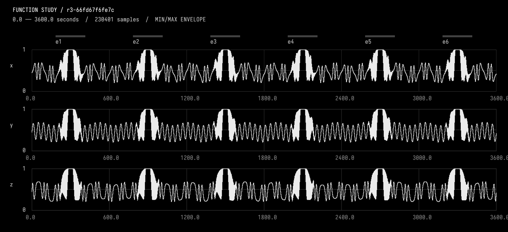
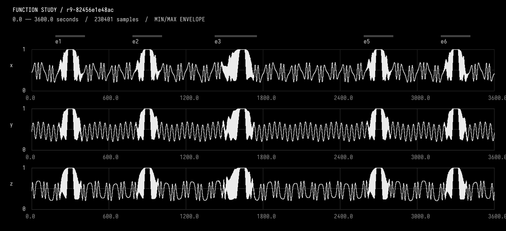

# Function conversation — worked example

A working Field/AI4 experiment: seven real Astra conversations turn three flat
channels into an editable one-hour function, then reshape it without losing the
rest. The function is ordinary Kotlin returning `Functions.Fn` values, in a function study box whose
AI4 chat has the study tools (`afield.stdlib.FunctionStudyTools`). The recorded turns used an
earlier arrangement in which those tools were a box of this document.

Open the function_conversation_example folder as a Field document. For a fresh
conversation, use the separate blank function_conversation starter.

Select **The function — talk here (AI4)** and press **command/ctrl-4**. Its chat
already contains the seven real recorded turns, including plots and tool traces.
Scroll back to follow the edits, or send a new message to continue. The transcript
is stored in `function_source_ai4_chat_history_.md` and travels with this document.
It is assembled from the untouched `conversations/01-create.md` through
`07-restore-background.md` records; image sidecars are embedded for portability.
These older transcripts did not record per-response model badges, so the UI labels
them “Model not recorded.” The archive records the run configuration below.
Opening the document restores the checked source history (`studies/function_source/`) and draws
the overview. The last working revision is **r9-82456e1e48ac**. Manual source edits are reported as dirty
until admitted through a guarded candidate transaction.

## The saved conversations

Every entry is an actual AI4 UI-path turn, with model-authored source, tool calls,
real image inputs, compiler diagnostics, revision snapshots and before/after data.
Model/provider: **gpt-6-astra / OpenAI**, using Field's existing configuration.

| Request | Checked source | Wall time |
| --- | --- | --- |
| [Create six events](conversations/01-create.md) | [r3-66fd67f6fe7c](studies/function_source/r3-66fd67f6fe7c.kt) | 100.1 s |
| [Move e3 by 40 seconds](conversations/02-move.md) | [r4-f7f9ef4f2f47](studies/function_source/r4-f7f9ef4f2f47.kt) | 52.1 s |
| [Double its rise; pin the hold length](conversations/03-stretch.md) | [r5-2aa6023ddfca](studies/function_source/r5-2aa6023ddfca.kt) | 68.1 s |
| [Lag y, then catch up](conversations/04-lag.md) | [r6-deb1b1738cb0](studies/function_source/r6-deb1b1738cb0.kt) | 168.1 s |
| [Delete e4](conversations/05-delete.md) | [r7-ebc54198e3ae](studies/function_source/r7-ebc54198e3ae.kt) | 227.1 s |
| [Warp a pinned background passage](conversations/06-warp.md) | [r8-e4aea058bc8b](studies/function_source/r8-e4aea058bc8b.kt) | 286.4 s |
| [Restore background; retain event work](conversations/07-restore-background.md) | [r9-82456e1e48ac](studies/function_source/r9-82456e1e48ac.kt) | 236.2 s |

Times include model calls and provider rate-limit backoff; the later turns incurred
multiple retries. Token usage is not exposed by AI4's SendResult and is not claimed.
The [interrupted lag attempt](conversations/04-lag-interrupted.md) is preserved too:
its working revision survived compiler-plugin errors and a stalled diagnostic query.

## Look at the actual functions

Original six-event composition:

Final function: e3 moved and lengthened, y briefly delayed, e4 deleted, original
background restored. The timings of e1, e2, e5 and e6 are unchanged.

The overview shows min/max excursions. It does not resolve pulse ordering; the
conversation artifacts include local waveform plots and measured peak times.

## Verified independently

[Independent runtime results](conversations/independent-verification.json) recompile
the seven saved Kotlin sources and use a separate <=11 ms sampling grid:

- Moves, stretching, lag, deletion and warp have **zero sampled difference outside
  their declared scope**. x/z are unchanged over the entire hour after the y lag.
- The deleted event region equals the actual continuing background evaluator.
- The source's warp clock has sampled rates **0.86261598–1.13738402**, pinned
  endpoints, and endpoint rates approximately 1.
- Restoring the background gives **zero sampled whole-hour difference** from the
  pre-warp composition, retaining all event edits.
- Every revision's hold probes have zero target error. Reordered random-access
  probes agree. Actual failed compilation preserves the working revision, and a
  stale agent edit cannot overwrite a manual source change.
- **25 targeted JVM tests pass**: five FunctionStudy tests and twenty existing
  AgentToolExtensions tests; the test-tree-write guard passed too.

The [replay check](checks/runtime.kt) runs in a disposable Field box and leaves
this document untouched. Sampling is evidence, not a proof about arbitrary narrow
features or stateful code. The source explicitly supplies constant hold segments.

## Tools and implementation

[Working guide](guides/working.md) · [Tool definitions](function_tools_code_.kt) ·
[Current function](function_source_code_.kt) ·
See **Talking a function into existence** in Field’s documentation.

The eight tools inspect/select, compile guarded candidates, patch source, sample,
return visual observation bundles, test preservation, and export checked data. Historical source can be restored
wholly or used to restore only a background passage. Images travel through AI4's
real image-input path; base64 image data is excluded from numerical tool JSON.

This run also repaired AI4's shared diagnostic provider: bounded code-use queries
now attach the existing nonblocking summary snapshot. The previously stalled
lookup returned in **0.86 seconds** after the change.

Limits: this is trusted Kotlin in Field's JVM, not process isolation. Cooperative
cancellation is tested at the domain layer, and AI4 turn logs distinguish completion,
failure, and cancellation. Selection is session-local; checked source/revisions and saved
conversations persist. The proposed 20-task comparison of source-only, plots, and
plots-plus-measurements has **not been run**.

## Faster edit and export loop

The [eighth saved conversation](conversations/08-loop-improvements.md) verifies the
updated Inspect → Patch → Export flow on a separate 60-second fixture. It completed
in 15.506 seconds, including 13.402 seconds waiting for the model and 1.541 seconds
in tools. A checked patch returns a before/after preview; export reuses the checked
revision and verifies the output files. No duplicate compile or observation was
needed. These are small-edit measurements, not a speed guarantee.

The current overview uses the interactive Plotly signal viewer with shared time
zoom and pan, follows the active revision, and preserves its viewport. Saved PNGs
above remain the historical evidence from the original conversations.

Each study's tools act on the box whose chat is open, so the starter and this example can be open at
once, each with its own history.
