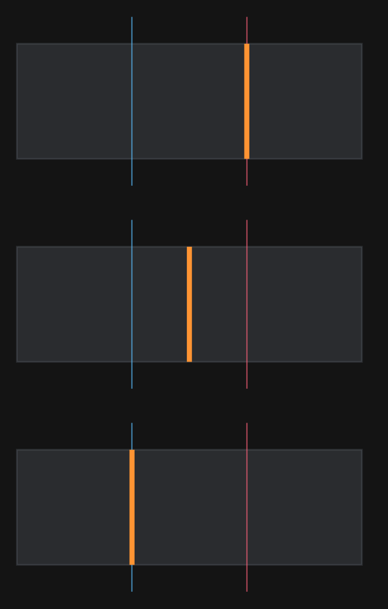

# Brief — a weighted constraint notation

Field has eight registered main languages and several embedded ones, and before this page not one of
them could express a *constraint*. Not a computation over geometry — a **relation to be satisfied**,
with a **weight**, that a solver honours. Meanwhile `src/jvmMain/kotlin/afield/stdlib/ceres/` holds a
complete weighted constraint vocabulary with a Ceres backend, an interactive drag session and 32
residual families, reachable from Kotlin and from nothing else.

Brief is that vocabulary as text.

```
#brief
point west  at (0, 0)
point east  at (9, 0)
1e10 fix west east

prefer post at 1/3 along (west, east)
insist distance(west, post) = 6
```

That program solves to `post.x = 5.997002997`, which is `(1·3 + 1000·6) / 1001` — the weighted mean of
what its two statements asked for. Change `prefer` to `insist` and it is `4.5`, exactly. Change it to
`demand` and it is `3.002996970`. **That is the whole idea**: hard-versus-soft is not a flag, it is a
number, and the number is visible in the answer.

| where | what |
| --- | --- |
| the compiler | `src/jvmMain/kotlin/afield/brief/Brief.kt` — lexer, parser, AST, diagnostics, vocabulary |
| resolve + lower + solve | `src/jvmMain/kotlin/afield/brief/BriefLowering.kt` |
| the editor extension | `src/commonMain/resources/brief.js`, `src/jvmMain/kotlin/afield/brief/BriefEditorExtension.kt` |
| analytic checks, real Ceres | `src/jvmMain/kotlin/afield/examples/brief/BriefSolveSmoke.kt` (`./gradlew smokeBrief`) |
| the node probe | `src/jvmMain/kotlin/afield/examples/brief/BriefEditorExtensionWorkout.kt` |
| the guards | `src/jvmTest/kotlin/afield/brief/BriefCoverageTest.kt`, `BriefTest.kt`, `BriefEditorExtensionTest.kt` |
| the demo | `public/docs/assets/brief_house_demo/metadata.edn` |

It is a **Route A** language in the sense of `dev_docs/small_language_anatomy.md`: a `#brief`-tagged
region inside a Kotlin triple-quoted string, no `BoxExecution`, one `.js` in the editor. Route A was
chosen over promotion for a reason that is not about cost. The case that motivates the whole thing is
constraining geometry that lives in the surrounding Kotlin — `Vector3f`s a box is already drawing — and
a box language cannot see those. `BriefProgram.toGeometryModel(bindings)` can.

## Why nothing else could do this

The audit, because the design depends on it being true.

| language | can state a constraint? | closest thing |
| --- | --- | --- |
| `petri` | no | arc *weight* = token multiplicity, operational; invariants are **derived**, never declared |
| `stacksl` | no | `eq` is a comparison that pushes a value. Zero solver words in 3320 lines. |
| `rectsl` | **half** | `4.0 free-param radius` declares an unknown — in text — and can say nothing about it |
| `forth`, `nano` | no | nothing |
| `fieldml` | no | a 95-name prelude, entirely computational |
| `morpho` | no | `MorphoFitness` is a score *computed in Kotlin* |
| `clojure` | no | no core.logic, no choco, no loco on the classpath |
| `python` | no | no scipy; the prelude is print redirection and iframe embedding |
| `fnrewrite` | no — closest in spirit | declarative pattern→replacement, but no unknowns, no residual, no weight |

RectSL is the instructive one. It gets *exactly half* of a constraint: the unknown is user-declarable
in the language's own text, and `RectSLFit.kt` even has `TrackFitTarget(time, value, weight)` with a
real weighted RMS behind it — but the target and its weight are Kotlin-only, no RectSL word names
either, and `free-param` is not even in `rectsl.js`'s vocabulary. **The missing half is the relation,
not the variable.**

And the escape hatches do not weaken the claim, they sharpen it. FieldML's `hostCall`, Clojure's and
Python's interop all reach arbitrary JVM code. But `geometryModel` takes a
`GeometryModelScope.() -> Unit`, and a receiver lambda is not something any of them can construct. Even
with full JVM reach, none of these languages can state the relation — *because the relation is a Kotlin
lambda*.

## The grammar

Line-oriented. `#` begins a comment; a leading `#brief` line is skipped either way, so the same text
works as an embedded region and as a loose `.brief` file.

### Declarations

```
point NAME at (x, y)          # z defaults to 0
point NAME at (x, y, z)
line  NAME from A to B        # a named segment; declares no constraint of its own
plane NAME through A B C      # the order fixes the normal, and every offset's sign
panel NAME corners A B C D    # around the perimeter; area triangulates on the a–c diagonal
```

### Directives

```
settle 1e-6 | settle none     # the whole-cloud weak prior. `none` = nothing but what you wrote.
robust none | huber 1e-3 | soft-l1 S | cauchy S
```

`robust` defaults to `none`, and that default is a decision — see "Two defaults that were nearly
fatal" below.

### Constraints

Every constraint is `strength relation`, and there are two relation forms. In the examples below
`a b c d`, `apex`, `west`, `east`, `post`, `left`, `right` are points; `spine`, `ridge`, `mast`,
`rafter`, `eaves`, `westWall`, `eastWall` are lines; `floor` and `mid` are planes; `roof`, `wide` and
`small` are panels. `BriefDocsTest` compiles every one of them against exactly that geometry, so none of
these is a plausible-looking line somebody typed.

**Equations**, over properties:

```
insist spine.length = 4                 prefer  spine.length >= 2
prefer westWall.length = eastWall.length   prefer  spine.length <= 9
insist roof.area = 12                   prefer  wide.area = small.area
insist apex.z = 3                       prefer  a.z = b.z
insist apex.x = 2                       prefer  a.y = b.y
insist distance(a, b) = 8               prefer  angle(spine, ridge) = 30deg
prefer cos-angle(spine, ridge) = 0.5    prefer  dot(spine, ridge) = 0.5
prefer raw-dot(spine, ridge) = 6        prefer  dihedral(eaves, d, b) = -1
```

**Predicates**, over elements:

```
insist  spine parallel ridge            insist  spine perpendicular mast
insist  westWall same-vector eastWall   insist  a b c d planar
insist  roof planar                     insist  a b c colinear
insist  a b c level                     insist  a b same-x
insist  a b same-y                      insist  a b same-z
insist  a b same-xy                     insist  a b same-xz
insist  a b same-yz                     insist  a coincident b
insist  apex on floor offset 3          insist  apex inside floor clearance 0.2
insist  left mirrors right across mid   insist  floor faces (0, 0, 1)
insist  mast along (0, 0, 1)            insist  all above-ground
prefer  rafter toward apex              prefer  rafter vanishes-at apex
prefer  post at 1/3 along (west, east)
demand  fix west east                   demand  fix west in xy
whisper hold apex                       whisper all loose
```

Number literals accept `1e3`, `-4`, `30deg` (converted to radians) and `1/3` (folded as a division, so
fractions read as fractions without a rational literal).

## Weight, which is the point

| word | weight | what it is |
| --- | --- | --- |
| `whisper` | `1e-3` | a tie-breaker. Loses to anything; shapes the answer where nothing else speaks. |
| `prefer` | `1e0` | the default, and the scale a `length` residual is measured on. |
| `insist` | `1e3` | wins a direct fight against `prefer` by a factor of a thousand. |
| `demand` | `1e6` | `ConstraintScope.lock`'s own default weight. **Still soft.** |

The slot also takes a **bare number** — `1e10 fix west east`, `250 spine.length = 4` — because the
words are only names for numbers, and saying so in the grammar is more honest than a ladder that
pretends to be a type. A leading number is read as a strength unless the next token is `=`, `>=`, `<=`,
`.` or `/`.

Three things about the numbers.

**`demand` is 1e6 because `lock` is.** Every rung that has a counterpart in the Kotlin DSL means what
the DSL means, so a brief and the equivalent `constraints { }` block produce the same figure. Nothing
here is a hard constraint; `demand` is a heavy preference, which is what `lock` has always been.

**Two verbs carry a different unqualified strength**, and this is the one place uniformity was the
wrong answer. `fix` is `lock`, whose own default is `1e6`; `hold` and `all loose` are `weak` and
`weakAll`, whose default is `1e-6`. A bare `fix p` meaning `prefer` would be consistent and would not
hold anything, and a notation whose commonest fixture silently does nothing is worse than one with two
documented exceptions. An explicit strength always wins.

**Weights only compare between residuals that share units.** This is inherited, not introduced: a
`length` residual is in length, an `area` residual in length², a `cos-angle` residual is
dimensionless. `insist roof.area = 12` against `prefer spine.length = 4` on a plan measured in
millimetres is not a fight between `1e3` and `1e0`. Where a brief mixes units, write the numbers.

## Forward reference

A brief precedes its model — that is what the word means, and it is why the language is called this.

**Compound elements resolve in a second pass.** A constraint on line 3 may name a panel declared on
line 30. This is not a feature bolted onto the grammar; it falls out of resolving *after* parsing
rather than during, which is why `BriefSyntax` is deliberately unresolved.

**Points are declared on use.** Naming a point nothing declared creates one. The seed is a
golden-angle point on a widening spiral (`radius = sqrt(k+1)`, `theta = k · 2.399963`), and that detail
matters: a brief made only of relations would otherwise start from a coincident pile at the origin,
whose Jacobian is rank-deficient and whose solve goes nowhere. The spiral guarantees every invented
point is distinct from every other, and it is deterministic, because for a non-convex problem the seed
decides *which* answer you get. `BriefProgram.inventedPoints` reports them, because a language that
invents geometry silently is a language that hides a typo as a shrug.

What is *not* declared on use is a line, plane or panel: those have structure a notation cannot guess,
so an unresolved one is an error with a did-you-mean and a suggested declaration.

## Two kinds of relation in one notation

"Keep these two the same area" is a relation over *properties*. "Put this a third of the way along" is
a relation over *elements*. Getting both into one grammar is the hardest part of the design and this is
how it went.

**What worked: properties are first-class terms.** A term is a number, an `element.property`, or a
`function(elements…)`. That single move is what puts `spine.length = 4`, `west.length = east.length`,
`wide.area = small.area` and `angle(spine, ridge) = 30deg` in one production, and it is why there is no
separate syntax for "the same length as" — it is just an equation with an element term on both sides.

**What worked: one statement shape.** Everything is `strength relation`, and the parser picks the
relation form by scanning the line for a top-level `=`, `>=` or `<=`. Lexical, no backtracking, and
statable in one sentence.

**What did not work: making everything an equation.** `planar`, `mirrors`, `colinear` and `fix` have no
scalar left-hand side. There is no property of a nameable thing whose value "these four points are
coplanar" constrains — the residual is a deviation from a plane the solver introduces as free
variables, and inventing a `roof.flatness` for a user to set to zero would be a syntax nobody would
look for and a number nobody could interpret. So the notation has **two relation forms and one strength
slot**, and the strength slot is where the unification actually lives: whatever kind of thing you are
saying, its weight is written in the same place and means the same thing.

**Where the two kinds meet is `at f along`.** It reads as a relation over elements — "the spine is a
third of the way from west to east" — and it lowers to an arithmetic identity over positions. That is
the one construct that would have been natural to express either way, and it is also the one that
exposed a defect in the host DSL (below).

## Diagnostics

Every failure is a `BriefDiagnostic` with a line, a column, a span, a message and a separate `hint`,
and `compileBrief` reports **all** of them rather than the first — a brief with four misspellings
should tell you about four.

```
5:8 error: no line called 'spien' — did you mean 'spine'?
5:8 error: 'floor' is a plane, and a line was wanted here
9:8 error: 'one' and 'two' share the corner(s) b, c — an equal-area residual reads all eight
           corners at once and Ceres will not let one residual name a point twice
4:8 error: 'spine.length' is insisted to be both 4 and 6 — lines 4, 5: lower one of them, or the
           solver will split the difference and satisfy neither
```

The did-you-mean threshold scales with the length of what was written (`1 + length/4`) and a candidate
must also share a first letter or a length. A fixed distance of 2 suggests `x` for `z` on a one-letter
name, which is worse than silence.

**The contradiction check is deliberately narrow.** It fires only for two statements at `insist` or
above that agree on the subject and disagree on the number. A least-squares system is *supposed* to
absorb disagreement — that is what the weights are for — so flagging every opposed pair would make the
notation unusable. `prefer spine.length = 4` next to `insist spine.length = 6` is not an error; it is a
compromise, and the notation's whole premise is that you can ask for one.

Diagnostics in `brief.js` are lexical only, by design: an unbalanced bracket, a meaningless character,
a glue word beginning a statement. Anything needing to know whether `spine` is a line belongs on the
JVM. A browser extension that guesses at resolution produces confident wrong squiggles.

## Coverage: how much of the vocabulary the notation reaches

**31 of 37 `ConstraintScope` relations — 83.8%.** `BriefCoverageTest` reflects over every declared
member of the class, requires the table to classify each one, and asserts a floor of 82% — two points
under, so a real regression fails and a rounding difference does not. It also checks the reverse: every
verb, function and property in `BriefVerbs` must be claimed by a row, so a word cannot parse and lower
to nothing.

The six it does not reach, named rather than hidden in the arithmetic:

- three `ceq` overloads that take a `Vector3fc` — a host value, reached by `toGeometryModel(bindings)`;
- three `PointExpr.ceq` overloads, deliberately superseded (below).

Adding a verb to `ConstraintScope` now fails the build until somebody decides which column it is in.
That is the point: the drift this catches is *silent*, because nothing breaks when the notation falls
behind — the Kotlin caller is fine, and the notation merely cannot say the new thing.

## Two defaults that were nearly fatal

Both are the same lesson, and it is the one thing this project learned that
`dev_docs/small_language_anatomy.md` does not say.

### What the anatomy page did not warn about

**A notation inherits its host's defaults as *semantics*, and the host's defaults were chosen for a
different consumer.** The anatomy page tells you everything about the *mechanics* of wrapping a Kotlin
facility in a language — the registries, the two routes, the `code_language` handshake, the docs-capture
branches. What it does not say is that the moment you write a documentation table saying `insist` means
`1e3`, you have made a *numerical claim about the host's defaults*, and you have to verify it by
measuring, not by reading the host's KDoc. Twice, the KDoc was right about what it described and the
default was somewhere else.

**One: the loss.** `GeometryModelScope.build()` constructed `CeresProgram(constraints)` and so took
`RobustLoss.DEFAULT` = `Huber(1e-3)`. Past a scaled residual of `1e-3` — on anything measured in metres,
everywhere — Huber's cost is *linear*, so two weighted statements pulling one unknown settle at the
weighted **median** of their targets, and the heavier wins outright at any ratio. Measured: two distance
statements at weights 1 and 1000 targeting 1 and 3 land on `2.999998` under Huber and on `2.998002` —
the weighted mean — under `NONE`. `ArchitecturalGeometry.kt` promises "a least-squares compromise
weighted by whatever you gave them", which was true only for residuals under `1e-3`. A notation built on
a strength ladder cannot ship on that loss, and the DSL had no way to change it. It does now
(`GeometryModelScope.robustLoss`); a brief defaults to `none` and can say `robust huber 1e-3` to get the
old behaviour back.

**Two: the tolerances.** `SolveOptions` defaults to 8 iterations and `functionTolerance = 1e-6`, a
*relative* decrease — right for a drag frame redrawn sixty times a second, and wrong for a statement of
intent. On a problem whose cost is a few thousand, the solve stopped `1e-4` short of the minimum, so the
notation's meaning depended on how many iterations were affordable. `settleOptions()` is what a brief
means by "solve it": tolerances near machine epsilon, and `DENSE_QR`, which matters because a `demand`
beside a `whisper` is a condition number of `1e9`.

Both were found by asserting a closed form. Neither would have been found by a test that reported
convergence, and neither shows up as a failure — they show up as a figure that is *slightly* wrong, and
as a weight ladder that does not do what its own documentation says.

### And one sharp edge in the host DSL, which the host DSL already documented

`PointExpr.ceq` looked like the way to lower `at f along`. It is not, and — correcting this page's first
version, which implied Brief had documented it — **its KDoc already said why before Brief existed**
(`ArchitecturalGeometry.kt:680-687` at the base commit): it
materialises a *trace* point recomputed **between** solves and held only by a `1e-6` prior, so within a
solve the minimiser can satisfy the relation by moving the trace point rather than the geometry — and
its weight is hardcoded to `1.0` besides. A brief written with `prefer` and one written with `demand`
would have produced the same figure. `ConstraintScope.expression` now reaches the `EXPR` opcode (which
existed, differentiated on `ceres::Jet`, behind an `internal` type), so `at f along` is three genuine
two-sided weighted residuals and `area = area` — which no opcode encodes — is expressible at all.

## The demo

`public/docs/assets/brief_house_demo/metadata.edn` is a loadable Field document with one Kotlin box.
Open it in a fresh Field4 and run the box.

A two-bay plan, 180 × 60, corners pinned. The spine wall between them is under two instructions that
cannot both hold: *stay a third of the way in* (which wants x = 60) and *the west room is 120 wide*
(which wants x = 120). **Change the word `prefer` on the two `at 1/3 along` lines** and re-run:

| the word | spine lands at | why |
| --- | --- | --- |
| `prefer` | `119.940` | `(1·60 + 1000·120) / 1001` — the insisted length nearly wins |
| `insist` | `90.000` | `(60 + 120) / 2`, exactly — a dead-even split |
| `demand` | `60.060` | `(1e6·60 + 1e3·120) / 1.001e6` — the proportion nearly wins |



Blue is where the proportion wants the wall; red is where the length wants it; orange is where the
solver put it. Those three figures were captured from a real Field box, and the three numbers are the
box's own printed output.

The box needs the native solver once: `./gradlew buildCeresRedistributable`.

## Verification

| what | how | status |
| --- | --- | --- |
| the notation's *meaning*, against closed forms, through real Ceres | `./gradlew smokeBrief -PceresLibrary=…` | 8 analytic assertions pass |
| parse / resolve / diagnose / lower | `./gradlew jvmTest --tests 'afield.brief.*'` | 39 tests pass, no native library needed |
| the coverage ratchet | same | 31/37, floor 82% |
| `brief.js` ↔ `BriefVerbs`, both directions | same | 9 word sets, exact set equality |
| `brief.js` executed for real | `python3 tools/run_field_tests.py --id brief.editor-extension.workout` | pass |
| the drag, across the whole strength ladder | `smokeBrief` | monotone, and the same weighted-mean arithmetic |
| the demo in a real Field box | `tools/field_backdoor.py` on a real document | prints `spine wall x = 119.940` |
| the figure | rasterised from the box's own SVG output and inspected | correct at all three strengths |

Every case in `smokeBrief` is **over-determined** on purpose. A residual of `1e-15` on a square system
says the solver ran; it says nothing about whether the model means what it reads. A weighted
least-squares compromise, by contrast, is a closed form — the minimum of `wa(x-ta)² + wb(x-tb)²` is
`(wa·ta + wb·tb)/(wa+wb)` — so the assertion is a statement about the notation's semantics, and it
moves if a weight is dropped anywhere in the lowering.

## Dragging a brief

`BriefProgram.openSession()` gives a `BriefSession`: the compiled model held open, with the gesture verbs
addressed by **the names the brief used** rather than by `PointRef`s the author never saw.

```kotlin
compileBrief(source).openSession().use { session ->
    session.drag("spine", Vec3(9.0, 0.0, 0.0), BriefStrength.INSIST.weight)
    println(session["spine"])
    session.release("spine")
}
```

The claim, and it is measured: **a drag is one more weighted statement.** Against a brief that insists
the spine sits at x = 3, pulling it toward x = 9 lands at

| drag strength | lands at | which is |
| --- | --- | --- |
| `whisper` 1e-3 | 3.0000 | the brief, essentially untouched |
| `prefer` 1e0 | 3.0060 | `(1·9 + 1000·3) / 1001` |
| `insist` 1e3 | 6.0003 | the midpoint — an even fight |
| `demand` 1e6 | 8.9940 | `(1e6·9 + 1e3·3) / 1.001e6` |

The same arithmetic as the text, from the same ladder. A `demand` written in the brief will beat a
default drag, and that is the brief being believed rather than a bug to work around.

Two things to know. **`drag` solves; do not solve again while still holding it.** A `WeakPosition`'s
target is refreshed from the current position on every solve, so re-solving re-anchors the pull to
wherever the point now is and the brief wins back a little each time — measured, a second 200-iteration
solve moves the even-fight case from 6.0 to 4.5. That is correct and documented behaviour and it is not
what "how hard does this pull" means. **And a session runs the interactive `SolveOptions`,** not
`settleOptions`, because that is what a session is for; ask it for meaning and you get a figure a
fraction of a percent off. Call `solve()` when the question is what the brief means.

## Known limits

- **No arbitrary arithmetic.** You cannot write `spine.length = ridge.length * 2 + 3`. A notation that
  can say anything is a programming language; this one is a brief. `ConstraintScope.expression` is the
  Kotlin escape hatch.
- **`area = area` refuses panels that share a corner**, because Ceres will not let one residual block
  name a point twice. The diagnostic names the corner and says why. This is a real limit of the
  formulation, not a missing feature.
- **`p.z = 3` is implemented with a hidden anchor point** locked at `1e9` and a `SameCoordinate` tie,
  because no opcode ties a coordinate to a number. It shows up in `BriefProgram.pointNames` as
  `_at:p.z:0`. Sound, and worth knowing before you count points.
- **`liveGeometry` is still out of reach.** `BriefSession` covers the drag; what a brief cannot yet do
  is track host `Vector3f`s across frames the way `LiveGeometryProgram.step` does.
- **A brief that says `settle none` cannot be dragged**, and `openSession` refuses it by name. A drag is
  a *raised prior* over the model's `WeakPosition` weights, not an added constraint, so with no
  whole-cloud prior there is nothing to raise: `drag` returns true, the solve succeeds, and the point
  does not move. Silent, and it cost an hour.
- **The box output panel did not render in the headless page** during verification, which is why the
  figure above was rasterised from the box's SVG rather than screenshotted from the UI. The `lines()`
  idiom is used throughout `public/docs/` so it is expected to be fine interactively, but that is an
  expectation, not something this work verified.
