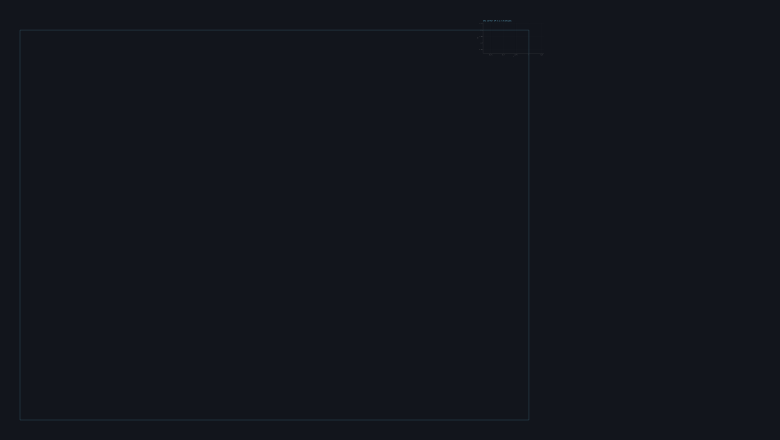
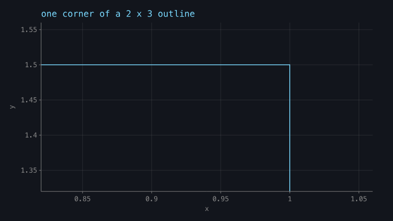
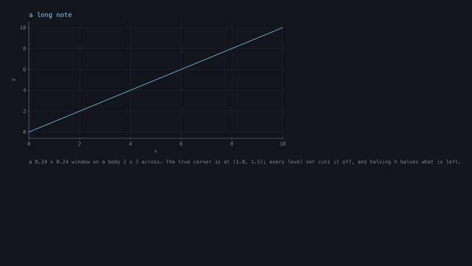
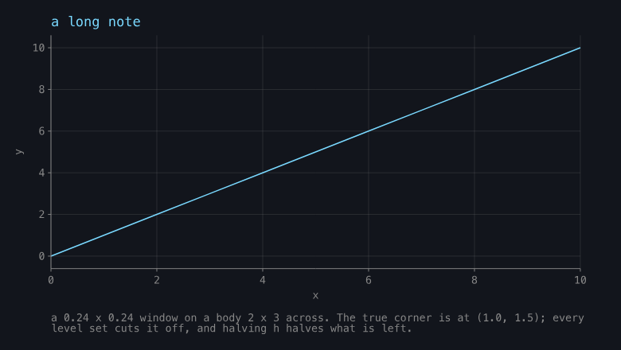
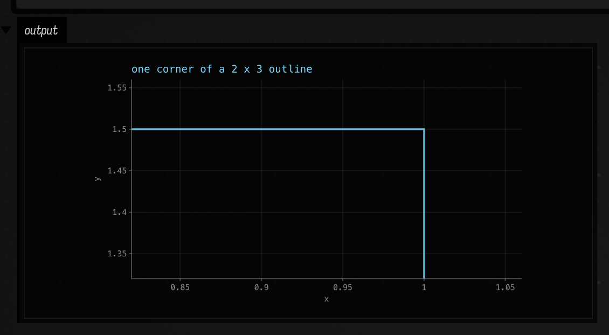
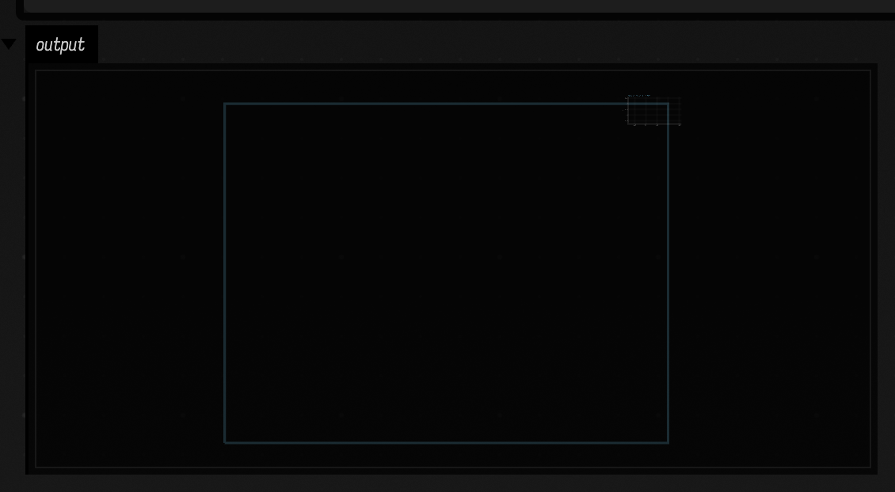

# A figure that does not fit inside itself

`sharp_edge.png` shipped on `public/docs/tetgen.md` as an empty olive rectangle with the real plot
crammed illegibly into one corner, over **five green gates**. Nothing in the build was wrong. Nothing
in the build was looking at the thing that was.

This is what the mechanism actually is, what the numbers actually were, and what the sixth gate
checks. `dev_docs/chart_primitive.md` is the primitive's own design note; this is the failure mode.

## The mechanism

A `Chart` declares a `width` × `height` frame and maps every datum it is given into pixels inside
it. `Chart.toHTML` hands the resulting lines to `afield.graphics.linesToHTML`, which computes the
geometry's **own union bounds** and stamps them on the wrapper as `data-afield-bounds-*`. A box
output panel, and the docs capture behind it, then fit *those* bounds into the space available.

So geometry outside the declared frame is not cropped. It is the thing everything else is scaled
down to fit beside. One stray point at 5000 px turns a 780 × 440 figure into a stamp.

Two independent ways to produce it, and both of them shipped on the same page:

1. **data outside an explicit `xDomain`/`yDomain`.** A derived domain always covers its own data, so
   this needs an explicit one — and a magnified corner view is exactly the case that has one.
2. **a long `note`.** It was one unwrapped line, drawn from `plotRect().x` rightwards with no bound.

## The numbers, measured, not inherited

Measured at `c08b19003` through `run-jvm-main`, by rendering and reading
`FLine.fast2DBounds()` — the same rectangle `linesToHTML` publishes.

| case | before | after |
| --- | --- | --- |
| a 2 × 3 outline into a 0.24 × 0.24 window, 780 × 440 | series 5137 px outside `plotRect`; figure bounds `-5063,14 5815×4437`; panel fit **9%** | overshoot 0.00 px; bounds `10,14 741×412`; panel fit **97%** |
| a 142-character note, 780 × 440 | 1197 px on one line against 711 px of room; bounds `10,14 1240×423`; panel fit **60%** | bounds `10,14 757×423`; panel fit **95%** |

These four are rendered the way a **panel** draws a figure, not the way a raster surface does. That
distinction is the whole reason the failure survived five gates: rasterise a chart onto a
780 × 440 surface and the off-frame geometry is simply not in the picture, so the image looks fine.
`ChartGallery.renderAsPanelWouldFit` reproduces `someSkiko.kt`'s `computeFitTransform` arithmetic —
the same 20 px safety inset, the same `min` of the two ratios — so the capture shows what a reader
sees. The *before* half is `clip = false`, which is why the pair is something the harness re-derives
on every run rather than a screenshot of history.

The brief that sent this work said the note case measured "~70%". It is **63%**. Recorded because a
brief written because a number was wrong should not itself carry a wrong number.

## What each mark kind was doing

| kind | before | after |
| --- | --- | --- |
| `LINE` | no clip at all | Liang–Barsky per segment; surviving runs are subpaths of **one** `FLine` |
| `AREA` | no clip at all | fill by Sutherland–Hodgman, outline as `LINE` |
| `POINTS` | no clip at all | a dot whose centre is outside is dropped whole |
| `BARS` / `HISTOGRAM` | y clamped by `coerceIn`, x not clamped at all | both axes through `clipSpan`; a disjoint bar is dropped, not flattened |
| `HRULE` / `VRULE` | plot-spanning on one axis, unclamped on the other | dropped when the value is off the axis |
| `BAND`, expectation band | plot-spanning in x, unclamped in y | y clamped to the plot, dropped when disjoint |

Three choices in there are not obvious:

- **Pixel space, not data space.** A log scale is not affine, so a data-space box and a pixel-space
  box are not the same box; and bars, bands and rules are positioned in pixels from the plot
  rectangle to begin with. Pixels is the only space all seven kinds can be cut in uniformly.
- **Sutherland–Hodgman for a fill, Liang–Barsky for a line.** Cutting a polygon's edges individually
  leaves it open where it crossed the window, and the triangulator then fills a shape nobody drew.
- **A bar wholly off the axis is dropped, not clamped.** `coerceIn` collapsed it to the frame line
  and `max(1.0, y1 - y0)` then drew a one-pixel smear along the axis — a mark for data that is not
  in the window, which is worse than nothing.

The Liang–Barsky is lifted from `public/docs/tetgen.md`'s fence at `9f7ffc4f2`, which is where the
algorithm was first written in this repo — in a page, because the library would not do it.

## Two more the survey turned up

Neither is one of the reported defects, and one of them needs no careless caller at all.

- **`resolvedXDomain` lacked the positivity filter `resolvedYDomain` has always had.** A
  non-positive x is finite, so it entered the domain, and `padDegenerate` then took its `a = b / 100`
  path: `[0, 0.001, 0.1, 10, 1000]` on a log axis gave a domain of `10..1000` and drew two of the
  five data off the *left* of the frame, with no explicit domain anywhere. Measured red by deleting
  the filter and re-running: `1.00e+01..1.00e+03` before, `1.00e-03..1.00e+03` after, and on the
  pre-fix domain the smallest datum sat 1645 px left of the axis. Note that the new clip **hides**
  this one — the figure stays inside its frame because the off-axis points are cut away — which is
  why the assertion is on the domain and not on the bounds. A clip that quietly saves you from a
  wrong axis is not a fix.
- **`DataFrameCharts.chart` *generates* a footnote of unbounded length.** On a categorical x with
  spare numeric columns it builds one out of the column names. `frame.chart(x = "component")` on a
  five-column frame produced 119 characters, 1003 px, on a 780 px figure. Nobody typed it and no
  reviewer saw it, and it is reachable from `showChart(frame)`.

And one hypothesis **refuted** rather than confirmed: an `area` mark's fill baseline defaults to
data-y 0, which looked like it would escape a derived domain that does not contain 0. It does not —
`area` always materialises a `baseline` array and `resolvedYDomain` sees it. Checked before it was
asserted.

## Is the default palette distinguishable? Measured.

The third reported cause of `sharp_edge.png` was "four near-identical warm series colours". CIEDE2000
over the six `signalPalette` entries, 15 unordered pairs: **min 23.81** (orange vs yellow), median
47.48, max 74.94, faintest against the `#12151c` background 55.60. A working floor for a categorical
palette is around 20–25, so it clears it, if only just at its weakest pair. **The palette is not the
problem.**

What happened on that page is narrower. Its first series was hand-coloured `vec(1.0, 0.72, 0.35)` =
`#ffb859`, ΔE\*ab **13.91** from palette slot 1 `#ff9e4a` — the slot the *second* series then took,
because `nextColor()` advances on mark count and an explicitly coloured mark still consumes one.
Series three and four took green and yellow, and yellow is the 23.81 from that orange.

And the one nobody was looking for: palette slot 5, pink `#ff7a9e`, is ΔE2000 **12.24** from
`CHART_BAD` `#ff6b6b`. A six-series chart with an `expect()` claim recolours its failing data to a
colour a reader cannot tell from its sixth series, and being visible is the entire point of
`expect()`. Slot 1, orange, is 24.96, borderline.

That is **not fixed here** — moving either colour rewrites every committed capture in the repo and
touches `Table`'s column accents and Plotly's `showSignals` too. It is pinned at
`MIN_PALETTE_AGAINST_BAD = 12.0`, a ratchet and not a target.

The Kotlin CIEDE2000 in `ChartGallery` agrees with an independent Python reference to 0.01 on all
four of those statistics, which is the reason to trust forty lines of colour-difference arithmetic
in a test harness.

## The sixth gate

`ChartGallery.checkNothingLeavesTheFrame` asserts, for every figure it renders, that the drawn
geometry is inside the declared frame to within `FRAME_SLOP = 4 px` — a floor with room, given the
five committed gallery figures measure **0.00 px** of overshoot and the failure it catches was 5063.

Every regression case carries its **counterfactual as an assertion**, not as a comment:

| case | the counterfactual it asserts |
| --- | --- |
| corner-window | unclipped, the same data must reach > 2000 px outside `plotRect` |
| long-note | unwrapped, the note must overhang by > 200 px, and the panel fit must be < 70% |
| generated-note | `DataFrameCharts` must still emit a footnote wider than the frame |
| log-x-with-zero | on the pre-fix domain `10..1000`, the smallest datum must sit > 400 px left of the axis |
| bars / rules | the in-window versions must still draw, so "dropped" cannot degenerate into "never draws" |

Without that second half, a refactor that quietly disabled the clip would leave a suite that still
passes because its input had become harmless.

`ChartTest` carries the same five as arithmetic, so a failure names a coordinate rather than a
percentage of ink.

## The population

Predicate, over `git ls-files` (5307 tracked files, no glob): a figure is at risk if the `Chart`
behind it either sets an explicit `xDomain`/`yDomain` — the necessary condition, since a derived
domain always covers its own data — or carries a `note` whose one-line monospace width at 14 px
exceeds `width − plotRect().x − 12`.

**17 of 5307** tracked files construct a `Chart` at all. Of the **16** distinct figures among them
that render to pixels:

- **1 of 16** sets an explicit domain: the tetgen corner.
- **0 of 16** carry an over-long note *today*.
- **2 of 16** carry a hand-written workaround for one of the two defects, and both are on that one
  page: 30 lines of Liang–Barsky in the fence (`9f7ffc4f2`) and a caption shortened from 142
  characters to 63 (`281f3948f`).
- **0 of 16** committed chart PNGs change as a result of this fix. All twelve under
  `public/docs/assets/chart_gallery` and `dev_docs/assets/chart_primitive` re-render byte-identical,
  and the five gallery figures' ink and gutter numbers are unchanged to the digit.

So the honest headline is not "N figures are broken". It is that **both instances were caught by
hand, once each, by someone opening the PNG** — and the cost of catching them that way was a page
carrying a clipping algorithm and a caption written to a length limit nobody documented.

`public/docs/tetgen.md`'s workaround is left in place, with its comments corrected to say it is now
redundant. Removing it would mean recapturing `sharp_edge.png`, and that page's capture would churn
`cutaway.png` and `quality.png` with it — two figures this change does not touch.

## Verification, and what it cost

| what | result |
| --- | --- |
| `jvmTest --tests afield.{Chart,Table,Heatmap,PairDisplay}Test` | 71 tests, 0 failures, 0 errors (ChartTest 20 → 24) |
| `run_field_tests.py --id visualization.chart-gallery` | PASS, 4113 ms; 4 regression figures + 5 gallery figures inside their frames to within 4 px |
| `checkSourcePartition` | ok — 23 unattributed lines against a ratchet of 32, **identical to the base** |
| `checkAgentDemos` | ok — 10 documents, 38 inline files |
| `checkKDocAttachment` | ok — 1311 files, 17685 blocks |
| committed chart PNGs re-rendered | **12 of 12 byte-identical** |

The five existing gallery figures come out of the fix with their ink and gutter numbers
unchanged to the digit — 22.6 / 24.3 / 35.0 / 4.3 / 28.1% — which is the strongest available
evidence that clipping and wrapping did nothing to a figure that did not need them.

## Try it

`dev_docs/agents/demos/chart_clip/metadata.edn` opens into a fresh document with four boxes. Run
**"2 — the same figure, unclipped"** and watch the plot become a stamp; the switch is the single word
`clip` on the line the box marks with an arrow.

These two are `screenshot-box` on that document in a running Field — a real box output panel doing
its own fitting, not the harness reproducing the arithmetic:

The second one is `sharp_edge.png`, reproduced from four lines of Kotlin.
