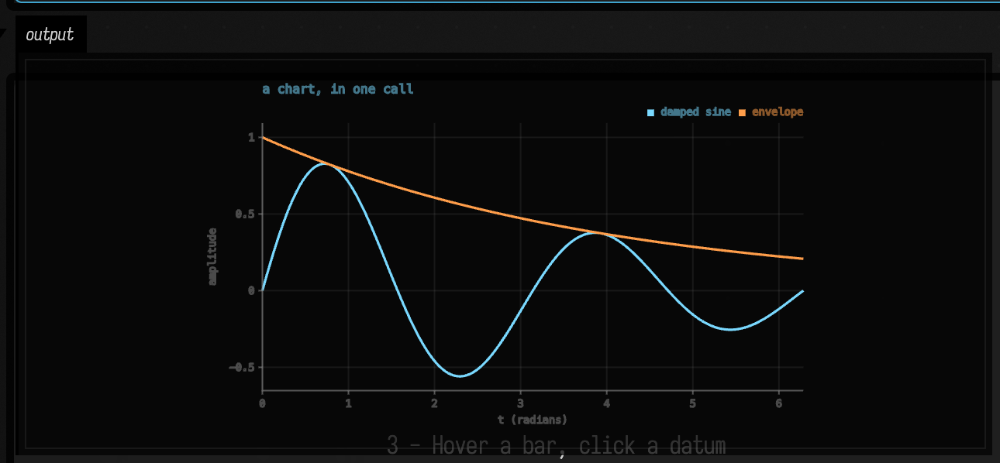
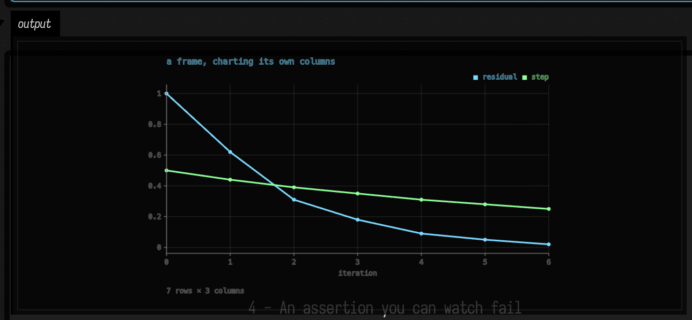
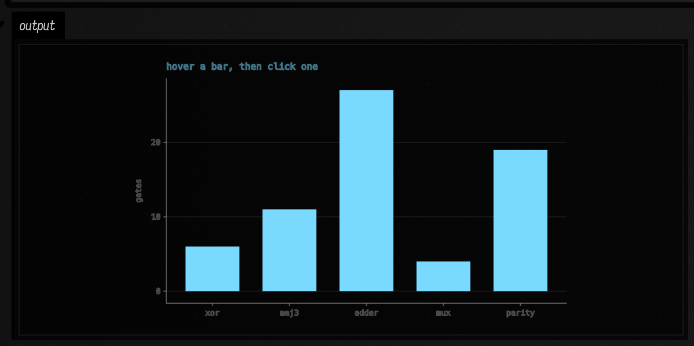
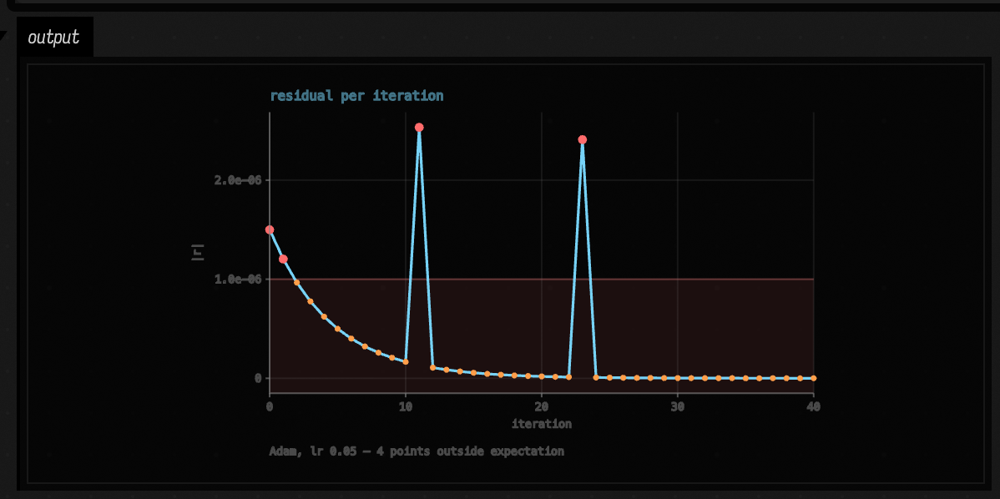
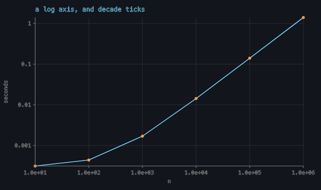
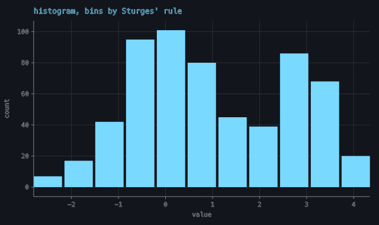

# `chart()` — the FLine plot primitive

`afield.Chart` is to a plot what `afield.Table` is to a grid: build it, hand it to `Box.showChart`
(or let a box's last expression be one), and it arrives on screen in the repo's style with no markup
in the way. It implements `ToHTML`, so `display(channel, chart)`, `chart.h` and a returned `Chart`
all render the same figure.

Source: [`src/jvmMain/kotlin/afield/visualization/charts.kt`](../src/jvmMain/kotlin/afield/visualization/charts.kt),
the DataFrame entry point in [`DataFrameCharts.kt`](../src/jvmMain/kotlin/afield/visualization/DataFrameCharts.kt).
A loadable document is at [`dev_docs/agents/demos/chart_primitive/`](agents/demos/chart_primitive/) —
open its `metadata.edn` in Field.

## Why it exists, and what was actually missing

`Table` was written because a dozen files each hand-rolled `<table style=…>` and no two agreed. The
same argument, one step along: **sixteen** files under `src/` draw their own axes and ticks across
**six unrelated media**, sharing no code at all.

| medium | files |
| --- | --- |
| AWT `Graphics2D` | `examples/functions/FunctionsPlotGallery.kt`, `four/synth/DoughDspPlotGallery.kt` |
| SVG strings | `stdlib/stats.kt:1362`, `visualization/ValueVisualizer.kt:1592`, `four/synth/PatPianoRollGallery.kt:653`, `four/synth/PatTranscriptionGallery.kt:196`, `stdlib/noir/audioai/GestureBoardVisualization.kt:38` |
| raster pixels | `examples/stdlib/AlifeGallery.kt:2153`, `examples/sonicpi/SonicPiPatternProbe.kt:397` |
| JS in an iframe | `stdlib/Functions.kt:3464`, `stdlib/FunctionGraphBrowser.kt:498` |
| RectSL rectangles | `rectsl/RectSL.kt:3204` |
| FLines | `morpho/MorphoSearchFLines.kt:55`, `four/synth/AbletonSetDebugDrawing.kt:231` |
| HTML divs | `petri/PetriVisual.kt:1219`, `forth/ForthInterpreter.kt:1193` |

Worse than the drawing is the **arithmetic**. Heckbert's nice-number tick algorithm had been written
*five* times over — `RectSL.kt:3138` (named as such), `FunctionsPlotGallery.kt:369`,
`DoughDspPlotGallery.kt:575`, and twice more as JavaScript in `Functions.kt:3383` and
`FunctionGraphBrowser.kt:487`. Every copy `private` or inside a string literal, so no caller could
reach one and two of them could silently disagree about where a gridline goes.

**What was *not* missing, and is worth knowing before adding to this file.** Field already had the
FLine→pixel plumbing: `List<FLine>.fitInto` (`StandardDrawing.kt:333`), `planeFigureHtml`'s
window→frame mapping (`spatial_field.kt:341`), and FLine gridlines in
`MorphoSearchFLines.plotFrame`. The genuine gap was narrower and is stated in a comment at
`MorphoSearchFLines.kt:51`: **an axis with text on it**, because `showPlaneGrid` has nowhere to put a
label. That, plus a DataFrame entry point, is the new surface. `visualization/plotly.kt` is not a
counter-example — it emits a Plotly HTML/JS payload, so its axes are the browser's.

## The shape of it

```kotlin
Chart(title = "residual per iteration", xLabel = "iteration", yLabel = "|r|")
    .line("residual", iterations, residual)
    .points("residual", iterations, residual)
    .expect(max = 1e-6, because = "converged below 1e-6")
```

- **Scales.** `Scale(lo, hi, pixelLo, pixelHi, kind)` — linear and log, with `toPixel`/`toData`. A y
  scale is built *inverted* (`Scale(lo, hi, plotBottom, plotTop)`) because y grows downwards in
  Field's 2D outputs; that inversion is the whole reason to have the type rather than two closures.
  A `LOG` scale refuses a non-positive domain, and a non-positive *datum* maps to `NaN` and is
  dropped rather than clamped — clamping would draw a lie.
- **Ticks.** `niceTicks(lo, hi, target)`, `logTicks`, `niceNumber`, `tickLabel`, `tickLabels`. Values
  are snapped to their own step, so nothing ever reads `0.30000000000000004`, and `tickLabels`
  chooses one notation for a whole axis.
- **Marks.** `points`, `line`, `area`, `bars`, `histogram`, `rule`, `vrule`, `band`.
- **`toFLines()`** lowers the whole figure to `List<FLine>` in pixel space; `plotRect()` reports the
  frame the derived insets landed on.
- **`toHTML()`** goes through `afield.graphics.linesToHTML`, which is the markup `Box.lines` builds.

### Labels are glyph outlines, and there are three traps

`labelLines` in `charts.kt` avoids all three deliberately, and each has been got wrong in this repo
before:

1. `TextLayout.toFLines()` — **plural and stroked**, never one filled `toFLine()`, whose triangulator
   fans dozens of disjoint contours from a shared origin and draws a starburst where a word should be.
2. Placement by `FLine.transform` (`FLine.kt:509`), which copies control points too. Offsetting
   `node.to` alone leaves every cubic handle at the origin and smears each letter into a streak.
3. Wrapped in `runCatching`: a headless machine with no fonts should get an *unlabelled* chart, not
   an exception in the middle of a figure.

### Marks pick themselves up

`Box.lines` switches to the interactive SVG renderer the moment any line carries `onClick` or
`hoverColor` (`someSkiko.kt:37`). Point and bar marks set both, plus a `label` naming the datum, so
hovering a bar and clicking a point work **by construction** — `Chart.pickable = false` is the escape
hatch, and `Chart.pickLimit` (default 400) is where a mark stops being individually live.

Dots are real twelve-segment polygons, *not* `pointed` nodes. The reason is measured at
`spatial_field.kt:331`: Skia's SVG export has no circle primitive and writes a `pointed` node as
roughly **5 kB of quadratic Béziers**, so a 90-point cloud came to 458 kB for one panel. A polygon is
a few hundred bytes and, unlike a `pointed` node, is a line of its own that can carry its own callback.

### `expect` — the part that is not formatting

`Chart.expect(min, max, series, because)` **draws** the claim: the accepted range becomes a band
across the plot, the bounds it actually names are ruled, data outside recolours to `CHART_BAD`, the
footnote counts them, and `Chart.deviations` hands the same list to a test. An unbounded side draws
no edge, which is the visual difference between "at most 1e-6" and "between 0 and 1e-6". There is
also a predicate form, `expect(series, because) { x, y -> … }`, with no shape to draw.

Two marks over the same numbers — a `line` for the trend and `points` to make it clickable — is one
datum, so `deviations` is `distinct()`. Before that it said "8 points outside expectation" above four
visibly red dots.

## Captures

All of these are real output. The four box screenshots come out of a live Field driven through the
backdoor, so they are the production `.h`/`display` renderer rather than a test harness.

**A chart in one call.** `showChart(…)` with two named series and a shared x.



**A DataFrame charting its own columns.** `showChart(runs)` picked `iteration` for the x axis and the
two remaining numeric columns as series, each with a pickable points mark in the line's colour. The
footnote is the frame's shape.



**Bars that hover and click.** Every bar is a separate `<g>` with a registered callback; `c.onPick`
prints in the box.



**An assertion you can watch fail.** `.expect(max = 1e-6)` — the band, the ruled bound, the four real
overshoots in `CHART_BAD`, and the footnote counting them.



**A log-log axis with decade ticks**, and **a histogram binned by Sturges' rule** — both from the
capture harness rather than a box.





## Verifying it

Two harnesses, deliberately split: `ChartTest` owns the arithmetic, `ChartGallery` owns the pixels.

```bash
# 20 assertions: ticks, mapping, log refusals, loudness, expectations
./gradlew jvmTest --no-daemon --tests 'afield.ChartTest'

# five figures rendered to real PNGs, with ink floors and a floored counterfactual
CHART_GALLERY_DIR=/tmp/chart-gallery-out \
  python3 tools/run_field_tests.py --id visualization.chart-gallery --port 9477
```

`ChartGallery`'s floors are set near measurements rather than at "more than nothing":

| guard | floor | measured |
| --- | --- | --- |
| inked fraction | 4.5% | 5.7% (sparsest figure), 23–36% (the rest) |
| left gutter ink | 400 px | 490–978 |
| bottom gutter ink | 500 px | 606–2411 |
| counterfactual | 8000 px moved | 10193 of 243200 |
| tick spacing spread | < 1e-3 px | 0.00e+00 |

The gutters are measured against `Chart.plotRect()` rather than a hard-coded strip, because the
insets are derived from the widest tick label. They exist because an overall ink floor cannot notice
a chart that lost its glyph outlines — the data is most of the ink.

The gallery also drives the interactive path live: `linesToHTML` must emit exactly one registered
callback per bar, and one of them is looked up and fired through `FLineClick.toIntersection()`, the
same conversion the server's `fline-click` route uses. The record printed on a passing run:

```
hit record: kind=FACE label="cost: adder → 27" line=2 node=1 u=0.5 v=0.5
            faces=BILINEAR -> onPick saw cost/adder=27.0@2
```

What that does **not** cover is Chromium deciding which `<g>` a click landed in.
`tools/fline_hit_proof.py` covers that half for `FLineHitInspectorFigure`, and the markup here comes
out of the same `buildInteractiveSVG`.

## Capture gotcha

`screenshot-box <uid>` selects the box, but the canvas's depth-of-field can still have the *previous*
selection in focus when the shot lands, and the result is a plausible-looking blurred figure. The
reliable recipe is to open the box first and preserve that selection:

```
--command 'editor-open <uid> --open-outputs'
--command 'sleep 2'
--command 'screenshot-box <uid> out.png --padding 10 --preserve-selection'
```

Two consecutive `screenshot-box` calls on the same box sometimes works and sometimes does not; the
`editor-open` form worked every time.

## Migrating a hand-roller

`FunctionsPlotGallery` is ported: its private `niceTicks` and `fmt` are gone in favour of
`afield.niceTicks` and `afield.tickLabels`, and its committed captures are regenerated. Two things
improved for free — the old copy never snapped its tick values (invisible only because `fmt` rounded
to two decimals), and an axis that read "-1, -0.50, 0, 0.50, 1" now reads "-1, -0.5, 0, 0.5, 1".

Four Kotlin copies remain, and they are the next ports: `DoughDspPlotGallery.kt:575`,
`RectSL.kt:3138`, and the two JavaScript ones. RectSL's is the awkward one — it is inside a language
runtime with its own 3×5 dot-matrix numerals, so only the tick *selection* transfers.
