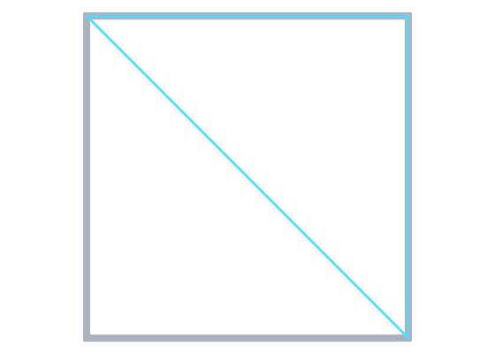
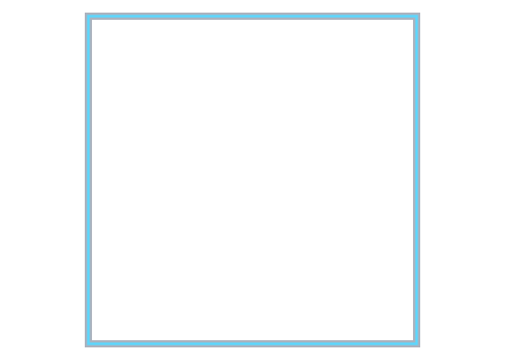
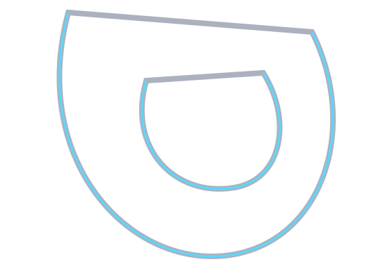
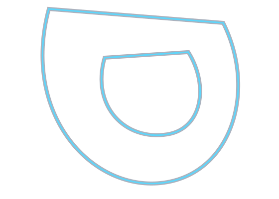
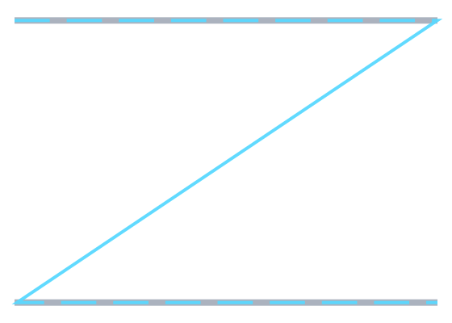
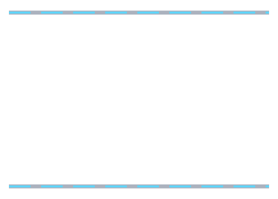

# `FLine.Close` — the node that stores no point

`FLine.Close` is `Node(0)`. It has an empty `storage`, and `Node.to` is `storage[0]`. So **reading
`.to` on a `Close` throws `IndexOutOfBoundsException`**, and every function that asks "where does
this instruction end?" without checking blows up the moment a line is closed.

Three accessors exist for the right answer, all in `FLine.kt`:

| accessor | line | what it gives you |
|---|---|---|
| `Node.toOrNull` | :188 | the point, or `null` for a `Close` — for "skip it" |
| `FLine.endPointOf(i)` | :219 | where instruction `i` leaves the pen; a `Close` resolves to the start of the subpath it closes. Index clamped. |
| `FLine.currentPoint` | :237 | `endPointOf(nodes.size - 1)`, or `null` for an empty line — what `nodes.last().to` was reaching for |

A `Close`'s end point genuinely *is* the start of the subpath it closes: that is where `close()`
leaves the pen. So `endPointOf` is the answer, not a workaround.

## Two halves, fixed a night apart

**Trailing `Close`** — `nodes.last().to`. Fixed 2026-07-31 in `0954ebfb` (ten sites) and `673e7d5c`
(the `Cursor`, sixteen more). Covered by `ClosedLineNodeAccessTest` and `CursorClosedLineTest`.

**Interior `Close`** — `nodes[i - 1].to` inside a loop, or a bare `node.to` over every node. Fixed
2026-08-01. That pass found the field was both larger and differently shaped than
[`arc_length_spacing.md`](arc_length_spacing.md) had guessed: **80 of the 290 operation/curve pairs
in `InteriorCloseNodeTest.noGeometryOperationThrowsOnAnInteriorClose` throw at `7abe8736`, across 18
of its 29 operations** — found by running the surface, not by reading it.

(An earlier draft of this page said 49 across 10. That was the honest number at the time and is
stale now rather than wrong: it was measured before the corpus grew from 7 curves and 24 operations
to 10 and 29. The figure above is the current one, re-measured against the base tree with the corpus
as it now stands. Counts in prose rot; this one is regenerable by checking the graphics sources out
at `7abe8736` and running that one test.)

| function | file:line | what it did |
|---|---|---|
| `findSelfIntersections` | `FLineGeometry.kt:674` | threw |
| `bySimplifying` | `:590` | threw |
| `byConvexHull2D` | `:831` | threw |
| `windingNumber`, and so `FLine.contains` | `:1110` | threw — no `Close` branch at all, unlike both its siblings |
| `centroid2D` (degenerate branch only) | `:1212` | threw |
| `byReversing` | `:1301` | **wrong answer** — see below |
| `bySubdividing` | `:2130` | threw on some shapes, **silently dropped the `Close`** on the rest |
| `smoothTo`, `tcbTo`, `biarcTo`, `outgoingTangent3D` | `:2747`, `:2831`, `:2923`, `:4231` | threw |
| `byFiltering` | `FLine.kt:431` | threw |
| `fast2DBounds` | `FLine.kt:813` | threw if the *first* node was a `Close` |
| `_flineToJavaShape` | `FLinesAndJavaShapes.kt:1960` | **silently dropped the `Close`** |

Plus one bug with nothing to do with `Close`: `intersect`, `intersectX` and `intersectY`
(`FLinesAndJavaShapes.kt:2556/2605/2636`) looped `for (i in 0 until nodes.size)` and read
`nodes.get(i - 1)` — `get(-1)` on the first node. It survived because an `FLine` normally opens with
a `MoveTo`, which neither branch matches. `FLine().lineTo(...)` is legal, and it threw.

## Where interior `Close` nodes actually come from

**Not from glyphs.** `javaShapeToFLine` turns AWT's `SEG_CLOSE` into a `lineTo` back to the last
`moveTo` (`FLinesAndJavaShapes.kt:2269-2273`), as does `javaShapeToFLineFlat` (`:2205-2209`). An
outline arriving from a `java.awt.Shape` has **no `Close` node at all**. Pinned at four shapes,
including a two-contour ring, by `InteriorCloseNodeTest.awtNeverEmitsACloseNode`.

**From `afield.stdlib.arrow`.** `arrow(startHead = true, endHead = true)` (`StandardDrawing.kt:396`)
calls `appendHead` (`:426`) twice, and `appendHead` ends each arrowhead with `target.close()`
(`:439`). So a double-headed arrow is

```
MoveTo LineTo | MoveTo LineTo LineTo Close | MoveTo LineTo LineTo Close
```

— ten nodes, `Close` at 5 and 9, one of them interior. A shipped drawing primitive, no user
cleverness required. That is the fixture the tests and the demo use.

**From `close()` in user code**, and from two places that route to it: `'z'` in the path mini-DSL
(`FLine.kt:1369`) and `FLine.plusAssign(other: FLine)` (`:1090`), which copies nodes verbatim, so
appending anything to a closed line makes one.

## The pictures

Vector, rendered through `planeFigureHtml` → `drawToSVG` → Skia's SVG canvas — the same path
`Box.showPlaneGrid` (`spatial_field.kt:463`) uses. Grey is the input, cyan is the result.
Generated by `InteriorCloseFigureTest`, whose assertions run on every build.

| | before | after |
|---|---|---|
| **reversing a closed square** |  |  |
| **subdividing a two-contour glyph** |  |  |
| **dashing across two subpaths** |  |  |

`assets/interior_close/grid-after.html` is the same three panels as one `planeFigureHtml` grid, with
their titles — the literal `Box.showPlaneGrid` layout, kept as the worked example of that call.
There is deliberately no `grid-before.html`: it would have mixed panels rendered from two different
trees (see below) into one picture, which is precisely the sort of composite that stops being
evidence.

The first two "before"s are the real base tree (graphics sources at `7abe8736`). The third is not,
and the reason matters: `byDashing`'s multi-subpath fix had *already* landed in `673e7d5c`, so at
`7abe8736` the dashing figure is byte-identical to today's. What was missing there was the test, not
the fix. That panel's "before" is HEAD with the `pieces()` block at `FLineGeometry.kt:2198-2202`
commented out and nothing else touched.

## `byReversing` is now a reversal

The old implementation was a single backwards walk over the node list. That cannot reverse a closed
contour: it emits the `close()` where the *first* instruction of the reversed subpath belongs, so
the shape comes apart. On a 200×200 square closed with `close()` it retraced **683 of 800 units
(85%)** — a diagonal plus two sides — and on a two-contour outline **1142 of 1327 (86%)**. Both
numbers are computed live by the demo below.

It now works subpath by subpath, last subpath first:

```
moveTo p0, S1 -> p1, ..., Sn -> pn, close      reverses to
moveTo pn, Sn' -> pn-1, ..., S1' -> p0, close
```

The new `close` is the old closing segment travelled backwards. Node count, subpath count and
`Close` count all survive, and `byReversing().byReversing()` is the identity —
`reversingTwiceIsTheIdentity` checks that at 5 curves.

Two **independent** judges agree, neither of which knows anything about that model:
`aReversalEnclosesTheSameRegion` compares `java.awt.geom.Area` before and after at 54 shapes, and
`aReversalTracesTheSamePointsBackwards` resamples both by arc length at 20 subpaths. Both fail on
the old implementation.

**The reversal of a closed contour starts one segment round the cycle**, at the last drawn point
rather than at the `moveTo`. A cycle has no canonical starting point, so this is a free choice, and
it is the one that keeps the `Close` while remaining an involution — the alternative (start at `p0`,
emit the closing segment as an explicit `lineTo`) preserves the start point but yields a subpath
with no `Close` node at all, closed only implicitly, and reversing *that* gives a different
instruction sequence. Since the `Close` is what `Cursor.segmentIsClose`, `FLine.pieces` and
`Dyn4jScene.flattenClosedFLineLoops` all branch on, keeping it wins.

This is worth stating because it is invisible in the geometry and easy to trip over: the first draft
of the arc-length oracle compared the two pointwise and reported 11 "failures", every one a closed
subpath, every one off by exactly one segment. The code was right and the test was wrong.
`theReversalOfAClosedContourStartsOneSegmentRoundTheCycle` pins the choice so it cannot drift.

Two further normalisations, documented on the function and tested:

- a `Close` that is **not** the last instruction of its subpath (`close()` then more drawing, with
  no `moveTo` between — legal, because `close()` leaves the pen at the subpath start) comes back as
  an explicit straight segment. There is no way to write "close, backwards": in the reversed
  traversal the pen is not at the subpath start when it reaches that segment
  (`FLineGeometry.kt#in the reversed traversal the pen is not at the subpath`).
- a subpath with no leading `moveTo` gains one, matching the renderer, which already reads a leading
  `LineTo` as a `moveTo` (`someSkiko.kt:339-344`).

This refutes the assertion `0954ebfb` left at `ClosedLineNodeAccessTest.kt:74`, that the reversal of
a closed square starts at its `moveTo`. Updated in the same commit as the change.

## `windingNumber` walks subpaths now

`windingNumber` had no `Close` branch, and `FLine.contains` is nothing but a call to it — so
point-in-polygon threw on every closed shape. Rewritten to walk subpaths: a `moveTo` is a pen lift
and contributes no segment, and every subpath is closed back to its own `moveTo` whether or not it
says so. That is what makes it right on a glyph with a counter: the two contours wind opposite ways
and cancel inside the hole.

**It was also giving wrong answers on lines with no `Close` in them at all**, which is the part the
crash was hiding. `java.awt.geom.Path2D.contains` is an entirely separate implementation of the
nonzero winding rule, and
`CloseNodeSemanticOracleTest.containsAgreesWithAwtOnCloseFreeMultiContourShapes` differential-tests
against it on shapes closed the long way, with an explicit `lineTo` back — so the old code runs and
simply answers. At `7abe8736`, **100 of 1764 probes disagreed**; now 0. And not marginally:

```
ringHole at (-137.1, -68.6): FLine.contains=true awt=false
```

a point 57 units clear of a ring whose outer edge is at -80, called *inside* it, because the phantom
edge from the outer contour's last point to the inner contour's `moveTo` swept the test ray. A
`moveTo`-and-three-`lineTo`s square with no closing instruction of any kind was wrong too, for the
other half of the change.

On the main corpus the same oracle runs 8648 probes over 66 contours — including a pentagram, a
bowtie and 60 randomised multi-subpath polygons — with 0 disagreements.

## Blast radius

Most of these have no production caller. `bySimplifying`, `byConvexHull2D`, `windingNumber`,
`centroid2D`, `byReversing`, `bySubdividing` and `findSelfIntersections` are called only from
`FLineGeometryExamples` (the docs gallery), on open lines; `byFiltering`, `tcbTo`, `biarcTo`,
`intersectX` and `intersectY` have no caller outside tests. So for most of it the honest verdict is
**latent**: real bugs on the public API, waiting for the first user who closes a line.

### The two changed semantics are invisible to every caller — shown, not argued

`byReversing`, `windingNumber` and `contains` between them have four non-test callers in the whole
repo: `FLineGeometryExamples.kt:846` (`pathOperationsExample`), `:789` (`geometricQueriesExample`),
the `runAllExamples` sweep at `:1419-1427`, and the docs box "Reverse blend extract"
(`public/docs/fline_examples.md:1958`, code at
`public/docs/assets/fline_examples/metadata.edn:34`) — the last of which is a *rendering* path with
a committed screenshot at `public/docs/assets/reverse_blend_extract.png`.

`CloseNodeSemanticOracleTest.everyProductionCallerProducesExactlyWhatItDidBefore` runs all of them
and dumps every node of every result — 691 lines, including the four boolean ops, which share the
converter — into `src/jvmTest/resources/afield/graphics/close_node_caller_audit.txt`. That file was
generated with the graphics sources checked out at `7abe8736` and is byte-identical to what HEAD
produces. So **nothing on `main` renders differently**, and the committed screenshot has not gone
stale.

### The one defect that was not latent

The dropped `Close`, not any `nodes[i - 1]` read. `_flineToJavaShape` is reached two ways:

- `flineToJavaShape_notThickened` → `byJavaOffsetting` (`FLineThickening.kt:160`), the JTS bridge's
  `toMultiLineString` (`:384`), `Dyn4jScene.flattenClosedFLineLoops` (`Dyn4jScene.kt:244`);
- `flineToJavaShape` (`FLinesAndJavaShapes.kt:1920`), which strokes the result → the four boolean
  ops (`FLineGeometry.kt:1006-1042`) and **`FLine.byThickening`** (`FLine.kt:412`).

**Two public APIs lost an edge**: `byJavaOffsetting` and `byThickening`. Thickening a 200×200 square
closed with `close()` stroked three sides — AWT got `moveTo, lineTo, lineTo, lineTo` and no
`closePath`, so the edge from (0,200) back to (0,0) was simply not there.
`thickeningAClosedSquareKeepsAllFourSides` and `byThickeningHasTheSameDefectAndTheSameFix` are both
red without the fix ("the thickened outline is a single region, so it is a U rather than a closed
band").

**How long, and who was hurt.** `_flineToJavaShape` has had no `Close` branch since `52a1d563e`
(2025-11-03), the first commit of this build layout — nine months. And **neither affected API has a
single caller anywhere in the repo, `src/personal` included**. The only `flineToJavaShape` call in
the human's own code is `src/personal/kotlin/euclid/flinesAndJTS.kt:69`, inside a `@Deprecated` shim
whose public functions have no callers, and whose input is AWT-derived and therefore `Close`-free
anyway. So: a real defect, on real public API, that shipped for nine months and demonstrably bit
nobody.

**Not the sentence diagrams.** `src/personal/kotlin/sentences/` builds all its geometry three ways —
`moveTo`+`cubicTo` per curve (`Flines.kt:28-35`), one deliberately open `lineTo` bracket
(`:124-128`), and glyph outlines from `font.createGlyphVector(frc, text).outline` through
`javaShapeToFLine` (`:196`, `:204`). It calls `.close()` nowhere, never uses the `'z'` path DSL, and
never `+=`s an FLine; and since `javaShapeToFLine` converts `SEG_CLOSE` to a `lineTo`, its glyph
outlines carry no `Close` node to begin with. It also calls none of the affected functions — its
only Field graphics call is the inbound AWT→FLine direction. Either reason alone is sufficient.

### Two things that look broken and are not

Both worth writing down rather than fixing decoratively:

- the four boolean ops go through the same converter, and their test passes at the old behaviour
  too. `java.awt.geom.Area` fills an open path by implicitly closing it, so a union of two open
  squares is a union of two squares. Now pinned at three points anyway.
- `Dyn4jScene.flattenClosedFLineLoops` is the caller whose *name* says it needs the `Close` — it
  switches on `SEG_CLOSE` off the `PathIterator` — and it passes either way. Its final
  `flush(requireClosed = false)` (`:307`) accepts the subpath regardless, and a dyn4j polygon is
  implicitly closed, so it gets the same four vertices.

### The rest of the repo

A sweep of every `.kt` under `src/` outside the graphics package found **26 further places that read
an `FLine.Node`, and none of them is unsafe** — every one either already has a `Close` branch
(`ValueVisualizer`, `ImagingGallery`, `contours.kt`, `fline_graph_connectivity.kt`,
`alife_lsystem.kt`, `alife_animate.kt`, `spatial_field.kt`) or is provably unreachable by a `Close`
because it only ever sees locally-built `moveTo`/`lineTo` geometry.

That negative is enforced rather than remembered:
`InteriorCloseNodeTest.everyFileThatBranchesOnNodeTypeHasConsideredClose` requires every file that
branches on `FLine.MoveTo`/`LineTo`/`CubicTo` — 25 of them today — either to mention `FLine.Close`
or to appear in a four-entry exemption table with a written reason. A new `when` that forgets the
fourth node type fails the build, and an exemption that stops being true fails it too.

One adjacent finding, **not fixed**, because it is in gitignored personal code this branch treats as
read-only: `src/personal/kotlin/organic/FLineLinearizer.kt:91-101` walks `line.nodes` with
`when (node) { is FLine.MoveTo -> …; is FLine.LineTo -> …; else -> Unit }`. That `else` swallows
both `CubicTo` and `Close` — the same shape of bug `_flineToJavaShape` had.

## Seeing it

`dev_docs/agents/transcripts/close_node_demo.yaml` replays into a fresh document. Two pure-compute
boxes, no Window and no Renderer:

```
python3 tools/field_backdoor.py --port <free port> --with-playwright \
  --command "transcript write close_node_demo --file dev_docs/agents/transcripts/close_node_demo.yaml" \
  --command "transcript run close_node_demo"
```

(one invocation: the scratch document's lifetime is per-invocation, so a `write` in one call and a
`run` in the next land in different scratch sessions). Verified: `applied=4 skipped=0 errors=0`, and
`examples.demo-transcript.exec` runs it as `[execute] PASS close_node_demo (applied=4, output
lines=2)`.

`close_node_reversal` writes the old backwards walk out in the box, so both reversals are computed
in front of you rather than remembered, and prints the retraced-length numbers quoted above.
`close_node_arrow` takes the stdlib's own double-headed arrow — `10 nodes, Closes at [5, 9], of
which 1 interior` — and runs ten operations over it, every one of which used to throw.

## Files

| file | what |
|---|---|
| `src/jvmMain/kotlin/afield/graphics/FLine.kt` | `byFiltering`, `fast2DBounds` |
| `src/jvmMain/kotlin/afield/graphics/FLineGeometry.kt` | the ten geometry sites; `byReversing` and `windingNumber` rewritten |
| `src/jvmMain/kotlin/afield/graphics/FLinesAndJavaShapes.kt` | `intersect` family off-by-one; `_flineToJavaShape` closes and tolerates a leading `LineTo`; `CubicSegment3(FLine, index)`; `copyDepthFrom` |
| `src/jvmTest/kotlin/afield/graphics/InteriorCloseNodeTest.kt` | the corpus, the audit sweep, per-site tests, the blast radius |
| `src/jvmTest/kotlin/afield/graphics/InteriorCloseFigureTest.kt` | the figures, and the assertions that keep them honest |
| `src/jvmTest/kotlin/afield/graphics/ArcLengthSpacingTest.kt` | the restored multi-subpath dashing regression |
| `dev_docs/agents/transcripts/close_node_demo.yaml` | the replayable demo |
