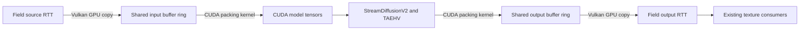

# StreamDiffusionV2 as an optional RTT processor

Design and initial implementation, 2026-10-02. The GPU buffer bridge and optional
worker are implemented in this worktree. A native Field ink run sustained 16 FPS
at 512×512 with active TAEHV/TensorRT. See
[`optional/streamdiffusion/README.md`](../../optional/streamdiffusion/README.md)
for setup, an editable box and retained capture/run data. The local video studies
remain the visual reference.

## Decision

Keep pixels on the GPU in both directions. Run the model in an optional persistent
Python process and share Vulkan allocations with that process through CUDA
external memory. CPU messages carry configuration, handles, slot IDs, timestamps
and status. There is no per-frame image readback, NumPy conversion, JPEG or file
transport in the local path.

Use device-local shared **buffers** as the initial bridge. This lets any ordinary
Field RTT remain optimally tiled and gives CUDA/PyTorch a flat pointer. A Vulkan
image-to-buffer copy and a CUDA conversion kernel are reasonable GPU operations;
this design does not promise to eliminate every device-to-device copy. Direct
optimal-image import as a CUDA array is another option, but introduces image
format/layout constraints without removing the conversion to a model tensor.

## Existing seams inspected

| Component | What exists | How it informs this integration |
| --- | --- | --- |
| `four/targets/RenderToTexture.kt` | Transfer-source attachments and `recordColorTransferSource` | Capture an existing RTT after its draw, outside the render pass |
| `four/texture/Image.kt` | Dedicated opaque-FD image allocation/export | Allocation and FD ownership precedent; currently forces linear image tiling |
| `four/texture/VulkanExternalMemory.kt` | Exact allocation size and row pitch descriptors | Reuse descriptor discipline and extend it for buffers, offsets and formats |
| `four/texture/UnixFdPass.kt` | Unix socket `SCM_RIGHTS` handoff | Send actual memory and semaphore descriptors once at session setup |
| `four/stream/FieldRTTStreamer.kt` | Exported RTT ring, cadence gate, render-fence callback | Reuse lifecycle/cadence ideas; add explicit per-slot release acknowledgement |
| `native/field-encode-linux/src/Engine.hpp` | `cuImportExternalMemory` and mapped device pointer | Concrete CUDA import precedent; do not route diffusion through NVENC |
| `four/device/Semaphore.kt` | Ordinary binary/timeline semaphores | Add exportable synchronization rather than assuming these are exportable |
| `four/Renderer.kt` | Graphics submit waits/signals and deferred cleanup | Add scoped external waits/signals to submission and fence-aware retirement |
| `four/neural/ShaderLearningView.kt` | `Target`/`AutoCloseable` processor exposing an output RTT | Follow render registration and caller-owned source conventions |
| `afield/kratos/` | Optional owned Python worker, capability probe, close and revisions | Reuse lifecycle patterns with a separate diffusion protocol |

Paths beginning `four/` are relative to `src/jvmMain/kotlin/afield/`.
`VulkanBuffer` currently allocates through its normal VMA path, and does not expose
external allocation/export. Introduce a small dedicated external buffer owner;
avoid exporting an arbitrary pooled allocation containing unrelated resources.
Linux device creation already enables external memory FD extensions when
supported. External semaphore FD support also needs capability negotiation and
enablement. The current encoder's fence callback is a useful precedent, but a
fixed round-robin ring alone cannot guarantee a slot has finished being read.

## Data path

1. Field draws the source once, then copies its attachment into an available
   shared input slot. Record the frame ID, source time and settings generation
   with that draw. Transition/release the shared buffer for external access and
   signal its ready semaphore from the graphics submission.
2. The worker imports each allocation once. Match Vulkan and CUDA devices by UUID.
   Use PyTorch's CUDA context and explicit stream ordering, rather than copying
   the encoder's standalone CUDA context creation into a Torch process.
3. CUDA waits for input readiness. A kernel reads the shared buffer and produces
   model-owned tensors: channel order, orientation, dtype and normalization must
   match the video experiments. Release the input slot after this GPU read has
   finished; model-owned tensors retain the accepted chronological frames.
4. Run the causal pipeline, keeping decoded output as a CUDA tensor. A packing
   kernel writes each returned frame into a free shared output slot. Signal
   output readiness only after these writes complete.
5. Field acquires that output buffer, copies it into a stable sampled output RTT,
   restores sampling layout, and releases the buffer after its own GPU read.
   The output RTT remains a normal Field texture for later passes.

Memory export describes allocation size, resource/mapping offset, usable extent,
format, strides and dedicated-allocation flags. CUDA opaque-FD import consumes
the received duplicate on success; sender and receiver track their own lifetimes.
Memory ownership transfers and memory barriers accompany semaphore ordering.
Sharing a descriptor by itself provides neither synchronization nor tensor layout.

Color handling is explicit: Field's default attachment is BGRA sRGB. Raw copies
preserve stored encoded bytes, while sampling an sRGB image linearizes them.
Match the reference video's encoded RGB normalization. Likewise choose output
storage/sampling semantics deliberately so downstream display does not apply an
extra gamma conversion. Handle alpha and vertical orientation explicitly.

## Synchronization and bounded latency

Prefer exportable timeline semaphores where both APIs report support; exportable
binary semaphores per slot are a viable alternative. Keep directional ownership
and monotonically increasing generations/values explicit. Each slot has a real
state machine: free, producer writing, consumer reading, released.

Field displays its last completed output while inference continues. Do not put a
wait for an unfinished diffusion job on the main graphics submission: enqueue a
result for consumption only after the worker reports completed CUDA work, then
include the external semaphore wait and acquire barrier needed for visibility.
Similarly, reuse a slot only after its consumer completion has been observed.
GPU event/semaphore completion polling and small control messages are acceptable
CPU orchestration; pixel transfers through host memory are unnecessary.

The input sampler initially targets the experiments' 16 FPS independently of
Field's display cadence. Accept frames in chronological order. The model starts
with five RGB frames and subsequently consumes groups of four. Bound accepted
chunks and use credits; when overloaded, stop accepting new captures rather than
letting queues grow. Report missed sampling intervals. A deliberate seek or major
time discontinuity resets the causal session. Do not apply a stateless
newest-request-wins policy inside an accepted causal chunk.

Return actual per-output source frame IDs/times. TAEHV has temporal context and
the denoising pipeline has delay, so tagging every output with the latest input
ID is incorrect. An output chunk can contain multiple frames: present them in
order at the intended cadence, with an explicit low-latency drop policy if the
display falls behind. Expose capture, conversion, inference and presentation
timings separately, together with queue depth, dropped frames and VRAM usage.

On worker failure retain the last valid output and stop new captures. Remove
future submission waits before retiring a failed generation, and do not leave a
Vulkan queue waiting on a semaphore that a dead process will never signal.
Close/reconfigure drains outstanding GPU use on both sides before memory is freed.
Renderer fence completion alone does not retire CUDA use of an exported buffer.

## Preserve the demonstrated inference behavior

Reuse `/home/marc/temp/sd2` and its installed environment/models for the first local
integration. Package a reproducible optional setup later with pinned revisions,
the required local patches and an explicit model directory. Field startup and
ordinary graphics builds must not require Python, Torch, TensorRT or model files.

Use the experiments' fixed strength/noise schedule, two denoising steps, normalized
latents, seed and TAEHV decoder. The current live convenience path computes an
adaptive schedule, so simply calling it would change the behavior the user liked.
`streamdiffusionv2/pipeline.py` returns NumPy through `_decode_video_array`;
`streamv2v/inference.py` converts output with `.cpu().float().numpy()`.
The lower-level `TAEHV.stream_decode_to_pixel` already returns a tensor and can
feed the shared-buffer packing kernel directly. Preserve its decoder context.

Reset all causal caches, attention eviction indices and decoder history on a new
session. Version prompt/settings changes and suppress output from retired
generations. Report whether TensorRT engines actually ran and whether TAEHV is
active, including any backend fallback.

The long video runs used about 23 GiB of the 4090's 24 GiB. Shared pixel buffers
are small compared with model weights, but Field and diffusion still compete for
VRAM and compute. Investigate moving T5 off the GPU after prompt encoding and
retaining GPU prompt embeddings. Prompt encoding placement is independent of
the per-frame GPU image path. The initial native ink demonstration sustained
the requested 16 FPS, with about 12.3 GiB total GPU use observed on this machine.
Other Field workloads still need their own memory/performance budget.

## Proposed optional API and implementation order

Implemented API: a `StreamDiffusionSession` owns the worker and
model state; a `StreamDiffusionView(renderer, source, config)` owns the bridge,
output RTT and render registration. The caller owns the source. Make source render
ownership explicit so an already registered target is not rendered twice. Capture
`Renderer` from box context before starting asynchronous setup.

Suggested locations:

- `optional/streamdiffusion/`: Python worker, CUDA driver bindings and Torch CUDA packing operations,
  installation instructions, pinned setup and editable example.
- `src/jvmMain/kotlin/afield/four/diffusion/`: session, config, protocol and RTT view.
- Shared external allocation/semaphore support under `four/buffers/` and
  `four/device/`, with renderer submission hooks owned by the graphics layer.

First implement the bidirectional GPU bridge with a simple GPU transformation;
then connect CUDA tensors to the existing causal inference/TAEHV path; then expose
prompt, strength, seed, reset and status in a Field box. The first visual example
should draw the same spinning lines/curves natively into an RTT and show source
and processed output alongside each other. Retain charcoal, ink, dark paper,
white-on-black and original/adapted prompt presets from the studies.

Future flow/depth attachments can use additional shared buffers with the same
frame ID, extent and convention metadata. The first implementation needs only
RGB; accurate transport does not by itself add conditioning to the model.

## References

- [NVIDIA CUDA graphics interoperability](https://docs.nvidia.com/cuda/archive/13.2.0/cuda-programming-guide/04-special-topics/graphics-interop.html): external memory, matching device UUIDs, and external semaphore ordering.
- [CUDA driver external resource API](https://docs.nvidia.com/cuda/cuda-driver-api/cuda_driver_api/group__CUDA__EXTRES__INTEROP.html): import, mapping, descriptor ownership and lifetime contracts.
- Local visual reference and setup: `/home/marc/temp/sd2/LOCAL_SETUP.md` and the
  tools under `/home/marc/temp/sd2/tools/`.

The native FD helper and Kotlin build pass. Live identity and ink demonstrations
exercised both GPU directions. The ink run's worker log records TensorRT engines
for latent shapes 2, 3 and 4; the retained run data records 329 presented frames
and 16.00 FPS over its steady interval. No automated test suite was added or run.

## Public starting point and capability gate

`streaming_diffusion.yaml` is a self-contained renderer/guide/curves document,
materialized under `public/docs/assets/agent_transcripts/streaming_diffusion/` and
listed in the welcome screen and transcript gallery. The public page is
`public/docs/streaming_diffusion.md`, linked from the graphics navigation.

`StreamDiffusionSupport.probe` returns availability and a useful reason. It
returns on non-Linux platforms before touching UnixFdPass, POSIX permissions,
CUDA or Python. On Linux it checks the selected NVIDIA Vulkan device, exportable
buffer and timeline semaphore features, configured paths, model files and the
isolated native helper. Runtime CUDA device matching/package/model checks remain
worker startup checks. Both the starting point and direct view/session construction
use this gate before allocating shared GPU resources or creating a Unix session.

The final three-box transcript was run in an owned automation workspace on
2026-10-02. Without FIELD_STREAMDIFFUSION_ROOT it emitted normal setup output
and a Markdown panel, with no box errors. With the existing backend configured,
it presented 343 frames, with active TAEHV/TensorRT and strict checkpoint loading.
The final retained capture and measurements are in optional/streamdiffusion/artifacts
and public/docs/assets/streaming_diffusion. Mac runtime behavior remains unexecuted
on this Linux host; the platform guard precedes all platform-specific operations.
Owned worker processes were gone after the automation client closed.

## Renderer correspondence implementation

The optional `StreamDiffusionMotionProvider` now supplies all three paths: Vulkan
display reprojection, Vulkan history blending, and CUDA noise advection. Each
request carries current/reference renderer frame IDs, times, generations and a
DISPLAY/HISTORY/NOISE use. Frame IDs advance on every source draw; noise references
the previous accepted input, history references resolved outputs, and display
references the delayed output's source geometry. Consumers finish recording
before another provider request; targets may be reused within the command buffer.

Motion is backward absolute UV, confidence and reactive rejection in a
single-layer sampled/transfer-source RGBA32F RTT matching source extent. The six
input slots include an additional 16-byte-per-pixel plane when a provider is
supplied. RGB and motion share the allocation/semaphore lifetime; CUDA clones
both before releasing the slot. Output transport is unchanged. Metadata names
the motion reference ID, with -1 disabling a missing field.

History uses two resolved targets, clamps history to fresh 3x3 colours and rejects
inter-generation blending. Display mixes warped history with current source at
invalid pixels. Noise uses nearest CUDA grid sampling and square-root mixing,
clearing state on reset; temporal VAE compression makes this a spatial heuristic.
No model flow/depth conditioning is introduced. The public guide documents the
coordinate convention, cost, retention window and validity requirements.

## Display hole fill and free text prompts

`StreamDiffusionMotionProvider.recordFallback` optionally records a sampled RGB
fallback immediately after DISPLAY correspondence, borrowing the resolved styled
reference. The provider owns its target; format, extent and sample count match
the source. Returning null retains source RGB at rejected pixels. The curve demo
uses a GPU local paper fill: it preserves current source marks, excludes old
reference ribbon IDs and strong contrast, and reconstructs paper from nearby
stylized pixels. This removes the source-paper colour mismatch that made a pale
mask imprint follow old curve positions. Filling unknown styled content remains
a heuristic. The starting point now defaults to charcoal and accepts arbitrary
text through a prompt override; the three material choices are convenience presets.
