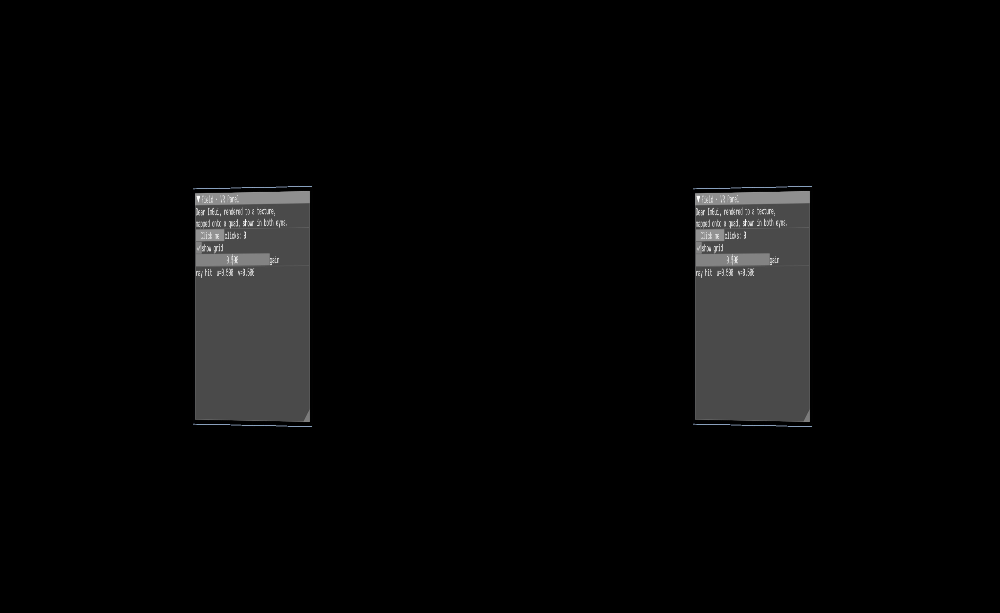
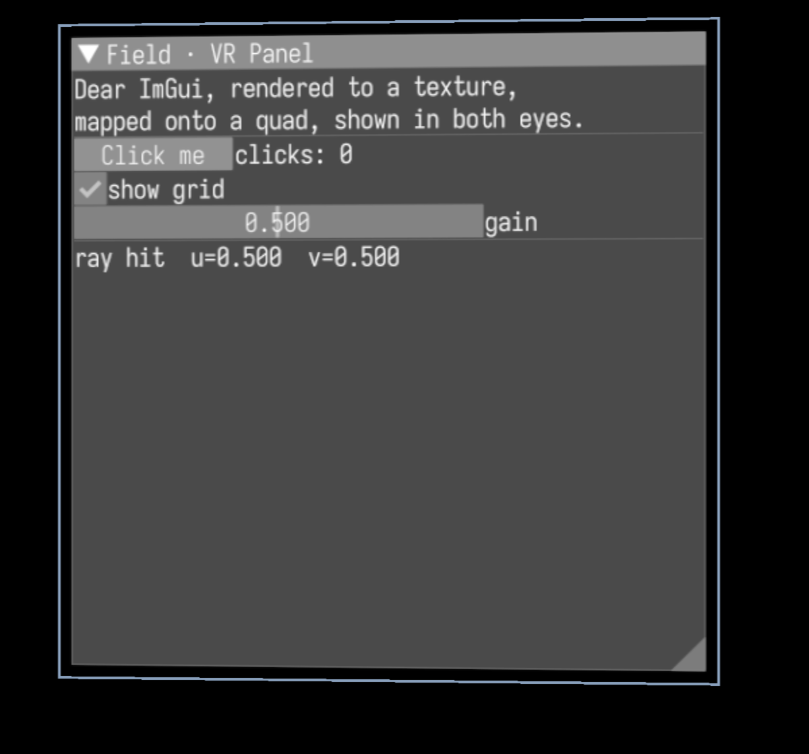

# ImGui as an in-VR panel

Field can put a live [Dear ImGui](https://github.com/ocornut/imgui) panel *inside* a 3D/VR
scene: ImGui draws into a texture, the texture is mapped onto a world-space quad, the quad is
rendered once per eye into a side-by-side (SBS) stereo image, and a controller ray is hit-tested
against the quad so the panel is actually clickable. On a headset the same packed SBS image is
what OpenXR copies into the eye swapchains; on the desktop it previews in the window.

This page documents the capability that landed in `feat(imgui): ImGui as an in-VR panel`
(commit `c06bef0b`). It is developer-facing: the pipeline, the helper API, the interaction
model, the gotchas, and how to run it. The public worked-example lives at
`public/docs/imgui_vr_panel.md`.

## The pieces

| Thing | File | Role |
| --- | --- | --- |
| `ImGuiPanel` | `src/jvmMain/kotlin/afield/four/imgui/ImGuiPanel.kt` | The helper: a world-space rectangle wrapping an `ImGuiRenderToTexture`, with `place`/`faceToward`, `raycast`/`interact`, `panelMvp`, and `controllerRay`. |
| `ImGuiVrPanelDemo` | `src/jvmMain/kotlin/afield/examples/four/ImGuiVrPanelDemo.kt` | Standalone runnable demo (`runImGuiVrPanelDemo`) that wires the whole loop. |
| `ImGuiVrPanelSmokeTest` | `src/jvmMain/kotlin/afield/examples/four/ImGuiVrPanelSmokeTest.kt` | End-to-end smoke, FIELD_TEST id `examples.four.imgui-vr-panel-smoke`. |
| `imgui_vr_panel.yaml` | `dev_docs/agents/transcripts/imgui_vr_panel.yaml` | Agent transcript that builds the same thing as two live boxes. |

`ImGuiRenderToTexture` (`src/jvmMain/kotlin/afield/four/imgui/ImGuiRenderToTexture.kt`) and
`SideBySideStereoTarget` (`src/jvmMain/kotlin/afield/four/targets/SideBySideStereoTarget.kt`)
already existed; the new work is the `ImGuiPanel` helper plus the demo/smoke/transcript that
compose them.

## The pipeline

```
ImGui frame ──▶ ImGuiRenderToTexture (RTT)  ──▶ textured quad (ImGuiPanel)
                                                     │
                          rendered once per eye by SideBySideStereoTarget
                                                     │
                              packed side-by-side image (sbs.packed)
                                             ├──▶ blitToScreen  → desktop window
                                             └──▶ copySideBySideToEyes → OpenXR eye swapchains
```

1. **ImGui → RTT.** `ImGuiRenderToTexture` runs a Dear ImGui frame each render and draws it into
   a render target. The demo makes a 2048×2048 SRGB RTT with 4 mip levels and registers it as a
   pre-target (`renderer.renderList.preTargets["imgui-rtt"] = imgui`) so it is drawn before the
   scene that samples it.
2. **RTT → quad.** A 4-vertex quad sized to the RTT aspect ratio is textured with the RTT via a
   `textureResolver` that binds `imgui` to the sampler named `panelTex`. The quad's per-eye MVP
   comes from `panel.panelMvp(view, projection)`.
3. **Quad → SBS.** The quad module is registered on `SideBySideStereoTarget` with
   `sbs += "imgui-panel" to { … }`; SBS instantiates it **once per eye** and packs the two eye
   views into one side-by-side image, `sbs.packed`.
4. **SBS → screen / headset.** `sbs.packed.blitToScreen(...)` shows the packed image on the
   desktop window. On Windows/Linux with a headset attached, `OpenXRHmdTarget.copySideBySideToEyes`
   copies the identical packed image into the eye swapchains. On macOS the OpenXR natives are
   excluded, so the desktop blit is the only output — but the render graph is identical.

## The `ImGuiPanel` helper

`ImGuiPanel(imgui, halfWidth, halfHeight)` is a rectangle in its local XY plane (z = 0), with
local **+x = right, +y = up, +z = front-facing normal**. It holds a `Matrix4f model` world
transform.

Placement:

- `place(position, right, up)` — orient from a position and two axes. The normal is `right × up`,
  so the viewer must be on the +normal side to read it. Axes are re-orthonormalized. Binding the
  panel to the back of a hand each frame is exactly `panel.place(handPos, handRight, handUp)`.
- `faceToward(position, eye, worldUp)` — place at `position` facing the `eye`, kept upright.
- `panelMvp(view, projection, dest)` — the model-view-projection to draw the quad for one eye.

Ray interaction:

- `raycast(origin, direction)` intersects a world ray with the panel plane and returns a
  `Hit(worldPoint, u, v, onPanel)` — `null` if the ray is parallel or the hit is behind the
  origin. Panel UV origin is **top-left** (`u = x/width + 0.5`, `v = 0.5 − y/height`).
- `interact(origin, direction, pressed)` does the raycast **and** injects the hit into ImGui as a
  pointer via `imgui.injectPointer(u·width, v·height, pressed)` when `onPanel`; otherwise it parks
  the pointer far off-panel so ImGui registers no hover.
- `ImGuiPanel.controllerRay(state, localForward = +Z)` builds `(origin, direction)` from a
  controller pose — `direction = rotation · localForward`, matching Field's mock and OpenXR
  controllers.

## Interaction model (controller ray)

Every frame the demo's `updateRayHit()`:

1. Reads the controller with `sbs.controllerState()` (right hand). If it is inactive or the pose is
   invalid, it parks the ImGui pointer off-panel and bails.
2. Builds the ray with `ImGuiPanel.controllerRay(ctrl)`.
3. Calls `panel.interact(origin, dir, ctrl.selectPressed || ctrl.triggerPressed)`, which hit-tests
   and injects the pointer/click into ImGui.
4. Records `hitU`/`hitV`/`hitActive`/`lastHitWorld` (the smoke asserts on these).

Because the pointer is driven by the ray, the demo sets `imgui.useWindowMouseEvents = false` so the
OS cursor does not fight the injected pointer. On the desktop, `sbs.enableMouseController(...)`
turns mouse motion into the mock controller's ray; in XR a real controller drives it.

## Gotchas (read before you touch it)

- **Camera must look +Z, or the text comes out X-mirrored.** `build()` sets the stereo camera to
  `at = (0,0,0)`, `target = (0,0,1)`. With that pose the camera-right vector is +X, so world +X maps
  to screen-right and ImGui text reads correctly. Looking down −Z mirrors +X to screen-left and
  flips the panel horizontally. The panel sits at `z = +1.5 m`.
- **`captureWindowToFile` output is upright — do not un-flip it.** This used to say the opposite,
  and following it now gives you an upside-down still. `62fd65d0a` established that
  `vkCmdCopyImageToBuffer` hands rows over top-to-bottom and stopped the window capture flipping
  them again. `screencapture` of the live window is also upright, but needs Screen-Recording
  permission. See [CAPTURE_ROW_ORDER.md](CAPTURE_ROW_ORDER.md) for the per-path table.
- **Each SBS eye is 2× horizontally squished** in the packed image, since two eye views share the
  window width. A single-eye crop stretched 2× horizontally recovers the panel's true proportions.
- **`preTargets` ordering matters** — the ImGui RTT must be drawn before the module that samples it.

## Running it

Interactive desktop preview (mouse aims the ray, left-click presses):

```bash
./gradlew runImGuiVrPanelDemo
```

Verification capture. Two modes exist on the demo:

- `capture <out.png>` — renders a warm-up aimed at panel centre, then grabs the **live macOS
  window** with `screencapture -R` (upright, but needs Screen-Recording permission — fails headless
  / over SSH with a non-zero exit).
- `capture-gpu <out.png>` — renders the same warm-up, then reads the swapchain back with
  `Renderer.captureWindowToFile` (a Vulkan transfer-source copy). **No Screen-Recording permission
  needed**, so it works headless / in CI. The PNG is upright as written.

```bash
./gradlew runImGuiVrPanelDemo --args="capture-gpu build/imgui-vr-panel.png"
```

Smoke test (the canonical way to verify — it applies the required JVM args):

```bash
python3 tools/run_field_tests.py --id examples.four.imgui-vr-panel-smoke
```

The smoke builds the exact demo pipeline on a real Vulkan window, renders 60 frames with the mock
controller aimed at panel centre, and asserts the ray→quad hit-test round-trips to panel-centre UV
`(0.5, 0.5)` and world point `(0, 0, 1.5)`. It is the desktop (non-headset) path;
`SideBySideStereoTarget.openXR == null` on macOS, so the assertion is on the raycast math and the
fact that the whole per-eye render graph builds and runs without error.

## Captured evidence

Real GPU capture (`capture-gpu`, un-flipped), the packed side-by-side image — the same pixels a
headset would show, one panel per eye:



A single eye, cropped and un-squished for legibility. Text reads left-to-right (not mirrored), the
widgets are live, and `ray hit u=0.500 v=0.500` shows the centre-aimed controller ray landing on
the panel. The faint blue rectangle is the fragment shader's edge tint (so an all-black panel is
still visibly a quad):



## As live boxes

`dev_docs/agents/transcripts/imgui_vr_panel.yaml` builds the same pipeline as two connected boxes:
a **renderer box** that owns the `Window` + `Renderer` and runs the loop, and a **panel box**
(childed to it) that constructs `ImGuiVrPanelDemo` from the inherited renderer, calls `build()`, and
enables the mouse controller. This is the path an agent or the docs runner uses to stand the demo up
inside a live Field document.
