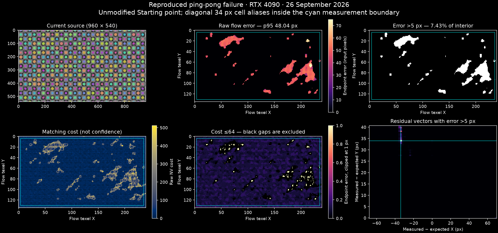

# NVIDIA tools: runtime checkpoints, 25 September 2026

This continues the existing RTXDI and NGX work. It adds real KWin Wayland lifecycle verification,
RR over the existing Lambertian RTXDI bridge, a GPU optical-flow primitive, and frozen MLP inference.
User walkthroughs and Starting Points are `ray_reconstruction`, `optical_flow`, and `learned_shader`.

## Machine and dependencies

- RTX 4090, NVIDIA 610.43.02, Vulkan device API 1.4.341; system headers/loader 1.4.350.
- Field's existing JDK 25 / FFM and LWJGL 3.4.3. The Gradle launcher uses its pinned JDK 17.
- DLSS 310.9.1, commit `374959484e79a640feaba44c93ac8cfb0a03f5b5`, NGX API 0x15.
- RR reference sample `nvpro-samples/vk_denoise_dlssrr` at `f8113a84fa952278bb1286e7899f81b7afe8f41e`.
  Its wrapper and guide contracts were inspected; Field's own RR scene is the executed integration.
- RTX Neural Shading SDK `f309ae68677a67060cc6ded2d0af925a3931435f`; its sample CMake fetch pins Slang 2026.10. Field now independently pins shared Slang 2026.18.3; see `ADVANCED_VULKAN.md`.
  `results/neural-tools/learned-build.json` records compiler/source/binary SHA-256 hashes.
- No separate optical-flow SDK: LWJGL already exposes `VK_NV_optical_flow`.

`tools/lighting/neural_capabilities.cpp` is a physical-device-only probe. Its JSON explicitly says
`enabledByProbe: false`. Field separately enables supported optical flow and cooperative-vector
inference. The latter also requires the Slang output's replicated-composite and Vulkan memory-model
features. Training is advertised on this device but is not enabled or exercised by the Field adapter.
The offline training script uses NumPy, with no optional GPU-training dependency.

NVIDIA's SDK libraries and neural-shading distribution retain their own licenses; no NVIDIA binary,
header, or pretrained network is bundled here. The RR sample is Apache-2.0. The Field MLP weights are
generated by our own reproducible function/training script. Slang's distribution has its own license.

## Ownership and contracts

| Facility | Owner / change |
| --- | --- |
| Wayland acquire | `SwapChain.acquireNextImage` has a 16 ms timeout; only successful acquisition signals its semaphore bookkeeping. |
| Queue exceptions / retirement | `Renderer.runOnQueueThread` unwraps execution exceptions; skipped submissions do not age retirement. Presentation gaps over 250 ms change the temporal revision. |
| RR host calls | `native/field-ngx/field_ngx.cpp`, private ABI 4 (optional specular hit-distance image added for the path tracer); existing serialized 8 MiB FFM worker, device-owned runtime, per-view opaque handles. |
| RR shaders/guides | `RayReconstructionDemo`, existing Fabricate G-buffer and `DirectLighting`; raster-only jitter keeps motion and matrices unjittered. |
| RR lifecycle | `DlssReconstruction` with typed `RayReconstructionGuides`; same retirement queue as SR, no extra temporal pass after RR. |
| Optical flow | `OpticalFlow`, using queue family 5 on this GPU; private concurrent-sharing images and graphics → optical → graphics binary semaphores. |
| Optical output | RGBA32F: xy input-pixel displacement first→second, z raw cost, w=1; 4×4 grid by default. GPU conversion + signed fixed-point unpack. |
| Learned function | `LearnedShader`, two pinned Slang SPIR-V variants; 16→32→32→3, FP16 row-major weights and 64-byte offsets. No per-pixel native calls. |

RR input color is unfiltered linear HDR RTXDI RGB; normal.xyz world unit normal + roughness in alpha;
diffuse/specular albedos describe the actual Lambertian BRDF, hence specular=0 and roughness=1.
Hardware depth is standard Vulkan [0,1], background=1. Motion is current→previous in input pixels,
X right/Y down, excluding jitter. Camera matrices are unjittered column-major/right-multiply, equivalent
in memory to NGX row-major/left-multiply. No invented specular hit distance. Glossy RR is not certified.
All sampled guides use mip 0/layer 0 and shader-read layout; NGX output is storage + transfer-dst,
GENERAL during evaluation and sampled afterward. Field rebinds command state after SDK evaluation.

Optical flow accepts opaque linear RGB; the same tone map/gamma conversion creates BGRA8 inputs.
Private optical images carry `VkOpticalFlowImageFormatInfoNV`, ordinary sampled/transfer usages, and
GENERAL layout while the engine accesses them. Concurrent sharing avoids implicit ownership transfers;
semaphores establish memory order. Returned output is GPU-resident, but this initial serial adapter
waits on the final fence. Cost is not calibrated confidence. Pool/session/image lifetime ends after GPU
retirement. Device-owned disposal also covers a view left open when its parent renderer stops. Driver-private optical session memory is not exposed by this API.

## Reproduce

Use the existing optional NGX and RTXDI build recipes in RECONSTRUCTION.md and IMPLEMENTATION.md.
For the learned shaders, prepare the pinned SDK without installing system packages:

```sh
./gradlew buildLearnedShaders
OPENBLAS_NUM_THREADS=1 uv run --project . --group docs python tools/lighting/train_shader.py
```

The upstream sample was instrumented only to capture frame 120 and exit:
`tools/lighting/rtxns-smoke.patch` records that change. Build `SimpleInferencing` in the SDK's
`build/linux-release`, then launch from `bin/linux-x64/Release` with `--vulkan` and
`FIELD_RTXNS_SMOKE=/absolute/path/capture.png`. It ran on the 4090 and saved an actual neural BRDF image.

Start an isolated Field with the existing private-source workaround, then use its backdoor:

```sh
PORT=9768 VK_DRIVER_FILES=/usr/share/vulkan/icd.d/nvidia_icd.json \
  AFIELD_SKIP_WORKSPACE_PERSIST=1 ./gradlew runJvm \
  -x compilePersonalKotlinJvm -x personalJar \
  --args='--workspace /home/marc/Field4/build/lighting-experiment'

uv run --project . --group backdoor python tools/lighting/check_wayland.py --port 9768
uv run --project . --group backdoor python tools/field_backdoor.py --json --attach-existing --port 9768 \
  --command 'run-jvm-main afield.four.reconstruction.RayReconstructionSmoke --arg=--clip --timeout 360'
uv run --project . --group backdoor python tools/field_backdoor.py --json --attach-existing --port 9768 \
  --command 'run-jvm-main afield.four.vision.OpticalFlowSmoke --arg=--clip --timeout 200'
uv run --project . --group backdoor python tools/field_backdoor.py --json --attach-existing --port 9768 \
  --command 'run-jvm-main afield.four.neural.LearnedShaderSmoke --arg=--clip --timeout 240'
```

Check the actual Starting Points, checkbox changes, captures and ordinary Stop cleanup with:

```sh
uv run --project . --group backdoor python tools/lighting/check_neural_starting_points.py \
  --port 9768 --server-log build/neural-tools/server-9768.log
```

Pass the real managed-server log path if launching through the backdoor. This check rejects Vulkan
validation errors from scene shutdown as well as failed macro/control commands. The optical GPU smoke
also deliberately leaves one context open to verify device-owned retirement. Camera and light pause
controls are checked independently in the RR smoke.

Run checks sequentially. Save their JSON as `build/neural-tools/{rr,flow,learned}-final.json` and run
`tools/lighting/publish_neural_captures.py`. It rejects missing completion markers, failed exit codes,
or any VUID before copying captures/metrics into public assets. KWin test scripts select only the
unique smoke-window caption and are unloaded after each state change. GLFW iconified state is not used.

The JVM smoke loops count actual submitted frames, not acquire attempts, so bounded swapchain waits
cannot silently shorten warm-up, timing distributions, or consecutive captured animation frames.

## Limits

Mono and opaque RGB only; semantic edits need explicit history reset. RR is verified for this diffuse
direct-lighting bridge, not glossy/transmission/path-traced inputs. Static reference agreement is not
evidence of zero ghosting. Optical flow is serial across pairs and can be wrong at borders or repeated
patterns; it is not a substitute for engine motion vectors. Learned inference is frozen, small and
limited to the training domain; GPU training now has a separate checked adapter; see `ADVANCED_VULKAN.md`. No VR, frame generation,
DLSS 5, native Metal backend or software optical-flow fallback is added.

## Follow-up: consecutive flow, captured shaders, explicit reconstruction graphs

The optical-flow demo's old `(+12,-8)` offset was larger than its temporal deformation. The default now compares `t` to `t+1/30` with no global translation. The separate translation control remains a known-direction check. `OpticalFlowSmoke` compares 85,696 interior flow samples with the analytically inverted local warp across four phases, checks four direction quadrants, and checks identical frames. Median endpoint error is 0.1495 px, p95 0.3477 px; the old constant vector gives 14.407 px median error on this test. Updated source images, advection still and consecutive-frame video were captured in Field, not synthesized.

`ShaderTraining.capture` renders a real `moduleHere()` target in Vulkan and writes two checksummed little-endian float32 datasets: six floats per row `(normalized x,y,parameter,linear r,g,b)`. Train/validation use disjoint parameter slices. One opaque RGBA16F/RGBA32F attachment is supported; other scene inputs must be fixed. The source fingerprint hashes compiled vertex/fragment SPIR-V, not an imitation of its formula. Bound texture/uniform semantics remain the caller's explicit fixed-state contract.

`ShaderTraining.trainAsync` launches the existing NumPy trainer in a cancellable process. No extra native binding or framework was introduced. `ShaderLearningView` compares the actual target, learned texture, and amplified absolute error; learned-only mode skips the teacher pass. Loading incompatible source fingerprints rejects the new model before replacing the working one. Captured models cannot accidentally select the unrelated built-in analytic reference.

Before the discontinuous stripe was added, the real `learned_from_module` Starting Point was clicked through capture and training, then checked at full 1080p. It used 98,304 training rows, 26,624 validation rows and 12,000 steps. Validation MSE after FP16 conversion: 2.91187e-5. Full GPU image at held-out parameter 0.173: MSE 2.61595e-5; max RGB error 0.02883. All values were finite. The negative model-load test preserves the active model, and learned-only mode leaves the source-render counter unchanged. The current `module-verification.json` and media now describe the striped follow-up recorded below.

The additional GPU timing span covers the whole ShaderLearningView pre-target (source or inference, resolve, comparison display), excluding final window blit. In that pre-stripe run source was 0.539 ms median and learned view 2.769 ms, although cooperative inference alone was 0.218 ms. Do not claim a teacher speedup from the smaller compute-only time. Clocks and inter-pass overhead also differ from the older standalone analytic benchmark; each measurement has its own scope.

The capstone `reconstruction_plumbing` and `rr_plumbing` Starting Points contain explicit `Target.render` scheduling and editable `moduleHere` attachment writes, not an alternative renderer. Rerun testing caught and repaired deferred cleanup reading a replaced box property: retain the old target before queuing cleanup. Cleanup also retains its renderer because ordinary Stop may clear the parent's delegated renderer before the frame coroutine's finalizer runs. `check_plumbing.py` checks attachment counts/sizes, bypass in both directions, reset, a full rerun, nonempty native captures and normal Stop with zero VUIDs in the final run.

Reproduce the focused checks sequentially against a fresh, agent-owned Field:

```sh
uv run --project . --group backdoor python tools/lighting/check_shader_learning.py \
  --port 9782 --server-log build/neural-tools/server-9782.log
uv run --project . --group backdoor python tools/lighting/check_plumbing.py \
  --port 9782 --server-log build/neural-tools/server-9782.log
uv run --project . --group docs python -m unittest discover -s tools/lighting -p test_training_dataset.py
```

`publish_shader_learning.py` requires the successful workflow report and source-skip/negative-load checks before publishing its PNG/MP4. `publish_neural_captures.py --stage flow` updates only the corrected flow media. Existing approved RR media was retained. No SDK or toolchain revision changed in this follow-up.


## Optional dependency preparation

RTXNS now follows the repository's Git-submodule convention at `optional/lighting/RTXNS`, pinned to the same source revision. `./gradlew buildLearnedShaders` initializes that root submodule, validates its revision and tracked files, and prepares the exact Slang compiler through `tools/native_download_cache.py`. Compiler archives are SHA-256 pinned in `optional/lighting/toolchains.json` using official release asset digests. The task does not configure the upstream sample project or download its recursive dependencies, DXC or Vulkan headers. Those remain optional upstream-example work.

Shader artifacts and build provenance now live at `build/lighting/learned-shader/`; `LearnedShader` loads that path and its missing-component diagnostic names the Gradle task. The checked-in SDK source and shared compiler cache survive `clean`. Normal build/check/startup never depend on this task. Explicit `--offline` preparation rejects absent or corrupt cache data without network use. A failed compilation of either variant preserves both prior binaries. Changed SDK checkouts are not reset or overwritten. See `optional/lighting/README.md` for provenance and platform limits.

The optical-flow display now labels the grey diagnostic itself: **COST**, **0 100+**, and a black-to-white scale. This is rendered by the live display shader, so native screenshots and video retain the label. Cost still comes from the same measured field; the label does not change advection or its rejection threshold.

The [optional-build verification](results/neural-tools/optional-build.json) records online and offline
preparation, a disposable clean checkout that auto-initialized the submodule, byte-identical shader
outputs, Kotlin compilation, and scalar/cooperative GPU checks with no Vulkan validation errors.
`tools/test_learned_shader_build.py` is discovered by the existing `checkPythonTools` gate; its six
tests cover cached offline use, corrupt archives, extraction containment, preserved working shaders,
Unix library links, and refusing to overwrite a changed SDK checkout. Only Linux x86-64 was executed.

## Docs on machines without RTX

Ordinary docs builds reuse the committed lighting/neural media and never invoke the optional NVIDIA
build or publishing helpers. Their Starting points are compile-only in automated transcript checks.
The older `path_tracing` and `ray_tracing_examples` pages have ten runnable capture fences; these now
carry `capture-profile="linux-nvidia"` so another machine cannot silently replace the measured
NVIDIA reference images with fallback renders or failed captures.

This profile is disabled by default, including under `FIELD_DOCS_RUNNER_MODE=always` and `strict`.
macOS retains the assets even when the profile is requested. Missing retained assets fail explicitly;
the runner does not try to regenerate them. On a suitably equipped Linux capture machine, opt in with:

```sh
FIELD_DOCS_CAPTURE_PROFILES=linux-nvidia FIELD_DOCS_RUNNER_MODE=always \
  FIELD_DOCS_RUNNER_PORT=9477 UV_CACHE_DIR=/tmp/field4-uv-cache \
  uv run --project . --group docs python tools/build_zensical_docs.py --clean
```

The profile governs capture provenance, not rendering capability: the renderer still negotiates
features at runtime. Explicit opt-in is an operator assertion about the capture host, not a GPU probe.
`tools/test_neural_docs_gating.py` processes the eight actual pages with a simulated macOS host in
`always` mode, asserts that no capture is attempted and all ten existing assets are reused, checks
Linux's default opt-out, and verifies that a missing protected asset fails without replacement.
These are host-policy tests, not execution on a Mac GPU. Existing capture-transaction tests verify
that failed capture attempts preserve published assets.

## RTT flow plumbing and the existing Slang compiler

`OpticalFlow` accepts borrowed `HasImageView` providers, including RTTs (first color attachment),
explicit MRT attachments, and dynamic ping-pong views. Its `output` is an owned sampled RGBA32F RTT;
the operation itself is not a texture. `optical_flow_pingpong` renders an editable `moduleHere` source
into two retained frames, evaluates between Field frames, and publishes the field to a child shader.
A completed source submission precedes conversion. Cuts seed both ring slots; paused pairs disable
hints on every evaluation. Ring providers are retained rather than snapshotting native image handles.

### Correction and repeated verification, 26 September 2026

The earlier **"passed 32 commands" was one successful end-to-end run**, after development
iterations that had failed. It was not repeated certification. It ran on `a0`, CachyOS / KDE
KWin Wayland, RTX 4090, NVIDIA 610.43.02, Vulkan device API 1.4.341, on Field port 9788 with
`VK_DRIVER_FILES=/usr/share/vulkan/icd.d/nvidia_icd.json` and validation enabled. The source was
960×540, flow 240×135 (grid 4), and GLFW was asked for a 1920×1080 logical window; actual captures
can be larger under desktop scaling. The original moving median/p95 values were
0.1981/0.2661, 0.0751/0.2424, and 0.1384/0.3692 input pixels. The original evidence is preserved in
[`pingpong-single-run-2026-09-25.json`](results/neural-tools/pingpong-single-run-2026-09-25.json).
Those three observations did not establish that raw p95 stayed below 1 pixel at other phases.

The reported failure reproduces on unchanged `d5b2d8929`: after relaunch, raw median EPE
0.1060 px, p95 48.04 px, and **2,190 / 29,464 interior samples (7.4328%) above 5 px**.
The image-view handles, analytical vector and Field frame counter were identical before and
after blocking readback. Of those outliers, 2,094 round to a residual of (-34,+34) input pixels,
the diagonal repeat of the source's 34 px cell. The patches extend well into the image.
Increasing the exclusion from 4 to 16 flow texels changes the outlier fraction from 7.43% to
8.97%; this is not just a border problem. These measurements support repeated-pattern matches,
not a stale readback pair or a unit/sign error. The ping-pong ownership and hardware adapter are unchanged by this correction.



[`pingpong-tail.json`](results/neural-tools/pingpong-tail.json) records the spatial/border and
cost sweeps. All three raw RGBA float32 images from that failing pair remain under the local
`build/neural-tools/pingpong-investigation/original/live/pair-7109912007472/`. Cost and error
correlate, but some incorrect vectors have even zero matching cost. No cost is labelled confidence.

A later original-source pair was worse: **14.46%** of the interior had EPE >5 px, with
raw p95 69.32 px. Even selecting cost ≤64 left p95 68.94 px, at 75.91% coverage.
Most residuals rounded to (+68,0), two checker cells. This defeated the proposed cost-selected
check; its limits were not widened. [`pingpong-low-cost-alias.json`](results/neural-tools/pingpong-low-cost-alias.json)
retains that counterexample.

The Starting point's source now contains a fixed, aperiodic **brightness** texture between
circles and varied per-circle brightness, using an integer cell hash. Both move with the same
analytical translation. The original mostly chromatic differences and repeating checkerboard
were an ambiguous tracking fixture; the replacement gives the brightness matcher actual local
information. Its GLSL remains editable. Arbitrary user shaders can still be ambiguous: this is
a correction to the example, not a claim that the engine resolves every repeated pattern.

**The original accuracy bounds remain:** raw interior median EPE <0.5 input pixel and raw p95
<1 pixel, over all 29,464 samples after excluding the same four-flow-texel (16 input pixel) border.
Cost does not affect acceptance. The check additionally records >5 px outlier fraction, maximum
error, rounded cell residuals and cost-selected statistics for diagnosis. It checks all channels
for finite values and retains both input images and the unfiltered output.
Paused inputs must be identical, expected displacement zero, and the entire motion texture
(including borders, without cost rejection) must stay below the original median/p95/max speed
bounds of 0.125/0.25/0.5 input pixels. Readback must stay within one Field frame with unchanged
image handles and expected motion. Nine CPU fault-model tests cover zero/reversed/stale motion,
large high- and low-cost tails, cost-independent grading, non-finite values, unchanged moving
images and motion at paused borders.

The completed repeated check on 26 September used the revised source on the same `a0` RTX 4090,
NVIDIA 610.43.02, Vulkan 1.4.341 and KDE/Wayland setup, with JDK 25.0.2, LWJGL 3.4.3+4 and
validation enabled. All **three runs passed: 111/111 commands, 72 moving pairs and six paused
pairs**, in one fresh Field JVM. Each table entry is the worst observed value among that run's
24 moving pairs; errors are input pixels, without cost rejection.

| Run | Maximum median EPE | Maximum p95 EPE | Maximum individual interior EPE | Interior EPE >5 px |
| --- | ---: | ---: | ---: | ---: |
| 1 | 0.2150 | 0.3235 | 0.5552 | 0 / 707,136 |
| 2 | 0.2194 | 0.3221 | 0.5599 | 0 / 707,136 |
| 3 | 0.2132 | 0.3157 | 0.4807 | 0 / 707,136 |

All paused source pairs were identical, with full-field median/p95 speed 0/0 and maximum speed
at most 0.125 px, including borders. Every readback retained the same frame, handles and analytical
motion. No `VUID` validation errors or Field execution errors appeared. The complete per-pair
report is [`pingpong.json`](results/neural-tools/pingpong.json); raw images and logs are retained
locally in `build/neural-tools/pingpong-investigation/batched-result/`. This replaces the earlier
single-run claim; the original failed-pattern evidence remains alongside it.
The report's top-level `desktopEnvironment` records the Python checker's shell (a tty here),
not the separately launched Field process. Each captured pair reports GLFW platform 393219
(`GLFW_PLATFORM_WAYLAND`); Field was launched with `WAYLAND_DISPLAY=wayland-0` and `DISPLAY=:0`.

Run against an isolated Field started with the environment above (port 9802 for this verification):

```bash
UV_CACHE_DIR=/tmp/field4-uv-cache uv run --project . --group backdoor python \
  tools/lighting/check_flow_pingpong.py --port 9802 \
  --server-log build/neural-tools/server-9802.log --repeats 3 --samples-per-stage 8
```

The default is three independent documents, eight moving samples at each of initial launch,
resume, and parent/consumer relaunch, plus two paused samples per document. Each run also tests
normal Stop and stopping the renderer before its children. Animation phases follow actual Field
frames, with 15 frames between captures in each moving stage; this is repeated phase sampling,
not an exhaustive or fixed-phase accuracy certificate.
A unique output directory retains each pair's `flow.f32`, `first.f32`, `second.f32`, metadata and
metrics, and every command/server log, even on failure. Files are little-endian RGBA float32,
row-major: 240×135 flow, 960×540 sources. Flow XY are displacement in input pixels; Z is raw NV cost.
Each run has 37 commands, including completion barriers for the three sampling jobs. A new
browser/document-ready barrier prevents controls being emitted before the page is ready; their
presence is checked in the DOM, and pause/reset still use the actual UI controls. The native-window
capture remains. Readback arrays live inside a callback compiled once per check box. Each moving
stage collects its samples in one running Field job, avoiding a new REPL compilation per sample.
Earlier extended checks exhausted the JVM heap, first with retained top-level arrays and then
with repeated snippet compilations; those incomplete runs and logs remain under
`build/neural-tools/pingpong-investigation/`. The default retains about 1.3 GB of raw image data.
`--publish` explicitly copies the proof and first native capture into the repository only after
all requested runs pass. Ordinary checks and docs builds do not replace the committed capture.
`Renderer.isClosed` lets between-frame producers stop before touching a destroyed device.
No renderer change or native dependency was needed. The source change has been run on the
RTX 4090; the revised ping-pong source has not yet been rerun on the M1 Max.

Field already has `SlangCompiler` for `vertex_fragment` and the per-stage Slang properties. The
learned-shader task now writes `build/lighting/slangc.path` only after both SPIR-V variants compile;
the existing compiler uses it after explicit `AFIELD_SLANGC`, `afield.slangc`, and PATH lookup. An
explicit bad override fails rather than silently selecting another compiler. Preparing the optional
compiler does not download anything during Field startup. The learned kernel retains its separate
cooperative-vector compilation recipe while sharing that compiler.

On this Linux machine, with no `slangc` on PATH, `tools/lighting/check_slang_compiler.kt` compiled
shared vertex/fragment SPIR-V and a per-stage compute GLSL result through that fallback, then checked
the invalid-override failure. Run that snippet in a scratch box through the usual backdoor. Kotlin
compilation and offline `buildLearnedShaders` also passed. macOS compiler execution was not tested.

## Editing a material around a frozen network

The `learned_shader` Starting point also includes an unlaunched **editable learned material** box.
Stop the original comparison box and launch that scene: it schedules `LearnedShader` before a
separate `moduleHere` that samples `learnedImage`. Its fragment is ordinary editable GLSL. The docs
show the actual Slang compute kernel, the GLSL buffer-to-RTT resolve, and this consuming material.
The GLSL does not contain an exported neural function; Slang compiles directly to SPIR-V.

`tools/lighting/check_learned_material.py --port 9790 --server-log <actual-log>` changes the material
with the real `moduleHere_reload` action. The 18-command run verifies unchanged kernel identity,
unchanged RTT handle and bit-identical raw inferred RGB, alongside a changed graphics shader and
changed displayed treatment. The raw left panel stayed pixel-identical; the right panel's largest
mean channel change was 60.4134 byte levels. The 3264×1836 capture reflects this Wayland window's
framebuffer scale. Ordinary Stop completed with zero VUIDs. The check stages its capture until all
assertions pass; `results/neural-tools/material-edit.json` retains the result. No new optional
component or automatic GPU capture was added to the docs build.

## Additional Vulkan experiments (26 September)

The next completed work is tracked separately in [ADVANCED_VULKAN.md](ADVANCED_VULKAN.md):
raw full-path-tracer guides into the existing RR adapter, general Field-computed triangle clusters,
and cooperative-vector GPU training from an actual render target. These reuse the existing command,
optional-library and frozen-weight interfaces. Their three new Starting Points are compile-only in
portable transcript checks; explicit NVIDIA checks own capture regeneration. The shared Slang pin is
2026.18.3; the RTXNS source/sample pin is unchanged. Ordinary docs builds keep the committed media.

## Discontinuous stripe studies — 27 September 2026

Both examples on `learned_shader.md` now learn a hard magenta band at normalized x in
`[-0.12, 0.12)`, RGB `(0.95, 0.04, 0.8)`. The analytic NumPy target and Slang `original()`
use the same step, and `learned_from_module` adds it in the actual editable fragment shader.
It is part of the training target, never an overlay on learned output. The GPU-training
teacher on the separate `gpu_shader_learning` page now uses the same stripe; its subsequent
4,001-update run is recorded in `ADVANCED_VULKAN.md`.
The network architecture, input features, sample counts and step budgets were retained.

The analytic model was retrained for 6,000 updates: 8,192-point held-out FP16 RGB MSE
0.0012659674. The captured-module workflow retrained from 98,304 actual GPU samples for
12,000 updates; its 26,624 held-out samples measured MSE 0.0002342100 after FP16 conversion.
The generated Starting Point contains the same striped fragment used in that capture.

The GPU checks now assert that the source actually contains the stripe and an abrupt colour
jump, and record separate edge-band/away-from-edge errors. The edge band is within 0.02
normalized x of either boundary (3.9583% of the 1920 × 1080 image). With cooperative inference:

| Study | Full-image MSE | Edge-band MSE | Away-from-edge MSE | Maximum channel error |
| --- | ---: | ---: | ---: | ---: |
| Analytic, t=0.25 | 0.00117675 | 0.0175144 | 0.000503399 | 0.501016 |
| Captured module, held-out t=0.173 | 0.000194449 | 0.00321314 | 0.0000700345 | 0.500039 |

The sharp source, finite learned transition and amplified error bands are visible in both
refreshed PNGs and 120-frame 1080p clips. No filter or post-composited stripe was added.
The source functions and training budgets differ; these rows are not a ranking of trainers.

Validation was one complete run of each workflow on the RTX 4090, driver 610.43.02 under
KDE Wayland, using shared Slang 2026.18.3:

- `LearnedShaderSmoke --clip`: both scalar and cooperative paths agree with independent CPU
  inference (maximum errors 0.00000182 / 0.00105244); exit 0, completion marker, zero VUIDs.
- `check_shader_learning.py --port 9830 --server-log build/neural-tools/stripe-server-9830.log`:
  all 16 commands passed, including actual capture/train/load, negative model load, source-pass
  skipping, rerun and Stop; zero Vulkan validation errors.
- `check_learned_material.py` on the same server: all 18 commands passed; editing the consumer
  GLSL preserved the kernel, image and bit-identical raw RGB. The unchanged half's mean byte
  error was zero; the changed half moved by 67.8705 byte levels. Its screenshot was refreshed.
- Four existing training-dataset boundary tests passed. One-off source checks confirmed both
  hard edges in the NumPy training target. The documented Slang training shader's three entry
  points and the GLSL teacher compile, with fold-stripped source matching the runtime shaders.

Warmed median timings: analytic scalar inference 5.566 ms, cooperative inference 0.307 ms,
original 0.279 ms in the cooperative run. Captured-module source view 1.976 ms, learned view
5.579 ms, inference alone 0.257 ms. Scope remains explicit in the public page; automatic
clocks and inter-pass costs make these scene measurements, not fixed-clock comparisons
against previous runs. Verified publishers updated the existing assets and evidence records.
