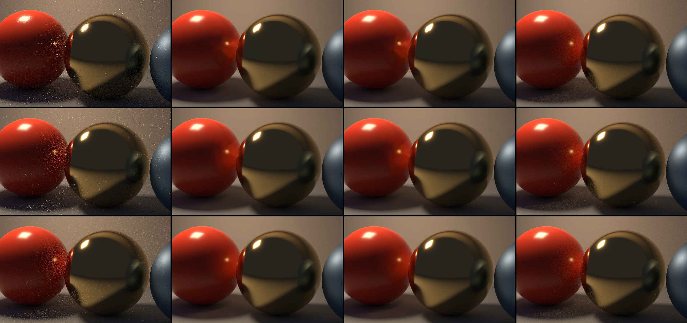

# OIDN as Vulkan compute: port spike (2026-11-14)

Follows [`OIDN_SPIKE.md`](OIDN_SPIKE.md). The direction is now the compute port: OIDN's RT network runs as
Field's own Vulkan compute shaders, over the same weights `oidn-webgpu` uses. Native OIDN is kept only as a
yardstick.

**Result:**

- **Works:** the port runs on the path tracer and denoises inside the frame into a texture.
- **Matches native OIDN:** 76.6 dB PSNR against native OIDN on identical inputs; mean display-space difference
  1.0e‑4 (one 8-bit level is 3.9e‑3).
- **Speed:** about 0.71 s per 1080p denoise on the M1 Max with KosmicKrisp, which is 11.6× slower than native
  OIDN Metal (61 ms) and 1.4× slower than native OIDN CPU (~495 ms). That is fine for "denoise once when the
  trace settles", but not yet interactive.

Nothing is landed or committed. Files:

- `src/jvmMain/kotlin/afield/media/reconstruction/OidnCompute.kt`: `.tza` loader and `OidnComputeDenoiser`.
- `OidnComputeSpike.kt`: the harness.
- A one-line `internal val accumulationBuffer` added to `PathTracingRenderer`.
- Captures and JSON in [`oidn_compute/`](oidn_compute/): `quality.json` from the full run, `timing.json` from
  the timing run of the code as it now stands.

## What was built

`OidnComputeDenoiser(tracer, tracer.enableFrameOutput(), "rt_hdr_alb_nrm.tza")` is a `Target` installed after
the tracer. Everything runs on the GPU; nothing is read back to denoise.

| Pass | What it does |
| --- | --- |
| `aux` (every traced frame) | Running mean of primary albedo (diffuse + specular, clamped) and normal, read straight from `PathTraceFrameOutput`'s packed per-pixel buffer by buffer reference, in step with the tracer's sample count. So the guides average the same jittered samples as the colour. |
| `autoexposure-bins`, `-reduce` | OIDN's autoexposure: mean luminance per (up to) 16×16 bin, geometric mean of the bins above 1e‑8, key 0.18. It matches native OIDN exactly at 8 spp (identical output with the scale forced) and to 3e‑4 at 32/128 spp. |
| `input` | PU transfer of `color × scale`, albedo clamped to [0,1], normals mapped to [0,1]. Nine channels in three fp16 chunks, image padded to a multiple of 16 with zeros. |
| 16 × conv | The small OIDN UNet (`enc_conv0 … dec_conv0`, 32–112 channels). 3×3 conv + bias + ReLU. Nearest **upsample**, the **concat** with the skip connection, and 2×2 **max-pool** are folded into the conv that consumes or produces them, so they cost no extra passes or memory. |
| `output` | Inverse PU and `/ scale`, into a linear vec4 buffer. |
| present | Copies that buffer into a `RenderToTexture` (`den.output`), the same way `PathTraceFrameOutput` fills its images. A box can show it. Reading the texture back gives exactly the buffer (max difference 0). |

Choices:

- **Hand-written GLSL, not WGSL → SPIR-V.** oidn-webgpu does not ship fixed kernels. Its 3,700-line planner
  generates WGSL per layer, precision and feature path, so there was nothing stable to put through naga or tint.
  Writing the graph and the five kernel kinds directly in Field's `ComputeModule` style was shorter: about 400
  lines in total, with `.tza` parsing in about 25 lines of Kotlin.
- Each pass is a `ComputeModule` with one `ComputeMesh`, all buffers passed as buffer references in push
  constants, and a compute→compute barrier between passes.
- **Activations are fp16**, packed with `packHalf2x16`, because Field's device does not enable
  `storageBuffer16BitAccess`. Arithmetic and weights stay fp32. The weights are 1.8 MB of fp16 in the `.tza`.
- **Memory:** 871 MB of activations at 1080p, about 830 MB of it full-resolution tensors that are never reused.
  Aliasing dead tensors would roughly halve this. Construction, including compiling 21 modules, takes 0.4 s.
- **Attribution:** the network topology, `.tza` format and input/output conventions follow oidn-webgpu (MIT)
  and OIDN (Apache-2.0); the file header says so. The kernels are new.

## Quality

The scene, tracer and 1024 spp reference are the same as in `OIDN_SPIKE.md` (KosmicKrisp, `COMPUTE_BVH`,
1920×1080). PSNR is on display values (clamped, sRGB) against the reference.

| spp | noisy | **Vulkan compute** | native OIDN CPU, same inputs | Vulkan vs native |
| --- | --- | --- | --- | --- |
| 8 | 29.51 dB | **38.12 dB** | 38.13 dB | 76.6 dB, mean diff 1.0e‑4 |
| 32 | 30.76 dB | **38.50 dB** | 38.50 dB | 76.6 dB, mean diff 1.0e‑4 |
| 128 | 33.30 dB | **38.71 dB** | 38.71 dB | 76.6 dB, mean diff 1.0e‑4 |

Full frames: [noisy 8 spp](oidn_compute/noisy-8spp.jpg),
[Vulkan 8 spp](oidn_compute/vulkan-8spp.jpg) (read back from `den.output`),
[native CPU 8 spp](oidn_compute/native-cpu-8spp.jpg), [Vulkan 32 spp](oidn_compute/vulkan-32spp.jpg),
[reference](oidn_compute/reference-1024spp.jpg).

- **Largest difference:** 0.68 in linear HDR at 8 spp, on the directly visible emitter (radiance 40), where
  fp16 activations and the PU curve's steep top meet.
- **No port-specific artefacts:** a difference of 1e‑4 cannot be seen. The Vulkan and native columns show the
  same smoothing, fireflies removed and highlights kept.
- **oidn-webgpu itself was not run** on these inputs. Native OIDN is the stronger yardstick, since oidn-webgpu
  is validated against it.

## Speed, 1920×1080, M1 Max, KosmicKrisp

| Measure | ms |
| --- | --- |
| **Denoise, fence-timed submit (median of 15)** | **708** (min 672) |
| Same, steady-state frame with tracer paused: with denoise / without | 597 / 8.3 |
| Native OIDN Metal (`OIDN_SPIKE.md`) | 61 |
| Native OIDN CPU | ~495 |

GPU timestamps (`LightingGpuTimer`) read 0 ms around every pass and around the whole network. KosmicKrisp
evidently doesn't separate dispatches inside one encoder, so all figures are wall time around a fence
(an empty submit costs 0.04 ms).

Per pass, each submitted alone, in ms:

| Pass | ms |
| --- | --- |
| dec_conv1a | 226 |
| dec_conv2a | 97 |
| dec_conv1b | 93 |
| enc_conv1 + pool | 48 |
| dec_conv2b | 47 |
| dec_conv3a | 45 |
| dec_conv3b | 27 |
| enc_conv2 + pool | 19 |
| enc_conv0 | 18 |
| dec_conv4a | 15 |
| dec_conv0 | 12 |
| dec_conv4b | 10 |
| enc_conv3 + pool | 10 |
| everything else | under 5 each |
| input, output, autoexposure (together) | 1.6 |

The network is 262 GMAC at 1088 rows. 708 ms is 0.74 TFLOPS, about 7% of the M1 Max's fp32 peak. Native OIDN
Metal (MPSGraph) reaches the equivalent of 8.6 TFLOPS.

Two kernel revisions were measured and both were **slower** on KosmicKrisp, so neither was kept:

- 16 output channels per invocation: 1.51 s.
- Two input chunks staged per barrier, with array-indexed accumulators: 1.10 s.

The one kept stages one 4-channel chunk per barrier and computes 2×2 pixels × 8 channels per invocation in
explicitly named accumulators.

## RTX 4090 (Linux, a0): the cooperative-matrix path

On NVIDIA the device now enables `VK_KHR_cooperative_matrix`, together with 16-bit storage buffers
and the Vulkan memory model (`Device.supportsCooperativeMatrix`; turn it off with
`afield.cooperativeMatrix.disabled`). With it, `OidnComputeDenoiser` builds a second network:

- **Layout:** activations are channels-last (NHWC) fp16 with a one-pixel zero border and channels
  padded to 16.
- **Conv as implicit GEMM, tiled through shared memory:** a workgroup of eight subgroups owns 2 rows ×
  64 pixels and every output channel; each subgroup owns 16 pixels of one row. For each 16-channel
  input block the workgroup stages once, in shared memory, the 4 × 66-pixel input patch (16 fp16 per
  pixel, so one 3×3 tap of a subgroup's pixels is a contiguous 16×16 A tile) and that block's weights
  for all nine taps. Every subgroup then runs its 9 × CO/16 MMAs (16×16×16 fp16 into fp32) from
  there. Accumulators start from the bias (a 16-row copy, one strided load), ReLU runs per element,
  and full tiles store straight to the output as fp16.
- **Upsample + concat fused into the staging:** for the decoder convs the first channels of the patch
  are read at half resolution from the coarser tensor and the rest from the skip tensor, so neither
  pass nor concat tensor exists. Max-pool is still a small pass of its own.

`afield.oidn.portable=true` / `AFIELD_OIDN_PORTABLE=1` forces the portable kernels. Measured with
the same harness, scene and reference as on the Mac. Times are fence-timed medians of 15, each
repeated twice; GPU timestamps exclude submission. The tiled rows were measured while unrelated jobs
shared a0. Their GPU timestamps were identical in both runs (5.12 ms), but one run's fenced median
read 10.6 ms against a minimum of 5.27 ms, so the table gives the uncontended run.

| 1920×1080, RTX 4090, driver 620.70 | ms per denoise |
| --- | --- |
| **Field, cooperative matrix, shared-memory tiles** | **5.3** (GPU timestamps 5.12) |
| Field, cooperative matrix, previous kernel (per-subgroup global loads) | 15.5–15.8 (GPU timestamps 14.6–14.9) |
| Field, portable kernels | 16.0–16.4 (GPU timestamps 16.0) |
| Native OIDN 2.5.1, CUDA device, `quality=high` | 6.5 |
| Native OIDN, CUDA, `quality=balanced` | 4.9 |
| Native OIDN, CPU | ~430 |

- **Quality** is unchanged: linear RMSE against native OIDN (CPU) on identical 8-spp inputs is
  0.00395, against 0.00399 for the previous kernel. Earlier, against the same reference: 76.6 dB
  to native, and PSNR 38.12 / 38.50 / 38.71 dB at 8 / 32 / 128 spp, equal to native to 0.002 dB.
- **Faster than native OIDN on CUDA at `quality=high`:** 5.3 against 6.5 ms. The 16 convs take
  4.57 ms of GPU time, about 115 TFLOPS of the 177 measured.
- **Less memory:** 1.13 GB of activations, against 1.66 GB, since the concat tensors are gone. The
  portable kernels still use 0.87 GB.
- **Per layer (GPU timestamps, ms):** dec_conv1a 1.35 (from 3.8), dec_conv1b 0.60 (from 3.2),
  dec_conv2a 0.55 (from 1.9), enc_conv1 0.30, dec_conv2b 0.30, dec_conv3a 0.28, enc_conv2 0.24,
  dec_conv0 0.22, enc_conv0 0.20, pool1 0.19; everything else is under 0.18.
- **`[[unroll]]` on the tap and tile loops is what makes the tiled kernel fast.** Without it, the
  same tiled kernel ran at 32.8 ms, twice as slow as the old one. Its time tracked the number of
  16-channel input blocks rather than the output channels, which suggests NVIDIA's compiler was
  indexing the accumulator array dynamically. Unrolling does nothing for the old kernel
  (14.3 ms GPU with it), so the 2.8× is the tiling.
- **Measured and not kept** (all with the unrolled loops, GPU ms): prefetching the next block into
  registers while multiplying the current one, 5.13; rows padded to 48 bytes against shared-memory
  bank conflicts, 5.16; f16vec4 rather than uvec4 shared arrays (before unrolling, 32.3); an fp32
  shared-memory epilogue, 5.30; 1 × 128-pixel tiles, 5.29; 4 × 64-pixel tiles (16 subgroups),
  5.41. Shared memory is 49152 bytes per workgroup on this driver, which rules out
  double-buffering the 112-channel layers' weights.
- **Wider per-subgroup tiles in the old kernel were slower.** Two or four 16-pixel tiles per
  subgroup, sharing each weight tile in registers, ran at 28.4 and 37.6 ms. That is consistent with
  register spill, and possibly with the same dynamic indexing.
- **Contention:** runs made while other GPU jobs shared a0 twice failed `vkCreateDevice` with
  `VK_ERROR_INITIALIZATION_FAILED` until retried.

Raw JSON: [`oidn_compute/rtx4090/`](oidn_compute/rtx4090/).

### Is Field the bottleneck? No: the kernel is

`OidnComputeSpike --peaks` dispatches microbenchmarks through the same `ComputeModule` /
`ComputeMesh` path the denoiser uses, timed with a fence:

| Through Field on the RTX 4090 | Measured | RTX 4090 spec (at 2.52 GHz boost) |
| --- | ---: | ---: |
| Cooperative-matrix MMA, fp16 → fp32 accumulate | 177 TFLOPS | 165 |
| Cooperative-matrix MMA, fp16 → fp16 accumulate | 353 TFLOPS | 330 |
| Copy kernel, 1 GiB in + 1 GiB out | 922 GB/s | 1008 |

The card clocks up to 3.1 GHz, which is why the tensor rows beat the spec. So Field's Vulkan path
reaches the tensor cores and the memory at full rate:

- **No overhead beyond the hardware:** submission and barriers cost about 0.9 ms of the old kernel's 15.5,
  robust buffer access is off, and validation was off in these runs.
- **Where the gap was:** the previous kernel's convolutions averaged about 35 TFLOPS of the 177
  available (262 GMAC in 14.7 ms of GPU time). Native OIDN's 6.5 ms is about 80 TFLOPS.
- **Precision was not the gap.** fp16 accumulation, which doubles peak on GeForce, gave 15.2 ms (no
  gain) at about 3× the error against native (RMSE 0.0138 against 0.0040), so it was not kept.
- **CUTLASS-style tiling closed it.** Each subgroup used to load its own A and B tiles straight from
  L1/L2, so the convs were bound by load latency, not by MMA rate. Staging both in shared memory
  once per workgroup (above) brings them to about 115 TFLOPS. OIDN's CUDA device is built on
  CUTLASS.
- **Side finding:** turning on shaderc's performance optimisation (Field compiles at level zero)
  makes the path tracer's shader fail to compile (`error null`). That is worth its own look before
  anyone flips the default.

### CUDA from Field

Done, for items 1 and 2 below: see [`dev_docs/graphics/CUDA_DRIVER_FFM.md`](../graphics/CUDA_DRIVER_FFM.md).
Native OIDN on CUDA now runs zero-copy on the tracer's accumulation buffer and this port's guides,
at 7.0 ms for the Vulkan round trip (6.5 ms for the filter alone) on the 4090; `afield.cuda.CudaInteropProof`
is the harness.

LWJGL's CUDA module stops at 3.3.6, and Field is on 3.4.3. So CUDA in Field means FFM against
`libcuda.so` (the driver API, a stable C ABI) and optionally `libnvrtc`, the same pattern as
`NgxNative` and `OidnSpike`'s `Oidn`. The Vulkan side already exists: `Image.exportOpaqueFd` /
`VulkanExternalMemory` export opaque fds for the NVENC helper, whose comments record what
`cuImportExternalMemory` needs (exact size, dedicated allocation). On a0 the driver library is
present but no toolkit: no nvcc, no NVRTC outside conda environments.

Three concrete uses, in order of payoff:

1. **Native OIDN on CUDA, zero-copy.** Export the accumulation and guide buffers as fds and pass
   them to `oidnNewSharedBufferFromFD`. Synchronise with an exported timeline semaphore and
   `oidnNewSharedSemaphoreFromFD`. That gets 6.5 ms (4.9 balanced) with no readback, and needs no
   CUDA bindings at all, only the OIDN FFM binding already in the spike.
2. **A small driver-API binding:**
   - `cuInit`, primary context, `cuModuleLoadData` / `cuLaunchKernel`;
   - `cuImportExternalMemory` / `cuExternalMemoryGetMappedBuffer` and
     `cuImportExternalSemaphore` / `cuSignalExternalSemaphoresAsync` for interop;
   - device matching by UUID (`VkPhysicalDeviceIDProperties.deviceUUID` against `cuDeviceGetUuid`).

   About 30 entry points. Kernels arrive as PTX, either from NVRTC at runtime or shipped prebuilt.
3. **Libraries on top of 2:** cuBLAS/cuDNN, or ONNX Runtime's CUDA provider, sharing memory with
   the renderer.

## What's left before productising

Roughly in order of value.

0. **NVIDIA:** 5.3 ms, ahead of native CUDA OIDN's `quality=high` (6.5 ms) but behind
   `quality=balanced` (4.9 ms). What remains:
   - fuse max-pool into the conv epilogue (pool1 alone is 0.19 ms);
   - the convs reach about 115 of 177 TFLOPS. Deeper pipelining would need asynchronous copies,
     which GLSL does not expose;
   - native's balanced network, if its weights fit the same graph.

1. **Speed on the Mac (the main gap).** The convs are compute-bound at about 7% of peak, so the kernel is where the gains
   are.
   - **Implicit-GEMM tiling:** a register-blocked GEMM over (pixels × output channels) × (input channels × 9),
     with weights staged once per tile rather than per chunk.
   - **fp16 arithmetic** (`shaderFloat16` is enabled), which halves register pressure.
   - **Winograd F(2×2,3×3)** for the full-resolution layers (2.25× fewer multiplies).
   - **Profiling per driver:** the measured revisions show KosmicKrisp's compiler is sensitive to indexing
     style. MoltenVK may differ and was not measured.

   Neither Mac driver exposes cooperative matrix, so reaching native's ~60 ms is unlikely. 150–250 ms looks
   reachable; that is an estimate.

   On NVIDIA, `VK_KHR_cooperative_matrix` and the device's existing cooperative-vector support give a separate
   fast path.
2. **Tiling** (oidn-webgpu's `maxTileSize`) to bound memory at 4K. The network's receptive field means tiles
   need about a 64-pixel apron. Alias dead activation buffers in the same change.
3. **API shape:**
   - **Trigger:** `tracer.denoise()` / `denoiseWhenSettled(spp)` on `PathTracingRenderer`, or a
     `PathTracedReconstruction`-style view enum with a "denoised" view, instead of the spike's `request()`.
   - **Guides:** should come from the tracer itself rather than through `enableFrameOutput`, which refuses glass
     and media. The guides are what limit this to opaque scenes, not the network.
   - **Accessor:** replace `accumulationBuffer` with a proper accessor.
4. **Weights:** ship `rt_hdr_alb_nrm.tza` (1.8 MB, Apache-2.0) in Field's own resources. It currently lives
   only on the unmerged `claude/three-webgpu-spike` branch.
   - **Variants:** `rt_hdr` (no guides) and `rt_ldr*` load through the same code. The large UNet (`rt_*_large`)
     needs only its graph list.
   - **`cleanAux`:** `cleanAux` prefiltering would reuse the same network.
5. **Tests:**
   - **Fixture:** a small-resolution native-OIDN-parity fixture, a jvmTest with committed inputs and native
     output, fed through the GPU path. This retires the native library entirely.
   - **Smoke:** a GPU smoke beside `PathTracedReconstructionSmoke`.
6. **Watchdog:** a 0.7 s submit is safe, but at 4K an untiled denoise would be about 2.8 s in one command
   buffer. Tile or split before the Metal command-queue timeout.

Native OIDN code (`OidnSpike.kt`, its FFM binding) stays as a test yardstick only. No download task was added.
