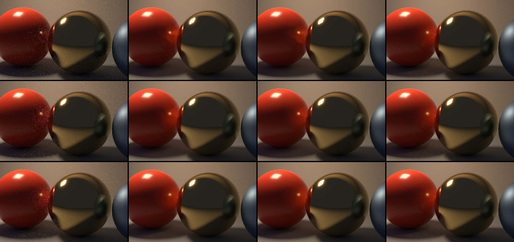

# OIDN for Field's Vulkan path tracer: spike report (2026-11-14)

Question: can the Vulkan path tracer get the denoised still the three.js WebGPU viewer gets from
`oidn-webgpu`, on the Mac, and should that be native Intel Open Image Denoise or a compute port?

**Answer: native OIDN, Metal device, readback route first.** It works now and denoises 1080p in
61 ms on an M1 Max. 8 spp plus OIDN looks better than the tracer's 1024 spp reference. The
denoiser is not the slow part. The tracer is: 226 ms per sample at 1080p on KosmicKrisp. So is
the spike's own readback code (see "Costs around the denoiser").

Nothing here is landed. The harness is `src/jvmMain/kotlin/afield/media/reconstruction/OidnSpike.kt`
(uncommitted). Pictures and raw numbers are in [`oidn_spike/`](oidn_spike/), and
[`oidn_spike/measurements.json`](oidn_spike/measurements.json) holds every figure quoted below.

## What was run

- OIDN **2.5.1** prebuilt, `oidn-2.5.1.arm64.macos.tar.gz`, sha256
  `98e0aca8e7ab69e9f4f0191582a500fd8b0d9085d68662f18ab6469e934a6efd`.
  It was downloaded by hand into a scratch folder. No Gradle task exists yet.
- Bound through **FFM** (`java.lang.foreign`), the way `NgxNative`, Manifold and Ceres are. About 60
  lines, no shim library: OIDN's C API is plain enough to call directly
  (`oidnNewDevice`, `oidnNewBuffer`/`oidnWriteBuffer`, `oidnNewFilter("RT")`, `oidnSetFilterImage`
  with `FLOAT3` at a 16-byte pixel stride so the tracer's `vec4` buffers go in unchanged,
  `hdr=true`, `quality`, `cleanAux`).
- Scene: three spheres from `PathTracedReconstructionSmoke` (red plastic, gold metal, rough blue
  metal) with a back wall and a small bright area light, which gives hard indirect noise. Rendered
  at 1920×1080 by `PathTracingRenderer`, `COMPUTE_BVH` backend, on **KosmicKrisp** (SDK 1.4.363,
  the Mac default), Vulkan validation off.
- Inputs per sample count: the accumulated linear radiance from `readLinear()`. Albedo is
  (diffuse + specular albedo, clamped to 0..1) and normal is `normalRoughness.xyz`, both from
  `enableFrameOutput()`, averaged on the CPU over the same jittered frames as the colour.
- Reference: the same tracer at 1024 spp, which still shows grain on the red sphere. That is why
  PSNR stops near 38–39 dB: past that point the reference's own noise is being measured.
- Launched with `field_backdoor.py run-jvm-main afield.media.reconstruction.OidnSpike`.

## Denoise time, 1920×1080, M1 Max

Median of 5 executes after one warm-up. The filter is RT, HDR, albedo + normal. Times in ms.

| Device | 8 spp | 32 spp | 128 spp | first execute of a new filter | very first execute in process |
| --- | --- | --- | --- | --- | --- |
| **Metal**, `quality=high` | **60.7** | **60.7** | **60.6** | ~210 | 1581 (kernel/MPSGraph build) |
| Metal, `cleanAux` (+2 aux prefilters) | 132 + 885 prefilter | 132 + 538 | 132 + 582 | ~460 | |
| CPU (10 cores, TBB), `quality=high` | 495 | 530 | 457 | ~470–570 | |
| CPU, `cleanAux` | 1318 + 2585 prefilter | 1530 + 2587 | 1158 + 2293 | | |

- The time does not depend on sample count, which is expected for a fixed-size UNet.
- `quality=balanced` gave **bit-identical** output and the same time as `high` on both devices in
  2.5.1 for this filter, so it buys nothing here.
- Metal and CPU agree visually. The largest per-channel difference at 128 spp is 0.39 in linear
  HDR, on the highlights. The PSNR of the two matches to 0.01 dB.
- The standalone `oidnBenchmark` agrees: 64.6 ms Metal and 524 ms CPU for
  `RT.hdr_alb_nrm.1920x1080`.
- Device creation took 25 ms (Metal) and 34 ms (CPU). Filter commit took 12–170 ms (Metal).
  Upload through `oidnWriteBuffer` for three 33 MB images took 62–69 ms, and download 12–17 ms.

The Metal device is built on MetalPerformanceShadersGraph (`otool -L`), which is why it is about
8× faster than the CPU device.

## Quality

PSNR is measured on display-referred values (clamped to 0..1, sRGB) against the 1024 spp reference.

| spp | noisy | OIDN alb+nrm | OIDN cleanAux |
| --- | --- | --- | --- |
| 8 | 29.51 dB | 38.12 dB | 38.27 dB |
| 32 | 30.76 dB | 38.50 dB | 38.65 dB |
| 128 | 33.30 dB | 38.71 dB | 38.81 dB |

Full frames: [noisy 8 spp](oidn_spike/noisy-8spp.jpg) → [OIDN 8 spp](oidn_spike/oidn-metal-8spp.jpg);
[noisy 32 spp](oidn_spike/noisy-32spp.jpg) → [OIDN 32 spp](oidn_spike/oidn-metal-32spp.jpg);
[reference 1024 spp](oidn_spike/reference-1024spp.jpg).

The crops show this:

- Even at 8 spp the denoised spheres, the floor shadow and the gold reflections are clean.
- OIDN removes the fireflies on the red plastic sphere that are still present in the 1024 spp
  reference.
- At 8 spp the red sphere's coat is slightly smoothed: its glossy grain is noise, and OIDN treats
  it as noise. cleanAux sharpens a little but costs 2.2× (plus prefilter).

**Unexplained:** linear-HDR MSE gets *worse* after denoising (0.0156 at 8 spp, against 0.0092 for
the noisy image), while display PSNR improves by 9 dB. My guess is that the directly visible
emitter (radiance 40) dominates linear MSE, and OIDN shifts its value or edge. The spike did not
save float images, so this is unchecked. Before any MSE-based test, dump the floats and mask
the emitter.

## Costs around the denoiser (they dominate)

| Step at 1080p | ms |
| --- | --- |
| One path-traced sample, KosmicKrisp, `COMPUTE_BVH` (1024 spp took 231.7 s) | **226 / spp** |
| `readLinear()` of the accumulated colour (33 MB) | **1806** |
| Per-frame aux readback (3 images via `ReconstructionCapture.read`) + CPU accumulate | 280 / frame |
| OIDN Metal denoise | 61 |

- The tracer speed decides the "same as three.js" experience. 32 spp is about 7.2 s of tracing
  here, against about 3.4 s for three-gpu-pathtracer's 32 spp plus denoise in WebGPU. Different
  scenes, so this is only a pointer, but Field's compute-BVH tracer on KosmicKrisp is worth a
  profile of its own. A single 64-spp dispatch at 1080p (about 15 s) tripped Metal's command
  watchdog (`MTL_COMMAND_QUEUE_ERROR_TIMEOUT` → `VK_ERROR_DEVICE_LOST`). Any "render N samples
  per frame" control has to cap work per submit on the Mac.
- The readbacks are slow because of how they are written, not because of the hardware. Both
  convert one element at a time through `mapAndRead_bytes`. A bulk `MemorySegment` copy, plus aux
  accumulation on the GPU (an accumulating pass over the frame-output images, or accumulated
  guides in the tracer), should bring the whole round trip near the OIDN upload figure (about
  65 ms). The zero-copy route below removes it entirely.

## Zero-copy (assessed, not built)

Driver facts, from `vulkaninfo` with SDK 1.4.363 on this machine:

| | MoltenVK | KosmicKrisp |
| --- | --- | --- |
| `VK_EXT_metal_objects` | yes (rev 2) | **no** |
| `VK_EXT_external_memory_metal` | yes | yes |
| `VK_EXT_external_memory_host` | yes | yes |
| `VK_KHR_cooperative_matrix` | no | no |
| `shaderFloat16`, 16-bit storage | yes | yes |

There are three routes for getting Vulkan memory into OIDN's Metal device, which needs an
`MTLBuffer` (`oidnNewSharedBufferFromMetal`):

1. **Host memory both ways (works on both drivers, and Field already does it).** Allocate
   page-aligned memory. Import it into Vulkan with `VK_EXT_external_memory_host`, exactly as
   `IOSurfaceHostBuffer` does for Syphon on KosmicKrisp. Wrap the same pages for Metal with
   `newBufferWithBytesNoCopy`. Then copy the accumulation buffer and two guide images into it with
   one GPU copy, wait on the fence, and run OIDN. On unified memory this is real zero-copy, apart
   from one GPU blit. Recommended.
2. `VK_EXT_external_memory_metal`: export a `VkDeviceMemory` as an `MTLBuffer`
   (`vkGetMemoryMetalHandleEXT`, handle type `MTLBUFFER`) and pass it to OIDN. This is cleaner,
   but needs the export `pNext` through Field's VMA allocation path, and nothing in Field uses it
   yet.
3. `VK_EXT_metal_objects`: only MoltenVK lists it in the `vulkaninfo` table above, so this route would cover MoltenVK and not the default KosmicKrisp.

Synchronisation: Field does not get at the `MTLCommandQueue`, so OIDN runs on its own queue. A
Vulkan fence wait, then OIDN execute (blocking), then upload is fine for a converged still. The
round trip costs one frame of latency.

**Linux NVIDIA (CUDA device):** export the buffer with `VK_KHR_external_memory_fd`, call
`oidnNewSharedBufferFromFD(OIDN_EXTERNAL_MEMORY_TYPE_FLAG_OPAQUE_FD)`, and sync with
`oidnNewSharedSemaphoreFromFD` against an exported timeline semaphore. This is the documented
OIDN path. The Linux package is 66.6 MB because it carries the CUDA, HIP and SYCL devices. There,
DLSS RR remains the real-time option, and OIDN would be the still and offline denoiser.

## Binary size

| Item | Size |
| --- | --- |
| Release tarball, arm64 macOS | 51.4 MB |
| `lib/` uncompressed | 52.1 MB: `libOpenImageDenoise_core` 51.0 MB (weights embedded), `_device_cpu` 0.34 MB, `libtbb` 0.37 MB, `_device_metal` 0.25 MB, loader 0.17 MB |
| `lib/` gzip-compressed | 47.7 MB |
| Linux x86_64 tarball / Windows x64 zip | 66.6 MB / 56.6 MB |

The weights inside `_core` cannot be stripped from the prebuilt. A from-source build with only
the `rt_hdr_alb_nrm` weights would be much smaller, but the build-time download of the stock
release is the pragmatic route. It would be a checksummed fetch beside
`buildDocsNativePrerequisites`, kept optional like NGX and Steam Audio. The dylibs carry
`@loader_path/../lib` rpaths, so they load from wherever the tarball is unpacked. On a fresh
download, macOS quarantine may need clearing, as with other fetched natives.

## The no-native-library option: porting oidn-webgpu to Vulkan compute

`oidn-webgpu` 0.6.0 is on the unmerged `claude/three-webgpu-spike` branch (the weights under
`src/commonMain/resources/vendor/oidn-webgpu/0.6.0/`, the code in
`tools/three-pathtracer-webgpu-bundle/node_modules/oidn-webgpu`). Its kernels are **not** a fixed
set of `.wgsl` files. `nativeUNetCore.ts` (3735 lines) plans the UNet and *generates* WGSL at
runtime: 13 `@compute` templates specialised per layer, precision (f32/f16) and feature path
(plain, subgroup, Chrome's experimental subgroup-matrix). Tiling, HDR transfer and `.tza` parsing
add about 1500 more lines.

A port would mean:

- Run the planner offline for a fixed configuration (RT HDR alb+nrm, f16, plain or subgroup path)
  and emit the WGSL variants.
- Translate them to SPIR-V (naga or tint), or hand-convert them to GLSL or Slang.
- Write a Kotlin executor: `.tza` weight upload, the per-layer dispatch list, and tile
  scheduling.

That is roughly 2–3 weeks to get it correct and tiled. Then it needs validating against OIDN's
output, and these measurements give a ready reference.

Performance is the catch. Neither Mac Vulkan driver exposes cooperative matrix, so a Vulkan port
cannot reach the simdgroup-matrix hardware that MPSGraph uses in OIDN's Metal device. Expect it
to be several times slower than 61 ms on this Mac; this is an estimate, not a measurement. Its
real advantages are zero-copy by construction, no 50 MB native library, and one code path on
every Vulkan driver.

## Recommendation

1. **Build native OIDN, Metal device on macOS, readback route.** Cost: an optional checksummed
   download, about 100 lines of FFM, and a `denoise()` on `PathTracingRenderer` that the box can
   display. Go to zero-copy route 1 when the readback shows up, which will happen first in an
   interactive "denoise every N samples" mode. Accumulate guides on the GPU instead of the
   spike's CPU averaging.
2. Put CPU OIDN behind the same API as the fallback (about 0.5 s at 1080p). It is fine for a still.
3. Don't port oidn-webgpu now. Revisit only if the 50 MB dependency becomes a problem, or a Mac
   driver ships cooperative matrix.
4. Separately: profile the compute-BVH tracer on KosmicKrisp (226 ms/spp at 1080p), and cap
   samples per submit below the Metal watchdog. These limit the experience more than the denoiser.
