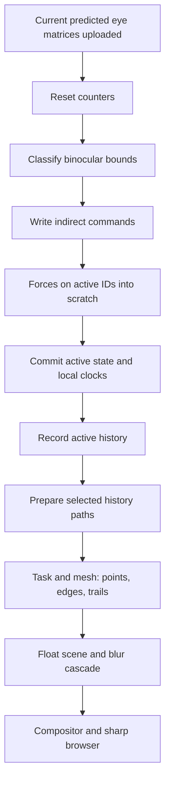

# dust_six: view-dependent particle work and mesh shading

`dust_six` is a separate user document at
`/home/marc/Documents/AFieldWorkspace/dust_six`. It keeps the writable rest cloud,
six-slot ONN, layout/transport cache, history, StackSL interventions, document keys,
blur compositor and sharp VR browser from `dust_five`. Its simulation and geometry
work now share a GPU-generated active list.

Status: CPU compilation and shader validation passed on 2026-11-03. The first
successful Quest/WiVRn GPU launch followed on 2026-11-04: all 19 scene boxes
launched, the manual live GPU state check passed, and the user confirmed particles
and browser match the desktop mirror. It observed 40,000 active particles, so the
sleep/resume case remains unexercised. `files/mesh-task/hardware-launch.json` and
`live-left-eye.png` record the result.

That first hardware session also repaired mesh UBO delegate generation, explicit
renderer ownership during UBO reload, and graphics-queue compute probe retirement.
Unused force push fields were removed to fit the 256-byte limit. Vulkan validation
remains enabled. `AFIELD_OPENXR_VALIDATE=false` disables the separate OpenXR API
layer for this document's launcher: the installed layer reports WiVRn vendor-created
body tracker spaces as invalid and floods the log. The option can be overridden
independently of Vulkan validation.

## Frame order

`MultiviewStereoTarget.beforeScene` runs after its eye UBO upload and before the
layered scene. `DustSixSchedule` records all seven compute stages once per frame
on that graphics command buffer, with memory dependencies between stages. It
enables only after all stages exist. The normal frame has no CPU visibility
readback, queue-idle wait or previous-frame image dependency.

## Visibility and pausing

The classifier tests the union of the two eye frusta, expanding their lateral
clip bounds by 10%. A particle's conservative bound includes its six edge
endpoints, bounded velocity handles, cached history bounds, configured trail warp,
sprite radius/aspect, cluster spread and pixel coverage allowance. An endpoint
can therefore keep its owner awake even when the owner's center is outside view.
Radius, warp and aspect ceilings also constrain the geometry shaders; changing
the bound contract requires changing both sides.

State A is canonical. Forces read A and write scratch B, then commit only active
IDs back to A. Skipped particles retain their actual last state, rather than
alternating between stale ping-pong copies. History heads, sample counts, local
time and random ticks stop while asleep. Waking resumes retained Verlet velocity
without integrating the elapsed wall-clock gap. Wake coverage fades in.

Sleeping neighbours remain frozen spring boundary conditions. This is an artistic
approximation, not the result of simulating the whole cloud offscreen.

The 64-byte per-particle metadata stores awake/head/count/tick, local time/fade/LOD,
and raw-history min/max. A shared work buffer holds counters, four indirect
commands and compact active/trace ID lists. Stable particle-ID sampling chooses
history traces within their budget, independent of atomic compaction order.

## Geometry and distance detail

Task workgroups inspect batches of 32 IDs. Mesh workgroups emit bounded quads for
noise-shaped leaf/bokeh sprites, velocity-curved ONN ribbons and prepared history
ribbons. Edge/trail task payloads contain IDs and child-count prefixes, rather
than an expanded list of every stroke. Long paths split into bounded chunks.

Both eyes share detail counts and random seeds. Near geometry adds stable spray
copies/overstrokes; far geometry keeps one. Fractional coverage fades the next
copy continuously, with total-copy normalization. Paths retain fixed sampling
while copies fade so changing distance does not switch curve subdivisions.
The existing derivative-antialiased fragment coverage and StackSL interventions
remain editable in the document's `task`, `mesh`, `fragment` and `compute` properties.

Default size is 400,000 particles with 64 history samples and a 400,000-trace budget
(expanded from 10,000 during the follow-up below).
The ID/command layout also supports 500,000 particles; that scale has not been
executed or memory-profiled. Simulation still classifies all particles, and
history storage still scales with particle count times capacity.

## Core support

- Mesh/task features are queried and enabled on supported non-macOS Vulkan devices,
  including Linux. Multiview mesh support is checked separately. The document
  checks its output, payload, invocation and view limits before drawing.
- `ComputeMesh` supports indirect dispatch; `MeshMesh` supports indirect task draws.
  Their command buffers are prepared before dynamic rendering, with bounds/alignment
  checks. Transfer visibility includes task/mesh shader stages.
- `RenderToTexture.meshModules` draws mesh pipelines into the same layered float
  scene used by the blur cascade. Its format and view-mask checks match ordinary
  modules.
- `DemoTranscriptExecSmokeTest --compile-file <recipe>` compiles a private recipe
  through Field's real macro/preamble/Kotlin pipeline without evaluating box bodies.

Private helper sources live in `src/personal/kotlin/drowning`. The document's narrow
runtime builder compiles the particle helpers plus `DustSixRuntime.kt`, avoiding
unrelated personal sources. A copy and provenance are retained with its evidence.

## Validation and next headset session

Document evidence is under `dust_six/files/mesh-task/`:

- Core `compileKotlinJvm` and the narrow particle runtime build passed.
- All 20 document boxes passed the real Field compiler with execution skipped.
- All 16 new compute/task/mesh/fragment stages compiled using actual authored
  StackSL expansion, passed SPIR-V validation, and the three graphics stage groups
  linked with glslang.
- 24 CPU policy checks cover binocular bounds, stable trace selection, indirect
  dimensions, fractional coverage and a reference paused-state/history model.
  These are algorithm checks, not evidence of GPU producer/consumer behaviour.

Once VRAM is free, connect WiVRn, run the document's `start-dust-vr.sh`, and run
`dust6_launch_scene`. It launches in dependency order and waits for pending work
before creating the document keys. The optional **21 · GPU state check** box uses
explicit idle waits and staged debug reads, checks live work/state invariants and
writes `gpu-verification.json`. It is excluded from normal startup. Its current report records the successful
launch, with `pauseExercised=false` until sleeping particles are observed.

First hardware checks: both-eye coverage at the margins; turn away/back to exercise
paused particles and histories; stable near/far stroke fades; live point/edge/trail
shader reloads; browser sharpness and mouse ownership; desktop mirror; clean stop.
The manual state check reports whether it actually observed sleeping particles.
It does not establish visual quality, shader timing or motion-to-photon latency.

### 400,000-particle follow-up

The 2026-11-04 density increase ran successfully with 400,000 particles. The live
GPU check passed with finite state, matching indirect counts, current-eye bindings
and one graphics command/frame for all seven stages; it also observed sleeping
particles frozen across adjacent frames. Transport matching is now lazy on Apply,
with persistent correspondence caching. The captured artist key was restored:
139/141 lanes match exactly, while the two source strides clamp from 16 to 40 to
retain the 10,000-source edge/trail budgets. Evidence is retained in the document's
`files/mesh-task/` density and GPU reports. 500,000 remains untested.

## Diagnostic sampling at large counts

The physics probe is capped at about 4,096 reporting particles per frame. Its
global atomics were the dominant cost at 400,000 particles: a focused live GPU
sample measured median force-pass time dropping from 26.185 ms to 2.635 ms, and
primary GPU frame time from 33.6 ms to 6.906 ms. The after sample confirmed sprites
visible. The user toggled sprites near the first sample, so these are diagnostic
snapshots rather than a controlled rendering comparison. History was about 0.14 ms.
All active particles still simulate; the probe's histogram, extrema and non-finite
counts describe the sampled subset. Live GPU state checks passed after the change.
Timing hooks and profiling were removed afterward. Evidence: `files/mesh-task/performance/`.

### Full trail budget and on-canvas statistics

The work-list and prepared-trail buffers now share box 3's configured budget,
currently 400,000. An explicit `also { work -> ... }` assignment avoids `apply`
receiver shadowing the outer budget with the helper's former 10,000 default.
Preparation uses a 2D indirect dispatch flattened into the existing linear
particle-major output. Both updated shaders passed CPU SPIR-V validation; live GPU
checks observed one-in-one selection and valid prepared samples beyond the first
dispatch row, using only a 96-byte sparse readback. Awake/culling and history gates
still apply. Box 1 now owns a once-per-second performance output from existing CPU
span snapshots and the XR frame counter. It reuses the active renderer.

## Interleaved history sampling and typography

History recording now uses `activeTick % N == particleId % N`. Initially this gives
N balanced cohorts: 400,000 particles at N=64 means 6,250 per cohort. Each particle
still records once per N active ticks. Offscreen pausing can drift the cohorts;
there is no resynchronization. Physics time and the noise/random clocks are unchanged.
`full-trails-400k` retains the original saved shader look; the new
`full-trails-400k-staggered` key contains the interleaved recorder. Recall named
keys in box 16. These are artist/shader snapshots, not frozen simulation buffers.

StackSL panels now use Field's code-font token and inherit font stretch and
OpenType features. The old shorthand selected Noto Sans Mono and reset stretch and
features; the live desktop check now reports Iosevka Field Semi-Condensed at 87.5%
with TXTR/dlig enabled. The headset view received the same style correction. The
permanent generator fix passed `compileKotlinJvm` and was loaded by the subsequent
Field restart. The running pages had also been corrected in place before restarting.
