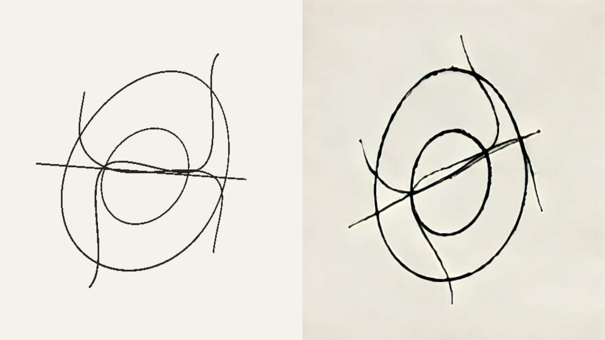

# StreamDiffusionV2 RTT processor (optional)

Linux/NVIDIA local worker. Field renders an RTT, exports device-local buffers to
CUDA, and receives the stylized frames through another shared GPU buffer ring.
The Python process carries the Torch/model dependencies. Ordinary Field builds
and startup do not need this environment or download models.

Pixels remain on the GPU: Vulkan copies, CUDA tensor operations, the Wan encoder,
causal denoiser, TAEHV decoder, and the return copy. JSON carries control and frame
metadata. `SCM_RIGHTS` carries allocation/semaphore handles once per session.

## Start here

From this Field checkout:

```bash
cmake -S native/field-fdpass -B native/field-fdpass/build -DJAVA_HOME=/path/to/jdk
cmake --build native/field-fdpass/build
uv pip install --python /path/to/sd2/.venv/bin/python -r optional/streamdiffusion/requirements.txt
```

The JDK must include JNI headers; this machine's Gradle toolchain is under
`~/.gradle/jdks/`. An existing compatible backend's weights and TensorRT engine cache can be reused. Set `FIELD_STREAMDIFFUSION_ROOT` or pass an
explicit `StreamDiffusionConfig(root = File(...))` to use another installation.

For a managed demonstration and native screenshot, run
`bash optional/streamdiffusion/run-demo.sh` from a graphical terminal. It creates
an isolated automation document, waits for active TensorRT output, displays the
scene for 20 seconds and closes its owned renderer/worker. The capture defaults
to `build/streamdiffusion-demo.png`.

For an interactive scene, open `streaming_diffusion` under **Starting points** on
Field's welcome screen, run its renderer box, then its spinning-curves box. The
curves box reports missing support before accessing Unix/CUDA facilities on
unsupported machines, including macOS.

You can also launch Field's normal renderer box. Connect a new box below it, paste
[`examples/spinning.kt`](examples/spinning.kt), and launch. Source is on the left,
processed output on the right. While loading, the right panel shows the source.
The comparison uses the current source: causal output has temporal delay.

The box exposes material, strength, prompt adaptation, animation and reset.
Edit `whiteOnBlack` before launch to choose the white-line control. Edit `backend`
to `identity` or `invert` to compose a graph without loading diffusion weights;
both still use the same bidirectional GPU transport.

## Process your own RTT

Check `StreamDiffusionSupport.probe(renderer, config).available` before constructing
a processor, and show `reason` when unavailable. Resolve the renderer before an asynchronous boundary:

```kotlin
import afield.four.diffusion.*
import java.io.File

val owner: Renderer = fromContext()
val processor = StreamDiffusionView(owner, target,
    StreamDiffusionConfig(File("/path/to/sd2"),
        prompt = StreamDiffusionPresets.CHARCOAL, strength = .45))
prop<RenderToTexture>(stylized) = processor.output
```

`processor` registers in `preTargets` and renders `target` itself. Remove the
source's separate render-list registration, or use `renderSource = false` and
schedule its draw before the processor in that frame. Use `stylized` as an
ordinary sampled RTT in subsequent modules. The caller owns the source;
`processor.close()` retires the worker, bridge and output. Construct and close
between graphics frames, following the usual Field resource lifecycle.

Supported source attachments: single-layer RGBA8/BGRA8, sRGB or UNORM, with
`colorTransferSrc = true`. The output preserves the source's format. Diffusion
dimensions must be multiples of 32. Start at 512×512 and 16 input FPS.

```kotlin
processor.reset(prompt = StreamDiffusionPresets.INK, strength = .85, seed = 0)
println(processor.session.status)
println(processor.session.capabilities)
println(processor.session.lastStats)
```

Reset starts a new causal generation and holds the last valid output during
warm-up. Six input slots and eight output slots bound queued GPU frames. Input
slots return after CUDA conversion, output slots after Field's GPU copy.
Skipped capture intervals are visible through `skippedCaptures`; accepted chunks
remain chronological. Five initial RGB frames are followed by groups of four.
Output source IDs/times account for decoder warm-up and denoising delay.

TAEHV uses TensorRT by default. `tensorrt_requested` reports the setting;
`tensorrt_active` becomes true after an engine actually loads and executes. A
fallback is reflected in subsequent capability/status messages. T5 is moved off
the GPU after prompt encoding by default; subsequent prompt encoding can run on
CPU. Per-frame image processing stays on CUDA. Prompt changes can therefore take
longer than steady-state frames.

## Prepare a separate backend

The worker depends on this compatible upstream snapshot and the small patches
preserved from the video study:

```bash
git clone https://github.com/chenfengxu714/StreamDiffusionV2.git /path/to/sd2
git -C /path/to/sd2 checkout 6961a5cf2045d1dda05a04ef229698bdc04e873a
git -C /path/to/sd2 apply /path/to/Field4/optional/streamdiffusion/upstream/field.patch
cp optional/streamdiffusion/upstream/local_rtx4090.yaml /path/to/sd2/configs/
uv venv --python 3.10 /path/to/sd2/.venv
uv pip install --python /path/to/sd2/.venv/bin/python torch==2.6.0 torchvision==0.21.0 --index-url https://download.pytorch.org/whl/cu124
uv pip install --python /path/to/sd2/.venv/bin/python -e /path/to/sd2
uv pip install --python /path/to/sd2/.venv/bin/python -r optional/streamdiffusion/upstream/requirements-local.txt -r optional/streamdiffusion/requirements.txt
cp optional/streamdiffusion/upstream/download-models.py /path/to/sd2/
/path/to/sd2/.venv/bin/python /path/to/sd2/download-models.py
```

This setup is for Python 3.10, Torch 2.6/CUDA 12.4, FlashAttention 2.7.4 and
TensorRT 10.9 on Linux x86_64. Model downloads are substantial; reuse existing
weights where possible. Wan and distilled checkpoints use pinned revisions;
the download helper's TAEHV URL follows its upstream main branch. Engine caches
are specific to their TensorRT/device configuration and may need rebuilding.

## Resolution and time

Dimensions must be multiples of 32; rectangular images are accepted. The worker's
4096-per-axis bound is a protocol ceiling, not a demonstrated model size.
512×512 at 16 FPS is verified on the RTX 4090. Higher resolutions increase memory
and computation and can require new TensorRT engines. Resolution and configured
FPS are fixed per processor: close and recreate it to change them.

FPS accepts 1–60. Field's display loop can run faster than diffusion and holds
the last completed image between updates. Five initial frames are followed by
four-frame groups. At 16 FPS a group spans 250 ms; measured worker computation is
about 186 ms. Causal processing and output pacing add delay, so 16 FPS is not
62.5 ms end-to-end latency. Exact end-to-end latency remains unmeasured.

There is no fixed clip duration; queues and model caches are bounded. Hours-long
stability has not been established. The model advances through accepted frames,
not source timestamps, so capture skips and FPS changes affect perceived motion.
Startup takes tens of seconds; first engine builds can take longer. The configurable
startup timeout defaults to 240 seconds. See the [public guide](../../public/docs/streaming_diffusion.md#duration-fps-and-latency).

## Lifecycle and limits

The worker's private Unix socket lives in a mode-0700 session directory. Each
session owns its child process, CUDA mappings and descriptors. Export descriptors
are closed after handoff. Worker exit precedes GPU allocation retirement, and
renderer shutdown stops workers before destroying the Vulkan device.

Field waits only for outputs whose CUDA completion was already reported. It holds
the last image when the worker is busy or fails. Worker logs live at
`processor.session.logFile`. Remote workers and user-supplied flow/depth
conditioning are future extensions; this implementation accepts RGB only.

Combined GPU throughput depends on the scene and VRAM headroom. The previous
offline video measurement is not a promise of the same FPS inside Field.

Public guide: [`Streaming diffusion`](../../public/docs/streaming_diffusion.md).

Architecture: [`STREAMDIFFUSION_RTT_INTEGRATION.md`](../../dev_docs/graphics/STREAMDIFFUSION_RTT_INTEGRATION.md).

## Recorded Field run

The native ink demo presented 343 frames, sustaining **16.00 FPS** over an
18-second steady interval at **512×512**. Three captures were skipped during
warm-up. The median four-frame worker chunk took **186 ms**. TAEHV/TensorRT was
active, with the text encoder offloaded. This is a live Field measurement.



[Run data](artifacts/run.json) and [worker log](artifacts/ink-worker.txt) retain the
measurements and actual TensorRT engine loads. Kotlin compilation and the native
FD helper build passed. No automated test suite was added or run. The final gated starting-point transcript was also run, both with a missing backend
and with active diffusion; this capture includes the final lifecycle and strict
checkpoint-loading changes. macOS was not run on this Linux host.
