# Agent transcript gallery

<div data-field-transcript-gallery="entries" hidden></div>

These are documents built from a blank canvas by agents working in Field. Open one to see the
result, try it in Field, or take it apart and make it your own.

Each begins as an **operation transcript**: a YAML macro that makes the boxes, writes the code and
connects the graph. The transcripts are also examples for agents to copy and adapt when
[automating Field](automating_field.md).

These are the same scenes offered as **Starting points** on the [welcome screen](history_overview.md):
each transcript that is a self-contained scene is materialized into an openable document, so you can
search for it there and open an editable copy in your workspace. A few are not, and each says why in
its own entry: some are integration probes rather than scenes, two are the halves of the
graphics-topology rule (a renderer with nothing to draw, and a draw box with no renderer), and
`mega_texture_wall` needs both an external renderer and a directory of images you supply. A scene
that needs a gesture, a headset or a service is still offered: you click once, or point it at a
device you own.

Every transcript in `dev_docs/agents/transcripts/` has an entry below. Each entry says what the
scene builds and which numbers it prints.

**Open →** shows a document beside its entry. Open another to replace it, or use the viewer's
arrow to open a separate tab. Documents with captured outputs show their results immediately;
**Open in Field·4** imports an editable copy into Field.

About half the entries carry a figure captured from that scene's own code. The rest have none,
because the scene publishes to a headset, wants a camera or an external service, or opens a window
the docs build does not capture. Those entries say what to run instead.

## Running one

Any transcript can be replayed into a running Field with the agent backdoor or the `field_run_transcript`
MCP tool; see [Automating Field](automating_field.md) for the full mechanism. In short:

```diffstatic {data-lang=bash}
uv run --project . --group backdoor python tools/field_backdoor.py --json \
  --command 'macro write hello_display --file dev_docs/agents/transcripts/hello_display.yaml' \
  --command 'macro run hello_display'
```

The source corpus lives in the repository at `dev_docs/agents/transcripts/`, with a companion
`README.md` covering the op vocabulary, capture commands, and the graphics-topology rule.

## How CI checks them

<!-- transcript-index: totals -->
One harness, `DemoTranscriptExecSmokeTest`, checks every transcript on every build, at one of three
depths. Most are **replayed end to end**: the real macro runner builds the graph and the real
compile-and-evaluate pipeline runs every box the transcript asks it to, and the test fails if a
single box emits one error-kind output line. (Almost always that is every box in the file. A
transcript may create a box it does not execute, one that wants a device the build does not have or
that is meant to fail so a diagnostic can be shown, and only the ops it writes down are replayed.)
Others want something the lightweight build does not own (a GLFW window and Vulkan renderer, an external
audio service, a native library, or a camera), so those are **built and compiled**: the graph is assembled through the
real apply path and each box's Kotlin goes through the real K2 compiler, with only the terminal
evaluation skipped, the line that would open the window or reach the device. A handful are
Kotlin **compiled to JavaScript** for a browser or visionOS head, through the real head profile that
the box's `// {{ marker }}` selects.

None of the three proves a picture is *right*; that is what the docs captures and the gallery
FIELD_TESTs are for. What all three prove is that the code in these files still compiles and runs
against today's stdlib. A separate check makes sure the copy the welcome screen opens is the one
the yaml produces today.

The saved documents under `dev_docs/agents/demos/` each have a transcript here too, so their box
Kotlin is compiled on every build.

??? aside "Agents: the starting-point guard"
    `checkAgentTranscripts` materializes every transcript into a document and compares it
    byte-for-byte against the committed starting points.

??? aside "Why the demos are registered here"
    Box code goes through the K2 REPL against a different import set from `jvmMain`, so no Gradle
    compile task sees it; a demo box can stop compiling with every gate green until a transcript
    replays it. `AgentDemoRegistrationTest` holds the two-way registration and
    `checkAgentTranscriptIndex` holds this page to the corpus; `dev_docs/GUARD_CORPORA.md` has the
    method.

## Pure-compute scenes

<!-- transcript-index: verified-by = execute -->

These build and run headless: no window, no GPU. Open one to get the code in front of you, then run
its box to see the output (a plot, an inline value thumbnail, a printed line).

### knight_tour_workshop

**Knight tours, many ways of drawing a move.** Five connected CPU-only FLine boxes:
straight tours from three search strategies, rolling arcs through consecutive triples, a 62-stage
growth sheet, arcs scaled about B with optional perpendicular push, short-join glued arcs, and
layered quadratic stroke experiments. (The source overview and four derived views make five boxes.)
Run **knight tours** first: it publishes the searches and sampled arcs once and refreshes the views.
The last box accepts collection literals or scalar parameters, zipped with hold-last repetition;
trims, pulls, rotation, offset and slide are deliberately unclamped. Its default three layers
produce 3,402 quadratic strokes across eighteen tiles, with runtime geometry assertions.
The glued view reports join lengths; its nearest-neighbour/2-opt route is not a global optimum.

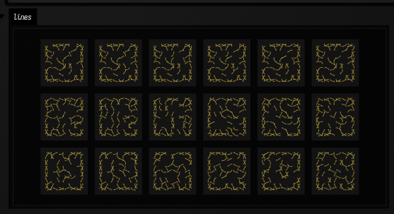

[Open →](offline.html?file=assets/agent_transcripts/knight_tour_workshop/metadata.edn) ·
[Walkthrough and parameters](knight_tour_workshop.md) ·
[Saved chat](assets/knight_tour_workshop/chat.txt)

### staged_project

**A level built in stages.** The starting place of [Start a staged project](staged_projects.md): a
level of rooms and doors that changes only through `level.inspect` and `level.edit`, a blockout, the
paths to every loot point and the loot placement as builds, a gate that holds placement until every
loot point is in reach, the placement rule as a [qualified source](qualified_sources.md), and a
corpus of seeded variants built by the same stages. Open it and press **Build** on each stage.

[Open →](offline.html?file=assets/agent_transcripts/staged_project/metadata.edn)

### learned_pen

**A pen that keeps writing.** The starting point of [A learned pen](learned_pen.md): the Distill
handwriting LSTM, run in Kotlin, continues a stroke you give it; twelve different futures from one
stroke; a drawing panel the pen writes on from, with sliders for its temperature and noise while it
goes; one memory cell held high and low, changing the hand; a live magnifier on the pen tip with
its next-step ellipses; and a slider that colours the line by any of its 500 cells. Pure CPU and
nothing to install. Launch the third box and draw.

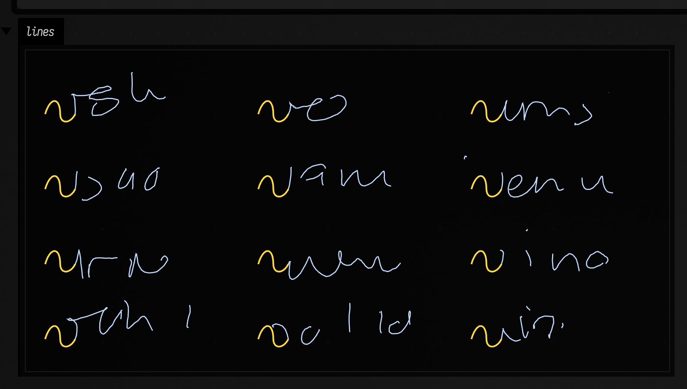

[Open →](offline.html?file=assets/agent_transcripts/learned_pen/metadata.edn)

### a_pen_that_sees

**A pen that sees the ink around it.** The starting point of [A pen that sees](a_pen_that_sees.md):
a pen that senses nearby lines, after Henri Michaux's mescaline drawings, hatching beside a line
pass after pass where its blind twin wanders; cracks that stop where they meet a line; a field of
trembling columns grown from one stroke; the measures that separate seeing from blind; and two
drawing panels, one the pen hatches beside and one it fills with cracks. Pure CPU.

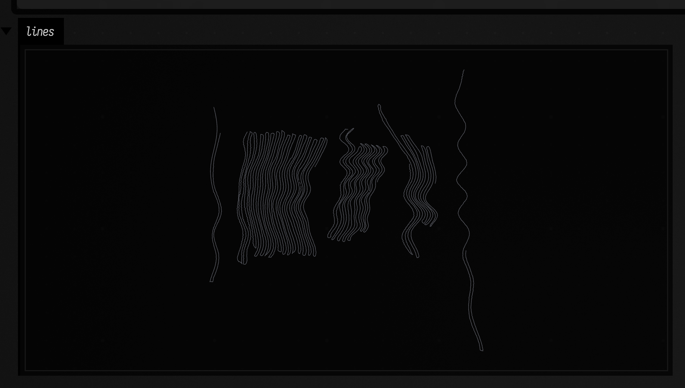

[Open →](offline.html?file=assets/agent_transcripts/a_pen_that_sees/metadata.edn)

### teaching_a_pen

**Pens with other hands.** The starting point of [Teaching a pen](teaching_a_pen.md): Hershey plotter
lettering and five drawing generators as corpora, the six pens Field ships trained on them each
drawing alone, one stroke continued in seven hands, a probe that finds which cells of a two-handed
pen know which hand it is in (and sixteen of them held, forcing one hand), a grid of scribbles you
click to keep as a corpus, and the handwriting pen fine-tuned on its own curliest work. Pure CPU.


[Open →](offline.html?file=assets/agent_transcripts/teaching_a_pen/metadata.edn)

### stipple_sheet

**A trained warp you can drag.** The live version of [Stipple transport](stipple_transport.md): one
box loads the small model the page trained and deforms 400 particles and a coordinate lattice with
it. Three sliders move transport time, movie time and the number of integration steps separately,
so you can push the sheet past the times it was trained on and watch where it stops holding.

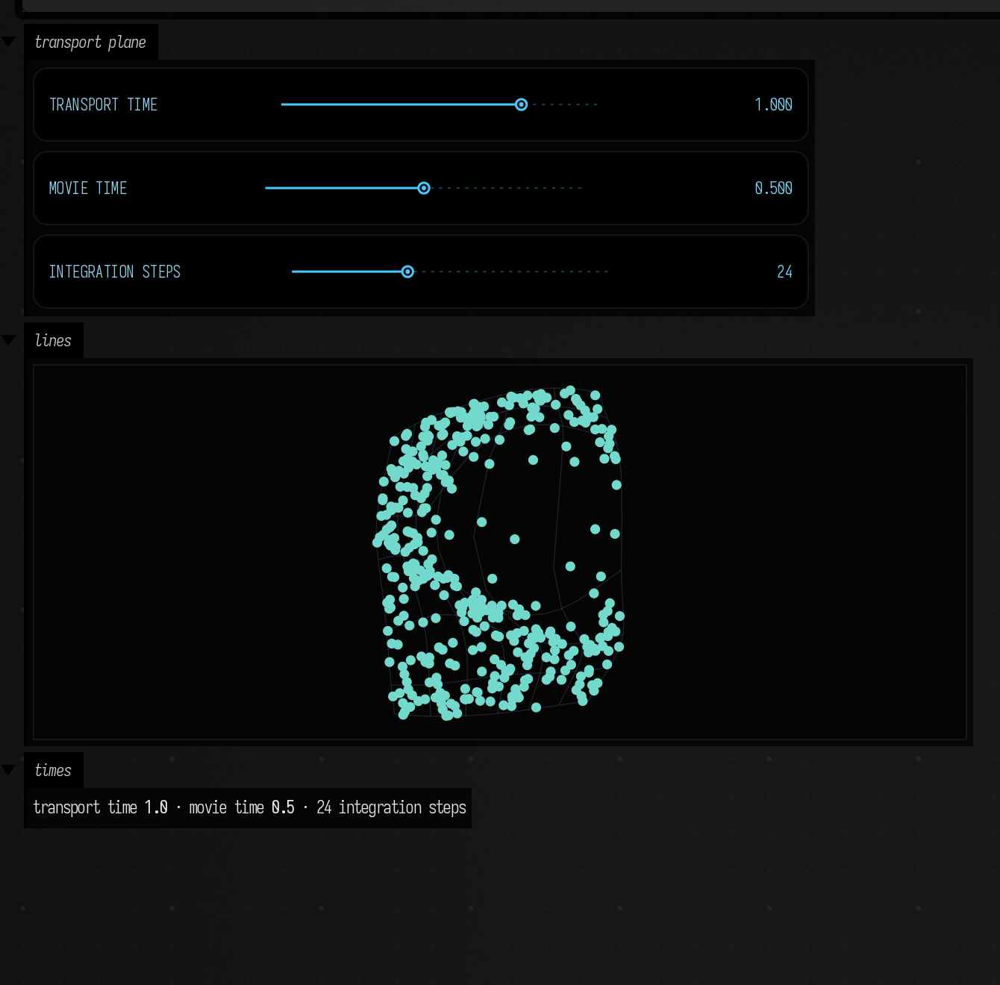

[Open →](offline.html?file=assets/agent_transcripts/stipple_sheet/metadata.edn)

### particle_video_reader

Inspect recorded trajectories as continuous polylines, with time, history length, identity color
and sampling-density controls. This portable example reads the same complete-trajectory subset
as the [Video particles](particle_video.md) walkthrough; it runs without a neural environment.

[Open →](offline.html?file=assets/agent_transcripts/particle_video_reader/metadata.edn)

### hello_display

Minimal blank-canvas macro that creates one runnable output box.


[Open →](offline.html?file=assets/agent_transcripts/hello_display/metadata.edn)

### ai4_iframe_hello

A single box embeds a page served by Field and exposes its iframe to AI4. Run the box, open its
AI Chat panel, and ask it to write “hello” in the textbox. [Live iframe tools](ai4_live_iframe.md)
explains the opt-in and the tools.

[Open →](offline.html?file=assets/agent_transcripts/ai4_iframe_hello/metadata.edn)

### ai4_cold_reader

One box gives AI4 two tools for reading this site as a newcomer: `cold_read_page` shows a page as it
stood at a git revision, and `report_stall` records each place the reader gets stuck. Run the box,
then ask its AI Chat panel to cold-read a page. [Scoring AI4 as a reader of these
docs](ai4_experiments.md#scoring-ai4-as-a-reader-of-these-docs) compares its stalls with an earlier
review.

[Open →](offline.html?file=assets/agent_transcripts/ai4_cold_reader/metadata.edn)

### spreadsheet_tour

A bill kept as a spreadsheet in one box, priced by `tax` and `discount` variables in a second. Run
**Rates** first, then **Bill**. Change a rate and run **Rates** again: the open sheet recomputes on the
next frame without running **Bill**. [Spreadsheets in a Box](spreadsheets.md) covers formulas, units
and the editing keys.

[Open →](offline.html?file=assets/agent_transcripts/spreadsheet_tour/metadata.edn)

### spreadsheet_constraints

Two sheets that solve for their cells. In **Temperature**, Celsius and Fahrenheit are both variables
and one assertion relates them: type a number into either and the other follows. In **Rectangle**,
width and height are held to an area of 40 and a width of at most 6. Run each box, then type into a
variable cell. [Solving for cells](spreadsheets.md#solving-for-cells) explains `free`, `eq`, `le`
and `ge`.

[Open →](offline.html?file=assets/agent_transcripts/spreadsheet_constraints/metadata.edn)

### marf_field_clocks

Three boxes make the [MARF field-clock](marf.md) distinction visible. The first prints four
`STAGES` refusals beside the same spellings read silently under `CYCLES`; `"1 <0 3>"` there becomes
`1 1 1 1 1 1 1 1`. The second draws four readers over twelve cycles, including a reader whose
address and duration advance on different grids. The last computes a ledger of ten spellings
against all three clocks. `STEPS` recovers sub-cycle addresses, but it cannot choose between
simultaneous layers: the stack `"<0 3>, 1"` is refused rather than silently losing a layer.
All three boxes execute headless without an audio device; the separate `marf_demo` below includes
a live audio instrument and is compiled instead.

[Open →](offline.html?file=assets/agent_transcripts/marf_field_clocks/metadata.edn)

### profiling_timeline

Three real coroutine workloads: steady arithmetic, periodic CPU bursts,
and vector allocation. The fourth box records three seconds with JVM stacks and opens the timeline;
**Hot code** explores sampled classes, methods, and box lines within the same time brush.
Replay waits for launch startup, verifies the measured lanes and allocation, then stops the workers
so you can brush and explore a quiet, latched capture. Change the vector box's `reuse` flag to
compare construction with in-place `set` on Field's vectors. See [Profiling](profiling_timeline.md).


[Open →](offline.html?file=assets/agent_transcripts/profiling_timeline/metadata.edn)

### smpte_timecode

**SMPTE timecode**, in four boxes, all pure CPU: drop-frame arithmetic (`00:00:59;29` + 1 frame is
`00:01:00;02`), four seconds of LTC rendered, made quiet, offset, noisy and played on a 0.9x to 1.1x
ramp, then decoded with a plot of decoded frame and measured speed against playback time, a MIDI Time
Code locate and two seconds of quarter frames driving a `TimecodeClock`, and a clock following LTC fed
in audio-sized blocks. See [SMPTE Timecode](smpte_timecode.md).

[Open →](offline.html?file=assets/agent_transcripts/smpte_timecode/metadata.edn)

### matrix_profile

**Motifs, discords and contrast**, in four boxes that use `afield.math.matrixprofile` (no GPU
needed). A random walk with a wiggle hidden three times, found by `matrixProfile(...).motifs()`; a
pulse train with one malformed beat, found by `discords()`; four noisy channels with a gesture in
two of them, which `multiMatrixProfile` finds along with the channels that carry it; and two sets
of examples where only one has a step, found by `contrastProfile(...).platos()`. Each box makes its
own signal from a fixed seed, so replace that with your own data.
See [Motifs, Discords and Contrast](matrix_profile.md).

[Open →](offline.html?file=assets/agent_transcripts/matrix_profile/metadata.edn)

### ai4_chat_archive

**Reading a saved AI4 chat**, in four boxes: a lens viewer with the chat-log tools registered, the
chat's outline, one branch read through, and the statistics of a storyline lens. They read the
example chat that ships under `public/docs/assets/ai4_chat_archive`, so run Field from a checkout.
See [Reading Saved AI4 Chats](ai4_chat_archive.md).

[Open →](offline.html?file=assets/agent_transcripts/ai4_chat_archive/metadata.edn)

### ai4_repo_tools

**The repo tools Field's agent edits a checkout with**, in one box. It makes a three-file toy checkout
in a temporary directory, then searches it, patches a misspelling, and reads the line back, all through
the same tools AI4 calls when `FIELD_AGENT=field` hands it a docs revision or a landing question. The
rest of its output is what the job's scope refuses: a path outside the readable list, `..`, a symbolic
link out of the root, `.git`, a read-only page, and a generated file. No model and no API key.

[Open →](offline.html?file=assets/agent_transcripts/ai4_repo_tools/metadata.edn)

### simulation_clock

The same instrument pointed at *simulation* time rather than wall-clock time, in two
boxes. The first runs two named coroutines — `Orbit`, stepping a phase on `stepSeconds`, and
`Pulse`, blinking on a 120/350 ms `delay` — inside a `withSimulationClock` driven by the box's own
`frames { }` loop, under an explicit `frameProfile("Playground", targetFps = 60.0,
allocationKiB = 128.0)` with two named scopes, `Simulation` and `Vectors`. The second records three
seconds with stacks and opens the timeline on its **Frames** tab, so the budget, the named scopes
and the child lanes all arrive in one capture. Nothing here is a service: the ordinary
**launch**/**stop** controls own the coroutines. On stop the box's own `finally` counts the children
that unwound, and the replay checks that count is exactly 2 alongside the lanes it expects (`Orbit` as a coroutine, `Vectors` as
a scope) and more than ten recorded frames. Replay records and then stops; launch the first box to
watch it play. It carries the same `reuse` flag as `profiling_timeline`, over 2048 vectors: flip it
and compare bytes per frame. See [Simulation time](profiling_timeline.md#simulation-time).


[Open →](offline.html?file=assets/agent_transcripts/simulation_clock/metadata.edn)

### drawing_notation

Six boxes on the drawing layer (`alt/option-d`) and the `notation` API. `draw` circles itself and draws an
arrow to `listen` that follows both boxes when you drag them; `read` prints every mark and what it
sits on; `listen` prints each stroke you draw. The other three read the drawing by cutting it:
`projection 1`, after Feldman, reads rectangles in a three-row grid as onsets, durations and
registers; `fontana mix`, after Cage, measures where a straight line you draw crosses six curves;
`crescendo` reads a hand-made hairpin's width at each beat as a dynamic. The replay runs all six
headless, since the drawing is data on the server and needs no window. See
[Drawing and Notation](drawing_and_notation.md).

[Open →](offline.html?file=assets/agent_transcripts/drawing_notation/metadata.edn)

### offline_viewer_demo

Three boxes show a small flock, an SVG chart, and the drawing layer around them. Each box has notes;
run `sketch` in Field to replace its frame, arrow, heading and underline. The saved drawing also
appears in the offline viewer before any box runs. CPU only. See [Drawing and Notation](drawing_and_notation.md).

[Open →](offline.html?file=assets/agent_transcripts/offline_viewer_demo/metadata.edn)

### notation_elements

The `notation` API end to end, in five boxes. `elements` draws one of every kind of mark from code
(shapes, lines, strokes, text, an arrow between boxes, a frame, a group) in each fill and stroke
style; `score` turns a frame into a score and reads the notes in it; `audit` calls every read, write
and cut and prints one line per call; `listen` reacts to strokes, arrows and text drawn by hand; and
`hand` sends a stroke, an arrow and a text from the page the way the drawing layer does. Run them in
that order, then press `alt/option-d` to see the drawing. See
[Drawing and Notation](drawing_and_notation.md).

[Open →](offline.html?file=assets/agent_transcripts/notation_elements/metadata.edn)

### slideshow_guide

A four-step guide over two small boxes. Run `tour` and follow the links in its note: the first step
selects the guide, the second selects `numbers` and draws a line to it while counting your visits,
the third opens `squares` with line 3 highlighted and a dashed line drawn to it, and the last has a
link whose callback updates a count the note shows. The whole tour, captured from a Field window
for [Interactive Guides](interactive_guides.md#a-guide-to-open):

<video controls muted loop playsinline preload="metadata" src="assets/interactive_guides/slideshow_guide.mp4" width="1500" height="620" style="max-width:100%;height:auto;aspect-ratio:1500/620" aria-label="The slideshow_guide document in a Field window: tour, numbers and squares on the left, the editor on the right. Tour's note types itself in and Start is clicked; numbers is selected and a green line runs from the note to it, with one visit counted; squares opens in the editor with line 3 marked and a dashed line to it; the last note's star link is clicked twice and the count reads 2; Finish closes the note."></video>

[Open →](offline.html?file=assets/agent_transcripts/slideshow_guide/metadata.edn)

### drawn_score

A drawn score, heard, as five boxes. `score` draws a frame named "score" with a piano roll of
rectangles, a glissando and a held note; `read` reads it with `notation.space` as eight beats of MIDI
pitch and prints its events; `play` decides in a dozen editable lines what each event means as notes,
builds a pattern with `patTimed` and renders two cycles offline into an audio player; `pentatonic`
reads the same drawing snapped to a scale; `listen back` finds the onsets and pitches in both renders
and plots what was heard against what was drawn. Draw your own notes in the frame and run the boxes
after `score` again. The replay runs all five headless: the drawing is data on the server and the
audio an offline buffer. See [A Drawn Score, Heard](chain_drawn_score.md).

[Open →](offline.html?file=assets/agent_transcripts/drawn_score/metadata.edn)

### drawn_morph

A drawn morph, heard, as five boxes. `shapes` draws a circle named "from" and a heart named "to" on
the drawing layer; `paired` reads both strokes back, gives each 240 points evenly spaced by arc
length with `resampleByLength`, pairs them with `matchPoints` and draws the pairs, matched and by
list index; `morph` draws five steps of each pairing; `spread` plots how big the cloud is through
the morph; `play` turns the morph, out and back, into 32 notes whose pitch is that size and renders
both pairings into audio players. Draw two strokes of your own and follow the comment in `shapes`.
The replay runs all five headless. See [A Drawn Morph, Heard](chain_drawn_morph.md).

[Open →](offline.html?file=assets/agent_transcripts/drawn_morph/metadata.edn)

### drawn_paint

Drawn strokes become paint, as six boxes. `strokes` draws three pen strokes on the drawing layer,
each with a pen pressure at every point, and plots the pressure along each; `paint` paints them with
a round brush whose `swell` follows the pen, follows the pen's pressure squared, and stays even;
`crossings` crosses wet yellow and red bands with blue, crosses them again dried, and smears them
with a clean hog brush and a badger blender; `drying` crosses one band after 0 to 100 simulated
hours; `meadow` paints a meadow at evening from 560 strokes on a red-ground oil canvas; `pencil`
draws the first three strokes in a 6B pencil. Every box reads the strokes in one region of the
drawing, so strokes you draw there with a tablet pen are painted too. All but `strokes` need the
optional paint library (`./gradlew buildPaintNative`); without it they say where they looked and
stop. See [Drawn Strokes Become Paint](chain_drawn_paint.md).

```diffstatic_runner {data-lang=kotlin capture="ui" region="box" capture-box="dp_meadow" screenshot="assets/chain_drawn_paint/starting_point.png" transcript="dev_docs/agents/transcripts/drawn_paint.yaml" padding="0" wait="0" timeout="300" requires="paint" embed=true hidden=true name="agent-transcripts-drawn-paint" alt="The meadow box of the drawn_paint starting point and, below it, its output panel showing the finished oil painting of a meadow at evening, sky and clouds over a field of grass and red poppies."}
// The transcript built the six boxes and ran them; this captures `meadow` and its output panel.
ui.pause(1500)
```

[Open →](offline.html?file=assets/agent_transcripts/drawn_paint/metadata.edn)

### studies_rings

A study in three boxes. `rings` holds three numbers in a property, a ring count, the brightness of
the dark bands and a warmth, and its code makes a `SourceFramesStudy` of that property with a CPU
painter and passes it to `registerStudyTools`, so the document's AI4 chat gets the ten Rings tools.
`change it` finds the study with `fromContextWithNameOrNull`, checks the property in as the first
revision if there is none, and flips warmth with SetNumbers on each run, showing the new revision over
its parent and their difference. `try things` sweeps the ring count across five values and tries two
candidates, 15 rings and lighter dark bands, without publishing either. All three run headless. See
[Studies](studies.md).

```diffstatic_runner {data-lang=kotlin screenshot="assets/agent_transcripts_gallery/studies_rings.png" capture="box" open-outputs="true" embed=true hidden=true timeout="300" padding="12" name="gallery-studies-rings" alt="The change it box's output: the rings study's new revision, blue rings, above its parent, the same rings in warm orange, and their difference image" macro-file="../../dev_docs/agents/transcripts/studies_rings.yaml" capture-box="rings_change"}
// The transcript builds the three boxes and runs them; this is change it's output.
```

[Open →](offline.html?file=assets/agent_transcripts/studies_rings/metadata.edn)

### lua_demo

**Lua inside Field, over LuaJIT.** A Kotlin root whose `mainLanguage` makes eleven boxes under it
Lua, and a Kotlin box that reads their line notes. **hello** prints `hello from LuaJIT 2.1…` and
`x is 42`; **this box** counts its own runs in `box.counter`; **drawing** makes twenty-six FLines from
Lua; **wave** (launch) redraws a sine wave in `update(dt)` every frame; **spawned** (launch) prints
four ticks half a second apart from a coroutine; **an error** is marked on line 3; **runaway**, a
`while true do end`, is stopped after one second on line 4; **jit** times the same loop interpreted
and compiled (about 5× apart); **controls** redraws a circle from a Lua slider; **sequencer** picks
eight notes from a scale in Lua, measures them with `field.render` and loops them through Field's
pattern voice with `play`. Needs `brew install luajit`. CI replays the graph and runs the Kotlin root,
which needs no LuaJIT; the Lua boxes are a guest language, and `LuaStateTest`/`LuaBoxTest` run Lua
against a real `lua_State`. See [Lua in a Box](lua.md).

[Open →](offline.html?file=assets/agent_transcripts/lua_demo/metadata.edn)

### hello_display_capture

The same single display box, paired with the backdoor capture commands
(`wait-output` / `output` / `screenshot-box`) that collect its output events and a cropped
screenshot. Capture is a transport concern, so it lives in backdoor commands, not in the macro.

[Open →](offline.html?file=assets/agent_transcripts/hello_display_capture/metadata.edn)

### two_box_context

Creates a parent/child pair and verifies the child inherits graph context from
its parent.

[Open →](offline.html?file=assets/agent_transcripts/two_box_context/metadata.edn)

### cloth_simdverlet_start

The starting place for cloth: a `SimdVerlet`, a 20 x 10 cloth put into
it with `sim.addCloth(...)`, an explicit `loop { }` that runs the physics, and
`sim.debugLines()` (a segment per distance constraint, a dot per particle, the pins in red, a
whisker per velocity) through `showPlane`, so the whole scene is CPU physics and Skia SVG with no
Window and no Renderer. Its comments record what the numbers do: the constraint solve
is force-based, so `stiffness * iterations` is the spring constant that decides everything, and on
this sheet 60 x 16 settles at 11 % peak strain while 150 x 16 diverges to NaN. A frame loop cannot
run to completion, so CI launches it, advances 90 runloop frames, and stops it.
[Particles, Cloth & Constraints](physics.md) explains the physics and derives that ladder.


[Open →](offline.html?file=assets/agent_transcripts/cloth_simdverlet_start/metadata.edn)

### simdverlet_world

The world the cloth above hangs in: colliders, tearing and wind, plus a rope
that can be knotted into a sheet. Four boxes: one each for draping over something, coming apart and
flying, and a fourth where all of it runs in one simulation. A collider is a **post-solve position
projection** rather than a force, and it has to be: because the solve is force-based,
a penalty collider runs once against springs acting at `stiffness * iterations`, so it either fails
to hold or explodes. Box 4 is the one to touch: at the shipped `tearThreshold = 0.6f` the sheet
holds and touches nothing, at `0.25f` a rip opens where the rope pulls and the pieces land on the
sphere and the floor, and both ends of that sentence are asserted by
`SimdVerletTearingTest.theWholeWorldLayerInOneSceneBehavesAsTheDemoSaysItWill`. Like the cloth, it
`launch`es rather than executes.

[Open →](offline.html?file=assets/agent_transcripts/simdverlet_world/metadata.edn)

### evolving_water_bugs

A genetic algorithm that evolves little 2D creatures of points, springs and motorised joints, with
every point a foot that steps on its own cycle. The library evolves the body, the foot timing and
the joint curves together; the box says what world they live in. In `water_bug` that is a water
surface seen from above: a foot that touches down grips the surface film where it landed, and one
that is up drags through the water. That rule is a dozen lines of `ContactModel` in the box, next
to the fitness that rewards distance and charges for stretching and effort. `ground_crawler` swaps
in a floor and gravity and scores only horizontal distance, and nothing else changes. Evolution runs
on its own thread and both loops draw the current champion; CI launches them, advances 90 frames,
and stops them.

```diffstatic_runner {data-lang=kotlin screenshot="assets/agent_transcripts_gallery/evolving_water_bugs.png" capture="box" open-outputs="true" run-box="water_bug" execution="launch" wait="20" embed=true hidden=true timeout="300" padding="12" name="gallery-evolving-water-bugs" alt="The water bug box's output after twenty seconds of evolution, headed with its generation and best score: one bar per foot showing when it grips the surface, and below them the current champion, a chain of blue points with two orange gripping feet" macro-file="../../dev_docs/agents/transcripts/evolving_water_bugs.yaml" capture-box="water_bug"}
// The transcript runs both loops for 90 frames and stops them; this relaunches water_bug and captures its champion.
```

[Open →](offline.html?file=assets/agent_transcripts/evolving_water_bugs/metadata.edn)

### inertial_movement

Motion that survives being interrupted, as three boxes that get longer in
that order. `inertial_hello` is five declarations: a `goal` that jumps between two values, an
`inertialTo` chasing it, and `showSignals` on the last 240 readings — the smallest thing that
wiggles. `inertial_vs_restarting` adds one line, a `startAt` on every frame: restarting a blend throws away the speed it had, which is what any one-shot ease does
each time you re-aim it, so against a target that never holds still the restarted arm never gets
going at all. `movement_playground` is the interactive one — drag an XY pad and a character chases it
through `MovementState`, with every parameter on a live slider, against a grey ghost of the same
model with the smoothing half-lives at zero, so the gap between the two is what the smoothing is
adding and `lag compensation` is what takes it back. No `AtomicReference` anywhere: the Framer runs
one coroutine at a time, so a plain `var` per control is enough. All three are `loop { }`s, so CI
launches them, advances 90 frames, and stops them.

[Open →](offline.html?file=assets/agent_transcripts/inertial_movement/metadata.edn)

### flow_islands

Three boxes, and a flow-matching generator graded by a Datalog program. `fi_cloud` trains
`flowMatch` on two interlocking half-moons and samples 200 new points; `fi_islands` hands both
clouds to `Datalog` as facts, counts the target points near each sample, calls a sample with none a
stray, and labels the connected pieces with and without the strays; `fi_draw` draws the samples
coloured by piece, strays in red. See [the walkthrough](chain_flow_islands.md).

[Open →](offline.html?file=assets/agent_transcripts/flow_islands/metadata.edn)

### stencil_bridges

Three boxes, and a word becomes a stencil. `sb_cut` lays out "BRIDGE", subtracts the glyph
outlines from a rounded plate with Manifold and splits the rest into pieces; `sb_judge` hands the
pieces and the glyph extents to `Datalog`, which calls the largest piece the plate and lists the
letters that lose a piece; `sb_bridge` cuts a bar through just those letters and counts the pieces
again. See [the walkthrough](chain_stencil_bridges.md).

[Open →](offline.html?file=assets/agent_transcripts/stencil_bridges/metadata.edn)

### point_matching

One-to-one matching between point clouds, a million points a side, with `matchPoints` and the
`BspOt2D` matcher behind it, in three boxes that get bigger in that order. `match_hello` pairs 600
points in a disc with 600 on a ring around it and draws every pair twice: matched, which comes out
as a sunburst, and paired by list index, which is a tangle of chords through the middle.
`square_to_heart` is a launched loop that flows 4000 points from a square into a heart and back,
the matched version beside the index-order one. Each point keeps the colour of where it started, so
on the left the colours stay in their sectors and on the right they turn to grey mush half way.
`million_pixels` makes every pixel of a 1024 x 1024 square a source point, scatters a million
targets through three discs, and paints each pixel with where its target sits in its disc: hue for
the angle, lightness for the distance from the centre. The result is three colour wheels, each
stretched over the part of the square that drains into it. The boundaries between them are the BSP
splits; where the eight merged trees disagree, the edge goes grainy. The matcher splits along
Gaussian-guided directions as the reference implementation does, and on these shapes it lands a few
percent above the exact optimum (`BspOtTest` measures it against the Hungarian answer). CI executes
the two still boxes, launches the morph for 90 frames, and stops it.

```diffstatic_runner {data-lang=kotlin screenshot="assets/point_matching/million_pixels.png" capture="box" open-outputs="true" wait-output=true wait-output-kind="all" wait-output-contains="rms travel" embed=true hidden=true timeout="300" padding="12" name="point-matching-million" alt="A square filled edge to edge with three large distorted colour wheels: one covering the upper left and centre, a smaller one at the upper right, and one across the bottom. Each wheel's hues run all the way round a dark centre and pale towards its rim. Where two wheels meet the boundary is a straight or gently curved seam, ragged and speckled in places" macro-file="../../dev_docs/agents/transcripts/point_matching.yaml" capture-box="million_pixels"}
// The transcript builds and runs all three boxes; this is million_pixels' output.
```

[Open →](offline.html?file=assets/agent_transcripts/point_matching/metadata.edn)

### shared_types_demo

A `data class` every box can name. Box 1 calls `sharedTypes(...)` to compile
`shared.Particle` as ordinary Kotlin onto the shared classloader; box 2 shows the metadata survived
(`Particle(x=3.0, y=4.0, mass=2.0)`, `copy(mass = 10.0)`, destructuring); box 3 `@rootExported` a
value and box 4 reads `momentum = 11.661903789690601` off it. That last number is what `sharedTypes`
buys: a class declared *inside* a box is nested in that box's snippet loader and crosses `@exported`
as `Any?`, so `.momentum` would not resolve. Box 1 runs twice, so the file covers a recycled engine
as well as a fresh one: the publisher takes its classpath snapshot after publishing, and a recycled
engine re-runs its preamble.

[Open →](offline.html?file=assets/agent_transcripts/shared_types_demo/metadata.edn)

### dataframe_typed_columns

Kotlin DataFrame's compiler plugin, which types a DataFrame by the
columns it actually contains: `people.age` with no `df["age"]`, no cast and no generated accessors in
the project. Box 2 is the one that cannot pass by accident: `filter { age >= 18 }` drops Alice and
`add("decade") { age / 10 }` prints `[3, 4]` for a column that exists only because the plugin
interpreted the call at compile time. Box 4 is the one that makes it live-codeable, and it runs
twice. The plugin's inferred type is built from *local* classes at body-resolve, so it cannot appear
in a snippet property's type and a frame left in a box would come back as `DataFrame<Any>`, fatal
for a loop whose whole point is to load once and then poke at the result. `typed("People")` reads the
frame's runtime columns and writes `@DataSchema interface People { … }` into the box's preamble, and a
schema declared in an earlier snippet *is* one the plugin generates accessors for. So the second
execution prints `ages: [15, 30, 45]` off a frame it never reloaded.

[Open →](offline.html?file=assets/agent_transcripts/dataframe_typed_columns/metadata.edn)

### linalg_thumbnails_demo

Each box evaluates one `afield.math.linalg` value; on execute its
output shows the terse text head plus a small inline SVG thumbnail the `ValueVisualizer` draws: an
auto-scaled arrow for vectors (isometric for `vec3`), a diverging heatmap grid for matrices.

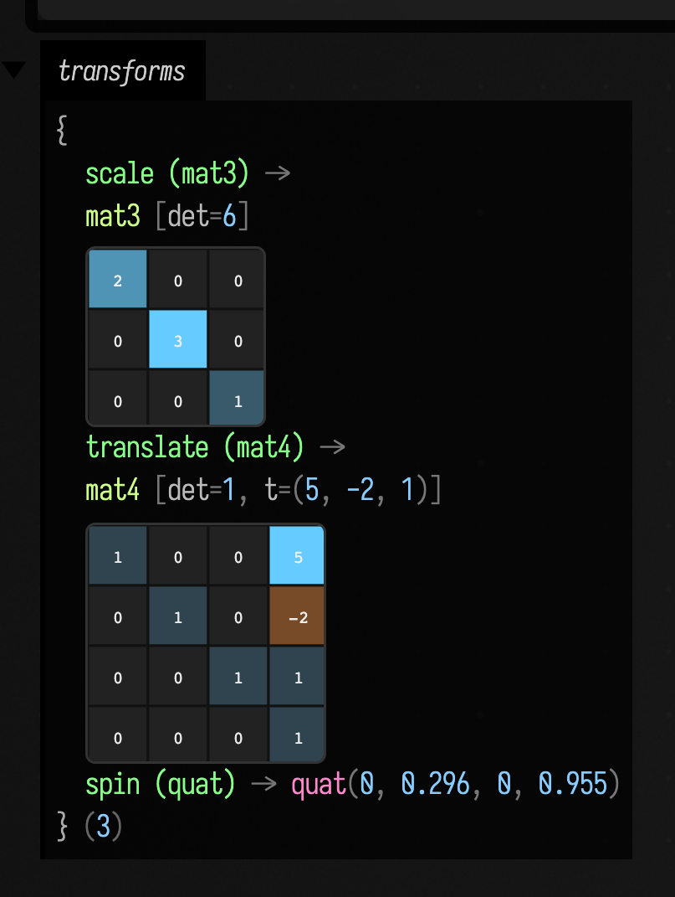

[Open →](offline.html?file=assets/agent_transcripts/linalg_thumbnails_demo/metadata.edn)

### control_surface_laws

Three controls beyond the plain slider: a slider **law**
(logarithmic, taper, bipolar), a **momentary button**, and a read-only **meter** fed by a `source`
lambda at 30 Hz. Four sliders cover the same 20 Hz–20 kHz range (1 kHz sits at 56.6% of a
logarithmic track and 4.90% of a linear one), and a button sits beside a checkbox so you can feel
the difference between a gesture and a state.

[Open →](offline.html?file=assets/agent_transcripts/control_surface_laws/metadata.edn)

### fn_differentiable_fit_demo

A self-contained demo of the differentiable fitter
(`afield.math.functions.fitBest` / `fitGradient`), the gradient-descent counterpart to the genetic
`evolve()`. The target is a product of two oscillators with a seed chosen to be wrong; a single
`fitGradient` stalls in a frequency local-minimum, so the demo uses `fitBest` (jittered restarts) to
land in the global basin. On execute it plots the target and the fitted curve and returns an RMSE
before→after summary with a loss-trajectory sparkline.

[Open →](offline.html?file=assets/agent_transcripts/fn_differentiable_fit_demo/metadata.edn)

### pat_fn_graph_fit

A rhythm as a graph you can fit. `patFn(...)` turns a pattern of kernel atoms
(`g:(value,sigma)`, `adsr:(…)`) into a `Functions.Fn`, and that `Fn` carries a real graph node whose
leaves are the numbers written in the pattern text, so `fitGradient` tunes a *rhythm*. Box 1 prints
the node: its op, its role-tagged knobs (`atom0.sigma`, `atom1.attack`, `cps`) and their values. Box 2
fits a two-bump target from a seed with the right structure and the wrong numbers, plots the two on
top of each other, and prints the fitted gesture back out as pattern text you can paste anywhere. Box
3 is the real limit: the same fit with the two heights *swapped* stalls, because re-assigning values
between atoms is a permutation rather than a direction.


[Open →](offline.html?file=assets/agent_transcripts/pat_fn_graph_fit/metadata.edn)

### pattern_language_composition

[The pattern language](pattern_language.md) as eight independent
boxes, six of which render their own audio offline. *Continuous signals* prints the exact rational
midpoint of `PatArc(3/7, 5/7)`, because a pattern is a function of a time *interval* and the
arithmetic is rational rather than floating point. *Whose rhythm survives* is the one to read
slowly: `|+|`, `|+` and `+|` over `"0 1"` and `"10 20 30"` produce 4, 2 and 3 events, so the bar is
which side's structure the result keeps. *A parameter, not a staircase* attaches `sine().rangex(300,
6000)` as a cutoff and prints the note count at `bd*4`, `bd*8` and `bd*16` to show it unchanged,
then runs the control arm, `appBoth` over a segmented curve, which fragments the rhythm. *Hear the
difference* measures its own render: it detects the hat onsets and prints
the level coefficient of variation of the flat half beside the modulated half. *Voice leading*
prints total movement as written against voice-led, and then both pitch-class sets: the harmony
does not change and the movement does.
*Groove* prints swung off-beats as exact rationals, a third of a subdivision late; *mini-notation
markers* checks three shorthand/bracket pairs (`bd sd . hh hh hh` against `[bd sd] [hh hh hh]`, and
the `_` and `!` forms) arc-for-arc and value-for-value and prints the boolean; and *playground* is
the box to edit. `showPatRoll` is SVG into `display()` and `showPatAudio` renders through a
deterministic CPU voice into an inline player, so there is no audio device and no window anywhere in
this file.


[Open →](offline.html?file=assets/agent_transcripts/pattern_language_composition/metadata.edn)

### kolakoski_euclid

**Kolakoski counts, Euclid places.** A Euclidean rhythm spreads a density you chose in advance as
evenly as it can; the Kolakoski word is the only sequence over `{1,2}` that is its own run-length
encoding. Crossing them gives a rhythm that is locally maximally even and globally self-describing:
the word says how many hits a group of slots gets, `bjorklund` says where inside the group they sit.
Box 1 is the flat version in two lines — eight groups of three slots, twelve onsets — rolled against
`euclid(12,24)` and `kolakoski(24)` at the *same* density, so what separates the three lanes is
distribution and nothing else, and played at two of those distributions so it is a sound as well as
a figure. Box 2 runs the same rule recursively: each pulse takes the next term as its child count,
`bjorklund` places the children on the parent's own grid, and each child runs until the next one, so
a level always tiles the bar and a count of 1 is a pulse that holds. The level sizes are then the
word's own partial sums — 1, 1, 2, 3, 4, 7 — and the last four levels play one voice each, coarse
loud and fine quiet, because every coarse onset is also a fine one and at equal gain the hierarchy
collapses into a pile. Box 3 pins a player to the *canvas* rather than to an output, through the
`customization` property, which is saved with the document.

Three details of the scene. The bar is 24 slots, so at
the docs-usual `cps = 2` it plays 24 hits a second and fuses into a growl; it runs at 0.35. The
audio is `showDirtAudio`, which mixes the real Dirt-Samples offline, where `showPatAudio` renders
`sd` and `hh` as filtered white noise; with no sample library on the machine every token falls back
to that synth voice and the scene still runs. And every output has its own channel and every channel
is opened, because an unopened channel is collapsed to zero height and a second write to one channel
replaces the first.

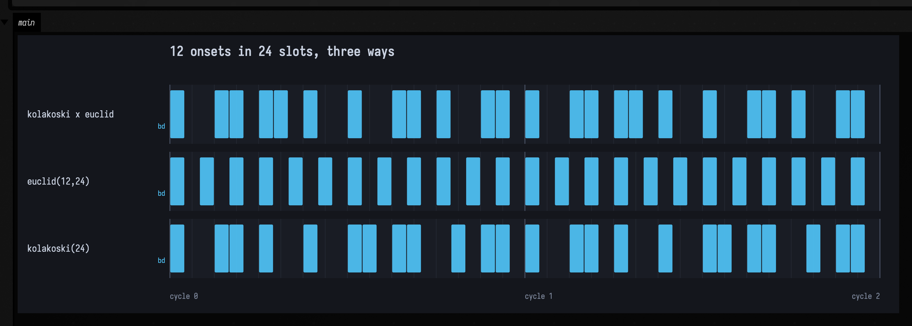

[Open →](offline.html?file=assets/agent_transcripts/kolakoski_euclid/metadata.edn)

### frames_lifecycle

**A frame loop, from start to cleanup.** The companion to
[Frames and the Animation Loop](animation_time_model.md), in four boxes. Box 1 is an `animate { }`
with no end condition: a disc travels a Lissajous figure until you press stop. Box 2 is the same
loop with `if (elapsed >= 6.0) end()` and an `.end { }` that repaints the last frame in red, so you
see it move and then see it stop. Box 3 shows that re-running a box replaces its loop rather than
adding a second one: run it twice and the counter restarts in a new colour. It also prints its own
frame rate, which is a different number on every machine. Box 4 is yours to drive: stop it inside
its eight seconds, let it run out, or re-run it, and compare which cleanup lines appear. `.end { }`
runs when the loop is cancelled, not when it finishes. Its cleanup lines collect in a separate channel that keeps the last
twelve across launches, so an earlier run's lines are still there to compare.

Every box redraws on a clock, 30 times a second at most, rather than on every frame, because the
loop runs thousands of frames a second and drawing each one floods the output.

```diffstatic_runner {data-lang=kotlin screenshot="assets/agent_transcripts_gallery/frames_lifecycle_stops.png" capture="box" open-outputs="true" wait="8.0" embed=true hidden=true timeout="120" padding="12" name="gallery-frames-lifecycle" alt="Box 2 after its six seconds: the disc stopped on its track and the progress bar full, all redrawn in red by the .end block" macro-file="../../dev_docs/agents/transcripts/frames_lifecycle.yaml" capture-box="frames_lifecycle_stops"}
// The transcript builds all four boxes and launches three; this is box 2 after it has stopped itself.
```

[Open →](offline.html?file=assets/agent_transcripts/frames_lifecycle/metadata.edn)

### three_inspector_wall

**The three.js output as an instrument.** One box draws a wall detail, four skins and five conduit
runs, with the three controls `threeInspect` adds to the viewer's toolbar: a ruler that measures the
closest approach between two things you click, a section plane, and an explode slider. It is the
complete example from [Drawing with FLines](fline_examples.md), the same code that page captures.

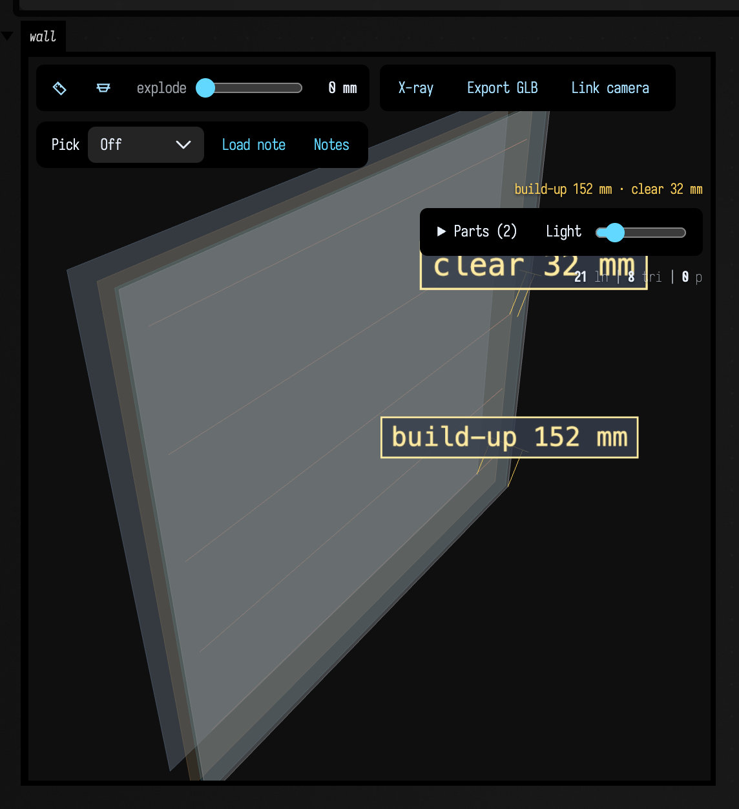

[Open →](offline.html?file=assets/agent_transcripts/three_inspector_wall/metadata.edn)

### fline_hit_records

**What a click on a figure returns.** A wall of panels drawn through `Box.inspect`. Click a panel and
the output names it, says whether you hit its face, an edge or a corner, and where on it, in the
wall's own coordinates. Click the amber ridge line and you get its position along its length. Every
hit is also printed, so the box's text output becomes a log of what you clicked. From the hit-record
section of [Drawing with FLines](fline_examples.md).

```diffstatic_runner {data-lang=kotlin screenshot="assets/agent_transcripts_gallery/fline_hit_records.png" capture="box" open-outputs="true" wait="3.0" embed=true hidden=true timeout="120" padding="12" name="gallery-fline-hit-records" alt="A card reading Click a part of the figure, above a wall of fifteen panels in three rows and five columns, drawn at a slant in teal to violet, with an amber ridge line along its top edge" macro-file="../../dev_docs/agents/transcripts/fline_hit_records.yaml" capture-box="fline-hit-records-wall"}
// The transcript builds and runs the box; this is its output before anything is clicked.
```

[Open →](offline.html?file=assets/agent_transcripts/fline_hit_records/metadata.edn)

### fline_measure

**Measuring, trimming and crossing a line.** Four boxes: evenly spaced locations along a curve with
their normals and the circles that match its bend; `trim` and `splitAt` by distance; where a looping
curve crosses a ring and itself, with bounds that hug the curve; and the non-zero and even-odd fill
rules side by side on a ring. From the measuring sections of [Drawing with FLines](fline_examples.md).

```diffstatic_runner {data-lang=kotlin screenshot="assets/agent_transcripts_gallery/fline_measure.png" capture="box" open-outputs="true" wait="3.0" embed=true hidden=true timeout="120" padding="12" name="gallery-fline-measure" alt="Two rings drawn in white, the left one filled with orange dots across its hole, the right one with dots only between its two circles" macro-file="../../dev_docs/agents/transcripts/fline_measure.yaml" capture-box="fline-measure-fill"}
// The transcript builds and runs all four boxes; this is the fill-rule box.
```

[Open →](offline.html?file=assets/agent_transcripts/fline_measure/metadata.edn)

### fline_exact_booleans

**Exact booleans and cubic offsets, side by side with the old paths.** Two boxes, each with a dot on every node: the union and difference of a blob and a circle through `Area` and through `booleanExact`, and a star and an S-curve offset by `byOffsetting` and by `byOffsettingExact`. From [Drawing with FLines](fline_examples.md#exact-booleans-and-offsets).

```diffstatic_runner {data-lang=kotlin screenshot="assets/agent_transcripts_gallery/fline_exact_booleans.png" capture="box" open-outputs="true" wait="3.0" embed=true hidden=true timeout="120" padding="12" name="gallery-fline-exact-booleans" alt="Offsets of a star and an S-curve, with a dot on every node. On the left, in orange, the sampled byOffsetting: the star offset crosses itself in loops at every point, and the S-curve offset is a dense chain of dots. On the right, in blue, byOffsettingExact: clean outlines with rounded joins on a handful of nodes" macro-file="../../dev_docs/agents/transcripts/fline_exact_booleans.yaml" capture-box="fline-exact-offsets"}
// The transcript builds and runs both boxes; this is the offsets box.
```

[Open →](offline.html?file=assets/agent_transcripts/fline_exact_booleans/metadata.edn)

### sound_render_path

**One beat, three ways of sounding it.** The companion to the real-drums section of
[Sound: the Pattern → Audio Path](sound.md). Box 0 draws the beat as a piano roll. Box 1 plays it
through the synth stand-in and box 2 through the Dirt samples: play them back to back. Box 3 shows
the per-event fallback, where a sample name the library does not have is voiced by the synth and
mixed in with the rest. Box 4 reports where Field looked for the sample library and what it found.

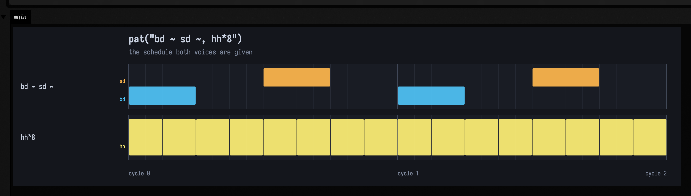

[Open →](offline.html?file=assets/agent_transcripts/sound_render_path/metadata.edn)

### pitch_transcription_roundtrip

The other direction: sound back to notation. Five pure-compute
boxes notate a pattern, render it offline, hear the audio back as pitched note events, and print a
`pat("…")` string that re-renders. Ground truth costs nothing here because Field authored the notation being scored
against, so the reference is the audio's *cause* rather than an annotation of it: the clean box
recovers 15 of 16 notes with a median pitch error of 0.3 cents. Two boxes are about failure. *A line
with no attacks in it* is a single Dough oscillator whose frequency steps with continuous phase, so
the RMS envelope is flat and the energy onset detector scores 0.13 against the pitch detector's 0.86,
a comparison `patRenderStereo` cannot host, because it re-attacks every event and its "legato" render
has one amplitude rise per note. *A chord* is refused and named POLYPHONIC rather than reported as its
loudest note, while a sawtooth's full harmonic stack is not refused, because timbre is not polyphony.
The box to edit is box 4: it declares the register the detector may resolve, which sets the analysis
window and therefore the shortest resolvable note, and changing that one line takes onset recall on
unchanged audio from 0.91 to 0.03. Pitch error is reported in cents throughout, because one corpus
case sits exactly 50 cents from equal temperament where the correct note name does not exist.


[Open →](offline.html?file=assets/agent_transcripts/pitch_transcription_roundtrip/metadata.edn)

### petri_sound

[Petri nets as a sequencer](petri_nets.md) as seven independent boxes, each
drawing its net with `showPetriNet` and playing it with `showDirtAudio`: a net's `emits()` is a
`PatPattern<String>`, so the audio path takes it with no adapter. The audio is
mixed *offline* from the real Tidal Dirt-Samples library when it is installed (`DirtRender.kt`
auto-discovers the SuperCollider quark, `FIELD_DIRT_SAMPLES` overrides) and from the synthetic
`patVoice` when it is not, and each box prints which one it used, so this file sounds like actual
drums on a machine that has the samples and still runs, silently degraded, on one that
does not. *The smallest loop* is one token going round two transitions and prints
`bd sd bd sd bd sd bd sd` at a period of `1/4`. *Five against three* shows what the model is for:
nothing in its source says fifteen, and `settle()` prints that it settles after 15 steps into 2
T-invariants (one per independent ring) with four cycles of audio so you can hear the rings drift
and re-align. *Song structure* and *tokens that are rhythms* are the medium timescale: the second
carries a whole `PatPattern` as a token's colour, so `unfold` prints four bars of `bd sd` followed by
four of `bd bd bd bd hh hh…`, an arrangement enforced by the net rather than by a scheduler, because
only one place is marked. *Dining philosophers* is silent, and is the contrast: the same
engine as a concurrency checker, printing `deadlocks=true` for the naive table, then
`deadlocks=false … never fires: grab.4, eat.4, done.4` for the asymmetric one: a starvation, not a
deadlock, which is why the third line adds a fair conflict policy and nothing is left over. And
*playground* is the box to edit: a read arc counting a fast `bd hh` ring, a weighted arc draining
three at once, and a snare that consequently walks backwards through the bar (`bd hh bd hh bd hh bd
sd hh` becoming `bd sd hh bd hh bd hh bd sd hh`), which is a 3-against-8 nobody wrote down. A
seventh box is the *live* path rather than the offline one (the real polyphonic Dirt player driven
by the transport) behind a `live` flag that defaults to false, because `audio { }` opens an output
device and this file is replayed end to end in CI; the flag rather than a comment is what keeps
those lines compiling.


[Open →](offline.html?file=assets/agent_transcripts/petri_sound/metadata.edn)

### petri_state_space

The other half of `afield.simulation.petri`: the same engine as an exact concurrency
checker, in five boxes. Where `petri_sound` asks what a net *plays*, this asks what it can *do*,
[the classical questions](petri_nets.md) over every interleaving rather than the one the conflict
policy picks. The first box makes the case: on the symmetric five-philosopher table `willDeadlock()`
prints `true` for that one trajectory, and `stateSpace()` exhausts all **82** reachable markings, all
**265** firings between them, and hands back the shortest sequence that wedges it: `grab.0, grab.1,
grab.2, grab.3, grab.4`, five firings, each of the markings along the way re-fired through the
engine's own enabling test by `verify()` before it is believed. It is drawn, too: BFS depth left to
right, one dot per marking, the counterexample in orange across the top into a red-ringed `stuck`.
*Asymmetric* is the fix and the fault that survives it: 70 markings, deadlock-free *proved* rather
than observed, and then `deadTransitions()` naming a starved philosopher on the same net where
`neverFires()` correctly names nobody, because starvation belongs to the conflict policy and deadness
belongs to the net. *Buffer* counts the four-slot producer/consumer buffer at exactly five reachable
markings, 4-bounded, live and reversible, and asks an `EF` query for the shortest route to a full one.
*A leak* is the inconclusive one: the exhaustive search reports `BUDGET` and returns `null` (unknown) from
every accessor that would otherwise have said "safe", while Karp–Miller puts an ω on the leaking place
and terminates in two nodes. And *what the algebra cannot see* prints two nets with byte-identical
incidence matrices, one of which enforces mutual exclusion with an inhibitor arc: no P-invariant
couples the two critical sections, and the search proves the exclusion over all three markings anyway.
Finally *the wall* measures the thing a green tick hides: the philosophers' state space grows like the
companion Pell numbers, about 2.41× per philosopher, so eleven is 16 238 markings in 230 ms and twelve
is past the budget, and a stubborn-set partial-order reduction turns that into `2n²−2n+2`, a **73×**
speed-up at eleven and an answer at twelve, while refusing every property the theorem does not cover.


[Open →](offline.html?file=assets/agent_transcripts/petri_state_space/metadata.edn)

### petri_tala_layout

One net, drawn twice, to compare Field's own layout with TALA — the engine
[d2](https://d2lang.com) uses for architecture diagrams, open-sourced in September 2026 and reached
through the optional `native/field-d2-layout` co-process. `PetriLayout.FORCE` relaxes a spring model
from 48 seeded starts and keeps whichever scores best on crossings and overlaps; `PetriLayout.TALA`
places the nodes at their real sizes instead, laying the net out once per direction bias and keeping
the fewest crossings. Which wins is per net rather than settled: on the dining table on
[the Petri page](petri_nets.md) FORCE crosses none and TALA three, while on the smaller table here it
is five against one, and TALA gets there in 2.1 s to FORCE's 4.5 s. The third box is the one to read
after running it — it prints which engine actually drew the second panel, because a machine without
the helper gets FORCE twice and should be told so rather than shown a relabelled drawing.

The figure is the same two-panel comparison on the *larger* dining table of
[the Petri page](petri_nets.md), which is where the direction reverses: FORCE's relaxed spring
drawing crosses nothing, and TALA's orthogonal routing crosses three.


[Open →](offline.html?file=assets/agent_transcripts/petri_tala_layout/metadata.edn)

### box_layout_demo

The only scene here that is a starting position rather than a result: nine
boxes wired into a pipeline and placed badly, so there is something for **Lay out
selection** and **Lay out whole document** to fix. Both palette commands read each box's frame for
its size and the box graph for its edges, ask the same `native/field-d2-layout` helper where things
should go, and animate the boxes into place through `OperationTranscript.recordMove`, so one undo
puts the document back. Two properties are worth watching for: the boxes keep the sizes you gave
them, where a diagram tool would resize a container around its contents, and the arrangement lands
back on the selection's own top-left corner instead of the document origin. Nothing runs when the
transcript replays — the nine boxes carry one-line comments and no execution — so the scene opens
the same way every time.

[Open →](offline.html?file=assets/agent_transcripts/box_layout_demo/metadata.edn)

### box_graph_demo

The examples from [Why Field?](why.md) and the property-inheritance section of
[Running code](running_code.md), in one document. Garden publishes `prop<Int>(petals) = 5`, Left
and Right shadow it with 7 and 9, Sibling reads Garden's 5, and Bloom, with both Left and Right as
parents, reads 9 because Right was connected first. Beside them, Studio holds plain variables that
Sketch finds with `fromContext` and `fromContextWithNameOrNull`. Disconnect Bloom from Right and
re-run it to see it read 7.

[Open →](offline.html?file=assets/agent_transcripts/box_graph_demo/metadata.edn)

### mesh_geometry_examples

The [mesh and 3D geometry worked example](mesh_examples.md) as seven
independent boxes, one per stage of the family. *Primitives* builds a cube, an icosphere, a torus and a
cylinder and prints what each one is: welded, watertight, χ = 2. *Marching cubes* takes a sphere, a
drilled sphere and a gyroid out of scalar fields and shows the surface converging on the analytic
volume as the resolution doubles. *SDF modelling* writes a shape as an expression (primitives combined
with union, difference and a smooth minimum) then meshes it. *Subdivide, smooth, decimate* runs one
mesh through Loop subdivision, then Laplacian against Taubin (the printed volumes show how much less Taubin shrinks), then
QEM decimation to a triangle budget with the deviation that costs. *Curvature, rays, closest points,
inside* queries a torus through the BVH and prints correctly-signed Gaussian curvature. *Bridges* turns
`voronoi3d` cells into meshes, meshes into `FLine`s, and writes OBJ and STL. The last box needs no view
code at all: it evaluates a `TriMesh` and lets its own `ToHTML` draw it: a shaded render beside the
counts, χ, genus, area, volume and bounds. Every box is pure CPU and runs on its own.


[Open →](offline.html?file=assets/agent_transcripts/mesh_geometry_examples/metadata.edn)

### geometry_from_disk

[Geometry from disk](geometry_from_disk.md) as three boxes, all of them
starting from a file rather than a generator. The first reads the committed 5.4 MB Khronos ToyCar
GLB through `meshFromAnyFile` and renders it with `showMesh`: **77,429 vertices, 108,936 triangles**
over three mesh/material buckets, each baked through its own node transform so the car arrives
sitting on its draped cloth rather than heaped at the origin, and extent **0.073 × 0.029 × 0.074**,
because the file is in metres and it is a 7 cm toy. It reports **χ = 1909, open, 2782 boundary
loops**, which is what an artist's shell always looks like once every UV seam is counted as the cut
it really is. The second writes one coloured sphere out as OBJ and as binary STL and reads both
back, printing the comparison: OBJ returns **642 verts, watertight, χ = 2** with its normals and
without its colours, STL returns **3840 unshared verts, χ = 1280, open** and welds back to 642
without its normals, while the volume stays **4.152741** down every route, which is the check that
the coordinates themselves survived. The third writes a four-corner coloured ASCII PLY and reads it
with `PlySupport.loadPly`, which needs no renderer at all, then bridges it to a `TriMesh` with the
colours intact and the loader's invented `(0, 0, 1)` normal correctly dropped. Change the path in
the first box to a mesh file of your own; boxes two and three clean up the temp files they write.


[Open →](offline.html?file=assets/agent_transcripts/geometry_from_disk/metadata.edn)

### typography_worked_example

[Typography as geometry](typography_examples.md) as eight boxes, none of
which uses an AWT rasteriser: AWT is touched
only to read a font's glyph outlines, and every picture after that is Field's own scanline filler or
Skia SVG. *A string becomes contours* prints, per glyph, the contour and hole counts, the advance, and
each ring's depth and *signed* area, which is where the winding convention becomes visible. *The
winding convention, and what happens without it* is the control arm: the same word rasterised with
`honourHoles = true`, with it switched off (the counters close up solid), and under `EVEN_ODD` over
the correct rings, then it prints the worst per-pixel difference between the last two, where 0.0
means the two fill rules agree exactly. *Advances, kerning, tracking, alignment* prints two identities:
the laid-out advance width against the sum of the glyph advances, and the
line widened by tracking against `(gaps × 0.16 em)`. Its kerning probe is written to survive a face
with no kern table at all, and prints which happened. *Text on a curve* lays a ring by arc length and
prints how many glyphs turned with the curve, plus that the original layout is untouched. *The
handles, animated* must be **launched**, not executed, and pre-computes its window from the wave's
extremes so the frame does not jitter. *Extrusion* checks a 2D hole count against a 3D Euler
characteristic and prints ink area × depth against the measured mesh volume. *SDF* and *point clouds*
close it out, the second running Delaunay and k-medoids over sampled letters.


[Open →](offline.html?file=assets/agent_transcripts/typography_worked_example/metadata.edn)

### wfc_worked_example

The [Wave Function Collapse worked
example](wfc_examples.md) as eight independent boxes: adjacency authored by hand with `wfcRules { }`
and both phases pinned with `forceTile`; the simple-tiled model learned from an image, printing the
band histogram that shows its learned weights losing the water bands entirely; an eight-tile
edge-socket set whose traces always connect; the overlapping model with and without the classic
ground constraint; von Neumann vs Moore on a source built so the choice provably matters (473
diagonal breaks against 0); and the collapse itself sampled through `step()` into wave and
possibility-count frames; and both `FloatArray` paths, whose synthesised heightfield ends up as
iso-contour `FLine`s. The last box needs no view code at all: it evaluates a half-collapsed and a
contradicted solver and lets `WfcSolver`'s own `ToHTML` draw them: possibilities left, entropy, and
the tiles decided so far, with the contradicted cell marked in both heatmaps. Every box is pure CPU,
runs on its own, and prints the numbers the docs page quotes.


[Open →](offline.html?file=assets/agent_transcripts/wfc_worked_example/metadata.edn)

### spatial_geometry_examples

The [Voronoi, contours and clusters worked
example](spatial_geometry_examples.md) as five independent boxes, each drawing itself with
`showPlaneGrid` (which is `drawToSVG` → `display`, so no AWT and no GPU). *Delaunay* builds the
triangulation, its Voronoi dual and the convex hull, checks the triangle and edge counts against
Euler's `2n-2-h` and `3n-3-h`, and prints how far past the sites JTS's clip envelope for an unbounded
cell actually reaches. *Apollonius* runs the same five sites at equal weights (every bisector a
straight line), at mixed weights (every bisector a circular arc), and with one site heavy enough to
swallow two neighbours into **complete discs** (which makes its own cell a region with holes rather
than a polygon) then verifies every boundary sample really is a score tie. *Contours* recovers the
Voronoi diagram from a completely different algorithm by contouring the gap between the nearest and
second-nearest site, and shows why asking for iso `0.0` finds *nothing*: that field is non-negative,
it grazes zero on the cell boundaries, and marching squares locates sign changes. *Marching* puts the two
decisions inside marching squares on inputs whose exact answer you know: a level set running through
a whole column of grid samples, a circle passing exactly through grid corners, and the ambiguous
saddle cell, and draws the sampling grid so you can see what the marcher had to work with.
*Clustering* cuts a merge tree at two depths, shows the finer cut nested inside the coarser, and runs
k-medoids and k-medians on the same planted clusters. Every box is pure CPU and runs on its own; move
a site, change a weight, raise an iso level or ask for a different `k` and re-run it.


[Open →](offline.html?file=assets/agent_transcripts/spatial_geometry_examples/metadata.edn)

### alife_evolution

The other half of [spatial artificial life](alife_examples.md): four boxes that
**search** those rule spaces rather than measuring a rule someone chose. The fitness functions are
`alife.kt`'s own 816 lines of morphology statistics, read as objectives instead of as reports. Box 1
asks for a Lenia soliton (alive, in one piece, travelling) and scores it straight off `leniaRun`'s
own DEATH/BOUNDED/SATURATION classification and wrapped centroid drift, so the phase comes off the
run and not off the prompt. Box 2 runs the *same engine* over a genome with nothing in common with the
first: 49 bits of birth and survival counts at radius 2, recombined by real uniform crossover,
selected by lexicase over two soups because a rule that holds together on one initial condition and
collapses on the other is exactly what a tournament's average hides. The radius is the lesson: at
radius 1 the space is 2¹⁷ and a few hundred independent draws land near the optimum on their own, so
evolution wins by 3 % and the search is not what found it. Box 3 illuminates the `(density,
activity)` behaviour space with MAP-Elites and prints coverage beside quality per occupied cell:
random sampling spreads over a descriptor space for free, so coverage on its own claims nothing. Box
4 is the one that pins the shared machinery: `FunctionEvolve.evolve` is a one-line call to
`PopulationSearch.evolve(mu = 1)`, and the FIELD_TEST `functions.evolve.worked-example` holds it to
`bestScore = -0.15676727177844857` over 961 evaluations, bit for bit, and box 4 prints that score
with `acceptedMutations=12  evaluations=961`.
The first *three* boxes each carry a control arm at the same budget under the same seed — a
`PopulationSearch.random` run in boxes 1 and 2, a random-sampled archive in box 3 — because a
generator good enough to stumble onto a decent rule occasionally looks exactly like a successful
search. Box 4 is the exception and has no control arm: at `mu = 1` it is a plain climb, and its
counterfactual is its own `initialLoss`, measured in the same run. None of the four opens a
`Window` or a `Renderer`. Change `LifeRuleGenome(radius = 2)` to
`LifeRuleGenome()` in box 2 and watch the margin collapse.


[Open →](offline.html?file=assets/agent_transcripts/alife_evolution/metadata.edn)

### alife_search_comparison

The "Does search beat random?" part of [spatial artificial life](alife_examples.md#does-search-beat-random)
as three boxes. Each runs `compareSearch` (random sampling, hill climbing, evolution, and evolution
with immigrants, all at the same evaluation budget over several seeds) on one genome: Life-like rules
scored for the edge of chaos, L-systems scored for fractal dimension, and Lenia rules scored as
solitons. Each prints the median and quartile table and draws every method's best-so-far curve. All
three run on the CPU in under 20 seconds.

[Open →](offline.html?file=assets/agent_transcripts/alife_search_comparison/metadata.edn)

### alife_worked_example

[Spatial artificial life](alife_examples.md) as twenty boxes: ten that
measure, and a band below them of ten that **move**. The measuring ten are independent and pure CPU:
Conway's Life checked against the glider's exact `(1, 1)` displacement and the R-pentomino's
textbook peak of 319 at generation 821; Wolfram's rule 90 checked cell-for-cell against Pascal's
triangle mod 2 computed from Kummer's theorem; a cyclic CA whose soup advance fraction matches the
closed form `1 - (13/14)^8` and then pins at 1.0; Gray–Scott's regimes told apart by isoperimetric
ratio, with two controls that produce nothing at all; Lenia's discrete limit shown bit-identical to the
integer Life stepper; boids and Physarum each against a twin run with one interaction switched off;
DLA's mass dimension against an Eden cluster and a uniform sprinkle; the Koch snowflake's exact
closure, length and area identities; and the bridges out to iso-contour `FLine`s, a colonization tree
and a watertight marched mesh. Every one of them prints the numbers the docs page quotes.

The moving ten are the same systems as time evolutions, through `Box.animateEvolution`: each one a
schedule (how many steps, over how many seconds, on what ramp) plus a way to draw the state, with the step
counter burned into every frame so each clip shows how far it got. They must be **launched**
rather than run: a `Frames` that is only built never runs. None of the twenty opens a `Window` or a
`Renderer`.


[Open →](offline.html?file=assets/agent_transcripts/alife_worked_example/metadata.edn)

### braitenberg_where_next

Sections 5 to 9 of [Braitenberg vehicles with memory](braitenberg_vehicles.md) as five boxes. Box 1
tunes `Activation.BUMP` aggressors with `orbitBias` to circle the lamps at four distances and draws
each population's `OrbitRadii` histogram. Box 2 puts a `speedCost` into the learning reward at four
prices. Box 3 runs learning and homeostasis separately and together from one seed. Box 4 is launched:
it trains a population on still lamps, then sets the lamps drifting and plays it beside Braitenberg's
lovers. Box 5 searches the four wiring weights with `VehicleWiringGenome` on `PopulationSearch`, with a
random-sampling control at the same budget. All five run on the CPU.

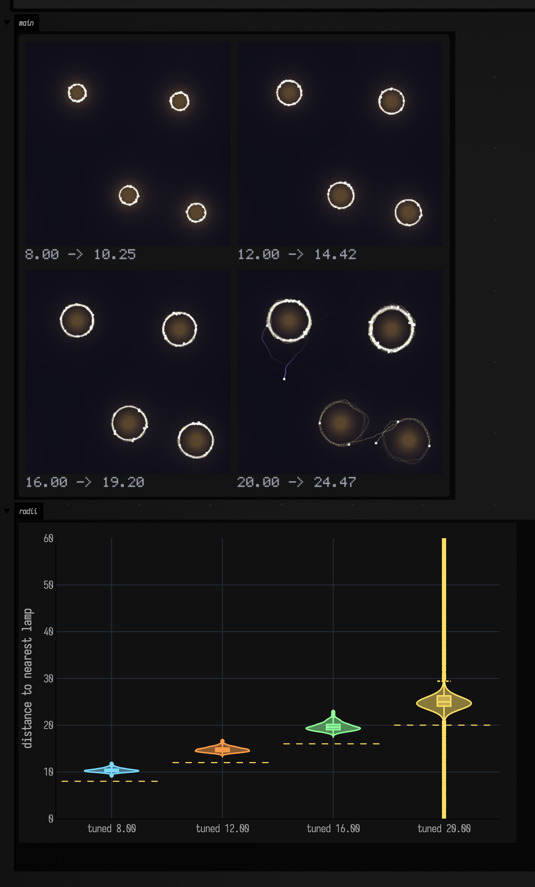

[Open →](offline.html?file=assets/agent_transcripts/braitenberg_where_next/metadata.edn)

### braitenberg_brain_search

Section 10 of [Braitenberg vehicles with memory](braitenberg_vehicles.md) as two boxes. Box 1 gives
each vehicle a small recurrent brain (`VehicleBrainGenome`) and compares random sampling, hill
climbing and two evolver settings on the orbit task at an equal budget over many seeds, then draws
each arm's best-so-far curve and the trails of its median seed. Box 2 repeats the comparison at 8 and
344 genes on moving lamps. Both run on the CPU.

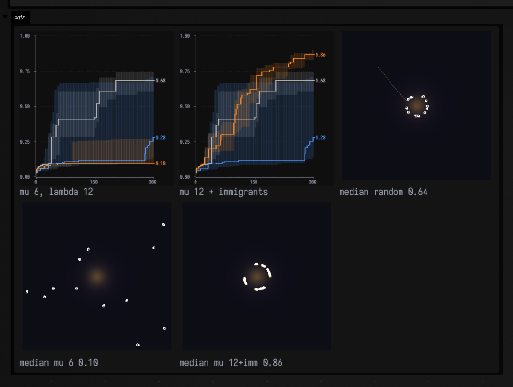

[Open →](offline.html?file=assets/agent_transcripts/braitenberg_brain_search/metadata.edn)

### statistics_examples

[Measuring dependence between two signals](statistics_examples.md)
as five independent boxes. *Summary* pins the three quantities `buildSummaryStats` makes easy to
misread: MAD recomputed from scratch to show it is the unscaled median absolute deviation, the
`sampleStdDev/populationStdDev` ratio against `sqrt(n/(n-1))` to show which of the two conventions the
card's `stddev` follows while its `skew` follows the other, and `cv` blowing up to 10¹⁴ once the mean is
re-centred to zero. *Histogram* re-derives the bin-width rule and predicts the bin count before asking:
28 bins where Freedman–Diaconis wins, and 10 where FD and Scott are both inflated by the distance
*between* two modes so the crudest rule, Sturges, decides. *Dependence* is the centrepiece: six shapes
at n=400 with all six coefficients on each, `xi` shown asymmetric (0.985 forwards, 0.246 backwards on a
parabola), `dCor` shown to be exactly 1 for *any* straight line but only 0.491 for a perfect parabola,
and then the permutation test the family does not provide: the growing-spread case's dCor of 0.193 beats
all 400 random re-pairings while its xi of 0.026 is beaten by 76 of them. *Rolling* runs both rolling
classes across a regime change against rolling `|pearson|` and against the measured null threshold, then
cross-checks the incremental sums against the O(w²) batch call, two different algorithms agreeing to
5×10⁻¹⁵. *Warp* fits an 8-knot quantile warp on one log-normal draw and measures a disjoint second one
(skew 11.7 → 0.007), compares it against the exact `Φ⁻¹(F̂(v))` built in the box, and prints both sharp
edges: `evaluate(-1.0)` returning −21.1 outside the fitted knots, and the 0.20 smoothing tracking
`10·0.8ᵏ`. Every box is pure CPU and self-checking; change a shape, a window size, a target distribution
or an n and re-run it.


[Open →](offline.html?file=assets/agent_transcripts/statistics_examples/metadata.edn)

### spectral_examples

[Spectral examples](spectral_examples.md) as five independent boxes over the
same chirp. *One spectrum* runs `fft` with a Hann window and plots the one-sided magnitude against
real Hz, with the centroid and the 85 % rolloff drawn in as dashed marks rather than left as numbers.
*Spectrogram* takes the same chirp through `stft`, converts to dB relative to peak with an explicit
−80 dB floor, and overlays the centroid trace on the heatmap. *Mel* runs two chirps crossing in
opposite directions through a 48-band filter bank, so the picture is an X and the bands are the only
thing you have to trust. *Resonator bank* is the control arm and does no transform at all: 96
log-spaced resonators from 120 Hz to 3900 Hz recover the same structure by filtering. *Streaming features* pushes samples one at a time through
`EMAFilter then SpectralCentroidFilter`, plus flux and RMS, into two injected onsets planted a third
and two thirds of the way through, so spectral flux has something it should spike at.


[Open →](offline.html?file=assets/agent_transcripts/spectral_examples/metadata.edn)

### imaging_cv_examples

[Imaging and computer vision](imaging_examples.md) as six independent
boxes, all pure CPU: `showImgGrid` is `Img.toPngBytes` → `PngEncoder` → `display`, so there is no AWT
rasteriser and no GPU. The images are large (2400×1800, 4.3 megapixels, 52 MB of float
RGB) because that is the size at which "is this fast enough to actually use?" has a meaningful
answer. *Basics* prints the Otsu threshold it computed rather than one guessed, and resamples down and
back up so you can see the detail is really gone. *Filters* corrupts a clean synthetic image with 4 %
salt-and-pepper noise and prints the mean absolute residual of gaussian, median and bilateral against
the clean original: the median is the right tool for impulse noise and the numbers say so, not the
picture. *Edges* runs Canny beside `cannyAuto`, whose thresholds come from that image's own gradients,
and ends with the closed outlines as `FLine`s. *Features* plants a square with known corners and a
decoy ring Hough must not fit, then prints how far the worst Harris corner landed from the true
corner. *Morphology* plants three discs of known radius and prints the distance-transform peak against
the largest planted radius. *Motion* warps a frame by a *known* affine transform, tracks it with
pyramidal Lucas–Kanade, fits a homography with RANSAC, and prints how far the recovered model
disagrees with the planted one over a 16-point probe grid, the real number for this whole family.


[Open →](offline.html?file=assets/agent_transcripts/imaging_cv_examples/metadata.edn)

### imaging_vector_kernels

Three boxes that each time one imaging primitive against a *second,
independent definition of the same thing*, written out longhand in the box. *pyrDown* times the fused
decimation against blur-then-throw-away, and prints the max elementwise difference so you can see the
only disagreement is float summation order. *boxBlur* times the running-sum implementation against
`convolveSeparable(boxKernel1D)`, which shares no code with it, and then prints the two blocks
at radius 2 and at `comparisonRadius` (24), with how each cost grew and which was faster at radius 2
in that run. The answer depends on the machine: a running sum is serial by nature, while five taps of
separable convolution vectorize freely, so at small radii the kernel can win. *bilateral* has no cheap reference, so it probes 3 px either side of a disc boundary at
`y = 210`, about one `sigmaSpace`, chosen because probing 30 px out would show a preserved step and
prove nothing, then prints the noise left in a flat patch. The absolute milliseconds here are not the
published benchmark (that is `:tools:imaging-bench` against OpenCV); what these boxes show is the
ratio to the slower definition. See the *Is it fast enough?*
section of [Imaging and computer vision](imaging_examples.md) for the measured comparison.

[Open →](offline.html?file=assets/agent_transcripts/imaging_vector_kernels/metadata.edn)

### imaging_visualizers_demo

Ten boxes with no `showImg`, no `display()` and no `println` in any of
them. Every box's last expression is an imaging value, and what you see is the inline
`ValueVisualizer` deciding how to draw it, which makes this the demo for
[visualizers](visualizers.md) rather than for imaging. `Img` gets an aspect-correct thumbnail with a
channel strip and per-channel histogram behind a disclosure; a signed `sobel().dx` gets a diverging
map with zero pinned rather than at an arbitrary grey; an out-of-range magnitude image gets rescaled
with its *true* range printed instead of appearing as a flat white rectangle. The fourth box is the
non-finite case: one `NaN` block and one lone `+∞`, counted, excluded from the statistics that set
the range, and painted magenta, so neither poisons `min`/`max`, turns `normalized()` into an
all-NaN image, or leaves the thumbnail silently black. `List<Corner>` is a scatter sized by strength;
check its disclosure against the corners of the rectangle the box planted at `x 30..90, y 26..76`.
`List<HoughLine>` is drawn twice, once clipped into a canvas the visualizer had to *invent* (the
caption admits it) and once as accumulator peaks. `FlowField` draws failed tracks as grey crosses
rather than hiding them, and `ComponentLabelling` rotates hue by the golden ratio so adjacent label
ids get unrelated colours.

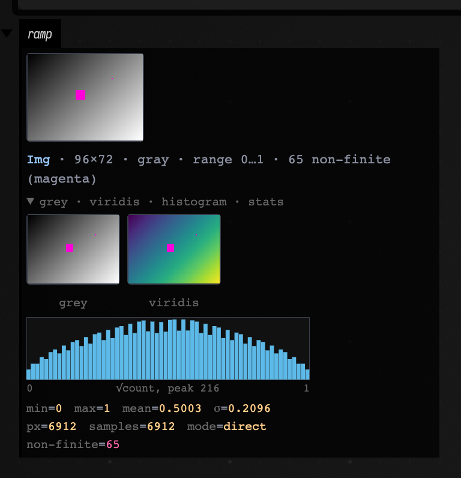

[Open →](offline.html?file=assets/agent_transcripts/imaging_visualizers_demo/metadata.edn)

### stippling

Two boxes for `stippling.kt`, which places exactly N dots so that they follow an image's tone and
keep an even spacing from their neighbours. The first draws a shaded sphere as an `Img` and turns it
into 6000 dots with `sphere.stipple(6000, invert = true)`; `invert` puts the ink where the picture is
dark. The second shows how that works. It starts from what `stipple` starts from: a Hilbert curve
through the image, cut into 6000 stretches of equal darkness, with one dot dropped in each, so every
region already holds the right number of dots. Beside that it takes one Lloyd step a frame: every
pixel finds its nearest dot by a distance transform, and every dot moves to the weighted centroid of
the pixels it owns. The plot under the two pictures is how far the dots moved at each step.
Relaxation keeps each region's count and evens out the spacing, and it moves almost no dots from one
region to another, which is why the start has to get the counts right. An independent random start
leaves its clumps in the result as blotches in the mid tones. Both boxes draw with `stipplesToImg`
and `showImg`. `stipplesToFLine` gives you the same dots as geometry, for `lines(...)` or a plotter,
but 6000 dots come to 15 MB of SVG, which is too much for a box that redraws every frame.

```diffstatic_runner {data-lang=kotlin screenshot="assets/stippling/sphere.png" wait="1.0" wait-output=true wait-output-kind="display" capture="box" padding="16" embed=true hidden=true name="stippling-sphere" alt="A sphere lit from the upper left, drawn in 6000 black dots on white: sparse across the highlight, dense in the shadowed lower right, and thinning out across the cast shadow on the floor" macro-file="../../dev_docs/agents/transcripts/stippling.yaml" capture-box="stipple_hello"}
// The transcript builds both boxes and runs them; this capture is its stipple_hello box.
```

[Open →](offline.html?file=assets/agent_transcripts/stippling/metadata.edn)

### viz_showheatmap

Four small boxes for the one-line helpers, and the shortest thing on this page.
A Gaussian bump in viridis; a diverging field with `normalize = false` and explicit `vmin`/`vmax`,
which is what anchors the white midpoint at zero rather than at the data's mean; a synthetic
spectrogram with `transpose`, `flipY` and `logScale`, which is the shape a spectrogram wants; and a
hand-built ARGB `IntArray` through `showImage`. `showHeatmap` and `showImage`
encode with `PngEncoder` and `display`, so there is no manual bilinear resampling, no flipY
bookkeeping and no AWT.

[Open →](offline.html?file=assets/agent_transcripts/viz_showheatmap/metadata.edn)

### audio_ai_codec

One box for the [EnCodec reconstruction
microscope](audio_ai_codec.md): two waveform players with a shared playhead, two log-frequency STFT
images, and a token map you can hover to read a codebook entry. The box builds a deterministic
fixture in-process (a 4-second chirp at 8 kHz, a "reconstruction" that is the source at 0.91 gain
plus two tones of codec texture, and 4 × 200 token frames) and the metrics in the header are literals
typed into `ReconstructionMetrics` rather than measured. The real path reaches an isolated GPU
service; this transcript exercises the real `CodecVisualization` renderer against the fixture, which
is why it runs in CI at all.


[Open →](offline.html?file=assets/agent_transcripts/audio_ai_codec/metadata.edn)

### arclength_spacing_demo

Two boxes on the difference between spacing a curve by its *parameter*
and spacing it by its *arc length*. A cubic can be perfectly straight and still be parameterised so
unevenly that `t = 0.5` is four fifths of the way along it, which is exactly the case an arc-length
table has to catch. *Dashes* dashes the same two curves twice (marching `t` in
equal steps down the left column, `byDashing` down the right) and captions each panel with the
shortest and longest dash it actually drew (18.8 .. 25.0 against a requested 22.0 for a mere S-curve;
far worse for the collinear one). *Ticks* puts 24 equal steps of parameter beside 24 equal steps of
arc length with the max/median gap on each (2.821 against 1.000 on the collinear cubic), and returns
the mechanism as numbers: a subdivision metric reading 0.000 on a curve that another scores at 161.
Both boxes compute both spacings live, so neither picture is stored. Move a control point towards the
middle of the chord and re-run to watch the two columns converge.

[Open →](offline.html?file=assets/agent_transcripts/arclength_spacing_demo/metadata.edn)

### lp_curves

Linear-programming algorithms as curve generators, the companion to
[Linear programs as curves](lp_curves.md). *Every route* draws one pentagon and one objective
direction seven ways: the central path, a fan of central paths, the primal-dual iterates, a PDHG
spiral, the ellipsoid method with its ellipses, the simplex walk and cutting planes, each captioned
with its own numbers. *A turning objective* is launched: the direction turns once every twelve
seconds while the hexagon's vertices breathe, and the central path, the PDHG spiral and the simplex
walk are recomputed twenty times a second. Change the weights or the PDHG step size and run it again.
*Drag the polygon* draws the [fan as a map](lp_curves.md#the-fan-as-a-map) in an editable viewer:
choose the pencil tool and drag a corner, and the grid is redrawn for the new polygon when the drag
ends.

```diffstatic_runner {data-lang=kotlin screenshot="assets/agent_transcripts_gallery/lp_curves_routes.png" capture="box" open-outputs="true" wait="3.0" embed=true hidden=true timeout="300" padding="12" w="1220" h="640" name="gallery-lp-curves-routes" alt="Seven panels of the same pentagon, each captioned with its method and its numbers: the central path, a rainbow fan of central paths, the primal-dual steps, a PDHG spiral, the ellipsoid method's shrinking ellipses, the simplex walk along two edges, and the cutting planes, every route ending at the same right-hand vertex" macro-file="../../dev_docs/agents/transcripts/lp_curves.yaml" capture-box="lp_routes"}
// The transcript runs every route and the fan map and launches the turning objective; this is every route's output.
```

[Open →](offline.html?file=assets/agent_transcripts/lp_curves/metadata.edn)

### lp_curves_3d

The same methods in three dimensions, the companion to
[Linear programs as curves, in three dimensions](lp_curves.md#in-three-dimensions). *Every route* takes the convex hull of a
seeded point cloud as an `LpPolytope` and draws the central path, the primal-dual iterates, the
simplex walk along the hull's edges and a PDHG spiral to one vertex, in a `three { }` scene you can
orbit. *A fan of central paths* draws one path per direction over the sphere and turns it on a
turntable. Change the direction or the seed and run it again.

```diffstatic_runner {data-lang=kotlin screenshot="assets/agent_transcripts_gallery/lp_curves_3d_fan.png" capture="box" open-outputs="true" wait="6.0" embed=true hidden=true timeout="180" padding="12" name="gallery-lp-curves-3d-fan" alt="A translucent faceted solid with grey edges and a bundle of rainbow-coloured central paths leaving a common point inside it and fanning out to every corner" macro-file="../../dev_docs/agents/transcripts/lp_curves_3d.yaml" capture-box="lp3_fan"}
// The transcript builds and runs both boxes; this is the fan box, caught mid-turn.
```

[Open →](offline.html?file=assets/agent_transcripts/lp_curves_3d/metadata.edn)

### madp_geometry

The madp geometry toolbox as a starting point. A model is a recipe of triangles: `geometry { }`
runs the block, which emits triangles through a transform stack with a current colour and a current
material (`mat`, `color`, `tri`, `quad`, `surface`, `revolve`, `tube`, `box`, `push`/`pop`). It
draws the result in a `three { }` view lit like a studio, with soft shadows and ambient occlusion on
a dark ground. The first box is the starter, a rippled terrain. The other ten are the toolbox's
presets: a crystal bloom of single triangles, a lathe-turned vessel with a metal rim, a tube along a
knot, a fungal tree of recursive tubes, phyllotaxis fronds, a Menger sponge and a city of boxes, a
lesson in triangle winding, and two animations, a breathing sheet and a torn signal, that
`animateGeometry { }` rebuilds thirty times a second. Launch those two to play them. Edit any recipe
and run it again; the view keeps your orbit.

The starter also calls `geometryAgent()`, which gives the document's AI4 chat the language and a
`geometry.look` tool. The tool returns a picture of any view here as it is on screen, so you can ask
the chat for a model and it can check its own work. The viewer's **Export GLB** saves a model, and
compresses it when gltfpack is installed.

```diffstatic_runner {data-lang=kotlin screenshot="assets/agent_transcripts_gallery/madp_geometry_terrain.png" capture="box" open-outputs="true" wait="4.0" embed=true hidden=true timeout="180" padding="12" name="gallery-madp-geometry-terrain" alt="A rippled blue-green terrain of flat-shaded triangles floating over a dark ground, casting a soft shadow onto it" macro-file="../../dev_docs/agents/transcripts/madp_geometry.yaml" capture-box="ripple_terrain"}
// The transcript builds and runs every box; this is the starter, ripple_terrain.
```

[Open →](offline.html?file=assets/agent_transcripts/madp_geometry/metadata.edn)

### close_node_demo

Two boxes about the `Close` node in the middle of an `FLine`, which is a shape
Field's own stdlib produces. *Reversing a closed contour* writes out a naive reversal walk inline,
beside the shipped one, on a square whose fourth side is the close and on a
two-contour glyph with a counter, and captions every panel with one number, the fraction of the
original length the reversal actually retraced, because a reversal that drops a segment is shorter
than what it reversed and that is the whole story. It also round-trips each reversal twice and prints
whether the node-class sequence came back identical. *The shipped primitive* shows where such a line
comes from: `arrow(a, b, startHead = true, endHead = true)` from the stdlib is ten nodes with two
`Close` nodes in it, at indices 5 and 9, so exactly one of them is interior and no cleverness was
needed to build it. It runs ten public operations over that arrow
under `runCatching` (reverse, subdivide, simplify, convex hull, filter, winding number, contains,
centroid, bounds, dash) and prints `ok` or `THREW` for each. Both boxes draw with
`showPlaneGrid`, so no AWT and no GPU.

[Open →](offline.html?file=assets/agent_transcripts/close_node_demo/metadata.edn)

### dynamic_graph_systems_examples

[Graphs that change while you
watch](dynamic_graph_systems_examples.md) as six independent boxes: point clouds that move while the
graph joining them is continually reinforced and forgotten. *Six systems* runs all six
`DynamicGraphSystem`s over one 220-point disc for the same 20 frames with the same reinforcement and
ceiling, and tells them apart by the one exact structural fact that separates them: the fraction of
edges that close a triangle, which is 0.0 % for flowline advection (a functional map, one arc per point)
and 100 % for both face-builders, the local tangent fan and alpha-event collapse. It also prints the peak
weight each system reached against the shared ceiling, which is how you find out that the alpha-event
system's area-scaled increment tops out at 0.3 % of it. *Decay* pins both forgetting laws against their
closed forms at 1, 4 and 120 steps (`e^-0.7 = 0.496585304` and `0.300000000`), halves a weight with
`ln 2 / λ`, and expires an edge by `ttl` while it is still at its ceiling: the two independent ways an
edge can die. *Hysteresis* walks two points apart from 0.05 to 0.13, past `rEnter` and inside `rExit`,
and shows the edge surviving where the `rExit == rEnter` control arm loses it; then 150 frames of a
wobbling 200-point disc measure what that buys: 553 edges created and 81 lost against 996 and 637, so
the memoryless arm creates 1.80× as many and loses 7.9× as many and its edge set never accumulates
enough weight to be a memory of anything. *Threshold* is the centrepiece: a static 240-point background
mesh with three rigid 22-point clusters crossing it, where a `minWeight` cut of 1.2 leaves **zero** edges
crossing a group boundary and components of exactly `[240, 22, 22, 22]`: the co-moving groups recovered
out of a graph that has only ever seen positions and a clock. The last two boxes must be **launched**,
not executed: *breathing* rewires a k-nearest-neighbour graph over a cloud that never moves, beside the
identical system with its clock pinned at zero (which holds exactly 590 edges for all 420 steps), and
*morphogenesis* grows a 64-point ring into a branching filament beside the same nine-stage pipeline with
tip growth removed. Every box is pure CPU; no `Window`, no `Renderer`.


[Open →](offline.html?file=assets/agent_transcripts/dynamic_graph_systems_examples/metadata.edn)

### autodiff_worked_example

Field's **automatic-differentiation layer** as five independent
boxes, one per layer of the stack. *Basics* differentiates one expression three ways that have to agree
(a reverse-mode tape sweep, a second-order forward-mode `Dual2` number, and a central-difference
oracle) and plots `f`, `f'` and `f''` from a **single** sweep, because the second derivative comes
free with the forward pass. It also prints the exact 2×2 Rosenbrock Hessian, which is a polarised
`Dual2` result rather than a finite difference of a gradient.


*Optimizers* walks the same Rosenbrock valley three times on the same exact gradients, and what a
line search buys shows up immediately: L-BFGS plunges past 10⁻²⁴ in about 42 iterations and stops,
while SGD+momentum is still zig-zagging near 10⁻³ at iteration 300 and Adam has barely left 10⁰.


*Fn fit* is the Field-specific bridge, and the reason this is not a generic AD library. `Functions.Fn`
is a closure over `Double` and cannot be differentiated by overloading its arithmetic, but every `Fn`
the stdlib builds carries an inspectable graph, and that graph is re-interpreted in tracked arithmetic.
The box makes the *same* `fitGradient` call twice, once on the historic central-difference gradient and
once with `gradient = FnGradientMode.EXACT`: same optimiser, same step size, same landscape. Both
start at RMSE 0.3605; finite differences ends at 0.0142 after 6801 loss evaluations, the exact
gradient at 0.0096 after 801: better, for an eighth of the work. It then asks `exactFitRefusal` why a
`saw`-based seed is turned away, because the exact path re-checks its own interpreter against `Fn.eval`
before it will trust itself.


*IK* solves inverse kinematics on a four-link `FLine` chain. Forward kinematics is a cumulative angle
sum, so it differentiates cleanly and 18 L-BFGS iterations put the tip dead centre in the target
reticle. The third panel is the smoothness knob, shown as the trade it is: the pose straightens
and it *costs* 0.006 units of reach.


*Pack* packs twelve discs by descending `relu(overlap)²` pairwise plus `relu(penetration)²` against the
walls, worst overlap 48.3 units → 0.35. This is where the library's even-split kink convention shows:
at the instant two discs touch, the hinge's derivative is half a one-sided rule's, so the
packing settles instead of chattering across the contact.


[Open →](offline.html?file=assets/agent_transcripts/autodiff_worked_example/metadata.edn)

### interaction_nets_lambda

A λ-term **compiled to an interaction net**, reduced by local rules, and read back — checked against an
ordinary capture-avoiding substitution evaluator that shares nothing with it. Three pure-CPU boxes, no
window and no setup. Interaction nets reduce locally: two agents meet at their principal ports, that
pair is replaced, nothing else in the graph is consulted. β-reduction becomes one such rule, and the
thing β normally hides — copying a term you are about to use twice — becomes explicit work done by
`DUP` agents the reduction can see and count. The first box normalises eight terms and compares each
answer to the oracle with `alphaEquivalent` rather than `==`, because a readback invents its own binder
names. The second draws `(λx. x x) (λy. y)` as five panels — the compiled net, then one per reaction,
of which there are four (`beta-linear`, `dup-lam`, `beta-linear`, `fan-fan`) — and the agent counts go
6, 4, 6, 4, 2 — *up* at `dup-lam`, because duplication is work done in the open rather than
by copying a subtree behind your back. The third runs all 25 named closed terms under four schedulers:
25 of 25 agree with the oracle and 25 of 25 give the same de Bruijn key whichever order fires, so the
scheduler is a free choice and the answer is not. The surprise is in the first table — on the
exponentiation row the net is left standing at ten agents for a term that needs eleven nodes to write
down, because it never stopped being shared and the unfolding happens in the *readback*, which treats a
fan as a bracket on the path through the term rather than as a node of it. The word *optimal* is
deliberately never used: there are no brackets and no croissants here, so the sharing is correct but
nothing bounds how many times a fan may be copied. `dev_docs/INTERACTION_NETS_LAMBDA.md` is the
write-up, and `tools/run_field_tests.py --id stdlib.lambda-terms.smoke` asserts the same three claims
headlessly.

[Open →](offline.html?file=assets/agent_transcripts/interaction_nets_lambda/metadata.edn)

### confluence_grid

The companion to the scene above, in 3D and all at once: **twenty λ-term reductions running together —
five terms across, four schedulers down — and every row lands on the same shape.** One box, pure CPU;
the 3D is a Three.js viewer in the box's own output panel, so there is no window and no GPU. Interaction
nets are *strongly* confluent, which is more than Church-Rosser: the four cells of a row do not merely
agree on the answer, they take the **same number of reactions** and finish on the same beat. What
differs is *which* reaction fires at each beat, and there is real choice about that, so the four columns
visit different intermediate graphs and different peak sizes on the way to one answer. The box prints
its own verdict per row — `one answer: true` when the four de Bruijn keys agree with each other *and*
with `referenceNormalOrder`, and `identical pose: true` when the four final layouts are point-for-point
equal. That second claim is the hard one, because `Net.relax` is 2D and path-dependent:
four isomorphic graphs draw four different ways and the picture then claims the opposite of the theorem.
The final pose is therefore a three-round Weisfeiler-Leman refinement — a node's label is its type folded
with its neighbours' labels, in **port order** — so the ordering is a structural invariant and nothing
reads an id or an insertion order. (A pose by BFS depth alone is not enough: on `3^3`, ten `DUP`s
leave sibling order ambiguous.) The box does **not** use `frames { }`, because a frames loop in a box with no `Window`/`Renderer` gets
*zero* ticks, so it drives its own clock with a sleep loop.

```diffstatic_runner {data-lang=kotlin screenshot="assets/agent_transcripts_gallery/confluence_grid.png" capture="box" open-outputs="true" wait="25" embed=true hidden=true timeout="300" padding="12" name="gallery-confluence-grid" alt="A Three.js view of twenty small interaction-net graphs in four columns of five, each at its final pose after reduction" macro-file="../../dev_docs/agents/transcripts/confluence_grid.yaml" capture-box="confluence_grid"}
// The transcript launches the grid; this captures it after the reductions finish.
```

[Open →](offline.html?file=assets/agent_transcripts/confluence_grid/metadata.edn)

### morpho_circuit_search

The three searches from [Searching for MorphoHDL Circuits](morpho_search.md), for circuits in
[somebody else's language](morpho_examples.md), where one unit of budget is one invocation of
morpho's own compiler on GraalJS. *Does selection beat sampling?* gives random search, hill climbing
and evolution the same generator, the same seed and the same budget on a one-bit full adder (whose
truth table is small enough that correctness is exhaustive rather than sampled) and marks
first-exactly-correct with a dropped tick, because a curve that reaches zero and one that reaches
0.004 look identical and that is the entire question. Two of the three find it; the control does not.
*A recursion, found* evolves an or-reduce, then re-compiles the same source text at 7, 9, 16, 32 and
48 bits; the widths are odd, because morpho's `SPLIT` gives equal halves only at even
widths and a family of powers of two never shows the search a cell whose halves differ, so it will
happily return a design that is silently wrong at 5. *The recursive adder is not found* is the
negative result: four drivers,
including one *given* the SPLITs, all flatten well short of correct, and then the box hand-writes the
ripple skeleton in the generator's own grammar and scores it through the same evaluator, so the target
is provably inside the search space. The cost plane shows the two reference designs and nothing the
search found.

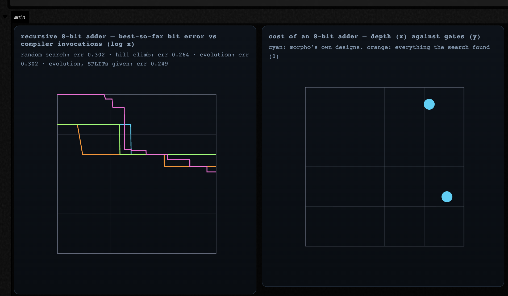

[Open →](offline.html?file=assets/agent_transcripts/morpho_circuit_search/metadata.edn)

### keyframe_editor

The keyframe editor, `keyframes(...)`, as the four boxes of its page,
[The keyframe editor](keyframe_editor.md). `brightness` plays a hand-drawn curve with a `loop`, moving
the editor's playhead with `setTime` and sending `evaluateValueAt` to a meter, so you can edit the
curve while it plays. `shape` starts a curve with one key of each type through
`keys = listOf(Keyframe(...))`. `smoothed` draws a smoothed copy of its curve as an overlay and keeps
it up to date with `onChange`. `custom types` defines an overshoot, a wobble and a chaotic scribble
(the logistic map, pinned to both keys) as key types of its own with `interpolant(...)`, which then appear in the key menu. CI launches `brightness`, executes the
other three, advances 90 frames, and stops.

[Open →](offline.html?file=assets/agent_transcripts/keyframe_editor/metadata.edn)

### gesture_to_keyframes

A performed gesture turned into keys you can edit, and back, from
[The keyframe editor](keyframe_editor.md#from-a-performed-gesture). One box holds a
[gesture pad](visualizers.md#recording-a-gesture) with a hand-wobbly figure eight in it, and the x and
y lanes that `bakeGesture` reduces the take to, within a tolerance of 0.02. Running the box bakes only
when the lanes are empty, so your edits survive a rerun. Drag a key in either lane and press
**replay lanes**: `setTake` sends the edited lanes back to the pad and its trail redraws. Shift-drag
on the pad to record a take of your own, then press **bake take**; **smooth take** takes the tremor
out of it and bakes it again. CI launches the box, advances 90 frames, and stops.

[Open →](offline.html?file=assets/agent_transcripts/gesture_to_keyframes/metadata.edn)

### gesture_paint_replay

A gesture recorded on a pad and painted with a brush. `pad to paint` holds a pen
[gesture pad](visualizers.md#recording-a-gesture), made with `gesture(pen = true)`. Each sample
keeps the pointer's pressure, tilt and twist as well as its position and time. The pad holds a
wave, pressed hardest in the middle. Running the box bakes the take into x, y and pressure lanes
and paints them with a [brush of moving hairs](paint_gestures.md):
`canvas.gesture(x, y, pressureLane = pressure)` turns the lanes into a timed gesture, and the
stroke moves as fast as the hand did. Edit a lane and press **paint lanes**. **paint take**
paints the take itself, tilt included. Shift-drag on the pad, with a tablet pen for pressure and
tilt, to record your own, then press **bake take**. `what the pad drops` paints one take four
ways: position and time only, as a mouse records it; with the pen's pressure; with pressure and
tilt; and the same path at an even speed. CI executes both boxes.

```diffstatic_runner {data-lang=kotlin screenshot="assets/agent_transcripts_gallery/gesture_paint_replay.png" capture="box" open-outputs="true" wait="6.0" embed=true hidden=true timeout="180" padding="12" name="gallery-gesture-paint-replay" alt="The pad to paint box with every panel open: three keyframe lanes for x (a rising line), y (one wave) and pressure (a single hump, hardest in the middle); the pen pad with its bake take, paint lanes, paint take and replay lanes buttons; and a cream sheet with one brown brush stroke along the wave, dark and heavy where it starts and fading as the pressure lifts" macro-file="../../dev_docs/agents/transcripts/gesture_paint_replay.yaml" capture-box="gpr_pad"}
// The transcript builds and runs both boxes; this is the pad box.
```

[Open →](offline.html?file=assets/agent_transcripts/gesture_paint_replay/metadata.edn)

### keyframer_worked_example

`KeyframeScope`, the thing that stops a look you spent twenty minutes
arriving at from existing only as the contents of a running process. Four pure-CPU boxes: *targets*
registers two uniform `Structure`s, captures them into a `Key`, edits it, invokes it to write the
state back, and reads the live structures to prove it landed, including the fact that `capture()`
reads a structure's *bindings* first and then its *set values*, so a property written by value
snapshots too. *Persist* shows that every
`saveKey` also appends to a `.versions` history, which values survive a saved key and how unsupported values are reported, and how `missingKey` lets a scope that has grown a parameter still load
an older file. *Updatecode* turns a captured look back
into pasteable Kotlin whose literals keep their *types*.

The fourth box is why a camera is stored as a `CameraPose` rather than a position: a
dual-quaternion `sclerp` is a screw motion, so it holds the subject at a constant 8.2462 units and
dead centre of frame for the whole move, while lerping the two positions cuts the corner and swings
27.2% closer at the midpoint.


Walkthrough: [Capturing & replaying live state](keyframer_examples.md).

[Open →](offline.html?file=assets/agent_transcripts/keyframer_worked_example/metadata.edn)

### keyframe_code_blend

What to do when the two keyframes are *programs*. Two looks for one
StackSL patch differ in a warp scale, an offset and a tint vector and in nothing else, so the two
token streams align and those three numbers can be interpolated; change one word instead — `fbm` for
`noise` — and the alignment reports a divergence and the blend goes back to stepping, because a
program built from the left structure with the right numbers is neither keyframe at either end. The
second box is the claim worth checking: one program, expanded once, drawn five times with only a
push constant changing, with both ends compared pixel for pixel against the programs they are
supposed to be. The third is where a runtime blend cannot reach — a modifier chain and a random range
both want literals in those positions, so a RUNTIME request comes back as STATIC, one compile per
`t`. The last two do the same thing to a pair of `sourceBlock { }` expressions, and they are where
the generated text stops being text: the blended expression is compiled through K2 and invoked at
five values of `t`, each result printed beside an expectation computed independently in Kotlin. They
are two boxes rather than one because a `SourceBackedBlock` hydrates by evaluating its source on its
own box's engine, and asking that engine to evaluate while it is already mid-evaluation re-runs the
body that is running — 327 nested runs and 355 seconds, measured. Hydrating into an idle box, which
is what the split does, runs it once.

Walkthrough: [Blending two programs](keyframer_examples.md#blending-two-programs-not-just-two-numbers).

[Open →](offline.html?file=assets/agent_transcripts/keyframe_code_blend/metadata.edn)

### fn_rewrite_kotlin_boxes

The same hazard as the pair above, in the rewrite language, with the
two spellings side by side. A `@{...}` right-hand
side in an `Fn` rewrite spec is Kotlin, and it is compiled in a live box's engine — but which box?
`rewriteKotlin` answers "the one calling me", so calling it from a box body asks that engine to
evaluate while the body is still running, and the body runs again. Left alone that was 172 nested
entries and a stack overflow, so a second hydration is refused. `rewriteFn` answers "the one you name",
and the box it names here comes from the topology — `parents.lastOrNull()` — so the snippets compile
in whatever box this one is connected beneath, and dragging a different parent in moves them. The
third box is the wrong way, kept runnable: its body still runs twice, which is what the refusal
costs and why the second box is the one to copy.

[Open →](offline.html?file=assets/agent_transcripts/fn_rewrite_kotlin_boxes/metadata.edn)

### pattern_rewrite_worked_example

Six runnable boxes that each hold one
[user-authored rewrite rule](pattern_rewrite.md) and one `println` that could not compile without it.
`neg(x) → -x` is the shape of the whole mechanism. `twice(x) → x * 2` is the precedence guard, and the
reason it is called with `twice(3 + 4)`: a non-atomic capture has to be parenthesised, so the answer
is 14 and not 11. `f(x) → f(wrap(x))` with `where { !isCallTo(x, "wrap") }` is the termination idiom:
wrap once and stop, rather than run into the fixpoint cap. Then a variadic hole, and `unquote`, which
computes the replacement *at compile time* from the matched identifier's text. The seventh box is the
one that is never executed: it holds a rule and nothing else, and a child box wired beneath it
compiles against that rule by inheritance, a control for ambient scope, which only means anything
because the parent stayed un-run.

[Open →](offline.html?file=assets/agent_transcripts/pattern_rewrite_worked_example/metadata.edn)

### rewrite_strategies_demo

Nine boxes on *where and when* a rewrite rule fires, and the only
transcript in the corpus whose boxes `check` their own answers rather than printing them. The
arithmetic is chosen so a number identifies a strategy: helpers multiply by 10, 100 and 1000 or add
1, 2 and 100, so `once` landing on 12 and the baseline landing on 30 are two different rewrite
decisions and not two different sums. Box 1 is the control arm (no `strategy` block, so the default
global fixpoint rewrites both sites) and every other box's number is a difference from it. `once`
and `subset` both reach 12 by different mechanisms; `topdown` and `bottomup` are exact mirrors on the
same input, 102 against 202; `choice("toY", "toX")` inverts declaration order to show
the strategy picks, not the source; `repeat(topdown, 2)` leaves the innermost `f` alone; and the last
box's `from { f(f(x)) }` eats two levels per step. The actual bound: each assertion proves this
strategy fired differently from the baseline, not that the rewriter is sound in general.

[Open →](offline.html?file=assets/agent_transcripts/rewrite_strategies_demo/metadata.edn)

### polytope_conway_demo

One very compact box for the
[Conway polytope algebra](polytope_examples.md). It marks two opposite cube faces with different
height attributes, selects exactly those faces, applies `kis` only there with the height deployed per
face, and sends the resulting polygonal faces to the on-canvas `threeLines(...)` viewer. Orbit it,
hover a face, and click one: a provenance card reports the output face id, the transform role, the
deployed height, the source elements it descends from, and the 3D hit position. The inspection output
below the view exercises the registered polytope value printers.

[Open →](offline.html?file=assets/agent_transcripts/polytope_conway_demo/metadata.edn)

### polytope_conway_gallery

The same algebra as four small boxes, one question each.
*Expressions* is a Conway-notation contact sheet you retype: change one list and the whole grid
rebuilds, captions and all, read off the topology rather than the pictures. *Abstract dual* takes the
cube's coordinates away and shows the dual's `realization` as `null` and its `toFaceFLines()` and
`triangulate()` refusing with their real exception messages, before a realization policy is applied
and the same object gains eight FLines. *Parameter field* writes a scalar onto each of a
dodecahedron's faces, deploys a selective **and** non-uniform `kis`, and paints the deployed value
onto the pickable output faces. *Realization* jitters a Conway output, relaxes it, and leaves the
solver's own before/after diagnostics (edge-length deviation, planarity error, convergence and stop
reason) as its final value. Every box is pure CPU.
Walkthrough: [Polytopes: topology first, coordinates later](polytope_examples.md).


[Open →](offline.html?file=assets/agent_transcripts/polytope_conway_gallery/metadata.edn)

### polytope_canonical_gallery

One box with one parameter: a Conway prefix string, `"gD"` as
shipped. It evaluates the expression, canonicalizes it, and draws the two forms side by side (both
gauge-normalized first, so the only difference on screen is shape and not scale or orientation) then
leaves the solver's own diagnostics as text: tangency-radius spread and planarity before and after,
the stop reason and iteration count, and the combinatorial face orbits. Click a face and it reports
its degree, which orbit it belongs to of how many, and its plane's distance from the centre. Change
the string to `"kkC"` to watch the same box report a clean failure: `canonicalize()` does not reach
that one, and the box prints the reason rather than a picture that looks fine.

That failure, from the walkthrough: `kkC` as built, the same solid after `canonicalize()`, and what a
different solver makes of it.

![Three shaded solids in a row above a table. The left, kkC as built, is a compact spiky ball of triangles. The middle, canonicalize(), is not a solid at all — it has collapsed to a thin diagonal sliver a few pixels wide, essentially a line. The right, relaxWithCeres(), is a clean stellated form with deep triangular spikes. The table gives tangency radius spread 3.386e-01, 1.930e+00 and 5.104e-08, and minimum dihedral angle 0.955, 0.003 and 0.340; canonicalize() reports converged = false with reason max iterations](assets/polytope_examples/kkc_canonical.png)

[Open →](offline.html?file=assets/agent_transcripts/polytope_canonical_gallery/metadata.edn)

### polytope_holes_and_chains

Three boxes for faces with holes, and for chaining composite
operators. *A face with a hole, end to end* builds a cube with a window cut in one face and prints the
consequences: Euler characteristic counting elements against counting cells (a disk with one hole is
`1 - 1`, so a sphere with a window is 1), the manifold check failing with exactly the count of
one-sided window edges, and eight triangles cut from the windowed face where a solid square needs
two. It then runs four operations a holed face refuses (`dual`, `bevel`, `toOff`, and fan
triangulation) under `runCatching` and prints each real exception message, with the literal fallback
`DID NOT THROW` in case one of them ever stops. *The same plate, with the ring and without it* is the
counterfactual, rendered by `threeGrid(...)` with back-face culling on, which makes the picture a
winding test as well as a hole test: a mis-wound rim triangle would be *missing*. *Every
composite chains now* runs eight composite operators off one ambo (join, needle, zip, ortho, expand,
snub, meta, bevel) prints what it asked for beside what actually ran, and closes with a composite
still refusing a single realization policy.


[Open →](offline.html?file=assets/agent_transcripts/polytope_holes_and_chains/metadata.edn)

### ceres_free_variables

Two boxes on unknowns that are not vertex positions. *A plane per face*
canonicalizes a Conway solid by solving for a unit normal and an offset per face, and solves the same
problem twice (once with the residual written in Kotlin and differentiated on `ceres::Jet` through
the expression VM, once with the hand-written C++ opcode) then prints the largest disagreement
between the two answers and, as a self-check, that every solved normal is still unit, which no
residual ever asked for: the sphere manifold's own doing. *Unknowns that are not points* fits a centre
and a radius to four fixed points from a terrible start, and checks itself against the
tetrahedron circumsphere computed by Cramer's rule in the same box. Both need the native Ceres
wrapper, which is **not** committed, so as checked out, both boxes take the no-wrapper branch: they
print that it is missing, show a card naming `./gradlew buildCeresRedistributable`, and draw the
*unsolved* seed rather than failing. One caveat while reading that branch: an ABI-too-old wrapper
is swallowed by the same `runCatching`, so at the box's output it is indistinguishable from an
absent one.

[Open →](offline.html?file=assets/agent_transcripts/ceres_free_variables/metadata.edn)

### manifold_solids

Two boxes on [robust mesh Booleans](manifold.md), an optional native
dependency that needs no wrapper: Manifold ships a C ABI, so the whole
binding is Panama/FFM against `libmanifoldc`. *A part, and whether it is manufacturable* builds a
60×40×8 plate with four bored bosses, a properly rounded slot (a square `offset` by 4.5 with round
joins, then extruded) and an 0.8mm chamfer done as a Minkowski closing with an octahedron, then
prints the numbers that decide whether it could be cut: **15513.561 mm³**, genus **5**, and a
**2.767mm** wall between the slot and the nearest bore, measured with `minGap` rather than eyeballed.
It then checks Manifold against Field's own mesh family, which shares no code with it: `signedVolume`
agrees to `1.28e-05` and both say genus 5. The same box checks the trap that follows from
that: the *shaded* mesh has 9773 vertices against the plain one's 8740, split at every crease so each
face can carry its own normal, and `isWatertight()` is therefore **false** on that one.
Same geometry, different index topology; ask for `toTriMesh()` when you are measuring and
`toTriMesh(normals = true)` when you are drawing. *A Kotlin lambda as a level set* is the upcall: a
gyroid-thickened torus written as a function, marched by Manifold's own thread pool in 77 ms into a
solid that is **guaranteed** closed rather than merely usually closed, then sliced into 13 layers (79
contours) with each layer `offset` inward by half a nozzle width, so the orange lines are the path a
printer would actually walk. Both boxes need `brew install manifold`; without it the first draws the
same shape through Field's own `marchingCubes` and names the difference.


[Open →](offline.html?file=assets/agent_transcripts/manifold_solids/metadata.edn)

### solidcraft_intro

**One design, two evaluations.** The box from [SolidCraft: edit the design, then see the part](solidcraft.md)
opens a bundled feature-tree design, changes `width` from 40 to 50 mm, and draws the resulting
parts side by side. A fixed 20 mm circular cut is through the first extrusion and blind in the
second; the box also prints B-rep volumes and STEP/STL export sizes. This uses the optional
SolidCraft Rust bridge (`./gradlew buildSolidCraftNative`). Without it, the box gives that command
instead of failing.

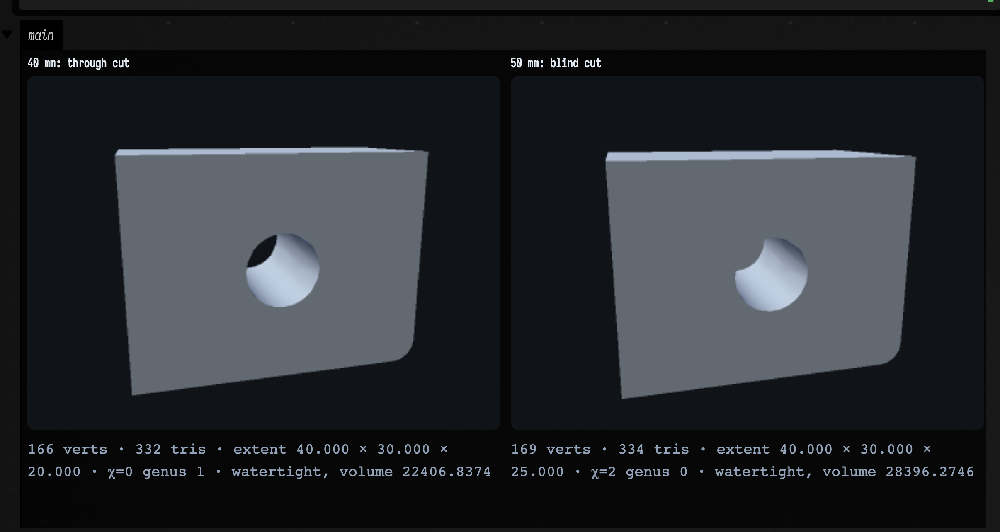

[Open →](offline.html?file=assets/agent_transcripts/solidcraft_intro/metadata.edn)

### ai4_paint_studio

A studio where AI4 paints. The one box puts a canvas from the [paint simulator](paint_canvas.md) on
an easel and gives the chat agent twenty tools to paint on it: strokes, dabs, whole regions worked
the way a painter blocks in, glazes, pencil lines, hatching, stippling, drying time, a fresh canvas
or sheet of paper, a painting knife, a rag, spatter, watercolour and ink washes, drops and a tilted
board, brushes kept by name between requests, and *hang*, which keeps a
finished painting in the document's gallery. The canvas and the kept tools belong to the
conversation, so rewinding the chat to a request brings back the canvas, and every kept brush as
dirty as it was, from before it. Open the
box's AI panel and ask for a painting; [AI4 paints](ai4_painting.md) shows three made this way. A
second box, Scribbler, adds a `scribble` tool with `aiTool { }`; [Experimenting with
AI4](ai4_experiments.md) shows a painting made with it. It needs the paint library
(`./gradlew buildPaintNative`) and an AI provider.

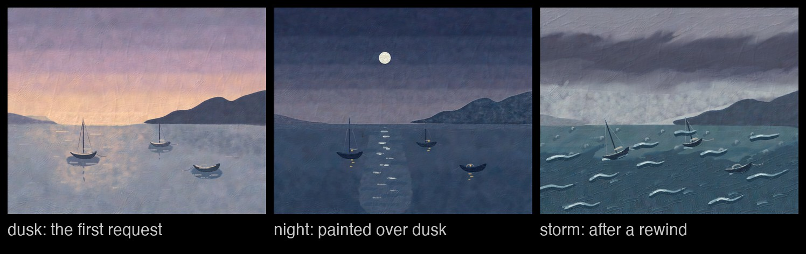

[Open →](offline.html?file=assets/agent_transcripts/ai4_paint_studio/metadata.edn)

### stacksl_evolve_studio

A StackSL search toward a picture that the AI chat steers. The one box holds the search and gives
the chat agent tools to run generations, look at the best programs, propose programs of its own,
ask the fast model for a round of edits, take a gradient step on a program's numbers, and change the
metric and population. The population belongs to the conversation: rewinding the chat to a request
puts the search back as it was before it, and the agent can breed the current population with one
from a branch it left. Opening the document shows only the target; the search starts when you ask
for it. Open the box's AI panel and ask, for instance, "evolve toward the target, and bring in the
watchmaker when it stalls". [Evolving a Shader](stacksl_evolve.md#steering-it-from-the-ai-chat)
describes it. It needs an AI provider.

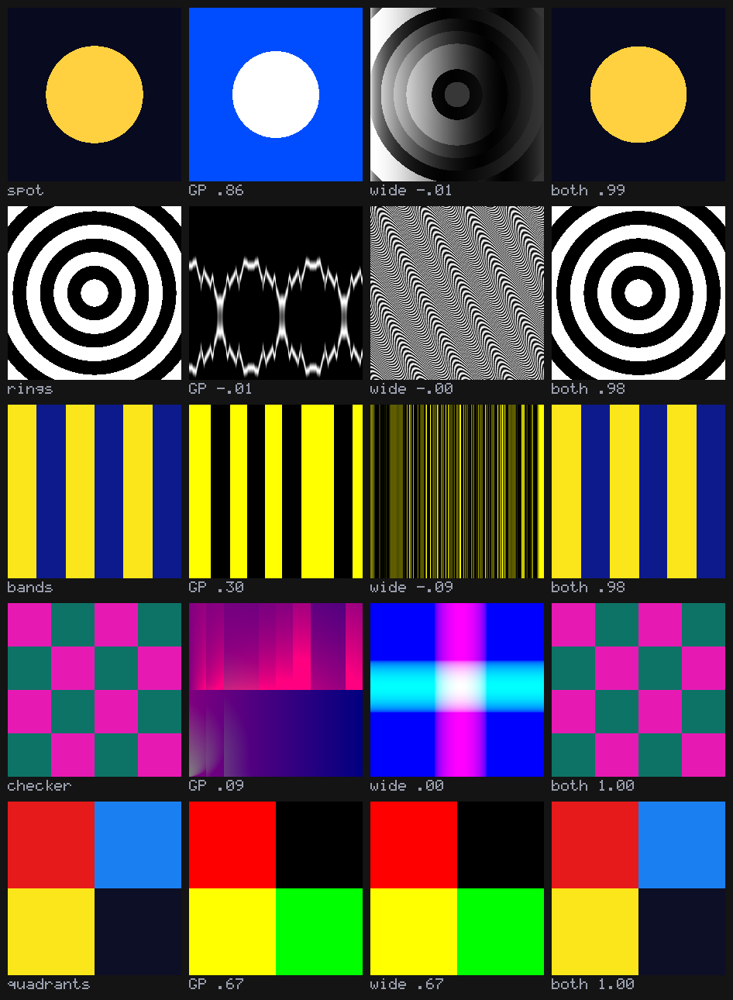

[Open →](offline.html?file=assets/agent_transcripts/stacksl_evolve_studio/metadata.edn)

### paint_canvas

Three boxes that paint and draw [FLines with simulated paint and pencil](paint_canvas.md). *A
canvas, a brush, three strokes* loads a filbert twice and then drags it through a three-pass zigzag
without reloading, so you can see the brush run dry. *Strokes along a flow field* paints 260 short
strokes that follow a field of directions. It reloads the brush before each one with `wipe = 0.4`,
so some of the last colour stays in the bristles and neighbouring strokes blend. *Pencil, hatching
and chalk* sketches a vase in 2B, hatches its shadow side in 4B and rules a chalk line under it, on a
20 cm sheet so the pencil reads at screen size. All three need the optional paint library
(`./gradlew buildPaintNative`). Without it they say where they looked and stop.

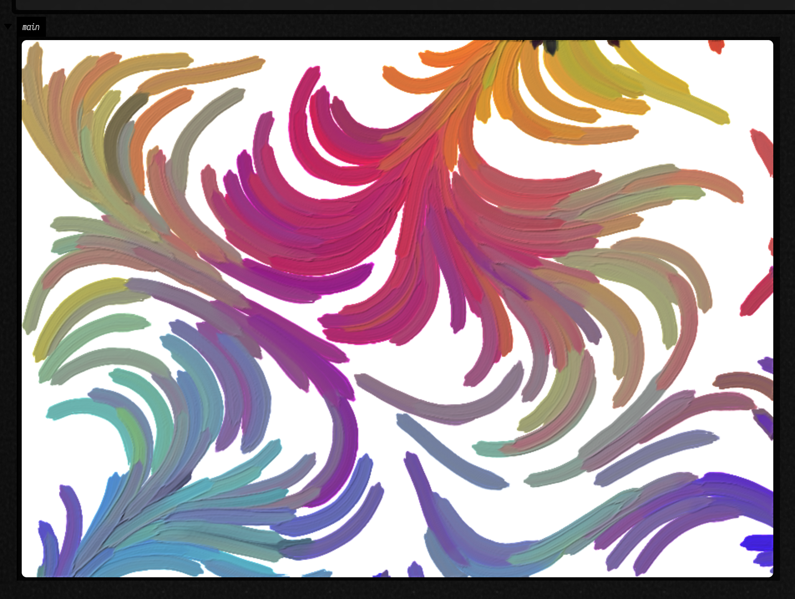

[Open →](offline.html?file=assets/agent_transcripts/paint_canvas/metadata.edn)

### photo_to_solid_chain

A photograph becomes a printable solid, as four pure-compute boxes — the loadable version of
[A Photograph, Closed and Mounted](chain_photo_to_solid.md). Four families that do not import one
another: Depth Anything V2 Small over ONNX predicts monocular depth from one committed still (a
Vision Pro passthrough frame of a living room, no depth camera and no network — the weights are
cached under `~/.afield/onnx`), the imaging family normalises and smooths it, `Img.toReliefMesh`
closes it into a watertight plaque, and Manifold does the Boolean. *Depth* prints the model's own raw
window, which moves with resolution and is therefore read off the run rather than remembered, and
shows why the solid comes out concave: the side walls and near floor are close, the far wall is not,
so the room arrives as a basin. *Plaque* closes the sheet into a solid
(`toHeightfieldMesh` returns a disc, `χ = 1` with one boundary loop, and `toSolid` refuses an open
sheet) and prints `watertight=true manifold=true chi=2`, `boundary loops=0`, and a volume that
Manifold and Field's own divergence-theorem sum agree on to the last digit despite sharing no code.
*Boolean* checks inclusion–exclusion, `vol(A ∪ B) + vol(A ∩ B) = vol(A) + vol(B)`, rather than
checking that the union got bigger, and shows the frame's genus going 1 → 0 as the plaque plugs its
window. *Levelset* marches the same depth field as an independent second construction of the same
solid — the two agree to about one marching cell. Every picture is `TriMesh.renderPng`
— a CPU rasteriser, AWT-free through `PngEncoder` — so there is no Window and no Renderer.


[Open →](offline.html?file=assets/agent_transcripts/photo_to_solid_chain/metadata.edn)

### solidsl_notation

Two boxes on [`afield.lang.solidsl`](solid_notation.md), the notation in which a
solid is a *value* rather than a `(Vec3) -> Float`. *A part, and what the notation knows before it
meshes* interrogates a bored plate with a blended boss before anything is built: **17 nodes**,
symbolic bounds, and exactly one subtree with no exact CSG form: the `SmoothUnion`, because "a
smooth blend's fillet surface lies on neither operand, so no union, intersection or difference of the
two can produce it". Then it builds the hybrid, and reports **1 subtree marched, the
rest exact**, the blend at `edgeLength 0.02163` and the plate and its four bores never sampled at
all: 29,632 triangles, watertight, volume **2.840885**, genus **4**, one for each bore. *The same
value, lowered to GLSL* needs neither Manifold nor a GPU: it emits `float sdSolid(vec3 p)` by walking
the tree, then shows what a notation buys that a closure cannot. Difference forty extra bores into
the scene, most of them nowhere near the part, and symbolic bounds alone cut **88 nodes to 28 and 654
GLSL statements to 294**: nothing sampled, nothing built. The last two lines want reading
together: set the blend radius to zero and the simplifier reports `path level set -> exact`,
because a blend of radius zero *is* a union, and a union has an exact form where a blend never will.
Ask the *unsimplified* tree and it still refuses (the rewrite is what removes the refusal), so the
box prints both; read apart, that pair of lines looks like a contradiction.


[Open →](offline.html?file=assets/agent_transcripts/solidsl_notation/metadata.edn)

### solidsl_gallery

The three boxes from the end of [SolidSL](solid_notation.md#open-this). *One shape, two evaluations*
puts one part through both lowerings and shows the meshes side by side; *the same source as a GLSL
raymarcher* prints the emitted shader and what the simplifier drops; *refusals, and the hybrid build*
lists every refusal with its reason. The first and third fall back to the field lowering when
Manifold is not installed, and say so.

[Open →](offline.html?file=assets/agent_transcripts/solidsl_gallery/metadata.edn)

### mesh_repair_demo

The two boxes from [Geometry from disk](geometry_from_disk.md#open-this-to-see-it). One punches
holes in a sphere and shows the diagnosis card; the other repairs it, prints what was done, and cuts
the result. Both build their mesh in the box, so they need no files and no network.

[Open →](offline.html?file=assets/agent_transcripts/mesh_repair_demo/metadata.edn)

### sorting_networks

The four examples from [Sorting networks](sorting_networks_examples.md), one box each: a bubble
network drawn beside an odd-even merge, how fast each removes disorder from random inputs, one
`SortingNetwork.anneal` run searching for a smaller network, and annealing across three starting
networks, three temperature schedules and three seeds. The two annealing boxes take about a minute each.

[Open →](offline.html?file=assets/agent_transcripts/sorting_networks/metadata.edn)

### rectsl_glsl_sdf

Two boxes that print. [RectSL](rectsl_cheatsheet.md) scenes lower to a single
`float scene(vec2, float)` GLSL function, and `emitSdf` is a string builder over the compiled
program, with no shaderc, no window and no renderer, so these are the cheapest possible check that the
emitter still compiles against the language. The first box lowers a two-track scene and prints the
whole emitted shader, with the counts that make the staging visible: rects unioned, curve functions
emitted, and any fidelity caveats. The second is the constant-folding demonstration: nine copies made
with `array` whose per-copy offsets are constant in time fold to literals rather than nine more
functions, because the stack VM ran once at compile time and `array`, `grid`, selections and the
`{{ }}` escapes are all spent before the GLSL exists. To see the same thing drawn and moving, replay
`rectsl_sdf_live` below.

[Open →](offline.html?file=assets/agent_transcripts/rectsl_glsl_sdf/metadata.edn)

### rectsl_inverse_animation

Two boxes on the *third* track backend. A RectSL track already knew how
to evaluate itself and how to spell itself as GLSL; `toFn` lowers it to an `Fn` instead, which makes it
differentiable, so a track can be solved rather than authored. The first box prints the symbolic IR with
its unknowns still in it, `ADD(MUL(linear[0.0=0.0 4.0=4.0], ?gain=1.0), ?bias=0.0)`, and is the
clearest look at what `free-param` actually puts in the tree. The second states three waypoints a rect
should pass through, fits the parameters against them on the exact gradient, and rasterises the answer as
three stacked bands: the target, a seed missing every waypoint by 7.72, and the solved arc threading all
three at 4.7e-15. Move a waypoint and re-run to watch it re-solve; move one somewhere
`amp·trig(rate·t + phase) + centre` cannot reach and the caption reports the miss instead.


[Open →](offline.html?file=assets/agent_transcripts/rectsl_inverse_animation/metadata.edn)

### rectsl_heading_fit

The same backend, over headings. `->face-travel` builds a `HeadingTrack`,
which is `atan2` of a central finite difference, and covers 116 of the gallery corpus's 2754 tracks.
The first box makes the lowering checkable: one figure-of-eight trajectory
drawn three times, with the sampler's own rotation on top, the lowered `Fn`'s beneath it, and
`atan(dy/dx)` with the quadrant thrown away at the bottom. Bands one and two are the same picture (0
differing pixels, measured) and in band three half the darts point backwards. Each dart wears a
nose pip for a reason: a bare rect is symmetric under a half turn, so the one glyph that has to show
a half turn could not. The second box turns the arrow round and solves *through* the `atan2`, asking how
steep a climb makes the dart point at 45 degrees, descending the exact gradient from 0.15 to
1.0000000000000244 with the residual falling 0.637 to 4.7e-15. It also prints the θ-slot map: a
heading reads each position track twelve times, so one named parameter occupies 36 slots and the
fitter has to move all of them as one variable.

[Open →](offline.html?file=assets/agent_transcripts/rectsl_heading_fit/metadata.edn)

### sound_path_map

The two boxes behind [How to make sound in Field](sound_paths.md). *The map* prints every
declared way Field has of making, carrying out and bringing in sound straight from
`SoundPathMap.PATHS`, ending with how many meet the one `render` signature and which ones no page
mentions. *One buffer, three paths* plays a two-second `bd ~ sd ~, hh*8` from real Dirt-Samples
one-shots, then the same buffer through `ChamberlinLowpass` and through a Faust `fi.lowpass(1, 900)`,
and prints the centroids (2856, 652 and 783 Hz), the two filters' similarity (0.9899) and the
worst disagreement between a plain gain run through both paths, which is 0. It needs `./gradlew fetchDocsDirtSamples` once and says so if
you skip it.

[Open →](offline.html?file=assets/agent_transcripts/sound_path_map/metadata.edn)

### faust_voice

Five boxes around [Faust](faust.md), whose compiler Field ships as WebAssembly, so
nothing is installed to run any of them. *Faust voice* is the one to click: a `#faust` region returned as
the box's last expression, which keeps the box lit while it plays and takes the sound down when you stop
it. The three sliders that appear are not written anywhere in the box: they are the program's own
`hslider` declarations, and because they arrive as an ordinary Field control group they are also what a
tablet gets. *Block diagram* is Faust's own SVG of the signal flow, out of the embedded compiler rather
than `faust -svg`. *Waveform* renders the identical program offline and plots it, which is both a cache
hit and the reason a Faust figure can mean something in a build with no sound card. *The interface it declares*
prints what makes the first box's controls possible: ranges, steps, `[unit:Hz]`, `[scale:log]`, and the
byte `index` in WebAssembly memory that makes a slider a float store rather than a message, listed
alphabetically, because that is how Faust orders them and not how they were written. *An error, on the
line* is broken here: `#` is not a comment in Faust, so the `#faust` marker is stripped before
compiling and its lines are added back before the marker is placed; get that arithmetic wrong and every
diagnostic lands a row or two off, looking like a compiler bug. Only the middle three boxes are replayed
here; the voice wants an audio device and the last one is meant to fail.

[Open →](offline.html?file=assets/agent_transcripts/faust_voice/metadata.edn)

### popup_prior_inspect

Asks Field what ranking prior the completion popup currently has for a
receiver type, by calling the object the completion server itself calls, `afield.runtime.completion.CommonMemberPrior`,
rather than describing it. Tabulates the type's `@CommonMembers` list in declared order with the score
each position earns. Change one string to ask about your own class, and replay it when a member you
expect near the top of `ctrl-space` is not there. It answers one of the two questions that place a row:
the other is which *section* it lands in, which lives behind an `internal` object and so belongs to
`FIELD_RANK_DUMP` instead. Both are explained on
[How completions are ranked](completion_ranking.md).

[Open →](offline.html?file=assets/agent_transcripts/popup_prior_inspect/metadata.edn)

### faust_polyphony

Six boxes in which [Faust](faust.md) stops being a drone with knobs and becomes an
instrument that a [pattern](sound.md) plays: eight instances of one compiled program, allocated to
notes. *Faust instrument* is the one to click: `faustPoly(…, voices = 8)` played by
`inst.play(pat("[c4,ef4,g4] …"), automate = mapOf("cutoff" to pat("900 2600 1400 5200").nums()))`,
so the chords are one pattern and the filter is another and both are scheduled in frames. Only
`cutoff` appears as a slider; `freq`, `gate` and `gain` are absent because the notes write them, and
they are found by *label* because Faust lists controls alphabetically and index 0 in that program is
`cutoff`. *Offline, with a plot* is the same path with no audio device: 16 notes over 2.25s, 8
cutoff steps, 0 steals, peak 0.317. *Three notes at once* is the box to read twice, because counting
attacks cannot tell polyphony from a voice stealing itself, so it counts spectral peaks in 100–230
Hz, a band that can hold nothing but fundamentals, and gets **three** at four voices (130.0, 166.2,
196.5 Hz against a notated 130.81, 164.81, 196.00) against **one** at a single voice, which also
reports two steals. *Onsets, in samples* puts every notated event's frame beside the frame the audio
actually attacks on, but it leads with the measurement that has no threshold in it at all: the
render is exactly `0f` between notes, so the first non-zero sample of a note is an exact fact, and
it **is** the notated frame for 13 of 13 checkable notes, worst 0. The scheduler is sample-exact;
the detector's own numbers (14 of 14 found, median 1 frame, jitter ±6, worst 7, against up to 110 if
the writes were quantised to the 128-frame block that twelve of the fourteen onsets fall inside) are
printed underneath and labelled as the detector's. It checks `faustSilentGaps` first, because an
onset detector pointed at a continuous tone always finds something. *What it refuses* is a program
with no `gate`, and the message it gets instead of silence. *When it runs out of voices* is the one
knob here you can hear: four notes on two voices, rendered at `stealReleaseFrames = 1` and at
`1440`, printing **4.23×** and **0.11×** for the normalised waveform step across the steal, with
both WAVs playable and the line to edit marked. Five of the six are replayed here; the instrument
wants an audio device.

[Open →](offline.html?file=assets/agent_transcripts/faust_polyphony/metadata.edn)

### agent_eval_corpus

**The eval corpus Field's own agent is measured on.** `AgentEvalCorpus` turns the boxes in this corpus
into tasks for the in-Field agent: a box the transcript ran whole, that prints or displays, and that
needs no renderer, audio, files or clock becomes a goal (its name, its parents, its own leading comment,
the text its output must include), a setup (its ancestors), a solution (its real code) and checks (the
output it gave twice in a row). Two boxes: *What was mined* prints how many tasks came from how many
transcripts and tabulates them by kind and split beside the reasons the other boxes were dropped; *One
task* prints a held-out task's goal and checks as the agent receives them. The method and the live
before/after are in `dev_docs/ai/IN_FIELD_AGENT_HARNESS.md` ("Mined corpus").

[Open →](offline.html?file=assets/agent_transcripts/agent_eval_corpus/metadata.edn)

### alife_script

**Giving one agent a program.** `afield.simulation.agents`' `alife_script.kt` adds a per-agent behaviour layer to ALife:
the nine `alife_*.kt` files already there advance a whole population with one `step(params)` call, and
this lets an *individual* agent sequence behaviours, wait on simulation time, hold named phases, run
bounded concurrent sub-behaviours, and compose steering drives from whichever of them are active right
now. Three pure-CPU boxes: one agent whose entire program is "orbit that point", then six sites and
twenty-four agents showing a division of labour that one global rule does not buy, then phases —
flock, scatter, flock, scatter. The clock is a fixed step and the world is seeded, so the same document
run twice is the same run, including across JVMs. `dev_docs/ALIFE.md` is the write-up.

[Open →](offline.html?file=assets/agent_transcripts/alife_script/metadata.edn)

### alife_walls

**A world with walls.** A `ScriptWorld` can hold obstacles: the collision that stops an agent
crossing one is **swept** rather than discrete, and `route()` plans a way round rather than pressing
into it. Three boxes: one barrier and three answers to hitting it (`SLIDE`, `BOUNCE` with
restitution, `STOP`, with the contact counts and end positions printed), routed seek against direct
seek on a maze, and following a wall while climbing a light. Swept collision is the part worth reading
for — a discrete test lets a fast agent step straight through a thin wall between two frames, and that
failure looks like an agent ignoring geometry rather than like a timestep problem.

[Open →](offline.html?file=assets/agent_transcripts/alife_walls/metadata.edn)

### chart_clip

**A figure that does not fit inside itself.** Four boxes: the corner plot as it looks now, the same
figure with `clip = false`, a long note wrapping and not wrapping, and the numbers behind both read
off the drawn geometry. Run box 2 and the plot becomes a stamp in one corner of an empty rectangle. The switch is a
single word and it is that destructive because a panel fits the geometry's *own* bounds: anything
outside the declared frame is not cropped, it shrinks everything else.

[Open →](offline.html?file=assets/agent_transcripts/chart_clip/metadata.edn)

### gp_instruments

**Tuning by Gaussian process**, in three boxes. A `GpOptimizer` finds the three dials of a curve
that match a hidden target in thirty tries, and charts the best misfit after each one. A
`GpPreference` shows two rosettes and two buttons, learns from each "A or B?" click, and proposes
the next pair. The third box answers the same questions for a judge whose ideal rosette is known,
and draws the model's favourite after every six answers, then the ideal past a dividing line, in its own colour, with a chart of what the model believes about hue. See
[Tuning by Gaussian process](gaussian_process_optimization.md).

[Open →](offline.html?file=assets/agent_transcripts/gp_instruments/metadata.edn)

### browse_embeds

**Looking inside values with `tree`, `column` and `logs`**, one box each. A map of mixed values in
`tree(...)` — a data class, an array, a 5000-item list that arrives 200 rows at a time, object keys and a
loop marked ↺ rather than opened forever — the same value in `column(...)`, a launched box whose list
grows while you watch, and `logs(...)` filtered to one channel. See
[Visualizers](visualizers.md).

[Open →](offline.html?file=assets/agent_transcripts/browse_embeds/metadata.edn)

### gp_drawing

**Drawing with Gaussian processes**, in three boxes to play with. A closed loop through six pins,
whose mean and draws all close without a seam; drag a pin's control and it redraws. Four 1-D
measurements with sliders for the length scale and for how noisy one of them is. A field over the
plane: its mean, two whole-field draws and its standard deviation. See
[Drawing with Gaussian processes](gaussian_processes.md).

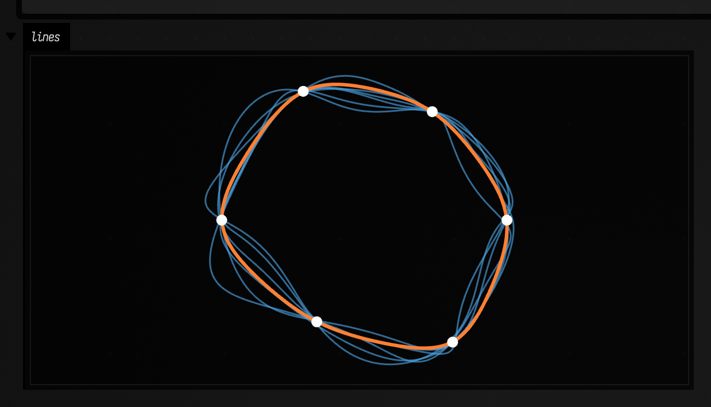

[Open →](offline.html?file=assets/agent_transcripts/gp_drawing/metadata.edn)

### chart_primitive

**`Chart` — the FLine plot primitive**, in four boxes, one per thing the primitive is for: a chart in
one call, a DataFrame charting its own columns, marks that hover and click because they set `onClick`
and `hoverColor` rather than because anyone configured them, and `Chart.expect` — a claim drawn as a
band with the data that breaks it recoloured and counted, which is the plot counterpart of
`Table.expect`. Everything lowers to `List<FLine>` and goes out through `Box.lines`' own renderer, so
the axes, the tick labels and the legend are glyph outlines and SVG rather than a raster or a
third-party JS chart.

[Open →](offline.html?file=assets/agent_transcripts/chart_primitive/metadata.edn)

### completion_rank_at_scale

**Completion ranking at corpus scale**, over the checked-in recording of 578 carets — no GPU, no
window, no sidecar. Three boxes: the corpus itself with its payload distribution, the *real*
`KotlinSourceIndex.getCompletionCategoryForSymbol` called with the real recorded `declaredIn`, and
the whole decision re-scored through the shipped
weights. The third box shells out to `tools/rank_weight_lab.py`.
`dev_docs/completion_rank_at_scale.md` is the written-up version, with the sweep and the falsification
behind it.

[Open →](offline.html?file=assets/agent_transcripts/completion_rank_at_scale/metadata.edn)

### keyframe_key_discovery

**Whether the keyframe browser can show you your own keys.** Three boxes, no GPU and no window — a
`KeyframeScope` needs neither, and each box writes its key directory into a fresh temp dir so nothing
lands in the document. Six keys named `a b c d d2 d3`, the shapes a real session actually produced,
browsed twice in one box: the top panel uses the last pattern that session tried and finds two of the
six, and says so, with a button that widens it in one click. Then junk against damage — the two
are not the same and the browser has to tell them apart — and a saved slot that applies to nowhere.

[Open →](offline.html?file=assets/agent_transcripts/keyframe_key_discovery/metadata.edn)

### logging_layer

**Channels, sinks, and the three different rules that select on a channel.** Six boxes, one per thing
on the logging page, and every one reads the objects a running Field is using: `LogDispatcher`'s live sink list, `ConsoleMute`'s actual mute set, `LogStream`'s
actual subscription filter. The reason to run these rather than read them is box 3 —
`ConsoleMute.isMuted` compares the **whole** channel string, the pinned console splits on commas and
compares a tag, and `LogStream`'s filter takes any case-insensitive substring, so one word selects
three different sets of lines, and box 3 shows all three with a real subscriber.

[Open →](offline.html?file=assets/agent_transcripts/logging_layer/metadata.edn)

### midi_clip

**MIDI files, written and read back.** Four pure-CPU boxes, no device required to run them: two
mini-notation patterns rendered into a two-track `MidiClip` and written as a format-1 Standard MIDI
File, that file read back with no knowledge of what wrote it and turned into a `PatPattern` — the PPQ,
the tempo and the track split survive the round trip or the comparison says so — then the MIDI ports
this machine can actually see, and an audition. Boxes 1 and 2 pass a file through the temp directory,
so run 1 first; 3 and 4 are independent of both. Box 3 lists what the JVM reports and separates it
from what is plugged in: the JDK always contributes Gervill and the Real Time Sequencer, so a
non-empty list is not evidence of hardware, and on a machine with no ports the hardware row reads
*none*, which is the answer rather than an error. Box 4's audition does **not** go out through those
ports: it renders the clip offline through Gervill to a WAV and reports the peak amplitude, because a
WAV of pure silence is exactly as large as a loud one — and if the JVM cannot reach
`com.sun.media.sound.AudioSynthesizer.openStream` it renders nothing and tells you to use
`clip.playTo("Gervill")` instead. Run headless, it takes the offline route and reports a 2.00 s
render with a peak of 0.489.

[Open →](offline.html?file=assets/agent_transcripts/midi_clip/metadata.edn)

### pattern_condense

**The shortest way to write a rhythm down.** `patCondense` searches Field's own mini-notation for the
shortest string that plays the rhythm it is given, and accepts a candidate only by *playing* it: every
one goes back through `pat(...)` and its events are compared to the target's. That is why box 1 draws
pairs rather than printing strings — the lower lane of a pair **is** the string in its label, rendered,
so a search that is wrong shows up as two lanes that do not coincide. Box 2 condenses 300 random masks
and recomputes every figure the search named, from `bjorklund` and `kolakoskiMask` rather than off the
label: noise compresses about three times worse than a real figure, and that separation is the claim.
Box 3 closes the loop — a bar rendered to samples, transcribed, and condensed back into `60(3,8,3)`,
with nothing between the render and the transcription looking at the pattern. It recovers the grid
at 0.2501 s/step over 8 steps with a worst residual of 0.001 step, and box 2's two medians are 0.613
for noise against 0.194 for `kolakoskiMask(16)`, a 3.2x separation.

[Open →](offline.html?file=assets/agent_transcripts/pattern_condense/metadata.edn)

### read_only_session

**Read-only mode, from the inside.** Two boxes, no GPU, no network, no setup — and a document whose
point is to be opened **twice**. A `saved{}` counter that counts up in an ordinary session and cannot
in a read-only one, and a box on what the flag is (`./field.sh --read-only`, `AFIELD_READ_ONLY=1`,
`-Dafield.readOnly=true`), what a box can ask about it, and which writes are refused rather than
silently dropped. Read-only is what lets a committed document be opened without Field writing a
backup, a screenshot, history metrics and an operation transcript back into the folder it came from —
which is why every demo under `dev_docs/agents/demos/` tells you to pass the flag.

[Open →](offline.html?file=assets/agent_transcripts/read_only_session/metadata.edn)

### history_box_story

**One box's code across every saved version.** A transcript, not a saved document: replay it into a
saving document (not `--scratch`) and it edits one box, `sketch`, three times, waiting for the autosave
after each edit, so the document's backups hold four real versions. Select `sketch`, run **Show Document
History**, and the sidebar's **This Box** list shows its four values newest first. Click a row to select
that version, or choose **Restore** to put that value back into `sketch` alone. See
[Document History](document_history.md#one-box-edit-by-edit).

[Open →](offline.html?file=assets/agent_transcripts/history_box_story/metadata.edn)

### controls_surface

**A performer's control surface.** Two pure-CPU boxes built from the `controlGroup` DSL. The first
puts a log-law cutoff slider, an XY pad, a toggle, a name and a colour beside a live figure drawn from
whatever the box last received: click the pad, then use the arrow keys (shift for ten times the step),
Backspace or a double-click to reset, and shift-drag to ease it into place; click a slider and turn
the wheel. The second box's slider rebuilds its own group once dragged past 0.5, replacing the DOM
under the pointer, and the drag carries on. `dev_docs/CONTROLS_RENEWAL.md` is the write-up.

[Open →](offline.html?file=assets/agent_transcripts/controls_surface/metadata.edn)

### controls_presets_morph_midi

**Presets you can morph between, a recorded slider, and a MIDI knob.** Two pure-CPU boxes. The
first declares its controls as locals delegated to a `KeyframeScope` and adds `presetBar(keys)`:
two keys, `calm` and `storm`, are saved on its first run, so its buttons recall them and the
**preset morph** slider blends between them, moving the circle it draws. A **rec size** button
records the size slider into a keyframe curve. The second box binds a log-law cutoff slider and a
checkbox to MIDI controller numbers and feeds them stand-in knob values, printing the cutoff as the
knob goes from 0 to 127. These are the two examples from
[Presets and morphing](visualizers.md#presets-and-morphing) and [MIDI learn](visualizers.md#midi-learn).

[Open ↗](offline.html?file=assets/agent_transcripts/controls_presets_morph_midi/metadata.edn)

### certified_envelope

**A bound no feature can slip between.** Five pure-CPU boxes, no window and no setup. The signal is
an hour of a slow 40-second swing plus a glitch 10 ms wide at 1234.57 s, placed halfway between two
of the signal viewer's 0.02 s samples and built from `Functions` ops rather than a `fn { }` lambda.
The first box draws it the way the function workbench does, a min/max envelope per bin, and the
glitch is simply not there: its peak is 0.7994, the sampled maximum in its bin is 0.3038, and nothing
in the picture says so. The second box turns on the viewer's certified band, interval arithmetic
over `FnFormulas`, and the amber spike appears at 1234 s, bounded at 0.7995. The third finds the
global maximum by branch-and-bound, with its witness, and proves `f <= 0.8` while refuting
`f <= 0.7`. The fourth shows what refuses: a `fn { }` lambda is refused by name rather than bounded
by a guess, while one event rebuilt from formula ops holds exactly 1.0 over its plateau, proved
exactly rather than to a tolerance. The fifth takes the function workbench's own worked example,
rebuilt bit-for-bit from formula ops, and certifies its claims. Every plateau holds exactly
(1, 1, 1), but the recorded assumption "all channels stay in [0, 1]" is refuted by 4 ulps at
x = 284.999942779541, where the original lambda returns 1.0000000000000009 and the viewer's sampling
grid never looks. `dev_docs/FN_INTERVAL.md` is the write-up.

[Open →](offline.html?file=assets/agent_transcripts/certified_envelope/metadata.edn)

### slideshow_own_tour

**A guide over boxes that are already there.** Two ordinary boxes, `numbers` and `squares`, and a
third, `tour`, whose `slideShow` walks through them in three steps. Each step finds the box it
describes by name with `selectBoxByName`, so the guide works on any document that has boxes with
those names; the second step opens `squares` at line 3 and marks it, and the last offers Start
again and Finish. Run `numbers` and `squares` (they print `[1, 2, …, 10]` and
`[1, 4, 9, …, 100]`), then run `tour` and follow its links. This is the "tour of your own
document" example on [Interactive guides](interactive_guides.md), as a document you can open.

[Open →](offline.html?file=assets/agent_transcripts/slideshow_own_tour/metadata.edn)

### solidsl_inverse

**A Solid you can differentiate — and therefore solve.** `afield.lang.solidsl` writes a 3D solid down as a
value and had two readings of it, a marchable distance field and Manifold's exact CSG; both are
*evaluations*, and neither changes what you can ask the notation for. This is the third reading. Three
boxes, no Manifold, no GPU, no window — marching cubes and the mesh rasteriser are both pure Kotlin.
The exact gradient checked against central differences on the spot, with `segments` **absent** from
the slot list because an integer facet count has no derivative; an inverse fit that recovers three
parameters seeded 42%, 45% and 112% wrong, the loss falling twenty orders of magnitude in fourteen
iterations, with the seed and fitted renders in the same box; then the seven refusals, which carry *reasons* rather than nulls, and the one failure mode
that matters — a swallowed child under a hard `Union` is dead, because a pointwise `min` gives the
whole derivative to whichever child is nearest, and it presents as a *converged* optimisation.

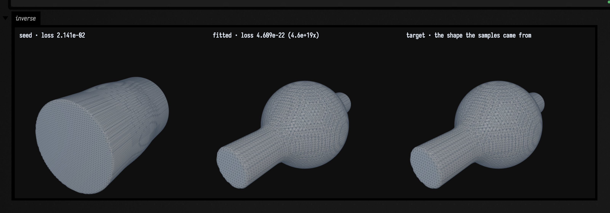

[Open →](offline.html?file=assets/agent_transcripts/solidsl_inverse/metadata.edn)

### stacksl_fit_demo

The fitting demo from [StackSL examples](stacksl_examples.md): every literal in a StackSL program
made addressable, gradient descent on those numbers, and the fitted program printed back as source
you can paste into a shader.

[Open →](offline.html?file=assets/agent_transcripts/stacksl_fit_demo/metadata.edn)

### macro_recorder_stamp

**A macro used as a stamp.** The first box saves a macro the way the
[Macro Recorder](automating_field.md) writes one: a box with code, another box, and a connection
between them. The second replays it as a copy three times, each lower down the canvas, so every run
makes a new connected pair; the third replays it one operation at a time, as the panel's Step
button does. Open the Macro Recorder afterwards to find the macro listed with its own Run, Rename
and Delete.

[Open →](offline.html?file=assets/agent_transcripts/macro_recorder_stamp/metadata.edn)

### madp_ga

**Interactive evolution, after Karl Sims**, ported from the madp GA demo. Each tile is a short
reverse-Polish colour program (`x 9 * sin 0.18 + y 0.55 + 0.62 hsl`) run once per pixel, and you
are the fitness function: each box shows two parents and seven children in a 3×3 grid, and
clicking two tiles makes them the parents of the next generation. The lead box starts from the
demo's two starters, two more from its example programs, and the last changes the breeding rules
so that only numbers mutate. The language is `ColorRpn` and the grid is `evolveByEye`, which takes
any genome with a picture; design notes in `dev_docs/madp/ga.md`.

```diffstatic_runner {data-lang=kotlin screenshot="assets/agent_transcripts_gallery/madp_ga_lead.png" capture="box" open-outputs="true" wait="2.0" embed=true hidden=true timeout="180" padding="12" name="gallery-madp-ga-lead" alt="The GA grid on a near-black ground: a toolbar with Reroll, Fresh Parents and Start over and the mut, len and res settings, then nine tiles in three rows, the two parents (rainbow vertical stripes and rainbow spokes) outlined in blue and seven mutated children below them, each with its program written under it" macro-file="../../dev_docs/agents/transcripts/madp_ga.yaml" capture-box="madp_ga_lead"}
// The transcript builds and runs every box; this is the lead box, starting from the demo's starters.
```

[Open →](offline.html?file=assets/agent_transcripts/madp_ga/metadata.edn)

### assimp_browsing

**A glTF file, as Assimp loads it, opened in `column(...)` and `tree(...)`**, in one box and with no
renderer: the scene's root node and its transform, meshes, materials and animations. See
[Browsing a glTF scene](visualizers.md#browsing-a-gltf-scene).

[Open ↗](offline.html?file=assets/agent_transcripts/assimp_browsing/metadata.edn)

## Service-backed composition scenes

<!-- transcript-index: verified-by = execute -->

These are complete, editable starting points whose first view works without model weights. Their
generation boxes remain explicit about the companion service or hardware they need.

### audio_ai_gesture_board

Draw timed prompt regions, salience events, and activity, density,
register and brightness curves over one shared musical timeline. The first box renders and explains
the typed sketch immediately. The second resolves a source recording by filename, requests eight
MusicGen-Style candidates, then presents both gesture-fit rankings and the full waveform/splice
audition board. The current worker treats prompt wording as compiled conditioning and the numeric
lanes as waveform-evaluated targets; the UI never disguises either as native timed control.
Walkthrough: [Gesture board: drawing toward a sound](audio_ai_gesture_board.md).


[Open →](offline.html?file=assets/agent_transcripts/audio_ai_gesture_board/metadata.edn)

### audio_ai_analysis

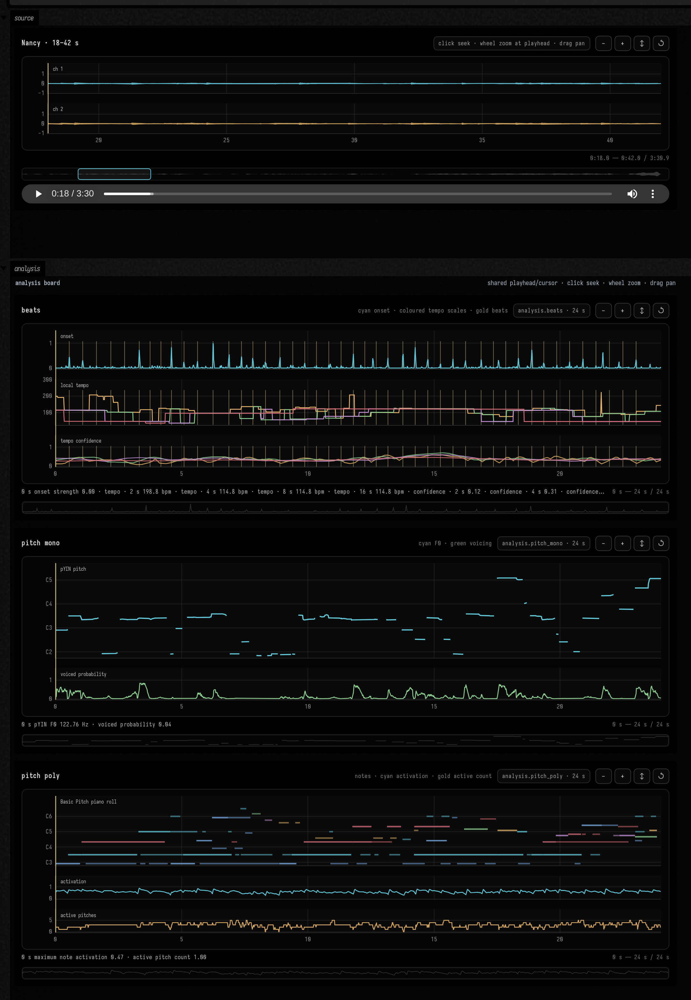

Resolve a recording by filename, display its exact source window, submit
librosa beat and pYIN analysis plus Spotify Basic Pitch, follow all three jobs through replaceable
progress cards and the durable monitor, await their immutable results, then compare onset, tempo,
confidence, monophonic F0, voicing and polyphonic notes on synchronized timelines. Its first two
boxes show the guide and real cached previews without the analysis worker.
Walkthrough: [Beat and pitch analysis](audio_ai_analysis.md).

[Open →](offline.html?file=assets/agent_transcripts/audio_ai_analysis/metadata.edn)

### audio_ai_speech_embeddings

Find or import `near_drowning.wav`, submit revision-pinned
emotion2vec and WavLM Base+ frame-embedding jobs, follow both through replaceable progress cards
and the durable monitor, then pool 500 ms of evidence at 25 Hz and play the recording through Smile
t-SNE axes 0×1 and 2×3 in each learned space. The first two boxes explain and exercise the
synchronized phase-portrait renderer without
downloading model weights; the complete local source-to-result path remains explicit in box 3.
Walkthrough: [Speech-reactive learned spaces](audio_ai_speech_embeddings.md).

[Open →](offline.html?file=assets/agent_transcripts/audio_ai_speech_embeddings/metadata.edn)

### audio_ai_spectral_embeddings

Find or import `near_drowning.wav`, submit and monitor one
model-free librosa spectral job, retain its 25 Hz mel, log-mel, MFCC, and diagnostic trajectories,
then decode the binary artifact once and compare mel-Wasserstein, log-mel cosine, and MFCC Euclidean
t-SNE phase portraits. The first two boxes explain and exercise the synchronized renderer without a
service; box 3 owns the complete source-to-result path.
Walkthrough: [Short-time spectral spaces](audio_ai_spectral_embeddings.md).

[Open →](offline.html?file=assets/agent_transcripts/audio_ai_spectral_embeddings/metadata.edn)

### audio_ai_muscriptor

Turn an imported or Field-rendered recording into instrument-labelled
notes with the model-neutral `analysis.transcribe_music` operation. The live box selects a
revision-pinned small, medium, or large MuScriptor backend, follows its durable job, synchronizes
the source waveform with an instrument-coloured piano roll, and downloads performance-timed plus
optional beat-quantized MIDI. The guide and synthetic score viewer execute without gated weights;
the complete authenticated model path remains an explicit action in box 3.
Walkthrough: [Multi-instrument transcription with MuScriptor](audio_ai_muscriptor.md).

[Open →](offline.html?file=assets/agent_transcripts/audio_ai_muscriptor/metadata.edn)

### audio_ai_corpus_microscope

Resolve Nancy and Final Out at Candlestick Park, submit and monitor
multi-scale segmentation and grouped descriptor jobs, then use a six-second Nancy window to retrieve
related source windows. The resulting board aligns playheads and hover cursors in relative time,
shows each descriptor-group distance, and provides an automatic query-to-neighbour splice audition.
Walkthrough: [Corpus microscope: from recordings to related windows](audio_ai_corpus_microscope.md).

[Open →](offline.html?file=assets/agent_transcripts/audio_ai_corpus_microscope/metadata.edn)

### contour_trees_explorer

[Merge trees and contour trees](contour_trees.md). The first box shows a landscape of hills and
hollows with its contour tree's nodes, the regions its arcs stand for, and the tree drawn as a plot,
with a slider that prunes branches by persistence. The second divides the brightness of the leaf
print into contour-tree regions, lightly and strongly simplified. Plain Kotlin, no optional
libraries.

[Open →](offline.html?file=assets/agent_transcripts/contour_trees_explorer/metadata.edn)

### vector_field_explorer

[Vector field topology](vector_field_topology.md). The first box builds a flow from swirls,
sources and sinks and draws its critical points and separatrices over streamlines, with a slider
that scales the swirl. The second draws the ridges and valleys of the leaf print's brightness as
the topology of its gradient, with a blur slider. Plain Kotlin, no optional libraries.

[Open →](offline.html?file=assets/agent_transcripts/vector_field_explorer/metadata.edn)

### mapper_explorer

[Mapper graphs of point clouds](mapper.md). The first box draws the Mapper graph of a ring with a
tail and a separate blob over its points, with sliders for the number of bins, their overlap and
the lens. The second scatters points along the letters A, H and O and counts the loops in each
graph. Plain Kotlin, no optional libraries.

[Open →](offline.html?file=assets/agent_transcripts/mapper_explorer/metadata.edn)

## External-service live-coding scenes

<!-- transcript-index: verified-by = compile -->

These boxes are all compiled through Field's real Kotlin/preamble path, but not evaluated by CI:
their purpose is to cross a process, audio-device or capture-device boundary that the lightweight
build does not own.

### rtp_midi_demo

**Network MIDI** in three boxes, run in order: the first opens an RTP-MIDI session called "Field"
and announces it over Bonjour, the second opens another session that joins it and lists the peer,
and the third plays four notes and a controller from that peer, which the first box's outputs show.
Nothing else needs to be on the network. See [Network MIDI](rtp_midi.md).

[Open →](offline.html?file=assets/agent_transcripts/rtp_midi_demo/metadata.edn)

### temporal_memory

**Continuing a gesture**, in seven boxes. A lab notebook with the measurements and wrong turns behind
the design; six takes of modern dance from the CMU motion capture database, remembered by the
Variable Markov Oracle and continued as a strip of poses, as hand and head heights labelled by take,
and as a dancing figure you launch and leave running; two oscillators with a slider to take over a
channel; a Timestral forecast drawn as a quantile fan; and the dance played five ways, two judged
by Timestral, with coverage, repetition and join roughness for each. Boxes 5 and 6 start the
Timestral worker, which needs `TimestralSession.install()` once.
See [Continuing a Gesture](temporal_memory.md).

[Open →](offline.html?file=assets/agent_transcripts/temporal_memory/metadata.edn)

### ai_tool_demo

**Giving the AI a tool**, in two boxes. The first is the whole mechanism: a function, the schema a
model sees, and a call through `AgentToolExtensions.execute` with the JSON a model would send. The
second is a geometry tool that answers with measurements and a rendered picture of the mesh. Neither
needs an API key or a model. See [AI features](aiFeatures.md).

[Open →](offline.html?file=assets/agent_transcripts/ai_tool_demo/metadata.edn)

### chain_scene_to_light

A RectSL scene on a light rig, with no lighting hardware: the universes go out as sACN to this
machine and come back. Launch `1. Scene on the rig` to draw the scene, shrink it to one pixel per
fixture and send it on a 44 Hz clock; launch `2. Receiver` to draw the rig lit by what arrived; run
`3. Measure` for a round trip of nine frames and a thin line sampled two ways. Edit the scene in the
first box and launch it again to see the change reach the second. See
[A RectSL Scene on a Light Rig](chain_scene_to_light.md).

[Open →](offline.html?file=assets/agent_transcripts/chain_scene_to_light/metadata.edn)

### kratos_thermal_playground

Launch one box and drag the cuboid arm, conductivity, heat source
and skin temperature controls. A persistent optional Kratos worker solves embedded conduction on
one fixed background grid. The original and current temperature slices, grid identity, changed
classifications, revisions and timings remain visible. Stop releases the worker; launch restarts it.
Install the worker first with `uv sync --project optional/kratos --frozen` from the Field checkout.
Requires Manifold. Each slice uses its own colour range; numerical temperature differences are
reported alongside it. The controls also appear on `/controllers`.

[Open →](offline.html?file=assets/agent_transcripts/kratos_thermal_playground/metadata.edn)

### kratos_flow_playground

Incompressible flow past a sphere-and-rod obstacle, on the same fixed
background grid and the same optional worker as the thermal playground. Dragging the radius reshapes
the body immediately, because that part is Manifold alone; solving is a button, because one request
marches three Newton steps and costs seconds rather than milliseconds. The result comes back as a
velocity field, which the box integrates into streamlines and draws as tubes coloured by speed,
beside a mid-plane slice of the wake. At the default settings 729 nodes and 3072 tetrahedra carry a
Reynolds number of 12 and a speed range of 0.175 to 1.454 m/s: the maximum is the flow accelerating
around the obstacle, and potential flow around a sphere gives exactly 1.5, which is the quickest way
to see that the answer is a flow and not a plausible picture. Install the worker first with
`uv sync --project optional/kratos --frozen`, or build its container where Kratos has no wheels.
Requires Manifold.

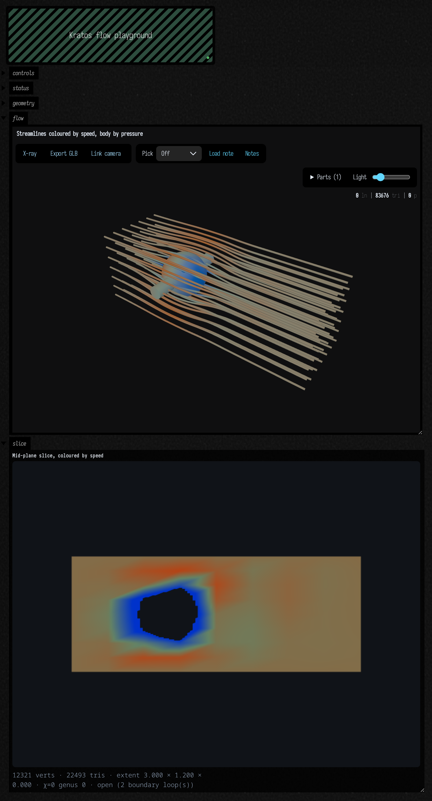

[Open →](offline.html?file=assets/agent_transcripts/kratos_flow_playground/metadata.edn)

### kratos_structural_playground

An L-bracket bending under load, and the argument for quadratic
elements made as a picture rather than a table. Unlike the other two this one is **body-fitted**:
Kratos has no immersed structural element, so TetGen tetrahedralizes the Manifold surface and the
mesh goes to the worker, which means a geometry edit costs a remesh and a new session where the
embedded playgrounds reclassify a grid they never rebuild. On launch it meshes the same bracket
twice, once with 4-node tetrahedra and once with 10-node, solves both under the same 3 kN tip load,
and draws the two deflected shapes beside the undeformed part, all coloured by von Mises stress. At
the default settings 1681 tetrahedra give 0.187 mm against 0.232 mm — the linear element reaches 81%
of the quadratic one's deflection, which is the constant-strain tetrahedron's locking seen directly,
and dragging the arm longer makes the gap worse. Install the worker first with
`uv sync --project optional/kratos --frozen`, or build its container where Kratos has no wheels;
TetGen needs `python3 tools/build_tetgen_native.py` once. Requires Manifold.

[Open →](offline.html?file=assets/agent_transcripts/kratos_structural_playground/metadata.edn)

### kratos_parameter_study

The same worker and the same background grid, asked a question one
solve cannot answer: which arm length and which conductivity put 294.15 K — one kelvin above the
skin — at a chosen point inside the part? The box declares a two-axis design space and a scalar
reduced from each solved field, then either tiles the space on a grid or searches it with an
evolutionary run reported against a random control at the same budget, and draws the landscape as a
heat map with the winner ringed beside the winning body and its temperature slice. Stationary
conduction makes the answer a closed form, `k* = q·φ(arm)/(T − Tb)`, so the dark valley in the
picture is checkable arithmetic rather than a shape to admire — and nothing in the sweep knows that.
A change of arm length is a reclassification, never a remesh: 225 solves and `builds` is still 1.
7×7 is 49 solves and about ninety seconds on the container worker. Install it first with
`uv sync --project optional/kratos --frozen`, or build the container image where Kratos has no
wheels. Requires Manifold.


[Open →](offline.html?file=assets/agent_transcripts/kratos_parameter_study/metadata.edn)

### audio_render_analysis

Start with music written in Field rather than an imported recording.
Four explicit live-coding boxes render Pat/Dirt, Dough and Faust or record Sonic Pi, write a finite
WAV, import it by content hash, submit the standard beat and pitch fan-out, stream each job's status,
and end in a source waveform plus synchronized analysis board. The guide and every complete service
path are compile-checked; running them remains an intentional user action.
Walkthrough: [Render Field music, then analyse it](audio_render_analysis.md).

[Open →](offline.html?file=assets/agent_transcripts/audio_render_analysis/metadata.edn)

### loris_partial_explorer

Analyze the committed public-domain film dialogue, follow native-worker status, inspect irregular
frequency/amplitude/phase/bandwidth trajectories, and audition source and resynthesis with a shared
cursor and full-band ERB/Hz/cents views. Further boxes select and transform partials, compare
independent fine-time and fine-frequency passes, and twist one chunk into a noisy spectral whirlpool
with playable resynthesis. Every complete box is compile-checked; running analysis requires the optional
`./gradlew buildLorisNative` build, not a GPU or audio-model server.
Walkthrough: [Loris partial tracks and resynthesis](loris.md).

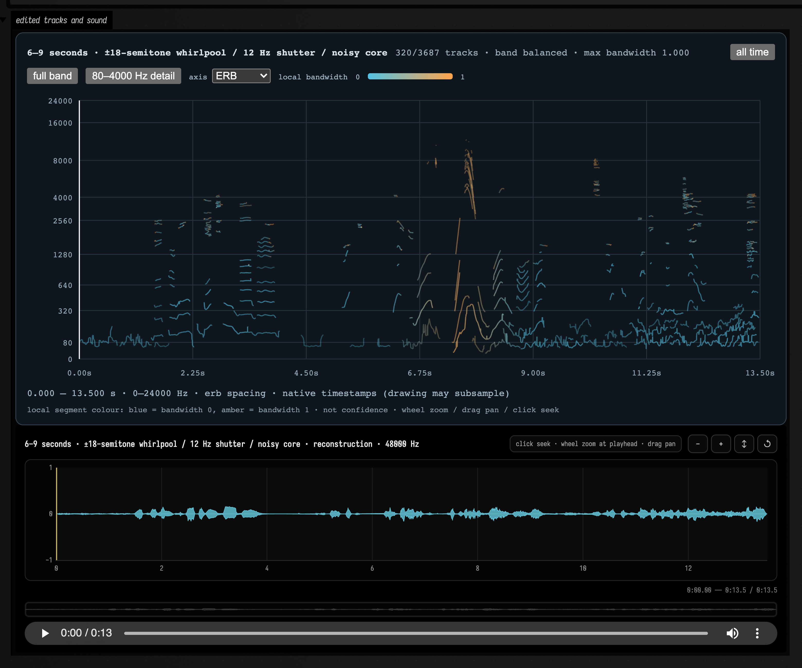

[Open →](offline.html?file=assets/agent_transcripts/loris_partial_explorer/metadata.edn)

### audio_ai_underfit_mancini

Import a held-out excerpt, hash the completed Experiment in Terror
Underfit checkpoint, and submit a 30-second Stable Audio 3 candidate with modest guidance. The guide
explains the 165-chunk album training set and the source-conditioned controls; box 2 owns the live
worker request and presents the durable candidate board with source, seed, model revisions, and
checkpoint provenance. The optional authenticated GPU worker is compiled here and remains an explicit
interactive action.
Walkthrough: [Generating with a LoRA](audio_ai_underfit_mancini.md),
with the actual MJQ source excerpt, matched no-LoRA baseline and archived LoRA take.

[Open →](offline.html?file=assets/agent_transcripts/audio_ai_underfit_mancini/metadata.edn)

### onnx_webcam_live

One webcam frame through two ONNX models in one box: Depth Anything V2 Small at
266x266 (~120ms on a CPU execution provider) and CLIP ViT-B/32's vision tower (~45ms), displayed as the
frame beside its colour-mapped depth map with a zero-shot ranking over four text prompts. The prompts are
encoded once into a `val`, because a fixed prompt does not change between frames; the depth map is
normalised against an exponential moving average of its own range, since Depth Anything emits *inverse
relative* depth in arbitrary units whose range moves with the content. Running it downloads ~600MB of
encoders on first use. Needs a camera, which the build does not have, so it is compiled and never
evaluated here.

[Open →](offline.html?file=assets/agent_transcripts/onnx_webcam_live/metadata.edn)

### python_cells

**Python cells, with a Kotlin box as their language root.** Five boxes: a root that stays Kotlin and
four children that run as Python because the root says so — print appearing inline beside the line that
made it, a namespace shared across the cells because they are one interpreter rather than four, the JVM
importable from Python, and `fig.show()` landing in the box. The root stays Kotlin because the toggle
swaps the execution of a root's **children**, never of the root; its `mainLanguage` property is what
makes the four boxes below Python. This one has a prerequisite the
other scenes do not — Field must have found an interpreter with JEP's native library in it *before it
started*; without one each cell reports "Python unavailable" and how to fix it. [Python in Field](python.md) has the recipe.

`DemoTranscriptExecSmokeTest` compiles the Kotlin root and **skips the four Python cells**, because
they are not Kotlin, so CI checks one box of five. Run against a real interpreter, the cells print
the numpy array inline, keep the namespace into the next cell (`a is still here: (3, 4) 66`), and
reach `java.lang.System` from Python. The last cell's `fig.show()` needs a browser attached to be worth watching: with
`--with-playwright` it opens this box's `browser` channel, and headless it emits no output at all.

[Open →](offline.html?file=assets/agent_transcripts/python_cells/metadata.edn)

### python_box_parity

**Python boxes doing what Kotlin boxes do: errors on the right line, and live controls.** Three boxes:
a Kotlin language root and two Python cells under it. Run the first cell and the red error marker sits
on line 6, inside `mean`, where the division by zero happened. The second draws a slider and a checkbox
whose callbacks are Python functions; moving either runs the function, and its `display(...)` updates
the box. Same prerequisite as `python_cells`: Field must have found a Python with JEP before it started.

`DemoTranscriptExecSmokeTest` compiles the Kotlin root and skips the two Python cells, so CI checks one
box of three. [Python in Field](python.md) shows both cells' output.

[Open →](offline.html?file=assets/agent_transcripts/python_box_parity/metadata.edn)

### clojure_box_parity

**Clojure boxes doing what Kotlin and Python boxes do: errors on the right line, live controls, and
values from the parent.** Four boxes: a Kotlin language root and three Clojure boxes under it. Run
the first and the red error marker sits on line 6, inside `mean`, where the division by zero
happened, not on the call on line 8. The second draws a slider and a checkbox whose handlers are a
Clojure fn and an atom; ticking the box redraws its `main` panel, and running it again keeps the
tick. The third prints the root's `speed` property and its Kotlin `palette` variable, both read with
`(context ...)`. Run the root first. Nothing to install: Clojure ships inside Field.

`DemoTranscriptExecSmokeTest` compiles the Kotlin root and skips the three Clojure boxes, so CI checks
one box of four; `ClojureFieldCoreTest` and `ClojureHostTest` run what the Clojure boxes use.
[Clojure in a box](clojure.md) teaches the same calls.

[Open →](offline.html?file=assets/agent_transcripts/clojure_box_parity/metadata.edn)

### remotejs_box_parity

**RemoteJS boxes doing what Kotlin, Python and Clojure boxes do.** Six boxes: a Kotlin root that opens
the browser head on the canvas, and five Javascript boxes that run in it. `print` and `console.log`
appear beside their lines and the last value beside the last line; an error is marked on line 4,
inside `mean`, not on the call on line 7; `display`, a slider and a checkbox redraw a `main` panel
from callbacks in the head; a `setTimeout` prints after the run has finished; and Stop freezes a
`launch(...)` loop. Run the root first.

`DemoTranscriptExecSmokeTest` compiles the Kotlin root and skips the Javascript boxes, which need a
browser head; `RemoteJsBoxSurfaceTest` runs the JVM half. [Javascript in a browser tab](remotejs.md)
teaches the same calls.

[Open →](offline.html?file=assets/agent_transcripts/remotejs_box_parity/metadata.edn)

### fieldcv_webcam

**Your webcam through fieldcv, drawn by the GPU from shared memory.** Eight boxes: a render window; a
Python root with three cells under it, one that opens the camera mirrored and starts a pipeline of
tracks, pose, hands and a face mesh (with flow and background subtraction ready to switch in), one of
single lines to run one at a time — `use("hands")`, `inset_view = motion`, a lambda of your own — and
one that reports frames per second and what was found; and three Kotlin boxes under the window that
read the cells' results by name through `NumpyShared`: the frame as a texture, an inset of any image
the cells choose, and six channels of polylines, including strokes drawn by pinching thumb and index
finger. Without a camera, or before macOS has granted it, the webcam cell runs on a sample clip
instead. `public/docs/python_cv.md` is the page; the Python cells need the optional `cv` dependency
group, which CI does not install, so `DemoTranscriptExecSmokeTest` compiles the three Kotlin boxes
and skips the Python.

[Open →](offline.html?file=assets/agent_transcripts/fieldcv_webcam/metadata.edn)

### pure_data_demo

**Pure Data inside Field.** Eight boxes: a Kotlin root whose `mainLanguage` makes three Pd boxes
under it, and four Kotlin boxes that drive a patch from Kotlin. **drone**'s text is its patch: launch
it, then run the line `freq 330` on its own and the filtered sawtooth moves. **round trip** is
`[r in] → [+ 1] → [s out]`; running `in 41` prints `out: 42`, and the line note on `[s out]` then
reads `'out' = 42.0`, live from the playing patch. **typo** has `[osc 440]` on line 3, and launching it marks that line
"Pd couldn't create [osc 440] — did you mean [osc~ 440]?". The Kotlin boxes write a wavetable into
`[table wave]` (2051 points), send a `SawOsc` through a Pd `[lop~]` and read its level back from
`[s level]`, send numbers to the drone with `pdBox("drone").pdSend(...)`, and render a patch offline:
**offline** prints 440 upward zero crossings in one second at a peak of 0.2500. Needs libpd, built
once with `./gradlew buildLibpdNative`. The build does not own that, so CI compiles the four Kotlin
boxes and skips the three Pd ones, as it skips Python cells. [Pure Data](pure_data.md) has the walkthrough and captures.

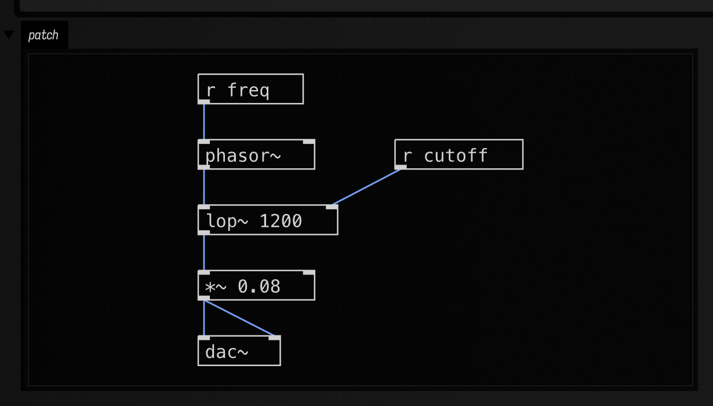

[Open →](offline.html?file=assets/agent_transcripts/pure_data_demo/metadata.edn)

### csound_demo

**Csound inside Field.** A Kotlin root whose `mainLanguage` makes three Csound boxes under it, and
five Kotlin boxes that talk to Csound. **pluck** is a `.csd` with a plucked string, a MIDI-played
`Key` instrument and a global reverb on a `chnmix` bus. Launched, alt/option-Enter on its score line
`i "Pluck" 0 1 69 -9` answers `sent …`, and alt/option-Enter inside `instr Pluck` answers `recompiled instr
Pluck`. **typo** has `oscilx` on line 4, which launching marks there. **talk to pluck** writes a k-
and an S-channel and sends score events built from Kotlin values; the orchestra's `outvalue`s come
back as `Csound said: from Kotlin` and the reverb's level. **keys** sends MIDI notes, which `Key`
prints as `Key 62`, `Key 65`, … **Field into fx** feeds a Field sawtooth into an a-rate channel and
plays the reverb tail back as a Field signal. **through Csound, measured** prints a gain of 0.2420
for a 1 kHz Field sine through `butterlp 500` (a Butterworth gives 0.2425), and **a table from
Kotlin** writes a 4096-point ftable and reads it back equal. Needs libcsound, built once with
`./gradlew buildCsoundNative`. The build does not own that, so CI compiles the Kotlin boxes and
skips the Csound ones. [Csound](csound.md) has the walkthrough.

[Open →](offline.html?file=assets/agent_transcripts/csound_demo/metadata.edn)

### orca_hello

[ORCA](orca.md) in a box output, playing a melody and a bass line through a `PatSynthBank`. Run the
box, click the grid and type; every note ORCA plays is shown under it. The box also gives its AI
Chat tools that read and write the grid, so you can ask AI4 to change the tune.

[Open →](offline.html?file=assets/agent_transcripts/orca_hello/metadata.edn)

### orca_jam

An ORCA with four voiced channels (a soft lead, a bass, a noise hi-hat, a bright square) and AI4 on
the board. Run the box, open its AI Chat and ask it to play: it writes into the grid while the music
runs, and rewinding the chat puts the board and the tempo back. [ORCA](orca.md#gpt-jams-orca) has a
recording of a jam.

[Open →](offline.html?file=assets/agent_transcripts/orca_jam/metadata.edn)

### orca_duet

Two ORCAs in one box and a Kotlin `frames { }` loop between them. `lead` plays a tune; the loop
copies the last eight notes it played into `echo`, which plays them back three frames to a note
against `lead`'s two, and every eighth echo moves one note of `lead`'s tune up the scale. A line
under the grids shows what Kotlin heard and changed. Launch the box, then type into either grid.
[ORCA](orca.md#two-orcas-and-kotlin-between-them) has the video and a recording.

[Open →](offline.html?file=assets/agent_transcripts/orca_duet/metadata.edn)

### madp_chargrid

**A picture as a grid of glyph indices.** A box's program writes numbers into a 40 × 25 grid with
`SET(x, y, g, color, style)`, a charset string turns each number into a character, and each cell can
carry a CSS colour and a rotation. `charGrid { }` runs the program once a tick and lets it read the
last tick with `PREV`, which is all Conway's Life needs; `charStream { }` runs one long program in
which every `SET` waits a tick, so 10 PRINT's maze types itself out. Every glyph can be a dough sound:
the Glass box's charset is eight bars, A minor from E2 to E4, and its arpeggios draw and play at
once. The lead box is the demo's plasma; the others are 10 PRINT, Life, matrix rain, Glass, spinners
(one `CSSVAR` spins the whole field) and a C64 typewriter. A port of the madp charGrid demo; the
design notes are in `dev_docs/madp/chargrid.md`.

```diffstatic_runner {data-lang=kotlin screenshot="assets/agent_transcripts_gallery/madp_chargrid_plasma.png" capture="box" open-outputs="true" wait="4.0" embed=true hidden=true timeout="180" padding="12" name="gallery-madp-chargrid-plasma" alt="A 40 by 25 grid of block and box-drawing glyphs in rotating rainbow hues, a plasma of two sine waves, on a near-black panel" macro-file="../../dev_docs/agents/transcripts/madp_chargrid.yaml" capture-box="madp_chargrid_plasma"}
// The transcript builds and runs every box; this is the lead, the plasma.
```

[Open →](offline.html?file=assets/agent_transcripts/madp_chargrid/metadata.edn)

### madp_score

**The canvas as a score.** Run the first box and an orange playhead sweeps the canvas from left to
right every eleven seconds. Every box it crosses runs its `score { }` block each frame while the
playhead is over it, drawing into the dark panel under the first box and playing dough sounds:
McLaren's twitching scratches, a Fischinger orbit, two Glass phase boxes that run the same code at
different widths and drift apart, a box that jump-cuts itself to somewhere else in the score, and a
duck. `thisRMS` is how loud a box's own sounds are right now, measured from its voices, so the
shapes swell with the notes. Drag a box to move it in time, stretch it to make it last longer, and
run it again after an edit. A port of the madp score demo; the design notes are in
`dev_docs/madp/score.md`.

```diffstatic_runner {data-lang=kotlin capture="ui" region="window" hide-toasts=true viewport="1900x660" clip="20,20,1400,600" screenshot="assets/agent_transcripts_gallery/madp_score.png" macro-file="../../dev_docs/agents/transcripts/madp_score.yaml" padding="0" wait="0" timeout="300" embed=true hidden=true name="gallery-madp-score" alt="Field's canvas as a score: dark boxes spread left to right and an orange playhead line crossing the two Glass phase boxes, which are lit red and olive; under the first box, a dark panel shows what they draw, a row of thin orange bars above a row of blue ones"}
// The transcript builds the score and runs its first box. Wait until the playhead is about seven
// seconds in, where the two Glass phase boxes overlap, then take the picture.
var at = ""
for (i in 0 until 240) {
    ui.pause(250)
    at =
        ui.eval(
                """
                const f = document.querySelector("iframe[src*='score_view']")
                const s = f && f.contentDocument && f.contentDocument.getElementById("status")
                return s ? s.textContent : "no score view yet"
                """
                    .trimIndent(),
            )
            .toString()
    val t = Regex("score · ([0-9.]+)s").find(at)?.groupValues?.get(1)?.toDouble()
    if (t != null && t in 6.9..7.5) break
}
check(Regex("score · ([0-9.]+)s").containsMatchIn(at)) { "the score never started: " + at }
```

[Open →](offline.html?file=assets/agent_transcripts/madp_score/metadata.edn)

### madp_line

**Strokes that come alive.** Run the first box, press Alt+D, choose the pencil and draw on the
empty canvas beside the boxes. Each stroke turns into a moving, sounding object: its shape sets up a
small synth choir, and the louder the choir plays, the wider the stroke's ribbon swings. Every
stroke keeps the code it was drawn with, so edit the box and run it again, and only the strokes you
draw next change. Run another box to give it the pen: a filled ribbon, comet dust with long trails,
curve maths that splits a stroke into four related curves, strokes that pull each other into a web,
and a stroke snapped onto a twelve-step sequencer whose cursor marks the note you hear. The block
in `eachStroke { }` runs once per stroke and its `draw { t -> }` sixty times a second. No pen to
hand? **draw for me** sends three strokes the way the drawing layer does. The lead box's notes walk
through the demo and how this version maps onto it. A port of the madp line demo; the design notes
are in `dev_docs/madp/line.md`.

```diffstatic_runner {data-lang=kotlin screenshot="assets/agent_transcripts_gallery/madp_line.png" capture="window" open-outputs="false" clip="20,20,1260,840" wait="5.0" embed=true hidden=true timeout="180" name="gallery-madp-line" alt="The madp line boxes in a column on the left of the dark canvas, with draw for me beside the first; to their right three drawn strokes have come alive as softly waving cyan ribbons, a long arc, a loop and a low wave, strung with small green, yellow and orange beads" macro-file="../../dev_docs/agents/transcripts/madp_line.yaml"}
// The transcript builds every box, runs the prism choir to take the pen, then runs draw for me,
// whose three strokes arrive over the drawing layer's own message and come alive.
```

[Open →](offline.html?file=assets/agent_transcripts/madp_line/metadata.edn)

### madp_tetra

**Four pictures as a tetrahedron.** Run the first box and CLIP turns each of four photographs (a
cat, a dog, a tiger, a car) into a point in its 512-dimensional space. The six distances between
them become the six edges of a tetrahedron that turns slowly in the view below the pictures, with
each edge's length written on it and listed in the corner. Any four points of such a space sit
exactly in three dimensions, so the picture loses nothing: here the car's three edges are the three
longest. Drop your own pictures on the slots, or drag one up from the tray. The second box puts a
sentence in the fourth slot. Its point sits far from all three pictures, even the one it describes,
and the coloured diamonds rank each point's three edges, so you can still see which picture the
sentence is nearest. The third box swaps the car for a wolf. The fourth adds a fifth picture, and
the note under its picture gives the stress, how far the best 3D fit is from the real distances.
A port of the madp tetra demo; the design notes are in `dev_docs/madp/tetra.md`.

??? aside "Not the madp page's model"
    The madp page embeds with jina-clip-v2 on a Python server. Field runs OpenAI's CLIP ViT-B/32
    through ONNX in the JVM, so the distances differ from the page's. The geometry does not depend
    on the model: four unit vectors in any dimension embed exactly in 3D. The page's `tetra2` server
    also squared its distances twice before MDS, which this port does not repeat.

```diffstatic_runner {data-lang=kotlin screenshot="assets/agent_transcripts_gallery/madp_tetra.png" capture="box" open-outputs="true" wait="10.0" embed=true hidden=true timeout="240" padding="12" name="gallery-madp-tetra" alt="Four photographs (a cat, a dog, a tiger and a red car) in coloured slots above a dark view of a tetrahedron with coloured spheres at its corners, each edge labelled with its CLIP distance, and a table of the six distances in the corner" macro-file="../../dev_docs/agents/transcripts/madp_tetra.yaml" capture-box="tetra"}
// The transcript builds and runs every box; this is the starter, tetra.
```

[Open →](offline.html?file=assets/agent_transcripts/madp_tetra/metadata.edn)

### mqtt_demo

The demo for [MQTT](mqtt.md), on Field's own broker: one box plays three pretend sensors, one
listens to every temperature, one plots them, and one shows a retained message. Launch the sensors
first.

[Open →](offline.html?file=assets/agent_transcripts/mqtt_demo/metadata.edn)

### dmx_lighting_demo

The demo for [Driving Lights](dmx_lighting.md), with no lighting hardware: an Art-Net receiver that
draws the universes it gets, a 200-pixel strip on a curve sent to it, an ArtPoll, and an image on an
RGBW matrix sent as sACN and received back in the same box. Launch the receiver first.

[Open →](offline.html?file=assets/agent_transcripts/dmx_lighting_demo/metadata.edn)

### oscquery_demo

The demo for [OSCQuery](oscquery.md): one box publishes parameters, others show them as controls,
connect back to them as a remote, mirror them, animate one, and discover services on the network.
Nothing else needs to be running.

[Open →](offline.html?file=assets/agent_transcripts/oscquery_demo/metadata.edn)

### sonicpi_pattern_demo

The three boxes from [Sonic Pi](sonic_pi.md#a-document-to-open). The first turns a pattern into a
Sonic Pi program and prints it, and needs nothing installed; the second plays it; the third drives
Sonic Pi from Field's clock.

[Open →](offline.html?file=assets/agent_transcripts/sonicpi_pattern_demo/metadata.edn)

### marf_demo

**One bank of stages, read four different ways — three drawn, one heard.** A MARF *bank* is a list
of stages (a ramp, a step, a hold, an oscillation, a curve) and it has no position of its own; a
*reader* supplies the position, as a pattern of slot addresses read on a clock. The first box draws
three readers of one bank as three lanes on one shared time scale, so reading down a column compares
the same instant. The second uses two readers as the `x` and `y` of a single FLine — the path stays
coherent without the coordinates being synchronised, because both read the same material on their
own clocks. The third shows that a stage's value need not be a number: one `Vector3f` reader drawn
as its three components, the stage boundaries falling in the same places in all three lanes because
there is one stage structure carrying three values.

The fourth box is why this scene is compiled rather than replayed. It sends three readers of the
same bank into `patSpatial` as azimuth, filter cutoff and distance — pat → Dough → Steam Audio HRTF,
in realtime — so running it opens an audio device, and a `patSynth` launch outlives the box that
started it. The other three boxes would run in CI, but they stay in one document with the fourth,
because the document shows that the bank does not know whether it is being drawn or heard.

```diffstatic_runner {data-lang=kotlin screenshot="assets/agent_transcripts_gallery/marf_demo_readers.png" capture="box" open-outputs="true" embed=true hidden=true timeout="300" padding="12" name="gallery-marf-demo-readers" alt="Three lanes on one time scale, read from one bank of five stages: blue reads one address per stage, a ramp then oscillations; orange holds each address three stages, so its ramp and hold stretch out; green reads a fractional address and blends between slots. A legend underneath names the three readers" macro-file="../../dev_docs/agents/transcripts/marf_demo.yaml" capture-box="marf_readers"}
// The transcript builds and runs all four boxes; this is the first box's three readers.
```

[Open →](offline.html?file=assets/agent_transcripts/marf_demo/metadata.edn)

### syphon_bridge

Three boxes that move frames over [Syphon](syphon.md), the way video applications on a Mac share
pictures. *Servers on this machine* lists every Syphon server announced. *Publish an animated
picture* draws twelve circles into a `BufferedImage` every frame and publishes it as "Field pattern",
which Resolume, TouchDesigner, MadMapper or OBS can pick up. *Receive a server's frames* connects to
"Field pattern" as a client and shows its latest frame, so the round trip is visible with nothing
else installed; change the name to receive another application. macOS only, and all three need the
optional library (`./gradlew buildSyphonNative`, which needs Xcode); without it they say how to build
it and stop.

[Open →](offline.html?file=assets/agent_transcripts/syphon_bridge/metadata.edn)

### particle_video

Follow a movie as recorded moving points. The [Video particles](particle_video.md) walkthrough
shows a hand-colored serpentine dance at native resolution with 24,000 target particles, with
source and Kotlin-rendered output side by side. The reader box scrubs a portable subset of complete
trajectories and exposes identity colors and trails without a Python process. The tracking box
runs an optional cached RAFT job; prepare its environment and select the device first.
CI compiles the boxes; new inference requires that separate environment.

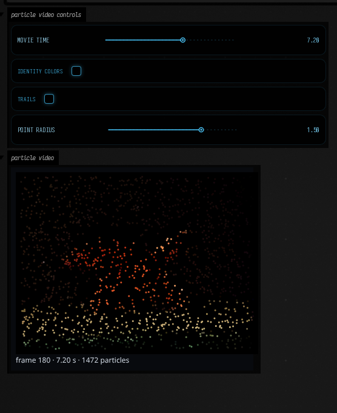

[Open →](offline.html?file=assets/agent_transcripts/particle_video/metadata.edn)

### morse_smale_explorer

[Morse–Smale complexes](morse_smale.md), three ways. The first box draws the ridges of a
photograph under a persistence slider. The complex is built once and the slider only re-reads it,
so dragging is instant. The second, launched, moves six hills around a 200 × 150 grid and
recomputes the field and its complex on every frame, colouring each critical point by its id; a peak
keeps its colour while it stays on the same grid cell. The third prints one saddle's four
separatrices as a table. Needs the optional native library: `./gradlew buildMorseSmaleNative`.

[Open →](offline.html?file=assets/agent_transcripts/morse_smale_explorer/metadata.edn)

### principal_curves_explorer

[Principal curves](principal_curves.md), three ways. The first box fits three noisy strands as
curves under a bending slider and draws a band around each showing how widely its points are
scattered. The second fits the green pixels of the leaf print as a branching tree. The third,
launched, moves 2000 points along a travelling wave and refines one forest five iterations a frame
to follow them, never regrowing it. Needs the optional native library:
`./gradlew buildPrincipalCurvesNative`.

[Open →](offline.html?file=assets/agent_transcripts/principal_curves_explorer/metadata.edn)

### polyvector_explorer

[Line-drawing vectorization](polyvector.md) by polyvector fields. The first box draws a pencil
sketch with a T-junction, a crossing and a wave, builds its field once, and re-traces it whenever
the pruning slider moves, drawing the field's streamlines under the curves. The second vectorizes
the edges of a photograph on a worker thread, which takes about a minute. The third turns the
vectorized sketch into geometry and treats it as such: parallel outlines, normals and a wave. Needs the optional native
library and its OpenCV, Boost and Eigen packages: the welcome page's **Geometry extensions** panel
says how, or run `./gradlew buildPolyvectorNative`.

[Open →](offline.html?file=assets/agent_transcripts/polyvector_explorer/metadata.edn)

### tracking_explorer

[Tracking features through time and scale](topology_tracking.md). The first box, launched, moves six
hills in a computed field and follows their peaks frame by frame, each with its own colour and
trail, reporting how many peaks there are and how many tracks have existed. The second follows the
dark places in a photograph across increasing blur and draws each as a circle the size of the
largest blur it survives. Needs the optional Morse–Smale library: `./gradlew buildMorseSmaleNative`.

[Open →](offline.html?file=assets/agent_transcripts/tracking_explorer/metadata.edn)

### eagle_flow_explorer

**An eagle's flight, read in two frames of reference.** A 1930s film of a golden eagle landing on a
falconer's fist, turned into a flow by tracked particles. Taken as it is, the flow's streamlines,
separatrices and critical points describe the film weaving in the gate, and sweep across the sky
around the bird. A slider removes the camera's motion, leaving only the eagle, and another scrubs
the 306 frames; the second box renders the whole clip as a movie. From
[Vector field topology](vector_field_topology.md#flow-from-old-film). Needs FFmpeg.

```diffstatic_runner {data-lang=kotlin screenshot="assets/agent_transcripts_gallery/eagle_flow_raw.png" capture="box" open-outputs="true" wait="8.0" embed=true hidden=true timeout="240" padding="12" name="gallery-eagle-flow" alt="A darkened frame of old film in which an eagle, wings spread, lands on a falconer's fist, covered edge to edge in pale streamlines that sweep across the sky in long curves, wrap around the bird in a tight spiral and fan out over the field below, with orange and blue separatrices running from two white saddles" macro-file="../../dev_docs/agents/transcripts/eagle_flow_explorer.yaml" capture-box="eagle_flow_live"}
// The transcript builds and runs the first box; this is frame 270 with the camera's motion kept.
```

[Open →](offline.html?file=assets/agent_transcripts/eagle_flow_explorer/metadata.edn)

### runaway_box_interrupt

**Stopping a runaway box**, in two boxes: the first spins in a loop that never ends, and Field
throws out of it after about thirty seconds (or sooner, with Interrupt Running Box); the second then
runs normally to show Field is responsive again. CI compiles it but cannot evaluate a box whose
point is that it never finishes. See [Running code](running_code.md).

[Open →](offline.html?file=assets/agent_transcripts/runaway_box_interrupt/metadata.edn)

## FieldML scenes

<!-- transcript-index: verified-by = compile -->

The demos for [FieldML and the JVM](fieldml_host_bridge.md). Each is a FieldML root with FieldML
boxes under it; the four that draw also have a Kotlin box that opens the window and renderer.

### fieldml_macro_demo

The first demo for [FieldML and the JVM](fieldml_host_bridge.md): a `prop` set in one FieldML box
and inherited by another that draws a spiral from it, Field's `println` macro expanded and called,
and the Kotlin that `prop` generates, shown as text. Run the parameter box, then the drawing box.

[Open →](offline.html?file=assets/agent_transcripts/fieldml_macro_demo/metadata.edn)

### fieldml_host_bridge_demo

[FieldML and the JVM](fieldml_host_bridge.md) in five boxes: a FieldML function rasterised by
Kotlin, a FieldML lambda passed to `FLine.transform`, host members with real types, overloads and
varargs, and named arguments with Kotlin defaults.

[Open →](offline.html?file=assets/agent_transcripts/fieldml_host_bridge_demo/metadata.edn)

### fieldml_lambda_demo

FieldML lambdas the JVM calls with no cast, from [FieldML and the JVM](fieldml_host_bridge.md):
six typed callback parameters, what the type checker knows inside a lambda, and where it still
knows nothing.

[Open →](offline.html?file=assets/agent_transcripts/fieldml_lambda_demo/metadata.edn)

### fieldml_afield_four_demo

A whole Field 4 scene described from FieldML, from [FieldML and the JVM](fieldml_host_bridge.md):
a triangle on a real Vulkan device. Run the `window and renderer` box first, then the FieldML box.

[Open →](offline.html?file=assets/agent_transcripts/fieldml_afield_four_demo/metadata.edn)

### fieldml_frames_demo

A FieldML triangle that spins, driven by `eachFrame`, from
[FieldML and the JVM](fieldml_host_bridge.md). Run the `window and renderer` box first.

[Open →](offline.html?file=assets/agent_transcripts/fieldml_frames_demo/metadata.edn)

### fieldml_frames_sequence_demo

A band raised one column at a time, held, and started again in the other colour, all from one
FieldML `frames` body that waits between steps, from
[FieldML and the JVM](fieldml_host_bridge.md#waiting-inside-a-frames-body). Run
`window and renderer (FieldML)`, then `a script across frames`.

[Open →](offline.html?file=assets/agent_transcripts/fieldml_frames_sequence_demo/metadata.edn)

### fieldml_macro_module_demo

A scene built by calling the `moduleHere` source macro from FieldML, with a live parameter beside
it, from [FieldML and the JVM](fieldml_host_bridge.md). Run the renderer box first.

[Open →](offline.html?file=assets/agent_transcripts/fieldml_macro_module_demo/metadata.edn)

### fieldml_mesh_demo

Sixteen triangles whose vertex data a FieldML box writes every frame, from
[FieldML and the JVM](fieldml_host_bridge.md). Run the `window and renderer` box first.

[Open →](offline.html?file=assets/agent_transcripts/fieldml_mesh_demo/metadata.edn)

### fieldml_suspend_demo

A ribbon rewritten every frame by a scene with no Kotlin box: a FieldML box opens the window and
starts `Renderer.run` with `hostLaunch`, from [FieldML and the JVM](fieldml_host_bridge.md). Run
`window and renderer (FieldML)` first.

[Open →](offline.html?file=assets/agent_transcripts/fieldml_suspend_demo/metadata.edn)

## visionOS device scenes

<!-- transcript-index: verified-by = kotlinjs, execute -->

These publish to Field4Vision's autonomous Live Metal renderer. Open **Live Metal** in the visionOS
app, then run the box; the program is retained and replayed if the native client connects later. A
visionOS device or simulator is required for the image. Four of the six are Kotlin compiled to
JavaScript for the head, and CI compiles them through the real head profile; `vision_metal_cube` and
`vision_geometry_desk_preview` are JVM Kotlin and CI runs them to completion. See
[Building geometry in the headset](vision_geometry.md) for the walkthrough these are drawn from.

Read the figures here for what they are: **Preview Vision Geometry** rendering the same builder on
the Mac, so the mesh is the real packed vertex array the headset would have received, and the shading
is a stand-in two-light lambert over your vertex colours. None of them is a photograph of the device,
and none of them says anything about your MSL.

### visionos_start

The smallest complete Live Metal program, and the place to start: a cube built in
the headset by `geometry { }`, a Metal shader in the box's `msl` property, and one uniform animated on
the compositor clock.

[Open →](offline.html?file=assets/agent_transcripts/visionos_start/metadata.edn)

### vision_geometry_shapes

A tour of the geometry builder's shape primitives: cube, sphere, plane
and tube side by side in one mesh, with a shader that reads the uv the shapes write as a checker.


[Open →](offline.html?file=assets/agent_transcripts/vision_geometry_shapes/metadata.edn)

### vision_geometry_heightfield

The builder at its raw level: a ripple height field assembled vertex
by vertex, with normals from finite differences of the same height function and per-vertex colour
carrying relief into the shader. The shape most procedural meshes take.


[Open →](offline.html?file=assets/agent_transcripts/vision_geometry_heightfield/metadata.edn)

### vision_geometry_animated

Rebuilding the mesh every frame, which is what separates building
geometry in the headset from shipping it over the wire: a swept tube whose spine and radius both move.


[Open →](offline.html?file=assets/agent_transcripts/vision_geometry_animated/metadata.edn)

### vision_metal_cube

The non-Kotlin/JS route, for comparison: JVM Kotlin publishes the shader, the
script and an explicit request for the head's built-in cube in one `visionMetal(...)` call.

[Open →](offline.html?file=assets/agent_transcripts/vision_metal_cube/metadata.edn)

### vision_geometry_desk_preview

The one on this list that needs **no headset at all**: both boxes
build a Live Metal `geometry { … }` for real (compiled to JavaScript and executed) and draw the
resulting mesh into their own output. The second is the same mesh wound backwards, so you can see what
an inside-out mesh looks like and how the preview tells you.


[Open →](offline.html?file=assets/agent_transcripts/vision_geometry_desk_preview/metadata.edn)

## Browser-head scenes

<!-- transcript-index: verified-by = kotlinjs -->

These are Kotlin compiled to JavaScript and shipped to a **browser head**: the WebXR/Three.js page
at `/extensions/remote_ar/index.html`, which supplies THREE, Tone.js and the Field globals. The
result appears in the head, not in Field, so nothing on this page can show it. CI compiles each box
body through the real head profile its `// {{ marker }}` names; an unknown marker is a hard error
rather than a silent fallback to the wrong head. See [Kotlin in the head](kotlin_in_the_head.md) for
the profiles and [RemoteJS and WebXR](ar_reference.md) for the bound names.

### remotear_start

The starter: a `// {{ remoteAR }}` box beneath a KotlinJS language root that
adds one cube 1.2 m up and 1.5 m out and spins it on the frame clock. Open the head page yourself
first; this transcript does not open one. `onStop` runs exactly once when you relaunch, which is
what makes editing the box and launching it again a clean hot-replace rather than two cubes.

[Open →](offline.html?file=assets/agent_transcripts/remotear_start/metadata.edn)

### remotear_scene_motion

The larger of the two RemoteAR scenes: a metallic torus knot under a
directional and an ambient light, an `FLine` ring built with the transform operators
(`+ Matrix4`, `+ Vector3`, `* scalar`) and published to `stage.orbit`, and a glTF loaded and handed
to the XR animation mixer. The asset is the one thing worth reading twice. A head is a browser, so
it can only fetch over http — a path on your disk is not a URL it can reach, and `mapDirectory`,
which reads as the fix, sends a message no route in the server consumes. So the model here is the
committed CC0 Khronos ToyCar, mounted at `/sample-assets`, and this scene needs nothing you do not
already have. It carries no animation clips, so `play()` is a no-op that says so in the log; point
it at a model with clips and the mixer moves.

[Open →](offline.html?file=assets/agent_transcripts/remotear_scene_motion/metadata.edn)

### tone_synth_sequence

Computer music in the head, and self-contained in a way the other two are
not: box 1 embeds the head page in the Field document itself as an iframe, so there is no separate
browser window to arrange, and the Tone.js it plays through is vendored rather than fetched. Box 3
is `// {{ tone }}` Kotlin — a `PolySynth` into a reverb, an arpeggio scheduled on the transport at
96 bpm. One thing to know before you open it: a browser starts its `AudioContext` suspended and
resumes it only after a real user gesture, so `Tone.start()` has to follow a click *inside* the
head, and the box is named to say so. There is nothing to hear in a headless build, so CI compiles
this one and stops there.

[Open →](offline.html?file=assets/agent_transcripts/tone_synth_sequence/metadata.edn)

## Graphics scenes

<!-- transcript-index: verified-by = compile -->

These are scenes that, when run, open a **native Vulkan window**, so the live image is a desktop
window, not an embedded frame. All but one build their own `Window` + `Renderer`; `mega_texture_wall`
takes its renderer from an `agent_graphics_context` parent, for the reason its own entry gives, and
so is the one here that is not offered as a starting point. The figures
here are captures of that window, taken by the docs capture pipeline from these transcript files
(`capture="native-window"`). Where an entry
carries none, there is no such capture: run the scene yourself and grab its window with a follow-on
`native-screenshot` backdoor command (with `--with-playwright`).

### renderer_browsing

**The Vulkan renderer opened in `column(...)` and `tree(...)`**, in three boxes: a renderer and its
window, a triangle beneath it, and a box that browses the renderer. Open render → modules → the
triangle's module to see its pass, shaders, meshes and bindings, and cpu for span timings; the cards
refresh about once a second while the renderer runs. See
[Browsing the renderer](visualizers.md#browsing-the-renderer).

[Open →](offline.html?file=assets/agent_transcripts/renderer_browsing/metadata.edn)

### flow_grain

A bounded pool of scrolling fluid tiles, flow-oriented grain, smoothed-velocity particle
strokes and a color/motion RTT. Each shader is an editable box. Execute **Reset** to restart
contents at a frame boundary without replacing GPU resources; launch **Profile** for a
repeatable camera path in the existing CPU/allocation timeline. See
[Flow grain and motion](flow_grain.md) for the storage contracts and controls.

[Open →](offline.html?file=assets/agent_transcripts/flow_grain/metadata.edn)

### openxr_eye_intersection

A white wire cube at the closest-approach midpoint of the two real
HTC eye rays, with a 3 cm maximum gap and explicit LOCAL-to-world conversion. A translated,
30-degree-yaw world origin and a hold control make coordinate mistakes visible when you move your
head. The EXT combined ray is drawn separately because one ray cannot determine depth. macOS
renders the reference grid and cubes without simulating eye data; hardware validation needs an
HTC-capable OpenXR runtime. See [the coordinate walkthrough](openxr_eye_intersection.md).

[Open →](offline.html?file=assets/agent_transcripts/openxr_eye_intersection/metadata.edn)

### splat_sequence_streaming

4D splat video: a sequence of PlayCanvas `.compressed.ply` files
played as fifteen simultaneous sources arranged in a ring around the viewer, all decoded into **one**
GPU buffer. On a 15-file frame of 309,555 splats, reading each file and re-packing it takes 59 ms
against a 41.7 ms budget at 24 fps, while `readRaw` +
`GaussianSplatRenderer.packInto` (straight from the quantized payload to the 16-float layout, written
absolutely into the mapped buffer) takes 22 ms, and 27 ms including a back-to-front CPU sort of the
whole frame. Three things in it are not the obvious choice. The ring is fifteen *rotations* and no
translation, because each capture is a depth map from a camera at the origin and so already sits
1–1.6 in front of its own origin. Per-source transforms are baked at decode for +8%, because the
per-file linear map folds into a congruence the covariance already computes, which is what rules out
a matrix palette here. And `SplatTransport.advance()` returns false on the six display frames in seven
where the resolved source frame did not move, so scrubbing a shot costs nothing until it crosses a
frame boundary. Needs your own frames: the box prints how to make them and stops if the directory is
absent, rather than shipping somebody's capture as a fixture.

[Open →](offline.html?file=assets/agent_transcripts/splat_sequence_streaming/metadata.edn)

### splat_shader

The madp splat-shader demo: a few lines of GLSL run once per Gaussian splat per frame and may
rewrite its centre, radii, colour and rotation (`pos`, `scales`, `rgba`, `quat`, with `index` and
`t` to read). Each box's compute tab is just those lines between `#include "splat/insert"` and
`#include "splat/end"`, and its code hands the module and a cloud to `SplatShader`. A passthrough on
the icosphere shell leads; six of the demo's inserts follow, one on each of its procedural clouds
(pulse rings, dissolve, gravity well, fern veins, lichen tangle, xray shell), and a last box runs
scanlines over the ToyCar model, read with `SplatSet.fromGltf` as one disc per vertex. Each launches
into the same window with the demo's turn, size and trail controls; the gravity well starts with
its trail on, each frame laid over a fading copy of the last. The insert runs in a compute pass
ahead of the depth sort, so a dissolve that throws splats outward is sorted where they went.
Moving splats in the vertex shader instead would draw many neighbouring pairs in the wrong order.

```diffstatic_runner {data-lang=kotlin screenshot="assets/agent_transcripts_gallery/splat_shader_passthrough.png" capture="native-window" native-wait-frames="90" trim-native=true wait="3.0" embed=true hidden=true timeout="300" name="gallery-splat-shader" alt="The icosphere shell in the native window: a sphere of about a thousand small glowing splats on black, coloured by longitude from cyan on the left through chartreuse at the front to red and orange on the right, with the far side's violet splats showing between the near ones" macro-file="../../dev_docs/agents/transcripts/splat_shader.yaml" capture-box="splat_renderer"}
// The transcript builds every box and launches the renderer and the passthrough.
```

[Open →](offline.html?file=assets/agent_transcripts/splat_shader/metadata.edn)

### mega_texture_wall

A directory of images as one wall, behind a virtual texture the **GPU**
drives: the fragment shader takes `dFdx`/`dFdy` of the image's
own UVs, so it knows how many pixels across it is being drawn at, and `atomicMax`es the level it
wants into a feedback buffer. A frame later the CPU reads that buffer, and that read is the entire
input to its decoding, residency and eviction — it is never told where anything is, how large it
looks, or whether it is on screen at all. On 1640 film frames the ladder runs from 15×7 base pages
to a top page of 1920×798 — a whole source frame — and dollying in walks each image up it and
evicts it again on the way out. The ceiling that stops the last step thrashing is computed from two
measured numbers and nothing else: how many images want a level, and how many pages that level has.

A page arriving does not snap in. It fades over the page it replaces across ten frames, or over the
image's own mean colour when there was no previous page — which is the pop worth removing, since
every image in a cold start makes it. Only upgrades fade: a level lost to eviction has to snap,
because its pixels belong to another image by the time the page table stops naming them.
`config.crossfadeFrames = 0` turns it off.

Worth opening for the shape as much as the subject. The wall's geometry is arithmetic on
`gl_InstanceIndex` — six vertices, one instance per image, no vertex buffer at all — and both
shaders are box properties with `{{ mega.all }}` interpolated into them, so the sampling, the layout
and the LOD policy are all editable with `alt/option-r` rather than buried in Kotlin. Flip
`showResidentLevel` in the fragment shader to watch residency directly: red is the base level, green
is a full source frame, and flying at the wall turns it green ahead of you. The library is
`afield/graphics/texture/mega/`, reached from a box through `megaTextureHere { folder(…) }`.

Needs a graphics parent, so replay `graphics_renderer_launch` first, and point the `folder(…)` line
at images of your own — which together are why this one ships no starting point.

### gpu_probe_bench

A bench for asserting things about compute shaders. Four boxes: a renderer, because
Field 4 has no headless mode and a compute-only dispatch still needs a window for the device
to exist; the whole `GpuProbe` idiom on one screen; the pressure-projection chain a GPU fluid
actually runs — divergence, twelve Jacobi sweeps, project — graded cell by cell against a closed
form written in Kotlin; and a deliberate half-dispatch, so a reader can watch the sentinel fire and
read what it says. Every assertion prints the measured value beside the floor it is compared
against. The library is `afield/graphics/vulkan/util/GpuProbe.kt` and the design notes are in the repository at `dev_docs/GPU_PROBE.md`.

Registered `COMPILE_ONLY` — box 1 opens a window — so what CI holds is that all four box bodies
still compile against Field's real K2 import set. The numbers are asserted separately, by the
`four.gpu-probe.pressure-chain` and `four.gpu-probe.self-check` FIELD_TESTs.

[Open →](offline.html?file=assets/agent_transcripts/gpu_probe_bench/metadata.edn)

### gpu_state

A stateful GPU simulation: 40,000 particles whose positions and velocities live in a
ping-ponged pair of device-local buffers and are never uploaded after frame one. A renderer box, a
compute box whose force law is a live `stack.auto` StackSL slot you can retype while it runs, and a
draw box reading the same allocation. The companion page is [GPU State](gpu_state.md).


[Open →](offline.html?file=assets/agent_transcripts/gpu_state/metadata.edn)

### keyframe_autosweep

An overnight explorer of a keyframe space. A renderer, a rig whose live state is ten keyframe lanes,
the sweep, and a box for the morning after. Each pass draws two or three keys from a directory,
blends them at random weights — sometimes past either end of the hull they span — applies the blend,
and hands a fresh directory to a `suspend` callback that renders a still and a short clip into it,
beside the blended key as ordinary key JSON and a manifest of what went in at what weight. Twelve
renders here, at about 8,300 an hour on an M-series laptop, so the box finishes while you watch; the
sweep it is a scale model of runs until the disk floor, the clock or the morning stops it. Two of its
ten lanes need handling of their own, because they are the two a blend cannot simply average: `palette`
is a name with no midpoint, so it is taken whole from one parent and the manifest records which, and
`grid.visible` is an `Int` driving CPU-authored geometry, which an extrapolated blend can push
outside its own range — where the target clamps it and the key keeps the number, so the archive still
records the point that was visited. The morning box needs no renderer at all: an archive describes
itself. The companion page is [Sweeping saved keyframes overnight](keyframe_autosweep.md).

[Open →](offline.html?file=assets/agent_transcripts/keyframe_autosweep/metadata.edn)

### threebox

A self-contained renderer + compute + draw particle system: a renderer box that owns
the `Window`/`Renderer` and pumps the loop, a compute box that simulates 100k particles into a
`buffer_reference` buffer it publishes as a prop, and a draw box that reads that buffer and renders.
The capture below is this transcript instrumented on [Field probes](field_probes.md).


[Open →](offline.html?file=assets/agent_transcripts/threebox/metadata.edn)

### demo_document

The [demo document](demo_document.md): one canvas showing most of what Field does. A palette pushes
`petals` down to three connected boxes, one holding two nested boxes; a three.js gyroid and an editable
FLine flower sit in output panels; a renderer streams a turning spiral into a box's panel and runs a
compute shader a Field probe plots; a keyframe curve plays with its playhead running; a box draws inline
visualizers when its editor is open; a time slider waits to be scrubbed across four cues; and a notes box
draws on the drawing layer over all of it. Its film plays behind the home page, and the feel benchmark
times the replay.

<video controls muted loop playsinline preload="metadata" src="assets/demo_document/film.mp4" width="1280" height="720" style="max-width:100%;height:auto;aspect-ratio:1280/720" aria-label="The demo document filmed in Field's desktop app. It opens on the whole canvas, then glides to a palette box and drags one of its children, whose connection follows; orbits a white gyroid in a three.js panel; drags two points of a pink editable flower; holds on an orange and blue spiral streamed from Vulkan into a box's panel beside a probe's blue histogram; adds a key to a keyframe curve and drags it while the playhead runs; drags a red time slider across four cue boxes, whose coloured bars appear as it passes; draws a white loop on the drawing layer; and opens a box's editor, where a histogram, a history and a summary draw beside the code. It ends on the whole canvas again"></video>

[Open →](offline.html?file=assets/agent_transcripts/demo_document/metadata.edn)

### four_pass_chain

A **heterogeneous, multi-resolution** post-process chain in three boxes: a
renderer, a grid of lit spheres, and one `addPassChain(...)` call that reduces the scene to a half and
then a quarter, blurs the cheap small image with two aperture discs, and composites back at full
resolution. Six passes, each with *its own* resolution, where `Bundle.addShaderEffect` sizes every
pass target to its source. Run the third
box and it prints the plan first: every pass with its resolved size, which sampler reads which earlier
pass, which passes share a target, and the memory cost against one full-resolution target per pass.
Then edit the three `setPush` numbers under it and run again — the discs widen or narrow and the
composite crossfades with no pipeline rebuild and no target reallocated. Widening `aperture-far`
*lowers* the frame's high-frequency energy rather than raising it, because a wider disc spreads a
fixed amount of light and dims the whole image. `dev_docs/FOUR_PASS_CHAIN.md` is the
write-up, and `tools/run_field_tests.py --id four.pass-chain.smoke` is the same layer driven headlessly
with assertions on the pixels.

[Open →](offline.html?file=assets/agent_transcripts/four_pass_chain/metadata.edn)

### four_simulation_chain

Two GPU **simulations** declared as pass chains: a Stam stable fluid you paint into by dragging in the
window, and a jump flood distance transform of a shape you move around, inset into a corner of the
frame. The companion to `four_pass_chain`, for state that carries between frames: a fluid's velocity
field this frame is a function of the velocity field *last* frame. A pass can declare itself
persistent, which gives it a ping-pong target
whose previous frame any pass can read, including a pass that runs *earlier* in the list: `fluid-advect`
is first and reads `fluid-velocity`, which is second to last. The fluid is twenty-seven passes — advect,
curl, force, divergence, a twenty-pass Jacobi pressure solve, projection, dye advection — and the Jacobi
sweep is a pass chain in the most literal sense, each iterate reading only the one before it and the
fixed divergence. Turn `vorticity` down to `0f` and back to watch the one term that separates a smear
from something that behaves like fluid; drop `iterations` to `4` and the dye starts piling up and
thinning out rather than going unstable, because a velocity field with residual divergence creates and
destroys mass. `dev_docs/FOUR_PASS_CHAIN.md` is the write-up, and
`tools/run_field_tests.py --id four.simulation-chain.smoke` is both chains driven headlessly — the jump
flood against exact ground truth, and the fluid against the one thing no plan can check: with the input
switched off, the picture has to keep changing.

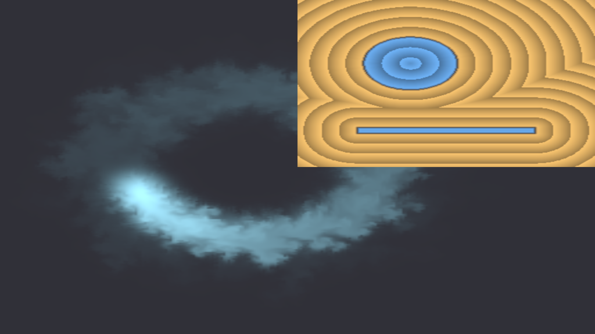

[Open →](offline.html?file=assets/agent_transcripts/four_simulation_chain/metadata.edn)

### four_summary_pyramid

A **summarised quadtree over a raster**, declared as one pass chain: three drifting, rotating blobs, a
2×2 reduction pyramid that carries mergeable statistics instead of colour, and an overlay that draws
what each cell of the tree knows as a centroid and an ellipse. The structure comes free — a 2×2
reduction has a parent for every four cells and one cell at the top, which *is* a complete quadtree,
with no nodes, no pointers and no build step that can disagree with the data. What differs from the
downsample pyramid in `four_pass_chain` is what a cell carries: weight, value mean, value variance and
occupancy on one plane, the spatial moments `Σwx, Σwy, Σwx², Σwy²` on another, and `Σwxy` with the two
extremes on a third. From the last two, `covariance = E[ppᵀ] − E[p]E[p]ᵀ`, so every cell has an
orientation and an anisotropy: an adaptive cell stops saying "occupied" and starts carrying a crude
geometric model of what is inside it. Every channel is a per-cell *mean* rather than a sum, which is
what keeps the whole tree inside the range a readback can show and costs nothing, because centroid,
covariance, mean and variance are all ratios in which the cell's area cancels. What the window shows
is an **adaptive cut**, not a level: the descent starts at depth 1, stops wherever a cell already
describes its contents well enough, and draws the cells it stopped at — so the empty quadrants stay
whole and the blobs' boundaries are resolved six levels down. Without a criterion a consumer reads one
level, and one level of a pyramid is a grid; with one, a descent turns out to be a pass chain in the
same literal sense a Jacobi sweep is, two passes per level at two different resolutions because the
decision lives at the tree's scale and the drawing at the picture's. Turn `threshold` and the whole
cut coarsens or refines on the next frame with nothing rebuilt.
`dev_docs/FOUR_PASS_CHAIN.md` is the write-up, and
`tools/run_field_tests.py --id four.quadtree-chain.smoke` compares it against **closed forms** — a
linear ramp has an exact mean, variance, centroid and spatial variance at every level, so the pyramid
is checked against arithmetic rather than against a previous render.


[Open →](offline.html?file=assets/agent_transcripts/four_summary_pyramid/metadata.edn)

### four_morton_quadtree

The same three planes of statistics, produced from a **moving point set** by a completely different
pipeline: Morton codes, a sort, one level of nodes found by bracketing prefixes in the sorted array,
and then literally the same reduction ladder as `four_summary_pyramid` — one Kotlin function called
twice, so a consumer cannot tell which producer made a summary. Quantise a point into a `2^depth` grid
and interleave the bits of its cell coordinates and its code *is* its path down the tree, two bits per
level; sort the codes and every node's points are a contiguous range, so a node needs no pointers and
no contents, only `(first, count)`. Two things a fragment chain cannot do shape the rest. It cannot
scatter, so the sort is the gather form of the same answer — each element counts how many precede it,
then each slot picks up the element whose rank it holds, two passes and exact, quadratic where a radix
sort is linear. And it cannot scan or compact, so boundary detection is asked *per node* rather than
per element: a node knows its own prefix, because its prefix is the Morton code of its own
coordinates, and finds its range with two binary searches. Nothing here is persistent — the points
move and the codes, the sort, the ranges and every level are rebuilt from nothing each frame. It ends
in the same adaptive cut as its companion, under the one criterion an occupancy quadtree cannot
express: refine where the mass is *narrower than the cell holding it*, which needs the second
moments. The smoke test puts a point at every texel centre of a raster and finds the twelve summary
channels bit-identical between the two producers, and checks that the cells a cut chose tile the
frame exactly.


[Open →](offline.html?file=assets/agent_transcripts/four_morton_quadtree/metadata.edn)

### aperture_playground

The same multi-resolution idea as `four_pass_chain`, taken apart into eight boxes you
can edit one at a time: a renderer, a full-resolution `RGBA16F` source of lines and point sprites, a
½ and a ¼ reduction, two circular-aperture filters (4/10 px, then 24 px), a screen composite, and a
last column of analytic point sprites. One shader pair and at most one resource per box, so editing
a shader and re-executing *that* box is the whole edit loop, and the two reduction helpers are
nested inside the source box with their shaders still visible rather than hidden behind it.

Two things in it are the reason to read the code. The source's four channels are four **light
bands**, at radii 0, 4, 10 and 24 px — which means alpha is carrying light rather than coverage, so
every intermediate filter has to run with `blend = false` or the band is composited away; that is
the mistake this file is shaped to make visible. And the last column computes the disc-and-aperture
overlap *analytically*, with no texture and no blur pass at all, so the filtered columns beside it
have something exact to be wrong against. The composite's `sharp / blur / guide` mix is one shared
`Vec4` the paint box also writes, so it is a number to edit rather than a pipeline to rebuild. The
renderer is on the ordinary launch/stop controls, and
[Aperture playground](aperture_playground.md) is the walkthrough.


[Open →](offline.html?file=assets/agent_transcripts/aperture_playground/metadata.edn)

### spin_glass

A 2D Edwards–Anderson spin glass, Vulkan-compute accelerated. A renderer box, a
"metropolis update" compute box (checkerboard / red-black Monte Carlo over Ising spins with
cosine simulated annealing, updating in-place buffers), a "measure" compute box (probes
`vec2(spin, energy)` per site so the stats card's x-mean is the magnetization and y-mean the energy
per spin), and a "lattice view" draw box whose fragment shader colours each cell. Demonstrates a
`renderer → update → measure → view` publish/read chain and a red-black update in two half-sweeps,
with `computeBarrier()` between them and `computeBarrier(graphics = true)` before the view reads the
spins. The lattice size must be positive and even; after changing it, rebuild update, measure and
view.

[Open →](offline.html?file=assets/agent_transcripts/spin_glass/metadata.edn)

### lattice_boltzmann_cylinder

A **lattice Boltzmann fluid** in a wind tunnel, with a cylinder in the way. Three boxes: a renderer
that opens its own window, a fluid box that builds a `ShaderLatticeBoltzmannSystem` and publishes it as
`lbm`, and a cylinder box beneath it whose fragment shader draws into the fluid's control texture: a
solid disc, walls top and bottom, and stripes at the left edge that release dye and hold the wind
steady. Within a minute or so the wake behind the cylinder starts shedding a von Kármán vortex
street, shown as vorticity. Assign `lbm.settings.previewMode` from another box to see the dye, the
speed or the velocity instead. The fluid box's `fragment` tab is the collision-and-streaming rule. The
same two boxes are lessons 10 and 10b of `canonical_graphics`;
[A fluid: lattice Boltzmann](afield_four_graphics.md#lattice-boltzmann) walks through them.

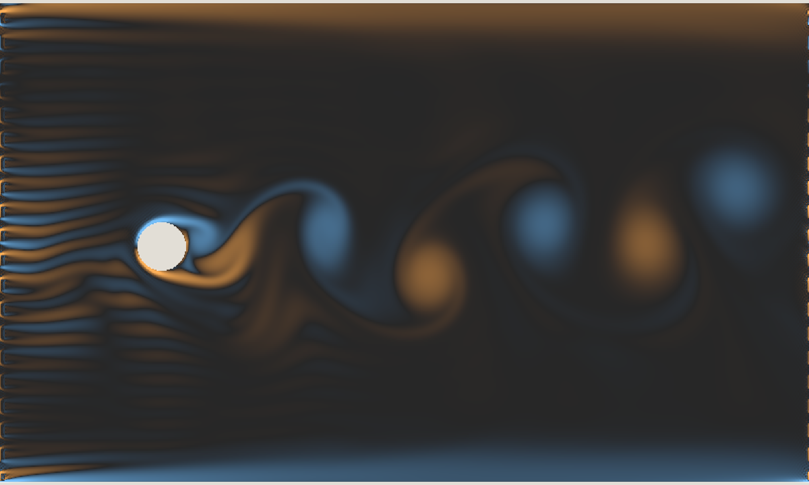

[Open →](offline.html?file=assets/agent_transcripts/lattice_boltzmann_cylinder/metadata.edn)

### forest_fire

A **forest fire** on the GPU, in a square window. A renderer box, a forest box that builds a
`ShaderForestFireSystem` and publishes it as `fire`, and a fire-starter box beneath it whose fragment
shader keeps two points lit in the fire's ignition texture, one red and one green. Burnt trees
recover, so each point sends out a train of ragged rings, one per recovery time, and where the two
trains meet they interleave. Red recovers faster, so its rings come more often. The forest box's
`fragment` tab is the spreading rule. The same two boxes are lessons 11 and 11b of
`canonical_graphics`; [A forest fire](afield_four_graphics.md#forest-fire) walks through them.

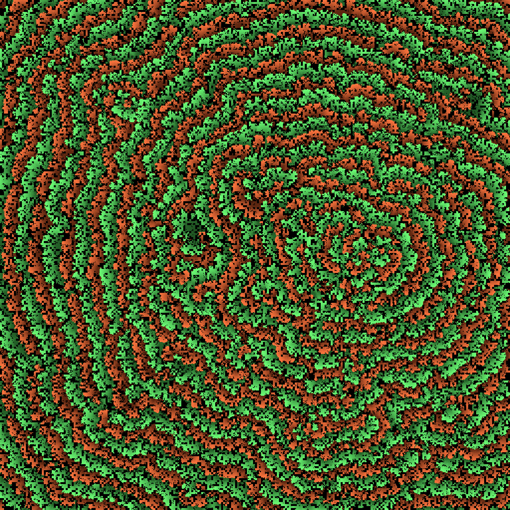

[Open →](offline.html?file=assets/agent_transcripts/forest_fire/metadata.edn)

### gpu_physarum

**Physarum on the GPU**: a million agents on a `TrailField`, in a square window. A renderer box; a
slime box that builds a two-species `ShaderPhysarumSystem` and publishes it as `physarum`, its
`vertex` tab holding the agent rule; a weather box that sets the trail's wind and half-life and the
agents' jitter while it runs; and a reset box that empties the trail and scatters the agents again.
Amber and cyan transport networks form within a few hundred frames, each species avoiding the
other's trail. [A million agents on the GPU](alife_examples.md#a-million-agents-on-the-gpu) walks
through the slime box.

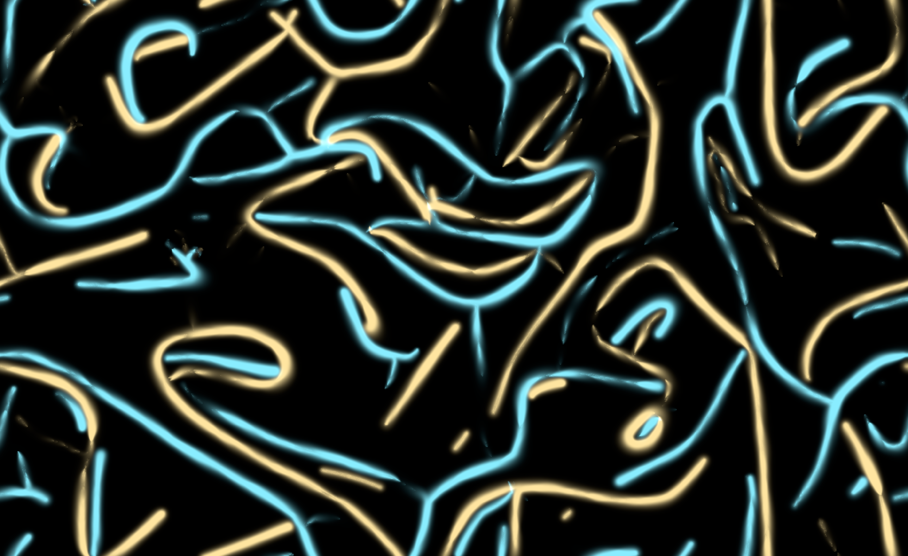

[Open →](offline.html?file=assets/agent_transcripts/gpu_physarum/metadata.edn)

### gpu_stigmergy

**Several species on one stigmergy field**, on the GPU. A renderer box; a slime box that builds a
three-species `ShaderPhysarumSystem` whose `attraction` matrix makes each species follow its own
trail and avoid the others', so they pack a `TrailField` into an amber, cyan and pink labyrinth; a
followers box whose 20,000 `TrailFollowers` climb amber and flee cyan, beading the amber roads in
white; a chase box that rewrites the deposit and attraction matrices live so the cyan species
lays the amber species' scent; and a reset box.
[Several species on one field](alife_examples.md#several-species-on-one-field) walks through the
slime and followers boxes.

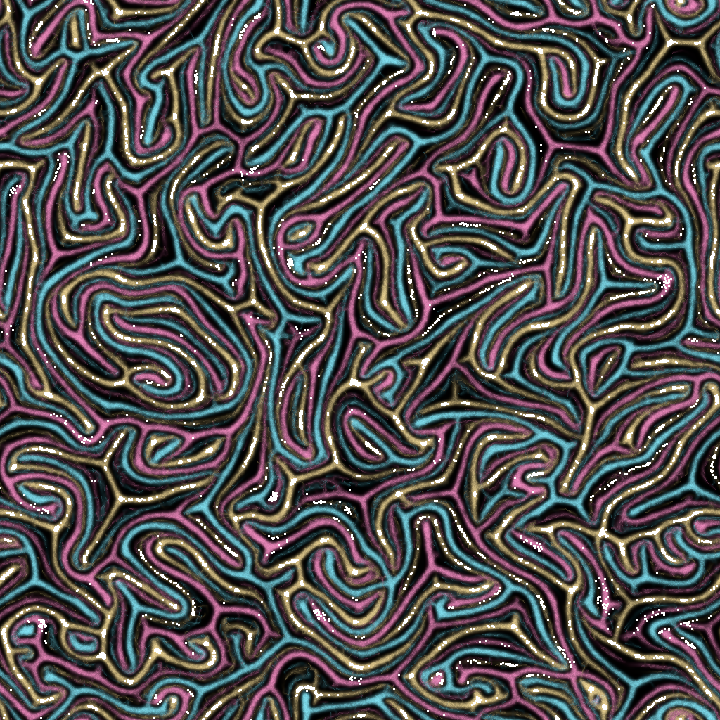

[Open →](offline.html?file=assets/agent_transcripts/gpu_stigmergy/metadata.edn)

### fern_iterated_systems

**Fern**, the classroom demo of iterated systems, on the GPU. Each system is tens or hundreds of
thousands of particles, each stepped by one rule every frame and plotted after every step into a
picture that fades a little each frame, so their visits pile up into fine glowing dust. A renderer
box, then four systems beneath it: the **Barnsley fern** (four affine maps chosen at random, the
chaos game, launched when the scene opens), the **Lorenz attractor** (a continuous chaotic flow,
projected from 3D and coloured by height), a **flame-style IFS** (each map followed by a swirl,
handkerchief or spherical variation, shown as log density), and the **Sierpinski triangle** (the
smallest chaos game). Each system box's `compute` tab holds the rule as six GLSL functions,
`initParticle`, `step`, `project`, `shouldDraw`, `color` and `pointSize`; its code sets the
viewport, the background, the particle count and the fade, and shows sliders for fps, steps,
fade and exposure. Launch another system box to switch to it.

```diffstatic_runner {data-lang=kotlin screenshot="assets/agent_transcripts_gallery/fern_iterated_systems_barnsley.png" capture="native-window" native-wait-frames="120" trim-native=true wait="30.0" embed=true hidden=true timeout="400" name="gallery-fern-iterated-systems" alt="The Barnsley fern in the native window: a tall green frond of fine glowing dust on black, its leaflets built of smaller leaflets, the lowest left one turning yellow-green" macro-file="../../dev_docs/agents/transcripts/fern_iterated_systems.yaml" capture-box="fern_renderer"}
// The transcript builds every box and launches the renderer and the Barnsley fern.
```

[Open →](offline.html?file=assets/agent_transcripts/fern_iterated_systems/metadata.edn)

### particles_sketchbook

**Particles**, the classroom particle sketchbook, on the GPU. The world starts empty: drag in the
renderer window and particles are painted in along the stroke, and four hooks decide what they
do. A renderer box, then seven sketches beneath it: **boids ribbon** (three schools flocking along
a noise flow, launched when the scene opens), **spring mesh** (neighbours knit into a web of
springs), **predator wake** (a hunter only `draw()` shows cuts through a flock), **bounce house**
(gravity, walls and ball collisions), **sine garden** (orbits, clumping and sinusoidal forcing),
**pendulum bloom** (particles tethered to where they were painted) and **vortex brush** (rings that
follow the pointer). Each sketch box's `compute` tab holds the demo's hooks as GLSL, `spawn`,
`eachPair`, `update` and `draw`, run once for every particle each frame over a neighbour grid, with
the demo's helpers by the same names (`flock`, `clump`, `spring`, `collide`, `link`, `springTo`,
`oscillate`, `bounce`, `wrap`, `ring`, ...); its code holds the demo's `init()` world settings and
shows a trail slider, pause and reset. Launch another sketch box to switch to it.

```diffstatic_runner {data-lang=kotlin screenshot="assets/agent_transcripts_gallery/particles_sketchbook_boids.png" capture="native-window" native-wait-frames="90" trim-native=true wait="8.0" embed=true hidden=true timeout="300" name="gallery-particles-sketchbook" alt="Boids ribbon in the native window: a few hundred small glowing dots on near-black, gathered into loose schools in cyan, green, yellow and pink, with faint threads between close neighbours of the same school" macro-file="../../dev_docs/agents/transcripts/particles_sketchbook.yaml" capture-box="particles_renderer"}
// The transcript builds every box and launches the renderer and boids ribbon.
```

[Open →](offline.html?file=assets/agent_transcripts/particles_sketchbook/metadata.edn)

### madp_boids

**boids**, the classroom flocking sketchbook, on the GPU. A flock is written as a spec: kinds of
boid, each with a count, speed limits, a field of view, a look and a list of steering rules, and
every boid's acceleration is the sum of its rules' Reynolds steering forces. A renderer box, then
seven flocks: **murmuration** (the three classic rules, colour by heading, the pointer as a hawk,
launched when the scene opens), **hawks** (predators that chase, eat and rest), **fireflies** (two
swarms seeking moving points, glowing where trails cross), **ink** (a noise flow field on paper
that keeps every stroke), **bait ball** (a mill of sardines blown open by sharks), **two tribes**
(a mixed flock sorting itself by colour) and **conga** (one hand-written rule that makes chains).
Each flock box's code is the spec and its compute tab says how the boids look; the controls are
the page's fps, steps, trail and fade, with pause, reset, a metrics card and an inspector that
shows what one boid sees. Launch another flock box to switch to it.

```diffstatic_runner {data-lang=kotlin screenshot="assets/agent_transcripts_gallery/madp_boids_murmuration.png" capture="native-window" native-wait-frames="90" trim-native=true wait="8.0" embed=true hidden=true timeout="300" name="gallery-madp-boids" alt="Murmuration in the native window: several hundred small arrows on near-black, gathered into drifting flocks, each flock one colour because colour follows heading, mostly violet, blue and pink with one green flock heading the other way, with short fading trails behind them" macro-file="../../dev_docs/agents/transcripts/madp_boids.yaml" capture-box="boids_renderer"}
// The transcript builds every box and launches the renderer and murmuration.
```

[Open →](offline.html?file=assets/agent_transcripts/madp_boids/metadata.edn)

### recstl_playground

A one-stop [RectSL](rectsl_examples.md) playground: a Window + Renderer, a
hackable `#rectsl` snippet, and transport controls (play / loop / speed / time-scrub) published in
the box's output area. Edit the `rectsl` string and re-run to change it live.

[Open →](offline.html?file=assets/agent_transcripts/recstl_playground/metadata.edn)

### rectsl_dataviz

A loadable demo of the RectSL data-visualization family: a viridis colour-bar
legend built with `array` + `colormap`, and a bar chart whose heights and colours are both bound to a
numeric list via `data` / `normalize` / `bars`, animated in with a staggered eased `->alpha`.

[Open →](offline.html?file=assets/agent_transcripts/rectsl_dataviz/metadata.edn)

### rectsl_plot_axes

A loadable demo of the RectSL plotting layer: a shared coordinate `->domain` +
`->frame` with `axes` (rules, nice-number ticks, numeric labels drawn as rect numerals, gridlines) and
three series overlaid in the one domain (an `area`, a `line`, and `points`) plus a `colorbar` and a
discrete swatch `legend`.

[Open →](offline.html?file=assets/agent_transcripts/rectsl_plot_axes/metadata.edn)

### rectsl_musicality

A RectSL scene on a musical clock, and nothing in it is written in seconds:
the wall declares `->tempo 120` and `->beats-per-cycle 4`, and the tracks are written in
mini-notation. The identity it demonstrates: a RectSL track is `sample(t)`
and a pattern is `events(arc)`, both pure functions of time, so a pattern *is* a track, and a pattern
event carries an onset and a real duration, so an event *is* a life window. `pat` is `array` indexed
by rhythm instead of by ordinal: it spends its subdivision on *when*, where `strip` spends it on
*where*. A kick on `"bd*4"` drops in on an ease-out and fades; hats are a Euclidean 5-in-16 ring;
`->every` keeps both versions of a track and chooses per sample. See the *Musicality* section of
[RectSL examples](rectsl_examples.md) for the same program as video, where the rhythm is legible.


[Open →](offline.html?file=assets/agent_transcripts/rectsl_musicality/metadata.edn)

### rectsl_sdf_live

The drawn counterpart to `rectsl_glsl_sdf`: the same lowering, but the emitted
`scene()` goes into a generated fullscreen-triangle pipeline and is drawn per pixel, so the trade
becomes visible. Distance buys outlines and glows at any width, `smin` blending *between* rectangles,
boolean ops, per-pixel normals and sub-frame motion blur, in exchange for fill, material and z
order, because `min` is union and a union has no layers. The look is one of eight presets (`fill`,
`outline`, `glow`, `contours`, `relief`, `blend`, `carve`, `motion-blur`); this one ships on `relief`.
The box keeps one footgun, with a note on it: a top-level `val fragment` in a box is a
script *property*, so naming the shader source `fragment` self-assigns the receiver's empty
`fragment` and hands shaderc nothing, which reports itself as "Desktop shaders for Vulkan SPIR-V
require version 140 or higher": a message about nothing. Hence `fragmentSource`.


[Open →](offline.html?file=assets/agent_transcripts/rectsl_sdf_live/metadata.edn)

### imgui_vr_panel

[Dear ImGui as an in-VR panel](imgui_vr_panel.md), in four working lines on top
of the renderer box: a side-by-side stereo target, the demo panel, and a mouse-driven mock controller.
The ImGui frame goes into a 2048×2048 render-to-texture, onto a world-space quad 1.5 m out, rendered
once per eye, so the panel has real stereo depth rather than being pasted flat, and the packed
side-by-side image is blitted to the desktop window. **No headset required**: the mouse aims the ray
and clicking presses. On Windows and Linux the same image feeds real eye swapchains, which this
transcript does not exercise.


[Open →](offline.html?file=assets/agent_transcripts/imgui_vr_panel/metadata.edn)

### external_browser_surface_macos_smoke

The receiver half of a web UI on a VR texture, exercised
against real macOS GPU objects: an IOSurface-backed render target becomes a Mach send right, is
looked up through the same port path an Electron producer must use, imported through
`VK_EXT_metal_objects`, and copied into a stable sampled image. The box reads that resident image
back as `32,128,223` and accepts only a `PRESENTED` release that arrived after the graphics fence.
CI compiles the graph on every OS; the tracked backdoor replay is the live macOS test. It is an
integration probe rather than a welcome-screen starting point, so no materialized document is
offered here.

### iosurface_ring_roundtrip_smoke

Both of Field's macOS IOSurface paths, on the IOSurfaces the
`field-encode` helper really allocates. The video streamer renders a known colour into its ring and
the helper encodes it; the box then reads each ring IOSurface on the CPU and expects `223,128,32`.
Ring slot 0 is then handed to the browser receiver as a Mach send right and read back from the
resident image as `32,128,223`, after a `PRESENTED` release. It runs on either Mac driver: MoltenVK
imports each IOSurface as the backing of a Vulkan image, and KosmicKrisp, which cannot, imports its
pages as a buffer and copies one frame per tick. CI compiles the graph; the backdoor replay is the
live test, and needs `native/field-encode` built. An integration probe, not a starting point.

### external_browser_surface_linux_smoke

The Linux receiver and transport proof: a real dma-buf
crosses processes with SCM_RIGHTS, keeps its DRM modifier and per-plane layout, imports into Vulkan,
and is copied into Field's stable resident texture before its lease is released. It also exercises
the opt-in CPU bitmap fallback used while Chromium's Linux shared-texture export can announce an
unfilled buffer. CI compiles the graph everywhere; the live replay belongs on a Linux Vulkan host.
Like the macOS half it is an integration probe rather than a starting point, so no materialized
document is offered.

### field_ui_browser_texture

The end-to-end version: a hidden Electron window opens this Field
document, emits Chromium's accelerated offscreen `paint` textures, and transfers their IOSurfaces
to Field as Mach rights. Field imports each image into Vulkan, copies it into a stable sampled
texture, draws that texture on a full-window mesh, and only then releases Electron's paint lease.
The result is Field's own live canvas and boxes recursively visible inside Field's native renderer;
the native window's input is routed back to Chromium, and launch proves a page-to-Field-to-JavaScript
promise round trip. The published `browserControl` property is the live navigation, input,
evaluation, and raw-CDP handle. The default path never uses a screenshot or CPU bitmap; Linux also
offers an explicit readback/upload fallback while the upstream empty-dma-buf issue remains. Run the
renderer box first, then the panel box.


[Open →](offline.html?file=assets/agent_transcripts/field_ui_browser_texture/metadata.edn)

### youtube_mouse_keyboard_browser

The desktop interaction proof: a full YouTube watch page
rendered directly into a matching 1280×720 native Field window. This path does not synthesize a VR
controller. GLFW mouse motion, buttons and wheel are mapped across the aspect-identical texture into
Chromium CSS pixels; key up/down, modifiers and text input come from the same physical keyboard.
That makes the EU consent controls, search field and player usable exactly as ordinary browser UI,
while Electron continues to play page audio.


[Open →](offline.html?file=assets/agent_transcripts/youtube_mouse_keyboard_browser/metadata.edn)

### youtube_kaleidoscope

The proof that the browser texture is ordinary native graphics data,
not a rectangular desktop-share layer. The transcript accepts the EU consent page and starts the
real YouTube `HTMLVideoElement`, then feeds the fully composited 1280×720 tab to 224 independently
animated Vulkan triangles. Each shard rotates and drifts in the vertex stage; its fragment stage
chooses a different angular fold, mirrors the browser image, separates RGB samples, and draws a
barycentric glass edge. The live replay confirms the video clock is advancing and that Chromium
considers the hidden tab audible.


Walkthrough: [Chromium as a native Field surface](puppet_browser.md).

[Open →](offline.html?file=assets/agent_transcripts/youtube_kaleidoscope/metadata.edn)

### youtube_vr_browser

The usable layer built on that transport: a full YouTube watch page, not
an embed or screenshot, rendered at 1280×720 onto a 1.6 m × 0.9 m quad 1.7 m ahead. It is rendered
once per eye at real stereo depth. The controller ray supplies hover and trigger clicks for the EU
consent flow and player controls; thumbstick or trackpad scrolls, and the physical keyboard can type
into Chromium. Electron continues to play the page's audio. Without a headset the desktop window
shows the same side-by-side scene and its mouse supplies the controller ray.


[Open →](offline.html?file=assets/agent_transcripts/youtube_vr_browser/metadata.edn)

### webrtc_shader_jam

The classroom shader jam from Field. One box publishes a fragment shader as a WebRTC stream
named `login/field-shader`, and another lists who is publishing and draws the stream it picks on a
quad in the renderer's window. After `WebRTCNetwork.join(url)` once, Field signs in to that
aaaframe class in its own window and remembers it; a browser ShaderTrinket then receives the Field
box like any classmate, and Field can show any student's Publish. Before joining, the receiving box
shows its neighbour's stream through Field's own relay. Needs the Field Electron app.

```diffstatic_runner {data-lang=kotlin screenshot="assets/agent_transcripts_gallery/webrtc_shader_jam.png" capture="native-window" capture-profile="macos-electron" native-wait-frames="90" trim-native=true wait="25.0" embed=true hidden=true timeout="400" name="gallery-webrtc-shader-jam" alt="Field's renderer window showing the stream the publishing box sends over Field's own relay: a three-lobed flower of blue-violet petals ringed by teal and green bands with dark outlines, filling a 16 by 9 frame on black" macro-file="../../dev_docs/agents/transcripts/webrtc_shader_jam.yaml" capture-box="webrtc_renderer"}
// The transcript builds and launches all three boxes; on Field's own relay the receiving box shows the publishing box's
// stream.
```

The same box receiving a browser ShaderTrinket's stream through aaaframe:

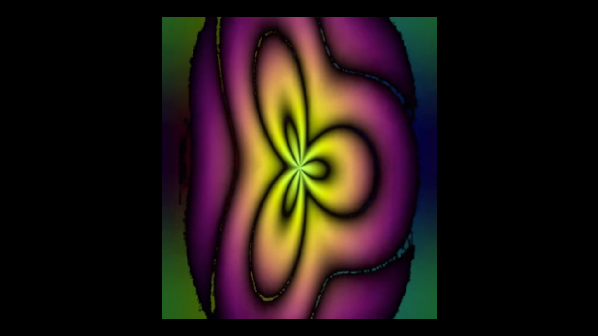

Walkthrough: [WebRTC Streams](webrtc.md).

[Open →](offline.html?file=assets/agent_transcripts/webrtc_shader_jam/metadata.edn)

### direct_lighting

A floor and three boxes lit by one animated rectangle, using Fabricate's raster G-buffer and a
compute ray query for each shadow sample. Switch the original renderer, unshadowed lighting and
opaque ray-query shadows without restarting. Controls expose sample budget, radiance, light phase,
effect weight and diagnostics; the native window has a keyboard camera. The independent GPU smoke
compares 8-sample ensembles against 256-sample references and checks transforms and shader rollback.
After the optional SDK build, the same [direct-lighting scene](direct_lighting.md) adds real RTXDI
initial, temporal and spatial resampling, multiple stable-ID lights, reference comparison and history controls.
The scene renders at 1280 × 720; surface-guided reconstruction is enabled, with a switch back to raw lighting.

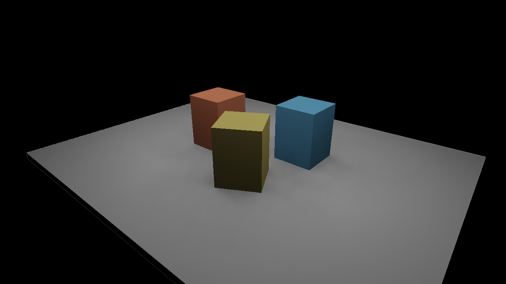

[Open →](offline.html?file=assets/agent_transcripts/direct_lighting/metadata.edn)

### open_dlss_nr

Draw animated ink in an editable Field fragment shader, pass it through OpenDLSS-NR at
tone 0 / structure 10, then grade the result independently. Three labeled 768 × 768 panels
keep the source visible. The **record clip** child exports six seconds of consecutive GPU frames
from the live study. Source and grading work without the optional native dependency.
See [Neural image rendering](open_dlss_nr.md) for preparation, all scene code and the captured video.

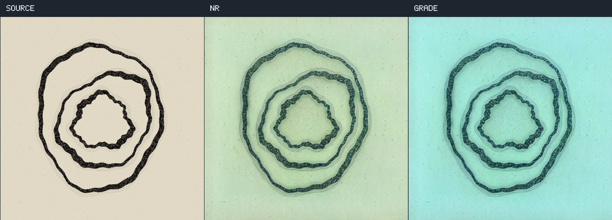

[Open →](offline.html?file=assets/agent_transcripts/open_dlss_nr/metadata.edn)

### open_dlss_nr_cubes

Rasterize two rotating colored cubes on a checkerboard plane, with thin crossing bars, a moving
camera and light. Compare SOURCE, OpenDLSS-NR at tone 0 / structure 10, and independently graded
output in three labeled 768 × 768 panels. Both shaders are editable; **record clip** captures
six seconds at 30 fps from the live GPU targets. Source and grading work without the optional backend.
See [Neural image rendering](open_dlss_nr.md) for the complete scene code and video.

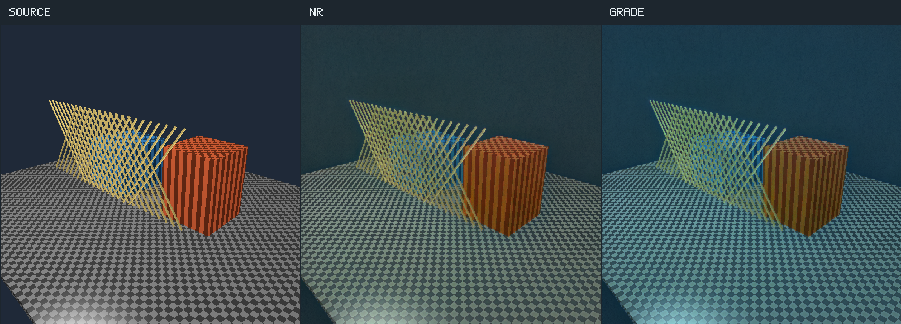

[Open →](offline.html?file=assets/agent_transcripts/open_dlss_nr_cubes/metadata.edn)

### neural_reconstruction

Compare the unmodified source, native-resolution DLAA, and two DLSS Super Resolution modes at
1920 × 1080. Thin crossing geometry, textured surfaces and moving highlights expose edge behavior;
a second scene adds flat colors, procedural animation and particles. Edit the box's vertex/fragment
shaders and reload transactionally. The Starting Point works in source mode without the optional NGX
library. See [Neural Reconstruction](neural_reconstruction.md) for setup and measured comparisons.

[Open →](offline.html?file=assets/agent_transcripts/neural_reconstruction/metadata.edn)

### ray_reconstruction

Compare raw RTXDI, Field's spatial filter, spatial filtering plus DLAA, and Ray Reconstruction at
1920 × 1080. A moving light, camera cuts and instance edits expose the difference between denoising
and temporal reconstruction. Requires the optional NGX and RTXDI builds.
See [Ray Reconstruction](ray_reconstruction.md).

[Open →](offline.html?file=assets/agent_transcripts/ray_reconstruction/metadata.edn)

### optical_flow

Turn two images into a GPU motion field, inspect vectors and matching cost, and drive a feedback
image with the result. The known-translation setting verifies direction and pixel units; deformation
makes a more exploratory instrument. Uses the NVIDIA optical-flow engine where the device has one, and
Field's portable shader flow everywhere else, macOS included.
See [Optical Flow](optical_flow.md).

[Open →](offline.html?file=assets/agent_transcripts/optical_flow/metadata.edn)

### optical_flow_pingpong

Render one editable shader into `PingPongRenderToTexture`, compare the previous and latest frames,
then sample the resulting motion texture in a second `moduleHere()` box. Pause and reset make the
frame ordering visible. Runs on either optical-flow backend.
See [Optical Flow](optical_flow.md#keep-the-previous-frame-with-ping-pong).

[Open →](offline.html?file=assets/agent_transcripts/optical_flow_pingpong/metadata.edn)

### learned_shader

Render a user-trained RGB function using ordinary arithmetic or cooperative vectors. Compare it with
the original and an amplified error view, then reload frozen weights at a frame boundary. An
additional **editable learned material** box samples the fixed network output in its own GLSL;
stop the comparison box before launching it, then edit its fragment with **Reload Shader**.
Requires the optional Slang shader build. See [A Learned Shader Function](learned_shader.md).

[Open →](offline.html?file=assets/agent_transcripts/learned_shader/metadata.edn)

### learned_from_module

Capture the output of an editable `moduleHere()` shader, train a small network in a separate CPU
process, and compare the original with its learned replacement and error view. The model learns
screen coordinates and one parameter; all other scene state stays fixed.

[Open →](offline.html?file=assets/agent_transcripts/learned_from_module/metadata.edn)


### path_tracing_camera


A keyboard-controlled perspective camera with subpixel antialiasing
and thin-lens depth of field. The middle sphere stays sharp while the nearer and farther spheres
blur; focus follows the camera target unless a distance is supplied.


[Open →](offline.html?file=assets/agent_transcripts/path_tracing_camera/metadata.edn)

### path_tracing_materials

Plastic, polished gold and rough metal under a sunset environment.
The [path tracer](path_tracing.md) accumulates into a render-to-texture target and uses a separate
pass to put it on screen.


[Open →](offline.html?file=assets/agent_transcripts/path_tracing_materials/metadata.edn)

### path_tracing_glass

Clear, absorbing and frosted glass spheres, plus a thin blue pane, over
a checkerboard and striped background. Shows the difference between solid refraction and thin glass.


[Open →](offline.html?file=assets/agent_transcripts/path_tracing_glass/metadata.edn)

### path_tracing_gltf

Imports the textured Toy Car GLB with its hierarchy and PBR materials, fits
the camera to its bounds, and lights it with a hidden sunset environment.


[Open →](offline.html?file=assets/agent_transcripts/path_tracing_gltf/metadata.edn)

### path_tracing_hidden_environment

Keeps the environment's illumination and reflections while
primary camera rays see a black background. The same output can carry transparent coverage for compositing.


[Open →](offline.html?file=assets/agent_transcripts/path_tracing_hidden_environment/metadata.edn)

### path_tracing_material_shader_check

Exercises editable material shaders, includes and reflected
push constants. An intentional shader error preserves the last valid pipeline; a successful reload
resets accumulation and produces a PASS marker during live execution.

[Open →](offline.html?file=assets/agent_transcripts/path_tracing_material_shader_check/metadata.edn)

The three below end at the same tracer and start somewhere else in Field, so each one carries two
subsystems the others do not; [Long Way Round](chains.md) is where they are
walked through.

### polytope_path_trace_lineage

Bevel of the dodecahedron, traced with its materials read out of
its lineage. Each of the 62 faces descends from exactly one element of the seed, so the rank of that
element picks gold, thin glass or plastic, and the three groups come out 12, 30 and 20: the
dodecahedron's own faces, edges and vertices. See
[the walkthrough](chain_polytope_render.md).

[Open →](offline.html?file=assets/agent_transcripts/polytope_path_trace_lineage/metadata.edn)

### polytope_manifold_path_trace

The same polytope through the Boolean layer: welded into a
Manifold solid, eroded by a ball and subtracted from itself into a wall of constant thickness, cut
open by a plane, then traced. Genus, volume and watertightness are each measured twice, once by
Manifold and once by Field's own mesh code, and the shell's volume is checked against area times
thickness.

[Open →](offline.html?file=assets/agent_transcripts/polytope_manifold_path_trace/metadata.edn)

### polytope_layer_stack_path_trace

Canonical gC sliced at 48 layer midpoints, extruded with small gaps and coloured
by height. The real path tracer accumulates at least 900 samples before the
Linux/NVIDIA capture. See [the layer-stack walkthrough](chain_ceres_manifold_contours.md).

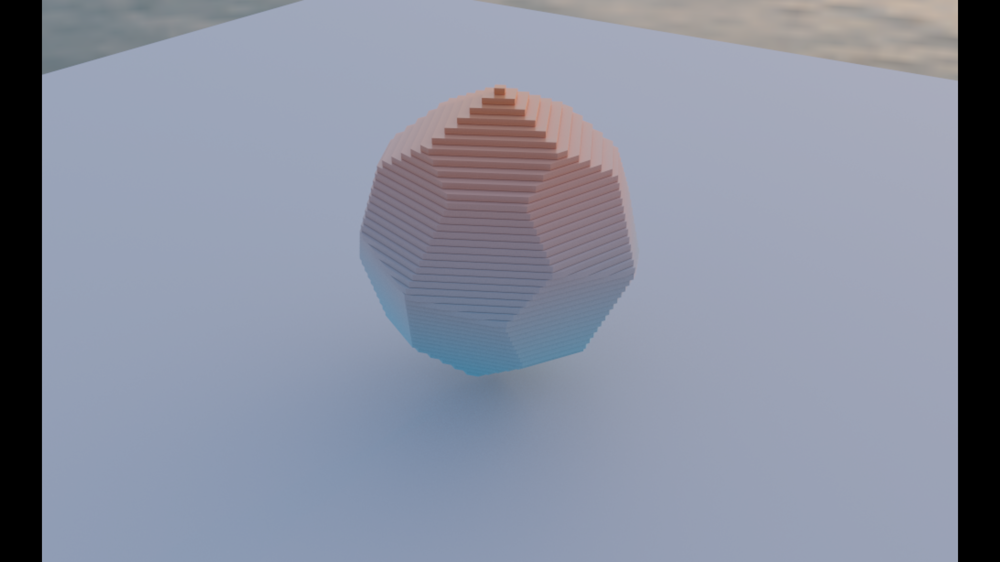

[Open →](offline.html?file=assets/agent_transcripts/polytope_layer_stack_path_trace/metadata.edn)

### photo_mount_path_trace

The relief and frame returned by `PhotoToSolidChain.mount()`, imported into the
real tracer and lit with the Venice environment. The retained Linux/NVIDIA figure
shows the mounted plaque after at least 900 samples. See
[the photo-to-solid walkthrough](chain_photo_to_solid.md).

[Open →](offline.html?file=assets/agent_transcripts/photo_mount_path_trace/metadata.edn)

### physics_manifold_path_trace

A 14 × 14 SimdVerlet cloth drapes over a sphere collider, and each
of its 364 distance constraints becomes a rod: the convex hull of a ball at each end, which is a
capsule needing no orientation arithmetic. One batched union welds them, and the genus of the result
has to equal the sheet's 169 quads, which the box checks and says in words. See
[the walkthrough](chain_physics_render.md).

[Open →](offline.html?file=assets/agent_transcripts/physics_manifold_path_trace/metadata.edn)

### pattern_particles

Four boxes and the whole chain from a rhythm to a GPU push constant.
`patSynth` schedules `pat("bd*4, ~ 52 ~ 52, hh*16")` block by block in the audio render, a `BandSplit`
of four `Biquad` band-passes measures what comes out, the four numbers become four push-constant
floats, and 24,000 particles in four rings follow them, one band each. The audio box pulls the bank
itself rather than handing it to the engine, so the figure comes out the same on a machine with no
output device. See [the walkthrough](chain_pattern_particles.md).

[Open →](offline.html?file=assets/agent_transcripts/pattern_particles/metadata.edn)

### petri_sparks

Three boxes: a renderer, a `#petri` net of three token rings and a `charge` place that four kicks
fill and a clap empties, and a sparks box that asks a run of the net each frame what fired in the
last 1.6 seconds (`firingsOver`), where each token is (`markingAt`) and how full `charge` is
(`countAt`). Each firing becomes a burst of streaks in its transition's colour, computed entirely in
the vertex shader from the burst's origin and age. See [the walkthrough](chain_petri_sparks.md).

[Open →](offline.html?file=assets/agent_transcripts/petri_sparks/metadata.edn)

### life3d_manifold_path_trace

`LIFE3D_BLOB` for eight generations, then the question a volume of
ones and zeros cannot answer for itself: how many separate things are left. Field's marching cubes
and Manifold's level set both march the same density field and disagree about the genus, and
`decompose()` explains why: it returns 48 independent solids whose volumes sum exactly
to the whole, and `1 - 48` is the negative genus. The box also marches the field at three spacings
each way, because the count is a property of the surface and not only of the automaton. See
[the walkthrough](chain_life3d_render.md).

[Open →](offline.html?file=assets/agent_transcripts/life3d_manifold_path_trace/metadata.edn)

### petri_state_space_sculpture

The dining philosophers' reachability graph as a path-traced sculpture. Each marking of the
symmetric five-seat table becomes a glass bead, placed by breadth-first depth and by which
philosophers hold forks; each firing becomes a `tubeMesh` coloured by what it does, and the
shortest route to the deadlock glows. The stubborn-set reduced graph stands beside it. See
[the walkthrough](chain_petri_sculpture.md).

[Open →](offline.html?file=assets/agent_transcripts/petri_state_space_sculpture/metadata.edn)

### rectsl_spacetime_path_trace

A RectSL animation read as a solid object. The scene's signed
distance over (x, y, time) is sampled slice by slice, one autodiff tape each, handed to both marchers
through `sampledField3D`, and traced: the swept bar becomes a twisted ribbon and the growing square a
wedge, coloured along the time axis. It also measures what each marcher does where the volume runs
into the sampling window, which `marchingCubes` leaves open with two boundary loops and `levelSetOf`
closes. See [the walkthrough](chain_rectsl_spacetime.md).

[Open →](offline.html?file=assets/agent_transcripts/rectsl_spacetime_path_trace/metadata.edn)

### skinned_volume_path_trace

The candy wrapper as a volume. A capped two-bone tube, generated by
`CappedTwistFixture`, is posed at a 180° twist twice from one file: by linear blend skinning and by
dual quaternions. Each pose becomes a Manifold solid and prints its genus and enclosed volume, then
comes back with creased normals for the path tracer, and the two lie side by side on a floor. The
linear-blend tube keeps two thirds of the rest volume and narrows to a point at the joint. The
dual-quaternion one keeps its full width. See [the walkthrough](chain_skinned_volume.md).

[Open →](offline.html?file=assets/agent_transcripts/skinned_volume_path_trace/metadata.edn)

### frame_history_reprojection

**Temporal reprojection you can see going wrong.** Four boxes — a renderer, a lit scene of twenty-five
spheres with the camera slowly turning, a chain accumulating the frame into a reprojected history, and
a fourth cycling the four debug views every 150 frames. Reprojection answers *where was this pixel last
frame*, and it needs a debug view because a wrong answer still renders a plausible picture. Each mode
fails differently: **beauty** ghosts behind the spheres if the reprojection never arrives; **backward
motion** goes grey *while the camera turns* if it is stuck at the identity; **previous UV** is the only
one that shows a constant offset, because an offset inside a *difference* is invisible; and
**availability** is green with a thin red band on the edge the camera is turning away from — entirely
green means the flag is hard-wired on, entirely red means the CPU validity rule rejects everything.
That thin band is the signature of a working reprojection: beauty and availability disagree about
nothing when it is right, and beauty still looks fine when it is wrong. The layer is
`FabricatePassSpec.frameHistory` and `FabricatePassLibrary.temporalAccumulate`.

[Open →](offline.html?file=assets/agent_transcripts/frame_history_reprojection/metadata.edn)

### path_tracer_instrument

**The path tracer, with an instrument.** Six boxes: a renderer, the tracer with a log, the instrument
in one line, the convergence curve, an integrator swapped live, and the integrator put back. The
subject is one line, `display("output", tracer)`, which shows the running tracer through its
registered value printer rather than as a bare object. Boxes 4 and 5 swap the integrator
underneath the instrument and put it back, which is the part a printed line cannot do.

[Open →](offline.html?file=assets/agent_transcripts/path_tracer_instrument/metadata.edn)

### path_tracing_emitters

**Two lamps in the dark, with emitter sampling flipped on and off.** Two boxes: a renderer, and a grey
floor, a red wall, a white sphere and two small lamps that are the only light in the scene — the
environment is black. Box 2 flips exactly one flag every 256 samples and prints which way it is set.
Off, the image is a blizzard of black and white speckle and the sphere is barely legible; on, the same
scene at the same sample count is clean, with a soft shadow under the sphere and a cool tint on its
right from the smaller lamp. Flipping the flag resets accumulation, so the two estimators are always
compared at the same budget rather than at whatever each had happened to accumulate.

[Open →](offline.html?file=assets/agent_transcripts/path_tracing_emitters/metadata.edn)

### path_tracing_medium

**Shafts of light through haze.** Two boxes: a renderer, and a slatted strip light over a hazed room
whose `mediumDensity` cycles through four values every 192 samples, so the same geometry is drawn
clear, thin and thick, over and over. A participating medium is the case where "light travels in
straight lines between surfaces" stops being true — the integrator has to sample a scattering event
*along* the ray, and the visible result is the beam itself rather than only what it lands on. Cycling
the density rather than picking one is what makes that legible: the geometry never moves, so everything
that changes between passes is the medium. `dev_docs/PARTICIPATING_MEDIA.md` is the write-up.

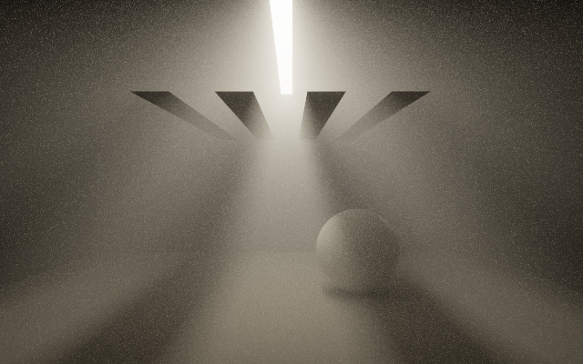

[Open →](offline.html?file=assets/agent_transcripts/path_tracing_medium/metadata.edn)

### neural_particles

**A cloud of noise assembling itself into a word, through a network trained a second earlier.** Three
boxes: a renderer, an offline training step, and three hundred thousand particles. The middle box
fits a flow-matching velocity field `v(x, t)` in about a second of pure Kotlin; `MlpWeights.glsl`
writes those five thousand numbers out as an unrolled GLSL forward pass, and a compute shader
evaluates one per particle per frame. The particle is a struct in a storage buffer rather than a
texel, because it carries where it started and how far through its journey it is — a flow is a
*map*, not a field of forces, and neither of those fits in four channels.

Three things in it are measured rather than chosen. A word needs one source blob per *closed
subpath*, phase-aligned with the contour it becomes: a single Gaussian cannot become five disjoint
outlines at any training budget (chamfer 13.1 against a floor of 0.8) while the mixture reaches 5.3.
Particles must *dwell* on the target rather than resetting the instant they arrive, or only one in a
hundred and fifty is ever on the glyph and the picture is a featureless haze that looks exactly like
an undertrained field. And the source jitter that seeds the particles is the opposite of the jitter
used in training — train on the exact correspondence, seed near it.
`tools/run_field_tests.py --id four.neural-particles.smoke` grades the GPU's trajectories against the
CPU integrator per particle.

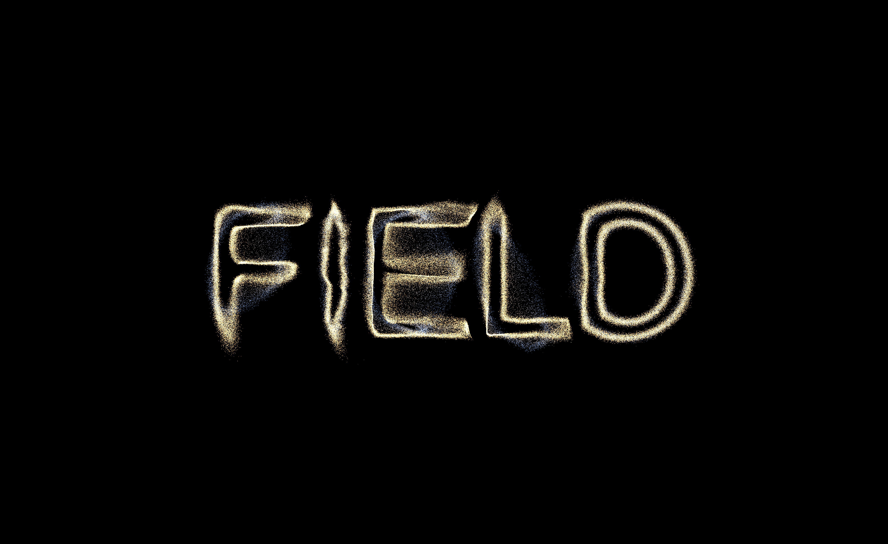

[Open →](offline.html?file=assets/agent_transcripts/neural_particles/metadata.edn)

### learned_boids

**Two flocks side by side: one running Reynolds boids, one running a network that learned it.** Four
boxes: a renderer, a training step, and a flock each. `ShaderBoids` takes a `learned` argument and
branches only where the force is computed, so the two are an A/B of the rule and of nothing else.

The neighbour search is what makes it possible. A flocking rule is a sum over *nearby* particles, and
finding those without looking at everybody needs a sort — hash each boid to a grid cell, sort the
pairs with `GpuRadixSort` so a cell's members land in one contiguous run, then walk the 3x3 block
around your own. The learned half is a Deep Sets interaction,
`a = phi(v, SUM psi, MEAN psi)`, about a thousand parameters fitted by reverse-mode autodiff, which
Smile cannot express because the gradient runs through a sum over a variable-length set.

The right flock looking like the left one is not evidence. Almost any attraction-and-repulsion rule
with a speed limit produces something an audience accepts. The numbers that mean something are in
the smokes —
`four.neighbour-grid.smoke` checks the search against brute force as *sets* (a query that misses a
tenth of its neighbours yields a force a few percent out and a flock that still flocks), and
`four.shader-boids.smoke` grades both rules against a CPU brute force per particle.

[Open →](offline.html?file=assets/agent_transcripts/learned_boids/metadata.edn)

### letter_interpolation

**A "C" becoming an "S" through shapes that are neither, by interpolating the weights of two
trained velocity fields.** Three boxes: a renderer, one that trains both letters from a shared
circular source, and one that sweeps `t` across forty seconds, writing a blended network into the
weight buffer once a frame.

The distinction that makes it interesting is between interpolating the *targets* and interpolating
the *network*. The first sends each point along a straight line from its place on the C to its
place on the S — a crossfade, no network required, no surprises. The second produces a field that
was never trained on anything, and where it sends a particle is a nonlinear function of `t`.
Measured, at `t = 0.5` the two disagree by 0.85 of the whole width of the morph.

What it actually does is seal the C into a closed ring and re-open it the other way, so the middle
is a rounder, *simpler* form than either letter rather than a blur of the two. Both letters must be
a single closed contour in the typeface — C, S, E, F, L, T, V, Z — because one circle cannot be
paired with two contours at once, and both must be trained from the same source and the same seed.
`WeightInterpolationTest` holds the numbers, including a check that the hand-written integrator
agrees with the library's.

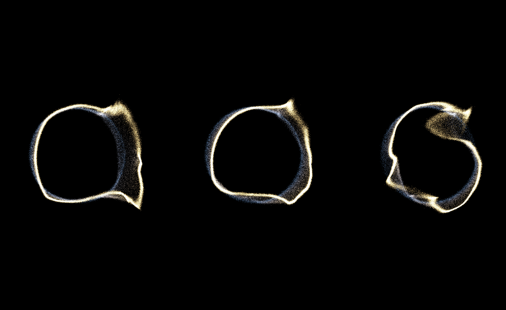

[Open →](offline.html?file=assets/agent_transcripts/letter_interpolation/metadata.edn)

### letter_interpolation_panels

**The same interpolation, pinned at three values and rendered side by side.** Three
`ShaderNeuralParticles` over one trained pair, each with its weights set once and its `viewCenter`
offset so the panels sit apart.

A capture of the sweeping scene lands on whatever `t` the clock happened to reach; pinning each
panel makes the picture on [Neural particle systems](neural_particles.md) show the same three values every
time. It is also the cheapest demonstration that the weight buffer is per-system — one trained pair drives any
number of panels with no extra training and no extra shaders.

[Open →](offline.html?file=assets/agent_transcripts/letter_interpolation_panels/metadata.edn)

### shader_boids_separation

**Two ShaderBoids flocks of 12,000 on one renderer, differing only in `separationRadiusFraction`.**
With the default weights and no driver, a fraction of 1 lets separation reach as far as alignment and
cohesion, and the flock spreads into one even disc; at 0.25 separation is short-range and the flock
packs into one dense clump. The pair is the figure on [Neural particle systems](neural_particles.md).

[Open →](offline.html?file=assets/agent_transcripts/shader_boids_separation/metadata.edn)

### skinned_characters

**A rigged mesh you can bend, and a crowd of sixty-four of them.** Skeletal animation for
Field 4: bones and per-vertex weights read out of a glTF, a joint-matrix palette evaluated at
a time, and linear blend skinning into a deformed surface.

Eight boxes. A window and renderer the four GPU boxes hang beneath; a box that prints what the
loader reads out of the rig (nodes, bones, clips, the worst weight-sum error over all 60
vertices, and 60 of 60 vertices bit-identical to the unskinned mesh at the bind pose) and draws four
poses side by side; two sliders driving a live re-skin, printing the tip's `x` so the pose is a
number and not only a picture; the path tracer on the *deformed* mesh, cross-checked against the CPU
bridge to 0.0000000; the same deformation on the GPU with no shader change; the candy wrapper, where
linear blending pinches the waist to **0.0%** of rest and dual quaternions hold it at **100.0%**;
the vertex-shader version, where 64 characters at their own phases are one mesh, one draw call
and one upload of 128 matrices per frame; and the candy wrapper again on the GPU, a linear-blend
and a dual-quaternion tube side by side in one draw call, chosen by one word per instance.

Replaying the transcript in CI compiles every box of the document. The numbers above are held more
sharply elsewhere: `GltfSkinningTest` asserts bind-pose
bit-identity rather than a tolerance, and the captured frames are under
`dev_docs/agents/evidence/skinning/` and `dev_docs/agents/evidence/gpu_skinning/`.

[Open →](offline.html?file=assets/agent_transcripts/skinned_characters/metadata.edn)

### reconstruction_plumbing

The explicit `moduleHere()` → three `RenderToTexture` attachments → DLAA/SR pipeline, with source bypass and history reset. Read [From modules to reconstruction](reconstruction_plumbing.md) alongside its editable Kotlin and shaders. Requires a Vulkan window; NGX is optional and unavailable machines display the source.

[Open →](offline.html?file=assets/agent_transcripts/reconstruction_plumbing/metadata.edn)

### rr_plumbing

The same pass ordering extended to raw RTXDI and five RR guide attachments. The editable `moduleHere()` shader translates Field's motion and Lambertian surface data. Requires the optional RTXDI and NGX builds and an RR-capable Vulkan device. See the [capstone walkthrough](reconstruction_plumbing.md#extend-the-graph-to-ray-reconstruction).

[Open →](offline.html?file=assets/agent_transcripts/rr_plumbing/metadata.edn)


### streaming_diffusion

A renderer and an editable spinning-curves scene with ink, charcoal and barbed-wire controls.
The optional Linux/NVIDIA worker returns a sampled RTT through shared GPU memory; unsupported
platforms show an availability message. CI compiles the boxes without starting the worker.
The retained native capture and measured run are on [Streaming diffusion](streaming_diffusion.md).

[Open →](offline.html?file=assets/agent_transcripts/streaming_diffusion/metadata.edn)


### syphon_gpu

[Syphon](syphon.md) from the Vulkan renderer, both ways. A renderer box opens a window; the second
box draws a colour gradient into a `RenderToTexture` and publishes every frame as "Field GPU" with
`followOnGpu`, which copies each frame on the GPU into an IOSurface for Syphon without reading it
back; the third connects to "Field GPU" as a client and draws its frames, as a texture, over the
whole window, sampling the IOSurface Syphon shares without copying it. macOS only; needs
`./gradlew buildSyphonNative`.

[Open →](offline.html?file=assets/agent_transcripts/syphon_gpu/metadata.edn)

### syphon_zero_copy_receive_smoke

The test behind `SyphonClient.texture()`. A separate process publishes a known pattern through
Syphon, first at 64×48 and then at 96×64. A shader samples the received texture into a
`RenderToTexture`, and the box reads it back. It expects exact pixels in the right order and the
right way up, one re-import when the size changes, and no frame copied through memory. MoltenVK
samples the IOSurface as an imported image; KosmicKrisp samples it as host memory under a linear
image. CI compiles the graph; the backdoor replay is the live test, and needs
`./gradlew buildSyphonNative`. An integration probe, not a starting point.

[Open →](offline.html?file=assets/agent_transcripts/syphon_zero_copy_receive_smoke/metadata.edn)

### stacksl_gallery

The gallery from [StackSL examples](stacksl_examples.md): one renderer box and a box per StackSL
shader. Launch the renderer, then launch any example; each one replaces the last in the window.

[Open →](offline.html?file=assets/agent_transcripts/stacksl_gallery/metadata.edn)

### shadertrinket

**ShaderTrinket in Field.** A ShaderToy Image pass, `void mainImage(out vec4 fragColor, in vec2
fragCoord)`, lives in each box's `fragment` property, under one `{{ shadertoy.image }}` line, and
draws into a canvas the renderer window shows. Launch the renderer, then the lead box (Flat Rings,
ShaderTrinket's default program); each preset box (Classic Plasma, Star Tunnel, Mandelbrot Glow,
SDF Sphere Trace) replaces the picture when you launch it, the way choosing a preset does. Edit a
`fragment` and press alt-R to recompile; an error is marked on its own line. The Camera Input Demo
binds the camera to `iChannel0` with `textures("iChannel0" to webcam())`. The last two boxes are
the classroom jam, as in [WebRTC streams](webrtc.md): Publish shares the canvas as
`@you/field-shader`, and Live Stream lists everyone publishing and samples the one you click as
`iChannel2`, from a browser ShaderTrinket or another Field. Both need the Field Electron app. A port
of the madp ShaderTrinket demo; the design notes are in `dev_docs/madp/shadertrinket.md`.

```diffstatic_runner {data-lang=kotlin screenshot="assets/agent_transcripts_gallery/shadertrinket_flat_rings.png" capture="native-window" native-wait-frames="90" trim-native=true wait="6.0" embed=true hidden=true timeout="300" name="gallery-shadertrinket" alt="Flat Rings in the native window: eight thick rings in teal, amber and blue, each with a pale dot at its centre, drifting and overlapping over a faint dark checkerboard" macro-file="../../dev_docs/agents/transcripts/shadertrinket.yaml" capture-box="shadertrinket_renderer"}
// The transcript builds every box and launches the renderer and the lead box, Flat Rings.
```

[Open →](offline.html?file=assets/agent_transcripts/shadertrinket/metadata.edn)

### stacktrinket_feedback

StackTrinket, the classroom StackSL editor, in Field: StackSL programs that read their own previous
frame. A renderer box, then seven programs beneath it: the pulse ring, feedback fog, persistent
bloom, store channels, subroutine cse, four memory bands and long memory ecology. Each box keeps its
program in the `stackSL` tab and calls `stackFeedback()`, which draws it every frame with the last
frame bound as `state` and follows edits live. The box's lowering panel shows how deep its stack
ends and any error at its line and column, and its glsl panel the GLSL the program becomes.
Launching a box replaces the program in the window. The jam box joins the classroom shader jam, the
WebRTC network browser ShaderTrinkets use. It publishes its program as `@you/stacktrinket`, lists
who else is publishing, and hands the stream you pick to its program as a second picture, which
`0 sample1` reads at this pixel the way `prev` reads the last frame.

```diffstatic_runner {data-lang=kotlin screenshot="assets/agent_transcripts_gallery/stacktrinket_feedback_pulse_ring.png" capture="native-window" native-wait-frames="90" trim-native=true wait="3.0" embed=true hidden=true timeout="300" name="gallery-stacktrinket-feedback" alt="The pulse ring in the native window: a soft white ring on black, centred, its radius half the window's width, fading smoothly to black on both sides" macro-file="../../dev_docs/agents/transcripts/stacktrinket_feedback.yaml" capture-box="stacktrinket_renderer"}
// The transcript builds every box and launches the renderer and the pulse ring.
```

```diffstatic_runner {data-lang=kotlin screenshot="assets/agent_transcripts_gallery/stacktrinket_feedback_fog.png" capture="native-window" native-wait-frames="600" trim-native=true wait="8.0" embed=false hidden=true timeout="300" name="gallery-stacktrinket-feedback-fog" macro-file="../../dev_docs/agents/transcripts/stacktrinket_feedback.yaml" run-box="stacktrinket_feedback_fog" execution="launch" capture-box="stacktrinket_renderer"}
// After the transcript, launch the feedback fog box and let its trails build for a few seconds.
```

[Open →](offline.html?file=assets/agent_transcripts/stacktrinket_feedback/metadata.edn)

## Graphics building blocks

<!-- transcript-index: verified-by = compile -->

Neither of these two is a scene, and neither is offered as a starting point: one is a renderer with
nothing to draw, the other is a child box that gets its renderer from a parent it does not contain.
They are in the corpus because they are the two halves of the graphics-topology rule, and an agent
composing a new scene needs both; see `dev_docs/agents/transcripts/README.md`.

### graphics_renderer_launch

The bare parent: open a `Window`, build a `Renderer`, pump the loop.
Nothing is drawn. Replay it when you want a renderer for boxes you are about to write, then wire
those boxes beneath it so they can reach it through graph context.

### afield_four_traditional_triangle

The other half: a single draw box with no renderer of its own,
which calls `fromContext()` and expects an `agent_graphics_context` parent to have supplied one.
Replayed alone it has nothing to draw into, which is the rule it exists to demonstrate. The figure is
this same box *given* that parent, which is how the
[Field 4 graphics walkthrough](afield_four_graphics.md) opens: the docs runner supplies the
context, and one triangle arrives.


### path_traced_reconstruction

Multi-bounce path tracing with raw, progressive and Ray Reconstruction views at 1080p.
Optional NGX; opaque surfaces and a pinhole camera. See [Path-Traced Reconstruction](path_traced_reconstruction.md).

[Open →](offline.html?file=assets/agent_transcripts/path_traced_reconstruction/metadata.edn)

### computed_ray_geometry

Edit a compute shader that generates triangle clusters, rebuilds their acceleration structures,
and ray traces the result. Requires enabled NV cluster acceleration structures and ray-tracing pipelines.
See [Compute your ray-traced geometry](computed_ray_geometry.md).

[Open →](offline.html?file=assets/agent_transcripts/computed_ray_geometry/metadata.edn)

### gpu_shader_learning

Train directly on an editable moduleHere render target, freeze the fit, and export portable learned weights.
Requires cooperative-vector training and the optional Slang shader build.
See [Learn from a shader on the GPU](gpu_shader_learning.md).

[Open →](offline.html?file=assets/agent_transcripts/gpu_shader_learning/metadata.edn)

### motion_recording_probe

Scrub a one-metre coordinate probe, play its recorded poses and inspect the reset at two seconds.
This diagnostic two-joint clip uses the portable motion API; it does not run ARDY or CLoSD.
See [motion recordings](motion_recordings.md).

[Open →](offline.html?file=assets/agent_transcripts/motion_recording_probe/metadata.edn)

### motion_closd_recording

Replay a real CLoSD foot-tether/release performance, scrub its recorded time and orbit the executed
body beside the planner's reference. This starting point needs neither CLoSD nor Isaac Gym.
See [motion recordings](motion_recordings.md).

[Open →](offline.html?file=assets/agent_transcripts/motion_closd_recording/metadata.edn)

### motion_resistance_replay

Watch genuine stronger-tether CLoSD motion with reference/executed poses, force and stretch, and a
smoothed follow camera. This replay needs no models. See [Generative Mocap — ARDY and CLoSD](motion_recordings.md).

[Open →](offline.html?file=assets/agent_transcripts/motion_resistance_replay/metadata.edn)

### motion_tether_score

A short Kotlin movement score: walk, attach a named foot, continue walking, release. Requires
optional CLoSD setup. See [writing a score](motion_recordings.md#write-a-movement-score).

[Open →](offline.html?file=assets/agent_transcripts/motion_tether_score/metadata.edn)

### motion_closd_live

Give CLoSD an intention, attach a named rigid body to a point tether, apply a torso impulse and
release or reset it. Sessions record automatically in the document's files. Requires the optional
CLoSD environment and `FIELD_MOTION_HOME`; see [motion recordings](motion_recordings.md).

[Open →](offline.html?file=assets/agent_transcripts/motion_closd_live/metadata.edn)

### motion_ardy_path

Timed ARDY routes. Live Core27 motion, timed FLine routes and sparse model conditioning. Requires the optional ARDY environment and cached prompts or the CPU encoder service. No physical attachment is implied.

[Open →](offline.html?file=assets/agent_transcripts/motion_ardy_path/metadata.edn)

### motion_ardy_intentions

Changing ARDY intentions. Live Core27 motion, timed FLine routes and sparse model conditioning. Requires the optional ARDY environment and cached prompts or the CPU encoder service. No physical attachment is implied.

[Open →](offline.html?file=assets/agent_transcripts/motion_ardy_intentions/metadata.edn)

### motion_ardy_foot

ARDY kinematic foot restriction. Live Core27 motion, timed FLine routes and sparse model conditioning. Requires the optional ARDY environment and cached prompts or the CPU encoder service. No physical attachment is implied.

[Open →](offline.html?file=assets/agent_transcripts/motion_ardy_foot/metadata.edn)

### motion_recorded_results

Compare recorded ARDY movement, CLoSD tether trials and ARDY route failures in an editable Field 3D renderer. No model installation. Change `experiment` in the box to select a comparison.

[Open →](offline.html?file=assets/agent_transcripts/motion_recorded_results/metadata.edn)

### motion_ardy_demo_replay

Play the interactive ARDY skipping take in Field, with editable Kotlin code and a following camera. No model installation.

[Open →](offline.html?file=assets/agent_transcripts/motion_ardy_demo_replay/metadata.edn)

### stereo_rtt_composite

[An editable stereo RTT composite](stereo_rtt_composite.md): three wireframe cubes, a floor and
resolution chart render once per eye, then pass through FXAA into both the desktop mirror and,
optionally, an OpenXR headset. The five-box graph starts in desktop preview mode; its guide gives
the launch order and the explicit headset switch. The FXAA shader clamps every tap to its own eye
and the output checkbox compares the same image with and without AA. Requires Vulkan; compiled
without opening a window in CI, with a real desktop capture on the walkthrough page.

[Open →](offline.html?file=assets/agent_transcripts/stereo_rtt_composite/metadata.edn)

### field_vr_ide

[Field inside VR](field_vr_ide.md): the live canvas, editor and command palette in a world-locked
browser panel. Either controller can point, click and drag; one grip moves the panel and two
grips resize it. Analog stick scrolling supports both axes. Hand pointing is disabled to preserve mouse input.
An in-panel keyboard preserves editor focus and includes text, Commands and Run. Linux WiVRn
headset keyboard and mouse input works without desktop focus, and another browser can edit the
same document independently. The Quest 3 workflow has been tested in the headset.
Launch 1 then 2; the default is a front-on desktop companion plus a closeable headset scene preview.
The preview can show one eye or both eyes side by side. Requires Vulkan and Electron.

[Open →](offline.html?file=assets/agent_transcripts/field_vr_ide/metadata.edn)

## Saved documents

<!-- transcript-index: bundled -->

These starting points are not built from a transcript. Each is a saved document that ships with
Field and is copied into your workspace as it is when you open it, because what it holds cannot be
replayed: a lesson sequence, or a conversation's revisions, variants and chat.

### canonical_graphics

The graphics lessons: cameras, compute shaders and particles, texturing, render-to-texture, blur
kernels, a GPU radix sort and more, one box per lesson, each running against a live renderer.
[Field 4 graphics](afield_four_graphics.md) walks through it, and
[the viewer](offline.html?file=assets/canonical_graphics/metadata.edn) shows every lesson with its
code and the picture its window drew.

### stacksl_conversation_ink

The ink-in-amber-water session from [Talking a shader into existence](stacksl_conversation.md):
four AI4 turns and two edits made in the shader card. Opening it draws the finished program; the
chat, every checked revision and the variants offered along the way are in the program box.

### stacksl_conversation_tiles

The zellige-tiles session from [Talking a shader into existence](stacksl_conversation.md), ending
with grout the person drew in by hand.

### stacksl_conversation_aurora

The aurora-over-hills session from [Talking a shader into existence](stacksl_conversation.md),
including the turn that traced the mound and the measured half-speed slowdown.
