# Agent transcript gallery

An **operation transcript** is a short YAML macro that builds a whole Field document (boxes, code,
graph wiring) from a blank canvas. Field ships a small, curated corpus of them, and they are the
worked examples an agent copies, runs, and adapts when [automating Field](automating_field.md).

These are the same scenes offered as **Starting points** on the [welcome screen](history_overview.md):
each transcript that is a self-contained scene is materialized into an openable document, so you can
search for it there and open an editable copy in your workspace. Four are not, and each says why in
its own entry: two are integration probes rather than scenes, and two are the halves of the
graphics-topology rule — a renderer with nothing to draw, and a draw box with no renderer. Needing a
gesture, a headset or a service is *not* on that list. A scene you have to click once, or point at a
device you own, is still a scene.

Every transcript in `dev_docs/agents/transcripts/` has an entry below, and
`checkAgentTranscriptIndex` keeps it that way: it fails on a transcript with no entry, an entry
naming a transcript that is not there, an entry offering a starting point that was never generated,
or an entry filed under a section whose claim about CI does not match how CI checks it. The entries
are written by hand, one per transcript, because the useful thing to say about a scene is which
number it prints and why that number matters, and no generator over the yaml can write that.

Figures are captures of the code running, taken by the docs capture pipeline: most for the
walkthrough page linked beside the entry, and some — the path tracers, the browser-on-a-texture
scenes, `gpu_state`, `threebox`, the triangle at the foot of the page — driven from the transcript
file itself. About half the entries carry one. The rest have none:
nothing in the tree captures that scene, because it publishes to a headset, wants a camera or an
external service, or opens a window the pipeline has never been pointed at. Those entries say what
to run instead. Nothing on this page is hand-drawn, mocked up or synthesized.

## Running one

Any transcript can be replayed into a running Field with the agent backdoor or the `field_run_transcript`
MCP tool; see [Automating Field](automating_field.md) for the full mechanism. In short:

```diffstatic {data-lang=bash}
uv run --project . --group backdoor python tools/field_backdoor.py --json \
  --command 'macro write hello_display --file dev_docs/agents/transcripts/hello_display.yaml' \
  --command 'macro run hello_display'
```

The source corpus lives in the repository at `dev_docs/agents/transcripts/`, with a companion
`README.md` covering the op vocabulary, capture commands, and the graphics-topology rule.

## How CI checks them

<!-- transcript-index: totals -->
One harness, `DemoTranscriptExecSmokeTest`, checks all 113 transcripts on every build, at three
depths. 66 of them are **replayed end to end**: the real macro runner builds the graph and the real
compile-and-evaluate pipeline runs every box the transcript asks it to, and the test fails if a
single box emits one error-kind output line. (Almost always that is every box in the file. A
transcript may create a box it does not execute, one that wants a device the build does not have or
that is meant to fail so a diagnostic can be shown, and only the ops it writes down are replayed.)
40 want something the lightweight build does not own (a GLFW window and Vulkan renderer, an external
audio service, or a camera), so those are **built and compiled**: the graph is assembled through the
real apply path and each box's Kotlin goes through the real K2 compiler, with only the terminal
evaluation skipped, the line that would open the window or reach the device. The remaining 7 are
Kotlin **compiled to JavaScript** for a browser or visionOS head, through the real head profile that
the box's `// {{ marker }}` selects.

None of the three proves a picture is *right*; that is what the docs captures and the gallery
FIELD_TESTs are for. What all three prove is that the code in these files still compiles and runs
against today's stdlib. A second guard, `checkAgentTranscripts`, materializes every transcript into
a document and compares it byte-for-byte against the committed starting points, so the copy the
welcome screen opens is the one the yaml produces today.

## Pure-compute scenes

<!-- transcript-index: verified-by = execute -->

These build and run headless: no window, no GPU. Open one to get the code in front of you, then run
its box to see the output (a plot, an inline value thumbnail, a printed line).

### hello_display

Minimal blank-canvas macro that creates one runnable output box.

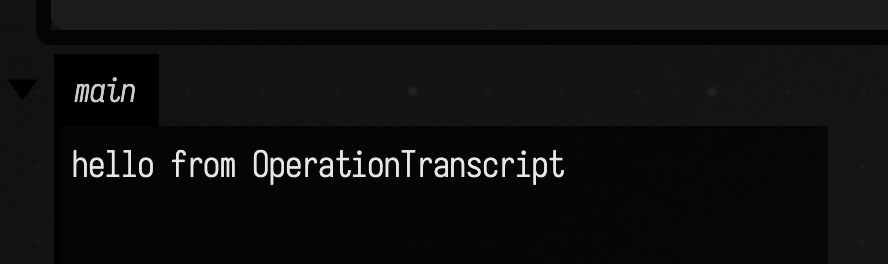

[Open ↗](/offline.html?file=/field4/assets/agent_transcripts/hello_display/metadata.edn)

### profiling_timeline

Three real coroutine workloads: steady arithmetic, periodic CPU bursts,
and vector allocation. The fourth box records three seconds with JVM stacks and opens the timeline;
**Hot code** explores sampled classes, methods, and box lines within the same time brush.
Replay waits for launch startup, verifies the measured lanes and allocation, then stops the workers
so you can brush and explore a quiet, latched capture. Change the vector box's `reuse` flag to
compare construction with in-place `set` on Field's vectors. See [Profiling Timeline](profiling_timeline.md).

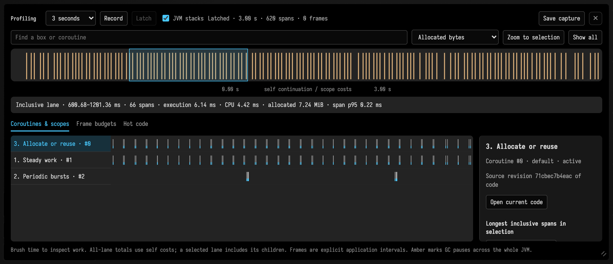

[Open ↗](/offline.html?file=/field4/assets/agent_transcripts/profiling_timeline/metadata.edn)

### simulation_clock

The same instrument pointed at *simulation* time rather than wall-clock time, in two
boxes. The first runs two named coroutines — `Orbit`, stepping a phase on `stepSeconds`, and
`Pulse`, blinking on a 120/350 ms `delay` — inside a `withSimulationClock` driven by the box's own
`frames { }` loop, under an explicit `frameProfile("Playground", targetFps = 60.0,
allocationKiB = 128.0)` with two named scopes, `Simulation` and `Vectors`. The second records three
seconds with stacks and opens the timeline on its **Frames** tab, so the budget, the named scopes
and the child lanes all arrive in one real capture rather than three. Nothing here is a service: the
ordinary **launch**/**stop** controls own the coroutines, and the transcript proves it rather than
claiming it — on stop the box's own `finally` counts the children that unwound, and the replay
checks that count is exactly 2 alongside the lanes it expects (`Orbit` as a coroutine, `Vectors` as
a scope) and more than ten recorded frames. Replay records and then stops; launch the first box to
watch it play. It carries the same `reuse` flag as `profiling_timeline`, over 2048 vectors: flip it
and compare bytes per frame. See [Simulation time](simulation_clock.md).

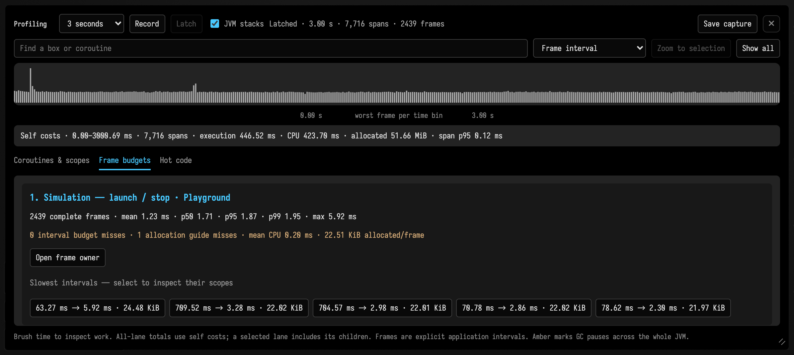

[Open ↗](/offline.html?file=/field4/assets/agent_transcripts/simulation_clock/metadata.edn)

### hello_display_capture

The same single display box, paired with the backdoor capture commands
(`wait-output` / `output` / `screenshot-box`) that collect its output events and a cropped
screenshot. Capture is a transport concern, so it lives in backdoor commands, not in the macro.

[Open ↗](/offline.html?file=/field4/assets/agent_transcripts/hello_display_capture/metadata.edn)

### two_box_context

Creates a parent/child pair and verifies the child inherits graph context from
its parent.

[Open ↗](/offline.html?file=/field4/assets/agent_transcripts/two_box_context/metadata.edn)

### cloth_simdverlet_start

The starting place for cloth: a `SimdVerlet`, a 20 x 10 cloth put into
it with `sim.addCloth(...)`, an explicit `loop { }` that runs the physics, and
`sim.debugLines()` (a segment per distance constraint, a dot per particle, the pins in red, a
whisker per velocity) through `showPlane`, so the whole scene is CPU physics and Skia SVG with no
Window and no Renderer. Its comments record what the numbers do: the constraint solve
is force-based, so `stiffness * iterations` is the spring constant that decides everything, and on
this sheet 60 x 16 settles at 11 % peak strain while 150 x 16 diverges to NaN. It is also the first
`execute` transcript that *launches* rather than executes (a frame loop cannot run to completion),
so CI launches it, advances 90 real runloop frames, and stops it.
[Particles, Cloth & Constraints](physics.md) is the explainer behind it, and re-derives that ladder
from scratch.


[Open ↗](/offline.html?file=/field4/assets/agent_transcripts/cloth_simdverlet_start/metadata.edn)

### simdverlet_world

The world the cloth above hangs in: colliders, tearing and wind, plus a rope
that can be knotted into a sheet. Four boxes: one each for draping over something, coming apart and
flying, and a fourth where all of it runs in one simulation. A collider is a **post-solve position
projection** rather than a force, and it has to be: because the solve is force-based,
a penalty collider runs once against springs acting at `stiffness * iterations`, so it either fails
to hold or explodes. Box 4 is the one to touch: at the shipped `tearThreshold = 0.6f` the sheet
holds and touches nothing, at `0.25f` a rip opens where the rope pulls and the pieces land on the
sphere and the floor, and both ends of that sentence are asserted by
`SimdVerletTearingTest.theWholeWorldLayerInOneSceneBehavesAsTheDemoSaysItWill`. Like the cloth, it
`launch`es rather than executes.

[Open ↗](/offline.html?file=/field4/assets/agent_transcripts/simdverlet_world/metadata.edn)

### inertial_movement

Motion that survives being interrupted, as three boxes that get longer in
that order. `inertial_hello` is five declarations: a `goal` that jumps between two values, an
`inertialTo` chasing it, and `showSignals` on the last 240 readings — the smallest thing that
wiggles. `inertial_vs_restarting` adds one line, a `startAt` on every frame, and that line is the
whole argument: restarting a blend throws away the speed it had, which is what any one-shot ease does
each time you re-aim it, so against a target that never holds still the restarted arm never gets
going at all. `movement_playground` is the interactive one — drag an XY pad and a character chases it
through `MovementState`, with every parameter on a live slider, against a grey ghost of the same
model with the smoothing half-lives at zero, so the gap between the two is what the smoothing is
adding and `lag compensation` is what takes it back. No `AtomicReference` anywhere: the Framer runs
one coroutine at a time, so a plain `var` per control is enough. All three are `loop { }`s, so CI
launches them, advances 90 frames, and stops them.

[Open ↗](/offline.html?file=/field4/assets/agent_transcripts/inertial_movement/metadata.edn)

### shared_types_demo

A `data class` every box can name. Box 1 calls `sharedTypes(...)` to compile
`shared.Particle` as ordinary Kotlin onto the shared classloader; box 2 shows the metadata survived
(`Particle(x=3.0, y=4.0, mass=2.0)`, `copy(mass = 10.0)`, destructuring); box 3 `@rootExported` a
value and box 4 reads `momentum = 11.661903789690601` off it. That last number is what `sharedTypes`
buys: a class declared *inside* a box is nested in that box's snippet loader and crosses `@exported`
as `Any?`, so `.momentum` would not resolve. Box 1 runs twice, so the file covers a recycled engine
as well as a fresh one: the publisher takes its classpath snapshot after publishing, and a recycled
engine re-runs its preamble.

[Open ↗](/offline.html?file=/field4/assets/agent_transcripts/shared_types_demo/metadata.edn)

### dataframe_typed_columns

Kotlin DataFrame's compiler plugin, which types a DataFrame by the
columns it actually contains: `people.age` with no `df["age"]`, no cast and no generated accessors in
the project. Box 2 is the one that cannot pass by accident: `filter { age >= 18 }` drops Alice and
`add("decade") { age / 10 }` prints `[3, 4]` for a column that exists only because the plugin
interpreted the call at compile time. Box 4 is the one that makes it live-codeable, and it runs
twice. The plugin's inferred type is built from *local* classes at body-resolve, so it cannot appear
in a snippet property's type and a frame left in a box would come back as `DataFrame<Any>`, fatal
for a loop whose whole point is to load once and then poke at the result. `typed("People")` reads the
frame's runtime columns and writes `@DataSchema interface People { … }` into the box's preamble, and a
schema declared in an earlier snippet *is* one the plugin generates accessors for. So the second
execution prints `ages: [15, 30, 45]` off a frame it never reloaded.

[Open ↗](/offline.html?file=/field4/assets/agent_transcripts/dataframe_typed_columns/metadata.edn)

### linalg_thumbnails_demo

Each box evaluates one `afield.stdlib.linalg` value; on execute its
output shows the terse text head plus a small inline SVG thumbnail the `ValueVisualizer` draws: an
auto-scaled arrow for vectors (isometric for `vec3`), a diverging heatmap grid for matrices.

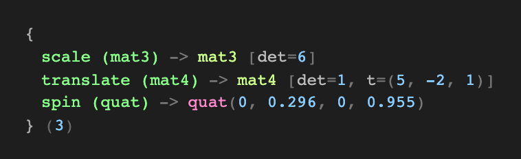

[Open ↗](/offline.html?file=/field4/assets/agent_transcripts/linalg_thumbnails_demo/metadata.edn)

### control_surface_laws

The three affordances Field's control surface gained: a slider **law**
(logarithmic, taper, bipolar), a **momentary button**, and a read-only **meter** fed by a `source`
lambda at 30 Hz. Four sliders over the same 20 Hz–20 kHz range make the point directly (1 kHz sits at
56.6% of a logarithmic track and 4.90% of a linear one), and a button sits beside a checkbox so the
difference between a gesture and a state is visible rather than described.

[Open ↗](/offline.html?file=/field4/assets/agent_transcripts/control_surface_laws/metadata.edn)

### fn_differentiable_fit_demo

A self-contained demo of the differentiable fitter
(`afield.stdlib.fitBest` / `fitGradient`), the gradient-descent counterpart to the genetic
`evolve()`. The target is a product of two oscillators with a seed chosen to be wrong; a single
`fitGradient` stalls in a frequency local-minimum, so the demo uses `fitBest` (jittered restarts) to
land in the global basin. On execute it plots the target and the fitted curve and returns an RMSE
before→after summary with a loss-trajectory sparkline.

[Open ↗](/offline.html?file=/field4/assets/agent_transcripts/fn_differentiable_fit_demo/metadata.edn)

### pat_fn_graph_fit

A rhythm as a graph you can fit. `patFn(...)` turns a pattern of kernel atoms
(`g:(value,sigma)`, `adsr:(…)`) into a `Functions.Fn`, and that `Fn` carries a real graph node whose
leaves are the numbers written in the pattern text, so `fitGradient` tunes a *rhythm*. Box 1 prints
the node: its op, its role-tagged knobs (`atom0.sigma`, `atom1.attack`, `cps`) and their values. Box 2
fits a two-bump target from a seed with the right structure and the wrong numbers, plots the two on
top of each other, and prints the fitted gesture back out as pattern text you can paste anywhere. Box
3 is the real limit: the same fit with the two heights *swapped* stalls, because re-assigning values
between atoms is a permutation rather than a direction.

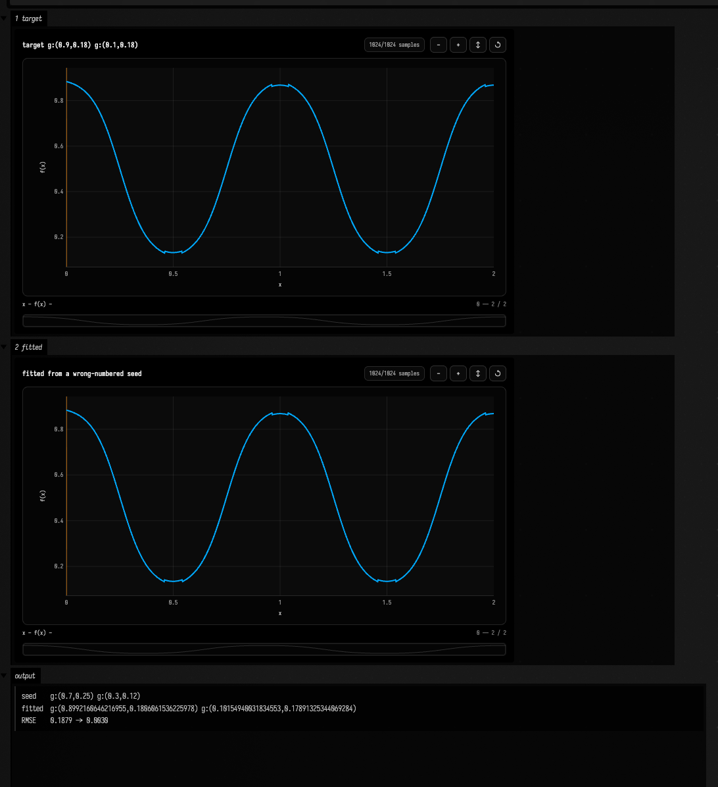

[Open ↗](/offline.html?file=/field4/assets/agent_transcripts/pat_fn_graph_fit/metadata.edn)

### pattern_language_composition

[The pattern language](pattern_language.md) as eight independent
boxes, six of which render their own audio offline. *Continuous signals* prints the exact rational
midpoint of `PatArc(3/7, 5/7)`, because a pattern is a function of a time *interval* and the
arithmetic is rational rather than floating point. *Whose rhythm survives* is the one to read
slowly: `|+|`, `|+` and `+|` over `"0 1"` and `"10 20 30"` produce 4, 2 and 3 events, so the bar is
which side's structure the result keeps. *A parameter, not a staircase* attaches `sine().rangex(300,
6000)` as a cutoff and prints the note count at `bd*4`, `bd*8` and `bd*16` to show it unchanged,
then runs the control arm, `appBoth` over a segmented curve, which fragments the rhythm. *Hear the
difference* measures its own render rather than asserting it: it detects the hat onsets and prints
the level coefficient of variation of the flat half beside the modulated half. *Voice leading*
prints total movement as written against voice-led, and then both pitch-class sets, so the claim
"the harmony did not change and the movement did" is two printed lines rather than a sentence.
*Groove* prints swung off-beats as exact rationals, a third of a subdivision late; *mini-notation
markers* checks three shorthand/bracket pairs (`bd sd . hh hh hh` against `[bd sd] [hh hh hh]`, and
the `_` and `!` forms) arc-for-arc and value-for-value and prints the boolean; and *playground* is
the box to edit. `showPatRoll` is SVG into `display()` and `showPatAudio` renders through a
deterministic CPU voice into an inline player, so there is no audio device and no window anywhere in
this file.

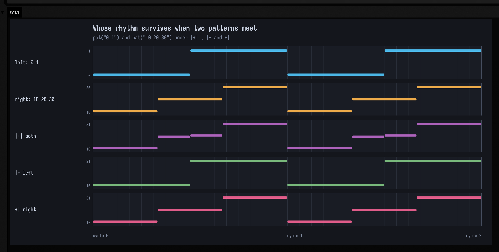

[Open ↗](/offline.html?file=/field4/assets/agent_transcripts/pattern_language_composition/metadata.edn)

### pitch_transcription_roundtrip

The other direction: sound back to notation. Five pure-compute
boxes notate a pattern, render it offline, hear the audio back as pitched note events, and print a
`pat("…")` string that re-renders, the arrow `audio_render_analysis` draws by hand and nothing in the
repo could walk. Ground truth costs nothing here because Field authored the notation being scored
against, so the reference is the audio's *cause* rather than an annotation of it: the clean box
recovers 15 of 16 notes with a median pitch error of 0.3 cents. Two boxes are about failure. *A line
with no attacks in it* is a single Dough oscillator whose frequency steps with continuous phase, so
the RMS envelope is flat and the energy onset detector scores 0.13 against the pitch detector's 0.86,
a comparison `patRenderStereo` cannot host, because it re-attacks every event and its "legato" render
has one amplitude rise per note. *A chord* is refused and named POLYPHONIC rather than reported as its
loudest note, while a sawtooth's full harmonic stack is not refused, because timbre is not polyphony.
The box to edit is box 4: it declares the register the detector may resolve, which sets the analysis
window and therefore the shortest resolvable note, and changing that one line takes onset recall on
unchanged audio from 0.91 to 0.03. Pitch error is reported in cents throughout, because one corpus
case sits exactly 50 cents from equal temperament where the correct note name does not exist.

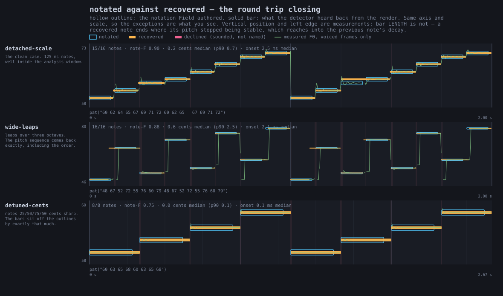

[Open ↗](/offline.html?file=/field4/assets/agent_transcripts/pitch_transcription_roundtrip/metadata.edn)

### petri_sound

[Petri nets as a sequencer](petri_nets.md) as seven independent boxes, each
drawing its net with `showPetriNet` and playing it with `showDirtAudio`: a net's `emits()` is a
`PatPattern<String>`, so the audio path takes it with no adapter. The audio is
mixed *offline* from the real Tidal Dirt-Samples library when it is installed (`DirtRender.kt`
auto-discovers the SuperCollider quark, `FIELD_DIRT_SAMPLES` overrides) and from the synthetic
`patVoice` when it is not, and each box prints which one it used, so this file sounds like actual
drums on a machine that has the samples and still runs, silently degraded, on one that
does not. *The smallest loop* is one token going round two transitions and prints
`bd sd bd sd bd sd bd sd` at a period of `1/4`. *Five against three* shows what the model is for:
nothing in its source says fifteen, and `settle()` prints that it settles after 15 steps into 2
T-invariants (one per independent ring) with four cycles of audio so you can hear the rings drift
and re-align. *Song structure* and *tokens that are rhythms* are the medium timescale: the second
carries a whole `PatPattern` as a token's colour, so `unfold` prints four bars of `bd sd` followed by
four of `bd bd bd bd hh hh…`, an arrangement enforced by the net rather than by a scheduler, because
only one place is marked. *Dining philosophers* is silent, and is the contrast: the same
engine as a concurrency checker, printing `deadlocks=true` for the naive table, then
`deadlocks=false … never fires: grab.4, eat.4, done.4` for the asymmetric one: a starvation, not a
deadlock, which is why the third line adds a fair conflict policy and nothing is left over. And
*playground* is the box to edit: a read arc counting a fast `bd hh` ring, a weighted arc draining
three at once, and a snare that consequently walks backwards through the bar (`bd hh bd hh bd hh bd
sd hh` becoming `bd sd hh bd hh bd hh bd sd hh`), which is a 3-against-8 nobody wrote down. A
seventh box is the *live* path rather than the offline one (the real polyphonic Dirt player driven
by the transport) behind a `live` flag that defaults to false, because `audio { }` opens an output
device and this file is replayed end to end in CI; the flag rather than a comment is what keeps
those lines compiling.


[Open ↗](/offline.html?file=/field4/assets/agent_transcripts/petri_sound/metadata.edn)

### petri_state_space

The other half of `afield.petri`: the same engine as an exact concurrency
checker, in five boxes. Where `petri_sound` asks what a net *plays*, this asks what it can *do*,
[the classical questions](petri_nets.md) over every interleaving rather than the one the conflict
policy picks. The first box makes the case: on the symmetric five-philosopher table `willDeadlock()`
prints `true` for that one trajectory, and `stateSpace()` exhausts all **82** reachable markings, all
**265** firings between them, and hands back the shortest sequence that wedges it: `grab.0, grab.1,
grab.2, grab.3, grab.4`, five firings, each of the markings along the way re-fired through the
engine's own enabling test by `verify()` before it is believed. It is drawn, too: BFS depth left to
right, one dot per marking, the counterexample in orange across the top into a red-ringed `stuck`.
*Asymmetric* is the fix and the fault that survives it: 70 markings, deadlock-free *proved* rather
than observed, and then `deadTransitions()` naming a starved philosopher on the same net where
`neverFires()` correctly names nobody, because starvation belongs to the conflict policy and deadness
belongs to the net. *Buffer* counts the four-slot producer/consumer buffer at exactly five reachable
markings, 4-bounded, live and reversible, and asks an `EF` query for the shortest route to a full one.
*A leak* is the inconclusive one: the exhaustive search reports `BUDGET` and returns `null` (unknown) from
every accessor that would otherwise have said "safe", while Karp–Miller puts an ω on the leaking place
and terminates in two nodes. And *what the algebra cannot see* prints two nets with byte-identical
incidence matrices, one of which enforces mutual exclusion with an inhibitor arc: no P-invariant
couples the two critical sections, and the search proves the exclusion over all three markings anyway.
Finally *the wall* measures the thing a green tick hides: the philosophers' state space grows like the
companion Pell numbers, about 2.41× per philosopher, so eleven is 16 238 markings in 230 ms and twelve
is past the budget, and a stubborn-set partial-order reduction turns that into `2n²−2n+2`, a **73×**
speed-up at eleven and an answer at twelve, while refusing every property the theorem does not cover.


[Open ↗](/offline.html?file=/field4/assets/agent_transcripts/petri_state_space/metadata.edn)

### petri_tala_layout

One net, drawn twice, to compare Field's own layout with TALA — the engine
[d2](https://d2lang.com) uses for architecture diagrams, open-sourced in September 2026 and reached
through the optional `native/field-d2-layout` co-process. `PetriLayout.FORCE` relaxes a spring model
from 48 seeded starts and keeps whichever scores best on crossings and overlaps; `PetriLayout.TALA`
places the nodes at their real sizes instead, laying the net out once per direction bias and keeping
the fewest crossings. Which wins is per net rather than settled: on the dining table on
[the Petri page](petri_nets.md) FORCE crosses none and TALA three, while on the smaller table here it
is five against one, and TALA gets there in 2.1 s to FORCE's 4.5 s. The third box is the one to read
after running it — it prints which engine actually drew the second panel, because a machine without
the helper gets FORCE twice and should be told so rather than shown a relabelled drawing.

The figure is the same two-panel comparison on the *larger* dining table of
[the Petri page](petri_nets.md), which is where the direction reverses: FORCE's relaxed spring
drawing crosses nothing, and TALA's orthogonal routing crosses three.


[Open ↗](/offline.html?file=/field4/assets/agent_transcripts/petri_tala_layout/metadata.edn)

### box_layout_demo

The only scene here that is a starting position rather than a result: nine
boxes wired into a pipeline and placed badly, so there is something for **Lay out
selection** and **Lay out whole document** to fix. Both palette commands read each box's frame for
its size and the box graph for its edges, ask the same `native/field-d2-layout` helper where things
should go, and animate the boxes into place through `OperationTranscript.recordMove`, so one undo
puts the document back. Two properties are worth watching for: the boxes keep the sizes you gave
them, where a diagram tool would resize a container around its contents, and the arrangement lands
back on the selection's own top-left corner instead of the document origin. Nothing runs when the
transcript replays — the nine boxes carry one-line comments and no execution — so the scene opens
the same way every time.

[Open ↗](/offline.html?file=/field4/assets/agent_transcripts/box_layout_demo/metadata.edn)

### mesh_geometry_examples

The [mesh and 3D geometry worked example](mesh_examples.md) as seven
independent boxes, one per stage of the family. *Primitives* builds a cube, an icosphere, a torus and a
cylinder and prints what each one is: welded, watertight, χ = 2. *Marching cubes* takes a sphere, a
drilled sphere and a gyroid out of scalar fields and shows the surface converging on the analytic
volume as the resolution doubles. *SDF modelling* writes a shape as an expression (primitives combined
with union, difference and a smooth minimum) then meshes it. *Subdivide, smooth, decimate* runs one
mesh through Loop subdivision, then Laplacian against Taubin (watch which one holds its volume), then
QEM decimation to a triangle budget with the deviation that costs. *Curvature, rays, closest points,
inside* queries a torus through the BVH and prints correctly-signed Gaussian curvature. *Bridges* turns
`voronoi3d` cells into meshes, meshes into `FLine`s, and writes OBJ and STL. The last box needs no view
code at all: it evaluates a `TriMesh` and lets its own `ToHTML` draw it: a shaded render beside the
counts, χ, genus, area, volume and bounds. Every box is pure CPU and runs on its own.


[Open ↗](/offline.html?file=/field4/assets/agent_transcripts/mesh_geometry_examples/metadata.edn)

### geometry_from_disk

[Geometry from disk](geometry_from_disk.md) as three boxes, all of them
starting from a file rather than a generator. The first reads the committed 5.4 MB Khronos ToyCar
GLB through `meshFromAnyFile` and renders it with `showMesh`: **77,429 vertices, 108,936 triangles**
over three mesh/material buckets, each baked through its own node transform so the car arrives
sitting on its draped cloth rather than heaped at the origin, and extent **0.073 × 0.029 × 0.074**,
because the file is in metres and it is a 7 cm toy. It reports **χ = 1909, open, 2782 boundary
loops**, which is what an artist's shell always looks like once every UV seam is counted as the cut
it really is. The second writes one coloured sphere out as OBJ and as binary STL and reads both
back, printing the comparison: OBJ returns **642 verts, watertight, χ = 2** with its normals and
without its colours, STL returns **3840 unshared verts, χ = 1280, open** and welds back to 642
without its normals, while the volume stays **4.152741** down every route, which is the check that
the coordinates themselves survived. The third writes a four-corner coloured ASCII PLY and reads it
with `PlySupport.loadPly`, which needs no renderer at all, then bridges it to a `TriMesh` with the
colours intact and the loader's invented `(0, 0, 1)` normal correctly dropped. Change the path in
the first box to a mesh file of your own; boxes two and three clean up the temp files they write.

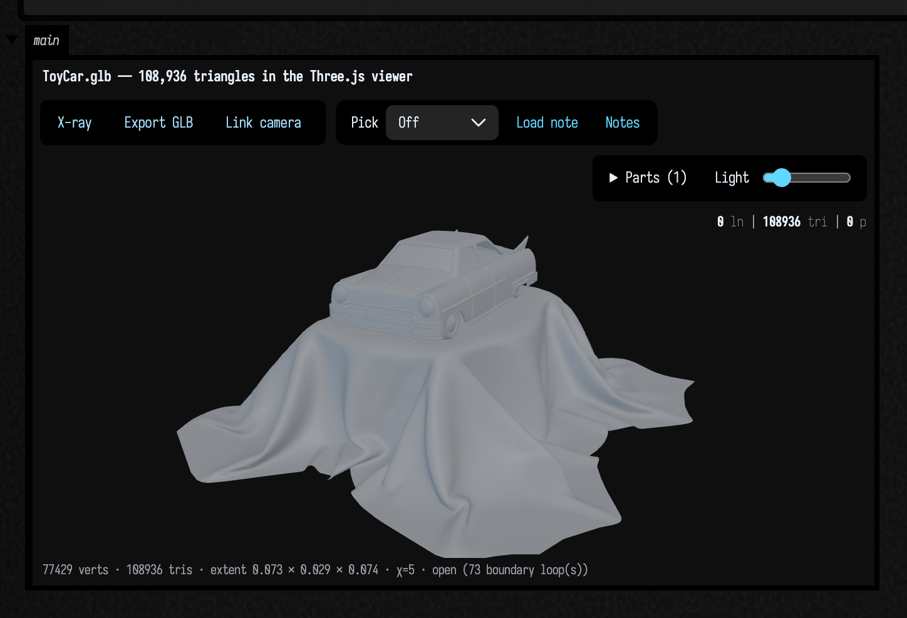

[Open ↗](/offline.html?file=/field4/assets/agent_transcripts/geometry_from_disk/metadata.edn)

### typography_worked_example

[Typography as geometry](typography_examples.md) as eight boxes, and
the interesting thing about it is that there is no AWT rasteriser anywhere in the file: AWT is touched
only to read a font's glyph outlines, and every picture after that is Field's own scanline filler or
Skia SVG. *A string becomes contours* prints, per glyph, the contour and hole counts, the advance, and
each ring's depth and *signed* area, which is where the winding convention becomes visible. *The
winding convention, and what happens without it* is the control arm: the same word rasterised with
`honourHoles = true`, with it switched off (the counters close up solid), and under `EVEN_ODD` over
the correct rings, then it prints the worst per-pixel difference between the last two, where 0.0
means the two fill rules agree exactly. *Advances, kerning, tracking, alignment* prints two identities
instead of claiming them: the laid-out advance width against the sum of the glyph advances, and the
line widened by tracking against `(gaps × 0.16 em)`. Its kerning probe is written to survive a face
with no kern table at all, and prints which happened. *Text on a curve* lays a ring by arc length and
prints how many glyphs turned with the curve, plus that the original layout is untouched. *The
handles, animated* must be **launched**, not executed, and pre-computes its window from the wave's
extremes so the frame does not jitter. *Extrusion* checks a 2D hole count against a 3D Euler
characteristic and prints ink area × depth against the measured mesh volume. *SDF* and *point clouds*
close it out, the second running Delaunay and k-medoids over sampled letters.

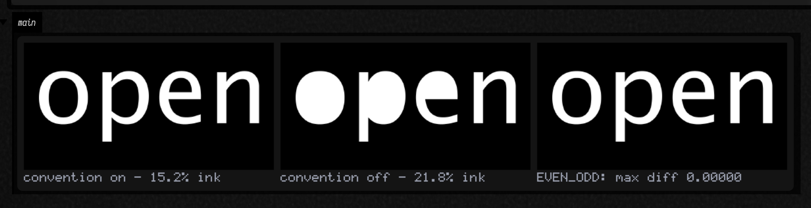

[Open ↗](/offline.html?file=/field4/assets/agent_transcripts/typography_worked_example/metadata.edn)

### wfc_worked_example

The [Wave Function Collapse worked
example](wfc_examples.md) as eight independent boxes: adjacency authored by hand with `wfcRules { }`
and both phases pinned with `forceTile`; the simple-tiled model learned from an image, printing the
band histogram that shows its learned weights losing the water bands entirely; an eight-tile
edge-socket set whose traces always connect; the overlapping model with and without the classic
ground constraint; von Neumann vs Moore on a source built so the choice provably matters (473
diagonal breaks against 0); and the collapse itself sampled through `step()` into wave and
possibility-count frames; and both `FloatArray` paths, whose synthesised heightfield ends up as
iso-contour `FLine`s. The last box needs no view code at all: it evaluates a half-collapsed and a
contradicted solver and lets `WfcSolver`'s own `ToHTML` draw them: possibilities left, entropy, and
the tiles decided so far, with the contradicted cell marked in both heatmaps. Every box is pure CPU,
runs on its own, and prints the numbers the docs page quotes.

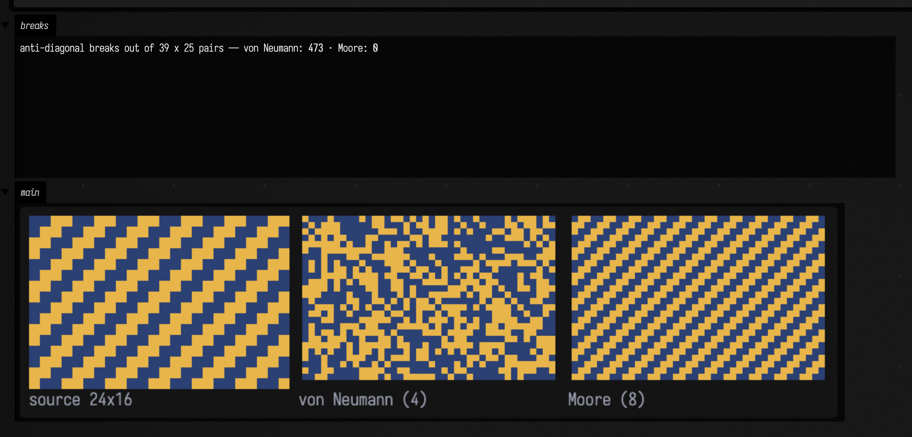

[Open ↗](/offline.html?file=/field4/assets/agent_transcripts/wfc_worked_example/metadata.edn)

### spatial_geometry_examples

The [Voronoi, contours and clusters worked
example](spatial_geometry_examples.md) as five independent boxes, each drawing itself with
`showPlaneGrid` (which is `drawToSVG` → `display`, so no AWT and no GPU). *Delaunay* builds the
triangulation, its Voronoi dual and the convex hull, checks the triangle and edge counts against
Euler's `2n-2-h` and `3n-3-h`, and prints how far past the sites JTS's clip envelope for an unbounded
cell actually reaches. *Apollonius* runs the same five sites at equal weights (every bisector a
straight line), at mixed weights (every bisector a circular arc), and with one site heavy enough to
swallow two neighbours into **complete discs** (which makes its own cell a region with holes rather
than a polygon) then verifies every boundary sample really is a score tie. *Contours* recovers the
Voronoi diagram from a completely different algorithm by contouring the gap between the nearest and
second-nearest site, and shows why asking for iso `0.0` finds *nothing*: that field is non-negative,
it grazes zero on the seams, and marching squares locates sign changes. *Marching* puts the two
decisions inside marching squares on inputs whose exact answer you know: a level set running through
a whole column of grid samples, a circle passing exactly through grid corners, and the ambiguous
saddle cell, and draws the sampling grid so you can see what the marcher had to work with.
*Clustering* cuts a merge tree at two depths, shows the finer cut nested inside the coarser, and runs
k-medoids and k-medians on the same planted clusters. Every box is pure CPU and runs on its own; move
a site, change a weight, raise an iso level or ask for a different `k` and re-run it.


[Open ↗](/offline.html?file=/field4/assets/agent_transcripts/spatial_geometry_examples/metadata.edn)

### alife_evolution

The other half of [spatial artificial life](alife_examples.md): four boxes that
**search** those rule spaces rather than measuring a rule someone chose. The fitness functions are
`alife.kt`'s own 816 lines of morphology statistics, read as objectives instead of as reports. Box 1
asks for a Lenia soliton (alive, in one piece, travelling) and scores it straight off `leniaRun`'s
own DEATH/BOUNDED/SATURATION classification and wrapped centroid drift, so the phase is measured
rather than asserted. Box 2 runs the *same engine* over a genome with nothing in common with the
first: 49 bits of birth and survival counts at radius 2, recombined by real uniform crossover,
selected by lexicase over two soups because a rule that holds together on one initial condition and
collapses on the other is exactly what a tournament's average hides. The radius is the lesson: at
radius 1 the space is 2¹⁷ and a few hundred independent draws land near the optimum on their own, so
evolution wins by 3 % and the search is not what found it. Box 3 illuminates the `(density,
activity)` behaviour space with MAP-Elites and prints coverage beside quality per occupied cell:
random sampling spreads over a descriptor space for free, so coverage on its own claims nothing. Box
4 is the one that pins the shared machinery: `FunctionEvolve.evolve` is a one-line call to
`PopulationSearch.evolve(mu = 1)`, and the FIELD_TEST `functions.evolve.worked-example` holds it to
`bestScore = -0.15676727177844857` over 961 evaluations, bit for bit. Every box carries a
`PopulationSearch.random` control arm at the same budget under the same seed, because a generator
good enough to stumble onto a decent rule occasionally looks exactly like a successful search. None
of the four opens a `Window` or a `Renderer`. Change `LifeRuleGenome(radius = 2)` to
`LifeRuleGenome()` in box 2 and watch the margin collapse.


[Open ↗](/offline.html?file=/field4/assets/agent_transcripts/alife_evolution/metadata.edn)

### alife_worked_example

[Spatial artificial life](alife_examples.md) as twenty boxes: ten that
measure, and a band below them of ten that **move**. The measuring ten are independent and pure CPU:
Conway's Life checked against the glider's exact `(1, 1)` displacement and the R-pentomino's
textbook peak of 319 at generation 821; Wolfram's rule 90 checked cell-for-cell against Pascal's
triangle mod 2 computed from Kummer's theorem; a cyclic CA whose soup advance fraction matches the
closed form `1 - (13/14)^8` and then pins at 1.0; Gray–Scott's regimes told apart by isoperimetric
ratio, with two controls that produce nothing at all; Lenia's discrete limit shown bit-identical to the
integer Life stepper; boids and Physarum each against a twin run with one interaction switched off;
DLA's mass dimension against an Eden cluster and a uniform sprinkle; the Koch snowflake's exact
closure, length and area identities; and the bridges out to iso-contour `FLine`s, a colonization tree
and a watertight marched mesh. Every one of them prints the numbers the docs page quotes.

The moving ten are the same systems as time evolutions, through `Box.animateEvolution`: each one a
schedule (how many steps, over how many seconds, on what ramp) plus a way to draw the state, with the step
counter burned into every frame so a clip cannot lie about where it got to. They must be **launched**
rather than run: a `Frames` that is only built never runs. None of the twenty opens a `Window` or a
`Renderer`.

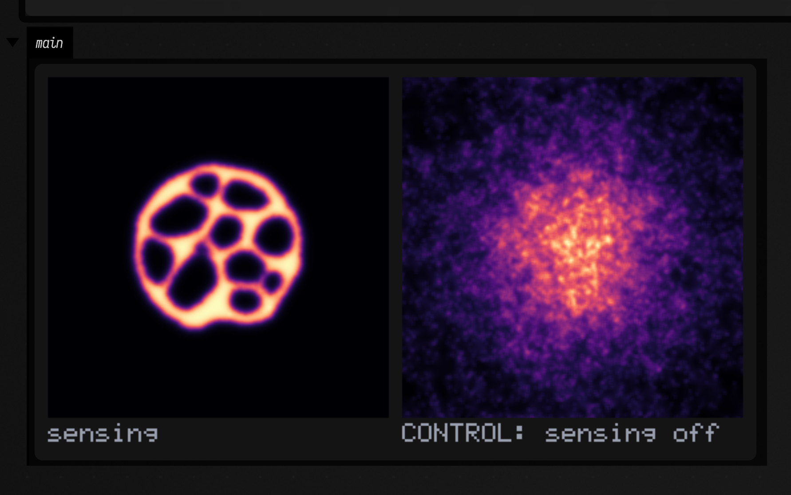

[Open ↗](/offline.html?file=/field4/assets/agent_transcripts/alife_worked_example/metadata.edn)

### statistics_examples

[Measuring dependence between two signals](statistics_examples.md)
as five independent boxes. *Summary* pins the three quantities `buildSummaryStats` makes easy to
misread: MAD recomputed from scratch to show it is the unscaled median absolute deviation, the
`sampleStdDev/populationStdDev` ratio against `sqrt(n/(n-1))` to show which of the two conventions the
card's `stddev` follows while its `skew` follows the other, and `cv` blowing up to 10¹⁴ once the mean is
re-centred to zero. *Histogram* re-derives the bin-width rule and predicts the bin count before asking:
28 bins where Freedman–Diaconis wins, and 10 where FD and Scott are both inflated by the distance
*between* two modes so the crudest rule, Sturges, decides. *Dependence* is the centrepiece: six shapes
at n=400 with all six coefficients on each, `xi` shown asymmetric (0.985 forwards, 0.246 backwards on a
parabola), `dCor` shown to be exactly 1 for *any* straight line but only 0.491 for a perfect parabola,
and then the permutation test the family does not provide: the growing-spread case's dCor of 0.193 beats
all 400 random re-pairings while its xi of 0.026 is beaten by 76 of them. *Rolling* runs both rolling
classes across a regime change against rolling `|pearson|` and against the measured null threshold, then
cross-checks the incremental sums against the O(w²) batch call, two different algorithms agreeing to
5×10⁻¹⁵. *Warp* fits an 8-knot quantile warp on one log-normal draw and measures a disjoint second one
(skew 11.7 → 0.007), compares it against the exact `Φ⁻¹(F̂(v))` built in the box, and prints both sharp
edges: `evaluate(-1.0)` returning −21.1 outside the fitted knots, and the 0.20 smoothing tracking
`10·0.8ᵏ`. Every box is pure CPU and self-checking; change a shape, a window size, a target distribution
or an n and re-run it.

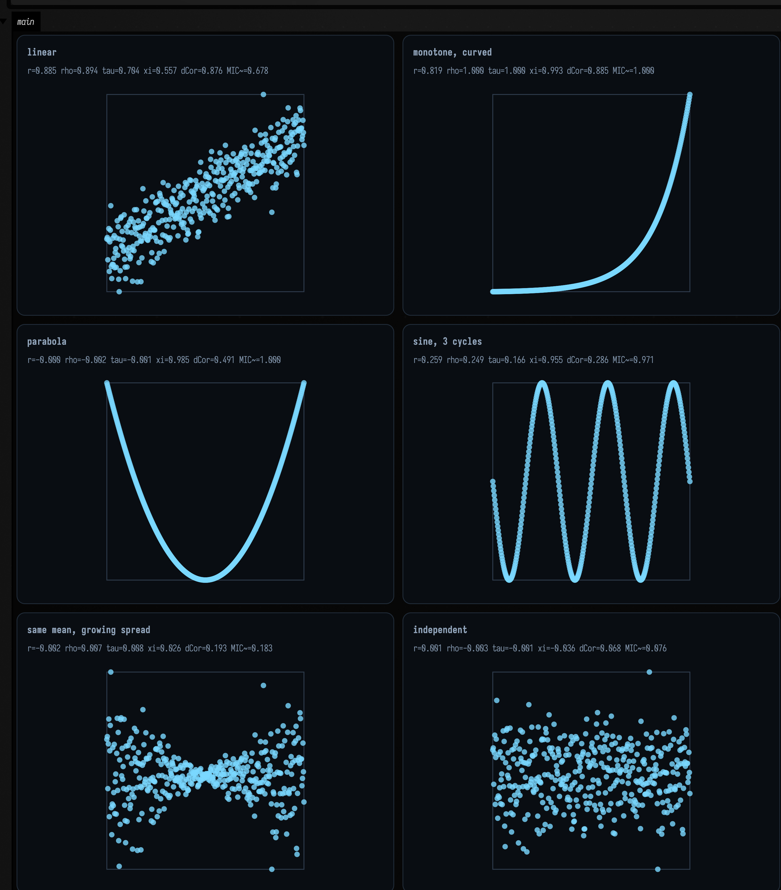

[Open ↗](/offline.html?file=/field4/assets/agent_transcripts/statistics_examples/metadata.edn)

### spectral_examples

[Spectral examples](spectral_examples.md) as five independent boxes over the
same chirp. *One spectrum* runs `fft` with a Hann window and plots the one-sided magnitude against
real Hz, with the centroid and the 85 % rolloff drawn in as dashed marks rather than left as numbers.
*Spectrogram* takes the same chirp through `stft`, converts to dB relative to peak with an explicit
−80 dB floor, and overlays the centroid trace on the heatmap. *Mel* runs two chirps crossing in
opposite directions through a 48-band filter bank, so the picture is an X and the bands are the only
thing you have to trust. *Resonator bank* is the control arm and does no transform at all: 96
log-spaced resonators from 120 Hz to 3900 Hz recover the same structure by filtering, which is worth
seeing beside the FFT. *Streaming features* pushes samples one at a time through
`EMAFilter then SpectralCentroidFilter`, plus flux and RMS, into two injected onsets planted a third
and two thirds of the way through, so spectral flux has something it should spike at.

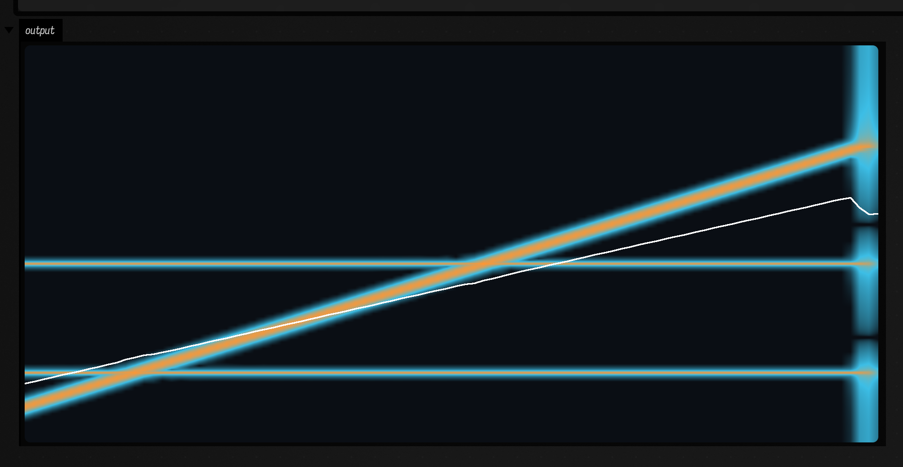

[Open ↗](/offline.html?file=/field4/assets/agent_transcripts/spectral_examples/metadata.edn)

### imaging_cv_examples

[Imaging and computer vision](imaging_examples.md) as six independent
boxes, all pure CPU: `showImgGrid` is `Img.toPngBytes` → `PngEncoder` → `display`, so there is no AWT
rasteriser and no GPU. The images are large (2400×1800, 4.3 megapixels, 52 MB of float
RGB) because that is the size at which "is this fast enough to actually use?" has a meaningful
answer. *Basics* prints the Otsu threshold it computed rather than one guessed, and resamples down and
back up so you can see the detail is really gone. *Filters* corrupts a clean synthetic image with 4 %
salt-and-pepper noise and prints the mean absolute residual of gaussian, median and bilateral against
the clean original: the median is the right tool for impulse noise and the numbers say so, not the
picture. *Edges* runs Canny beside `cannyAuto`, whose thresholds come from that image's own gradients,
and ends with the closed outlines as `FLine`s. *Features* plants a square with known corners and a
decoy ring Hough must not fit, then prints how far the worst Harris corner landed from the true
corner. *Morphology* plants three discs of known radius and prints the distance-transform peak against
the largest planted radius. *Motion* warps a frame by a *known* affine transform, tracks it with
pyramidal Lucas–Kanade, fits a homography with RANSAC, and prints how far the recovered model
disagrees with the planted one over a 16-point probe grid, the real number for this whole family.

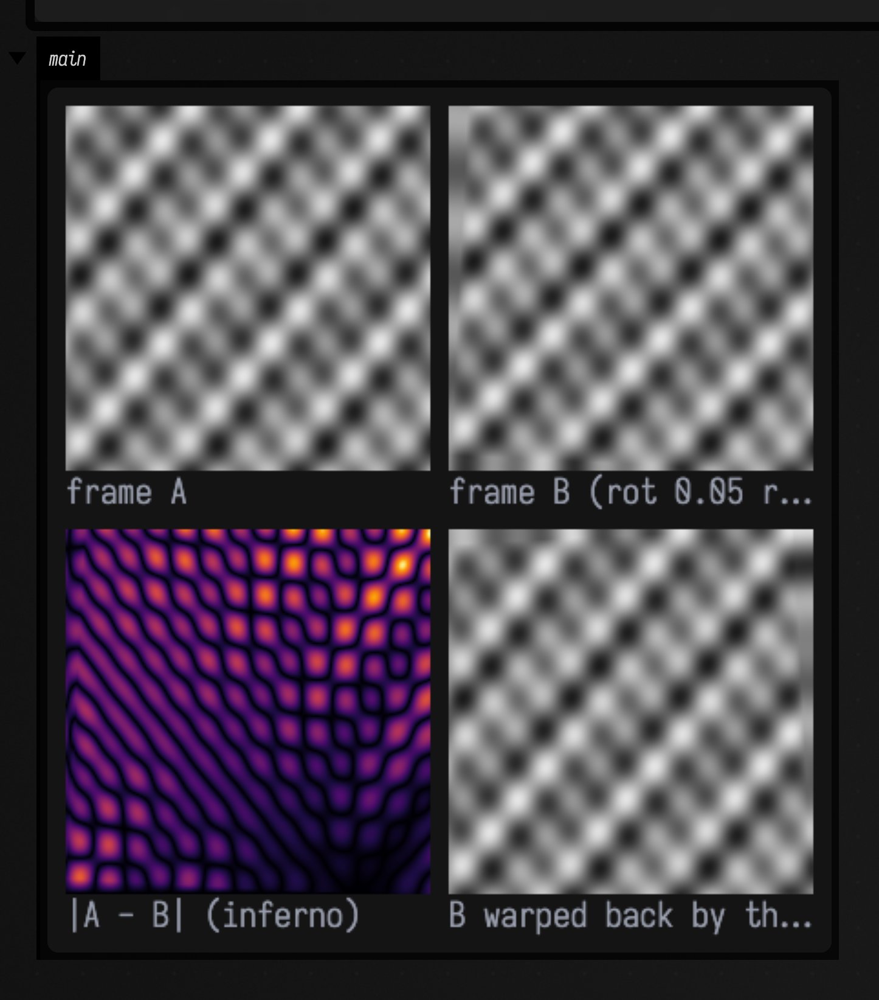

[Open ↗](/offline.html?file=/field4/assets/agent_transcripts/imaging_cv_examples/metadata.edn)

### imaging_vector_kernels

Three boxes that each time one imaging primitive against a *second,
independent definition of the same thing*, written out longhand in the box. *pyrDown* times the fused
decimation against blur-then-throw-away, and prints the max elementwise difference so you can see the
only disagreement is float summation order. *boxBlur* times the running-sum implementation against
`convolveSeparable(boxKernel1D)`, which shares no code with it, and then prints the two blocks
together, at radius 2 and at radius 24, because read together they say something the O(1)-beats-O(k)
story gets wrong: at radius 2 the *kernel* is faster, and only past a crossover of a few pixels does
the running sum win. A running sum is serial by nature; five taps of separable convolution vectorize
freely. *bilateral* has no cheap reference, so it probes 3 px either side of a disc boundary at
`y = 210`, about one `sigmaSpace`, chosen because probing 30 px out would show a preserved step and
prove nothing, then prints the noise left in a flat patch. The absolute milliseconds here are not the
published benchmark (that is `:tools:imaging-bench` against OpenCV); what these boxes show is the
ratio to the slower definition. See the *Is it fast enough?*
section of [Imaging and computer vision](imaging_examples.md) for the measured comparison.

[Open ↗](/offline.html?file=/field4/assets/agent_transcripts/imaging_vector_kernels/metadata.edn)

### imaging_visualizers_demo

Ten boxes with no `showImg`, no `display()` and no `println` in any of
them. Every box's last expression is an imaging value, and what you see is the inline
`ValueVisualizer` deciding how to draw it, which makes this the demo for
[visualizers](visualizers.md) rather than for imaging. `Img` gets an aspect-correct thumbnail with a
channel strip and per-channel histogram behind a disclosure; a signed `sobel().dx` gets a diverging
map with zero pinned rather than at an arbitrary grey; an out-of-range magnitude image gets rescaled
with its *true* range printed instead of appearing as a flat white rectangle. The fourth box is the
non-finite case: one `NaN` block and one lone `+∞`, counted, excluded from the statistics that set
the range, and painted magenta, so neither poisons `min`/`max`, turns `normalized()` into an
all-NaN image, or leaves the thumbnail silently black. `List<Corner>` is a scatter sized by strength;
check its disclosure against the corners of the rectangle the box planted at `x 30..90, y 26..76`.
`List<HoughLine>` is drawn twice, once clipped into a canvas the visualizer had to *invent* (the
caption admits it) and once as accumulator peaks. `FlowField` draws failed tracks as grey crosses
rather than hiding them, and `ComponentLabelling` rotates hue by the golden ratio so adjacent label
ids get unrelated colours.

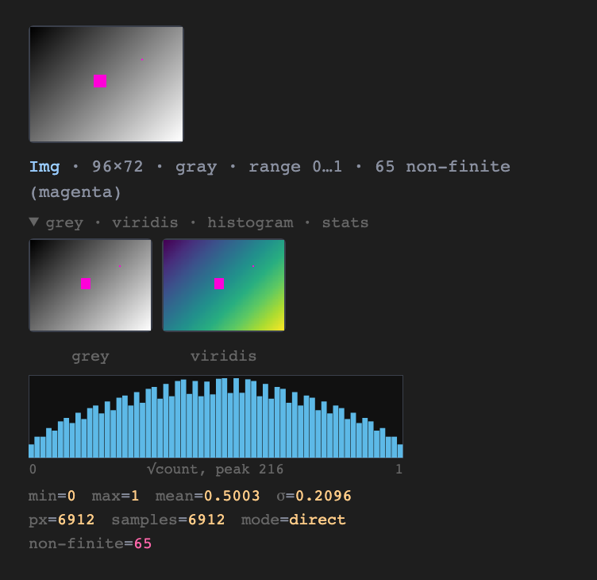

[Open ↗](/offline.html?file=/field4/assets/agent_transcripts/imaging_visualizers_demo/metadata.edn)

### viz_showheatmap

Four small boxes for the one-line helpers, and the shortest thing on this page.
A Gaussian bump in viridis; a diverging field with `normalize = false` and explicit `vmin`/`vmax`,
which is what anchors the white midpoint at zero rather than at the data's mean; a synthetic
spectrogram with `transpose`, `flipY` and `logScale`, which is the shape a spectrogram wants; and a
hand-built ARGB `IntArray` through `showImage`. `showHeatmap` and `showImage`
encode with `PngEncoder` and `display`, so there is no manual bilinear resampling, no flipY
bookkeeping and no AWT.

[Open ↗](/offline.html?file=/field4/assets/agent_transcripts/viz_showheatmap/metadata.edn)

### audio_ai_codec

One box for the [EnCodec reconstruction
microscope](audio_ai_codec.md): two waveform players with a shared playhead, two log-frequency STFT
images, and a token map you can hover to read a codebook entry. The box builds a deterministic
fixture in-process (a 4-second chirp at 8 kHz, a "reconstruction" that is the source at 0.91 gain
plus two tones of codec texture, and 4 × 200 token frames) and the metrics in the header are literals
typed into `ReconstructionMetrics` rather than measured. The real path reaches an isolated GPU
service; this transcript exercises the real `CodecVisualization` renderer against the fixture, which
is why it runs in CI at all.

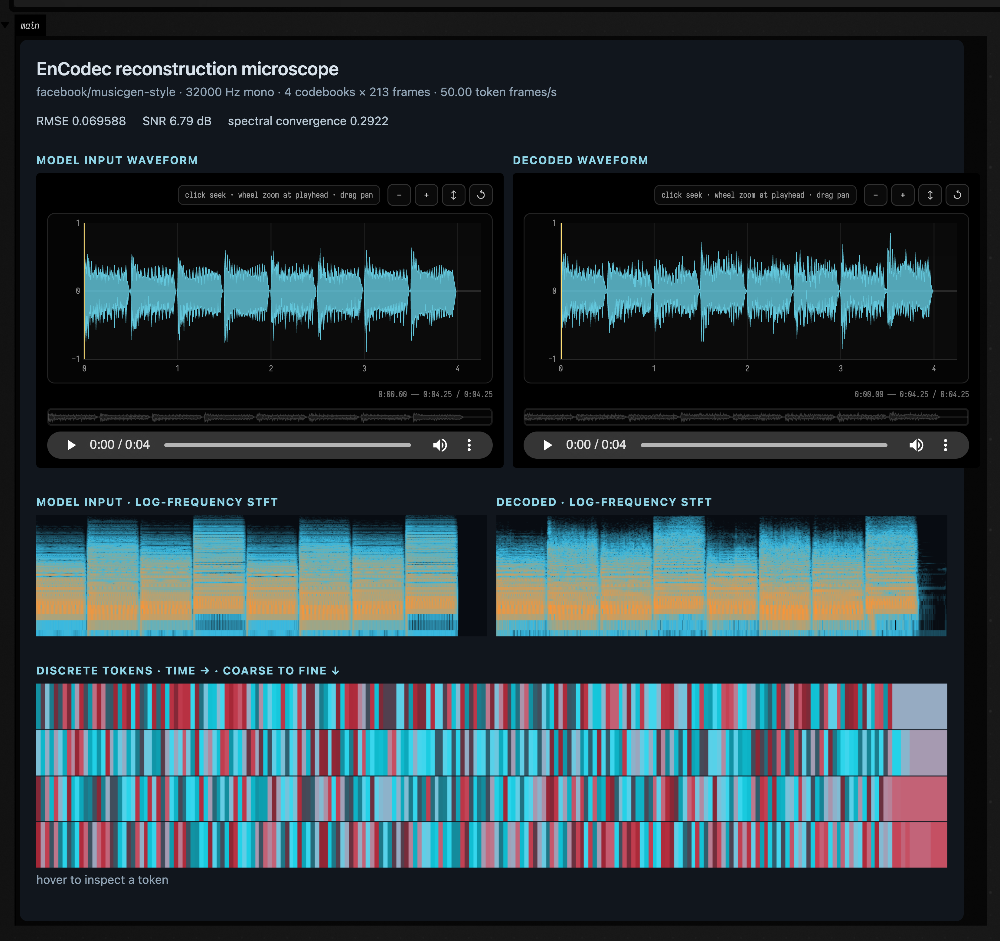

[Open ↗](/offline.html?file=/field4/assets/agent_transcripts/audio_ai_codec/metadata.edn)

### arclength_spacing_demo

Two boxes on the difference between spacing a curve by its *parameter*
and spacing it by its *arc length*. A cubic can be perfectly straight and still be parameterised so
unevenly that `t = 0.5` is four fifths of the way along it, which is exactly the case an arc-length
table has to catch. *Dashes* dashes the same two curves twice (marching `t` in
equal steps down the left column, `byDashing` down the right) and captions each panel with the
shortest and longest dash it actually drew (18.8 .. 25.0 against a requested 22.0 for a mere S-curve;
far worse for the collinear one). *Ticks* puts 24 equal steps of parameter beside 24 equal steps of
arc length with the max/median gap on each (2.821 against 1.000 on the collinear cubic), and returns
the mechanism as numbers: a subdivision metric reading 0.000 on a curve that another scores at 161.
Both boxes compute both spacings live, so neither picture is stored. Move a control point towards the
middle of the chord and re-run to watch the two columns converge.

[Open ↗](/offline.html?file=/field4/assets/agent_transcripts/arclength_spacing_demo/metadata.edn)

### close_node_demo

Two boxes about the `Close` node in the middle of an `FLine`, which is a shape
Field's own stdlib produces. *Reversing a closed contour* writes out a naive reversal walk inline,
beside the shipped one, on a square whose fourth side is the close and on a
two-contour glyph with a counter, and captions every panel with one number, the fraction of the
original length the reversal actually retraced, because a reversal that drops a segment is shorter
than what it reversed and that is the whole story. It also round-trips each reversal twice and prints
whether the node-class sequence came back identical. *The shipped primitive* shows where such a line
comes from: `arrow(a, b, startHead = true, endHead = true)` from the stdlib is ten nodes with two
`Close` nodes in it, at indices 5 and 9, so exactly one of them is interior and no cleverness was
needed to build it. It runs ten public operations over that arrow
under `runCatching` (reverse, subdivide, simplify, convex hull, filter, winding number, contains,
centroid, bounds, dash) and prints `ok` or `THREW` for each. Both boxes draw with
`showPlaneGrid`, so no AWT and no GPU.

[Open ↗](/offline.html?file=/field4/assets/agent_transcripts/close_node_demo/metadata.edn)

### dynamic_graph_systems_examples

[Graphs that change while you
watch](dynamic_graph_systems_examples.md) as six independent boxes: point clouds that move while the
graph joining them is continually reinforced and forgotten. *Six systems* runs all six
`DynamicGraphSystem`s over one 220-point disc for the same 20 frames with the same reinforcement and
ceiling, and tells them apart by the one exact structural fact that separates them: the fraction of
edges that close a triangle, which is 0.0 % for flowline advection (a functional map, one arc per point)
and 100 % for both face-builders, the local tangent fan and alpha-event collapse. It also prints the peak
weight each system reached against the shared ceiling, which is how you find out that the alpha-event
system's area-scaled increment tops out at 0.3 % of it. *Decay* pins both forgetting laws against their
closed forms at 1, 4 and 120 steps (`e^-0.7 = 0.496585304` and `0.300000000`), halves a weight with
`ln 2 / λ`, and expires an edge by `ttl` while it is still at its ceiling: the two independent ways an
edge can die. *Hysteresis* walks two points apart from 0.05 to 0.13, past `rEnter` and inside `rExit`,
and shows the edge surviving where the `rExit == rEnter` control arm loses it; then 150 frames of a
wobbling 200-point disc measure what that buys: 553 edges created and 81 lost against 996 and 637, so
the memoryless arm creates 1.80× as many and loses 7.9× as many and its edge set never accumulates
enough weight to be a memory of anything. *Threshold* is the centrepiece: a static 240-point background
mesh with three rigid 22-point clusters crossing it, where a `minWeight` cut of 1.2 leaves **zero** edges
crossing a group boundary and components of exactly `[240, 22, 22, 22]`: the co-moving groups recovered
out of a graph that has only ever seen positions and a clock. The last two boxes must be **launched**,
not executed: *breathing* rewires a k-nearest-neighbour graph over a cloud that never moves, beside the
identical system with its clock pinned at zero (which holds exactly 590 edges for all 420 steps), and
*morphogenesis* grows a 64-point ring into a branching filament beside the same nine-stage pipeline with
tip growth removed. Every box is pure CPU; no `Window`, no `Renderer`.


[Open ↗](/offline.html?file=/field4/assets/agent_transcripts/dynamic_graph_systems_examples/metadata.edn)

### autodiff_worked_example

Field's **automatic-differentiation layer** as five independent
boxes, one per layer of the stack. *Basics* differentiates one expression three ways that have to agree
(a reverse-mode tape sweep, a second-order forward-mode `Dual2` number, and a central-difference
oracle) and plots `f`, `f'` and `f''` from a **single** sweep, because the second derivative comes
free with the forward pass. It also prints the exact 2×2 Rosenbrock Hessian, which is a polarised
`Dual2` result rather than a finite difference of a gradient.

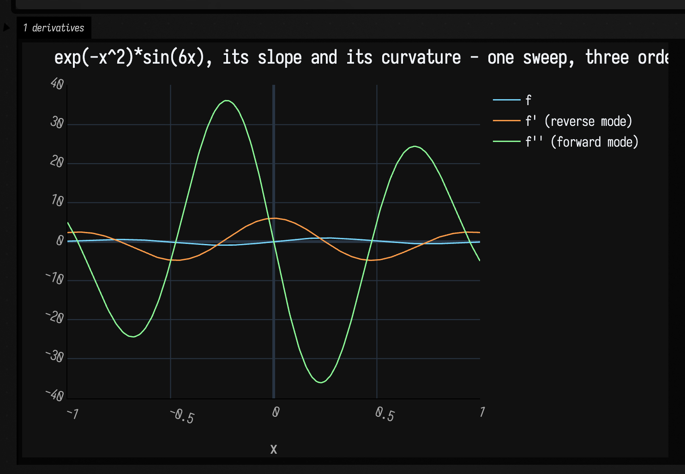

*Optimizers* walks the same Rosenbrock valley three times on the same exact gradients. The picture is
the argument for a line search: L-BFGS plunges past 10⁻²⁴ in about 42 iterations and stops, while
SGD+momentum is still zig-zagging near 10⁻³ at iteration 300 and Adam has barely left 10⁰.

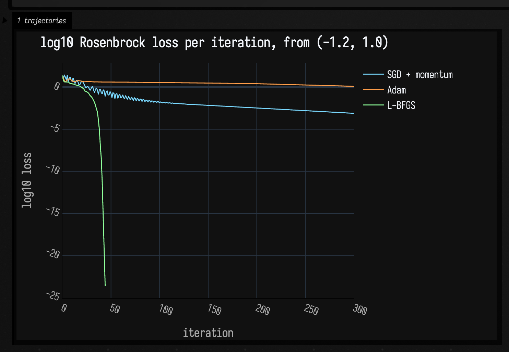

*Fn fit* is the Field-specific bridge, and the reason this is not a generic AD library. `Functions.Fn`
is a closure over `Double` and cannot be differentiated by overloading its arithmetic, but every `Fn`
the stdlib builds carries an inspectable graph, and that graph is re-interpreted in tracked arithmetic.
The box makes the *same* `fitGradient` call twice, once on the historic central-difference gradient and
once with `gradient = FnGradientMode.EXACT`: same optimiser, same step size, same landscape. Both
start at RMSE 0.3605; finite differences ends at 0.0142 after 6801 loss evaluations, the exact
gradient at 0.0096 after 801: better, for an eighth of the work. It then asks `exactFitRefusal` why a
`saw`-based seed is turned away, because the exact path re-checks its own interpreter against `Fn.eval`
before it will trust itself.

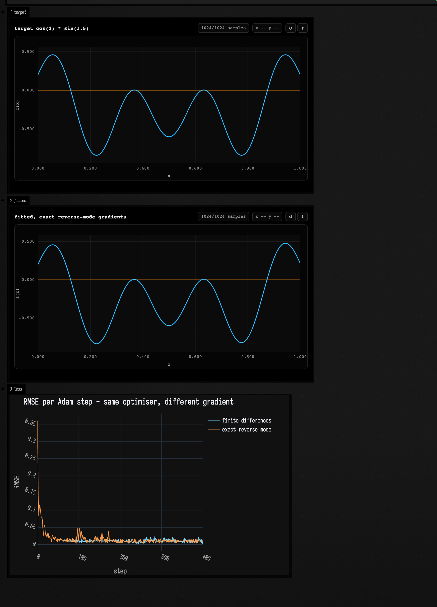

*IK* solves inverse kinematics on a four-link `FLine` chain. Forward kinematics is a cumulative angle
sum, so it differentiates cleanly and 18 L-BFGS iterations put the tip dead centre in the target
reticle. The third panel is the smoothness knob, shown as the trade it is: the pose straightens
and it *costs* 0.006 units of reach.

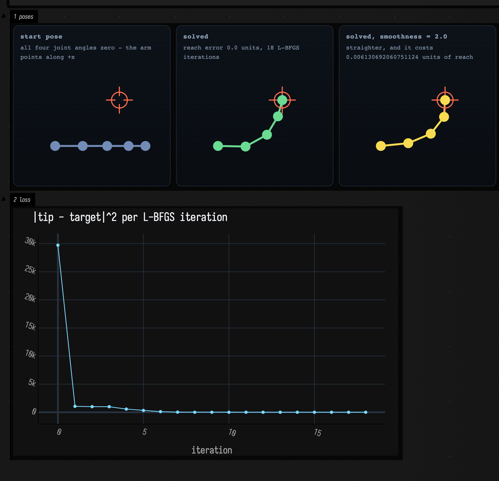

*Pack* packs twelve discs by descending `relu(overlap)²` pairwise plus `relu(penetration)²` against the
walls, worst overlap 48.3 units → 0.35. This is where the library's even-split kink convention earns
itself: at the instant two discs touch, the hinge's derivative is half a one-sided rule's, so the
packing settles instead of chattering across the contact.

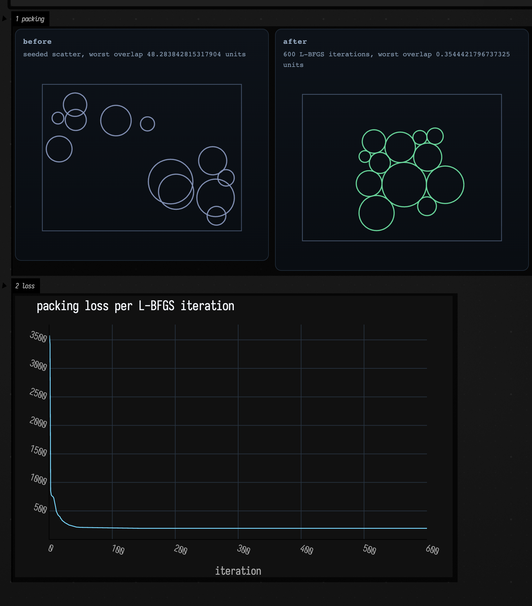

[Open ↗](/offline.html?file=/field4/assets/agent_transcripts/autodiff_worked_example/metadata.edn)

### morpho_circuit_search

Three boxes that search for circuits in
[somebody else's language](morpho_examples.md), where one unit of budget is one invocation of
morpho's own compiler on GraalJS. *Does selection beat sampling?* gives random search, hill climbing
and evolution the same generator, the same seed and the same budget on a one-bit full adder (whose
truth table is small enough that correctness is exhaustive rather than sampled) and marks
first-exactly-correct with a dropped tick, because a curve that reaches zero and one that reaches
0.004 look identical and that is the entire question. Two of the three find it; the control does not.
*A recursion, found* evolves an or-reduce, then re-compiles the same source text at 7, 9, 16, 32 and
48 bits; the widths are odd, because morpho's `SPLIT` gives equal halves only at even
widths and a family of powers of two never shows the search a cell whose halves differ, so it will
happily return a design that is silently wrong at 5. *The recursive adder is not found* is the
negative result: four drivers,
including one *given* the SPLITs, all flatten well short of correct, and then the box hand-writes the
ripple skeleton in the generator's own grammar and scores it through the same evaluator, so the target
is provably inside the search space. The empty half of that cost plane is the finding.


[Open ↗](/offline.html?file=/field4/assets/agent_transcripts/morpho_circuit_search/metadata.edn)

### keyframer_worked_example

`KeyframeScope`, the thing that stops a look you spent twenty minutes
arriving at from existing only as the contents of a running process. Four pure-CPU boxes: *targets*
registers two uniform `Structure`s, captures them into a `Key`, edits it, invokes it to write the
state back, and reads the live structures to prove it landed, including the fact that `capture()`
reads a structure's *bindings* first and then its *set values*, so a property written by value
snapshots too. *Persist* shows that every
`saveKey` also appends to a `.versions` history, that a `Boolean` or a list is dropped from a saved
key with no warning at all, and how `missingKey` lets a scope that has grown a parameter still load
an older file. *Updatecode* turns a captured look back
into pasteable Kotlin whose literals keep their *types*.

The fourth box is why a camera is stored as a `CameraPose` rather than a position: a
dual-quaternion `sclerp` is a screw motion, so it holds the subject at a constant 8.2462 units and
dead centre of frame for the whole move, while lerping the two positions cuts the corner and swings
27.2% closer at the midpoint.

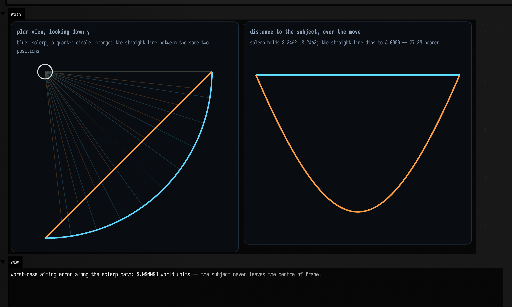

Walkthrough: [Capturing & replaying live state](keyframer_examples.md).

[Open ↗](/offline.html?file=/field4/assets/agent_transcripts/keyframer_worked_example/metadata.edn)

### keyframe_code_blend

What to do when the two keyframes are *programs*. Two looks for one
StackSL patch differ in a warp scale, an offset and a tint vector and in nothing else, so the two
token streams align and those three numbers can be interpolated; change one word instead — `fbm` for
`noise` — and the alignment reports a divergence and the blend goes back to stepping, because a
program built from the left structure with the right numbers is neither keyframe at either end. The
second box is the claim worth checking: one program, expanded once, drawn five times with only a
push constant changing, with both ends compared pixel for pixel against the programs they are
supposed to be. The third is where a runtime blend cannot reach — a modifier chain and a random range
both want literals in those positions, so a RUNTIME request comes back as STATIC, one compile per
`t`. The last two do the same thing to a pair of `sourceBlock { }` expressions, and they are where
the generated text stops being text: the blended expression is compiled through K2 and invoked at
five values of `t`, each result printed beside an expectation computed independently in Kotlin. They
are two boxes rather than one because a `SourceBackedBlock` hydrates by evaluating its source on its
own box's engine, and asking that engine to evaluate while it is already mid-evaluation re-runs the
body that is running — 327 nested runs and 355 seconds, measured. Hydrating into an idle box, which
is what the split does, runs it once.

Walkthrough: [Blending two programs](keyframer_examples.md#blending-two-programs-not-just-two-numbers).

[Open ↗](/offline.html?file=/field4/assets/agent_transcripts/keyframe_code_blend/metadata.edn)

### fn_rewrite_kotlin_boxes

The same hazard as the pair above, in the rewrite language, and the
two spellings side by side so the difference is visible rather than described. A `@{...}` right-hand
side in an `Fn` rewrite spec is Kotlin, and it is compiled in a live box's engine — but which box?
`rewriteKotlin` answers "the one calling me", so calling it from a box body asks that engine to
evaluate while the body is still running, and the body runs again: 172 nested entries and a stack
overflow, measured, until the second hydration was refused. `rewriteFn` answers "the one you name",
and the box it names here comes from the topology — `parents.lastOrNull()` — so the snippets compile
in whatever box this one is connected beneath, and dragging a different parent in moves them. The
third box is the wrong way, kept runnable: its body still runs twice, which is what the refusal
costs and why the second box is the one to copy.

[Open ↗](/offline.html?file=/field4/assets/agent_transcripts/fn_rewrite_kotlin_boxes/metadata.edn)

### pattern_rewrite_worked_example

Six runnable boxes that each hold one
[user-authored rewrite rule](pattern_rewrite.md) and one `println` that could not compile without it.
`neg(x) → -x` is the shape of the whole mechanism. `twice(x) → x * 2` is the precedence guard, and the
reason it is called with `twice(3 + 4)`: a non-atomic capture has to be parenthesised, so the answer
is 14 and not 11. `f(x) → f(wrap(x))` with `where { !isCallTo(x, "wrap") }` is the termination idiom:
wrap once and stop, rather than run into the fixpoint cap. Then a variadic hole, and `unquote`, which
computes the replacement *at compile time* from the matched identifier's text. The seventh box is the
one that is never executed: it holds a rule and nothing else, and a child box wired beneath it
compiles against that rule by inheritance, a control for ambient scope, which only means anything
because the parent stayed un-run.

[Open ↗](/offline.html?file=/field4/assets/agent_transcripts/pattern_rewrite_worked_example/metadata.edn)

### rewrite_strategies_demo

Nine boxes on *where and when* a rewrite rule fires, and the only
transcript in the corpus whose boxes `check` their own answers rather than printing them. The
arithmetic is chosen so a number identifies a strategy: helpers multiply by 10, 100 and 1000 or add
1, 2 and 100, so `once` landing on 12 and the baseline landing on 30 are two different rewrite
decisions and not two different sums. Box 1 is the control arm (no `strategy` block, so the default
global fixpoint rewrites both sites) and every other box's number is a difference from it. `once`
and `subset` both reach 12 by different mechanisms; `topdown` and `bottomup` are exact mirrors on the
same input, 102 against 202; `choice("toY", "toX")` inverts declaration order to show
the strategy picks, not the source; `repeat(topdown, 2)` leaves the innermost `f` alone; and the last
box's `from { f(f(x)) }` eats two levels per step. The actual bound: each assertion proves this
strategy fired differently from the baseline, not that the rewriter is sound in general.

[Open ↗](/offline.html?file=/field4/assets/agent_transcripts/rewrite_strategies_demo/metadata.edn)

### polytope_conway_demo

One very compact box for the
[Conway polytope algebra](polytope_examples.md). It marks two opposite cube faces with different
height attributes, selects exactly those faces, applies `kis` only there with the height deployed per
face, and sends the resulting polygonal faces to the on-canvas `threeLines(...)` viewer. Orbit it,
hover a face, and click one: a provenance card reports the output face id, the transform role, the
deployed height, the source elements it descends from, and the 3D hit position. The inspection output
below the view exercises the registered polytope value printers.

[Open ↗](/offline.html?file=/field4/assets/agent_transcripts/polytope_conway_demo/metadata.edn)

### polytope_conway_gallery

The same algebra as four small boxes, one question each.
*Expressions* is a Conway-notation contact sheet you retype: change one list and the whole grid
rebuilds, captions and all, read off the topology rather than the pictures. *Abstract dual* takes the
cube's coordinates away and shows the dual's `realization` as `null` and its `toFaceFLines()` and
`triangulate()` refusing with their real exception messages, before a realization policy is applied
and the same object gains eight FLines. *Parameter field* writes a scalar onto each of a
dodecahedron's faces, deploys a selective **and** non-uniform `kis`, and paints the deployed value
onto the pickable output faces. *Realization* jitters a Conway output, relaxes it, and leaves the
solver's own before/after diagnostics (edge-length deviation, planarity error, convergence and stop
reason) as its final value. Every box is pure CPU.
Walkthrough: [Polytopes: topology first, coordinates later](polytope_examples.md).


[Open ↗](/offline.html?file=/field4/assets/agent_transcripts/polytope_conway_gallery/metadata.edn)

### polytope_canonical_gallery

One box with one parameter: a Conway prefix string, `"gD"` as
shipped. It evaluates the expression, canonicalizes it, and draws the two forms side by side (both
gauge-normalized first, so the only difference on screen is shape and not scale or orientation) then
leaves the solver's own diagnostics as text: tangency-radius spread and planarity before and after,
the stop reason and iteration count, and the combinatorial face orbits. Click a face and it reports
its degree, which orbit it belongs to of how many, and its plane's distance from the centre. Change
the string to `"kkC"` to watch the same box report a clean failure: `canonicalize()` does not reach
that one, and the box prints the reason rather than a picture that looks fine.

That failure, from the walkthrough: `kkC` as built, the same solid after `canonicalize()`, and what a
different solver makes of it.

![Three shaded solids in a row above a table. The left, kkC as built, is a compact spiky ball of triangles. The middle, canonicalize(), is not a solid at all — it has collapsed to a thin diagonal sliver a few pixels wide, essentially a line. The right, relaxWithCeres(), is a clean stellated form with deep triangular spikes. The table gives tangency radius spread 3.386e-01, 1.930e+00 and 5.104e-08, and minimum dihedral angle 0.955, 0.003 and 0.340; canonicalize() reports converged = false with reason max iterations](assets/polytope_examples/kkc_canonical.png)

[Open ↗](/offline.html?file=/field4/assets/agent_transcripts/polytope_canonical_gallery/metadata.edn)

### polytope_holes_and_chains

Three boxes for faces with holes, and for chaining composite
operators. *A face with a hole, end to end* builds a cube with a window cut in one face and prints the
consequences: Euler characteristic counting elements against counting cells (a disk with one hole is
`1 - 1`, so a sphere with a window is 1), the manifold check failing with exactly the count of
one-sided window edges, and eight triangles cut from the windowed face where a solid square needs
two. It then runs four operations a holed face refuses (`dual`, `bevel`, `toOff`, and fan
triangulation) under `runCatching` and prints each real exception message, with the literal fallback
`DID NOT THROW` in case one of them ever stops. *The same plate, with the ring and without it* is the
counterfactual, rendered by `threeGrid(...)` with back-face culling on, which makes the picture a
winding test as well as a hole test: a mis-wound rim triangle would be *missing*. *Every
composite chains now* runs eight composite operators off one ambo (join, needle, zip, ortho, expand,
snub, meta, bevel) prints what it asked for beside what actually ran, and closes with a composite
still refusing a single realization policy.

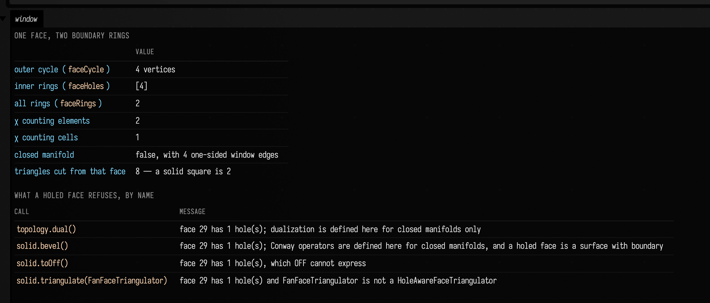

[Open ↗](/offline.html?file=/field4/assets/agent_transcripts/polytope_holes_and_chains/metadata.edn)

### ceres_free_variables

Two boxes on unknowns that are not vertex positions. *A plane per face*
canonicalizes a Conway solid by solving for a unit normal and an offset per face, and solves the same
problem twice (once with the residual written in Kotlin and differentiated on `ceres::Jet` through
the expression VM, once with the hand-written C++ opcode) then prints the largest disagreement
between the two answers and, as a self-check, that every solved normal is still unit, which no
residual ever asked for: the sphere manifold's own doing. *Unknowns that are not points* fits a centre
and a radius to four fixed points from a terrible start, and checks itself against the
tetrahedron circumsphere computed by Cramer's rule in the same box. Both need the native Ceres
wrapper, which is **not** committed, so as checked out, both boxes take the no-wrapper branch: they
print that it is missing, show a card naming `./gradlew buildCeresRedistributable`, and draw the
*unsolved* seed rather than failing. One caveat while reading that branch: an ABI-too-old wrapper
is swallowed by the same `runCatching`, so at the box's output it is indistinguishable from an
absent one.

[Open ↗](/offline.html?file=/field4/assets/agent_transcripts/ceres_free_variables/metadata.edn)

### manifold_solids

Two boxes on [robust mesh Booleans](manifold.md), the second optional native
dependency in the tree, and the one that needs no wrapper: Manifold ships a C ABI, so the whole
binding is Panama/FFM against `libmanifoldc`. *A part, and whether it is manufacturable* builds a
60×40×8 plate with four bored bosses, a properly rounded slot (a square `offset` by 4.5 with round
joins, then extruded) and an 0.8mm chamfer done as a Minkowski closing with an octahedron, then
prints the numbers that decide whether it could be cut: **15513.561 mm³**, genus **5**, and a
**2.767mm** wall between the slot and the nearest bore, measured with `minGap` rather than eyeballed.
It then checks Manifold against Field's own mesh family, which shares no code with it: `signedVolume`
agrees to `1.28e-05` and both say genus 5. The same box checks the trap that follows from
that: the *shaded* mesh has 9773 vertices against the plain one's 8740, split at every crease so each
face can carry its own normal, and `isWatertight()` is therefore **false** on that one.
Same geometry, different index topology; ask for `toTriMesh()` when you are measuring and
`toTriMesh(normals = true)` when you are drawing. *A Kotlin lambda as a level set* is the upcall: a
gyroid-thickened torus written as a function, marched by Manifold's own thread pool in 77 ms into a
solid that is **guaranteed** closed rather than merely usually closed, then sliced into 13 layers (79
contours) with each layer `offset` inward by half a nozzle width, so the orange lines are the path a
printer would actually walk. Both boxes need `brew install manifold`; without it the first draws the
same shape through Field's own `marchingCubes` and names the difference.

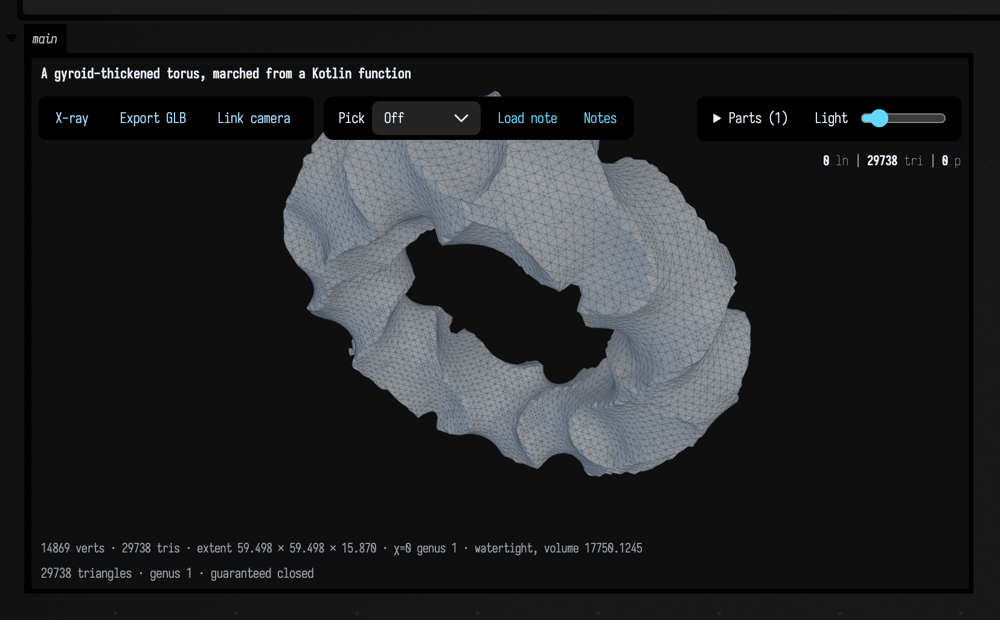

[Open ↗](/offline.html?file=/field4/assets/agent_transcripts/manifold_solids/metadata.edn)

### photo_to_solid_chain

A photograph becomes a printable solid, as four pure-compute boxes — the loadable version of
[A Photograph, Closed and Mounted](chain_photo_to_solid.md). Four families that do not import one
another: Depth Anything V2 Small over ONNX predicts monocular depth from one committed still (a
Vision Pro passthrough frame of a living room, no depth camera and no network — the weights are
cached under `~/.afield/onnx`), the imaging family normalises and smooths it, `Img.toReliefMesh`
closes it into a watertight plaque, and Manifold does the Boolean. *Depth* prints the model's own raw
window, which moves with resolution and is therefore read off the run rather than remembered, and
shows why the solid comes out concave: the side walls and near floor are close, the far wall is not,
so the room arrives as a basin. *Plaque* is the hop that did not exist until this page —
`toHeightfieldMesh` returns a disc, `χ = 1` with one boundary loop, and `toSolid` refuses an open
sheet — and prints `watertight=true manifold=true chi=2`, `boundary loops=0`, and a volume that
Manifold and Field's own divergence-theorem sum agree on to the last digit despite sharing no code.
*Boolean* checks inclusion–exclusion, `vol(A ∪ B) + vol(A ∩ B) = vol(A) + vol(B)`, rather than
checking that the union got bigger, and shows the frame's genus going 1 → 0 as the plaque plugs its
window. *Levelset* marches the same depth field as an independent second construction of the same
solid — the two agree to about one marching cell — and then puts a recorded claim back on the bench:
eight runs each way, in two regimes, of `Solid.levelSet`. `parallel = false` returns one distinct
answer in eight every time; `parallel = true` returns up to eight, and at one floor it returns the
wrong component count on all eight runs rather than a noisy one. Every picture is `TriMesh.renderPng`
— a CPU rasteriser, AWT-free through `PngEncoder` — so there is no Window and no Renderer.


[Open ↗](/offline.html?file=/field4/assets/agent_transcripts/photo_to_solid_chain/metadata.edn)

### solidsl_notation

Two boxes on [`afield.solidsl`](solid_notation.md), the notation in which a
solid is a *value* rather than a `(Vec3) -> Float`. *A part, and what the notation knows before it
meshes* interrogates a bored plate with a blended boss before anything is built: **17 nodes**,
symbolic bounds, and exactly one subtree with no exact CSG form: the `SmoothUnion`, because "a
smooth blend's fillet surface lies on neither operand, so no union, intersection or difference of the
two can produce it". Then it builds the hybrid, and reports **1 subtree marched, the
rest exact**, the blend at `edgeLength 0.02163` and the plate and its four bores never sampled at
all: 29,632 triangles, watertight, volume **2.840885**, genus **4**, one for each bore. *The same
value, lowered to GLSL* needs neither Manifold nor a GPU: it emits `float sdSolid(vec3 p)` by walking
the tree, then shows what a notation buys that a closure cannot. Difference forty extra bores into
the scene, most of them nowhere near the part, and symbolic bounds alone cut **88 nodes to 28 and 654
GLSL statements to 294**: nothing sampled, nothing built. The last two lines want reading
together: set the blend radius to zero and the simplifier reports `path level set -> exact`,
because a blend of radius zero *is* a union, and a union has an exact form where a blend never will.
Ask the *unsimplified* tree and it still refuses (the rewrite is what removes the refusal), so the
box prints both; read apart, that pair of lines looks like a contradiction.


[Open ↗](/offline.html?file=/field4/assets/agent_transcripts/solidsl_notation/metadata.edn)

### rectsl_glsl_sdf

Two boxes that print. [RectSL](rectsl_cheatsheet.md) scenes lower to a single
`float scene(vec2, float)` GLSL function, and `emitSdf` is a string builder over the compiled
program, with no shaderc, no window and no renderer, so these are the cheapest possible check that the
emitter still compiles against the language. The first box lowers a two-track scene and prints the
whole emitted shader, with the counts that make the staging visible: rects unioned, curve functions
emitted, and any fidelity caveats. The second is the constant-folding demonstration: nine copies made
with `array` whose per-copy offsets are constant in time fold to literals rather than nine more
functions, because the stack VM ran once at compile time and `array`, `grid`, selections and the
`{{ }}` escapes are all spent before the GLSL exists. To see the same thing drawn and moving, replay
`rectsl_sdf_live` below.

[Open ↗](/offline.html?file=/field4/assets/agent_transcripts/rectsl_glsl_sdf/metadata.edn)

### rectsl_inverse_animation

Two boxes on the *third* track backend. A RectSL track already knew how
to evaluate itself and how to spell itself as GLSL; `toFn` lowers it to an `Fn` instead, which makes it
differentiable, so a track can be solved rather than authored. The first box prints the symbolic IR with
its unknowns still in it, `ADD(MUL(linear[0.0=0.0 4.0=4.0], ?gain=1.0), ?bias=0.0)`, and is the
clearest look at what `free-param` actually puts in the tree. The second states three waypoints a rect
should pass through, fits the parameters against them on the exact gradient, and rasterises the answer as
three stacked bands: the target, a seed missing every waypoint by 7.72, and the solved arc threading all
three at 4.7e-15. Move a waypoint and re-run to watch it re-solve; move one somewhere
`amp·trig(rate·t + phase) + centre` cannot reach and the caption reports the miss instead.


[Open ↗](/offline.html?file=/field4/assets/agent_transcripts/rectsl_inverse_animation/metadata.edn)

### rectsl_heading_fit

The same backend, over headings. `->face-travel` builds a `HeadingTrack`,
which is `atan2` of a central finite difference, and covers 116 of the gallery corpus's 2754 tracks.
The first box makes the lowering checkable rather than asserted: one figure-of-eight trajectory
drawn three times, with the sampler's own rotation on top, the lowered `Fn`'s beneath it, and
`atan(dy/dx)` with the quadrant thrown away at the bottom. Bands one and two are the same picture (0
differing pixels, measured) and in band three half the darts point backwards. Each dart wears a
nose pip for a reason: a bare rect is symmetric under a half turn, so the one glyph that has to show
a half turn could not. The second box turns the arrow round and solves *through* the `atan2`, asking how
steep a climb makes the dart point at 45 degrees, descending the exact gradient from 0.15 to
1.0000000000000244 with the residual falling 0.637 to 4.7e-15. It also prints the θ-slot map, which
is the surprising part of the machinery: a heading reads each position track twelve times, so one
named parameter occupies 36 slots and the fitter has to move all of them as one variable.

[Open ↗](/offline.html?file=/field4/assets/agent_transcripts/rectsl_heading_fit/metadata.edn)

### faust_voice

Five boxes around [Faust](faust.md), whose compiler Field ships as WebAssembly, so
nothing is installed to run any of them. *Faust voice* is the one to click: a `#faust` region returned as
the box's last expression, which keeps the box lit while it plays and takes the sound down when you stop
it. The three sliders that appear are not written anywhere in the box: they are the program's own
`hslider` declarations, and because they arrive as an ordinary Field control group they are also what a
tablet gets. *Block diagram* is Faust's own SVG of the signal flow, out of the embedded compiler rather
than `faust -svg`. *Waveform* renders the identical program offline and plots it, which is both a cache
hit and the reason a Faust figure can mean something in a build with no sound card. *The interface it declares*
prints what makes the first box's controls possible: ranges, steps, `[unit:Hz]`, `[scale:log]`, and the
byte `index` in WebAssembly memory that makes a slider a float store rather than a message, listed
alphabetically, because that is how Faust orders them and not how they were written. *An error, on the
line* is broken here: `#` is not a comment in Faust, so the `#faust` marker is stripped before
compiling and its lines are added back before the marker is placed; get that arithmetic wrong and every
diagnostic lands a row or two off, looking like a compiler bug. Only the middle three boxes are replayed
here; the voice wants an audio device and the last one is meant to fail.

[Open ↗](/offline.html?file=/field4/assets/agent_transcripts/faust_voice/metadata.edn)

### popup_prior_inspect

Asks Field what ranking prior the completion popup currently has for a
receiver type, by calling the object the completion server itself calls, `afield.CommonMemberPrior`,
rather than describing it. Tabulates the type's `@CommonMembers` list in declared order with the score
each position earns. Change one string to ask about your own class, and replay it when a member you
expect near the top of `ctrl-space` is not there. It answers one of the two questions that place a row:
the other is which *section* it lands in, which lives behind an `internal` object and so belongs to
`FIELD_RANK_DUMP` instead. Both are explained on
[How completions are ranked](completion_ranking.md).

[Open ↗](/offline.html?file=/field4/assets/agent_transcripts/popup_prior_inspect/metadata.edn)

### faust_polyphony

Six boxes in which [Faust](faust.md) stops being a drone with knobs and becomes an
instrument that a [pattern](sound.md) plays: eight instances of one compiled program, allocated to
notes. *Faust instrument* is the one to click: `faustPoly(…, voices = 8)` played by
`inst.play(pat("[c4,ef4,g4] …"), automate = mapOf("cutoff" to pat("900 2600 1400 5200").nums()))`,
so the chords are one pattern and the filter is another and both are scheduled in frames. Only
`cutoff` appears as a slider; `freq`, `gate` and `gain` are absent because the notes write them, and
they are found by *label* because Faust lists controls alphabetically and index 0 in that program is
`cutoff`. *Offline, with a plot* is the same path with no audio device: 16 notes over 2.25s, 8
cutoff steps, 0 steals, peak 0.317. *Three notes at once* is the box to read twice, because counting
attacks cannot tell polyphony from a voice stealing itself, so it counts spectral peaks in 100–230
Hz, a band that can hold nothing but fundamentals, and gets **three** at four voices (130.0, 166.2,
196.5 Hz against a notated 130.81, 164.81, 196.00) against **one** at a single voice, which also
reports two steals. *Onsets, in samples* puts every notated event's frame beside the frame the audio
actually attacks on, but it leads with the measurement that has no threshold in it at all: the
render is exactly `0f` between notes, so the first non-zero sample of a note is an exact fact, and
it **is** the notated frame for 13 of 13 checkable notes, worst 0. The scheduler is sample-exact;
the detector's own numbers (14 of 14 found, median 1 frame, jitter ±6, worst 7, against up to 110 if
the writes were quantised to the 128-frame block that twelve of the fourteen onsets fall inside) are
printed underneath and labelled as the detector's. It checks `faustSilentGaps` first, because an
onset detector pointed at a continuous tone always finds something. *What it refuses* is a program
with no `gate`, and the message it gets instead of silence. *When it runs out of voices* is the one
knob here you can hear: four notes on two voices, rendered at `stealReleaseFrames = 1` and at
`1440`, printing **4.23×** and **0.11×** for the normalised waveform step across the steal, with
both WAVs playable and the line to edit marked. Five of the six are replayed here; the instrument
wants an audio device.

[Open ↗](/offline.html?file=/field4/assets/agent_transcripts/faust_polyphony/metadata.edn)

## Service-backed composition scenes

<!-- transcript-index: verified-by = execute -->

These are complete, editable starting points whose first view works without model weights. Their
generation boxes remain explicit about the companion service or hardware they need.

### audio_ai_gesture_board

Draw timed prompt regions, salience events, and activity, density,
register and brightness curves over one shared musical timeline. The first box renders and explains
the typed sketch immediately. The second resolves a source recording by filename, requests eight
MusicGen-Style candidates, then presents both gesture-fit rankings and the full waveform/splice
audition board. The current worker treats prompt wording as compiled conditioning and the numeric
lanes as waveform-evaluated targets; the UI never disguises either as native timed control.
Walkthrough: [Gesture board: drawing toward a sound](audio_ai_gesture_board.md).


[Open ↗](/offline.html?file=/field4/assets/agent_transcripts/audio_ai_gesture_board/metadata.edn)

### audio_ai_analysis

Resolve a recording by filename, display its exact source window, submit
librosa beat and pYIN analysis plus Spotify Basic Pitch, follow all three jobs through replaceable
progress cards and the durable monitor, await their immutable results, then compare onset, tempo,
confidence, monophonic F0, voicing and polyphonic notes on synchronized timelines. Its first two
boxes are model-free and remain runnable without the analysis worker.
Walkthrough: [Beat and pitch analysis](audio_ai_analysis.md).


[Open ↗](/offline.html?file=/field4/assets/agent_transcripts/audio_ai_analysis/metadata.edn)

### audio_ai_speech_embeddings

Find or import `near_drowning.wav`, submit revision-pinned
emotion2vec and WavLM Base+ frame-embedding jobs, follow both through replaceable progress cards
and the durable monitor, then pool 500 ms of evidence at 25 Hz and play the recording through Smile
t-SNE axes 0×1 and 2×3 in each learned space. The first two boxes explain and exercise the
synchronized phase-portrait renderer without
downloading model weights; the complete local source-to-result path remains explicit in box 3.
Walkthrough: [Speech-reactive learned spaces](audio_ai_speech_embeddings.md).

[Open ↗](/offline.html?file=/field4/assets/agent_transcripts/audio_ai_speech_embeddings/metadata.edn)

### audio_ai_spectral_embeddings

Find or import `near_drowning.wav`, submit and monitor one
model-free librosa spectral job, retain its 25 Hz mel, log-mel, MFCC, and diagnostic trajectories,
then decode the binary artifact once and compare mel-Wasserstein, log-mel cosine, and MFCC Euclidean
t-SNE phase portraits. The first two boxes explain and exercise the synchronized renderer without a
service; box 3 owns the complete source-to-result path.
Walkthrough: [Short-time spectral spaces](audio_ai_spectral_embeddings.md).

[Open ↗](/offline.html?file=/field4/assets/agent_transcripts/audio_ai_spectral_embeddings/metadata.edn)

### audio_ai_muscriptor

Turn an imported or Field-rendered recording into instrument-labelled
notes with the model-neutral `analysis.transcribe_music` operation. The live box selects a
revision-pinned small, medium, or large MuScriptor backend, follows its durable job, synchronizes
the source waveform with an instrument-coloured piano roll, and downloads performance-timed plus
optional beat-quantized MIDI. The guide and synthetic score viewer execute without gated weights;
the complete authenticated model path remains an explicit action in box 3.
Walkthrough: [Multi-instrument transcription with MuScriptor](audio_ai_muscriptor.md).

[Open ↗](/offline.html?file=/field4/assets/agent_transcripts/audio_ai_muscriptor/metadata.edn)

### audio_ai_corpus_microscope

Resolve Nancy and Final Out at Candlestick Park, submit and monitor
multi-scale segmentation and grouped descriptor jobs, then use a six-second Nancy window to retrieve
related source windows. The resulting board aligns playheads and hover cursors in relative time,
shows each descriptor-group distance, and provides an automatic query-to-neighbour splice audition.
Walkthrough: [Corpus microscope: from recordings to related windows](audio_ai_corpus_microscope.md).

[Open ↗](/offline.html?file=/field4/assets/agent_transcripts/audio_ai_corpus_microscope/metadata.edn)


## External-service live-coding scenes

<!-- transcript-index: verified-by = compile -->

These boxes are all compiled through Field's real Kotlin/preamble path, but not evaluated by CI:
their purpose is to cross a process, audio-device or capture-device boundary that the lightweight
build does not own.

### kratos_thermal_playground

Launch one box and drag the cuboid arm, conductivity, heat source
and skin temperature controls. A persistent optional Kratos worker solves embedded conduction on
one fixed background grid. The original and current temperature slices, grid identity, changed
classifications, revisions and timings remain visible. Stop releases the worker; launch restarts it.
Install the worker first with `uv sync --project optional/kratos --frozen` from the Field checkout.
Requires Manifold. Each slice uses its own colour range; numerical temperature differences are
reported alongside it. The controls also appear on `/controllers`.

[Open ↗](/offline.html?file=/field4/assets/agent_transcripts/kratos_thermal_playground/metadata.edn)

### kratos_flow_playground

Incompressible flow past a sphere-and-rod obstacle, on the same fixed
background grid and the same optional worker as the thermal playground. Dragging the radius reshapes
the body immediately, because that part is Manifold alone; solving is a button, because one request
marches three Newton steps and costs seconds rather than milliseconds. The result comes back as a
velocity field, which the box integrates into streamlines and draws as tubes coloured by speed,
beside a mid-plane slice of the wake. At the default settings 729 nodes and 3072 tetrahedra carry a
Reynolds number of 12 and a speed range of 0.175 to 1.454 m/s: the maximum is the flow accelerating
around the obstacle, and potential flow around a sphere gives exactly 1.5, which is the quickest way
to see that the answer is a flow and not a plausible picture. Install the worker first with
`uv sync --project optional/kratos --frozen`, or build its container where Kratos has no wheels.
Requires Manifold.

[Open ↗](/offline.html?file=/field4/assets/agent_transcripts/kratos_flow_playground/metadata.edn)

### kratos_structural_playground

An L-bracket bending under load, and the argument for quadratic
elements made as a picture rather than a table. Unlike the other two this one is **body-fitted**:
Kratos has no immersed structural element, so TetGen tetrahedralizes the Manifold surface and the
mesh goes to the worker, which means a geometry edit costs a remesh and a new session where the
embedded playgrounds reclassify a grid they never rebuild. On launch it meshes the same bracket
twice, once with 4-node tetrahedra and once with 10-node, solves both under the same 3 kN tip load,
and draws the two deflected shapes beside the undeformed part, all coloured by von Mises stress. At
the default settings 1681 tetrahedra give 0.187 mm against 0.232 mm — the linear element reaches 81%
of the quadratic one's deflection, which is the constant-strain tetrahedron's locking seen directly,
and dragging the arm longer makes the gap worse. Install the worker first with
`uv sync --project optional/kratos --frozen`, or build its container where Kratos has no wheels;
TetGen needs `python3 tools/build_tetgen_native.py` once. Requires Manifold.

[Open ↗](/offline.html?file=/field4/assets/agent_transcripts/kratos_structural_playground/metadata.edn)

### kratos_parameter_study

The same worker and the same background grid, asked a question one
solve cannot answer: which arm length and which conductivity put 294.15 K — one kelvin above the
skin — at a chosen point inside the part? The box declares a two-axis design space and a scalar
reduced from each solved field, then either tiles the space on a grid or searches it with an
evolutionary run reported against a random control at the same budget, and draws the landscape as a
heat map with the winner ringed beside the winning body and its temperature slice. Stationary
conduction makes the answer a closed form, `k* = q·φ(arm)/(T − Tb)`, so the dark valley in the
picture is checkable arithmetic rather than a shape to admire — and nothing in the sweep knows that.
A change of arm length is a reclassification, never a remesh: 225 solves and `builds` is still 1.
7×7 is 49 solves and about ninety seconds on the container worker. Install it first with
`uv sync --project optional/kratos --frozen`, or build the container image where Kratos has no
wheels. Requires Manifold.


[Open ↗](/offline.html?file=/field4/assets/agent_transcripts/kratos_parameter_study/metadata.edn)

### audio_render_analysis

Start with music written in Field rather than an imported recording.
Four explicit live-coding boxes render Pat/Dirt, Dough and Faust or record Sonic Pi, write a finite
WAV, import it by content hash, submit the standard beat and pitch fan-out, stream each job's status,
and end in a source waveform plus synchronized analysis board. The guide and every complete service
path are compile-checked; running them remains an intentional user action.
Walkthrough: [Render Field music, then analyse it](audio_render_analysis.md).

[Open ↗](/offline.html?file=/field4/assets/agent_transcripts/audio_render_analysis/metadata.edn)

### audio_ai_underfit_mancini

Import a held-out excerpt, hash the completed Experiment in Terror
Underfit checkpoint, and submit a 30-second Stable Audio 3 candidate with modest guidance. The guide
explains the 165-chunk album training set and the source-conditioned controls; box 2 owns the live
worker request and presents the durable candidate board with source, seed, model revisions, and
checkpoint provenance. The optional authenticated GPU worker is compiled here and remains an explicit
interactive action.
Walkthrough: [Experiment in Terror with an Underfit LoRA](audio_ai_underfit_mancini.md).

[Open ↗](/offline.html?file=/field4/assets/agent_transcripts/audio_ai_underfit_mancini/metadata.edn)

### onnx_webcam_live

One webcam frame through two ONNX models in one box: Depth Anything V2 Small at
266x266 (~120ms on a CPU execution provider) and CLIP ViT-B/32's vision tower (~45ms), displayed as the
frame beside its colour-mapped depth map with a zero-shot ranking over four text prompts. The prompts are
encoded once into a `val`, because a fixed prompt does not change between frames; the depth map is
normalised against an exponential moving average of its own range, since Depth Anything emits *inverse
relative* depth in arbitrary units whose range moves with the content. Running it downloads ~600MB of
encoders on first use. Needs a camera, which the build does not have, so it is compiled and never
evaluated here.

[Open ↗](/offline.html?file=/field4/assets/agent_transcripts/onnx_webcam_live/metadata.edn)

## visionOS device scenes

<!-- transcript-index: verified-by = kotlinjs, execute -->

These publish to Field4Vision's autonomous Live Metal renderer. Open **Live Metal** in the visionOS
app, then run the box; the program is retained and replayed if the native client connects later. A
visionOS device or simulator is required for the image. Four of the six are Kotlin compiled to
JavaScript for the head, and CI compiles them through the real head profile; `vision_metal_cube` and
`vision_geometry_desk_preview` are JVM Kotlin and CI runs them to completion. See
[Building geometry in the headset](vision_geometry.md) for the walkthrough these are drawn from.

Read the figures here for what they are: **Preview Vision Geometry** rendering the same builder on
the Mac, so the mesh is the real packed vertex array the headset would have received, and the shading
is a stand-in two-light lambert over your vertex colours. None of them is a photograph of the device,
and none of them says anything about your MSL.

### visionos_start

The smallest complete Live Metal program, and the place to start: a cube built in
the headset by `geometry { }`, a Metal shader in the box's `msl` property, and one uniform animated on
the compositor clock.

[Open ↗](/offline.html?file=/field4/assets/agent_transcripts/visionos_start/metadata.edn)

### vision_geometry_shapes

A tour of the geometry builder's shape primitives: cube, sphere, plane
and tube side by side in one mesh, with a shader that reads the uv the shapes write as a checker.

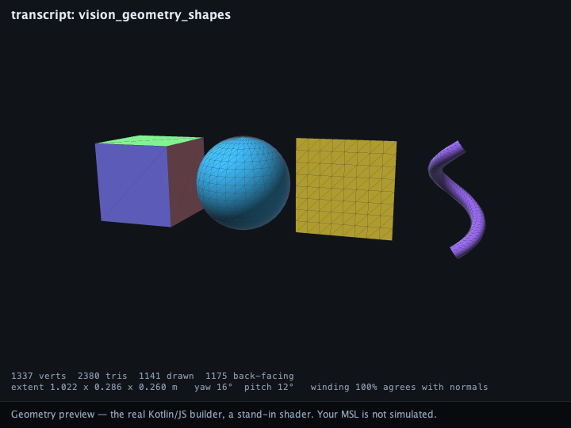

[Open ↗](/offline.html?file=/field4/assets/agent_transcripts/vision_geometry_shapes/metadata.edn)

### vision_geometry_heightfield

The builder at its raw level: a ripple height field assembled vertex
by vertex, with normals from finite differences of the same height function and per-vertex colour
carrying relief into the shader. The shape most procedural meshes take.

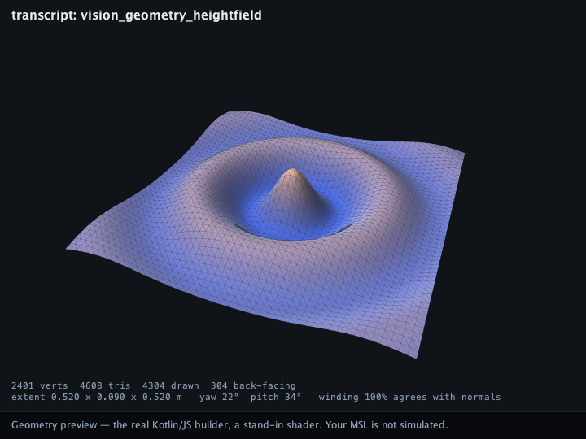

[Open ↗](/offline.html?file=/field4/assets/agent_transcripts/vision_geometry_heightfield/metadata.edn)

### vision_geometry_animated

Rebuilding the mesh every frame, which is what separates building
geometry in the headset from shipping it over the wire: a swept tube whose spine and radius both move.

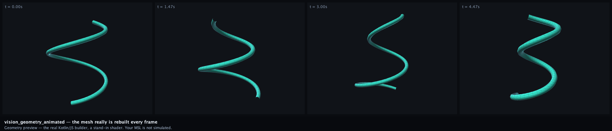

[Open ↗](/offline.html?file=/field4/assets/agent_transcripts/vision_geometry_animated/metadata.edn)

### vision_metal_cube

The non-Kotlin/JS route, for comparison: JVM Kotlin publishes the shader, the
script and an explicit request for the head's built-in cube in one `visionMetal(...)` call.

[Open ↗](/offline.html?file=/field4/assets/agent_transcripts/vision_metal_cube/metadata.edn)

### vision_geometry_desk_preview

The one on this list that needs **no headset at all**: both boxes
build a Live Metal `geometry { … }` for real (compiled to JavaScript and executed) and draw the
resulting mesh into their own output. The second is the same mesh wound backwards, so you can see what
an inside-out mesh looks like and how the preview tells you.

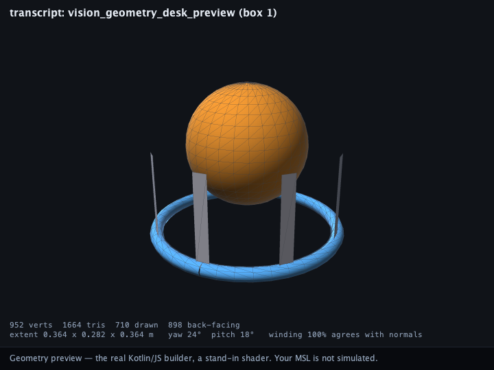

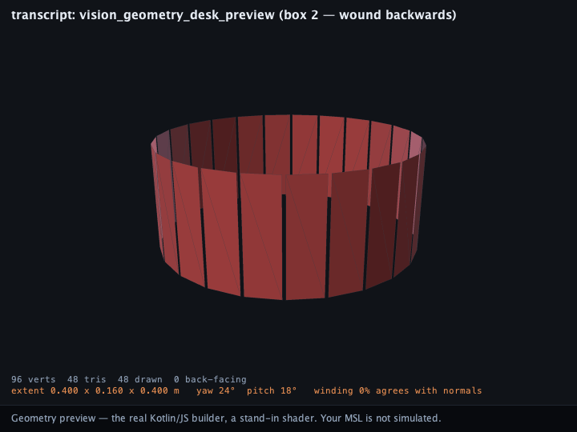

[Open ↗](/offline.html?file=/field4/assets/agent_transcripts/vision_geometry_desk_preview/metadata.edn)

## Browser-head scenes

<!-- transcript-index: verified-by = kotlinjs -->

These are Kotlin compiled to JavaScript and shipped to a **browser head**: the WebXR/Three.js page
at `/extensions/remote_ar/index.html`, which supplies THREE, Tone.js and the Field globals. The
result appears in the head, not in Field, so nothing on this page can show it. CI compiles each box
body through the real head profile its `// {{ marker }}` names; an unknown marker is a hard error
rather than a silent fallback to the wrong head. See [Kotlin in the head](kotlin_in_the_head.md) for
the profiles and [RemoteJS and WebXR](ar_reference.md) for the bound names.

### remotear_start

The starter: a `// {{ remoteAR }}` box beneath a KotlinJS language root that
adds one cube 1.2 m up and 1.5 m out and spins it on the frame clock. Open the head page yourself
first; this transcript does not open one. `onStop` runs exactly once when you relaunch, which is
what makes editing the box and launching it again a clean hot-replace rather than two cubes.

[Open ↗](/offline.html?file=/field4/assets/agent_transcripts/remotear_start/metadata.edn)

### remotear_scene_motion

The larger of the two RemoteAR scenes: a metallic torus knot under a
directional and an ambient light, an `FLine` ring built with the transform operators
(`+ Matrix4`, `+ Vector3`, `* scalar`) and published to `stage.orbit`, and a glTF loaded and handed
to the XR animation mixer. The asset is the one thing worth reading twice. A head is a browser, so
it can only fetch over http — a path on your disk is not a URL it can reach, and `mapDirectory`,
which reads as the fix, sends a message no route in the server consumes. So the model here is the
committed CC0 Khronos ToyCar, mounted at `/sample-assets`, and this scene needs nothing you do not
already have. It carries no animation clips, so `play()` is a no-op that says so in the log; point
it at a model with clips and the mixer moves. Until 2026-09-13 it referred to an external
`robot.glb` no checkout contains, and was withheld from the welcome screen for exactly that reason.

[Open ↗](/offline.html?file=/field4/assets/agent_transcripts/remotear_scene_motion/metadata.edn)

### tone_synth_sequence

Computer music in the head, and self-contained in a way the other two are
not: box 1 embeds the head page in the Field document itself as an iframe, so there is no separate
browser window to arrange, and the Tone.js it plays through is vendored rather than fetched. Box 3
is `// {{ tone }}` Kotlin — a `PolySynth` into a reverb, an arpeggio scheduled on the transport at
96 bpm. One thing to know before you open it: a browser starts its `AudioContext` suspended and
resumes it only after a real user gesture, so `Tone.start()` has to follow a click *inside* the
head, and the box is named to say so. That is an instruction, not a defect, which is why this ships
as a starting point from 2026-09-13 rather than staying agent-only. There is still nothing to hear
in a headless build, which is why CI compiles this one and stops there.

[Open ↗](/offline.html?file=/field4/assets/agent_transcripts/tone_synth_sequence/metadata.edn)

## Graphics scenes

<!-- transcript-index: verified-by = compile -->

These are self-contained scenes that build their own `Window` + `Renderer` and, when run, open a
**native Vulkan window**, so the live image is a desktop window, not an embedded frame. The figures
here are captures of that window, taken by the docs capture pipeline from *these* transcript files
(`capture="native-window"`), so they are the real frame and not a synthesized still. Where an entry
carries none, there is no such capture: run the scene yourself and grab its window with a follow-on
`native-screenshot` backdoor command (with `--with-playwright`).

### openxr_eye_intersection

A white wire cube at the closest-approach midpoint of the two real
HTC eye rays, with a 3 cm maximum gap and explicit LOCAL-to-world conversion. A translated,
30-degree-yaw world origin and a hold control make coordinate mistakes visible when you move your
head. The EXT combined ray is drawn separately because one ray cannot determine depth. macOS
renders the reference grid and cubes without simulating eye data; hardware validation needs an
HTC-capable OpenXR runtime. See [the coordinate walkthrough](openxr_eye_intersection.md).

[Open ↗](/offline.html?file=/field4/assets/agent_transcripts/openxr_eye_intersection/metadata.edn)

### splat_sequence_streaming

4D splat video: a sequence of PlayCanvas `.compressed.ply` files
played as fifteen simultaneous sources arranged in a ring around the viewer, all decoded into **one**
GPU buffer. The measurement that shaped it: on a real 15-file frame of 309,555 splats, reading each
file and re-packing it took 59 ms against a 41.7 ms budget at 24 fps, while `readRaw` +
`GaussianSplatRenderer.packInto` (straight from the quantized payload to the 16-float layout, written
absolutely into the mapped buffer) takes 22 ms, and 27 ms including a back-to-front CPU sort of the
whole frame. Three things in it are not the obvious choice. The ring is fifteen *rotations* and no
translation, because each capture is a depth map from a camera at the origin and so already sits
1–1.6 in front of its own origin. Per-source transforms are baked at decode for +8%, because the
per-file linear map folds into a congruence the covariance already computes, which is what rules out
a matrix palette here. And `SplatTransport.advance()` returns false on the six display frames in seven
where the resolved source frame did not move, so scrubbing a shot costs nothing until it crosses a
frame boundary. Needs your own frames: the box prints how to make them and stops if the directory is
absent, rather than shipping somebody's capture as a fixture.

[Open ↗](/offline.html?file=/field4/assets/agent_transcripts/splat_sequence_streaming/metadata.edn)

### gpu_state

A stateful GPU simulation: 40,000 particles whose positions and velocities live in a
ping-ponged pair of device-local buffers and are never uploaded after frame one. A renderer box, a
compute box whose force law is a live `stack.auto` StackSL slot you can retype while it runs, and a
draw box reading the same allocation. The companion page is [GPU State](gpu_state.md).

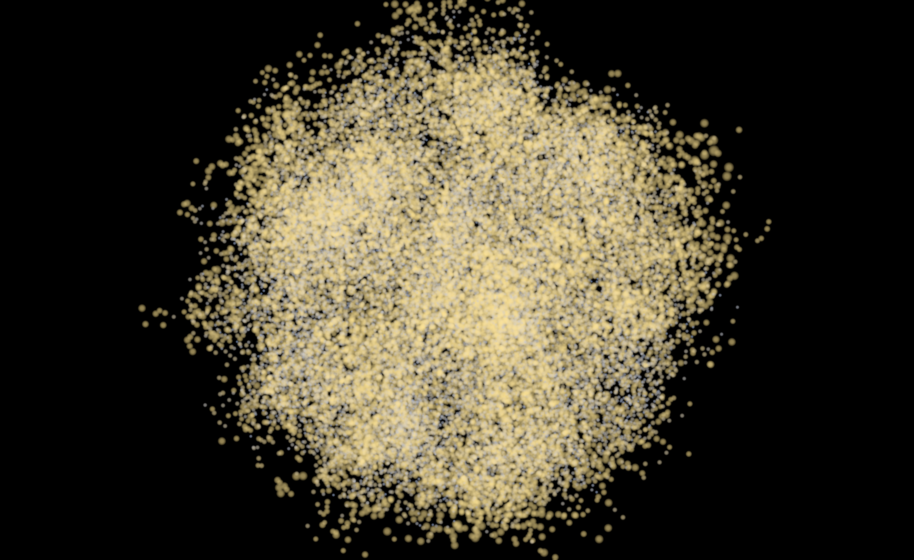

[Open ↗](/offline.html?file=/field4/assets/agent_transcripts/gpu_state/metadata.edn)

### threebox

A self-contained renderer + compute + draw particle system: a renderer box that owns
the `Window`/`Renderer` and pumps the loop, a compute box that simulates 100k particles into a
`buffer_reference` buffer it publishes as a prop, and a draw box that reads that buffer and renders.
The capture below is this transcript instrumented on [Field probes](field_probes.md).

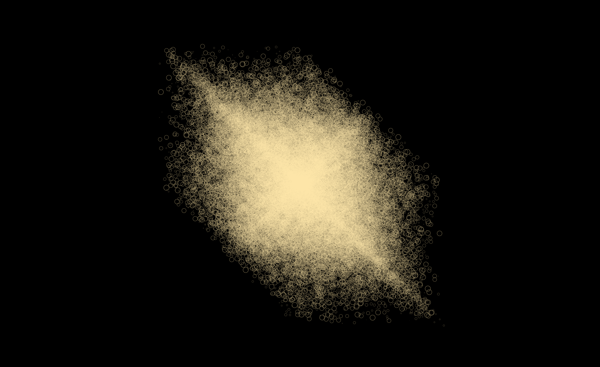

[Open ↗](/offline.html?file=/field4/assets/agent_transcripts/threebox/metadata.edn)

### four_pass_chain

A **heterogeneous, multi-resolution** post-process chain in three boxes: a
renderer, a grid of lit spheres, and one `addPassChain(...)` call that reduces the scene to a half and
then a quarter, blurs the cheap small image with two aperture discs, and composites back at full
resolution. Six passes, each with *its own* resolution — which is the thing the post stack could not
express before, because `Bundle.addShaderEffect` sized every pass target to its source. Run the third
box and it prints the plan first: every pass with its resolved size, which sampler reads which earlier
pass, which passes share a target, and the memory cost against one full-resolution target per pass.
Then edit the three `setPush` numbers under it and run again — the discs widen or narrow and the
composite crossfades with no pipeline rebuild and no target reallocated. Widening `aperture-far`
*lowers* the frame's high-frequency energy rather than raising it, because a wider disc spreads a
fixed amount of light and dims the whole image; that direction surprises people, and watching it is
the point of declaring the chain rather than assembling it. `dev_docs/FOUR_PASS_CHAIN.md` is the
write-up, and `tools/run_field_tests.py --id four.pass-chain.smoke` is the same layer driven headlessly
with assertions on the pixels.

[Open ↗](/offline.html?file=/field4/assets/agent_transcripts/four_pass_chain/metadata.edn)

### aperture_playground

The same multi-resolution idea as `four_pass_chain`, taken apart into eight boxes you
can edit one at a time: a renderer, a full-resolution `RGBA16F` source of lines and point sprites, a
½ and a ¼ reduction, two circular-aperture filters (4/10 px, then 24 px), a screen composite, and a
last column of analytic point sprites. One shader pair and at most one resource per box, so editing
a shader and re-executing *that* box is the whole edit loop, and the two reduction helpers are
nested inside the source box with their shaders still visible rather than hidden behind it.

Two things in it are the reason to read the code. The source's four channels are four **light
bands**, at radii 0, 4, 10 and 24 px — which means alpha is carrying light rather than coverage, so
every intermediate filter has to run with `blend = false` or the band is composited away; that is
the mistake this file is shaped to make visible. And the last column computes the disc-and-aperture
overlap *analytically*, with no texture and no blur pass at all, so the filtered columns beside it
have something exact to be wrong against. The composite's `sharp / blur / guide` mix is one shared
`Vec4` the paint box also writes, so it is a number to edit rather than a pipeline to rebuild. The
renderer is on the ordinary launch/stop controls, and
[Aperture playground](aperture_playground.md) is the walkthrough.

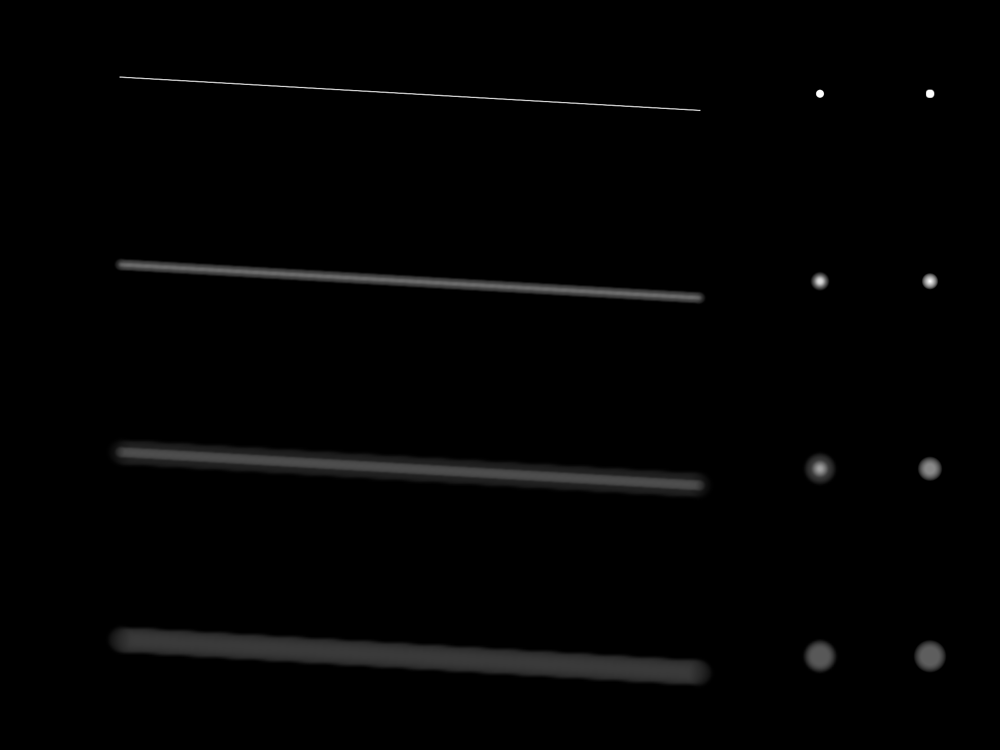

[Open ↗](/offline.html?file=/field4/assets/agent_transcripts/aperture_playground/metadata.edn)

### spin_glass

A 2D Edwards–Anderson spin glass, Vulkan-compute accelerated. A renderer box, a
"metropolis update" compute box (checkerboard / red-black Monte Carlo over Ising spins with
cosine simulated annealing, updating in-place buffers), a "measure" compute box (probes
`vec2(spin, energy)` per site so the stats card's x-mean is the magnetization and y-mean the energy
per spin), and a "lattice view" draw box whose fragment shader colours each cell. Demonstrates a
`renderer → update → measure → view` publish/read chain and a two-dispatch red-black update with a
`computeMemoryBarrier` between passes.

[Open ↗](/offline.html?file=/field4/assets/agent_transcripts/spin_glass/metadata.edn)

### recstl_playground

A one-stop [RectSL](rectsl_examples.md) playground: a Window + Renderer, a
hackable `#rectsl` snippet, and transport controls (play / loop / speed / time-scrub) published in
the box's output area. Edit the `rectsl` string and re-run to change it live.

[Open ↗](/offline.html?file=/field4/assets/agent_transcripts/recstl_playground/metadata.edn)

### rectsl_dataviz

A loadable demo of the RectSL data-visualization family: a viridis colour-bar
legend built with `array` + `colormap`, and a bar chart whose heights and colours are both bound to a
numeric list via `data` / `normalize` / `bars`, animated in with a staggered eased `->alpha`.

[Open ↗](/offline.html?file=/field4/assets/agent_transcripts/rectsl_dataviz/metadata.edn)

### rectsl_plot_axes

A loadable demo of the RectSL plotting layer: a shared coordinate `->domain` +
`->frame` with `axes` (rules, nice-number ticks, numeric labels drawn as rect numerals, gridlines) and
three series overlaid in the one domain (an `area`, a `line`, and `points`) plus a `colorbar` and a
discrete swatch `legend`.

[Open ↗](/offline.html?file=/field4/assets/agent_transcripts/rectsl_plot_axes/metadata.edn)

### rectsl_musicality

A RectSL scene on a musical clock, and nothing in it is written in seconds:
the wall declares `->tempo 120` and `->beats-per-cycle 4`, and the tracks are written in
mini-notation. The identity it demonstrates: a RectSL track is `sample(t)`
and a pattern is `events(arc)`, both pure functions of time, so a pattern *is* a track, and a pattern
event carries an onset and a real duration, so an event *is* a life window. `pat` is `array` indexed
by rhythm instead of by ordinal: it spends its subdivision on *when*, where `strip` spends it on
*where*. A kick on `"bd*4"` drops in on an ease-out and fades; hats are a Euclidean 5-in-16 ring;
`->every` keeps both versions of a track and chooses per sample. See the *Musicality* section of
[RectSL examples](rectsl_examples.md) for the same program as video, where the rhythm is legible.

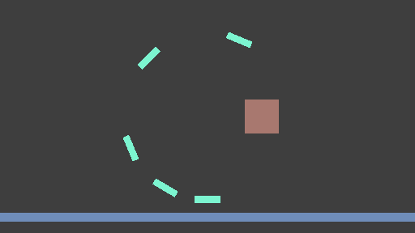

[Open ↗](/offline.html?file=/field4/assets/agent_transcripts/rectsl_musicality/metadata.edn)

### rectsl_sdf_live

The drawn counterpart to `rectsl_glsl_sdf`: the same lowering, but the emitted
`scene()` goes into a generated fullscreen-triangle pipeline and is drawn per pixel, so the trade
becomes visible. Distance buys outlines and glows at any width, `smin` blending *between* rectangles,
boolean ops, per-pixel normals and sub-frame motion blur, in exchange for fill, material and z
order, because `min` is union and a union has no layers. The look is one of eight presets (`fill`,
`outline`, `glow`, `contours`, `relief`, `blend`, `carve`, `motion-blur`); this one ships on `relief`.
The box keeps one footgun, with a note on it: a top-level `val fragment` in a box is a
script *property*, so naming the shader source `fragment` self-assigns the receiver's empty
`fragment` and hands shaderc nothing, which reports itself as "Desktop shaders for Vulkan SPIR-V
require version 140 or higher": a message about nothing. Hence `fragmentSource`.

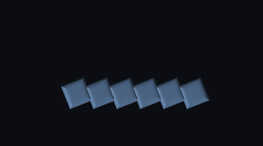

[Open ↗](/offline.html?file=/field4/assets/agent_transcripts/rectsl_sdf_live/metadata.edn)

### imgui_vr_panel

[Dear ImGui as an in-VR panel](imgui_vr_panel.md), in four working lines on top
of the renderer box: a side-by-side stereo target, the demo panel, and a mouse-driven mock controller.
The ImGui frame goes into a 2048×2048 render-to-texture, onto a world-space quad 1.5 m out, rendered
once per eye, so the panel has real stereo depth rather than being pasted flat, and the packed
side-by-side image is blitted to the desktop window. **No headset required**: the mouse aims the ray
and clicking presses. On Windows and Linux the same image feeds real eye swapchains, which this
transcript does not exercise.

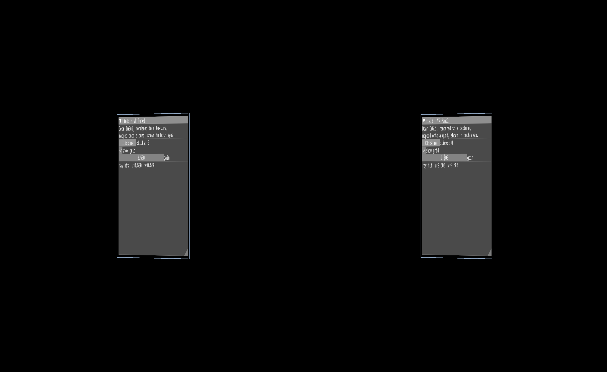

[Open ↗](/offline.html?file=/field4/assets/agent_transcripts/imgui_vr_panel/metadata.edn)

### external_browser_surface_macos_smoke

The receiver half of a web UI on a VR texture, exercised
against real macOS GPU objects: an IOSurface-backed render target becomes a Mach send right, is
looked up through the same port path an Electron producer must use, imported through
`VK_EXT_metal_objects`, and copied into a stable sampled image. The box reads that resident image
back as `32,128,223` and accepts only a `PRESENTED` release that arrived after the graphics fence.
CI compiles the graph on every OS; the tracked backdoor replay is the live macOS test. It is an
integration probe rather than a welcome-screen starting point, so no materialized document is
offered here.

### external_browser_surface_linux_smoke

The Linux receiver and transport proof: a real dma-buf
crosses processes with SCM_RIGHTS, keeps its DRM modifier and per-plane layout, imports into Vulkan,
and is copied into Field's stable resident texture before its lease is released. It also exercises
the opt-in CPU bitmap fallback used while Chromium's Linux shared-texture export can announce an
unfilled buffer. CI compiles the graph everywhere; the live replay belongs on a Linux Vulkan host.
Like the macOS half it is an integration probe rather than a starting point, so no materialized
document is offered.

### field_ui_browser_texture

The end-to-end version: a hidden Electron window opens this Field
document, emits Chromium's accelerated offscreen `paint` textures, and transfers their IOSurfaces
to Field as Mach rights. Field imports each image into Vulkan, copies it into a stable sampled
texture, draws that texture on a full-window mesh, and only then releases Electron's paint lease.
The result is Field's own live canvas and boxes recursively visible inside Field's native renderer;
the native window's input is routed back to Chromium, and launch proves a page-to-Field-to-JavaScript
promise round trip. The published `browserControl` property is the live navigation, input,
evaluation, and raw-CDP handle. The default path never uses a screenshot or CPU bitmap; Linux also
offers an explicit readback/upload fallback while the upstream empty-dma-buf issue remains. Run the
renderer box first, then the panel box.

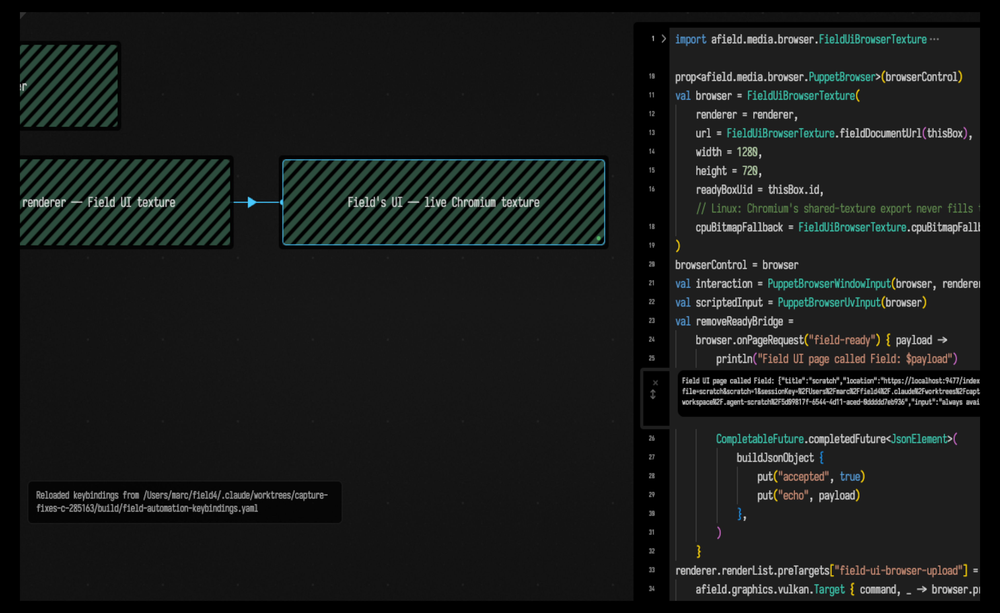

[Open ↗](/offline.html?file=/field4/assets/agent_transcripts/field_ui_browser_texture/metadata.edn)

### youtube_mouse_keyboard_browser

The desktop interaction proof: a full YouTube watch page
rendered directly into a matching 1280×720 native Field window. This path does not synthesize a VR
controller. GLFW mouse motion, buttons and wheel are mapped across the aspect-identical texture into
Chromium CSS pixels; key up/down, modifiers and text input come from the same physical keyboard.
That makes the EU consent controls, search field and player usable exactly as ordinary browser UI,
while Electron continues to play page audio.

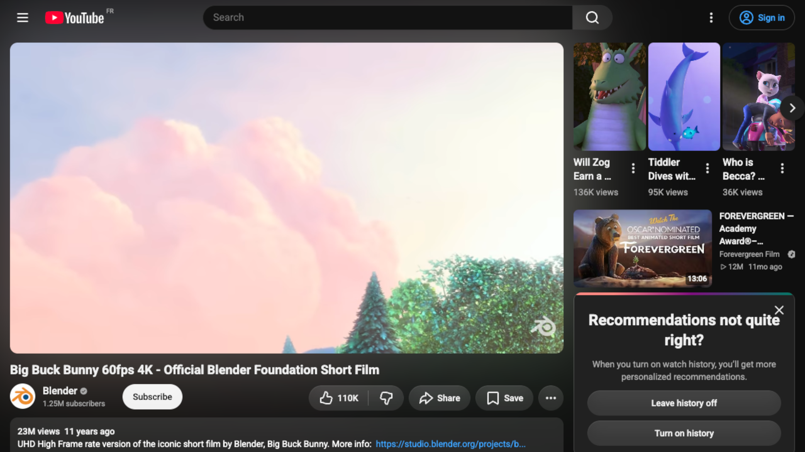

[Open ↗](/offline.html?file=/field4/assets/agent_transcripts/youtube_mouse_keyboard_browser/metadata.edn)

### youtube_kaleidoscope

The proof that the browser texture is ordinary native graphics data,
not a rectangular desktop-share layer. The transcript accepts the EU consent page and starts the
real YouTube `HTMLVideoElement`, then feeds the fully composited 1280×720 tab to 224 independently
animated Vulkan triangles. Each shard rotates and drifts in the vertex stage; its fragment stage
chooses a different angular fold, mirrors the browser image, separates RGB samples, and draws a
barycentric glass edge. The live replay confirms the video clock is advancing and that Chromium
considers the hidden tab audible.

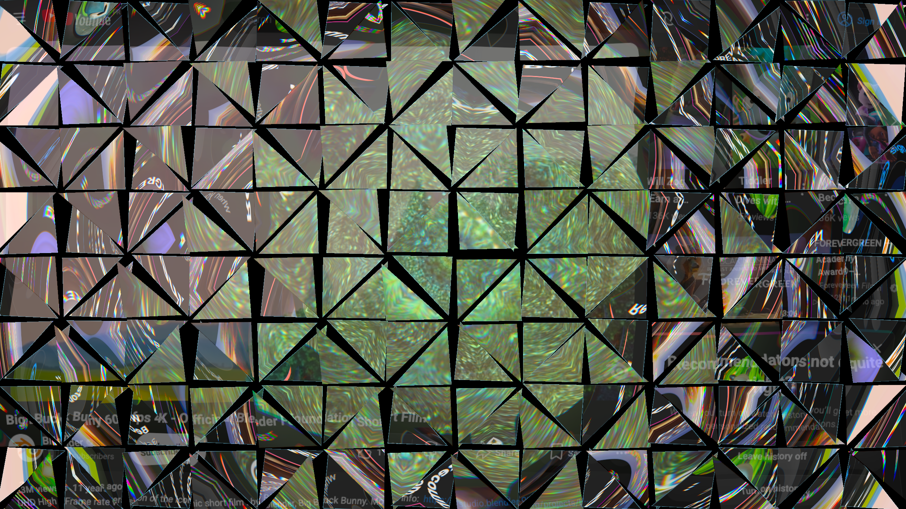

Walkthrough: [Chromium as a native Field surface](puppet_browser.md).

[Open ↗](/offline.html?file=/field4/assets/agent_transcripts/youtube_kaleidoscope/metadata.edn)

### youtube_vr_browser

The usable layer built on that transport: a full YouTube watch page, not
an embed or screenshot, rendered at 1280×720 onto a 1.6 m × 0.9 m quad 1.7 m ahead. It is rendered
once per eye at real stereo depth. The controller ray supplies hover and trigger clicks for the EU
consent flow and player controls; thumbstick or trackpad scrolls, and the physical keyboard can type
into Chromium. Electron continues to play the page's audio. Without a headset the desktop window
shows the same side-by-side scene and its mouse supplies the controller ray.

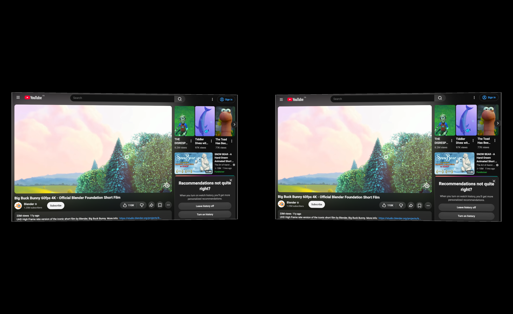

[Open ↗](/offline.html?file=/field4/assets/agent_transcripts/youtube_vr_browser/metadata.edn)

### path_tracing_camera

A keyboard-controlled perspective camera with subpixel antialiasing
and thin-lens depth of field. The middle sphere stays sharp while the nearer and farther spheres
blur; focus follows the camera target unless a distance is supplied.

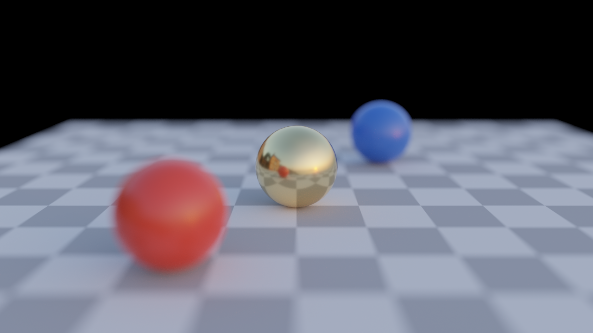

[Open ↗](/offline.html?file=/field4/assets/agent_transcripts/path_tracing_camera/metadata.edn)

### path_tracing_materials

Plastic, polished gold and rough metal under a sunset environment.
The [path tracer](path_tracing.md) accumulates into a render-to-texture target and uses a separate
pass to put it on screen.

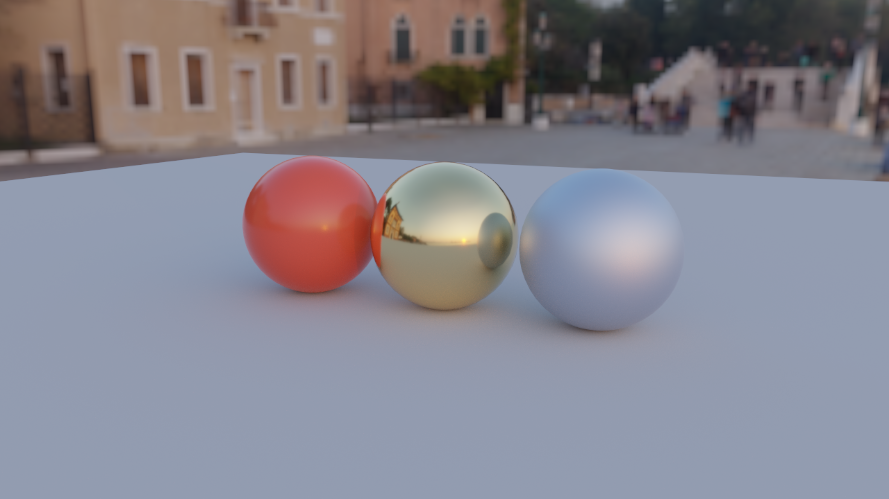

[Open ↗](/offline.html?file=/field4/assets/agent_transcripts/path_tracing_materials/metadata.edn)

### path_tracing_glass

Clear, absorbing and frosted glass spheres, plus a thin blue pane, over
a checkerboard and striped background. Shows the difference between solid refraction and thin glass.

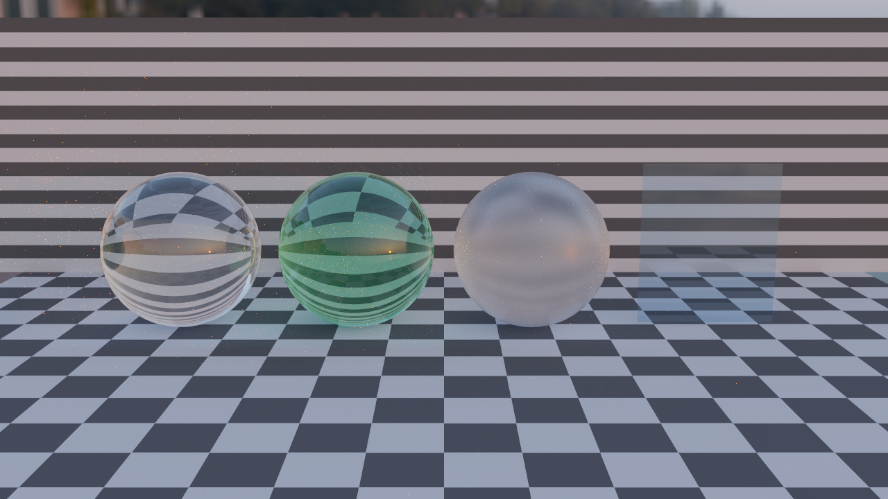

[Open ↗](/offline.html?file=/field4/assets/agent_transcripts/path_tracing_glass/metadata.edn)

### path_tracing_gltf

Imports the textured Toy Car GLB with its hierarchy and PBR materials, fits
the camera to its bounds, and lights it with a hidden sunset environment.

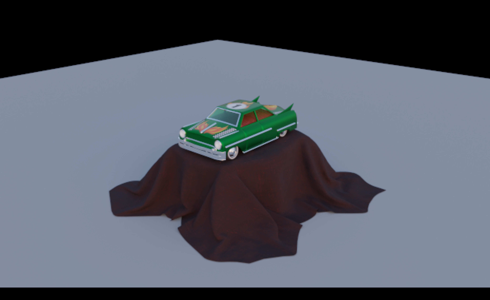

[Open ↗](/offline.html?file=/field4/assets/agent_transcripts/path_tracing_gltf/metadata.edn)

### path_tracing_hidden_environment

Keeps the environment's illumination and reflections while
primary camera rays see a black background. The same output can carry transparent coverage for compositing.

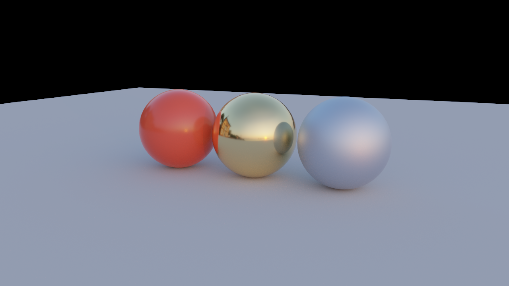

[Open ↗](/offline.html?file=/field4/assets/agent_transcripts/path_tracing_hidden_environment/metadata.edn)

### path_tracing_material_shader_check

Exercises editable material shaders, includes and reflected
push constants. An intentional shader error preserves the last valid pipeline; a successful reload
resets accumulation and produces a PASS marker during live execution.

[Open ↗](/offline.html?file=/field4/assets/agent_transcripts/path_tracing_material_shader_check/metadata.edn)

The three below end at the same tracer and start somewhere else in Field, so each one carries two
subsystems the others do not; [Chains Across Subsystems](chain_polytope_render.md) is where they are
walked through.

### polytope_path_trace_lineage

Bevel of the dodecahedron, traced with its materials read out of
its lineage. Each of the 62 faces descends from exactly one element of the seed, so the rank of that
element picks gold, thin glass or plastic, and the three groups come out 12, 30 and 20: the
dodecahedron's own faces, edges and vertices. See
[the walkthrough](chain_polytope_render.md).

[Open ↗](/offline.html?file=/field4/assets/agent_transcripts/polytope_path_trace_lineage/metadata.edn)

### polytope_manifold_path_trace

The same polytope through the Boolean layer: welded into a
Manifold solid, eroded by a ball and subtracted from itself into a wall of constant thickness, cut
open by a plane, then traced. Genus, volume and watertightness are each measured twice, once by
Manifold and once by Field's own mesh code, and the shell's volume is checked against area times
thickness.

[Open ↗](/offline.html?file=/field4/assets/agent_transcripts/polytope_manifold_path_trace/metadata.edn)

### physics_manifold_path_trace

A 14 × 14 SimdVerlet cloth drapes over a sphere collider, and each
of its 364 distance constraints becomes a rod: the convex hull of a ball at each end, which is a
capsule needing no orientation arithmetic. One batched union welds them, and the genus of the result
has to equal the sheet's 169 quads, which the box checks and says in words. See
[the walkthrough](chain_physics_render.md).

[Open ↗](/offline.html?file=/field4/assets/agent_transcripts/physics_manifold_path_trace/metadata.edn)

### pattern_particles

Four boxes and the whole chain from a rhythm to a GPU push constant.
`patSynth` schedules `pat("bd*4, ~ 52 ~ 52, hh*16")` block by block on the audio seam, a `BandSplit`
of four `Biquad` band-passes measures what comes out, the four numbers become four push-constant
floats, and 24,000 particles in four rings follow them, one band each. The audio box pulls the bank
itself rather than handing it to the engine, so the figure comes out the same on a machine with no
output device. See [the walkthrough](chain_pattern_particles.md).

[Open ↗](/offline.html?file=/field4/assets/agent_transcripts/pattern_particles/metadata.edn)

### life3d_manifold_path_trace

`LIFE3D_BLOB` for eight generations, then the question a volume of
ones and zeros cannot answer for itself: how many separate things are left. Field's marching cubes
and Manifold's level set both march the same density field, disagree about the genus, and the
disagreement is the finding — `decompose()` returns 48 independent solids whose volumes sum exactly
to the whole, and `1 - 48` is the negative genus. The box also marches the field at three spacings
each way, because the count is a property of the surface and not only of the automaton. See
[the walkthrough](chain_life3d_render.md).

[Open ↗](/offline.html?file=/field4/assets/agent_transcripts/life3d_manifold_path_trace/metadata.edn)

### rectsl_spacetime_path_trace

A RectSL animation read as a solid object. The scene's signed
distance over (x, y, time) is sampled slice by slice, one autodiff tape each, handed to both marchers
through `sampledField3D`, and traced: the swept bar becomes a twisted ribbon and the growing square a
wedge, coloured along the time axis. It also measures what each marcher does where the volume runs
into the sampling window, which `marchingCubes` leaves open with two boundary loops and `levelSetOf`
closes. See [the walkthrough](chain_rectsl_spacetime.md).

[Open ↗](/offline.html?file=/field4/assets/agent_transcripts/rectsl_spacetime_path_trace/metadata.edn)

## Graphics building blocks

<!-- transcript-index: verified-by = compile -->

Neither of these two is a scene, and neither is offered as a starting point: one is a renderer with
nothing to draw, the other is a child box that gets its renderer from a parent it does not contain.
They are in the corpus because they are the two halves of the graphics-topology rule, and an agent
composing a new scene needs both; see `dev_docs/agents/transcripts/README.md`.

### graphics_renderer_launch

The bare parent: open a `Window`, build a `Renderer`, pump the loop.
Nothing is drawn. Replay it when you want a renderer for boxes you are about to write, then wire
those boxes beneath it so they can reach it through graph context.

### afield_four_traditional_triangle

The other half: a single draw box with no renderer of its own,
which calls `fromContext()` and expects an `agent_graphics_context` parent to have supplied one.
Replayed alone it has nothing to draw into, which is the rule it exists to demonstrate. The figure is
this same box *given* that parent, which is how the
[afield.four graphics walkthrough](afield_four_graphics.md) opens: the docs runner supplies the
context, and one triangle arrives.

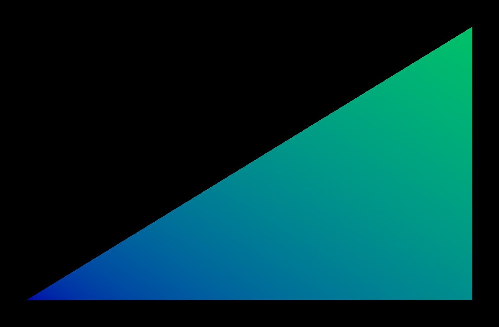
