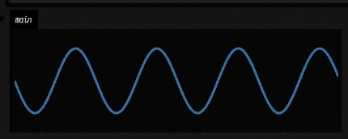

# AI4's built-in tools

When you chat with AI4 about a box, the model works on your document through tools: it makes
boxes, runs them, reads what they printed, looks at what they display, searches Field's tutorials
and source. This page lists every tool Field gives a chat without any setup, and shows the
common ones at work.

The examples show real calls and their results, starting with an empty document. A model sends
the same arguments and reads the same responses during a chat. Long strings and lists are
shortened here, and box IDs are shown as `<uid of Name>`.

Your own tools join these when you register them; see
[Give the AI a tool of your own](aiFeatures.md#give-the-ai-a-tool-of-your-own). Each tool is a
request class in Field's source, and the [AI4 codebase reference](reference/ai4.md) carries its
KDoc: start from [`Tools.kt`](reference/ai4.md#tools-kt) for the core set and
[`ToolMeta.kt`](reference/ai4.md#toolmeta-kt) for what the Effects column means.

## Making and running boxes

The model starts the way you would: it makes a box. This one exports a value for its children.

<!-- ai4-call NewBoxRequest -->
```diffstatic {data-lang=json}
{
  "name": "Settings",
  "code": "@exported val speed = 2.5\nprintln(\"speed is $speed\")"
}
```

```diffstatic {data-lang=json}
{
  "success": true,
  "message": "Created 'Settings'. It has not been run.",
  "uid": "<uid of Settings>",
  "name": "Settings",
  "outputMarker": 0,
  "timedOut": false
}
```

A second box, made as a child of the first, reads that value as `_speed` and draws with it.

<!-- ai4-call NewBoxRequest -->
```diffstatic {data-lang=json}
{
  "name": "Wave",
  "parent": "Settings",
  "code": "val points = (0..200).joinToString(\" \") { i ->\n    val x = i * 2.0\n    val y = 60 + 40 * Math.sin(i * 0.05 * _speed)\n    \"$x,$y\"\n}\ndisplay(\"main\", \"<svg width='400' height='120'><polyline fill='none' stroke='#3a6ea5' stroke-width='3' points='$points'/></svg>\")\nprintln(\"drew ${points.split(' ').size} points\")"
}
```

```diffstatic {data-lang=json}
{
  "success": true,
  "message": "Created 'Wave' under 'Settings'. It has not been run.",
  "uid": "<uid of Wave>",
  "name": "Wave",
  "outputMarker": 0,
  "timedOut": false
}
```

Wave draws with an SVG string, which suits a document like this one. When the code a box tool writes
reaches past something Field already has, the result says so in `notes`, and the message repeats it:
a class of two numbers with its own `plus` (Field has `vec(x, y)`), or SVG drawn by hand in a document
whose other boxes draw with FLines. The note does not block the write. It appears only on the write
that introduces the pattern, not on every later edit.

Tools take a box's name wherever they take its uid, as long as the name is unique. `RunBoxRequest`
compiles and runs the code and waits for the verdict.

<!-- ai4-call RunBoxRequest -->
```diffstatic {data-lang=json}
{
  "box": "Settings"
}
```

```diffstatic {data-lang=json}
{
  "success": true,
  "message": "Ran 'Settings' successfully.",
  "uid": "<uid of Settings>",
  "name": "Settings",
  "property": "code",
  "stage": "setup-complete",
  "stdout": [
    "speed is 2.5"
  ],
  "outputMarker": 2,
  "timedOut": false
}
```

<!-- ai4-call RunBoxRequest -->
```diffstatic {data-lang=json}
{
  "box": "Wave"
}
```

```diffstatic {data-lang=json}
{
  "success": true,
  "message": "Ran 'Wave' successfully.",
  "uid": "<uid of Wave>",
  "name": "Wave",
  "property": "code",
  "stage": "setup-complete",
  "stdout": [
    "drew 201 points"
  ],
  "displays": {
    "main": "<svg width='400' height='120'><polyline fill='none' stroke='#3a6ea5' stroke-width='3' points='0.0,60.0 2.0,64.9869893354091 4.0,69.89615837018091 6.0,74.6509011634419 8.0,79.17702154416813 10.0,83.4038909176185 12.0,87.26555040093336 14.0,9… (2760 more characters)"
  },
  "outputMarker": 5,
  "timedOut": false
}
```

## Reading and looking at output

`ReadBoxOutputRequest` returns what a box printed or displayed, as text, with a marker the next
call can pass to get only what is new.

<!-- ai4-call ReadBoxOutputRequest -->
```diffstatic {data-lang=json}
{
  "box": "Wave"
}
```

```diffstatic {data-lang=json}
{
  "success": true,
  "message": "3 entries from 'Wave'.",
  "uid": "<uid of Wave>",
  "name": "Wave",
  "running": false,
  "entries": [
    {
      "seq": 3,
      "kind": "display",
      "text": "<svg width='400' height='120'><polyline fill='none' stroke='#3a6ea5' stroke-width='3' points='0.0,60.0 2.0,64.9869893354091 4.0,69.89615837018091 6.0,74.6509011634419 8.0,79.17702154416813 10.0,83.4038909176185 12.0,87.26555040093336 14.0,9… (1760 more characters)",
      "channel": "main",
      "line": 0
    },
    {
      "seq": 4,
      "kind": "out",
      "text": "drew 201 points",
      "line": 7
    },
    {
      "seq": 5,
      "kind": "verdict",
      "text": "run: setup-complete",
      "line": 0
    }
  ],
  "outputMarker": 5,
  "timedOut": false
}
```

Text is not always enough: a drawing has to be seen. `ViewBoxOutputRequest` captures the box's
output area and hands the model the picture.

<!-- ai4-call ViewBoxOutputRequest image=wave.png keep=success,message,channels,width,height,inkFraction,dominantColours -->
```diffstatic {data-lang=json}
{
  "box": "Wave",
  "note": "is the sine wave drawn?"
}
```

```diffstatic {data-lang=json}
{
  "success": true,
  "message": "Captured the output of 'Wave' (main), 430x172. The picture is attached. This is an independent browser; viewerStates records its geometry view, which may differ from the user's.",
  "channels": [
    "main"
  ],
  "width": 430,
  "height": 172,
  "inkFraction": 0.03980530016224987,
  "dominantColours": [
    "#050505 76.9%",
    "#151515 19.1%",
    "#3a6ea5 2.4%",
    "#203a56 0.7%",
    "… 2 more"
  ]
}
```

This is the picture that came back with it:



The picture comes from a separate browser that shows only this box. Other boxes are hidden, so a
neighbour's output panel floating over this one cannot get into the picture. The box's own AI Chat
panel is left out too. A box whose only panel is its chat has nothing to capture, and the call says
so.

## Asking where a value comes from

`WhyDoesThisResolve` answers why a name a box reads resolves where it does, without running
anything. See [Why does this value resolve here?](why.md) for the rules it applies.

<!-- ai4-call WhyDoesThisResolve focus=Wave -->
```diffstatic {data-lang=json}
{
  "name": "_speed",
  "box": "Wave"
}
```

```diffstatic {data-lang=json}
{
  "summary": "'Wave' reads `_speed` (InheritanceFromContext) from variable `speed` of 'Settings', path 'Wave' → 'Settings' = 2.5; declared by `val Box._speed by InheritanceFromContext<kotlin.Double>()` from the preamble of 'Settings'",
  "explanation": {
    "box": {
      "uid": "<uid of Wave>",
      "name": "Wave"
    },
    "query": "_speed",
    "name": "_speed",
    "mechanism": "INHERITANCE_FROM_CONTEXT",
    "delegate": "InheritanceFromContext",
    "found": true,
    "supplier": {
      "uid": "<uid of Settings>",
      "name": "Settings"
    },
    "matchKind": "VARIABLE",
    "matchedName": "speed",
    "depth": 1,
    "path": [
      {
        "uid": "<uid of Wave>",
        "name": "Wave"
      },
      {
        "uid": "<uid of Settings>",
        "name": "Settings"
      }
    ],
    "crossesEdges": true,
    "value": "2.5",
    "valueType": "java.lang.Double",
    "ambiguous": false,
    "shadowedCount": 1,
    "shadowed": [
      {
        "supplier": {
          "uid": "<uid of Settings>",
          "name": "Settings"
        },
        "matchKind": "PROPERTY",
        "matchedName": "_speed",
        "depth": 1,
        "path": [
          "<uid of Wave>",
          "<uid of Settings>"
        ],
        "value": "2.5"
      }
    ],
    "declaration": {
      "line": "val Box._speed by InheritanceFromContext<kotlin.Double>() /**/",
      "inOwnPreamble": true,
      "tag": "<uid of Settings>",
      "suppliedBy": {
        "uid": "<uid of Settings>",
        "name": "Settings"
      }
    },
    "summary": "'Wave' reads `_speed` (InheritanceFromContext) from variable `speed` of 'Settings', path 'Wave' → 'Settings' = 2.5; declared by `val Box._speed by InheritanceFromContext<kotlin.Double>()` from the preamble of 'Settings'"
  }
}
```

## Trying Kotlin without running the box

`CompileKotlinRequest` checks code in a box's context and reports diagnostics without running it.
Here the model tries a misspelt name:

<!-- ai4-call CompileKotlinRequest keep=success,diagnostics -->
```diffstatic {data-lang=json}
{
  "file": "Wave",
  "source": "println(_sped * 2)"
}
```

```diffstatic {data-lang=json}
{
  "success": false,
  "diagnostics": [
    {
      "severity": "ERROR",
      "message": "Unresolved reference '_sped'.",
      "line": 1,
      "column": 19,
      "endLine": 1,
      "endColumn": 24,
      "code": "-1"
    }
  ]
}
```

`EvaluateKotlinExpressionRequest` evaluates one expression where the box's own values are in scope.

<!-- ai4-call EvaluateKotlinExpressionRequest -->
```diffstatic {data-lang=json}
{
  "target": "Wave",
  "expression": "_speed * 2"
}
```

```diffstatic {data-lang=json}
{
  "success": true,
  "target": "afield://ai4-tools/<uid of Wave>/code",
  "boxUid": "<uid of Wave>",
  "boxName": "Wave",
  "expression": "_speed * 2",
  "valueKind": "primitive",
  "type": "Double",
  "runtimeType": "Double",
  "primitiveValue": 5.0,
  "primitiveKind": "Double",
  "stringValue": "5.0",
  "html": "<div class='value-viz' style='font-family: \"Iosevka Web\", monospace; font-size: 12px; color: #ccc; line-height: 1.4; font-feature-settings: \"calt\" 1, \"dlig\" 1; font-variant-ligatures: contextual;'><span style='color: #8cf;'>5</span></div>",
  "message": "Expression evaluated."
}
```

## Changing a box

`SetBoxPropertyRequest` replaces a whole property; it does not run the box.

<!-- ai4-call SetBoxPropertyRequest -->
```diffstatic {data-lang=json}
{
  "box": "Settings",
  "property": "code",
  "value": "@exported val speed = 5.0\nprintln(\"speed is $speed\")"
}
```

```diffstatic {data-lang=json}
{
  "success": true,
  "message": "Set code on 'Settings' (52 chars). Not run.",
  "uid": "<uid of Settings>",
  "name": "Settings",
  "property": "code",
  "outputMarker": 0,
  "timedOut": false
}
```

`DocumentSourceReadRequest` then shows the difference between the source as it is now and as it last
ran, which is how the model knows the edit has not taken effect yet.

<!-- ai4-call DocumentSourceReadRequest keep=success,contents,liveRevision,executed,message -->
```diffstatic {data-lang=json}
{
  "uid": "{{uid:Settings}}",
  "property": "code"
}
```

```diffstatic {data-lang=json}
{
  "success": true,
  "contents": "@exported val speed = 5.0\nprintln(\"speed is $speed\")",
  "liveRevision": "5895c4cae7d82ff5965cafb0f16152c5b6e69e653c9de2f567915ea4538b0208",
  "executed": {
    "uid": "<uid of Settings>",
    "property": "code",
    "revision": "f0792f1414f6311afbfb1cae76a1b3e72051ca15da07892f09101862c23bdbac",
    "mode": "run",
    "stage": "setup-complete",
    "success": true
  },
  "message": "Live source inspected; no save or execution performed."
}
```

`ListBoxesRequest` is the model's map of the document.

<!-- ai4-call ListBoxesRequest -->
```diffstatic {data-lang=json}
{}
```

```diffstatic {data-lang=json}
{
  "success": true,
  "message": "2 box(es) in ai4-tools.",
  "boxes": [
    {
      "uid": "<uid of Settings>",
      "name": "Settings",
      "children": [
        "Wave"
      ],
      "running": false,
      "codeChars": 52,
      "lastRunSuccess": true
    },
    {
      "uid": "<uid of Wave>",
      "name": "Wave",
      "parents": [
        "Settings"
      ],
      "running": false,
      "codeChars": 309,
      "lastRunSuccess": true
    }
  ],
  "outputMarker": 0,
  "timedOut": false
}
```

## Many calls at once

When a step means several similar calls, the model can write them as one short JavaScript
program. Each tool is a function, named without its `Request` suffix.

<!-- ai4-call RunToolProgramRequest keep=success,stage,returned,totalCalls,failedCalls -->
```diffstatic {data-lang=json}
{
  "purpose": "run every box and report how each went",
  "code": "const boxes = tools.ListBoxes({}).boxes.filter(b => b.name !== 'root');\nreturn boxes.map(b => ({ name: b.name, success: tools.RunBox({ box: b.name }).success }));"
}
```

```diffstatic {data-lang=json}
{
  "success": true,
  "stage": "ok",
  "returned": [
    {
      "name": "Settings",
      "success": true
    },
    {
      "name": "Wave",
      "success": true
    }
  ],
  "totalCalls": 3,
  "failedCalls": 0
}
```

## Finding out how to do something

`TutorialCodeSearchRequest` finds worked examples of box code by what they do.

<!-- ai4-call TutorialCodeSearchRequest -->
```diffstatic {data-lang=json}
{
  "query": "draw a curve with FLine and show it on the canvas",
  "limit": 2
}
```

```diffstatic {data-lang=json}
{
  "success": true,
  "message": "2 tutorial(s). Read a codeFiles entry with AttachmentRequest to see working box code.",
  "matches": [
    {
      "name": "learned_pen",
      "description": "Continuing an FLine with a learned pen (`afield.ai.learning.pen`): the Distill handwriting LSTM, run in Kotlin, carries on a line you give it; a fan of possible futures from one line; a drawing panel the pen keeps writing from, with sliders… (160 more characters)",
      "boxes": [
        "3 - draw, and it writes on (launch)"
      ],
      "docs": [
        "learned_pen.md: Explains the model, its units and controls, continueWith, PenLine, futures, cell edits and retraining."
      ],
      "codeFiles": [
        "public/docs/assets/agent_transcripts/learned_pen/lp_draw_code_.kt"
      ]
    },
    {
      "name": "a_pen_that_sees",
      "description": "A learned pen that senses the ink around it (`afield.ai.learning.pen`, PenSense): what it sees at its tip; a seeing pen hatching beside a drawn line, after Michaux's mescaline drawings, against a blind twin trained on the same drawings; cra… (160 more characters)",
      "boxes": [
        "6 - hatch beside your line (launch)",
        "9 - hatch your drawing (launch)",
        "7 - cracks in your shape (launch)"
      ],
      "docs": [
        "a_pen_that_sees.md: Explains the sense inputs, the Michaux and cracks corpora, seeing against blind, and training a pen that sees."
      ],
      "codeFiles": [
        "public/docs/assets/agent_transcripts/a_pen_that_sees/ps_draw_code_.kt",
        "public/docs/assets/agent_transcripts/a_pen_that_sees/ps_doodle_code_.kt",
        "public/docs/assets/agent_transcripts/a_pen_that_sees/ps_shape_code_.kt"
      ]
    }
  ]
}
```

`WorkspaceSymbolSearch` looks up a declaration and its KDoc.

<!-- ai4-call WorkspaceSymbolSearch -->
```diffstatic {data-lang=json}
{
  "query": "FLine",
  "limit": 2
}
```

```diffstatic {data-lang=json}
{
  "matches": [
    {
      "symbol": "FLine",
      "kind": "class",
      "locationHint": "src/jvmMain/kotlin/afield/geometry/path/FLine.kt:223",
      "filePath": "src/jvmMain/kotlin/afield/geometry/path/FLine.kt",
      "line": 223,
      "definitionLine": "class FLine : HasProperties {",
      "kdoc": "Mutable path composed of move/line/cubic/close instructions.\n\nUse [moveTo], [lineTo], [cubicTo], and [close] to build geometry. Builders return\n[FLine] for chaining; use [here] to access the most recently added [Node] when you\nneed per-inst… (1345 more characters)"
    }
  ]
}
```

## Keeping track of the work

The checklist belongs to the chat. The model keeps its plan there, and the chat panel shows it.

<!-- ai4-call ChecklistUpdateRequest -->
```diffstatic {data-lang=json}
{
  "operation": "add",
  "text": "make the wave speed a slider"
}
```

```diffstatic {data-lang=json}
{
  "success": true,
  "message": "Checklist item added.",
  "items": [
    {
      "id": "1",
      "text": "make the wave speed a slider",
      "status": "pending"
    }
  ]
}
```

A guide is a Markdown file saved in the document, for anything that should outlast the chat.

<!-- ai4-call DocumentGuideCreateRequest -->
```diffstatic {data-lang=json}
{
  "path": "guides/wave.md",
  "contents": "# Wave\n\n`Settings` exports `speed`; `Wave` draws a sine at that speed.\n"
}
```

```diffstatic {data-lang=json}
{
  "success": true,
  "message": "Saved [guides/wave.md](field://guide/guides/wave.md)",
  "document": "<workspace>/ai4-tools",
  "readOnly": false,
  "path": "guides/wave.md",
  "link": "field://guide/guides/wave.md",
  "revision": "5c6eca8c0119990f83f8c00f987cbd886e40ddf99f26723ad8a6ae97344fd59c",
  "startLine": 0,
  "endLine": 0,
  "totalLines": 0,
  "truncated": false,
  "conflict": false
}
```

<!-- ai4-call DocumentGuideSearchRequest -->
```diffstatic {data-lang=json}
{
  "query": "speed"
}
```

```diffstatic {data-lang=json}
{
  "success": true,
  "message": "1 matching lines",
  "document": "<workspace>/ai4-tools",
  "readOnly": false,
  "startLine": 0,
  "endLine": 0,
  "totalLines": 0,
  "truncated": false,
  "hits": [
    {
      "path": "guides/wave.md",
      "line": 3,
      "text": "`Settings` exports `speed`; `Wave` draws a sine at that speed.",
      "heading": "Wave",
      "link": "field://guide/guides/wave.md#wave"
    }
  ],
  "conflict": false
}
```

Memory holds what AI4 should know in every document, not just this one: how you like box code
written, a correction you made, a trap you both hit last week. It is a folder of short Markdown
notes, one fact per note, in `~/.afield/ai4/memory/`. Every AI4 turn starts with the list of notes,
one line each, and AI4 reads a note in full before relying on its details. It writes a note when you
ask it to remember something, or when something is clearly worth remembering. Each note says whether
AI4 checked it, and cites the chat it came from. `HistorySearchRequest` and `HistoryReadRequest`
search and read the workspace's saved chats, every branch included, so a note can be traced back to
what was actually said.

The folder is yours to read and edit. `MEMORY.md` lists the notes and is rewritten after every
change, so edit the notes rather than that file. Each change AI4 makes is a commit in the folder's
own git repository: `git log -p` shows what it learned, and `git revert` undoes a change. Set
`AFIELD_AI4_MEMORY=off` to turn memory off, or `AFIELD_AI4_MEMORY_DIR` to keep it somewhere else.

A note written in the middle of a chat can be wrong, or go stale. So once in a while AI4 goes back
over its memory with nobody present. It reads the chats saved since its last pass, checks each note
against what was actually said, and fixes or deletes a note the chats contradict. It also records
corrections you made that no note holds yet, and merges notes that say the same thing. This happens
on its own when Field has had no AI4 chat for half an hour, at most every six hours, and only after a
few new turns. **Consolidate AI4 Memory** in the command palette runs it now. Each pass is one commit
in the memory's repository, with an account of what it changed in `dreams/`. Set
`AFIELD_AI4_DREAM=manual` to keep only the palette command, or `off` to stop it.

## Working on Field's own repository

AI4 can also work on Field's own checkout, outside any document. The chat panel on a box gets these
tools for the checkout Field is running from, so a conversation can add a page to the docs, register a
transcript or run a smoke test. Set `AFIELD_AI4_REPO_TOOLS=off` to withhold them. A job can also name a
checkout of its own: set `FIELD_AGENT=field` (or put `field` in `~/.afield/agent`) and the landing
queue's fixer, its `huh?`, and `tools/docs_notes.py revise` ask AI4 instead of `claude` or `codex`.

- `RepoReadFileRequest`, `RepoListFilesRequest` and `RepoSearchRequest` read the checkout, and
  `RepoPatchFileRequest` and `RepoWriteFileRequest` change it. Each job lists the paths it may read and
  the paths it may write, and a file marked `DO NOT EDIT` is refused.
- `RepoRunCommandRequest` runs one of the commands the job allows, by name: `gradle` with task names
  and `--tests`, `python-test` with a `tools/test_*.py` file, `check` with a `tools/check_*.py` file,
  read-only `git-status`, `git-diff`, `git-log` and `git-show`, and `land-precheck`. It is not a shell.
  Each name has a fixed command line, and its arguments are checked one by one, so `--stop`, `clean`,
  or a `;` is refused. Each run has a time limit, after which the command and everything it started
  is stopped (Gradle's shared daemon is left alone). Long output keeps its beginning and its end.
  The command also refuses to start while a smoke, UI or docs run holds that checkout's verification
  lock.
- A chat can also run `docs-build` (with a runner mode, and optionally `--page`), `docs-publications`,
  `field-test` (by catalog `--id` or `--tag`) and `jvm-main` (a Field entrypoint, started through the
  backdoor so it gets the JVM flags it needs).
- `RepoStartCommandRequest` starts any of these in the background and returns at once with a job id.
  `RepoCommandStatusRequest` reads the job's output and can wait up to two minutes for it to finish or
  to print a given line. `RepoStopCommandRequest` stops it. A job keeps running after the turn that
  started it, so a later turn can pick it up. `AwaitRepoCommandsRequest`† ends the turn, and Field
  continues the conversation with the job's exit code and the end of its log when it finishes.
- A command that could compile Field is refused while Field is running from the same checkout and
  its source has changed since Field started. Compiling then would replace classes the running Field
  has not loaded yet, and they would fail until Field is restarted. Restart Field first, or build in
  another worktree.

The fixer gets the Gradle, Python, check and git commands, so it can reproduce a red, make the
smallest edit, and run the same command again to confirm it. To try it by hand, run
`uv run --project . --group backdoor python tools/field_repo_agent.py --root . --write '**' --run fixer --prompt-file prompt.md`
in a checkout. The answer goes to stdout, and one line per tool call (with the commands it ran and
their exit codes) goes to stderr.

## Every built-in tool

Tools marked \* are deferred. The model sees only their names until it asks for their full
descriptions, because most chats never need them. The effects column says what a call can touch.
On a read-only document, Field refuses every call that changes the document.

Tools marked † end the turn to wait, for your answer or for a long build, so only the chat
panel on a box offers them; the editor's inline chats and the document chat do not. None of them
has an example here, because each needs a chat that someone resumes.

A few tools appear only in a particular kind of chat, such as one about a RectSL scene. Their
pages cover them.

<!-- ai4-tools-reference:begin -->
97 tools in 19 namespaces.

### `graph`

Boxes: make, read, change, connect, run, launch, stop, and look at their output.

| Tool | What it does | Effects |
| --- | --- | --- |
| `ConnectBoxesRequest` | Connect two boxes: `child` becomes a child of `parent` (e.g. parent = `Settings`, child = `Plot`). | mutate document |
| `DeleteBoxRequest` | Delete a box (and anything nested in it) from this Field document. | mutate document |
| `DisconnectBoxesRequest` | Remove the parent→child connection between two boxes (e.g. parent = `Settings`, child = `Plot`). | mutate document |
| `GetBoxPropertyRequest` | Read a text property of a box, most often `code` (e.g. box = `Primes`, property = `code`). | read document |
| `LaunchBoxRequest` | Launch a box (like the Launch command): run its setup, which may start loops or animations that keep running. | control runtime, execute code |
| `ListBoxesRequest` | List every box in this Field document. | read document |
| `NewBoxRequest` | Create a new box in this Field document. | mutate document |
| `PatchBoxTextRequest` | Edit part of a box's text property in place, without resending the whole text. | mutate document |
| `ReadBoxOutputRequest` | Read what a box has printed, displayed, or reported since a marker (0 = everything retained). | read document |
| `RunBoxRequest` | Run a box's code once to completion (like the Run command) and wait for its verdict. | execute code |
| `SetBoxPropertyRequest` | Replace a whole text property on a box, most often `code`, e.g. property = `code`, value = `println(1)`. | mutate document |
| `StopBoxRequest` | Stop a running box and everything it launched (e.g. box = `Ticker`). | control runtime |
| `SymbolAtRequest` | Ask what a name means at a place in a box's code, the way the editor hover does, but with everything Field knows: the hover text, every candidate the compiler offers there (overloads with signatures and types), the live value from the box's last run (or its parents'), the lines where this box declares it, and indexed Field declarations of that name with KDoc and source. | read document |
| `ViewBoxOutputRequest` | Look at what a box SHOWS: capture its output area (the panels its display(...) calls fill) as a picture. | capture image |

### `kotlin`

Compile and evaluate Kotlin in a box's own context without running the box.

| Tool | What it does | Effects |
| --- | --- | --- |
| `CompileKotlinRequest` | Compile Kotlin for a Field box without running it. | read document |
| `EvaluateKotlinExpressionRequest` | Evaluate a Kotlin expression in a Field box's existing KotlinInterface/KotlinInterface2 context. | execute code |
| `ListContentsRequest` | Return full contents for available text properties (code and shaders) in the current Field box and graph-relevant boxes, with file refs, languages, box names, relation labels, and preamble hints. | read document |
| `ListDefinitionsRequest` \* | List all definitions visible from the current Kotlin file, including associated shaders. | read document |
| `ListKotlinContextVariablesRequest` | List Kotlin REPL context variables currently retained by a Field box's KotlinInterface/KotlinInterface2 without evaluating code. | read document |

### `source`

A box's live, saved and last-run source, and edits to it.

| Tool | What it does | Effects |
| --- | --- | --- |
| `DocumentBoxNavigateRequest` \* | Navigate directly inside the current Field document by box UID. | — |
| `DocumentSourceExportRequest` \* | Export a live graph snapshot; see provenance warnings before publishing. | filesystem write, read document |
| `DocumentSourcePatchRequest` \* | Replace one live text property only if its revision matches the latest DocumentSourceRead. | mutate document |
| `DocumentSourceReadRequest` | Inspect live, saved and last executed source revisions for an explicit box UID and property. | read document |

### `states`

The document's saved histories and the states in them.

| Tool | What it does | Effects |
| --- | --- | --- |
| `StateForkRequest` | Create a named branch from an exact saved state in this document, only when the history advertises canFork. | filesystem write, mutate document |
| `StateListRequest` | List this document's saved histories, or list states in one history. | read document |
| `StateReadRequest` | Retrieve a saved state by exact ID or unique exact title/name within a history. | read document |
| `StateShowRequest` | Show a saved history and optionally select a state in the human's AI4 state browser. | read document |

### `guides`

Markdown guides that live in the document and outlast the chat.

| Tool | What it does | Effects |
| --- | --- | --- |
| `DocumentGuideAppendRequest` | Append text verbatim to a document guide using its latest revision. | mutate document |
| `DocumentGuideCreateRequest` | Create a new durable Markdown guide in the current document root, docs/ or guides/. | mutate document |
| `DocumentGuideListRequest` | List durable Markdown guides and handoff notes in the current Field document. | read document |
| `DocumentGuidePatchRequest` | Patch one exact passage in a document guide. | mutate document |
| `DocumentGuideReadRequest` | Read a document guide with its disk revision and line numbers. | read document |
| `DocumentGuideSearchRequest` | Search literal text, case-insensitively, in the current document's Markdown guides. | read document |

### `memory`

The chat's own scratchpad and checklist, which last the session; notes kept across sessions and documents, and the saved chats they cite.

| Tool | What it does | Effects |
| --- | --- | --- |
| `ChecklistReadRequest` | Read the in-memory checklist for this chat. | agent state |
| `ChecklistUpdateRequest` | Update the in-memory checklist for this chat. | agent state |
| `HistoryReadRequest` | Read a stretch of a saved AI4 chat as text, each block headed by its address. | filesystem read |
| `HistorySearchRequest` | Search the saved AI4 chats of this workspace, on every branch, for a phrase. | filesystem read |
| `MemoryDeleteRequest` | Delete a memory note that is wrong or no longer useful, with the reason, which the memory's history keeps. | agent state, filesystem write |
| `MemoryReadRequest` | Read one memory note. | agent state, filesystem read |
| `MemorySearchRequest` | Search your memory notes, the ones that persist across sessions and documents. | agent state, filesystem read |
| `MemoryWriteRequest` | Create or replace a memory note: one fact a later session with this person will need, kept across sessions and documents. | agent state, filesystem write |
| `ScratchpadReadRequest` | Read this chat's in-memory scratchpad across turns. | agent state |
| `ScratchpadUpdateRequest` | Update this chat's in-memory scratchpad. | agent state |

### `program`

One call that runs a short JavaScript program over the other tools.

| Tool | What it does | Effects |
| --- | --- | --- |
| `ReadToolEvidenceRequest` \* | Read back a complete tool result that was too large to keep in the conversation: a tool program's call record names it as `evidence` (an id starting ai4ev:). | filesystem read |
| `RunToolProgramRequest` | Run a short JavaScript program that calls this conversation's other tools as functions and returns one combined result. | — |

### `search`

Field's tutorials and the workspace's files, by what they do.

| Tool | What it does | Effects |
| --- | --- | --- |
| `TutorialCodeSearchRequest` | Find Field's tutorial code: about 260 worked examples of box code, by what they do, e.g. query = `draw FLines`, `GLSL compute shader on the renderer`, `slider controls`. | filesystem read |
| `WorkspaceSearchRequest` | Search saved UTF-8 files for literal text in exactly one scope. | filesystem read |

### `symbols`

Declarations in Field and the workspace, with their KDoc.

| Tool | What it does | Effects |
| --- | --- | --- |
| `WorkspaceSymbolSearch` | Look up symbols, including extension properties such as String.file. | filesystem read |

### `retrieval`

Natural-language search over Field's source, workspace code and docs.

| Tool | What it does | Effects |
| --- | --- | --- |
| `SemanticRetrievalRebuildRequest` \* | Rebuild Field's native Lucene semantic retrieval index from current source-index declarations and documentation sections. | filesystem read, filesystem write |
| `SemanticRetrievalSearchRequest` | Search Field's native Lucene semantic retrieval index across Field internals, current workspace code, and documentation. | filesystem read |
| `SemanticRetrievalStatusRequest` \* | Return status for Field's native Lucene semantic retrieval index, including capsule backend, ONNX/vector availability, and available corpora for SemanticRetrievalSearchRequest. | filesystem read |

### `codeuse`

What box code has actually called, from Field's local telemetry.

| Tool | What it does | Effects |
| --- | --- | --- |
| `CodeUseCallersForSourceLineRequest` \* | Given a source path and line inside src/, show recent Field box code snippets that appear to call the enclosing source symbol, with timestamps, compile/eval status, return types, and launch lifecycles. | filesystem read |
| `CodeUseEarlyDocumentSymbolsRequest` \* | Find source symbols used early in a document's observed code-use timeline and then rarely afterward. | filesystem read |
| `CodeUseHotSymbolsRequest` \* | List hot Field source symbols by observed Field box usage. | filesystem read |
| `CodeUseQueryRequest` | Query Field's local code-use telemetry database. | filesystem read |
| `CodeUseReferencesForCodeRequest` \* | Given Kotlin code, rank the most interesting files/properties/methods inside src/ that the code appears to refer to. | filesystem read |
| `CodeUseRelatedSourceForCodeRequest` \* | Given Field box code, return the most relevant src/ routines with bounded source excerpts, observed call-site frequencies, return/lifecycle summaries, and other Field snippets that called the same routines. | filesystem read |
| `CodeUseSemanticAnalyzeCodeRequest` \* | Given Field box or inline Kotlin code, ask Field's optional semantic K2 sidecar to resolve the code against src/ and enrich the result with local code-use graph evidence: source excerpts, call-site frequencies, timestamps, and peer snippets. | filesystem read |

### `macros`

Saved operation-transcript macros: list, read, write, run, undo.

| Tool | What it does | Effects |
| --- | --- | --- |
| `MacroListRequest` \* | List saved operation-transcript macros available to the current Field document. | read document |
| `MacroReadRequest` \* | Read a saved operation-transcript macro YAML file by name. | read document |
| `MacroRunRequest` \* | Run or undo a saved operation-transcript macro. | execute code, mutate document |
| `MacroWriteRequest` \* | Create or replace a saved operation-transcript macro YAML file in the current Field document. | mutate document |

### `render`

The native render window: capture it, reload its shaders.

| Tool | What it does | Effects |
| --- | --- | --- |
| `CaptureRenderWindowRequest` | Capture a live Field 4 (Vulkan) render window and attach it as an image, so you can see what a renderer box is actually drawing. | capture image, gpu |
| `ReloadShadersRequest` | Reload shader modules for the current Field box or target box/file ref. | capture image, control runtime, gpu |

### `geometry`

Geometry views and review notes (see [Geometry review](geometry_review.md)).

| Tool | What it does | Effects |
| --- | --- | --- |
| `InspectGeometryViewRequest` \* | Inspect current Three.js geometry in a separate capture browser. | capture image, read document |
| `ListGeometryViewsRequest` | List live Three.js and custom canvas review views owned by this document, with source boxes, geometry revisions and unresolved note counts. | read document |
| `ReadGeometryNoteRequest` \* | Read one geometry annotation including its original feature/view reference, replies and resolution history. | filesystem read, read document |
| `ReadGeometryReviewsRequest` \* | Read a page of geometry annotation summaries, without opening a browser or acknowledging any note. | filesystem read, read document |
| `ReplyGeometryNoteRequest` \* | Append a durable finding, decision or verification reply to a geometry note without changing its open/resolved status. | filesystem write, mutate document |
| `ReportGeometryFindingRequest` \* | Ask for review of a geometry finding in the existing annotation inbox. | capture image, filesystem write, mutate document, read document |
| `ReviewGeometryNoteRequest` \* | Explicitly resolve a verified geometry note, or reopen it (status: `resolved` or `open`). | filesystem write, mutate document |
| `StyleGeometryPartsRequest` \* | Style named solid parts in an existing document-owned Three.js viewer. | mutate document |

### `builds`

Long-running study builds (see [Let AI4 wait for long builds](ai4_long_builds.md)).

| Tool | What it does | Effects |
| --- | --- | --- |
| `AwaitStudyBuildsRequest` \* † | End this turn and let Field wait for build jobs without the model, then resume this conversation with their outcomes. | agent state, filesystem read, read document |
| `CancelStudyBuildRequest` \* | Request cancellation of a specific build. | control runtime, filesystem write, mutate document |
| `InspectStudyBuildsRequest` \* | Inspect a document build runner's stages and paged durable attempt history, or one jobId. | filesystem read, read document |
| `ListStudyBuildsRequest` | List the live derived-stage build runners in this document. | filesystem read, read document |
| `PruneStudyBuildsRequest` \* | Delete build attempts this document no longer needs, across all of its build runners, to free disk space. | filesystem read, filesystem write, mutate document, read document |
| `StartStudyBuildRequest` \* | Start one derived stage from its current frozen inputs. | control runtime, execute code, filesystem write, mutate document |
| `WaitStudyBuildRequest` \* | Wait up to 900 seconds for an existing build job to finish, streaming real progress into chat without additional model turns. | filesystem read, read document |

### `kit`

The document's kit (see [Kits](kits.md)).

| Tool | What it does | Effects |
| --- | --- | --- |
| `InspectKitRequest` \* | Say which kit this document runs and what differs from it. | filesystem read, read document |

### `presentation`

Slide files and built presentations (see [Presentation studio](presentation_studio.md)).

| Tool | What it does | Effects |
| --- | --- | --- |
| `PresentationControlRequest` \* | Control an already built presentation by host box UID. | control runtime, execute code, mutate document |
| `PresentationInspectRequest` | Inspect built Kotlin presentations in this document: returns host box UIDs, step IDs, titles, current cue and available reset action. | read document |
| `PresentationReadRequest` | Read the outline and revision of an editable Field slide file, default files/talk.slides.json. | read document |
| `PresentationWriteSlideRequest` | Create or revise ONE Markdown slide using the revision from PresentationReadRequest; use it after a read, e.g. slide id `intro` with a new body. | filesystem write, mutate document |

### `repo`

Field's own checkout: its files, and named commands run in the foreground or as background jobs.

| Tool | What it does | Effects |
| --- | --- | --- |
| `AwaitRepoCommandsRequest` † | End this turn and let Field wait for background jobs without the model, then resume this conversation with how each ended (state, exit code, time and the last lines of its log), e.g. jobIds [`job-213045-1`], maxMinutes 60. | agent state |
| `RepoCommandStatusRequest` | Read a background job's state and output, waiting for it if asked, e.g. jobId `job-213045-1`, waitSeconds 120, untilText `BUILD SUCCESSFUL`. | filesystem read |
| `RepoListFilesRequest` | List repository files matching a glob, relative to the job's root, e.g. `public/docs/*.md` or `src/jvmMain/kotlin/afield/ai/**`. | filesystem read |
| `RepoPatchFileRequest` | Replace an exact passage in a repository file the job may write, e.g. oldText `val x = 1` with newText `val x = 2`. | filesystem write |
| `RepoReadFileRequest` | Read a text file of the repository this job works in, with line numbers. | filesystem read |
| `RepoRunCommandRequest` | Run one of this job's allowed commands in its repository (not a shell: a named argv template). | execute code, filesystem write |
| `RepoSearchRequest` | Search the repository files this job may read for literal text (or a Java regex with regex=true), one match per line. | filesystem read |
| `RepoStartCommandRequest` | Start one of the allowed repository commands in the background and return at once with its jobId (e.g. command `docs-build`, args ["never"]; or `field-test`, args ["--id", "examples.demo-transcript.exec"]). | execute code, filesystem write |
| `RepoStopCommandRequest` | Stop a background job and everything it started (TERM, then KILL after a grace; Gradle daemons are left alone), e.g. jobId `job-213045-1`. | execute code |
| `RepoWriteFileRequest` | Create a repository file the job may write, with this content, e.g. path `dev_docs/notes/new_page.md`. | filesystem write |

### `core`

Housekeeping, and why a name a box reads resolves where it does.

| Tool | What it does | Effects |
| --- | --- | --- |
| `AskUserQuestionRequest` † | Ask the person a question and end this turn until they answer. | agent state |
| `Commentary` | Assistant commentary or design notes about the code. | — |
| `WhyDoesThisResolve` | Explain why a value a box's code reads resolves where it does, without running anything: for a name (an @exported or prop declaration, e.g. `_speed`, else a plain name as fromContextWithNameOrNull reads it) or a type (as fromContext<T>() finds it) — which box supplies it, through which path of parent boxes, whether it was a property or a live variable, which other boxes' values it shadows, whether an equally near box supplies a different value (an ambiguity), and which preamble line declared the name and which box that line came from. | — |
<!-- ai4-tools-reference:end -->
