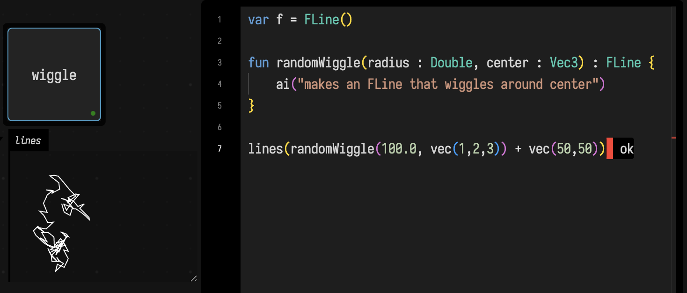

# AI Features

Field aims to have a complete set of AI-facing features, even when it might not be so clear as to what that might mean yet. This page collects them together.

## AI Chat about this box

`command/ctrl-4` (or "AI Chat (Panel)") opens an output area on this box where you can chat to GPT-5.3 about the code in this box. This agent has access to a full complement of tools for reading and editing your code, its properties and the internal files and documents that make up Field.


This agent tends to work very hard, especially at the beginning of the conversation. You can follow it's innermost thoughts and tool calls in the terminal.

Image based attachments are supported — just paste an image into the text box and let the Agent see the results of the code.


This means that 'can you make the thick lines a little more red' really is something you can have a concrete conversation about.

## AI 'Inline' chat

`command/ctrl-3` (or "AI Inline Chat") let's you indicate a spot in your code that you'd like some help with:


That should, quite quickly, give you:

```diffstatic {data-lang=kotlin}
var v = listOf<Vec2>()

v = List(100) { Vec2(Math.random().toFloat(), Math.random().toFloat()) }
```

If there are significant changes to your code, Field will bundle these into a provisional edit:


Green lines are additions and red deletions. This may include changes to other properties associated with a box (GLSL shader code), and it might include other boxes. You can review and accept or reject changes with the mouse or a command:


## AI Auto-complete

`ctrl-space` opens Field's custom completion panel. Field typically does a type-based analysis of what can complete here (Kotlin's internal compiler for Kotlin, the Jedi package for Python etc.); in the background it also fires off a request for up to 3 AI completions and updates the same FieldSuggest list when they arrive:

```diffstatic_runner {data-lang=kotlin capture="ui" region="editor" warm-completion=true screenshot="assets/ai-autocomplete.png" wait="0" timeout="90" embed=true hidden=true name="ai-autocomplete"}
ui.eval("window.localStorage.removeItem('field.suggest.recency.v1'); var s=document.createElement('style');s.textContent='.tick_text.ok{display:none !important}';document.head.appendChild(s);return 'setup';")
ui.openEditor(id)
ui.pause(700)
ui.clickSelector(".monaco-editor")
ui.pause(300)
ui.press("Control+A")
ui.type("var time = 0.0\nval speed = 0.5\nval wobble = si")
ui.pause(300)
ui.press("Control+Space")
ui.waitForSelector(".afield-suggest-row", 30000.0)
ui.waitForSelector("text=AI 1", 20000.0)
ui.pause(600)
```

In our testing these things seem to be particularly good at GLSL code, often one-shotting large chunks of the standard issue "Book of Shaders"-level shader repertoire. 

## Just fix the error, damnit. 

This one is my favorite:


Yields:


And a quick `f1`-"Accept All Provisional (Everywhere)" gets your code working. In addition to the code and the usual set of tools, this agent gets the error message on the screen as part of it's prompt.

## Really "wishful thinking" coding.

Wishful thinking coding is a top down process by which you pretend that you have a complex function that does the thing you want and then iteratively decompose it into smaller pretend functions. Eventually, the idea is, you get to functions that are so small it's not worth pretending any more (or you realize your architecture is bad and try again). AI can enter this way of breaking programs down quite directly. Field supports this:

```diffstatic {data-lang=kotlin}
var f = FLine()

fun randomWiggle(radius : Double, center : Vec3) : FLine {
    ai("makes an FLine that wiggles around center")
}

lines(randomWiggle(100.0, vec(1,2,3)))
```

Automatically, upon first run, that function notices that it doesn't exist yet, asks the LLM to write one, iterates on it until it compiles and then, having compiled it, continues on. On subsequent executions Field notices that it already has a function definition to hand (changing the signature or the prompt gets you a fresh function).



You can find the place where these AI functions are 'stored' in the `attic` property associated with the box. 


# Behind the scenes

Behind the scene's there's a couple of things going on. First of all, for any of this to work, you'll need your own OpenAI platform key. You can introduce this into the terminal that you are running Field from. On Mac, you can `export OPENAI_API_KEY=sk-proj-QU_auyboSk_OpQmTfJ37HiQLxTXV4XQaNLrgDB93XY8ZioJIdzLYWxXqivnH63LsmyP0X1wSHmT3BlbkFJfZF3ZXoRj7R1ETrBOS1MLHJ2iItWSlqd24opyhfLslAucbXZO4tgguXPd329RAORBF7A0CT8A` (that's not a real key). Alternatively you can run:

```diffstatic {data-lang=kotlin}
System.setProperty("OPENAI_API_KEY", "your key here")
```

Early on in your session.

Field will also open a filestore in that OpenAI's account, upload most of it's source and documentation to it, to allow agents to search it quickly. It will keep this filestore in sync when you upgrade your Field. So, the first time you open Field with AI extensions, expect some traffic.
