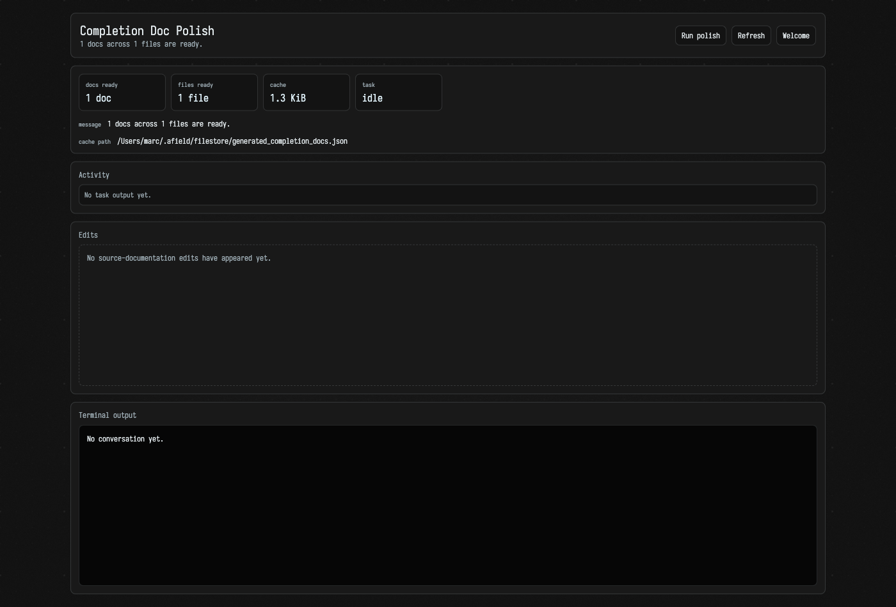

# AI documentation polish

Field can generate short documentation for Kotlin completion entries that lack
useful source KDoc. Those generated records live in a cache, and *polishing* is
the step that promotes them: an AI agent reads the cache, writes real KDoc
beside the declarations in `src/`, and Field regenerates its reference pages
from whatever reached source.

## Polishing the cache into source KDoc

The **Autogenerated docs** card on [`/welcome`](history_overview.md) reports the
cache's record and file counts. **Polish docs** opens
`/completion-doc-polish.html` and starts the real `polishCompletionDocs` Gradle
task.



The task gives an AI agent read access to the cache and Kotlin files under
`src/`. Its write tools are constrained to `src/` and the cache file, and its
instructions require documentation-only edits: keep signatures and behavior
unchanged, prefer concise KDoc beside the declaration, and change only cache
entries it has actually handled.

The cache survives a normal run: an entry disappears or changes only where the
polishing agent edited it.

After the agent process ends, the Gradle task runs `generateCodebaseReference`
as its final step. This keeps `public/docs/reference/` and
`dev_docs/kdoc_worklist.md` synchronized with any KDoc that reached source,
including a partial batch written before an agent failure. A reference-generation
failure makes the overall polish task fail and is shown in the same task output.

The detail page shows the current state, cache path and counts, task output, and
activity while the process runs. Updates arrive through the same
`/welcome-events` WebSocket used by the dashboard.

Each run's complete terminal/tool trace is appended to a timestamped log under
`~/.afield/logs/completion_doc_polish/`. The same directory contains
`latest.json`, an atomic snapshot of the latest run's state and log path. Field
reloads that state and the most recent 180,000 characters for the detail page
after a restart; the timestamped log itself is not truncated. If Field restarts
mid-run, the restored run is marked failed with an explicit interruption note.
Set `AFIELD_COMPLETION_DOC_POLISH_LOG_DIR` or the JVM property
`afield.completionDocPolish.logDir` to move these files.

## Dry runs

The dashboard button starts an in-place run. To let the model propose edits
without writing them, run:

```diffstatic {data-lang=bash}
:::static
./gradlew polishCompletionDocsDryRun
```

The dry run applies requested edits to an in-memory overlay and writes the
resulting unified patch to `build/completion-doc-polish-dry-run.patch`. It costs
the same model calls as a real run: `--dry-run` withholds the edits, not the
requests. The Gradle task passes the CLI's flag for you, and Gradle's own
identically-named `--dry-run` would skip the task rather than run it in this
mode. Nothing reaches source, so there is no `generateCodebaseReference` step
afterwards either.

A normal run edits the current checkout directly; it does not create a git
worktree.

Use `AFIELD_COMPLETION_DOC_POLISH_MODEL` to override the configured flagship
model for this task.

## The record cache

The cache is `<checkout>/.field/filestore/generated_completion_docs.json`: one
per checkout, seeded on first use from the machine-global `~/.afield/filestore`,
and relocated by `AFIELD_FILESTORE_DIR` or `-Dafield.filestore.dir`. Each record
carries the declaration's name, path, line and source hash alongside the
generated documentation, the model that wrote it, and when.

A record's key hashes the prompt version together with the declaration name,
source path, line and source hash, so a record survives only while all of those
still match. Editing the declaration retires its record; bumping
`COMPLETION_DOC_PROMPT_VERSION` retires every record at once.
