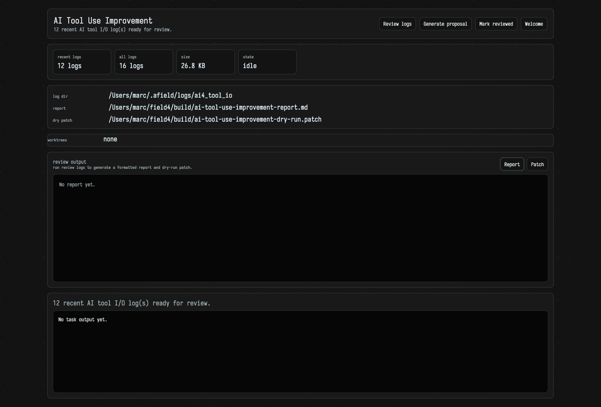
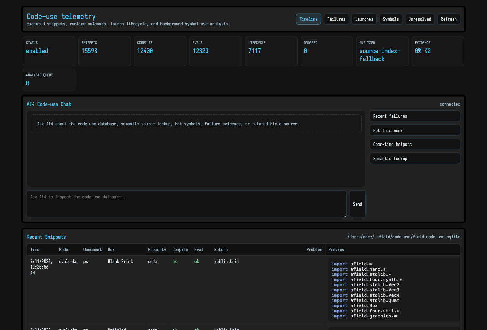

# AI Tool-Use History

Every time one of Field's [AI agents](aiFeatures.md) does something — reads a file, edits a property, searches your code, hits an error — it leaves a trace. Field keeps those traces, and then it does something slightly unusual with them: it reads them back to improve itself.

This page covers both halves — the **log** of what the agents did, and the **improvement loop** that mines it.

## The log

Every AI conversation opens a fresh log file under `~/.afield/logs/ai4_tool_io/`, named by timestamp. Each line is one JSON record: the prompt that started the conversation, every model response, and — the interesting part — every **tool call** (which tool, with what arguments, in which round) and its **result** (success, error, or exception).

So the log is a complete, replayable record of how the agent actually behaved: not the polished summary you saw in the chat panel, but the raw sequence of moves and mis-moves underneath it.

You do not normally read these files by hand. Logging is on by default; you can point it elsewhere with `AFIELD_AI4_TOOL_IO_LOG_PATH`, or turn it off with `AFIELD_AI4_TOOL_IO_LOG=0`.

## The improvement loop

The point of keeping the log is the loop that reads it. From the [`/welcome` dashboard](history_overview.md), the **Agent tool use** card gives you three actions:

- **Review logs** — a dry run. Field reads the most recent logs, summarises where the agent struggled (repeated failed calls, exceptions, conversations that ran out of tool rounds), and asks a flagship model to draft small source improvements that would reduce that friction. Nothing is applied — you get a **report** and a **dry-run patch** to read.
- **Generate proposal** — the same analysis, but the model's edits are actually made, each in its own throwaway **git worktree** so you can try, merge, or discard them one at a time without touching your working checkout.
- **Mark reviewed** — once you have looked at a batch, this archives those logs so the next run starts from fresh activity.

Clicking a run button opens the dedicated page at `/ai-tool-use-improvement.html`. It shows, live as the task works:

- the counts at the top — how many recent logs, total logs, and their size — and the current run **state**
- the paths to the **log directory**, the generated **report**, and the **dry-run patch**
- for a full proposal run, the list of **worktrees**, each with **Try / Merge / Delete** buttons
- the **report** and **patch** themselves, in their own tabs
- a live **transcript** of the improvement agent as it thinks and edits

The whole thing is a self-improvement history: the agent's past behaviour becomes the input to making its future behaviour better. The design intent — capture, replay, analyse friction, propose *small* changes, and treat every suggestion as a proposal rather than a commit — is spelled out in the project's `TRANSCRIPT_SELF_IMPROVEMENT_LOOPS` design note.

## Where it runs

Runs are launched as background Gradle tasks (`improveAiToolUse` / `improveAiToolUseDryRun`), so you can kick one off and keep working — the `/welcome` badge and the detail page update themselves over the `/welcome-events` WebSocket as the task progresses. The model used can be overridden with `AFIELD_TOOL_USE_IMPROVEMENT_MODEL`.

## Code-use telemetry

Sitting alongside the tool-use log is a second, larger record: **code-use telemetry**. Where the tool-use log tracks what the *agents* did, this tracks what *your code* did — every snippet you ran, whether it compiled, whether it evaluated, what it returned, and how launched boxes lived and died.

Open it from the **Code-use telemetry** card on the [`/welcome`](history_overview.md) AI panel (the `/code-use` browser).

The top row counts the lot — snippets run, compiles, evals, launch lifecycles, drops. Below it, a chat pane lets an agent answer questions *about* that database ("what failed recently?", "which helpers do I reach for at open time?"), and a **Recent Snippets** table shows the actual run history: time, document, box, whether it compiled and evaluated, the return type, and a preview of the code. It is the long-run memory of your Field sessions as *executions*, backed by a local SQLite database.

## Related

- The [documentation polish cycle](ai_doc_polish.md) is the sibling loop — same idea, aimed at AI-written docs instead of tool use.
- The [semantic index](semantic_index.md) is the searchable counterpart — your work as *content* rather than as *runs*.
