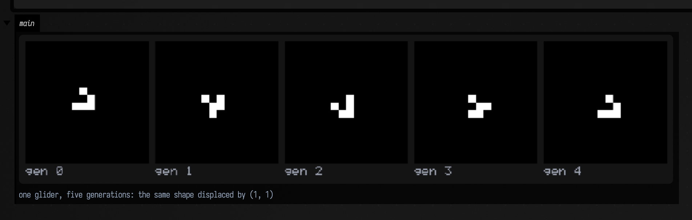
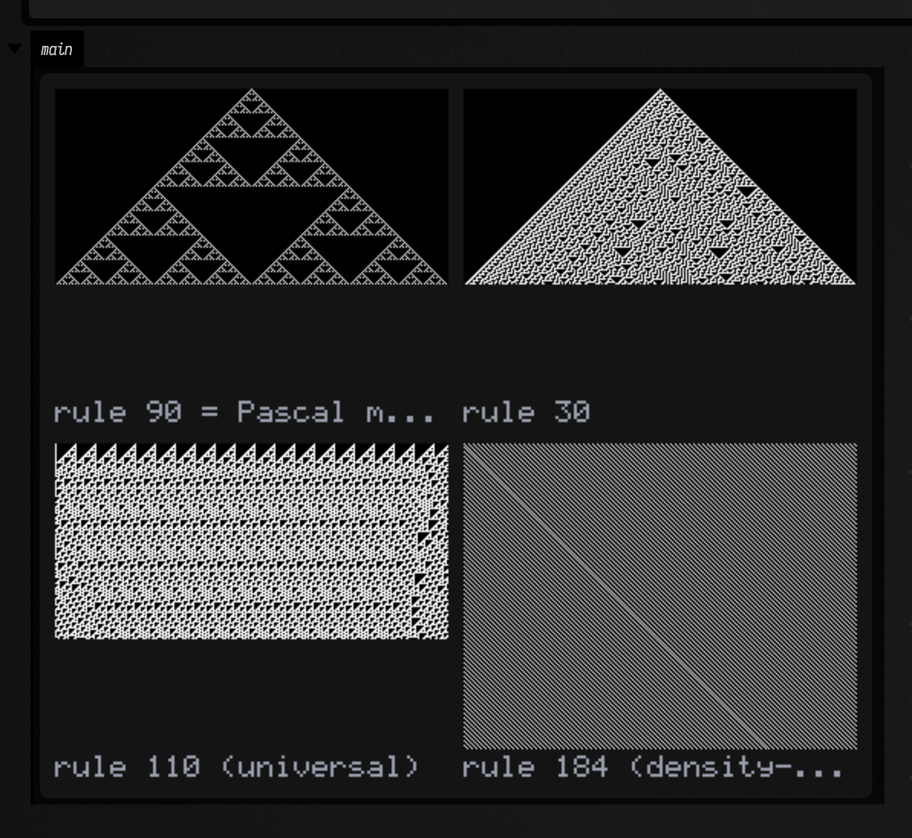
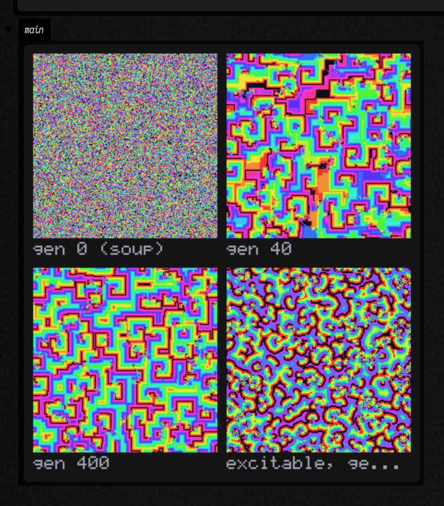
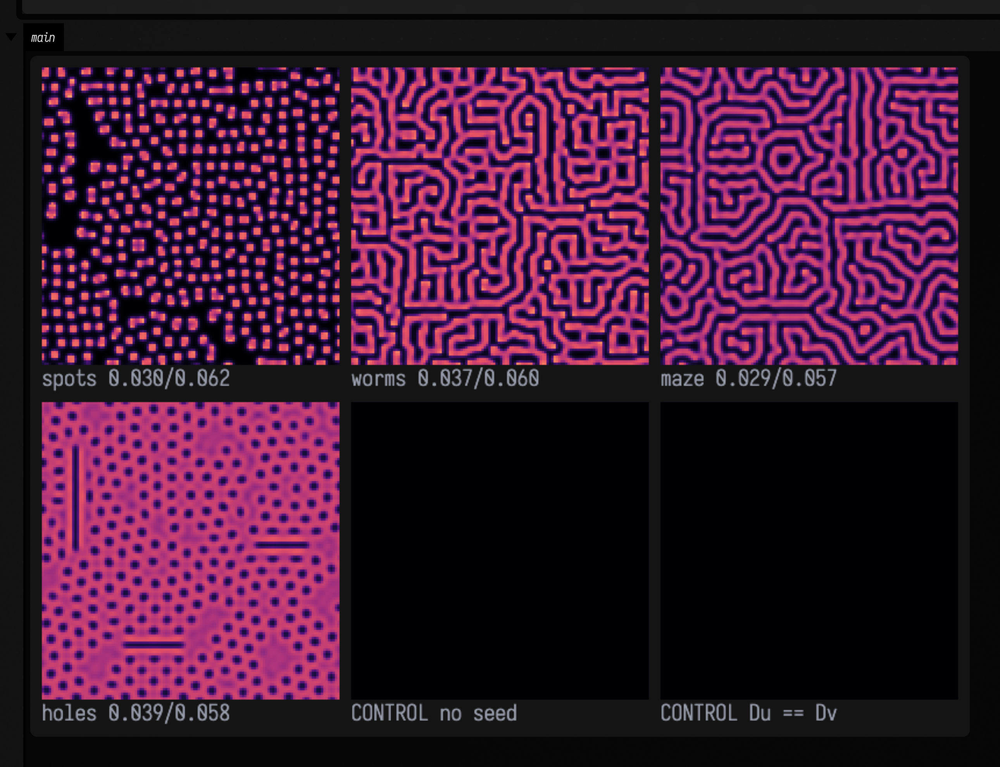
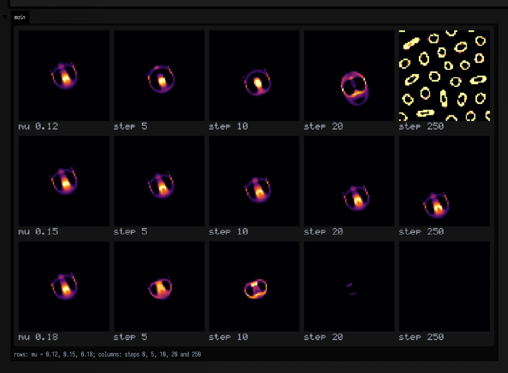
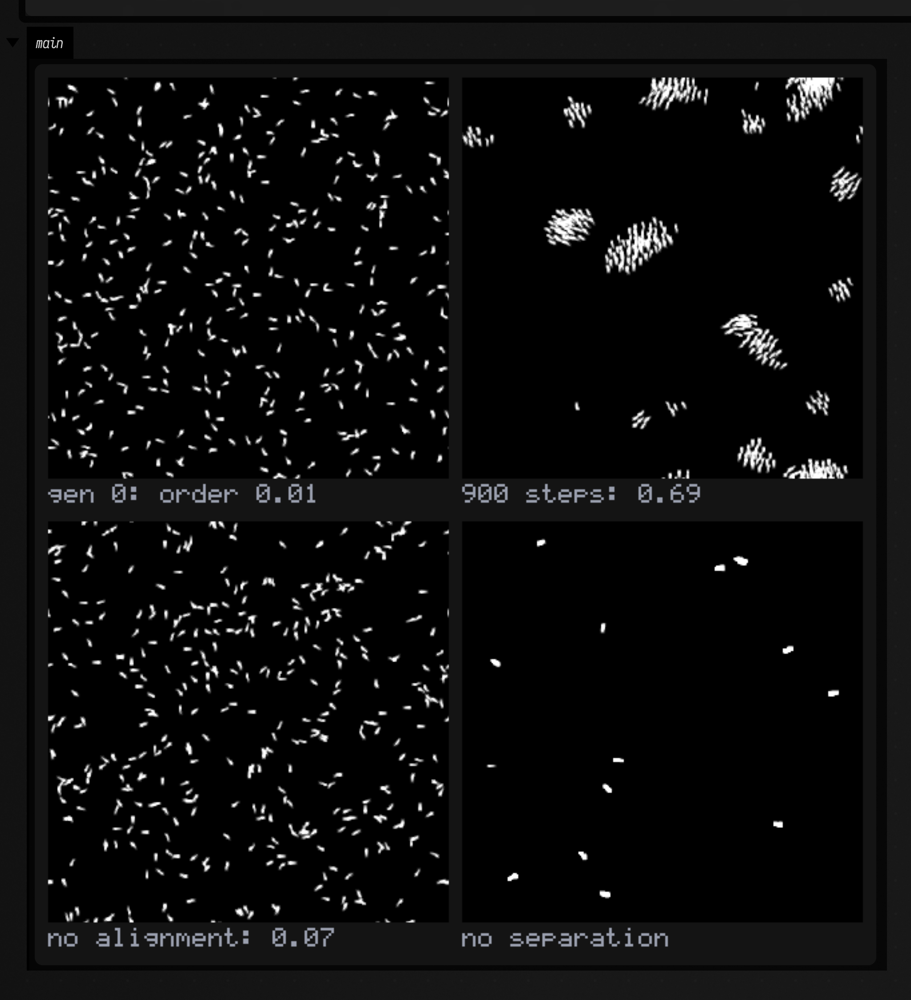
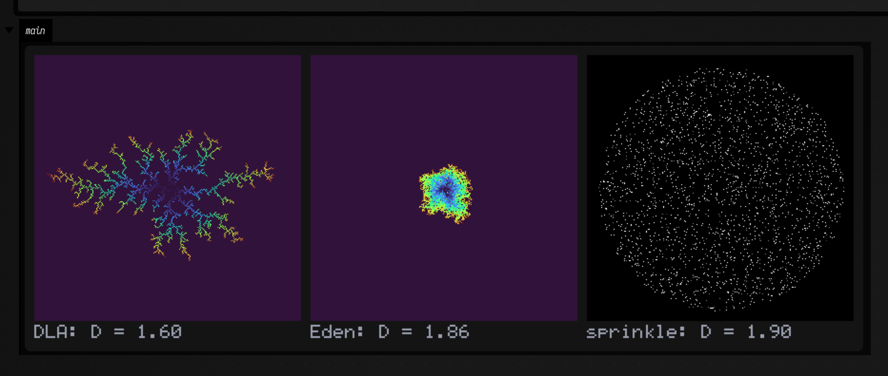
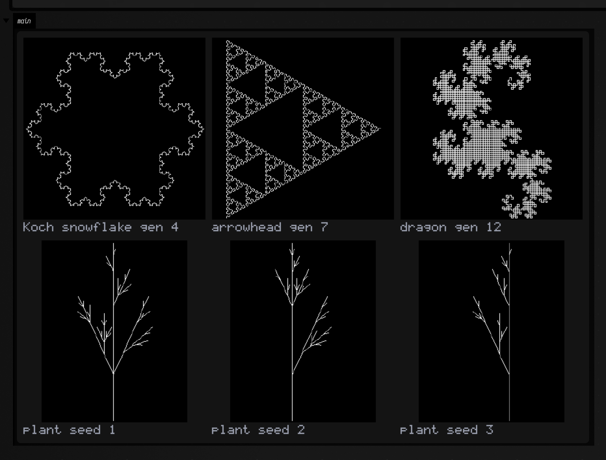
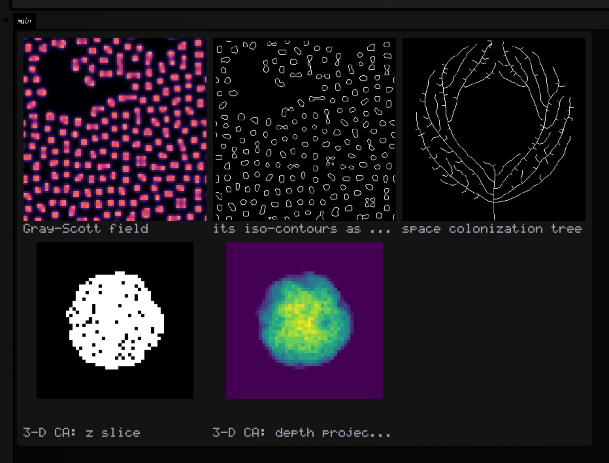
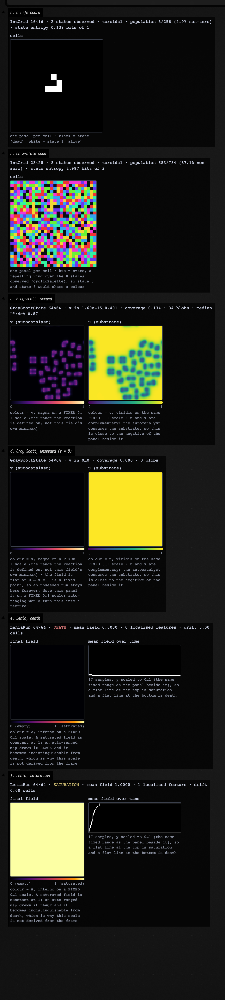

# Spatial artificial life

*Every public declaration used below is listed, with its KDoc, in the codebase reference:
[`alife.kt`](reference/alife.md#alife-kt), [`alife_ca.kt`](reference/alife.md#alife-ca-kt),
[`alife_continuous.kt`](reference/alife.md#alife-continuous-kt),
[`alife_agents.kt`](reference/alife.md#alife-agents-kt),
[`alife_lsystem.kt`](reference/alife.md#alife-lsystem-kt) and
[`alife_field.kt`](reference/alife.md#alife-field-kt). Start from
[what's already in the box](reference/index.md).*

Artificial life is the study of systems whose interesting behaviour is not in their rules. You write
down something local and small — count your neighbours, follow the strongest smell, grow toward the
nearest unclaimed space — and something global and large happens that the rule never mentions: a
spaceship, a coastline, a transport network, a dendrite with a fractional dimension. This page is
about the *spatial* half of that: grids, continuous fields and populations of agents. The
graph-rewriting half lives in [`growing.kt`](reference/data.md#growing-kt) and
[interaction nets](interaction_nets_examples.md), and the constraint-based generative half is
[Wave Function Collapse](wfc_examples.md).

The awkward thing about this material is that it is *very* easy to fake. Almost any local rule applied
to noise produces something that looks organic, so a screenshot proves nothing at all — and the
literature is full of pictures captioned with claims the picture cannot support. So the organising
principle of this page, and of the code behind it, is that **every claim is a number, and every number
has a control arm that gets it wrong**. A glider is not "a shape that moves"; it is a pattern whose
every live cell is displaced by exactly `(1, 1)` after four generations, and the same seed under a rule
one birth-count away is not. A flock is not "dots moving together"; it is a population whose
polarization is 0.69 where 400 independent headings would give 0.044 and where the same initial state
with the alignment term zeroed reaches 0.073.

Everything on this page is checked in CI by
[`afield.examples.stdlib.AlifeGallery`](https://github.com/), which renders seventeen figures and
asserts, for each, the statistic a control arm fails. The numbers printed below are the numbers it
asserts. It runs in two tiers: `stdlib.alife.gallery` is the fast one (~3 s, everything whose evidence
is an exact identity or a closed-form comparison, including the checks that pin the *measurement*
functions against analytic answers) and `stdlib.alife.gallery.slow` is the ~25 s of figures that
integrate a PDE or an agent population to a statistical verdict.

!!! note "The measurement layer is the interesting part"
    `alife.kt` is mostly not automata — it is [`polarization`](reference/alife.md#alife-kt) and its
    random baseline, [`blobShapes`](reference/alife.md#alife-kt) (the isoperimetric ratio that tells
    spots from stripes), [`correlationLength`](reference/alife.md#alife-kt),
    [`topShare`](reference/alife.md#alife-kt) and
    [`massRadiusDimension`](reference/alife.md#alife-kt). Those exist because "it produced pixels" is
    not evidence, and they are what the rest of the family makes its claims through.

## What this implementation does, and does not do

Six dependency-free files built on the existing [imaging](imaging_examples.md) and
[mesh](mesh_examples.md) families — nothing here reimplements convolution, connected-component
labelling, colour mapping or marching cubes:

- **`alife.kt`** — [`IntGrid`](reference/alife.md#alife-kt-intgrid), the toroidal-or-bounded integer
  lattice; the grid↔[`Img`](imaging_examples.md) bridges; and the measurement layer.
- **`alife_ca.kt`** — [`LifeRule`](reference/alife.md#alife-ca-kt-liferule) parsed from `B3/S23`,
  named Life patterns, exact cycle detection, cyclic multi-state CA, Wolfram's elementary 1-D rules as
  a space-time raster, and a 3-D life-like CA on [`IntVolume`](reference/alife.md#alife-ca-kt-intvolume).
- **`alife_continuous.kt`** — mass-conserving diffusion, Gray–Scott reaction–diffusion,
  Gierer–Meinhardt Turing patterns, and Lenia.
- **`alife_agents.kt`** — boids, a Physarum deposit–sense–move population, and diffusion-limited
  aggregation with two control models.
- **`alife_lsystem.kt`** — a bracketed, parametric, optionally stochastic L-system with a turtle that
  emits [`FLine`](fline_examples.md)s, and space-colonization branching.
- **`alife_field.kt`** — the [inline `ToHTML` views](#evaluating-one-of-these-in-a-box-the-inline-views),
  kept in their own file so the five above name nothing from Field's visualizer.

Things it deliberately does not do, so you are not surprised:

- **CPU only.** These are reference implementations you can read. The GPU story is
  [`afield.four`](reference/graphics.md), [StackSL](stacksl_examples.md) and
  [RectSL](rectsl_examples.md).
- **No named Lenia lifeform.** Reproducing Orbium needs its exact published initial array, which this
  family does not ship. What it does instead is [prove the discrete limit](#5-lenia-a-continuous-ca-that-contains-life)
  and report a measured phase trichotomy. Inventing an array and calling it canonical would be a
  fabrication.
- **`O(N²)` neighbour search in the agent models.** A spatial hash is right for 50 000 agents and is a
  different piece of code; these flocks are a few hundred agents and legibility wins.
- **Explicit Euler integration** for the continuous systems, with the stability bound stated as a
  `require` rather than silently clamped.

## 1. Conway's Life, against objects that predate the code

`B3/S23` is the most-studied dynamical system in computing, which is exactly why it is the right place
to start: there are *facts* about it to be checked. The glider translates one cell diagonally every
four generations. The block is a still life. The blinker has period two. And the R-pentomino — five
cells — runs for 1103 generations, peaks at a population of 319 at generation 821, and settles to 116
cells, six of which are gliders still flying away.

That last one has a subtlety worth the space, because it is the difference between a check and a
flattering approximation. Those figures are about an *unbounded* board. On a board with walls the
gliders are destroyed, and the system instead becomes exactly periodic at generation 1164 with 110
cells. Both answers are correct; they are answers to different questions. So the box below runs on a
620-wide board — wide enough that no glider can reach an edge in 1103 generations — and asserts
[`liveBounds`](reference/alife.md#alife-kt-intgrid) to *confirm* the walls never took part rather than
assuming it.

```diffstatic_runner {data-lang=kotlin screenshot="assets/alife_examples/life.png" wait="12.0" capture="box" open-outputs="true" padding="20"}
:::static
// Conway's Life. Every claim here is about an object that predates this code, stated as an
// integer-grid equality rather than as an observation about a picture.
val glider = LifePatterns.glider.centeredOn(40, 40)
println("glider, 4 generations: rigid translation = " + translationBetween(glider, glider.stepTimes(LIFE, 4)))
println("glider, 8 generations: rigid translation = " + translationBetween(glider, glider.stepTimes(LIFE, 8)))

// The control: one birth count away and the same seed is not a spaceship at all.
println("same seed under B34/S23, 4 generations: " +
    translationBetween(glider, glider.stepTimes(lifeRule("B34/S23"), 4)))

val block = LifePatterns.block.centeredOn(20, 20)
println("block is bit-identical after one step: " + block.step(LIFE).sameCellsAs(block))
println("blinker's detected period: " + LifePatterns.blinker.centeredOn(20, 20).runUntilCycle(LIFE, 20).period)
println("toad's detected period: " + LifePatterns.toad.centeredOn(20, 20).runUntilCycle(LIFE, 20).period)

// The R-pentomino. The textbook figures -- peak 319 at generation 821, then 116 cells from
// generation 1103 -- are facts about an UNBOUNDED board: six of those 116 cells are gliders still
// in flight. So it needs room. 620 wide gives every glider more than the 1103/4 cells it can
// travel, and liveBounds() confirms nothing reached an edge rather than assuming it.
var g = LifePatterns.rPentomino.centeredOn(620, 620, wrap = false)
var peak = 0
var peakAt = 0
for (gen in 1..1103) {
    g = g.step(LIFE)
    val pop = g.population()
    if (pop > peak) { peak = pop; peakAt = gen }
}
val b = g.liveBounds()!!
println("R-pentomino peak population " + peak + " at generation " + peakAt)
println("population at generation 1103 = " + g.population() +
    ", live cells " + b[0] + " clear of the board edge")

showImg(
    montage(
        (0..4).map { "gen " + it to LifePatterns.glider.centeredOn(16, 16).stepTimes(LIFE, it).toImg(2).upscaleNearest(12) },
        columns = 5, cellSide = 200
    ),
    caption = "one glider, five generations: the same shape displaced by (1, 1)"
)
```



Note what [`translationBetween`](reference/alife.md#alife-kt) does, and why it is not a centroid
comparison. It aligns the two patterns' bounding boxes, shifts one by that offset, and then demands
**exact cell-by-cell equality**. A pattern that moved *and* changed shape returns `null`. That is what
makes "the glider translates by (1, 1)" an assertion a wrong rule fails rather than a statistic a wrong
rule can fluke — and the `B34/S23` line above is that control, printing `null`.

## 2. Wolfram's elementary rules, against an independent oracle

A one-dimensional automaton's behaviour is two-dimensional, so
[`elementaryCa`](reference/alife.md#alife-ca-kt) returns the whole **space-time diagram** as an
`IntGrid`: one row per generation, time downward. Every famous statement about these 256 rules is a
statement about this picture.

The sharpest piece of evidence in this whole family is here. Rule 90 is `left XOR right`, and from a
single seed its space-time diagram **is Pascal's triangle mod 2** — the Sierpiński gasket.
[`sierpinskiReference`](reference/alife.md#alife-ca-kt) computes that from Kummer's theorem
(`C(n, k)` is odd exactly when `n and k == k`) without running a cellular automaton at all. So the
equality between them is a cross-check between two unrelated computations, not a stepper agreeing with
itself — and it holds in all 32 896 cells. A second, independent oracle comes free: row `g` of that
diagram holds exactly `2^popcount(g)` live cells (Gould's sequence).

Rule 184 is the traffic rule, and it conserves the number of live cells **exactly**, forever. Rule 90
does not, which is the control that stops "184 conserves density" from being a property of the harness.

```diffstatic_runner {data-lang=kotlin screenshot="assets/alife_examples/elementary.png" wait="5.0" capture="box" open-outputs="true" padding="20"}
:::static
// Wolfram's elementary rules, and the sharpest evidence in the family: rule 90 from a single seed
// IS Pascal's triangle mod 2, and `sierpinskiReference` computes that from Kummer's theorem
// without running a cellular automaton at all. The equality is a cross-check between two
// unrelated computations rather than a stepper agreeing with itself.
val w = 257
val gens = 128
val rule90 = elementaryCa(90, w, gens)
val oracle = sierpinskiReference(w, gens)
var differing = 0
for (i in rule90.cells.indices) if (rule90.cells[i] != oracle.cells[i]) differing++
println("rule 90 vs Pascal mod 2: " + differing + " differing cells of " + rule90.cells.size)

// A second, independent oracle: row g of that diagram holds exactly 2^(popcount g) live cells.
val rows = (0 until gens).map { r -> (0 until w).count { rule90.cells[r * w + it] == 1 } }
println("row populations are exactly 2^popcount(generation): " +
    (rows == (0 until gens).map { 1 shl Integer.bitCount(it) }))

// Rule 184 is the traffic rule: it conserves the number of 1s exactly, forever.
val seedRow = IntArray(257) { if ((it * 7919) % 3 == 0) 1 else 0 }
val traffic = elementaryCa(184, 257, 200, seedRow)
val pops = (0 until 200).map { r -> (0 until 257).count { traffic.cells[r * 257 + it] == 1 } }
println("rule 184 distinct row populations over 200 generations: " + pops.distinct())
println("rule 90 distinct row populations: " + rows.distinct().size + " values, so NOT conserved")

val col30 = elementaryCa(30, 601, 600).centerColumn()
println("rule 30 centre column: " + col30.count { it == 1 } + "/600 ones, longest run " +
    longestRunLength(col30) + " (rule 90's is " + longestRunLength(rule90.centerColumn()) + ")")

showImg(
    montage(
        listOf(
            "rule 90 = Pascal mod 2" to rule90.toImg(2),
            "rule 30" to elementaryCa(30, 257, 128).toImg(2),
            "rule 110 (universal)" to elementaryCa(110, 257, 128, IntArray(257) { if (it % 13 == 0) 1 else 0 }).toImg(2),
            "rule 184 (density-conserving)" to traffic.toImg(2)
        ),
        columns = 2, cellSide = 300
    )
)
```



## 3. Cyclic CA: self-organisation with a closed form to check it against

A cyclic cellular automaton has `k` states arranged in a ring. A cell in state `s` advances to `s + 1`
as soon as at least `threshold` of its neighbours are *already* in `s + 1`; otherwise it waits. Nothing
can skip a state, and there is no way back, so the only durable structures are rotating bands.

The measurement that makes "it self-organised" checkable is
[`cyclicAdvanceFraction`](reference/alife.md#alife-ca-kt). In an **uncorrelated** soup a cell can advance
exactly when one of its eight Moore neighbours happens to hold its successor state, which is
`1 - (1 - 1/k)^8` — a closed form, not a threshold. For `k = 14` that is 0.4473, and the measurement is
0.4483. Four hundred generations later every cell is being driven by a neighbour and the fraction pins
at **1.0000**, which is something no uncorrelated field does at any `k`.

The second pair of panels is the excitable corner of the parameter space (six states, threshold three,
radius two), which curls into visible spiral cores. That is a different *phase*, and the difference is
reported as a length scale rather than left to the eye — though note the direction: the wider
neighbourhood gives the **smaller** correlation length, because the spiral arms are narrow.

!!! note "This statistic's floor is 0.632, not 0"
    [`correlationLength`](reference/alife.md#alife-kt) is the lag at which the direction-averaged
    autocorrelation first falls to `1/e`, linearly interpolated. For a field with *no* correlation at all
    the interpolation runs from `ac(0) = 1` straight to `ac(1) ≈ 0`, so the answer is `1 − 1/e = 0.632` —
    a floor, reached from below by nothing. Both settled fields here are compared with their own pixels
    shuffled, which lands on that floor to six decimal places (2.80 against 0.634, and 2.01 against
    0.633), rather than with a chosen constant. A checkerboard — the shortest wavelength a lattice holds —
    reads exactly `(1 − 1/e)/(4/3) = 0.4741`, which is as low as this statistic can go.

```diffstatic_runner {data-lang=kotlin screenshot="assets/alife_examples/cyclic.png" wait="6.0" capture="box" open-outputs="true" padding="20"}
:::static
// A cyclic cellular automaton: a cell in state s advances to s+1 as soon as any neighbour is
// already in s+1. Nothing can skip, so the only durable structures are rotating bands.
//
// The measurement that makes "it self-organised" checkable: in an UNCORRELATED soup a cell can
// advance exactly when one of its 8 Moore neighbours happens to hold its successor state, which
// is 1 - (1 - 1/states)^8 -- a closed form. Once the field has organised, every cell is driven by
// a neighbour and the advance fraction pins at 1.0, which no uncorrelated field does.
val rule = CYCLIC_LABYRINTH
val soup = IntGrid.random(200, 200, states = rule.states, seed = 7L)
val predicted = 1.0 - Math.pow(1.0 - 1.0 / rule.states, 8.0)
val early = cyclicAdvanceFraction(soup, soup.step(rule))
val settled = soup.stepTimes(rule, 400)
val late = cyclicAdvanceFraction(settled, settled.step(rule))
println("soup advance fraction " + "%.4f".format(early) + ", closed form " + "%.4f".format(predicted))
println("after 400 generations " + "%.4f".format(late) + " of cells advance every step")

// The excitable corner of the parameter space (wider neighbourhood, higher threshold) is a
// visibly different phase -- spiral cores -- and the difference is measurable as a length scale.
val ex = CYCLIC_EXCITABLE
val exSettled = IntGrid.random(200, 200, states = ex.states, seed = 7L).stepTimes(ex, 200)
println("correlation length: labyrinth " + "%.2f".format(settled.toImg(rule.states).correlationLength(maxLag = 30)) +
    ", excitable " + "%.2f".format(exSettled.toImg(ex.states).correlationLength(maxLag = 30)))

val palette = cyclicPalette(rule.states)
showImg(
    montage(
        listOf(
            "gen 0 (soup)" to soup.toImg(palette),
            "gen 40" to soup.stepTimes(rule, 40).toImg(palette),
            "gen 400" to settled.toImg(palette),
            "excitable, gen 200" to exSettled.toImg(cyclicPalette(ex.states))
        ),
        columns = 2, cellSide = 280
    )
)
```



## 4. Gray–Scott: telling regimes apart by measurement

Two coupled fields, `u` (substrate) and `v` (autocatalyst), the reaction `U + 2V → 3V` with `V → P`,
and two numbers — a feed rate `F` and a kill rate `k`. The entire zoo of morphologies is a function of
those two numbers, which is why the system is a canonical morphogenesis model and not merely a pretty
one.

Here is the problem this section exists to solve. Spots and a labyrinth can have *identical* coverage,
identical mean and identical variance. Nothing in a histogram separates them. What separates them is
the **shape** of their features, and
[`morphology()`](reference/alife.md#alife-continuous-kt-morphologyreport) measures it: the
isoperimetric ratio `P²/4πA` (1 for a disc, growing without bound as a region gets thinner and more
convoluted) and the share of the covered area held by the single largest connected feature.

The numbers below, from the run in the box: the spots preset gives 329 separate features with a median
ratio of **0.80** and a largest-blob share of **0.008**; the two labyrinth presets give 24 and 34
features with ratios of **2.5** and **2.4** and largest shares of **0.64** and **0.45**. Three times
less round, and dominated by one connected structure. The `holes` preset is the inverse morphology and
reads as a single blob at 0.78 coverage with a ratio of **90**.

!!! warning "A calibration, because the statistic has a known bias"
    The digital "crack perimeter" over-estimates a smooth boundary by about `4/π`, so `blobShapes`
    applies that correction — and the gallery *measures* a synthetic 40-cell disc to confirm it lands
    at 1.00, rather than trusting the paragraph. The correction is asymptotic, so a 10-cell blob reads
    slightly **under** 1 (hence 0.80 for the spots). That bias points toward "round", which makes a
    *stripe* verdict conservative.

Two controls. `v = 0` is a stable fixed point of the equations, so an unseeded field stays at exactly
0.0 forever — the pattern comes from the dynamics and not from the renderer. And with `Du == Dv` the
Turing instability's short-scale advantage is gone and the same seed, the same reaction and the same
6000 steps produce nothing at all: Turing's own argument, restated as an experiment.

```diffstatic_runner {data-lang=kotlin screenshot="assets/alife_examples/gray-scott.png" wait="20.0" capture="box" open-outputs="true" padding="20"}
:::static
// Gray-Scott reaction-diffusion. Two coupled fields, two parameters, and the whole zoo of
// morphologies -- spots, worms, mazes, holes -- is a function of those two numbers.
//
// The point of `morphology()` is that a regime claim should be a claim about numbers. Spots and a
// labyrinth can have identical coverage, identical mean and identical variance; what separates
// them is the SHAPE of their features (isoperimetric ratio P^2/4piA, ~1 for a disc) and whether
// one connected structure dominates.
val side = 128
val steps = 6000
val panels = ArrayList<Pair<String, Img>>()
for ((label, p) in listOf(
    "spots 0.030/0.062" to GRAY_SCOTT_SPOTS,
    "worms 0.037/0.060" to GRAY_SCOTT_WORMS,
    "maze 0.029/0.057" to GRAY_SCOTT_MAZE,
    "holes 0.039/0.058" to GRAY_SCOTT_HOLES
)) {
    val end = grayScottSeed(side, side, patches = 6, patchSize = 14, seed = 11L).stepTimes(p, steps)
    println(label + " -> " + end.v.morphology())
    panels.add(label to end.v.colormap("magma", 0f, 0.5f).upscaleNearest(2))
}

// Two controls. v = 0 is a fixed point of the equations, so an unseeded field never patterns;
// and equal diffusion coefficients destroy the Turing instability entirely, which is Turing's
// own argument restated as an experiment.
val unseeded = grayScottSeed(side, side, patches = 0).stepTimes(GRAY_SCOTT_WORMS, 500)
println("CONTROL no seed: max autocatalyst after 500 steps = " + unseeded.v.max())
val equalD = grayScottSeed(side, side, patches = 6, patchSize = 14, seed = 11L)
    .stepTimes(GrayScottParams(feed = 0.037, kill = 0.060, du = 0.08, dv = 0.08), steps)
println("CONTROL Du == Dv -> " + equalD.v.morphology())
panels.add("CONTROL no seed" to unseeded.v.colormap("magma", 0f, 0.5f).upscaleNearest(2))
panels.add("CONTROL Du == Dv" to equalD.v.colormap("magma", 0f, 0.5f).upscaleNearest(2))

showImg(montage(panels, columns = 3, cellSide = 260))
```



## 5. Lenia: a continuous CA that contains Life

Lenia is one field `A` in `0..1`, one convolution kernel `K`, one growth mapping `G`, and

```
A  <-  clamp(A + dt * G(K * A), 0, 1)
```

That is the whole system. Its interest is that with a smooth ring kernel and a smooth bell-shaped
growth mapping it supports localised, self-maintaining, *moving* structures — solitons — which a
lattice automaton quantises away.

The honest claim to make about an *implementation* of it is a cross-check, and there is a very good one
available. With a uniform Moore ring kernel, `dt = 1`, and a **three-valued** step growth mapping (`+1`
on the birth counts, `0` on survive-only counts, `-1` elsewhere), Lenia reduces exactly to an
outer-totalistic `B/S` rule: `G = +1` forces a cell alive from either state, `G = 0` leaves it as it
was, `G = -1` forces it dead. So this file's sparse float convolution and `alife_ca.kt`'s integer
neighbour counting must agree **bit for bit**.
[`leniaFromLifeRule`](reference/alife.md#alife-continuous-kt) builds that limit, and the worst per-cell
difference over 20 generations of a glider is `0.0`. Moving the growth window one neighbour count
diverges completely.

Be precise about what that proves, because an earlier draft of this page was not: it called the two
"separately written steppers", and they are not independent implementations of Conway's Life.
`leniaFromLifeRule` reads the very same `B3/S23` birth and survive sets that the integer stepper reads,
so a wrong table would produce two wrong steppers in perfect agreement. What the bit-for-bit result
cross-validates is the two **update mechanisms** — a float convolution, an additive `A + dt·G` step, the
quantisation back to a neighbour count, the clamp to `0..1`, the toroidal border and the `Img`↔`IntGrid`
bridges, against integer neighbour counting and a table lookup. The *rule* is pinned separately, and from
outside this codebase, by the named-object checks above: a glider that translates by exactly `(1, 1)` in
four generations, a block that does not move, a blinker of period 2.

There is one real restriction, and it is a fact rather than a limitation: this needs `birth ⊆ survive`.
If a count births a dead cell but does not sustain a live one, no function of the neighbour count alone
can do both, and `leniaFromLifeRule` rejects the rule instead of quietly producing a different
automaton. Conway's `B3/S23` satisfies it.

For the *continuous* regime this page reports a measured phase trichotomy rather than a named creature.
[`leniaRun`](reference/alife.md#alife-continuous-kt) classifies an outcome as `DEATH`, `BOUNDED` or
`SATURATION` and hands back the mass history behind the verdict, and from one seed the growth mapping's
two parameters produce all three. The bounded cells are fine-grained self-maintaining textures — you
can see the individual ring-shaped cells in the panels — and are *not* the published solitons of the
Lenia literature. This family ships no published initial pattern and so claims none.

```diffstatic_runner {data-lang=kotlin screenshot="assets/alife_examples/lenia.png" wait="20.0" capture="box" open-outputs="true" padding="20"}
:::static
// Lenia is a CONTINUOUS cellular automaton: one field in 0..1, one convolution kernel, one growth
// mapping, and A <- clamp(A + dt * G(K * A)).
//
// The claim worth making about an implementation of it is a cross-check. With a uniform Moore ring
// kernel, dt = 1 and a three-valued step growth mapping, Lenia reduces EXACTLY to an
// outer-totalistic B/S rule -- so this float convolution and the integer Life stepper in
// `alife_ca.kt` must agree bit for bit. `leniaFromLifeRule` builds that limit.
val discrete = leniaFromLifeRule(LIFE)
println("discrete-limit kernel: " + discrete.taps.size + " taps summing to " + discrete.taps.weight.sum())

var grid = LifePatterns.glider.centeredOn(32, 32)
var field = grid.toImg(2)
var worst = 0.0
for (gen in 1..20) {
    grid = grid.step(LIFE)
    field = field.leniaTimes(discrete, 1)
    worst = maxOf(worst, fieldMaxAbsDiff(field, grid.toImg(2)))
}
println("20 generations, float Lenia vs integer Life: worst per-cell difference " + worst)
println("the glider the float stepper carried moved by " +
    translationBetween(LifePatterns.glider.centeredOn(32, 32), field.toIntGrid(0.5f)))

// Control: move the growth window by one neighbour count and nothing else.
println("CONTROL, growth window at B4/S234: difference " +
    fieldMaxAbsDiff(LifePatterns.glider.centeredOn(32, 32).toImg(2).leniaTimes(leniaFromLifeRule(lifeRule("B4/S234")), 20), grid.toImg(2)))

// The continuous regime, reported as a measured phase trichotomy rather than as a named creature:
// this file ships no published Lenia initial pattern, so it claims none.
val panels = ArrayList<Pair<String, Img>>()
panels.add("discrete limit == Life" to field.upscaleNearest(8))
panels.add("ring kernel R=8" to LeniaPresets.ring(0.15, radius = 8).kernelImg().normalized().upscaleNearest(10))
for (mu in listOf(0.06, 0.14)) {
    val r = LeniaPresets.ring(mu, sigma = 0.017, radius = 8, dt = 0.12)
    val run = leniaRun(leniaSeed(96, 96, r, blobRadii = 1.6, seed = 9L), r, steps = 240)
    println("mu = " + mu + " -> " + run)
    panels.add("mu=" + mu + " " + run.phase.name.lowercase() to run.field.colormap("inferno", 0f, 1f).upscaleNearest(3))
}
val wide = LeniaPresets.ring(0.60, sigma = 0.60, radius = 8, dt = 0.12)
val sat = leniaRun(leniaSeed(96, 96, wide, blobRadii = 1.6, seed = 9L), wide, steps = 240)
println("a growth bell positive over the whole unit interval -> " + sat)
panels.add("wide sigma: saturation" to sat.field.colormap("inferno", 0f, 1f).upscaleNearest(3))

showImg(montage(panels, columns = 3, cellSide = 280))
```



!!! note "One rendering trap, since it produced a wrong figure once"
    A saturated field is *constant* at 1, so an auto-ranged colour map draws it at the dark end of the
    ramp — and a `SATURATION` panel renders as black, indistinguishable from `DEATH`. The panels above
    use a fixed `0..1` range for exactly that reason.

## 6. Boids: order, against the level disorder would give

[Reynolds' three rules](https://www.red3d.com/cwr/boids/) — separate, align, cohere — on a torus. The
domain wraps for a reason beyond tidiness: in a bounded box the walls do half the flocking, because
agents that bounce off the same wall end up parallel, so a polarization measured in a box is not
evidence about the *rules*.

A flock is two things at once, and both are measured here:

- **Aligned.** The order parameter `|Σ v̂| / N` is 0.692 after 900 steps. That needs a scale, so
  [`randomPolarizationBaseline`](reference/alife.md#alife-kt) gives it: `√π / 2√N` is the expected value
  for `N` *independent* headings, which for 400 agents is 0.044. The measured value is 15.6× that. And
  the same initial state with `alignmentWeight = 0` — nothing else changed — reaches 0.073.
- **Spaced.** The 5th-percentile nearest-neighbour distance is 1.37 cells; with `separationWeight = 0`
  it collapses to 0.01. The floor under that distribution is the separation term, and you can see the
  control arm's population has collapsed to points.

0.692 rather than something near 1 is the *correct* answer, not a weak one: the population settles into
several separate flocks with different headings (visible in the figure), and the global order parameter
of `k` independent flocks tops out near `1/√k`.

!!! warning "A stalled flock can still score well on alignment"
    The three steering terms are written as *desired-minus-current* velocities, so in a settled flock
    they largely cancel and — with a force cap — the speed drifts downward. The first version of this
    code measured a mean speed of **0.46** against a cap of 1.4: a flock that had mostly stopped while
    still looking aligned. `BoidParams.minSpeedFraction` is the fix, and it changes magnitude only,
    never heading, so it cannot inflate the polarization number.

```diffstatic_runner {data-lang=kotlin screenshot="assets/alife_examples/boids.png" wait="10.0" capture="box" open-outputs="true" padding="20"}
:::static
// Reynolds' boids on a torus. A flock is not "dots that move together"; it is a population whose
// alignment order parameter is far above what independent headings would give, AND whose
// nearest-neighbour distribution has a floor. Both are measured against the same initial state run
// with one weight zeroed -- so the difference is attributable to that weight and nothing else.
val n = 400
val start = BoidFlock.random(n, 260.0, 260.0, speed = 1.4, seed = 4L)
val params = BoidParams()
println("random-heading baseline for " + n + " agents: " + "%.3f".format(randomPolarizationBaseline(n)))
println("initial polarization: " + "%.3f".format(start.order()))

val flock = start.copy(); flock.stepTimes(params, 900)
val noAlign = start.copy(); noAlign.stepTimes(params.copy(alignmentWeight = 0.0), 900)
val noSep = start.copy(); noSep.stepTimes(params.copy(separationWeight = 0.0), 900)

println("flock polarization " + "%.3f".format(flock.order()) +
    ", CONTROL with no alignment " + "%.3f".format(noAlign.order()))
println("5th-percentile nearest neighbour: flock " + "%.2f".format(quantileOf(flock.neighborDistances(), 0.05)) +
    ", CONTROL with no separation " + "%.2f".format(quantileOf(noSep.neighborDistances(), 0.05)))
println("mean speed " + "%.2f".format(flock.meanSpeed()) + " of a " + params.maxSpeed + " cap")

showImg(
    montage(
        listOf(
            "gen 0: order " + "%.2f".format(start.order()) to start.toImg(1.4, tail = 5.0),
            "900 steps: " + "%.2f".format(flock.order()) to flock.toImg(1.4, tail = 5.0),
            "no alignment: " + "%.2f".format(noAlign.order()) to noAlign.toImg(1.4, tail = 5.0),
            "no separation" to noSep.toImg(1.4, tail = 5.0)
        ),
        columns = 2, cellSide = 300
    )
)
```



## 7. Physarum: a transport network that is nowhere in the code

Jones' slime-mould model. Each agent deposits into a trail field, samples that field three ways ahead,
turns toward the strongest, and moves. The network is not stored anywhere — it is the fixed point of
that stigmergic loop.

The measurement is [`topShare(0.05)`](reference/alife.md#alife-kt): the fraction of all deposit held by
the brightest 5 % of pixels. A flat field gives 0.05 by definition. The sensing population gives
**0.480**; the identical population with sensing switched off — same count, same seed, same deposit,
same decay, random turns — gives **0.185**. And the shapes differ as sharply: median isoperimetric ratio
17.2 against 1.2, filaments against blobs.

!!! warning "Mutual exclusion is the whole model, not an optimisation"
    Without Jones' one-agent-per-cell rule there is nothing to stop every agent within sensing range of
    the brightest trail converging on it — and they do. The first version of this code collapsed 6000
    agents onto a 191-cell streak and measured a top-5 % share of **1.000**, which reads as perfect
    concentration and is total failure. `PhysarumParams.exclusive` makes the population
    *incompressible*, so a trail can only get so strong before it has to widen or branch, and branching
    under a density limit is what a transport network is.

```diffstatic_runner {data-lang=kotlin screenshot="assets/alife_examples/physarum.png" wait="8.0" capture="box" open-outputs="true" padding="20"}
:::static
// Jones' Physarum model: agents deposit into a trail field, sense it three ways ahead, turn toward
// the strongest, move. The transport network is nowhere in the code -- it is the fixed point of
// that loop.
//
// The measurement: `topShare(0.05)` is the fraction of all deposit held by the brightest 5% of
// pixels. A flat field gives 0.05. A network concentrates material into filaments and gives much
// more. The control is the identical population with sensing switched off -- same count, same
// seed, same deposit, same decay, random turns.
val side = 256
val p = PhysarumParams()
val sensing = PhysarumSwarm.disc(side, side, 6000, 0.55, seed = 6L).stepTimes(p, 400, seed = 6L)
val blind = PhysarumSwarm.disc(side, side, 6000, 0.55, seed = 6L)
    .stepTimes(p.copy(sensing = false), 400, seed = 6L)

println("top-5% deposit share: sensing " + "%.3f".format(sensing.trail.topShare(0.05)) +
    ", CONTROL sensing off " + "%.3f".format(blind.trail.topShare(0.05)) + " (a flat field gives 0.05)")
println("sensing morphology: " + sensing.trail.normalized().morphology())
println("blind   morphology: " + blind.trail.normalized().morphology())

showImg(
    montage(
        listOf(
            "sensing" to sensing.trail.normalized().colormap("magma"),
            "CONTROL: sensing off" to blind.trail.normalized().colormap("magma")
        ),
        columns = 2, cellSide = 340
    )
)
```


## 8. DLA: the one number with a literature value

Diffusion-limited aggregation: a seed at the centre, then particles released far away that random-walk
until they touch the cluster and stick. Nothing in the rule mentions branches, and the result is a
dendrite.

This is the one system in the family with a quantitative number to hit, so it gets the sharpest
evidence: the **mass–radius dimension**, fitted as `N(r) ∝ r^D` in log–log space by
[`massRadiusDimension`](reference/alife.md#alife-kt), which also reports `r²` — because a slope through a
curve is not a dimension. Planar DLA's asymptotic value is about 1.71; the cluster below measures
**1.597** with `r² = 0.9965`.

The two controls are what make that number mean something. An **Eden cluster** uses the same
neighbourhood and the same particle count, and differs only in that the growth site is chosen
uniformly instead of by a diffusing walker: it measures **1.860** and is visibly compact. A **uniform
sprinkle** over the same disc has dimension exactly 2 by construction and measures **1.898**. So the
estimator is reading the diffusion-limited part of DLA and not merely "a growth process happened", and
it is not simply reading the bounded support.

!!! note "Stated as a range, not as a match"
    1.597 is below 1.71, and it is honest to say why rather than to round toward the literature: lattice
    DLA clusters of this size are known to read low, and the asymptote needs far larger clusters. The
    assertion in CI is therefore "clearly between 1.5 and 1.8, and clearly not 2".

    "The cluster reads low" and "the estimator reads low" are different claims, and the second one is
    checkable, so it is checked rather than assumed. A point set placed at radii `R·(i/n)^(1/D)` has
    `N(r) = n·(r/R)^D` **by construction** for any real `D`, and `massRadiusDimension` recovers
    `1.000, 1.262, 1.711, 2.002` from sets built with `D = 1.00, 1.2619, 1.71, 2.00`. Handed something
    whose exponent *is* 1.71 it returns 1.71. Separately, a straight line of lattice points reads 0.993
    and a filled lattice disc 1.986 — the same 0.7 % low, because a staircase `N(r)` is not a power law.
    So about 0.7 % of the gap is the lattice and the rest is the cluster's finite size.

    A related trap, also caught by a control: fitting from where `N(r)` is three points measured a
    *uniform disc* at dimension **2.32**, which is not a possible answer. `massRadiusDimension`'s
    `minCount` raises the inner radius until the statistics exist.

```diffstatic_runner {data-lang=kotlin screenshot="assets/alife_examples/dla.png" wait="8.0" capture="box" open-outputs="true" padding="20"}
:::static
// Diffusion-limited aggregation: a seed, then particles released far away that random-walk until
// they touch and stick. Nothing in the rule mentions branches.
//
// This is the one system here with a quantitative number to hit, so it gets the sharpest evidence:
// the mass-radius dimension. An Eden cluster (same neighbourhood, growth site chosen uniformly
// instead of by a diffusing walker) and a uniform sprinkle both have dimension 2, so those two
// controls show the estimator is reading the diffusion-limited part and not merely "growth".
val side = 300
val dla = dlaCluster(side, side, particles = 6000, seed = 2L)
val fit = dla.fractalDimension(rMin = 5.0, rMaxFraction = 0.75)
println(dla)
println("DLA mass dimension " + "%.3f".format(fit.dimension) + " (r2 = " + "%.4f".format(fit.rSquared) + ")")

val eden = edenCluster(side, side, particles = dla.points.size, seed = 2L)
val edenFit = eden.fractalDimension(rMin = 5.0, rMaxFraction = 0.75)
println("CONTROL Eden dimension " + "%.3f".format(edenFit.dimension))
val sprinkle = sprinkleCluster(side, side, dla.points.size, dla.maxRadius, seed = 2L)
val sprinkleFit = massRadiusDimension(sprinkle.points, sprinkle.center,
    rMin = 5.0, rMax = sprinkle.maxRadius * 0.75, minCount = 60)
println("CONTROL uniform sprinkle dimension " + "%.3f".format(sprinkleFit.dimension) + " (exactly 2 by construction)")

showImg(
    montage(
        listOf(
            "DLA: D = " + "%.2f".format(fit.dimension) to dla.arrivalOrderImg().colormap("turbo"),
            "Eden: D = " + "%.2f".format(edenFit.dimension) to eden.arrivalOrderImg().colormap("turbo"),
            "sprinkle: D = " + "%.2f".format(sprinkleFit.dimension) to sprinkle.mask
        ),
        columns = 3, cellSide = 280
    )
)
```



## 9. L-systems: exact identities, not statistics

L-systems are the odd one out in this family, and they belong in it for a precise reason: they are the
one generative system here whose output can be checked **exactly and combinatorially**.

- Lindenmayer's original algae system (`A → AB`, `B → A`) has derivation lengths that are the Fibonacci
  numbers. Exactly.
- The Koch snowflake has exactly `3 · 4^n` forward symbols at generation `n`.
- Its turtle path **closes**: the pen returns to where it started, to `2.3 × 10⁻¹⁴` of a step.
- Its drawn length grows by exactly **4×** per generation at constant step size. (The textbook `4/3` is
  the ratio when the figure is held at constant *diameter*; this turtle holds the step constant, so the
  figure triples in size each generation. Same identity, stated for what is actually drawn.)
- And its enclosed area matches the closed form `9^n · A₀ · (1 + 3/5(1 − (4/9)^n))` to `3 × 10⁻⁸`
  relative — a second, independent geometric identity from the same turtle. (`FLine` stores
  single-precision coordinates, which is what sets that floor.)

Perturbing the turn angle by 0.01 radians leaves the path open by 2.7 steps, so the closure test has
teeth.

The bracket pair `[` `]` is what makes an L-system a *plant* rather than a curve: it pushes and pops the
turtle state, so a production can grow a side branch and return. And stochastic productions — several
competing rules for one symbol — vary the **topology** rather than jittering one plant's coordinates,
which is why the three plants below have 91, 74 and 51 branches rather than three wobbly copies of the
same tree.

```diffstatic_runner {data-lang=kotlin screenshot="assets/alife_examples/lsystem.png" wait="6.0" capture="box" open-outputs="true" padding="20"}
:::static
// L-systems are the one generative system in this family whose output can be checked exactly and
// combinatorially rather than statistically -- so they carry the sharpest evidence here.
println("algae derivation lengths (Fibonacci): " + LSYSTEM_ALGAE.derivations(9).map { it.length })
println("Koch snowflake forward symbols (3 * 4^n): " +
    (0..5).map { gen -> LSYSTEM_KOCH_SNOWFLAKE.derive(gen).count { it == 'F' } })

// And the turtle: the path CLOSES, its drawn length quadruples exactly at constant step size, and
// its enclosed area matches the closed form 9^n * A0 * (1 + 3/5(1 - (4/9)^n)). FLine stores
// single-precision coordinates, so "exact" here means to float precision.
val step = 1.0
val tp = TurtleParams(angle = Math.PI / 3.0, step = step)
val gens = (0..5).map { drawLSystem(LSYSTEM_KOCH_SNOWFLAKE, it, tp) }
println("worst closure residual: " + gens.map { turtleClosureError(it, step) }.max() + " of a step")
val lens = gens.map { flineTotalLength(it.lines) }
println("length ratio per generation: " + (1..5).map { "%.6f".format(lens[it] / lens[it - 1]) })
println("area, relative error against the closed form: " + (0..5).map { gen ->
    val a0 = Math.sqrt(3.0) / 4.0 * step * step
    val predicted = Math.pow(9.0, gen.toDouble()) * a0 * (1.0 + 0.6 * (1.0 - Math.pow(4.0 / 9.0, gen.toDouble())))
    "%.1e".format(Math.abs(Math.abs(flineSignedArea(gens[gen].lines)) - predicted) / predicted)
})
// Control: one wrong turn and none of that holds.
println("CONTROL, turn angle perturbed by 0.01 rad: open by " +
    "%.1f".format(turtleClosureError(drawLSystem(LSYSTEM_KOCH_SNOWFLAKE, 4, tp.copy(angle = Math.PI / 3.0 + 0.01)), step)) + " steps")

// Stochastic productions vary the TOPOLOGY, not merely the coordinates.
val plants = (1L..3L).map { drawLSystem(LSYSTEM_STOCHASTIC_PLANT, 5, TurtleParams(angle = Math.toRadians(24.0), step = 4.0), seed = it) }
println("three seeds of the stochastic plant give branch counts " + plants.map { it.lines.size })

// The arrowhead curve draws on A and B, not F -- with the default alphabet it renders nothing.
val arrow = drawLSystem(LSYSTEM_SIERPINSKI_ARROWHEAD, 7, TurtleParams(angle = Math.PI / 3.0, drawSymbols = "AB"))
println("arrowhead, generation 7: " + arrow.drawnSegments + " drawn segments (3^7 = 2187)")

showImg(
    montage(
        listOf("Koch snowflake gen 4" to rasterizeFLines(gens[4].lines, 300, 300),
            "arrowhead gen 7" to rasterizeFLines(arrow.lines, 300, 300),
            "dragon gen 12" to rasterizeFLines(drawLSystem(LSYSTEM_DRAGON, 12, TurtleParams(angle = Math.PI / 2.0)).lines, 300, 300)) +
            plants.mapIndexed { i, pl -> "plant seed " + (i + 1) to rasterizeFLines(pl.lines, 240, 300) },
        columns = 3, cellSide = 280
    )
)
```



!!! note "`drawSymbols` exists because of a blank panel"
    The Sierpiński arrowhead curve is written `A → B−A−B`, `B → A+B+A`, where `A` and `B` are *both*
    drawing symbols. Interpreted with the default `F`/`G` alphabet it draws nothing at all, which is
    exactly what the first version of this figure rendered.

## 10. Bridges out: FLines, trees and a watertight mesh

What makes this family Field's rather than a generic ALife library is where its output goes. Three
bridges, all into machinery that was already here:

1. **A reaction–diffusion field → [`FLine`](fline_examples.md)s.** `Img.isoContourFLines` runs the
   marching-squares extractor in `contours.kt` over the `v` field, so a Gray–Scott result becomes
   drawable, animatable, exportable geometry — 195 contours at `v = 0.25` below.
2. **Space colonization → a tree of `FLine`s.** Grown into an *annulus*, which no
   upward-with-noise heuristic reaches, so the branching really is following the space.
   `ColonizationTree.isTree()` checks the thing a picture cannot show — one root, `n − 1` edges, no
   cycles — because a growth algorithm that produces a cycle looks identical.
3. **A 3-D life-like automaton → a [`TriMesh`](mesh_examples.md).** `IntVolume.toMesh` smooths the
   occupancy and runs `mesh_sdf.kt`'s marching cubes, so the automaton's surface is a real mesh you can
   boolean, subdivide and export. The claim asserted is that it is **watertight** — a leaking mesher
   produces a picture that looks fine and a model that cannot be printed.

!!! warning "An empty mesh is vacuously watertight"
    The first version of this figure passed its watertight check with a dead volume and **zero
    triangles**. The triangle count is part of the claim now.

```diffstatic_runner {data-lang=kotlin screenshot="assets/alife_examples/bridges.png" wait="16.0" capture="box" open-outputs="true" padding="20"}
:::static
// What makes this family Field's rather than a generic ALife library: the bridges out into the
// things Field already draws, meshes and exports.
//
// (a) A reaction-diffusion field -> iso-contour FLines, through the marching-squares extractor in
//     `contours.kt` that was already here.
val rd = grayScottSeed(96, 96, patches = 5, patchSize = 12, seed = 4L).stepTimes(GRAY_SCOTT_SPOTS, 5000)
val contours = rd.v.isoContourFLines(0.25, cells = 96)
println("Gray-Scott -> " + contours.size + " iso-contour FLine(s) at v = 0.25")

// (b) Space colonization -> a tree of FLines. Grown into an ANNULUS, which no upward-with-noise
//     heuristic reaches, so the branching really is following the space. isTree() checks the thing
//     a picture cannot show: one root, n-1 edges, no cycles.
val ring = annulusAttractors(1400, 150.0, 140.0, 60.0, 120.0, seed = 3L)
val tree = spaceColonization(ring, 150.0, 285.0, influenceRadius = 30.0, killRadius = 7.0, stepSize = 5.0)
println(tree)
println("is a tree (one root, n-1 edges, acyclic): " + tree.isTree())
println("CONTROL, no attractors: " + spaceColonization(emptyList(), 150.0, 285.0).nodeCount + " nodes")

// (c) A 3-D life-like automaton -> a TriMesh, through `mesh_sdf.kt`'s marching cubes. The claim
//     that matters for a mesh is that it is WATERTIGHT -- a leaking mesher looks fine and produces
//     a model that cannot be printed, booleaned or subdivided. Note an EMPTY mesh is vacuously
//     watertight, so the triangle count is part of the claim.
val volume = IntVolume.randomBall(48, 48, 48, density = 0.55, ballFraction = 0.70, seed = 8L)
    .stepTimes(LIFE3D_CLOUDS, 6)
println(volume)
val mesh = volume.toMesh(resolution = 96, smoothRadius = 1)
println("marched: " + mesh.triangleCount + " triangles, watertight = " + mesh.isWatertight() +
    ", Euler characteristic = " + mesh.eulerCharacteristic())

showImg(
    montage(
        listOf(
            "Gray-Scott field" to rd.v.colormap("magma", 0f, 0.5f).upscaleNearest(3),
            "its iso-contours as FLines" to rasterizeFLines(contours, 300, 300),
            "space colonization tree" to rasterizeFLines(tree.toFLines(), 300, 300),
            "3-D CA: z slice" to volume.slice(24).toImg(2).upscaleNearest(5),
            "3-D CA: depth projection" to volume.depthProjection().colormap("viridis").upscaleNearest(5)
        ),
        columns = 3, cellSide = 280
    )
)
```



## Evaluating one of these in a box: the inline views

`IntGrid`, `GrayScottState` and `LeniaRun` implement Field's `ToHTML`, so *evaluating* one of them in a
box — or `grid.h` — draws it. Nothing to set up, no `montage` call, no colour map to choose.

The interesting part is the range policy, and it is not a matter of taste. **Every scale is fixed by
meaning and named in the caption**, never derived from the frame:

| view | panels | scale |
| --- | --- | --- |
| `IntGrid` | the lattice, one pixel per cell | two states → grayscale, `0` = dead, `1` = alive; more states → `cyclicPalette`, and the caption says the hues repeat |
| `GrayScottState` | `v` then `u` | `magma` and `viridis`, both fixed `0` … `1` — the range the reaction is defined on |
| `LeniaRun` | the final field, then the mass history | `inferno`, fixed `0` … `1`, and the sparkline's `y` fixed to the same `0` … `1` |

Auto-ranging here is not a cosmetic mistake, it is a lie with a specific victim. **A saturated Lenia
field is constant at 1.** Normalise it per-frame and it maps to the *dark* end of the colour map and
renders solid black — pixel-for-pixel indistinguishable from a field that died. That already cost this
family a figure once. A view is worse than a figure in this respect: a figure is regenerated
deliberately, a view is regenerated every time you look at a value.

So the views are checked at the pixel rather than by eye. `AlifeGallery`'s `inline-view` figure decodes
the base64 PNG back out of the emitted HTML and asserts individual pixels: all five of a glider's live
cells read `#ffffff` and all 139 dead ones read `#000000` at coordinates taken from the grid (which is
also how "one pixel per cell" is asserted rather than claimed); a `DEATH` run's centre pixel reads
`#000004`, the bottom of `inferno`, and a `SATURATION` run's reads `#fcffa4`, the top; and an unseeded
`GrayScottState` — the `v = 0` control arm — renders as exactly one colour, the bottom of `magma`,
where `Img`'s own auto-normalising thumbnail would have turned its numerical dust into a texture.

```diffstatic_runner {data-lang=kotlin screenshot="assets/alife_examples/inline-view.png" wait="12.0" capture="box" open-outputs="true" padding="20"}
:::static
// IntGrid, GrayScottState and LeniaRun implement ToHTML, so evaluating one draws it. The scales are
// fixed by MEANING (0..1 for a reagent or a Lenia field, the observed state count for a lattice) and
// named in every caption -- never taken from the frame, because a saturated Lenia field is constant
// at 1 and an auto-ranged colour map renders it BLACK, identical to a dead one.
display("a. a Life board", LifePatterns.glider.centeredOn(16, 16).h)

// More than two states: the cyclic palette, with the repeat disclosed in the caption.
display("b. an 8-state soup", IntGrid.random(28, 28, states = 8, seed = 3L).h)

// Gray-Scott: both reagents, both on a FIXED 0..1 scale.
val seeded = grayScottSeed(64, 64, patches = 4, patchSize = 10, seed = 11L)
    .stepTimes(GRAY_SCOTT_SPOTS, 2000)
display("c. Gray-Scott, seeded", seeded.h)

// The control arm, and the reason the scale is fixed: v = 0 is a fixed point, so this field is empty.
// On a fixed scale it is black. Auto-ranged, its numerical dust would become a rich texture.
display("d. Gray-Scott, unseeded (v = 0)", grayScottSeed(64, 64, patches = 0, seed = 11L)
    .stepTimes(GRAY_SCOTT_WORMS, 200).h)

// The two Lenia phases that an auto-ranged scale makes indistinguishable.
val death = LeniaPresets.ring(0.14, sigma = 0.017, radius = 8, dt = 0.12)
display("e. Lenia, death", leniaRun(leniaSeed(64, 64, death, blobRadii = 1.6, seed = 9L), death, steps = 160).h)
val sat = LeniaPresets.ring(0.60, sigma = 0.60, radius = 8, dt = 0.12)
display("f. Lenia, saturation", leniaRun(leniaSeed(64, 64, sat, blobRadii = 1.6, seed = 9L), sat, steps = 160).h)
```



## Loading all of this into a live Field

Every box above is one box of a shipped agent transcript,
[`alife_worked_example`](agent_transcripts.md), so you can open the whole page as a document and edit
it rather than retyping it:

```
python3 tools/field_backdoor.py run-transcript dev_docs/agents/transcripts/alife_worked_example.yaml
```

or open the materialized starting point from the welcome screen. Every box runs on its own and prints
the numbers this page quotes; none of them opens a `Window` or a `Renderer`.
