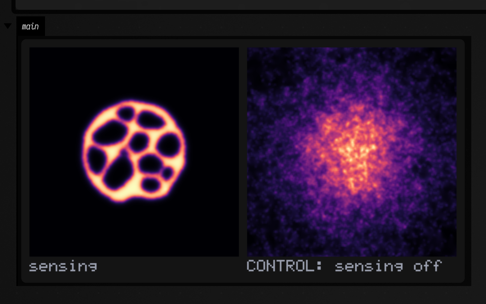
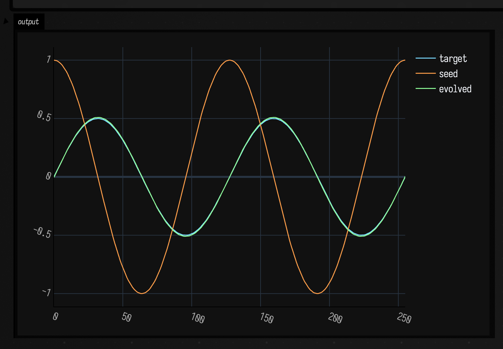

# Spatial artificial life

*Every public declaration used below is listed, with its KDoc, in the codebase reference:
[`alife.kt`](reference/alife.md#alife-kt), [`alife_ca.kt`](reference/alife.md#alife-ca-kt),
[`alife_continuous.kt`](reference/alife.md#alife-continuous-kt),
[`alife_agents.kt`](reference/alife.md#alife-agents-kt),
[`alife_lsystem.kt`](reference/alife.md#alife-lsystem-kt) and
[`alife_field.kt`](reference/alife.md#alife-field-kt). Start from
[what's already in the box](reference/index.md).*

Artificial life is the study of systems whose interesting behaviour is not in their rules. You write
down something local and small — count your neighbours, follow the strongest smell, grow toward the
nearest unclaimed space — and something global and large happens that the rule never mentions: a
spaceship, a coastline, a transport network, a dendrite with a fractional dimension. This page is
about the *spatial* half of that: grids, continuous fields and populations of agents. The
graph-rewriting half lives in [`growing.kt`](reference/data.md#growing-kt) and
[interaction nets](interaction_nets_examples.md), the constraint-based generative half is
[Wave Function Collapse](wfc_examples.md), and the half where a *moving* point cloud carries a
decaying graph with it is [graphs that change while you
watch](dynamic_graph_systems_examples.md).

The awkward thing about this material is that it is *very* easy to fake. Almost any local rule applied
to noise produces something that looks organic, so a screenshot proves nothing at all — and the
literature is full of pictures captioned with claims the picture cannot support. So the organising
principle of this page, and of the code behind it, is that **every claim is a number, and every number
has a control arm that gets it wrong**. A glider is not "a shape that moves"; it is a pattern whose
every live cell is displaced by exactly `(1, 1)` after four generations, and the same seed under a rule
one birth-count away is not. A flock is not "dots moving together"; it is a population whose
polarization is 0.69 where 400 independent headings would give 0.044 and where the same initial state
with the alignment term zeroed reaches 0.073.

Everything on this page is checked in CI by
[`afield.examples.stdlib.AlifeGallery`](https://github.com/), which renders eighteen figures and
asserts, for each, the statistic a control arm fails. The numbers printed below are the numbers it
asserts. It runs in two tiers: `stdlib.alife.gallery` is the fast one (~6 s, everything whose evidence
is an exact identity or a closed-form comparison, including the checks that pin the *measurement*
functions against analytic answers) and `stdlib.alife.gallery.slow` is the ~25 s of figures that
integrate a PDE or an agent population to a statistical verdict.

!!! note "The measurement layer is the interesting part"
    `alife.kt` is mostly not automata — it is [`polarization`](reference/alife.md#alife-kt) and its
    random baseline, [`blobShapes`](reference/alife.md#alife-kt) (the isoperimetric ratio that tells
    spots from stripes), [`correlationLength`](reference/alife.md#alife-kt),
    [`topShare`](reference/alife.md#alife-kt) and
    [`massRadiusDimension`](reference/alife.md#alife-kt). Those exist because "it produced pixels" is
    not evidence, and they are what the rest of the family makes its claims through.

## What this implementation does, and does not do

Six dependency-free files built on the existing [imaging](imaging_examples.md) and
[mesh](mesh_examples.md) families — nothing here reimplements convolution, connected-component
labelling, colour mapping or marching cubes:

- **`alife.kt`** — [`IntGrid`](reference/alife.md#alife-kt-intgrid), the toroidal-or-bounded integer
  lattice; the grid↔[`Img`](imaging_examples.md) bridges; and the measurement layer.
- **`alife_ca.kt`** — [`LifeRule`](reference/alife.md#alife-ca-kt-liferule) parsed from `B3/S23`,
  named Life patterns, exact cycle detection, cyclic multi-state CA, Wolfram's elementary 1-D rules as
  a space-time raster, and a 3-D life-like CA on [`IntVolume`](reference/alife.md#alife-ca-kt-intvolume).
- **`alife_continuous.kt`** — mass-conserving diffusion, Gray–Scott reaction–diffusion,
  Gierer–Meinhardt Turing patterns, and Lenia.
- **`alife_agents.kt`** — boids, a Physarum deposit–sense–move population, and diffusion-limited
  aggregation with two control models.
- **`alife_lsystem.kt`** — a bracketed, parametric, optionally stochastic L-system with a turtle that
  emits [`FLine`](fline_examples.md)s, and space-colonization branching.
- **`alife_field.kt`** — the [inline `ToHTML` views](#evaluating-one-of-these-in-a-box-the-inline-views),
  kept in their own file so the five above name nothing from Field's visualizer.

Things it does not do, so you are not surprised:

- **CPU only.** These are reference implementations you can read. The GPU story is
  [`afield.four`](reference/graphics.md), [StackSL](stacksl_examples.md) and
  [RectSL](rectsl_examples.md).
- **No named Lenia lifeform.** Reproducing Orbium needs its exact published initial array, which this
  family does not ship. What it does instead is [prove the discrete limit](#5-lenia-a-continuous-ca-that-contains-life)
  and report a measured phase trichotomy. Inventing an array and calling it canonical would be a
  fabrication.
- **`O(N²)` neighbour search in the agent models.** A spatial hash is right for 50 000 agents and is a
  different piece of code; these flocks are a few hundred agents and legibility wins.
- **Explicit Euler integration** for the continuous systems, with the stability bound stated as a
  `require` rather than silently clamped.

## 1. Conway's Life, against objects that predate the code

`B3/S23` is the most-studied dynamical system in computing, which is exactly why it is the right place
to start: there are *facts* about it to be checked. The glider translates one cell diagonally every
four generations. The block is a still life. The blinker has period two. And the R-pentomino — five
cells — runs for 1103 generations, peaks at a population of 319 at generation 821, and settles to 116
cells, six of which are gliders still flying away.

That last one has a subtlety worth the space, because it is the difference between a check and a
flattering approximation. Those figures are about an *unbounded* board. On a board with walls the
gliders are destroyed, and the system instead becomes exactly periodic at generation 1164 with 110
cells. Both answers are correct; they are answers to different questions. So the box below runs on a
620-wide board — wide enough that no glider can reach an edge in 1103 generations — and asserts
[`liveBounds`](reference/alife.md#alife-kt-intgrid) to *confirm* the walls never took part rather than
assuming it.

```diffstatic_runner {data-lang=kotlin screenshot="assets/alife_examples/life.png" wait="12.0" capture="box" open-outputs="true" padding="20"}
:::static
// Conway's Life. Every claim here is about an object that predates this code, stated as an
// integer-grid equality rather than as an observation about a picture.
val glider = LifePatterns.glider.centeredOn(40, 40)
println("glider, 4 generations: rigid translation = " + translationBetween(glider, glider.stepTimes(LIFE, 4)))
println("glider, 8 generations: rigid translation = " + translationBetween(glider, glider.stepTimes(LIFE, 8)))

// The control: one birth count away and the same seed is not a spaceship at all.
println("same seed under B34/S23, 4 generations: " +
    translationBetween(glider, glider.stepTimes(lifeRule("B34/S23"), 4)))

val block = LifePatterns.block.centeredOn(20, 20)
println("block is bit-identical after one step: " + block.step(LIFE).sameCellsAs(block))
println("blinker's detected period: " + LifePatterns.blinker.centeredOn(20, 20).runUntilCycle(LIFE, 20).period)
println("toad's detected period: " + LifePatterns.toad.centeredOn(20, 20).runUntilCycle(LIFE, 20).period)

// The R-pentomino. The textbook figures -- peak 319 at generation 821, then 116 cells from
// generation 1103 -- are facts about an UNBOUNDED board: six of those 116 cells are gliders still
// in flight. So it needs room. 620 wide gives every glider more than the 1103/4 cells it can
// travel, and liveBounds() confirms nothing reached an edge rather than assuming it.
var g = LifePatterns.rPentomino.centeredOn(620, 620, wrap = false)
var peak = 0
var peakAt = 0
for (gen in 1..1103) {
    g = g.step(LIFE)
    val pop = g.population()
    if (pop > peak) { peak = pop; peakAt = gen }
}
val b = g.liveBounds()!!
println("R-pentomino peak population " + peak + " at generation " + peakAt)
println("population at generation 1103 = " + g.population() +
    ", live cells " + b[0] + " clear of the board edge")

:::fold draw the glider's first five generations, twelve pixels to a cell
showImg(
    montage(
        (0..4).map { "gen " + it to LifePatterns.glider.centeredOn(16, 16).stepTimes(LIFE, it).toImg(2).upscaleNearest(12) },
        columns = 5, cellSide = 200
    ),
    caption = "one glider, five generations: the same shape displaced by (1, 1)"
)
:::endfold
```


Note what [`translationBetween`](reference/alife.md#alife-kt) does, and why it is not a centroid
comparison. It aligns the two patterns' bounding boxes, shifts one by that offset, and then demands
**exact cell-by-cell equality**. A pattern that moved *and* changed shape returns `null`. That is what
makes "the glider translates by (1, 1)" an assertion a wrong rule fails rather than a statistic a wrong
rule can fluke — and the `B34/S23` line above is that control, printing `null`.

### The two objects, moving

Two panels, 400 generations, two generations per displayed frame — which is slow enough that the glider's
four-generation cycle is legible rather than a strobe, and the reason the whole page's clips state their
step budget explicitly.

Left: the glider, on a **16-cell torus**, twenty-four pixels to a cell. It laps that board every 64
generations and does it six times over, so if you watch one edge you see it leave and re-enter from the
other. That is the same claim the montage above makes, and the same claim `translationBetween` asserts, in
the form where it is obvious.

Right: the R-pentomino on a **64-cell walled** board, with its live population in the caption. Read the
section's second paragraph before reading this panel: it is *not* the run the numbers above
are about. Those need a board wide enough that no escaping glider can reach an edge, which at 1103
generations means 620 cells, and 620 cells at one pixel each is a video in which the interesting part is
four pixels wide. So this is the walled question instead — same rule, same seed, different board — and what
it shows is the shape of the thing: five cells, a violent expansion, and then a long quieting-down toward
something stationary. Nothing is claimed here beyond the number in the caption, which is measured live.

??? aside "Why the boards are so small, measured"
    The first cut of this clip used a 48-cell torus and a 96-cell walled board, and it was the weakest clip
    on this page: the mean absolute luma difference between its first and last frames was **1.47** of 255,
    against 42 for Gray–Scott. The reason is arithmetic rather than aesthetic. A glider is five live cells,
    so on a 48-cell board **0.2 %** of the pixels ever change — the motion is perfect and the picture is
    almost still. Shrinking the board to 16 cells makes the same five cells **2 %** of the panel and the
    same 400 generations measure **5.26**, and half the clip's change has arrived by 37 % of its length.
    Nothing about the automaton changed; the frame is just
    the size of the thing being claimed. The most famous object in the field deserves not to be four pixels
    wide.

```diffstatic_runner {data-lang=kotlin video="assets/alife_examples/life.mp4" capture="box" open-outputs="true" wait-output="true" wait-output-kind="display" execution="launch" duration="8" fps="20" timeout="240" w="1000" embed=true name="alife-life-video" alt="Conway's Life: a glider drifting diagonally across a toroidal board, and the R-pentomino exploding and settling on a walled board"}
:::static
:::fold the two boards, integer-upscaled so a cell is a block you can count
// Both boards are integer-upscaled to the same 384 pixels, so a cell is a block you can count:
// twenty-four pixels for the glider's 16-cell torus, six for the R-pentomino's 64-cell walled
// board. Small boards here -- see the note above this clip, which measures why.
fun boards(g: IntGrid, r: IntGrid, n: Int) = listOf(
    "glider, gen " + n to g.toImg(2).upscaleNearest(24),
    "R-pent " + n + ": " + r.population() + " live" to r.toImg(2).upscaleNearest(6)
)
:::endfold

// 400 generations over 200 displayed frames: TWO generations per frame. Slower than every other
// clip on this page -- the glider's period is FOUR generations, and a spaceship stepped
// nine generations at a time is a strobe rather than a spaceship.
animateEvolution(
    LifePatterns.glider.centeredOn(16, 16) to
        LifePatterns.rPentomino.centeredOn(64, 64, wrap = false),
    totalSteps = 400,
    seconds = 7.0,
    framesTarget = 200,
    columns = 2,
    cellSide = 384,
    step = { (g, r) -> g.step(LIFE) to r.step(LIFE) },
    panels = { (g, r), n -> boards(g, r, n) }
)
```

## 2. Wolfram's elementary rules, against an independent oracle

A one-dimensional automaton's behaviour is two-dimensional, so
[`elementaryCa`](reference/alife.md#alife-ca-kt) returns the whole **space-time diagram** as an
`IntGrid`: one row per generation, time downward. Every famous statement about these 256 rules is a
statement about this picture.

The sharpest piece of evidence in this whole family is here. Rule 90 is `left XOR right`, and from a
single seed its space-time diagram **is Pascal's triangle mod 2** — the Sierpiński gasket.
[`sierpinskiReference`](reference/alife.md#alife-ca-kt) computes that from Kummer's theorem
(`C(n, k)` is odd exactly when `n and k == k`) without running a cellular automaton at all. So the
equality between them is a cross-check between two unrelated computations, not a stepper agreeing with
itself — and it holds in all 32 896 cells. A second, independent oracle comes free: row `g` of that
diagram holds exactly `2^popcount(g)` live cells (Gould's sequence).

Rule 184 is the traffic rule, and it conserves the number of live cells **exactly**, forever. Rule 90
does not, which is the control that stops "184 conserves density" from being a property of the harness.

```diffstatic_runner {data-lang=kotlin screenshot="assets/alife_examples/elementary.png" wait="5.0" capture="box" open-outputs="true" padding="20"}
:::static
// Wolfram's elementary rules, and the sharpest evidence in the family: rule 90 from a single seed
// IS Pascal's triangle mod 2, and `sierpinskiReference` computes that from Kummer's theorem
// without running a cellular automaton at all. The equality is a cross-check between two
// unrelated computations rather than a stepper agreeing with itself.
val w = 257
val gens = 128
val rule90 = elementaryCa(90, w, gens)
val oracle = sierpinskiReference(w, gens)
var differing = 0
for (i in rule90.cells.indices) if (rule90.cells[i] != oracle.cells[i]) differing++
println("rule 90 vs Pascal mod 2: " + differing + " differing cells of " + rule90.cells.size)

// A second, independent oracle: row g of that diagram holds exactly 2^(popcount g) live cells.
val rows = (0 until gens).map { r -> (0 until w).count { rule90.cells[r * w + it] == 1 } }
println("row populations are exactly 2^popcount(generation): " +
    (rows == (0 until gens).map { 1 shl Integer.bitCount(it) }))

// Rule 184 is the traffic rule: it conserves the number of 1s exactly, forever.
val seedRow = IntArray(257) { if ((it * 7919) % 3 == 0) 1 else 0 }
val traffic = elementaryCa(184, 257, 200, seedRow)
val pops = (0 until 200).map { r -> (0 until 257).count { traffic.cells[r * 257 + it] == 1 } }
println("rule 184 distinct row populations over 200 generations: " + pops.distinct())
println("rule 90 distinct row populations: " + rows.distinct().size + " values, so NOT conserved")

val col30 = elementaryCa(30, 601, 600).centerColumn()
println("rule 30 centre column: " + col30.count { it == 1 } + "/600 ones, longest run " +
    longestRunLength(col30) + " (rule 90's is " + longestRunLength(rule90.centerColumn()) + ")")

:::fold draw four of the 256 space-time diagrams, time downward
showImg(
    montage(
        listOf(
            "rule 90 = Pascal mod 2" to rule90.toImg(2),
            "rule 30" to elementaryCa(30, 257, 128).toImg(2),
            "rule 110 (universal)" to elementaryCa(110, 257, 128, IntArray(257) { if (it % 13 == 0) 1 else 0 }).toImg(2),
            "rule 184 (density-conserving)" to traffic.toImg(2)
        ),
        columns = 2, cellSide = 300
    )
)
:::endfold
```


### Four rules, drawn a generation at a time

A space-time diagram is a *picture of time*, which makes animating one slightly strange: the motion is the
downward growth of the picture, not motion within it. It is worth doing anyway, because the four panels
grow at the same rate and the differences between the 256 rules become differences you can watch appear.

One generation per displayed frame, 128 generations in six seconds. Rule 90 lays down the Sierpiński gasket
with the self-similarity arriving in bursts at the powers of two — the row populations are `2^popcount(g)`,
so the widest rows are the ones where `g` has many bits, and the diagram visibly *breathes*. Rule 30 starts
identically, from a single cell, and never repeats. Rule 110 — the universal one — separates into a
background of periodic structure with localised gliders travelling through it, which is what a proof of
universality has to be built out of. Rule 184 just shifts, forever, conserving its 86 live cells exactly.

??? aside "This one is a reveal, not a re-simulation, and that is a real distinction"
    [`elementaryCa`](reference/alife.md#alife-ca-kt) computes the whole diagram, and
    [`rowsRevealed`](reference/alife.md#alife-animate-kt) uncovers it a row at a time. That is legitimate
    here for a specific reason and not in general: row `g` of a space-time diagram depends only on rows
    below `g`, so revealing rows and re-running the automaton produce *identical* pixels. Every other clip
    on this page steps the real system. This one is the exception, and says so.

```diffstatic_runner {data-lang=kotlin video="assets/alife_examples/elementary.mp4" capture="box" open-outputs="true" wait-output="true" wait-output-kind="display" execution="launch" duration="7" fps="20" timeout="240" w="900" embed=true name="alife-elementary-video" alt="four elementary cellular automaton space-time diagrams filling in a row at a time: rule 90's Sierpinski gasket, rule 30's chaos, rule 110's gliders and rule 184's shifting traffic"}
:::static
:::fold compute the four space-time diagrams once, in full
// Compute the four space-time diagrams once, in full: 257 cells wide, 128 generations tall.
val seedRow = IntArray(257) { if ((it * 7919) % 3 == 0) 1 else 0 }
val diagrams = listOf(
    "rule 90" to elementaryCa(90, 257, 128).toImg(2),
    "rule 30" to elementaryCa(30, 257, 128).toImg(2),
    "rule 110" to elementaryCa(110, 257, 128, IntArray(257) { if (it % 13 == 0) 1 else 0 }).toImg(2),
    "rule 184" to elementaryCa(184, 257, 128, seedRow).toImg(2)
)
:::endfold

// 128 generations over 128 displayed frames: ONE row of every diagram per frame. The upscale comes
// AFTER the reveal, so `n` counts generations rather than pixels -- and `rowsRevealed` keeps the
// full height, so montage frames each panel identically instead of rescaling a growing image.
animateEvolution(
    Unit,
    totalSteps = 128,
    seconds = 6.0,
    framesTarget = 128,
    columns = 2,
    cellSide = 520,
    step = { it },
    panels = { _, n ->
        diagrams.map { (name, img) -> name + ", gen " + n to img.rowsRevealed(n).upscaleNearest(2) }
    }
)
```

## 3. Cyclic CA: self-organisation with a closed form to check it against

A cyclic cellular automaton has `k` states arranged in a ring. A cell in state `s` advances to `s + 1`
as soon as at least `threshold` of its neighbours are *already* in `s + 1`; otherwise it waits. Nothing
can skip a state, and there is no way back, so the only durable structures are rotating bands.

The measurement that makes "it self-organised" checkable is
[`cyclicAdvanceFraction`](reference/alife.md#alife-ca-kt). In an **uncorrelated** soup a cell can advance
exactly when one of its eight Moore neighbours happens to hold its successor state, which is
`1 - (1 - 1/k)^8` — a closed form, not a threshold. For `k = 14` that is 0.4473, and the measurement is
0.4483. Four hundred generations later every cell is being driven by a neighbour and the fraction pins
at **1.0000**, which is something no uncorrelated field does at any `k`.

The second pair of panels is the excitable corner of the parameter space (six states, threshold three,
radius two), which curls into visible spiral cores. That is a different *phase*, and the difference is
reported as a length scale rather than left to the eye — though note the direction: the wider
neighbourhood gives the **smaller** correlation length, because the spiral arms are narrow.

!!! note "This statistic's floor is 0.632, not 0"
    [`correlationLength`](reference/alife.md#alife-kt) is the lag at which the direction-averaged
    autocorrelation first falls to `1/e`, linearly interpolated. For a field with *no* correlation at all
    the interpolation runs from `ac(0) = 1` straight to `ac(1) ≈ 0`, so the answer is `1 − 1/e = 0.632` —
    a floor, reached from below by nothing. So the right comparison for a settled field is with its own
    pixels *shuffled*, which lands on that floor to six decimal places, rather than with a chosen
    constant — and that is the comparison CI makes. Be careful reading the two numbers the box below
    prints (**2.77** and **1.96** on its 200×200 fields) against the ones quoted in
    `dev_docs/ALIFE.md` (**2.80** and **2.01**): those are the gallery's 220×220 fields, a different
    measurement of the same phenomenon, not a discrepancy. A checkerboard — the shortest wavelength a
    lattice holds — reads exactly `(1 − 1/e)/(4/3) = 0.4741`, which is as low as this statistic can go.

```diffstatic_runner {data-lang=kotlin screenshot="assets/alife_examples/cyclic.png" wait="6.0" capture="box" open-outputs="true" padding="20"}
:::static
// A cyclic cellular automaton: a cell in state s advances to s+1 as soon as any neighbour is
// already in s+1. Nothing can skip, so the only durable structures are rotating bands.
//
// The measurement that makes "it self-organised" checkable: in an UNCORRELATED soup a cell can
// advance exactly when one of its 8 Moore neighbours happens to hold its successor state, which
// is 1 - (1 - 1/states)^8 -- a closed form. Once the field has organised, every cell is driven by
// a neighbour and the advance fraction pins at 1.0, which no uncorrelated field does.
val rule = CYCLIC_LABYRINTH
val soup = IntGrid.random(200, 200, states = rule.states, seed = 7L)
val predicted = 1.0 - Math.pow(1.0 - 1.0 / rule.states, 8.0)
val early = cyclicAdvanceFraction(soup, soup.step(rule))
val settled = soup.stepTimes(rule, 400)
val late = cyclicAdvanceFraction(settled, settled.step(rule))
println("soup advance fraction " + "%.4f".format(early) + ", closed form " + "%.4f".format(predicted))
println("after 400 generations " + "%.4f".format(late) + " of cells advance every step")

// The excitable corner of the parameter space (wider neighbourhood, higher threshold) is a
// visibly different phase -- spiral cores -- and the difference is measurable as a length scale.
val ex = CYCLIC_EXCITABLE
val exSettled = IntGrid.random(200, 200, states = ex.states, seed = 7L).stepTimes(ex, 200)
println("correlation length: labyrinth " + "%.2f".format(settled.toImg(rule.states).correlationLength(maxLag = 30)) +
    ", excitable " + "%.2f".format(exSettled.toImg(ex.states).correlationLength(maxLag = 30)))

:::fold one palette per rule, and three generations of the labyrinth beside the excitable phase
val palette = cyclicPalette(rule.states)
showImg(
    montage(
        listOf(
            "gen 0 (soup)" to soup.toImg(palette),
            "gen 40" to soup.stepTimes(rule, 40).toImg(palette),
            "gen 400" to settled.toImg(palette),
            "excitable, gen 200" to exSettled.toImg(cyclicPalette(ex.states))
        ),
        columns = 2, cellSide = 280
    )
)
:::endfold
```


### The two phases, running

Of everything in this family the cyclic CA is the system whose stills lie hardest, because the whole point
of it is *rotation* and a still frame has no chirality. Both panels below run 400 generations in six and a
half seconds — a little over three generations per displayed frame — from the same kind of soup. The
lattices are 96 cells rather than the figure's 200, drawn **three pixels to a cell**: at one pixel per cell
a rotating spiral core is about four pixels of video and reads as flicker.

That 96 is also the one place on this page where page weight decided a number. A cyclic CA re-colours
essentially every cell of both lattices on every frame, so consecutive frames share almost nothing and the
encoder has nothing to predict from: at 128 cells and eight seconds this clip alone was **9.6 MB**, more
than the other nine put together. The cost is very nearly proportional to cells × frames rather than to
pixels — magnifying a small lattice with nearest-neighbour blocks is close to free, and shrinking the
*lattice* is what pays — so it is 96 cells at three pixels each rather than 128 at two. It is a bigger
picture than it was, and it costs 5.1 MB instead of 9.6.

The left panel is the sequence the figure above samples at generations 0, 40 and 400, without the gaps.
Watch for the transition, because it is sharp and it has a name: the soup is **locally** advancing
everywhere (that is the 0.4483 the box prints, and it is what an uncorrelated field gives) but it has no
structure, and then within a few dozen generations it is *entirely* bands, after which every cell advances
on every step forever. Nothing directs that. The right panel is the excitable rule, and what it does that
the labyrinth does not is **rotate**: those spiral cores are pinned defects, they wind at a fixed rate, and
you cannot see any of that in a photograph of one.

```diffstatic_runner {data-lang=kotlin video="assets/alife_examples/cyclic.mp4" capture="box" open-outputs="true" wait-output="true" wait-output-kind="display" execution="launch" duration="7" fps="20" timeout="240" w="520" embed=true name="alife-cyclic-video" alt="two cyclic cellular automata running: a random soup organising into rotating bands, and an excitable rule winding into spiral cores"}
:::static
:::fold one palette per rule, fixed by the rule and never by the frame
// One palette per rule, FIXED -- it is a function of the rule's state count, never of the frame,
// which is what makes generation 0 and generation 400 the same picture of the same thing. Three
// pixels to a cell, nearest-neighbour, so the bands are countable and the encoder sees flat blocks.
val pal = cyclicPalette(CYCLIC_LABYRINTH.states)
val exPal = cyclicPalette(CYCLIC_EXCITABLE.states)
fun soups(a: IntGrid, b: IntGrid, n: Int) = listOf(
    "labyrinth, gen " + n to a.toImg(pal).upscaleNearest(3),
    "excitable, gen " + n to b.toImg(exPal).upscaleNearest(3)
)
:::endfold

// Two cyclic rules from the same kind of soup, stepped together so the schedule is shared:
// 400 generations over 130 displayed frames, so a little over THREE generations per frame.
val rule = CYCLIC_LABYRINTH
val ex = CYCLIC_EXCITABLE
animateEvolution(
    IntGrid.random(96, 96, states = rule.states, seed = 7L) to
        IntGrid.random(96, 96, states = ex.states, seed = 7L),
    totalSteps = 400,
    seconds = 6.5,
    framesTarget = 130,
    columns = 2,
    cellSide = 288,
    step = { (a, b) -> a.step(rule) to b.step(ex) },
    panels = { (a, b), n -> soups(a, b, n) }
)
```

## 4. Gray–Scott: telling regimes apart by measurement

Two coupled fields, `u` (substrate) and `v` (autocatalyst), the reaction `U + 2V → 3V` with `V → P`,
and two numbers — a feed rate `F` and a kill rate `k`. The entire zoo of morphologies is a function of
those two numbers, which is why the system is a canonical morphogenesis model and not merely a pretty
one.

Here is the problem this section exists to solve. Spots and a labyrinth can have *identical* coverage,
identical mean and identical variance. Nothing in a histogram separates them. What separates them is
the **shape** of their features, and
[`morphology()`](reference/alife.md#alife-continuous-kt-morphologyreport) measures it: the
isoperimetric ratio `P²/4πA` (1 for a disc, growing without bound as a region gets thinner and more
convoluted) and the share of the covered area held by the single largest connected feature.

The numbers below, from the run in the box: the spots preset gives 329 separate features with a median
ratio of **0.80** and a largest-blob share of **0.008**; the two labyrinth presets give 24 and 34
features with ratios of **2.5** and **2.4** and largest shares of **0.64** and **0.45**. Three times
less round, and dominated by one connected structure. The `holes` preset is the inverse morphology and
reads as a single blob at 0.78 coverage with a ratio of **90**.

!!! warning "A calibration, because the statistic has a known bias"
    The digital "crack perimeter" over-estimates a smooth boundary by about `4/π`, so `blobShapes`
    applies that correction — and the gallery *measures* a synthetic 40-cell disc to confirm it lands
    at 1.00, rather than trusting the paragraph. The correction is asymptotic, so a 10-cell blob reads
    slightly **under** 1 (hence 0.80 for the spots). That bias points toward "round", which makes a
    *stripe* verdict conservative.

Two controls. `v = 0` is a stable fixed point of the equations, so an unseeded field stays at exactly
0.0 forever — the pattern comes from the dynamics and not from the renderer. And with `Du == Dv` the
Turing instability's short-scale advantage is gone and the same seed, the same reaction and the same
6000 steps produce nothing at all: Turing's own argument, restated as an experiment.

```diffstatic_runner {data-lang=kotlin screenshot="assets/alife_examples/gray-scott.png" wait="20.0" capture="box" open-outputs="true" padding="20"}
:::static
// Gray-Scott reaction-diffusion. Two coupled fields, two parameters, and the whole zoo of
// morphologies -- spots, worms, mazes, holes -- is a function of those two numbers.
//
// The point of `morphology()` is that a regime claim should be a claim about numbers. Spots and a
// labyrinth can have identical coverage, identical mean and identical variance; what separates
// them is the SHAPE of their features (isoperimetric ratio P^2/4piA, ~1 for a disc) and whether
// one connected structure dominates.
val side = 128
val steps = 6000
val runs = listOf(
    "spots 0.030/0.062" to GRAY_SCOTT_SPOTS,
    "worms 0.037/0.060" to GRAY_SCOTT_WORMS,
    "maze 0.029/0.057" to GRAY_SCOTT_MAZE,
    "holes 0.039/0.058" to GRAY_SCOTT_HOLES
).map { (label, p) -> label to grayScottSeed(side, side, patches = 6, patchSize = 14, seed = 11L).stepTimes(p, steps) }
for ((label, end) in runs) println(label + " -> " + end.v.morphology())

// Two controls. v = 0 is a fixed point of the equations, so an unseeded field never patterns;
// and equal diffusion coefficients destroy the Turing instability entirely, which is Turing's
// own argument restated as an experiment.
val unseeded = grayScottSeed(side, side, patches = 0).stepTimes(GRAY_SCOTT_WORMS, 500)
println("CONTROL no seed: max autocatalyst after 500 steps = " + unseeded.v.max())
val equalD = grayScottSeed(side, side, patches = 6, patchSize = 14, seed = 11L)
    .stepTimes(GrayScottParams(feed = 0.037, kill = 0.060, du = 0.08, dv = 0.08), steps)
println("CONTROL Du == Dv -> " + equalD.v.morphology())

:::fold draw the four regimes and the two controls, all on one fixed magma range
showImg(
    montage(
        (runs + listOf("CONTROL no seed" to unseeded, "CONTROL Du == Dv" to equalD))
            .map { (label, s) -> label to s.v.colormap("magma", 0f, 0.5f).upscaleNearest(2) },
        columns = 3, cellSide = 260
    )
)
:::endfold
```


### The same 6000 steps, recorded live

A montage of finished fields is the *evidence*, and it is also the one view that hides what
reaction–diffusion is: those numbers are the end of a process, and the process is the phenomenon. So here
is one preset again, animated — the `maze` field, `F = 0.029`, `k = 0.057`, the same 6000 steps.

What to watch, with the step counter in the caption as your clock:

- **Step 63.** Six square seed patches, each with a bright rim. That is `grayScottSeed`'s output plus
  enough steps to make it visible: `v` is high only where the patch meets the substrate.
- **Step ~600.** Every square has buckled into a four-lobed cross. This is the Turing instability
  arriving as an *event*: the flat patch boundary is unstable, and it does not decay into noise, it picks
  a wavelength. The four lobes are that wavelength meeting the square's symmetry.
- **Step ~1600.** Each patch has filled its own interior with labyrinth and the fronts are advancing into
  empty substrate — the black regions are unconsumed `u`, and they are shrinking.
- **Step ~2900.** The fronts have met. From here the field is *entirely* labyrinth and the dynamics change
  character completely: no more growth, only rearrangement.
- **Step 6000.** Annealed. Watch the last second and almost nothing moves; the little that does is at the
  free ends, which is where a labyrinth still has somewhere to go. That is why the section's numbers are
  stable enough to assert.

Those five events are not spread evenly through the 6000 steps, and that is the whole reason this clip is
paced the way it is.

??? aside "The step schedule is geometric here, and the reason is a measurement"
    The first cut of this clip divided 6000 steps evenly across seven seconds — 43 steps per displayed
    frame. Measured as the mean absolute luma difference between the extracted frames, it went **42.09**
    from the first frame to the middle and **3.98** from the middle to the last: the reader watched
    reaction–diffusion happen in three seconds and then watched a finished labyrinth for four. Nothing was
    wrong with the simulation. The schedule was wrong, because reaction–diffusion is a **log-time**
    process: step 60 to step 600 and step 600 to step 6000 are about equally large *visible* changes, so
    equal steps per frame cannot be equal change per frame.

    So [`animateEvolution`](reference/alife.md#alife-animate-kt) takes a `ramp`, and the one visible line
    of the fence below sets it to 40 — meaning the last displayed frame advances forty times as many steps
    as the first, on the geometric schedule `done(t) = 6000 · (40^t − 1) / 39`. The mid-point of the
    *schedule* is then step **819** rather than step 3000.

    Whether that made the clip evenly paced is a separate question, and it has its own measurement: the
    mean absolute luma difference between **consecutive** frames, summed over each quarter of the recording.

    | | 1st quarter | 2nd | 3rd | 4th | half the change by |
    | --- | --- | --- | --- | --- | --- |
    | linear | **78.3 %** | 16.9 % | 4.7 % | 0.0 % | 14.5 % of the clip |
    | `ramp = 40` | 11.0 % | 42.8 % | 44.4 % | 1.8 % | **47.8 %** of the clip |

    Four fifths of everything that happened used to happen in the first two seconds. Now half the change has
    arrived at the half-way mark, which is what "evenly paced" means as a number, and the frames that show
    essentially nothing fell from 30 % of the clip to 21 %. The endpoint measurement agrees for once:
    first-to-middle and middle-to-last were **42.09** and **3.98**, and are now **30.47** and **28.57** —
    a 10.6× imbalance became 1.07×. The middle frame of the recording sits at `step 1559 of 6000` instead of
    step 2927.

    What a ramp cannot do is make a *burst* uniform. Gray–Scott's is the fronts filling the domain, roughly
    steps 400 to 1500 — 18 % of a linear clip, 30 % of this one. A schedule only decides how much of the clip
    that window gets, and `ramp` is the one parameter to change if you disagree with where it sits.

    Two caveats about instruments. The endpoint measurement is a *weak* one here even when it agrees:
    the first frame is a nearly black field, so its difference from any later frame saturates near 42
    whatever the schedule does. An earlier cut of this clip measured 42.40 / 9.61 while its consecutive-frame
    profile was still 15.5 / 73.8 / 10.7 / 0.0 — the endpoints understated a badly-paced clip. Trust the
    per-quarter table.

    And the ramp asks the last frames for about 170 reaction–diffusion steps each, which is more work than
    the first frames. During docs capture that cost can make the build slower, but cannot stretch or truncate
    the movie: the recorder advances `AnimationClock` by exactly `1 / fps` only after the preceding Field
    frame has been painted and stored. This clip therefore reaches `step 6000 of 6000` reproducibly, with a
    beat of settled labyrinth after it. The burned-in step clock keeps that endpoint visible and checkable.

```diffstatic_runner {data-lang=kotlin video="assets/alife_examples/gray-scott.mp4" capture="box" open-outputs="true" wait-output="true" wait-output-kind="display" execution="launch" duration="8" fps="20" timeout="300" w="1000" embed=true name="alife-gray-scott-video" alt="a Gray-Scott maze pattern forming: six square seed patches buckle into four-lobed crosses, fill with labyrinth, grow into each other and anneal"}
:::static
:::fold the autocatalyst field, on a fixed colour range
// The autocatalyst field on a FIXED 0..0.5 magma range. Auto-ranging per frame is what makes an
// animation of a growing pattern appear to stand still, and it is the single easiest way to turn
// a reaction-diffusion clip into a lie.
fun view(s: GrayScottState, n: Int) =
    listOf("maze - step " + n + " of 6000" to s.v.colormap("magma", 0f, 0.5f).upscaleNearest(3))
:::endfold

// The `maze` preset, the same 6000 steps the figure above measures, over 140 displayed frames --
// but NOT 43 steps per frame. `ramp = 40` makes the last displayed frame advance forty times as
// many steps as the first, which is the schedule a log-time process needs: the mid-point of the
// clip is step 819 rather than step 3000. This is the number to change if you disagree.
animateEvolution(
    grayScottSeed(128, 128, patches = 6, patchSize = 14, seed = 11L),
    totalSteps = 6000,
    seconds = 7.0,
    ramp = 40.0,
    cellSide = 420,
    step = { it.step(GRAY_SCOTT_MAZE) },
    panels = { s, n -> view(s, n) }
)
```

## 5. Lenia: a continuous CA that contains Life

Lenia is one field `A` in `0..1`, one convolution kernel `K`, one growth mapping `G`, and

```diffstatic {data-lang=text}
A  <-  clamp(A + dt * G(K * A), 0, 1)
```

That is the whole system. Its interest is that with a smooth ring kernel and a smooth bell-shaped
growth mapping it supports localised, self-maintaining, *moving* structures — solitons — which a
lattice automaton quantises away.

The claim worth making about an *implementation* of it is a cross-check, and there is a very good one
available. With a uniform Moore ring kernel, `dt = 1`, and a **three-valued** step growth mapping (`+1`
on the birth counts, `0` on survive-only counts, `-1` elsewhere), Lenia reduces exactly to an
outer-totalistic `B/S` rule: `G = +1` forces a cell alive from either state, `G = 0` leaves it as it
was, `G = -1` forces it dead. So this file's sparse float convolution and `alife_ca.kt`'s integer
neighbour counting must agree **bit for bit**.
[`leniaFromLifeRule`](reference/alife.md#alife-continuous-kt) builds that limit, and the worst per-cell
difference over 20 generations of a glider is `0.0`. Moving the growth window one neighbour count
diverges completely.

Be precise about what that proves. These are not two independent implementations of Conway's Life:
`leniaFromLifeRule` reads the very same `B3/S23` birth and survive sets that the integer stepper reads,
so a wrong table would produce two wrong steppers in perfect agreement. What the bit-for-bit result
cross-validates is the two **update mechanisms** — a float convolution, an additive `A + dt·G` step, the
quantisation back to a neighbour count, the clamp to `0..1`, the toroidal border and the `Img`↔`IntGrid`
bridges, against integer neighbour counting and a table lookup. The *rule* is pinned separately, and from
outside this codebase, by the named-object checks above: a glider that translates by exactly `(1, 1)` in
four generations, a block that does not move, a blinker of period 2.

There is one real restriction, and it is a fact rather than a limitation: this needs `birth ⊆ survive`.
If a count births a dead cell but does not sustain a live one, no function of the neighbour count alone
can do both, and `leniaFromLifeRule` rejects the rule instead of producing a different
automaton. Conway's `B3/S23` satisfies it.

For the *continuous* regime this page reports a measured phase trichotomy rather than a named creature.
[`leniaRun`](reference/alife.md#alife-continuous-kt) classifies an outcome as `DEATH`, `BOUNDED` or
`SATURATION` and hands back the mass history behind the verdict, and from one seed the growth mapping's
two parameters produce all three. The bounded cells are fine-grained self-maintaining textures — you
can see the individual ring-shaped cells in the panels — and are *not* the published solitons of the
Lenia literature. This family ships no published initial pattern and so claims none.

```diffstatic_runner {data-lang=kotlin screenshot="assets/alife_examples/lenia.png" wait="20.0" capture="box" open-outputs="true" padding="20"}
:::static
// Lenia is a CONTINUOUS cellular automaton: one field in 0..1, one convolution kernel, one growth
// mapping, and A <- clamp(A + dt * G(K * A)).
//
// The claim worth making about an implementation of it is a cross-check. With a uniform Moore ring
// kernel, dt = 1 and a three-valued step growth mapping, Lenia reduces EXACTLY to an
// outer-totalistic B/S rule -- so this float convolution and the integer Life stepper in
// `alife_ca.kt` must agree bit for bit. `leniaFromLifeRule` builds that limit.
val discrete = leniaFromLifeRule(LIFE)
println("discrete-limit kernel: " + discrete.taps.size + " taps summing to " + discrete.taps.weight.sum())

var grid = LifePatterns.glider.centeredOn(32, 32)
var field = grid.toImg(2)
var worst = 0.0
for (gen in 1..20) {
    grid = grid.step(LIFE)
    field = field.leniaTimes(discrete, 1)
    worst = maxOf(worst, fieldMaxAbsDiff(field, grid.toImg(2)))
}
println("20 generations, float Lenia vs integer Life: worst per-cell difference " + worst)
println("the glider the float stepper carried moved by " +
    translationBetween(LifePatterns.glider.centeredOn(32, 32), field.toIntGrid(0.5f)))

// Control: move the growth window by one neighbour count and nothing else.
println("CONTROL, growth window at B4/S234: difference " +
    fieldMaxAbsDiff(LifePatterns.glider.centeredOn(32, 32).toImg(2).leniaTimes(leniaFromLifeRule(lifeRule("B4/S234")), 20), grid.toImg(2)))

// The continuous regime, reported as a measured phase trichotomy rather than as a named creature:
// this file ships no published Lenia initial pattern, so it claims none.
val runs = listOf(0.06, 0.14).map { mu ->
    val r = LeniaPresets.ring(mu, sigma = 0.017, radius = 8, dt = 0.12)
    mu to leniaRun(leniaSeed(96, 96, r, blobRadii = 1.6, seed = 9L), r, steps = 240)
}
for ((mu, run) in runs) println("mu = " + mu + " -> " + run)
val wide = LeniaPresets.ring(0.60, sigma = 0.60, radius = 8, dt = 0.12)
val sat = leniaRun(leniaSeed(96, 96, wide, blobRadii = 1.6, seed = 9L), wide, steps = 240)
println("a growth bell positive over the whole unit interval -> " + sat)

:::fold draw the discrete limit, the kernel and the three phases on a fixed inferno range
showImg(
    montage(
        listOf(
            "discrete limit == Life" to field.upscaleNearest(8),
            "ring kernel R=8" to LeniaPresets.ring(0.15, radius = 8).kernelImg().normalized().upscaleNearest(10)
        ) + runs.map { (mu, run) ->
            "mu=" + mu + " " + run.phase.name.lowercase() to run.field.colormap("inferno", 0f, 1f).upscaleNearest(3)
        } + listOf("wide sigma: saturation" to sat.field.colormap("inferno", 0f, 1f).upscaleNearest(3)),
        columns = 3, cellSide = 280
    )
)
:::endfold
```


### The two `mu` values, running

The discrete-limit result above is a **proof**, and it stays a still: "the worst per-cell
difference over 20 generations is `0.0`" is a number, it is exact, and there is nothing about it to watch.
Animating it would add motion and subtract certainty.

The continuous regime is the opposite. Both panels are the same seed under the same ring kernel with only
`mu` changed — 0.06 on the left, 0.14 on the right — 240 steps in seven seconds, with the **mean field
printed live** in each caption so the phase verdict is being computed while you watch rather than asserted
afterwards. On a fixed `0 … 1` `inferno` scale, for the reason the note below this clip gives.

What to watch is the **first two seconds**, which is where the two panels stop being the same picture. Both
start as one smooth blob. Then the growth mapping's window decides everything: one `mu` has the blob break
into a field of ring-shaped cells that maintain themselves and then keep rearranging without ever growing or
dying — the mean field settles into a band and stays there — while the other loses more than it gains and
runs down to nothing. Same code, same seed, one number.

Which is why this clip is ramped like Gray–Scott's, and for the same measured reason: the blob breaks up
inside the first forty steps of two hundred and forty, so an even schedule gave **12.13** of change over the
first half of the clip and **1.14** over the second. `ramp = 25` puts the mid-point of the clip at step 40
instead of step 120 — the whole of the interesting decision gets half the clip, and the long
self-maintaining phase, which is the *claim* but not the event, gets the other half.

Measured the same way as Gray–Scott's, by consecutive-frame difference summed over each quarter of the
recording: an even schedule put **86.3 %** of the whole clip's change in the first quarter and had half of it
over by 10 % of the clip, with 71 % of frames showing essentially no change at all. At `ramp = 25` the
quarters read 11.1 / 76.4 / 11.4 / 1.1 %, half the change arrives at 38 % of the clip, the near-still frames
fall to 45 %, and middle-to-last goes from **1.14** to **5.78**. That 45 % is a floor rather than a failure:
one of the two panels really does die, and a dead field is *supposed* to sit still.

```diffstatic_runner {data-lang=kotlin video="assets/alife_examples/lenia.mp4" capture="box" open-outputs="true" wait-output="true" wait-output-kind="display" execution="launch" duration="8" fps="20" timeout="300" w="1000" embed=true name="alife-lenia-video" alt="two Lenia fields from the same seed under different growth-window centres: one breaks into self-maintaining ring cells, the other runs down to nothing"}
:::static
:::fold the two fields, on a fixed 0..1 inferno range
// inferno on a FIXED 0..1 scale, and the mean field recomputed every frame so the phase verdict
// is measured while you watch. See the note below this clip: an auto-ranged SATURATION field
// renders black and becomes indistinguishable from death, which cost this family a figure once.
fun fields(x: Img, y: Img, n: Int) = listOf(
    "mu=0.06 " + n + " mean " + "%.3f".format(x.mean()) to x.colormap("inferno", 0f, 1f).upscaleNearest(4),
    "mu=0.14 " + n + " mean " + "%.3f".format(y.mean()) to y.colormap("inferno", 0f, 1f).upscaleNearest(4)
)
:::endfold

// Same seed, same ring kernel, one number different: where the growth window is centred.
// 240 Lenia steps over 140 displayed frames -- but geometrically, not two per frame: `ramp = 25`
// spends the first half of the clip on the first 40 steps, because that is where the blob decides
// what it is going to be. Everything after is maintenance.
val a = LeniaPresets.ring(0.06, sigma = 0.017, radius = 8, dt = 0.12)
val b = LeniaPresets.ring(0.14, sigma = 0.017, radius = 8, dt = 0.12)
animateEvolution(
    leniaSeed(96, 96, a, blobRadii = 1.6, seed = 9L) to leniaSeed(96, 96, b, blobRadii = 1.6, seed = 9L),
    totalSteps = 240,
    seconds = 7.0,
    ramp = 25.0,
    columns = 2,
    cellSide = 384,
    step = { (x, y) -> x.leniaTimes(a, 1) to y.leniaTimes(b, 1) },
    panels = { (x, y), n -> fields(x, y, n) }
)
```

??? aside "One rendering trap, since it produced a wrong figure once"
    A saturated field is *constant* at 1, so an auto-ranged colour map draws it at the dark end of the
    ramp — and a `SATURATION` panel renders as black, indistinguishable from `DEATH`. The panels above
    use a fixed `0..1` range for exactly that reason.

## 6. Boids: order, against the level disorder would give

[Reynolds' three rules](https://www.red3d.com/cwr/boids/) — separate, align, cohere — on a torus. The
domain wraps for a reason beyond tidiness: in a bounded box the walls do half the flocking, because
agents that bounce off the same wall end up parallel, so a polarization measured in a box is not
evidence about the *rules*.

A flock is two things at once, and both are measured here:

- **Aligned.** The order parameter `|Σ v̂| / N` is 0.692 after 900 steps. That needs a scale, so
  [`randomPolarizationBaseline`](reference/alife.md#alife-kt) gives it: `√π / 2√N` is the expected value
  for `N` *independent* headings, which for 400 agents is 0.044. The measured value is 15.6× that. And
  the same initial state with `alignmentWeight = 0` — nothing else changed — reaches 0.073.
- **Spaced.** The 5th-percentile nearest-neighbour distance is 1.37 cells; with `separationWeight = 0`
  it collapses to 0.01. The floor under that distribution is the separation term, and you can see the
  control arm's population has collapsed to points.

0.692 rather than something near 1 is the *correct* answer, not a weak one: the population settles into
several separate flocks with different headings (visible in the figure), and the global order parameter
of `k` independent flocks tops out near `1/√k`.

??? aside "A stalled flock can still score well on alignment"
    The three steering terms are written as *desired-minus-current* velocities, so in a settled flock
    they largely cancel and — with a force cap — the speed drifts downward. The first version of this
    code measured a mean speed of **0.46** against a cap of 1.4: a flock that had mostly stopped while
    still looking aligned. `BoidParams.minSpeedFraction` is the fix, and it changes magnitude only,
    never heading, so it cannot inflate the polarization number.

```diffstatic_runner {data-lang=kotlin screenshot="assets/alife_examples/boids.png" wait="10.0" capture="box" open-outputs="true" padding="20"}
:::static
// Reynolds' boids on a torus. A flock is not "dots that move together"; it is a population whose
// alignment order parameter is far above what independent headings would give, AND whose
// nearest-neighbour distribution has a floor. Both are measured against the same initial state run
// with one weight zeroed -- so the difference is attributable to that weight and nothing else.
val n = 400
val start = BoidFlock.random(n, 260.0, 260.0, speed = 1.4, seed = 4L)
val params = BoidParams()
println("random-heading baseline for " + n + " agents: " + "%.3f".format(randomPolarizationBaseline(n)))
println("initial polarization: " + "%.3f".format(start.order()))

val flock = start.copy(); flock.stepTimes(params, 900)
val noAlign = start.copy(); noAlign.stepTimes(params.copy(alignmentWeight = 0.0), 900)
val noSep = start.copy(); noSep.stepTimes(params.copy(separationWeight = 0.0), 900)

println("flock polarization " + "%.3f".format(flock.order()) +
    ", CONTROL with no alignment " + "%.3f".format(noAlign.order()))
println("5th-percentile nearest neighbour: flock " + "%.2f".format(quantileOf(flock.neighborDistances(), 0.05)) +
    ", CONTROL with no separation " + "%.2f".format(quantileOf(noSep.neighborDistances(), 0.05)))
println("mean speed " + "%.2f".format(flock.meanSpeed()) + " of a " + params.maxSpeed + " cap")

:::fold draw the four populations with a five-unit motion streak behind each agent
showImg(
    montage(
        listOf(
            "gen 0: order " + "%.2f".format(start.order()) to start.toImg(1.4, tail = 5.0),
            "900 steps: " + "%.2f".format(flock.order()) to flock.toImg(1.4, tail = 5.0),
            "no alignment: " + "%.2f".format(noAlign.order()) to noAlign.toImg(1.4, tail = 5.0),
            "no separation" to noSep.toImg(1.4, tail = 5.0)
        ),
        columns = 2, cellSide = 300
    )
)
:::endfold
```


### The control arm, running beside it

The two numbers above — 0.692 and 0.073 — are the same initial state with one weight changed, and side by
side as clips they stop being numbers you have to take on trust. Both panels are the identical 400 agents
with the identical seed; the right one has `alignmentWeight = 0` and nothing else is different. 900 steps
in seven seconds, six or seven per displayed frame, with the live order parameter in each caption.

What to watch: **the left panel's flocks are not there at the start and nobody puts them there.** Within
about a hundred steps local alignment has produced a handful of coherent groups, and after that the
interesting event is the rare one — two flocks meeting and either merging or passing through. That is why
the order parameter settles near 0.69 rather than climbing to 1: it is the global average over several
flocks that each individually agree, and the caption's number wobbles as they merge and split. On the
right, the population stays a gas forever. It is *moving* — the speed floor is still on — it just never
agrees about anything.

The tail is drawn longer here (8 units) than in the still (5) and the domain is drawn at one pixel per
unit rather than 1.4. Both are frame-rate accommodations: at six or seven steps per displayed frame an agent
covers about nine units between frames, so a short tail leaves visible gaps. Neither changes anything
measured — `order()` reads the velocity array, not the picture.

```diffstatic_runner {data-lang=kotlin video="assets/alife_examples/boids.mp4" capture="box" open-outputs="true" wait-output="true" wait-output-kind="display" execution="launch" duration="9" fps="20" timeout="300" w="1000" embed=true name="alife-boids-video" alt="two boid populations from the same seed: the left forms coherent flocks, the right, with alignment switched off, stays a disordered gas"}
:::static
:::fold draw both populations, and measure the order parameter every frame
// One pixel per domain unit, with an 8-unit motion streak behind each agent -- long enough to join
// up at nine units of travel per frame. `order()` reads the velocity array, so neither choice
// touches what is measured; the number in each caption is computed fresh every frame.
fun flocks(a: BoidFlock, b: BoidFlock, n: Int) = listOf(
    "flock " + n + ": order " + "%.2f".format(a.order()) to a.toImg(1.0, tail = 8.0),
    "no align " + n + ": " + "%.2f".format(b.order()) to b.toImg(1.0, tail = 8.0)
)
:::endfold

// The same initial state, twice, stepped together -- so the ONLY difference between the two panels
// is the alignment weight. 900 steps over 140 displayed frames: six or seven steps per frame, and
// no ramp -- a flock's rate of change is roughly constant, which is exactly when linear is right.
val params = BoidParams()
val blind = params.copy(alignmentWeight = 0.0)
val start = BoidFlock.random(400, 260.0, 260.0, speed = 1.4, seed = 4L)
animateEvolution(
    start.copy() to start.copy(),
    totalSteps = 900,
    seconds = 7.0,
    columns = 2,
    cellSide = 300,
    step = { (a, b) -> a.step(params); b.step(blind); a to b },
    panels = { (a, b), n -> flocks(a, b, n) }
)
```

## 7. Physarum: a transport network that is nowhere in the code

Jones' slime-mould model. Each agent deposits into a trail field, samples that field three ways ahead,
turns toward the strongest, and moves. The network is not stored anywhere — it is the fixed point of
that stigmergic loop.

The measurement is [`topShare(0.05)`](reference/alife.md#alife-kt): the fraction of all deposit held by
the brightest 5 % of pixels. A flat field gives 0.05 by definition. The sensing population gives
**0.480**; the identical population with sensing switched off — same count, same seed, same deposit,
same decay, random turns — gives **0.185**. And the shapes differ as sharply: median isoperimetric ratio
17.2 against 1.2, filaments against blobs.

??? aside "Mutual exclusion is the whole model, not an optimisation"
    Without Jones' one-agent-per-cell rule there is nothing to stop every agent within sensing range of
    the brightest trail converging on it — and they do. The first version of this code collapsed 6000
    agents onto a 191-cell streak and measured a top-5 % share of **1.000**, which reads as perfect
    concentration and is total failure. `PhysarumParams.exclusive` makes the population
    *incompressible*, so a trail can only get so strong before it has to widen or branch, and branching
    under a density limit is what a transport network is.

```diffstatic_runner {data-lang=kotlin screenshot="assets/alife_examples/physarum.png" wait="8.0" capture="box" open-outputs="true" padding="20"}
:::static
// Jones' Physarum model: agents deposit into a trail field, sense it three ways ahead, turn toward
// the strongest, move. The transport network is nowhere in the code -- it is the fixed point of
// that loop.
//
// The measurement: `topShare(0.05)` is the fraction of all deposit held by the brightest 5% of
// pixels. A flat field gives 0.05. A network concentrates material into filaments and gives much
// more. The control is the identical population with sensing switched off -- same count, same
// seed, same deposit, same decay, random turns.
val side = 256
val p = PhysarumParams()
val sensing = PhysarumSwarm.disc(side, side, 6000, 0.55, seed = 6L).stepTimes(p, 400, seed = 6L)
val blind = PhysarumSwarm.disc(side, side, 6000, 0.55, seed = 6L)
    .stepTimes(p.copy(sensing = false), 400, seed = 6L)

println("top-5% deposit share: sensing " + "%.3f".format(sensing.trail.topShare(0.05)) +
    ", CONTROL sensing off " + "%.3f".format(blind.trail.topShare(0.05)) + " (a flat field gives 0.05)")
println("sensing morphology: " + sensing.trail.normalized().morphology())
println("blind   morphology: " + blind.trail.normalized().morphology())

:::fold draw both trail fields in magma
showImg(
    montage(
        listOf(
            "sensing" to sensing.trail.normalized().colormap("magma"),
            "CONTROL: sensing off" to blind.trail.normalized().colormap("magma")
        ),
        columns = 2, cellSide = 340
    )
)
:::endfold
```



### Watching the network find itself

`topShare` climbing from 0.05 to 0.48 is the evidence; the clip is what the number is *about*. 400 steps
in seven seconds, three per displayed frame, both populations stepped together — and the measured
top-5 % share recomputed and printed **every frame**, so the caption is a live instrument rather than a
result quoted after the fact.

Three things to watch, and the third is the one worth waiting for:

1. The disc **expands**, in both panels. That is not the network; that is 6000 mutually exclusive agents
   needing room.
2. In the sensing panel the expansion goes **anisotropic** almost immediately: some directions get
   reinforced and the rest go dark. Nothing chose those directions. They are wherever the deposit happened
   to be a little stronger when the agents first looked.
3. Then the interior **reorganises** — trails that were separate merge, and loops close and re-open. The
   share number keeps climbing while the *shape* keeps changing, which is the point: the network is a
   fixed point of the loop, not a thing that gets built and then stops.

The blind panel is the same 6000 agents with `sensing = false`, so it expands and then just sits there,
uniform, at a share that stays near a fifth of the sensing run's.

??? aside "The colour range is `deposit / (1 − decay)`, and the first cut of this clip got it wrong"
    The still above uses `normalized()`, which is right for one figure and wrong for a clip in two ways at
    once: a per-frame maximum makes an *empty* early field look exactly as bright as a settled network, and
    it normalises the two panels **separately**, so the control arm is stretched to fill the same range as
    the thing it is a control for.

    The trail field is unbounded above, so there is no natural `hi` to pick — but there is a derivable one.
    A cell that an agent occupies on every step accumulates `deposit` and keeps `decay` of what it had, so
    it converges to `deposit / (1 − decay)` = `5 / 0.08` = **62.5**, and with `blurRadius = 1` a cell in the
    interior of a saturated filament is surrounded by cells at the same value, so the blur does not reduce
    it. That is the ceiling, it comes from the parameters, and both panels are drawn on it.

    The first version of this clip guessed **30** instead. It rendered the entire network as flat cream with
    holes in it: every filament was over the top of the range, so the structure the section is *about* was
    clipped away. Caught by extracting the last frame and looking at it beside the still — which is the only
    way that class of mistake ever gets caught.

```diffstatic_runner {data-lang=kotlin video="assets/alife_examples/physarum.mp4" capture="box" open-outputs="true" wait-output="true" wait-output-kind="display" execution="launch" duration="7" fps="20" timeout="300" w="1100" embed=true name="alife-physarum-video" alt="two Physarum populations from the same seed: the sensing one expands into a branching transport network, the blind one into a uniform blob"}
:::static
:::fold draw both trails on one derived colour range, and measure the share every frame
// Both panels on ONE derived range, not on each other's maxima: a cell an agent occupies every
// step accumulates `deposit` and keeps `decay` of what it had, so it converges to
// deposit / (1 - decay) = 62.5. The first cut of this clip guessed 30 and clipped the network to
// flat cream. The caption's number is `topShare(0.05)`, recomputed every frame.
val p = PhysarumParams()
val ceiling = (p.deposit / (1.0 - p.decay)).toFloat()
fun trails(a: PhysarumSwarm, b: PhysarumSwarm, n: Int) = listOf(
    "sensing " + n + "  " + "%.3f".format(a.trail.topShare(0.05)) to a.trail.colormap("magma", 0f, ceiling),
    "blind " + n + "  " + "%.3f".format(b.trail.topShare(0.05)) to b.trail.colormap("magma", 0f, ceiling)
)
:::endfold

// Sensing and blind, from the same seed, stepped together: 400 steps over 140 displayed frames,
// so three deposit-sense-move rounds per frame. `step` takes its rng explicitly, so each
// population gets its own stream -- exactly what `stepTimes(p, 400, seed = 6L)` does internally,
// which is why these panels land on the same numbers as the figure above.
val rngA = kotlin.random.Random(6L)
val rngB = kotlin.random.Random(6L)
animateEvolution(
    PhysarumSwarm.disc(256, 256, 6000, 0.55, seed = 6L) to
        PhysarumSwarm.disc(256, 256, 6000, 0.55, seed = 6L),
    totalSteps = 400,
    seconds = 7.0,
    columns = 2,
    cellSide = 300,
    step = { (a, b) -> a.step(p, rngA) to b.step(p.copy(sensing = false), rngB) },
    panels = { (a, b), n -> trails(a, b, n) }
)
```

## 8. DLA: the one number with a literature value

Diffusion-limited aggregation: a seed at the centre, then particles released far away that random-walk
until they touch the cluster and stick. Nothing in the rule mentions branches, and the result is a
dendrite.

This is the one system in the family with a quantitative number to hit, so it gets the sharpest
evidence: the **mass–radius dimension**, fitted as `N(r) ∝ r^D` in log–log space by
[`massRadiusDimension`](reference/alife.md#alife-kt), which also reports `r²` — because a slope through a
curve is not a dimension. Planar DLA's asymptotic value is about 1.71; the cluster below measures
**1.597** with `r² = 0.9965`.

The two controls are what make that number mean something. An **Eden cluster** uses the same
neighbourhood and the same particle count, and differs only in that the growth site is chosen
uniformly instead of by a diffusing walker: it measures **1.860** and is visibly compact. A **uniform
sprinkle** over the same disc has dimension exactly 2 by construction and measures **1.898**. So the
estimator is reading the diffusion-limited part of DLA and not merely "a growth process happened", and
it is not simply reading the bounded support.

??? aside "Stated as a range, not as a match"
    1.597 is below 1.71, and it is worth saying why rather than rounding toward the literature: lattice
    DLA clusters of this size are known to read low, and the asymptote needs far larger clusters. The
    assertion in CI is therefore "clearly between 1.5 and 1.8, and clearly not 2".

    "The cluster reads low" and "the estimator reads low" are different claims, and the second one is
    checkable, so it is checked rather than assumed. A point set placed at radii `R·(i/n)^(1/D)` has
    `N(r) = n·(r/R)^D` **by construction** for any real `D`, and `massRadiusDimension` recovers
    `1.000, 1.262, 1.711, 2.002` from sets built with `D = 1.00, 1.2619, 1.71, 2.00`. Handed something
    whose exponent *is* 1.71 it returns 1.71. Separately, a straight line of lattice points reads 0.993
    and a filled lattice disc 1.986 — the same 0.7 % low, because a staircase `N(r)` is not a power law.
    So about 0.7 % of the gap is the lattice and the rest is the cluster's finite size.

    A related trap, also caught by a control: fitting from where `N(r)` is three points measured a
    *uniform disc* at dimension **2.32**, which is not a possible answer. `massRadiusDimension`'s
    `minCount` raises the inner radius until the statistics exist.

```diffstatic_runner {data-lang=kotlin screenshot="assets/alife_examples/dla.png" wait="8.0" capture="box" open-outputs="true" padding="20"}
:::static
// Diffusion-limited aggregation: a seed, then particles released far away that random-walk until
// they touch and stick. Nothing in the rule mentions branches.
//
// This is the one system here with a quantitative number to hit, so it gets the sharpest evidence:
// the mass-radius dimension. An Eden cluster (same neighbourhood, growth site chosen uniformly
// instead of by a diffusing walker) and a uniform sprinkle both have dimension 2, so those two
// controls show the estimator is reading the diffusion-limited part and not merely "growth".
val side = 300
val dla = dlaCluster(side, side, particles = 6000, seed = 2L)
val fit = dla.fractalDimension(rMin = 5.0, rMaxFraction = 0.75)
println(dla)
println("DLA mass dimension " + "%.3f".format(fit.dimension) + " (r2 = " + "%.4f".format(fit.rSquared) + ")")

val eden = edenCluster(side, side, particles = dla.points.size, seed = 2L)
val edenFit = eden.fractalDimension(rMin = 5.0, rMaxFraction = 0.75)
println("CONTROL Eden dimension " + "%.3f".format(edenFit.dimension))
val sprinkle = sprinkleCluster(side, side, dla.points.size, dla.maxRadius, seed = 2L)
val sprinkleFit = massRadiusDimension(sprinkle.points, sprinkle.center,
    rMin = 5.0, rMax = sprinkle.maxRadius * 0.75, minCount = 60)
println("CONTROL uniform sprinkle dimension " + "%.3f".format(sprinkleFit.dimension) + " (exactly 2 by construction)")

:::fold draw all three clusters, the first two coloured by arrival order
showImg(
    montage(
        listOf(
            "DLA: D = " + "%.2f".format(fit.dimension) to dla.arrivalOrderImg().colormap("turbo"),
            "Eden: D = " + "%.2f".format(edenFit.dimension) to eden.arrivalOrderImg().colormap("turbo"),
            "sprinkle: D = " + "%.2f".format(sprinkleFit.dimension) to sprinkle.mask
        ),
        columns = 3, cellSide = 280
    )
)
:::endfold
```


### The order the branches arrived in

A DLA cluster's shape is a record of *when*, and this is the one clip on the page where saying exactly what
is being replayed matters, so: the cluster is grown **once**, by `dlaCluster`, and `Aggregate.points` is the
order the particles stuck in. The clip reveals that recorded order at a uniform rate. It is not a
re-simulation and it is not uniform in the original walk's wall-clock either — a late particle takes far
longer to arrive than an early one, because it has to random-walk in from a larger circle past a bigger
target. What is uniform is particle *count*.

Watch what that shows, because it is the mechanism the fractal dimension is a consequence of.
**Screening.** The interior stops growing almost immediately: once a branch has neighbours on both sides,
a walker arriving from outside is overwhelmingly likely to touch a tip first, so it never reaches the
inside. So the cluster is not a blob that grows outward uniformly — it is a small number of tips that keep
racing outward while everything behind them is frozen. That is why a mass–radius fit gives 1.6 and not 2:
the interior is *empty*, permanently, and it was made empty by the arrival process rather than by the rule.

??? aside "Cropped, for the same reason section 1's boards shrank — and *not* zoomed"
    This clip was the second-weakest on the page (a first-to-last mean absolute luma difference of **2.78**)
    and the cause is the same arithmetic: a cluster that only ever grows can never differ from its first
    frame by more than the ink it lays down, and on a 300 × 300 domain this cluster lays down **2.7 %** of
    the pixels. Cropping once to the cluster's own bounding box raises that to **6.0 %** and the difference
    measured after is **5.83** — both figures printed by the box below, from the cluster it is about to
    animate.

    The crop has to be taken **per axis**. The first cut of it took a square of side `2 · maxRadius` and
    barely helped: `maxRadius` is 138.3 on a 300-cell domain, so the square was 282 × 282 and the ink share
    went from 2.7 % to 3.0 %. A DLA cluster is *anisotropic* — one arm gets ahead and sets the radius — and
    this one's bounding box is **261 × 152**. `maxRadius` is the right number for fitting a dimension and the
    wrong one for framing a picture.

    That is the ceiling and not a target: even at a perfect crop this figure is a couple of percent of ink
    on black, so it will always be a quieter clip than a field that re-colours every cell. The alternative
    — letting arrival order drive a *growing* crop, so the view zooms out as the cluster spreads — would
    have raised the number and destroyed the figure. Screening is a claim about the interior standing still
    while the tips advance, and in a frame that rescales every step nothing stands still. It is exactly the
    trap [`rasterizeFLinesFramed`](reference/alife.md#alife-animate-kt) exists to avoid in section 9, and
    section 4's fixed colour range avoids in colour. Considered, and refused.

```diffstatic_runner {data-lang=kotlin video="assets/alife_examples/dla.mp4" capture="box" open-outputs="true" wait-output="true" wait-output-kind="display" execution="launch" duration="8" fps="20" timeout="240" w="800" embed=true name="alife-dla-video" alt="a diffusion-limited aggregation cluster appearing in the order its particles arrived: a few tips race outward while the interior freezes"}
:::static
// Grow the cluster once, then replay `Aggregate.points` -- which IS the order the particles stuck
// in -- at a uniform rate over seven seconds.
val dla = dlaCluster(300, 300, particles = 6000, seed = 2L)

:::fold crop once to the finished cluster's bounding box, and colour by arrival order on its full scale
// The crop is the colour-range discipline in geometry: taken ONCE, from the finished cluster, never
// from the frame -- a crop that tracked the growing prefix would zoom out as the cluster grew and
// the screening this clip is about would be the one thing you could not see.
//
// Per AXIS rather than a square around maxRadius: a DLA cluster is anisotropic, and maxRadius is set
// by its single longest arm, so a square crop leaves a third of the panel permanently empty.
val pad = 2
val x0 = (dla.points.minOf { it.x }.toInt() - pad).coerceAtLeast(0)
val y0 = (dla.points.minOf { it.y }.toInt() - pad).coerceAtLeast(0)
val cw = (dla.points.maxOf { it.x }.toInt() + pad + 1 - x0).coerceAtMost(300 - x0)
val ch = (dla.points.maxOf { it.y }.toInt() + pad + 1 - y0).coerceAtMost(300 - y0)

// `arrivalPrefixImg` fixes the colour ramp to the FULL cluster's particle count, so a branch keeps
// the colour it arrived with; `arrivalOrderImg` normalises by its own count and would re-map the
// newest particle to the top of turbo on every frame.
fun cluster(dla: Aggregate, n: Int) =
    listOf("particles " + n + " of " + dla.points.size to
        dla.arrivalPrefixImg(n).crop(x0, y0, cw, ch).colormap("turbo", 0f, 1f).upscaleNearest(3))
:::endfold

// Why the crop: a cluster is a fixed amount of ink, and how legible its growth is depends entirely on
// how much of the frame that ink occupies. Note the particle count in the first line -- `particles`
// is a ceiling, not a promise, and this cluster stopped well short of the 6000 asked for.
println(dla)
println("cropped to " + cw + " x " + ch + " of 300 x 300, so " +
    "%.1f".format(100.0 * dla.points.size / (cw * ch)) + "% of the panel is ever lit, against " +
    "%.1f".format(100.0 * dla.points.size / 90000.0) + "% uncropped")

animateEvolution(
    Unit,
    totalSteps = dla.points.size,
    seconds = 7.0,
    cellSide = 660,
    step = { it },
    panels = { _, n -> cluster(dla, n) }
)
```

## 9. L-systems: exact identities, not statistics

L-systems are the odd one out in this family, and they belong in it for a precise reason: they are the
one generative system here whose output can be checked **exactly and combinatorially**.

- Lindenmayer's original algae system (`A → AB`, `B → A`) has derivation lengths that are the Fibonacci
  numbers. Exactly.
- The Koch snowflake has exactly `3 · 4^n` forward symbols at generation `n`.
- Its turtle path **closes**: the pen returns to where it started, to `2.3 × 10⁻¹⁴` of a step.
- Its drawn length grows by exactly **4×** per generation at constant step size. (The textbook `4/3` is
  the ratio when the figure is held at constant *diameter*; this turtle holds the step constant, so the
  figure triples in size each generation. Same identity, stated for what is actually drawn.)
- And its enclosed area matches the closed form `9^n · A₀ · (1 + 3/5(1 − (4/9)^n))` to `3 × 10⁻⁸`
  relative — a second, independent geometric identity from the same turtle. (`FLine` stores
  single-precision coordinates, which is what sets that floor.)

Perturbing the turn angle by 0.01 radians leaves the path open by 2.7 steps, so the closure test has
teeth.

The bracket pair `[` `]` is what makes an L-system a *plant* rather than a curve: it pushes and pops the
turtle state, so a production can grow a side branch and return. And stochastic productions — several
competing rules for one symbol — vary the **topology** rather than jittering one plant's coordinates,
which is why the three plants below have 91, 74 and 51 branches rather than three wobbly copies of the
same tree.

```diffstatic_runner {data-lang=kotlin screenshot="assets/alife_examples/lsystem.png" wait="6.0" capture="box" open-outputs="true" padding="20"}
:::static
// L-systems are the one generative system in this family whose output can be checked exactly and
// combinatorially rather than statistically -- so they carry the sharpest evidence here.
println("algae derivation lengths (Fibonacci): " + LSYSTEM_ALGAE.derivations(9).map { it.length })
println("Koch snowflake forward symbols (3 * 4^n): " +
    (0..5).map { gen -> LSYSTEM_KOCH_SNOWFLAKE.derive(gen).count { it == 'F' } })

// And the turtle: the path CLOSES, its drawn length quadruples exactly at constant step size, and
// its enclosed area matches the closed form 9^n * A0 * (1 + 3/5(1 - (4/9)^n)). FLine stores
// single-precision coordinates, so "exact" here means to float precision.
val step = 1.0
val tp = TurtleParams(angle = Math.PI / 3.0, step = step)
val gens = (0..5).map { drawLSystem(LSYSTEM_KOCH_SNOWFLAKE, it, tp) }
println("worst closure residual: " + gens.map { turtleClosureError(it, step) }.max() + " of a step")
val lens = gens.map { flineTotalLength(it.lines) }
println("length ratio per generation: " + (1..5).map { "%.6f".format(lens[it] / lens[it - 1]) })
println("area, relative error against the closed form: " + (0..5).map { gen ->
    val a0 = Math.sqrt(3.0) / 4.0 * step * step
    val predicted = Math.pow(9.0, gen.toDouble()) * a0 * (1.0 + 0.6 * (1.0 - Math.pow(4.0 / 9.0, gen.toDouble())))
    "%.1e".format(Math.abs(Math.abs(flineSignedArea(gens[gen].lines)) - predicted) / predicted)
})
// Control: one wrong turn and none of that holds.
println("CONTROL, turn angle perturbed by 0.01 rad: open by " +
    "%.1f".format(turtleClosureError(drawLSystem(LSYSTEM_KOCH_SNOWFLAKE, 4, tp.copy(angle = Math.PI / 3.0 + 0.01)), step)) + " steps")

// Stochastic productions vary the TOPOLOGY, not merely the coordinates.
val plants = (1L..3L).map { drawLSystem(LSYSTEM_STOCHASTIC_PLANT, 5, TurtleParams(angle = Math.toRadians(24.0), step = 4.0), seed = it) }
println("three seeds of the stochastic plant give branch counts " + plants.map { it.lines.size })

// The arrowhead curve draws on A and B, not F -- with the default alphabet it renders nothing.
val arrow = drawLSystem(LSYSTEM_SIERPINSKI_ARROWHEAD, 7, TurtleParams(angle = Math.PI / 3.0, drawSymbols = "AB"))
println("arrowhead, generation 7: " + arrow.drawnSegments + " drawn segments (3^7 = 2187)")

:::fold rasterize the three curves and the three plants
showImg(
    montage(
        listOf("Koch snowflake gen 4" to rasterizeFLines(gens[4].lines, 300, 300),
            "arrowhead gen 7" to rasterizeFLines(arrow.lines, 300, 300),
            "dragon gen 12" to rasterizeFLines(drawLSystem(LSYSTEM_DRAGON, 12, TurtleParams(angle = Math.PI / 2.0)).lines, 300, 300)) +
            plants.mapIndexed { i, pl -> "plant seed " + (i + 1) to rasterizeFLines(pl.lines, 240, 300) },
        columns = 3, cellSide = 280
    )
)
:::endfold
```


### The turtle, walking

An L-system could be animated by *derivation depth* — generation 0, then 1, then 2 — and that was the first
plan here. It was the wrong one: six generations over seven seconds is a slideshow with 23 duplicate frames
between each change, and worse, each generation is a completely different picture, so there is no motion to
read, only cuts.

What an L-system actually *has* is a turtle, and a turtle walks in an order.
[`flinePrefix`](reference/alife.md#alife-animate-kt) truncates the emitted [`FLine`](fline_examples.md)s at a
fraction of their total segment count in walk order, so both panels below are drawn by a pen, in the
sequence the pen moved.

Which makes the bracket pair visible, and that is the point of the right-hand panel. `[` pushes the turtle's
state and `]` pops it, so a plant is drawn **depth-first**: the pen runs all the way out to the tip of one
branch, then jumps back to a fork it remembered and runs out to the next. You can watch it do exactly that,
and the jumps are the stack. The Koch snowflake on the left has no brackets at all and is therefore one
continuous stroke — 768 segments at generation 4, traced without the pen ever leaving the paper, closing
back on its start to `2.3 × 10⁻¹⁴` of a step.

!!! note "The framing has to be pinned, or nothing moves"
    [`rasterizeFLines`](reference/alife.md#alife-lsystem-kt) fits its raster to the bounds of what it is
    given, which for a *growing* curve means the figure is rescaled on every frame: the curve appears to
    stay the same size while the world shrinks around it, and the growth becomes invisible.
    [`rasterizeFLinesFramed`](reference/alife.md#alife-animate-kt) takes the framing from the finished curve
    instead. This is the same class of mistake as an auto-ranged colour map, in geometry rather than in
    colour.

```diffstatic_runner {data-lang=kotlin video="assets/alife_examples/lsystem.mp4" capture="box" open-outputs="true" wait-output="true" wait-output-kind="display" execution="launch" duration="8" fps="20" timeout="240" w="900" embed=true name="alife-lsystem-video" alt="a Koch snowflake being traced as one continuous stroke beside a bracketed L-system plant drawn depth-first, the pen jumping back to remembered forks"}
:::static
:::fold rasterize each prefix in the finished curve's frame
// `rasterizeFLinesFramed` takes its framing from the FINISHED curve. Plain `rasterizeFLines` fits
// the raster to whatever it is handed, so a growing prefix rescales every frame: the curve appears
// to stay the same size while the world shrinks around it, and the growth becomes invisible.
fun drawn(koch: List<FLine>, plant: List<FLine>, f: Double): List<Pair<String, Img>> {
    val pct = (f * 100).toInt()
    return listOf(
        "Koch gen 4: " + pct + "% drawn" to rasterizeFLinesFramed(flinePrefix(koch, f), koch, 420, 420),
        "plant gen 5: " + pct + "% drawn" to rasterizeFLinesFramed(flinePrefix(plant, f), plant, 420, 420)
    )
}
:::endfold

// Animated by DRAWING, not by cutting between derivation depths: an L-system's turtle walks in an
// order, and `flinePrefix` truncates the emitted FLines at a fraction of their segment count in
// exactly that order. 240 ticks over 140 displayed frames.
val koch = drawLSystem(LSYSTEM_KOCH_SNOWFLAKE, 4, TurtleParams(angle = Math.PI / 3.0, step = 1.0))
val plant = drawLSystem(LSYSTEM_STOCHASTIC_PLANT, 5, TurtleParams(angle = Math.toRadians(24.0), step = 4.0), seed = 1L)
val ticks = 240
animateEvolution(
    Unit,
    totalSteps = ticks,
    seconds = 7.0,
    columns = 2,
    cellSide = 420,
    step = { it },
    panels = { _, n -> drawn(koch.lines, plant.lines, n.toDouble() / ticks) }
)
```

??? aside "`drawSymbols` exists because of a blank panel"
    The Sierpiński arrowhead curve is written `A → B−A−B`, `B → A+B+A`, where `A` and `B` are *both*
    drawing symbols. Interpreted with the default `F`/`G` alphabet it draws nothing at all, which is
    exactly what the first version of this figure rendered.

## 10. Bridges out: FLines, trees and a watertight mesh

What makes this family Field's rather than a generic ALife library is where its output goes. Three
bridges, all into machinery that was already here:

1. **A reaction–diffusion field → [`FLine`](fline_examples.md)s.** `Img.isoContourFLines` runs the
   marching-squares extractor in `contours.kt` over the `v` field, so a Gray–Scott result becomes
   drawable, animatable, exportable geometry — 195 contours at `v = 0.25` below. That count is checked
   against a second measurement rather than printed: CI asserts at least one loop per thresholded blob,
   and pins the extractor itself against circle geometry (a disc's contour encloses `πr²` to 0.16 %).
2. **Space colonization → a tree of `FLine`s.** Grown into an *annulus*, which no
   upward-with-noise heuristic reaches, so the branching really is following the space.
   `ColonizationTree.isTree()` checks the thing a picture cannot show — one root, `n − 1` edges, no
   cycles — because a growth algorithm that produces a cycle looks identical.
3. **A 3-D life-like automaton → a [`TriMesh`](mesh_examples.md).** `IntVolume.toMesh` smooths the
   occupancy and runs `mesh_sdf.kt`'s marching cubes, so the automaton's surface is a real mesh you can
   boolean, subdivide and export. The claim asserted is that it is **watertight** — a leaking mesher
   produces a picture that looks fine and a model that cannot be printed.

!!! warning "Contour loops carry no winding information"
    An annulus contours to two loops — an outer and an inner — and **both come back wound the same way**.
    Each is right to better than 0.4 % of its own circle, so the geometry is sound, but
    `loops.sumOf { flineSignedArea(...) }` reads 67 % high for a shape with a hole; the right answer is
    the *difference* of the magnitudes (0.006 % out). Anything that fills, booleans or exports these
    curves has to find the hole by containment or by area, not by orientation. `contours.kt` never
    promised a winding convention — this is undocumented behaviour, now asserted in CI so it cannot
    change silently.

??? aside "An empty mesh is vacuously watertight"
    The first version of this figure passed its watertight check with a dead volume and **zero
    triangles**. The triangle count is part of the claim now.

```diffstatic_runner {data-lang=kotlin screenshot="assets/alife_examples/bridges.png" wait="16.0" capture="box" open-outputs="true" padding="20"}
:::static
// What makes this family Field's rather than a generic ALife library: the bridges out into the
// things Field already draws, meshes and exports.
//
// (a) A reaction-diffusion field -> iso-contour FLines, through the marching-squares extractor in
//     `contours.kt` that was already here.
val rd = grayScottSeed(96, 96, patches = 5, patchSize = 12, seed = 4L).stepTimes(GRAY_SCOTT_SPOTS, 5000)
val contours = rd.v.isoContourFLines(0.25, cells = 96)
println("Gray-Scott -> " + contours.size + " iso-contour FLine(s) at v = 0.25")

// (b) Space colonization -> a tree of FLines. Grown into an ANNULUS, which no upward-with-noise
//     heuristic reaches, so the branching really is following the space. isTree() checks the thing
//     a picture cannot show: one root, n-1 edges, no cycles.
val ring = annulusAttractors(1400, 150.0, 140.0, 60.0, 120.0, seed = 3L)
val tree = spaceColonization(ring, 150.0, 285.0, influenceRadius = 30.0, killRadius = 7.0, stepSize = 5.0)
println(tree)
println("is a tree (one root, n-1 edges, acyclic): " + tree.isTree())
println("CONTROL, no attractors: " + spaceColonization(emptyList(), 150.0, 285.0).nodeCount + " nodes")

// (c) A 3-D life-like automaton -> a TriMesh, through `mesh_sdf.kt`'s marching cubes. The claim
//     that matters for a mesh is that it is WATERTIGHT -- a leaking mesher looks fine and produces
//     a model that cannot be printed, booleaned or subdivided. Note an EMPTY mesh is vacuously
//     watertight, so the triangle count is part of the claim.
val volume = IntVolume.randomBall(48, 48, 48, density = 0.55, ballFraction = 0.70, seed = 8L)
    .stepTimes(LIFE3D_CLOUDS, 6)
println(volume)
val mesh = volume.toMesh(resolution = 96, smoothRadius = 1)
println("marched: " + mesh.triangleCount + " triangles, watertight = " + mesh.isWatertight() +
    ", Euler characteristic = " + mesh.eulerCharacteristic())

:::fold draw the field, the contours, the tree and two views of the volume
showImg(
    montage(
        listOf(
            "Gray-Scott field" to rd.v.colormap("magma", 0f, 0.5f).upscaleNearest(3),
            "its iso-contours as FLines" to rasterizeFLines(contours, 300, 300),
            "space colonization tree" to rasterizeFLines(tree.toFLines(), 300, 300),
            "3-D CA: z slice" to volume.slice(24).toImg(2).upscaleNearest(5),
            "3-D CA: depth projection" to volume.depthProjection().colormap("viridis").upscaleNearest(5)
        ),
        columns = 3, cellSide = 280
    )
)
:::endfold
```


### The bridge, live: a field and its contours at the same time

The first of those three bridges is the one worth animating, because it is the one that produces *geometry*
rather than a picture — and geometry that tracks a moving field is the thing you would actually want in a
Field document. Left: the `v` field of a `spots` run, 5000 steps in seven seconds. Right: the same field's
`v = 0.25` iso-contours, re-extracted **every frame** through `contours.kt`'s marching squares, with the
loop count in the caption.

Watch the loop count. It climbs while the spots are dividing, because each division is one loop becoming
two, and it is the one number on this page that is a *topological* measurement rather than a statistical
one: it changes by integers, at the moment a thing happens. And watch the contours' relationship to the
field — the loops stay locked to the field's level set as it moves, which is what makes this a bridge rather
than a screenshot.

The step budget is the same idea as everywhere else on the page, with one extra cost: 36 frames a second of
marching squares as well as the reaction. If a clip like this ever falls behind, the caption says so.

```diffstatic_runner {data-lang=kotlin video="assets/alife_examples/bridges.mp4" capture="box" open-outputs="true" wait-output="true" wait-output-kind="display" execution="launch" duration="8" fps="20" timeout="300" w="1000" embed=true name="alife-bridges-video" alt="a Gray-Scott spots field evolving beside its iso-contours, re-extracted every frame, with the loop count rising as spots divide"}
:::static
:::fold pin the contour panel's framing to the field's extent
// The contour panel is framed by the FIELD's extent -- two invisible single-node FLines at the
// corners of the 96x96 sample grid, in the contour extractor's own pixel coordinates. Framed by
// the contours' own bounds instead, the early frames (two loops in one corner) would be drawn
// zoomed right in and the whole figure would zoom out as the pattern spread.
val fieldFrame = listOf(FLine().moveTo(0, 0), FLine().moveTo(95, 95))
fun bridge(s: GrayScottState, n: Int): List<Pair<String, Img>> {
    val loops = s.v.isoContourFLines(0.25, cells = 96)
    return listOf(
        "v field, step " + n to s.v.colormap("magma", 0f, 0.5f).upscaleNearest(4),
        "iso v=0.25: " + loops.size + " loops" to rasterizeFLinesFramed(loops, fieldFrame, 384, 384)
    )
}
:::endfold

// A reaction-diffusion field and its iso-contour FLines, re-extracted afresh every frame -- so the
// geometry tracks the field instead of being a snapshot of it. 5000 steps over 140 displayed
// frames: 36 reaction-diffusion steps AND one marching-squares pass per frame.
animateEvolution(
    grayScottSeed(96, 96, patches = 5, patchSize = 12, seed = 4L),
    totalSteps = 5000,
    seconds = 7.0,
    columns = 2,
    cellSide = 384,
    step = { it.step(GRAY_SCOTT_SPOTS) },
    panels = { s, n -> bridge(s, n) }
)
```

## 11. Evolution: searching the rule space instead of choosing one

Every section above picks a rule and measures what it does. This one runs the question backwards: given
a measurement, find a rule that scores well on it.

That inversion was not available until 2026-09-05, and the reason is worth stating plainly, because it
is a common shape. `alife.kt` is 816 lines of morphology statistics (`polarization`, `blobShapes`,
`correlationLength`, `massRadiusDimension`, `stateEntropyBits`, `centroidDrift`) and every one of them
was a *readout*. `git grep -inE 'fitness|genome|evolve|mutation'` over `alife*.kt` returned nothing at
all. The statistics were already the hard part; what was missing was the loop that calls them.

**The control arm is the entire argument, so it goes first.**
[`PopulationSearch.random`](reference/search.md#populationsearch-kt) is not a fourth search driver. It
draws from exactly the distribution `evolve` mutates within, at the same budget, under the same seed,
and every claim below is a margin over it. Without it none of these numbers would mean anything: a
generator good enough to stumble onto a decent rule now and then looks identical, from the outside, to a
search that works.

### A Lenia rule that travels

A soliton, meaning alive and in one piece and moving, is the thing continuous Lenia is famous for, and it is
three measurements Field already had. Every term of the score is read off `leniaRun`, which classifies a
run as DEATH, BOUNDED or SATURATION from the mean field value and reports a wrapped centroid drift. The
phase is *measured*, not asserted, which matters because the failure mode here is a rule that scores well
by saturating the grid and sitting still.

Against 220 evaluations of the control at the same seed, evolution finds a rule **17.2 % better** —
`2.09372` against `1.78636`, a margin of `0.3074`. The evolved rule is measured `BOUNDED` with one blob
and a centroid drift of 4.82 cells, so it is a single travelling structure rather than a high score. The
figure below is the honest version of that number: the first panel is the control's best, so the thing
evolution had to beat is in the same picture at the same budget.

??? aside "What the panels after the first one actually are"
    They are the successive **record holders** — the leader of each generation that improved on the best
    so far. It is tempting to call that a lineage and the code originally did, but with `mu = 6` and
    crossover on, the odds that six record holders are literally descended from one another are close to
    zero. A record-holder chain is still the right thing to draw; it just is not a family tree.

```diffstatic_runner {data-lang=kotlin screenshot="assets/alife_examples/evolve-lenia.png" wait="30.0" timeout="240" capture="box" open-outputs="true" padding="20"}
:::static
// Ask for a soliton: alive, in ONE piece, and travelling. Every term is read off leniaRun, which
// already classifies a run DEATH / BOUNDED / SATURATION and already reports a wrapped centroid drift.
val ops = LeniaGenome(radius = 6, dt = 0.1, shells = 3)
val objective = leniaSolitonObjective(width = 48, height = 48, steps = 90, initialSeed = 5L, driftScale = 8.0)
val budget = 220

// The control arm: the same distribution evolve mutates within, same budget, same seed.
val control = PopulationSearch.random(ops, objective, budget, seed = 13L, label = "random")
val evolved = PopulationSearch.evolve(
    ops, objective, budget, seed = 13L,
    mu = 6, lambda = 12, crossoverRate = 0.3, immigrantRate = 0.08, label = "evolve"
)
println(control.summary())
println(evolved.summary())
println("margin %.4f  (%.1f%% above the control)".format(
    evolved.bestFitness - control.bestFitness,
    100.0 * (evolved.bestFitness / control.bestFitness - 1.0)))

val best = evolved.best!!.genome
println("evolved rule: mu=%.4f sigma=%.4f".format(best.mu, best.sigma))
println("  " + leniaRun(leniaSeed(48, 48, best, seed = 5L), best, steps = 90, sampleEvery = 8))

:::fold the control's best, then each successive record holder
val panels = mutableListOf<Pair<String, Img>>()
val cRule = control.best!!.genome
panels += "rnd %.2f".format(control.bestFitness) to
    leniaRun(leniaSeed(48, 48, cRule, seed = 5L), cRule, steps = 90, sampleEvery = 8).field.upscaleNearest(3)
val picks = evolved.improvements.indices.toList().let { idx ->
    if (idx.size <= 5) idx else (1..5).map { (it * idx.size / 5) - 1 }
}
for (i in picks) {
    val imp = evolved.improvements[i]
    panels += "g%d %.2f".format(imp.generation, imp.fitness) to
        leniaRun(leniaSeed(48, 48, imp.genome, seed = 5L), imp.genome, steps = 90, sampleEvery = 8)
            .field.upscaleNearest(3)
}
// A FIXED 0..1 range, for the reason section "Evaluating one of these in a box" gives: a saturated
// Lenia field is constant at 1, and an auto-ranged colour map draws a constant field BLACK.
showImg(montage(panels, columns = 3, cellSide = 200, displayRange = 0f..1f),
    caption = "left to right: the random control's best, then each successive record holder")
:::endfold
```


### The same engine, a genome with nothing in common

A life-like rule is a *table*: which neighbour counts cause a birth, which cause survival. At radius 2
that is 24 birth bits and 25 survival bits: a fixed-length bit string, and therefore a genome two
parents can be recombined across. `LifeRuleGenome.crossover` is uniform crossover over the rule table,
real recombination rather than a graft, and it was Field's second two-parent crossover after
`afield.morpho.MorphoGenerator`'s.

The radius is the most useful thing in this section, and it is a lesson about controls rather than about
cellular automata. At radius 1 the rule space is 2¹⁷, and a few hundred *independent* draws land near the
optimum on their own; the first version of this measured evolution winning by 3 %. At radius 2 the space
is 2⁴⁹ and the margin is **27.4 %**, `0.54436` against `0.42744`. A control arm that nearly wins is telling you the problem is easy, not
that the search is good, and the only way to find that out is to run the control.

The figure below reads oddly until you notice what the first panel is. The control is the best of 400
*independent* draws, so it is a high bar early on: the evolved run's first two record holders score
`0.336` and `0.398` **below** the control's `0.427`, and only overtake it around generation five. A
population that started above its own control would mean the control was weak, not that the search was
strong.

Selection is lexicase rather than tournament, because this objective genuinely has a case structure: one
case per soup. A rule that holds together on one initial condition and collapses on the other is exactly
what an average hides, and lexicase never averages.

```diffstatic_runner {data-lang=kotlin screenshot="assets/alife_examples/evolve-ca.png" wait="40.0" timeout="240" capture="box" open-outputs="true" padding="20"}
:::static
// The same engine, a completely different genome.
//
// A life-like rule is a TABLE: which neighbour counts cause a birth, which cause survival. At a
// radius-2 neighbourhood that is 24 birth bits and 25 survival bits, a fixed-length bit string, and
// therefore a genome two parents can be recombined across. Field had exactly one other two-parent
// crossover before this (afield.morpho.MorphoGenerator); LifeRuleGenome.crossover is uniform
// crossover over the rule table and it is real recombination, not a graft.
//
// Radius 2 rather than the classic Moore 8 is a deliberate choice and it is the most useful thing
// in this box. At radius 1 the space is 2^17 rules, and a few hundred INDEPENDENT draws land close
// to the optimum on their own -- the first version of this demo measured evolution winning by 3%
// for exactly that reason. A control arm that nearly wins is telling you the problem is easy, not
// that the search is good. At radius 2 the space is 2^49 and the margin is 27%.

val ops = LifeRuleGenome(radius = 2)
val soups = listOf(
    randomSoup(48, 48, density = 0.35, seed = 101L),
    randomSoup(48, 48, density = 0.12, seed = 202L)
)

// "Alive but not saturated, and still changing" -- activity times a Gaussian band on density.
// Each factor alone is trivially gamed. A rule that fills the grid and stays filled scores 1 on
// density and 0 on activity; a rule that flickers every cell scores ~1 on activity and ~0 on the
// band; an extinct rule scores the floor. Only the product is large for a rule that keeps a
// moderate population AND keeps rearranging it, which is what everybody means by an interesting
// rule and what nobody can state by looking.
val objective = caEdgeOfChaosObjective(soups, warmup = 20, scored = 30)
val budget = 400

val control = PopulationSearch.random(ops, objective, budget, seed = 7L, label = "random")

// LEXICASE, because this objective genuinely has a case structure: one case per soup. A rule that
// holds together on one initial condition and collapses on the other is exactly what a
// tournament's average hides, and lexicase never averages.
val evolved = PopulationSearch.evolve(
    ops, objective, budget, seed = 7L,
    mu = 8, lambda = 16, selection = Selection.LEXICASE,
    crossoverRate = 0.3, immigrantRate = 0.1, label = "evolve"
)

println(control.summary())
println(evolved.summary())
println()
println("margin %.4f  (%.1f%% above the control)".format(
    evolved.bestFitness - control.bestFitness,
    100.0 * (evolved.bestFitness / control.bestFitness - 1.0)
))
println("recombined ${evolved.recombined} children by uniform crossover over the rule table")
println()
println("evolved rule ${lifeRuleSignature(evolved.best!!.genome)}")
println("control rule ${lifeRuleSignature(control.best!!.genome)}")
println()
println("The first record holders score BELOW the control: the control is the best of 400")
println("independent draws, so a population starts under it and has to climb past it.")
println()
println("Try Selection.TOURNAMENT above and compare. Try LifeRuleGenome() with no radius argument")
println("and watch the margin collapse -- that is the easy problem, and it is worth seeing.")

:::fold the control's best, then each successive record holder, on the same soup
val panels = mutableListOf<Pair<String, Img>>()
panels += "rnd %.3f".format(control.bestFitness) to
    caRun(soups[0], control.best!!.genome, 20, 30).finalGrid.toImg(2).upscaleNearest(3)
val picks = evolved.improvements.indices.toList().let { idx ->
    if (idx.size <= 5) idx else (1..5).map { (it * idx.size / 5) - 1 }
}
for (i in picks) {
    val imp = evolved.improvements[i]
    panels += "g%d %.3f".format(imp.generation, imp.fitness) to
        caRun(soups[0], imp.genome, 20, 30).finalGrid.toImg(2).upscaleNearest(3)
}
showImg(
    montage(panels, columns = 3, cellSide = 200),
    caption = "the control's best, then each successive record holder, all on the same soup -- the\n        early ones score BELOW the control, which is what overtaking looks like"
)
:::endfold
```


### Illuminating the space instead of optimising it

MAP-Elites keeps the best rule found in each cell of a grid over the *behaviour* space: here `(density,
activity)`, the two numbers `caEdgeOfChaosObjective` already reports. What comes out is not one answer
but a map of "the best rule that behaves like this".

??? aside "Coverage is the wrong claim here, and the box says so"
    The obvious headline would be that MAP-Elites covers more of the behaviour space than random
    sampling. It does not, and it should not be expected to: random sampling spreads over a descriptor
    space **for free**, because that is what random means, while MAP-Elites reaches a new cell only when a
    mutation happens to move a descriptor across a bin boundary. What illumination buys is the *quality*
    held in each cell it does occupy, so that is what the box measures — against a control built the only
    way that makes sense: the same budget of independent draws, binned identically and reduced to the
    best genome per cell.

    Measured over 600 evaluations: both archives occupy **20 of 36 cells**, so coverage is a tie, and
    the QD scores are **3.477 illuminated against 3.361 sampled**, a margin of 3.5 %. Twenty-eight of
    the 600 candidates landed off-grid and were clamped to an edge cell.

    Two honest limits on that number. It is **n = 1**: one seed, no variance estimate, and a 3.5 %
    margin is small enough that a handful of seeds could move it. And the archive's diversity is real,
    twenty occupied cells that genuinely differ, while its *interest* is not uniform: the activity-zero
    row is near-frozen by construction and several of its cells are hard to tell apart.

```diffstatic_runner {data-lang=kotlin screenshot="assets/alife_examples/evolve-mapelites.png" wait="60.0" timeout="300" capture="box" open-outputs="true" padding="20"}
:::static
// Illuminate the rule space instead of optimising it.
//
// MAP-Elites keeps the best rule found in each cell of a grid over the BEHAVIOUR space -- here
// (density, activity), the same two numbers caEdgeOfChaosObjective already reports as its
// Evaluation.behaviour. What comes out is not one answer but a map of "the best rule that behaves
// like THIS", which is the contact sheet below.
//
// This is the figure worth looking at. Top left is sparse and nearly dead; bottom right is dense
// and noisy; and somewhere in the middle band are the rules that hold structure while still moving.

val ops = LifeRuleGenome(radius = 2)
val soups = listOf(randomSoup(48, 48, density = 0.35, seed = 303L))
val objective = caEdgeOfChaosObjective(soups, warmup = 20, scored = 25)
val bins = listOf(6, 6)
val axes = listOf(0.0..1.0, 0.0..0.6)
val budget = 600

val archive = PopulationSearch.mapElites(ops, objective, budget, axes, bins, seed = 31L, initial = 40)
println(archive)
println("off-grid (clamped to an edge cell): ${archive.offGridCandidates} of $budget")
println()

// The control arm for a quality-diversity claim is the same budget of independent draws, binned
// identically and reduced to the best genome per cell. Comparing against a single best random rule
// would be the wrong control, because MAP-Elites is not trying to find one good rule.
val controlCells = HashMap<List<Int>, Double>()
val rng = kotlin.random.Random(31L)
repeat(budget) {
    val e = objective.evaluate(ops.random(rng))
    val cell = axes.indices.map { d ->
        (((e.behaviour[d] - axes[d].start) / (axes[d].endInclusive - axes[d].start)) * bins[d])
            .toInt().coerceIn(0, bins[d] - 1)
    }
    val incumbent = controlCells[cell]
    if (incumbent == null || e.fitness > incumbent) controlCells[cell] = e.fitness
}
val controlQd = controlCells.values.sum()
println("random-sampled archive: ${controlCells.size}/${archive.cells} cells, QD %.3f".format(controlQd))
println("illuminated archive:    ${archive.elites.size}/${archive.cells} cells, QD %.3f".format(archive.qdScore))
println()
println("Quality, not coverage, is the claim. Random sampling spreads over a descriptor space for")
println("free -- that is what random means -- while MAP-Elites reaches a new cell only when a")
println("mutation moves a descriptor across a bin boundary. What illumination buys is the quality")
println("held in each cell it does occupy.")

:::fold one panel per occupied cell, labelled (density bin)(activity bin) and score
val panels = archive.elites.entries
    .sortedWith(compareBy({ it.key[0] }, { it.key[1] }))
    .map { (cell, elite) ->
        "%d%d %.2f".format(cell[0], cell[1], elite.fitness) to
            caRun(soups[0], elite.genome, 20, 25).finalGrid.toImg(2).upscaleNearest(3)
    }
showImg(
    montage(panels, columns = 6, cellSide = 150),
    caption = "one panel per occupied cell; the label is (density bin)(activity bin) and the score"
)
:::endfold
```


### One core, four genomes

The point of the exercise is that all three of the above run on the same engine, and the proof is that a
fourth, older client now runs on it too. `FunctionEvolve.evolve` no longer contains a search: its body is
`PopulationSearch.evolve(mu = 1, crossoverRate = 0, immigrantRate = 0)` over an `FnGenomeOps`. The random
stream is identical to the hand-rolled version's, because the core skips the parent draw when the
population holds one individual and skips the crossover and immigrant draws when their rates are exactly
zero.

That is a claim about bytes, so it is checked as one. The FIELD_TEST `functions.evolve.worked-example`
has committed numbers captured *before* the refactor, and they reproduce after it:

```diffstatic {data-lang=text}
initialScore=-0.8420503456220446   bestScore=-0.15676727177844857
acceptedMutations=12  evaluations=961
```

```diffstatic_runner {data-lang=kotlin screenshot="assets/alife_examples/evolve-shared-core.png" wait="30.0" timeout="180" capture="box" open-outputs="true" padding="20"}
:::static
// The engine is SHARED, and that is the point of the whole exercise.
//
// Field had two population searches before tonight and they shared no code: afield.morpho's
// (GraalJS, not stdlib) and FunctionEvolve's, over Fn graphs. Neither was parametric.
//
// FunctionEvolve.evolve no longer contains a search. Its body is
// PopulationSearch.evolve(mu = 1, lambda = lambda, crossoverRate = 0, immigrantRate = 0) over an
// FnGenomeOps -- the same engine the three ALife boxes run on. The random stream is IDENTICAL to
// the hand-rolled version's, because the core skips the parent draw when the population holds one
// individual and skips the crossover and immigrant draws when their rates are exactly zero. Each
// of those is right on its own terms; together they make mu=1 a plain (1+lambda) climb.
//
// The proof is the FIELD_TEST functions.evolve.worked-example, whose committed numbers were
// captured BEFORE the refactor and reproduce bit for bit after it:
//
//     initialScore=-0.8420503456220446   bestScore=-0.15676727177844857
//     acceptedMutations=12  evaluations=961
//
// Below is that same search, running here.

val target = with(Functions) { sin(frequency = 1.0, amplitude = 0.5) }
val seed = with(Functions) { cos(frequency = 1.0, amplitude = 1.0) }

val run = evolve(
    seed = seed,
    iterations = 120,
    lambda = 8,
    rngSeed = 3L,
    fitness = matchFitness(target, samples = 160, complexityWeight = 0.01)
)

println("initialScore=${run.initialScore}")
println("bestScore=${run.bestScore}")
println("acceptedMutations=${run.steps.size}  evaluations=${run.evaluations}")
println()
println("the accepted improvements, which are now read off the generic SearchRun.improvements:")
run.steps.forEach { println("  gen %3d  %-14s %.6f".format(it.iteration, it.mutation, it.score)) }
println()
println("evolved: ${run.best}")
println()
println("One core, four genomes: an Fn graph here, and a LeniaRule, a life-like rule table and an")
println("L-system grammar in alife_evolve.kt. A fifth costs a GenomeOps and an Objective.")

:::fold the seed, the target and the evolved graph on one time base
// The seed, the target and what the search found, on one time base.
val xs = (0..255).map { -1.0 + 2.0 * it / 255.0 }
showSignals(
    "target" to xs.map { target.evalSafe(it, outside = 0.0) },
    "seed" to xs.map { seed.evalSafe(it, outside = 0.0) },
    "evolved" to xs.map { run.best.evalSafe(it, outside = 0.0) }
)
:::endfold
```



A fifth genome costs a `GenomeOps` and an `Objective`.

## Evaluating one of these in a box: the inline views

`IntGrid`, `GrayScottState` and `LeniaRun` implement Field's `ToHTML`, so *evaluating* one of them in a
box — or `grid.h` — draws it. Nothing to set up, no `montage` call, no colour map to choose.

The interesting part is the range policy, and it is not a matter of taste. **Every scale is fixed by
meaning and named in the caption**, never derived from the frame:

| view | panels | scale |
| --- | --- | --- |
| `IntGrid` | the lattice, one pixel per cell | two states → grayscale, `0` = dead, `1` = alive; more states → `cyclicPalette`, and the caption says the hues repeat |
| `GrayScottState` | `v` then `u` | `magma` and `viridis`, both fixed `0` … `1` — the range the reaction is defined on |
| `LeniaRun` | the final field, then the mass history | `inferno`, fixed `0` … `1`, and the sparkline's `y` fixed to the same `0` … `1` |

Auto-ranging here is not a cosmetic mistake, it is a lie with a specific victim. **A saturated Lenia
field is constant at 1.** Normalise it per-frame and it maps to the *dark* end of the colour map and
renders solid black — pixel-for-pixel indistinguishable from a field that died. That already cost this
family a figure once. A view is worse than a figure in this respect: a figure is regenerated
when you ask, a view is regenerated every time you look at a value.

So the views are checked at the pixel rather than by eye. `AlifeGallery`'s `inline-view` figure decodes
the base64 PNG back out of the emitted HTML and asserts individual pixels: all five of a glider's live
cells read `#ffffff` and all 139 dead ones read `#000000` at coordinates taken from the grid (which is
also how "one pixel per cell" is asserted rather than claimed); a `DEATH` run's centre pixel reads
`#000004`, the bottom of `inferno`, and a `SATURATION` run's reads `#fcffa4`, the top; and an unseeded
`GrayScottState` — the `v = 0` control arm — renders as exactly one colour, the bottom of `magma`,
where `Img`'s own auto-normalising thumbnail would have turned its numerical dust into a texture.

```diffstatic_runner {data-lang=kotlin screenshot="assets/alife_examples/inline-view.png" wait="12.0" capture="box" open-outputs="true" padding="20"}
:::static
// IntGrid, GrayScottState and LeniaRun implement ToHTML, so evaluating one draws it. The scales are
// fixed by MEANING (0..1 for a reagent or a Lenia field, the observed state count for a lattice) and
// named in every caption -- never taken from the frame, because a saturated Lenia field is constant
// at 1 and an auto-ranged colour map renders it BLACK, identical to a dead one.
display("a. a Life board", LifePatterns.glider.centeredOn(16, 16).h)

// More than two states: the cyclic palette, with the repeat disclosed in the caption.
display("b. an 8-state soup", IntGrid.random(28, 28, states = 8, seed = 3L).h)

// Gray-Scott: both reagents, both on a FIXED 0..1 scale.
val seeded = grayScottSeed(64, 64, patches = 4, patchSize = 10, seed = 11L)
    .stepTimes(GRAY_SCOTT_SPOTS, 2000)
display("c. Gray-Scott, seeded", seeded.h)

// The control arm, and the reason the scale is fixed: v = 0 is a fixed point, so this field is empty.
// On a fixed scale it is black. Auto-ranged, its numerical dust would become a rich texture.
display("d. Gray-Scott, unseeded (v = 0)", grayScottSeed(64, 64, patches = 0, seed = 11L)
    .stepTimes(GRAY_SCOTT_WORMS, 200).h)

// The two Lenia phases that an auto-ranged scale makes indistinguishable.
val death = LeniaPresets.ring(0.14, sigma = 0.017, radius = 8, dt = 0.12)
display("e. Lenia, death", leniaRun(leniaSeed(64, 64, death, blobRadii = 1.6, seed = 9L), death, steps = 160).h)
val sat = LeniaPresets.ring(0.60, sigma = 0.60, radius = 8, dt = 0.12)
display("f. Lenia, saturation", leniaRun(leniaSeed(64, 64, sat, blobRadii = 1.6, seed = 9L), sat, steps = 160).h)
```


## Loading all of this into a live Field

Every box above is one box of a shipped agent transcript, so you can open the page as a document and
edit it rather than retyping it. Sections 1 to 10 are
[`alife_worked_example`](agent_transcripts.md), and section 11 is
[`alife_evolution`](agent_transcripts.md), kept separate because the four search boxes take about
fifty seconds between them and the other twenty do not:

```diffstatic {data-lang=bash}
python3 tools/field_backdoor.py run-transcript dev_docs/agents/transcripts/alife_worked_example.yaml
python3 tools/field_backdoor.py run-transcript dev_docs/agents/transcripts/alife_evolution.yaml
```

or open the materialized starting point from the welcome screen. Every box runs on its own and prints
the numbers this page quotes; none of them opens a `Window` or a `Renderer`.
