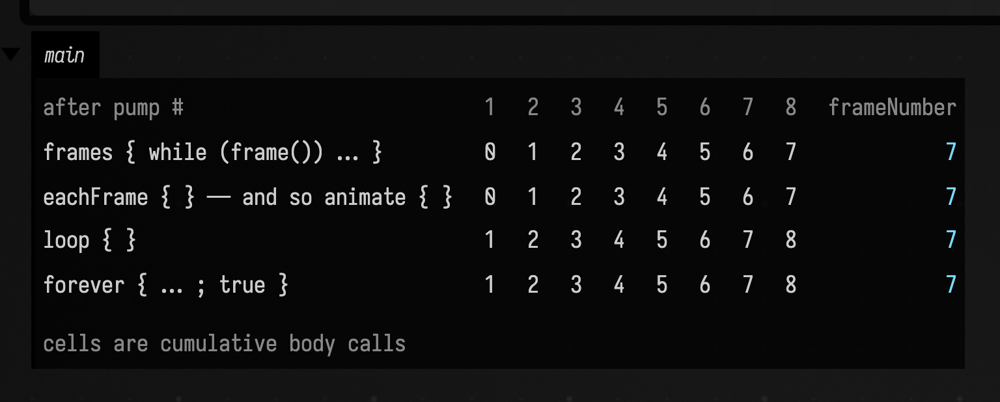
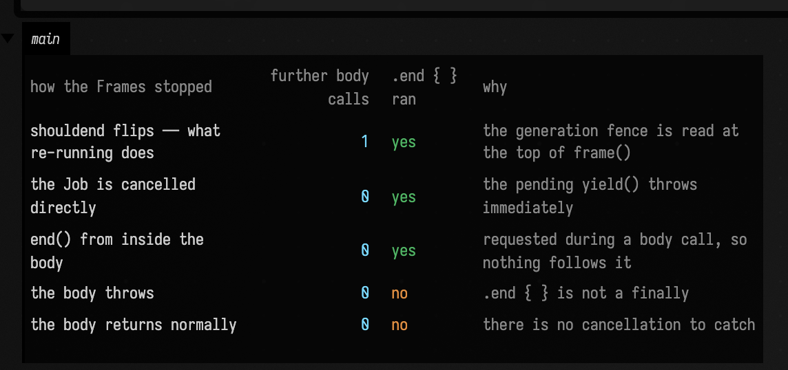
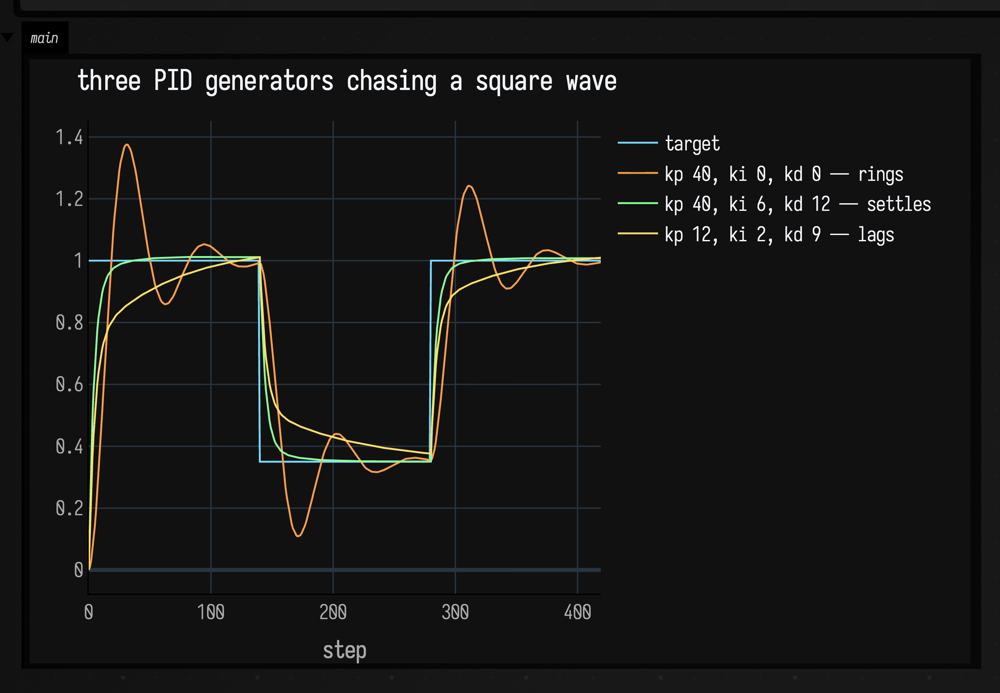
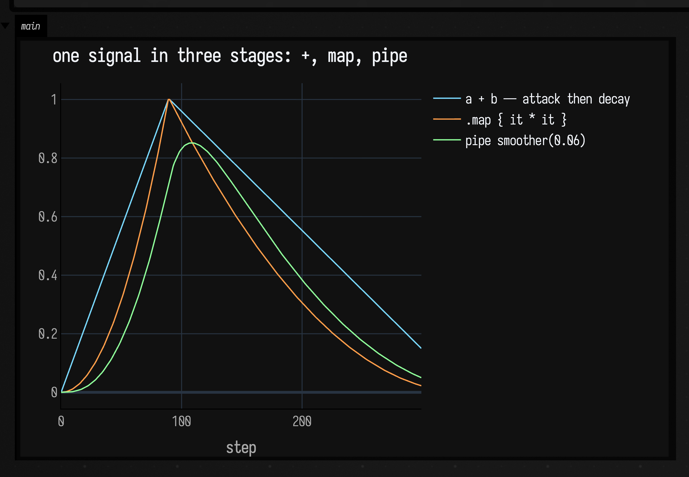
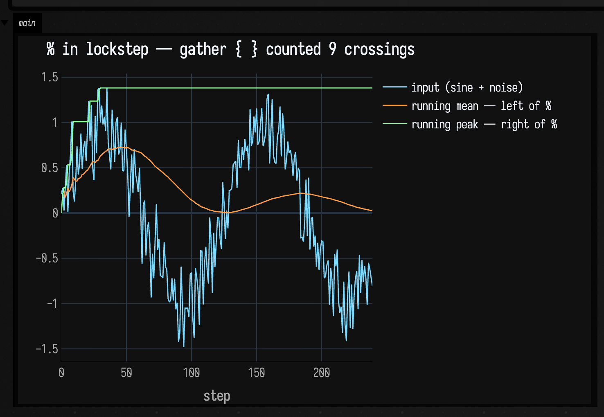

# Frames, and what a frame is

Every animated thing in Field runs on one mechanism. `animate { }` in a box, the ALife evolution
driver, a subprocess streaming its stdout into an output panel, the renderer's own `start(renderer::run)`
— all of them are a `Frames`, and all of them are pumped by the same loop. This page is about that
loop: what a frame is, how a `Frames` suspends and resumes, what *stops* one, and the pull-based
generator layer that sits beside it.

There is one fact to put first, because everything else follows from it and almost nobody guesses it:

!!! important "A frame is not a unit of time."

    Field's Runloop is a bare `while (true)` that drains a queue, counts one, and idles for about
    fifty microseconds. There is no 60 Hz, no vsync, no fixed timestep. `frameNumber` counts how
    many times your animation reached a frame boundary — it counts *work*, not *seconds*, and two
    Field sessions on two machines will not agree on how many of them fit in a second.

    So if you write motion as a function of `frameNumber` it will run at a different speed on a
    different machine, and at a different speed again while a shader is compiling. Write it as a
    function of [`AnimationClock.nowSeconds()`](#time-if-you-actually-meant-seconds) instead.

## The loop

`Runloop.start()` — `src/jvmMain/kotlin/afield/Runloop.kt` — is the whole scheduler:

```diffstatic {data-lang=kotlin}
while (true) {
    preRun.update()
    main.frame()          // ← every Frames in the document advances here
    postRun.update()
    frame++
    if (shouldSleep) schedulingState.idle()
    shouldSleep = true
}
```

It runs on one thread, named `field-runloop-main`. `idle()` is 64 `Thread.onSpinWait()`s followed by
a 50 µs `LockSupport.parkNanos` by default, tunable with `AFIELD_RUNLOOP_IDLE` and friends. Nothing
here waits for a display.

`main` is a **`Framer`**, and a `Framer` is a `kotlinx.coroutines.CoroutineDispatcher` — about thirty
lines of it. `dispatch` appends the runnable to a queue. `frame()` atomically swaps in a fresh queue
and runs everything that was in the old one, inline, to completion:

```diffstatic {data-lang=kotlin}
fun frame(): Int {
    val currentList = synchronized(queueLock) {
        val current = nextList; nextList = LinkedTransferQueue(); current
    }
    var n = currentList.poll()
    while (n != null) { … n.second.run() … ; n = currentList.poll() }
    return c
}
```

That swap is the frame boundary. A coroutine that suspends during the drain re-dispatches onto the
*new* queue, so it resumes on the next call and not this one. That is the entire mechanism: **a
frame is one drain of the dispatcher's queue.** Everything below is a consequence.

## Returning a `Frames` is what launches it

A `Frames` is inert. Building one runs no code and schedules nothing. What starts it is *returning*
it as the value of your box:

```diffstatic {data-lang=kotlin}
val n = expensiveSetup()      // runs once, when you hit run
animate { drawFrameOf(n) }    // the box's value — Field launches this
```

`ReturnValueRegistry.registerFramesReturnValue` sees a `Frames` come back, dispatches
`frames.body()` onto `Runloop.runLoop.main` inside `Box.withBoxContext(box)`, registers the coroutine
in `box.jobs`, and starts reporting `is-running` for the box. Code *before* the `animate { }` runs
once, on the run; the block runs once per frame after that.

The corollary catches people: if `animate { }` is not the returned expression, nothing happens.

```diffstatic {data-lang=kotlin}
animate { drawFrameOf(n) }    // not the last expression …
println("set up")             // … so this is the box's value, and nothing animates
```

`animate` itself is not syntax and not a rewrite. It is three lines in `stdlib.kt`:

```diffstatic {data-lang=kotlin}
fun animate(block: suspend Frames.() -> Unit): Frames = eachFrame(block)
```

There is a second way in, `Box.launchFrames(frames)`, which launches without going through the
return value. It exists for fire-and-forget work — `streamProcessFireAndForget` is its only caller
in the tree — and it differs in one respect worth knowing: it *composes* onto any `shouldend` already
installed, where the return-value path replaces it.

## The four builders

They differ only in who calls `frame()`. The clearest way to see that is to be the Runloop: a
`Framer` is an ordinary dispatcher, so we can make a private one, run each builder's body on it, and
drain it by hand, counting body calls per pump.

```diffstatic_runner {data-lang=kotlin screenshot="assets/animation_time_model/builders.png" wait="1.5" capture="box" open-outputs="true" w="1100" name="animation-builders"}
import kotlinx.coroutines.CoroutineScope
import kotlinx.coroutines.launch

// One pump == one Runloop tick. Nothing here needs a window, a document or a wall clock.
fun trace(pumps: Int, build: (() -> Unit) -> Frames): Pair<List<Int>, Int> {
    var calls = 0
    val f = build { calls++ }
    val framer = Framer()
    val job = CoroutineScope(framer).launch { runCatching { f.body() } }
    val perPump = mutableListOf<Int>()
    repeat(pumps) { framer.frame(); perPump += calls }
    job.cancel()
    return perPump to f.frameNumber
}

val pumps = 8
val rows = listOf(
    "frames { while (frame()) … }" to trace(pumps) { body -> frames { while (frame()) body() } },
    "eachFrame { } — and so animate { }" to trace(pumps) { body -> eachFrame { body() } },
    "loop { }" to trace(pumps) { body -> loop { body() } },
    // Qualified: a box also has afield.four.util.forever in scope, and bare `forever { }` is an
    // overload resolution ambiguity between the two.
    "afield.forever { … ; true }" to trace(pumps) { body -> afield.forever { body(); true } },
)

fun num(v: Any, dim: Boolean = false) =
    "<td style='padding:3px 12px;text-align:right${if (dim) ";color:#7f8c9b" else ""}'>$v</td>"

display("main", """
<table style='color:#c3ccd9;font:12px monospace;border-collapse:collapse'>
  <tr><td style='padding:3px 22px 3px 0;color:#7f8c9b'>after pump #</td>
      ${(1..pumps).joinToString("") { num(it, dim = true) }}
      <td style='padding:3px 22px;color:#7f8c9b'>frameNumber</td></tr>
  ${rows.joinToString("") { (label, r) ->
      "<tr><td style='padding:3px 22px 3px 0'>$label</td>" +
      r.first.joinToString("") { num(it) } +
      "<td style='padding:3px 22px;text-align:right;color:#7ad9ff'>${r.second}</td></tr>"
  }}
  <tr><td colspan='${pumps + 2}' style='padding:10px 0 0 0;color:#7f8c9b'>
      cells are cumulative body calls; every builder advanced exactly one frame per pump</td></tr>
</table>
""")
```



Read the offset. All four advance exactly one frame per pump — the last column is `7` in every row.
What differs is *when the body runs relative to the boundary*:

| builder | contract |
| --- | --- |
| `frames { }` | The body runs once and is responsible for calling `frame()` itself. Everything else is built on it. |
| `eachFrame { }` | `frames { while (frame()) { block() } }` — advance, *then* run the body. `animate { }` is this. |
| `loop { }` | Run the body, *then* advance — but only if the body did not advance already. |
| `forever { }` | `loop { }`, except the body returns a `Boolean` and returning `false` ends it. |

`eachFrame`'s body runs from pump 2; `loop`'s from pump 1. One pump, and it is the whole difference
between "advance, then run" and "run, then advance". The `loop`/`forever` conditional advance is the
part worth internalising: a body that calls `frame()` or `delay(ms)` itself does not get a second
advance bolted on afterwards.

!!! note "`forever { }` needs qualifying, and has no callers in the tree."

    A box imports both `afield.*` and `afield.four.util.*`, and each declares a `forever` — one
    returning a `Frames`, one returning a `Sequence<Boolean>`. A bare `forever { }` in box code is
    therefore an overload resolution ambiguity, which is why the figure above says
    `afield.forever { }`. Nothing in Field's own source calls either the `Frames` `forever` or the
    parallel-composition operator `Frames.plus`; both are public and both work — the figure drives
    `forever` and it behaves exactly as documented — but they carry less exposure to change than
    the other three builders.

## What stops one

This is the question a reader actually arrives with, and it has more than one answer. Every one of
them lands in the same place — `Frames.frame()`, which is the only suspension point a well-behaved
frame body has:

```diffstatic {data-lang=kotlin}
suspend fun frame(): Boolean {
    job = coroutineContext[Job]
    if (stillborn && job != null) { job?.cancel(); … }
    if ((if (inEndPhase) shouldCancelAtEnd() else shouldend()) && job != null) { job?.cancel(); … }
    try { yield(); frameNumber++; return r }
    catch (t: Throwable) { …run atEnd in a NonCancellable scope…; throw t }
}
```

| how it stops | what actually happens |
| --- | --- |
| **You re-run the box.** | The launch bumps `runGeneration[strand]`. The old `Frames`'s `shouldend` closes over the *old* generation, sees the mismatch at the top of its next `frame()`, and cancels. This is the everyday one. |
| **`Box.stop` / the stop button.** | `stopTrackedJobs()` is a barrier: it bumps `launchEpoch`, bumps *every* strand's generation, and cancels every job in `box.jobs` outright. It also, as a consequence, [skips your `.end { }` block](#box-stop-skips-the-end-block). |
| **`end()` from inside the body.** | Cancels the job directly. Called before the launch has a job, it sets `stillborn` and the animation is cancelled at its first frame instead. |
| **The body returns.** | `eachFrame`'s `while (frame())` exits, or a `frames { }` block runs off the end. Normal completion. |
| **`forever { }` returns `false`.** | Normal completion, same as above. |
| **The body throws.** | Caught by the launcher, logged, and reported on the box as an error. |
| **A stale launch epoch.** | If a stop landed between preparing the launch and dispatching it, `registerLaunchJob` refuses and the body never runs at all. |

Two of those differ in a way you can measure, and the difference is one body call:

```diffstatic_runner {data-lang=kotlin screenshot="assets/animation_time_model/stopping.png" wait="1.5" capture="box" open-outputs="true" w="1100" name="animation-stopping"}
import kotlinx.coroutines.CoroutineScope
import kotlinx.coroutines.launch

class Result(val how: String, val extraBodyCalls: String, val endBlockRan: Boolean, val note: String)

// Each probe runs a frame body for three pumps, requests a stop, then pumps six more times and
// reports what the body did afterwards. These are the stops box code can stage for itself; the
// `Box.stop` case needs the box's launch epoch, which is internal to Field — see the warning below.
fun probe(
    how: String,
    note: String,
    build: (counter: () -> Unit) -> Frames,
    request: (Frames, kotlinx.coroutines.Job) -> Unit,
): Result {
    var calls = 0
    var cleaned = false
    val f = build { calls++ }.end { cleaned = true }
    val framer = Framer()
    val job = CoroutineScope(framer).launch { runCatching { f.body() } }
    f.job = job
    repeat(3) { framer.frame() }
    val atRequest = calls
    request(f, job)
    repeat(6) { framer.frame() }
    return Result(how, "${calls - atRequest}", cleaned, note)
}

val results = listOf(
    probe("shouldend flips — what re-running does", "the generation fence is read at the top of frame()",
        { c -> eachFrame { c() } }, { f, _ -> f.shouldend = { true } }),
    probe("the Job is cancelled directly", "the pending yield() throws immediately",
        { c -> eachFrame { c() } }, { _, job -> job.cancel() }),
    probe("end() from inside the body", "requested during a body call, so nothing follows it",
        { c -> eachFrame { c(); end() } }, { _, _ -> }),
    // `throw`, not `error("boom")`: in a box the script's implicit Box receiver is still in scope,
    // so `error(...)` resolves to Box.error and reports a box error instead of throwing.
    probe("the body throws", ".end { } is not a finally",
        { c -> eachFrame { c(); throw IllegalStateException("boom") } }, { _, _ -> }),
    probe("the body returns normally", "there is no cancellation to catch",
        { c -> frames { repeat(2) { c(); frame() } } }, { _, _ -> }),
)

fun cell(v: Any, colour: String = "#c3ccd9", align: String = "left") =
    "<td style='padding:3px 16px 3px 0;text-align:$align;color:$colour'>$v</td>"

display("main", """
<table style='color:#c3ccd9;font:12px monospace;border-collapse:collapse'>
  <tr>${listOf("how the Frames stopped", "further body calls", ".end { } ran", "why")
      .joinToString("") { cell(it, "#7f8c9b") }}</tr>
  ${results.joinToString("") { r ->
      "<tr>" + cell(r.how) + cell(r.extraBodyCalls, "#7ad9ff", "right") +
      cell(if (r.endBlockRan) "yes" else "no", if (r.endBlockRan) "#8fff9a" else "#ff9e4a") +
      cell(r.note, "#7f8c9b") + "</tr>"
  }}
</table>
""")
```



Two results there are worth stating in words, because both are easy to assume the other way round.

**Re-running a box costs one more body call; stopping it costs none.** `shouldend` is read at the
*top* of `frame()`. A body suspended inside `frame()` is halfway through a call that has already
decided to return `true`: it resumes, returns `true`, and the loop runs the body one final time
before the *next* `frame()` looks at the flag. Cancelling the `Job` — what `Box.stop` does — makes
the pending `yield()` throw instead, so nothing more runs. If your animation holds a resource that
must not be touched after a re-run, one extra pass is the window you have to survive.

**`.end { }` is not a `finally`.** `atEnd` is invoked from exactly one place: `frame()`'s `catch`,
reached only when the pending `yield()` throws a cancellation. A body that throws its own exception
does not go through that path, and neither does one that simply returns. So `.end { }` means
*"when this animation is cancelled"*, not *"when this animation finishes"*. For cleanup that must
happen either way, use a Kotlin `try`/`finally` inside the body.

And when both are present and a cancellation arrives, **`.end { }` runs first** — `frame()` calls it
from inside its own `catch`, before rethrowing, so the cancellation has not yet unwound the body's
`finally`. That is the opposite of the order you would guess from the nesting.
(`FramesSemanticsTest.theEndBlockRunsBeforeTheBodysOwnFinally`.)

When `atEnd` does run, it runs properly: `frame()` re-enters through `withContext(NonCancellable)`
on a fresh `Job` that inherits the dispatcher and the box context, so the end block still gets frames
and can still draw. It is registered with the box as well, and fenced by its own generation — so a
*second* stop, arriving while the end block is running, cancels the end block too.

### `Box.stop` skips the end block { #box-stop-skips-the-end-block }

!!! warning "Pressing stop does not run your `.end { }`. Re-running the box does."

    This page said the opposite in its first draft, and the demo document below is what caught it.
    The figure above is right about what it measures — a cancelled `Job` reaches `atEnd` — but
    `Box.stop` does more than cancel the job.

    `stopTrackedJobs()` increments the box's `launchEpoch` *first*. `frame()` then does launch the
    end phase, and immediately hands the end job to `Box.registerLaunchJob`, which finds the epoch
    stale and — this is the part that matters — **cancels the job it was given**. The end block is
    sitting in the Framer's queue at that moment and is killed before it is ever dispatched.

    Re-running the box is different: that bumps the strand *generation* and leaves `launchEpoch`
    alone, so the end job registers and `.end { }` runs normally.

    Both halves are pinned by `FramesSemanticsTest.boxStopCancelsTheEndBlockBeforeItCanRun` and
    `reRunningTheBoxStillRunsTheEndBlock`. The practical rule: **`.end { }` is for cleanup you want
    when the animation retires itself or gets replaced, not for releasing something that must be
    released when a person presses stop.** Put that in a `finally`.

    **This bites one thing in the standard library.** `Box.streamProcess` runs an external command
    and streams its output into a box, and it is the only place in Field's source that installs an
    `atEnd` — the block that calls `proc.destroy()`. Its KDoc says *"ending the Frames will kill the
    process"*. Pressing stop does end the Frames, and
    `StreamProcessStopLeakTest.stopLeavesTheProcessRunning` shows a real `/bin/sleep` outliving it.
    Re-running the box kills it correctly. If you launch a subprocess from a box, do not rely on
    stop to reap it. The mechanism, the full caller sweep and the two candidate fixes are written up
    in `dev_docs/frames_stop_end_phase.md`; which one Field adopts is not settled.

## Time, if you actually meant seconds

`AnimationClock.nowSeconds()` — `Runloop.kt` — is the time source to write motion against. Ordinarily
it is monotonic wall time. Its second mode is the reason it exists:

> A frame-synchronous video capture installs a token that advances by exactly `1 / fps` only after a
> Field frame has been painted and copied into the movie. Code using `nowSeconds` therefore becomes
> frame-indexed during offline capture without changing its live, interactive pacing.

That is what makes an animation reproducible. During the capture that produced the video below, the
docs runner blocks the Runloop while Playwright paints and screenshots each frame; real time runs at
whatever rate that takes, and `nowSeconds()` advances by exactly 1/20 s per captured frame regardless.
Motion written against it is identical every build.

Live, though, the rate is whatever the machine can manage. This is the page's opening claim,
measured — a frame body that does nothing but stamp the clock, for two seconds, plotted:

```diffstatic_runner {data-lang=kotlin screenshot="assets/animation_time_model/cadence.png" execution="launch" wait="4.0" wait-output="true" capture="box" open-outputs="true" w="1100" timeout="90" name="animation-cadence"}
// One wall-clock reading per frame for two seconds, then plot the gaps between them. Nothing here
// is frame-indexed: a screenshot capture leaves AnimationClock on monotonic real time, unlike the
// frame-synchronous video recorder.
val t0 = AnimationClock.nowSeconds()
val stamps = ArrayList<Double>(400_000)

animate {
    val now = AnimationClock.nowSeconds()
    stamps += now
    if (now - t0 >= 2.0) end()
}.end {
    val gapsUs = (1 until stamps.size).map { (stamps[it] - stamps[it - 1]) * 1_000_000.0 }
    val elapsed = stamps.last() - stamps.first()

    // A 100-frame running mean, so the trend is readable under the spikes.
    val window = 100
    val smooth = gapsUs.indices.map { i ->
        val lo = maxOf(0, i - window + 1)
        gapsUs.subList(lo, i + 1).average()
    }

    val perSecond = gapsUs.size / elapsed
    val median = gapsUs.sorted()[gapsUs.size / 2]
    showSignals(
        "gap between frames (µs)" to gapsUs,
        "100-frame running mean" to smooth,
        channel = "main",
        title = "%,d frames in %.2f s — %,.0f a second, median gap %,.0f µs".format(
            gapsUs.size, elapsed, perSecond, median),
        xTitle = "frame",
        yTitle = "µs",
    )
}
```


Read the title, and then read the spikes. That number is not a property of Field; it is a property
of this machine, this build, and whatever else the Runloop was carrying at the time — the figure was
captured inside the docs build, with a browser attached and other boxes idle in the same process.
Run the [demo document](#where-this-lives) and you will get a different one, and a different one
again on the second run. Nothing in that plot is a frame *rate* you could schedule against, which is
the entire reason to write motion against seconds.

## An animation, and the moment it stops

Here is the loop actually running, recorded frame by frame. The disc's position comes from
`AnimationClock.nowSeconds()`; the tick row below it grows with `frameNumber`, one mark per four
frames reached. At four and a half seconds the body calls `end()`, and the `.end { }` block redraws
the last state in red. Nothing after that moves — the remaining three and a half seconds are the
stopped animation, not the end of the recording.

```diffstatic_runner {data-lang=kotlin video="assets/animation_time_model/running_and_stopping.mp4" capture="box" open-outputs="true" wait-output="true" wait-output-kind="display" execution="launch" duration="8" fps="20" timeout="300" w="1000" h="140" embed=true name="animation-running-stopping" alt="a cyan disc travelling along a horizontal track above a row of tick marks that grows steadily longer as frames accumulate; four and a half seconds in the disc stops dead, the tick row stops growing, and everything redraws in red and stays frozen for the rest of the clip"}
:::static
:::fold the fixed frame and the two shapes — geometry only, no animation in here
val W = 980.0
val H = 300.0
val FRAMES = 160      // frames in the clip: 8 s at 20 fps. The tick row is scaled to fill it.

// A border drawn every frame. Without a fixed extent, fitToSize rescales the view to whatever the
// dot is doing and the motion cancels itself out — the lesson rasterizeFLinesFramed in
// alife_animate.kt records, and it applies to lines() just as much.
fun border(rgba: Vec4) = fline {
    moveTo(6.0, 6.0); lineTo(W - 6.0, 6.0); lineTo(W - 6.0, H - 6.0); lineTo(6.0, H - 6.0); close()
    color = rgba; thickness = 1.4; stroked = true; filled = false
}

fun disc(cx: Double, cy: Double, r: Double, rgba: Vec4) = fline {
    (0..28).forEach { i ->
        val a = i / 28.0 * 2.0 * kotlin.math.PI
        val px = cx + r * kotlin.math.cos(a)
        val py = cy + r * kotlin.math.sin(a)
        if (i == 0) moveTo(px, py) else lineTo(px, py)
    }
    close(); color = rgba; filled = true; stroked = false
}
:::endfold

val started = AnimationClock.nowSeconds()
val stopAfter = 4.5

// The line worth reading: elapsed seconds in, a position along the track out. Written against the
// clock, not against frameNumber, so it means the same thing live and under capture.
fun dotX(elapsed: Double) = 110.0 + 760.0 * (0.5 - 0.5 * kotlin.math.cos(elapsed * 0.9))

// A lambda, not a named `fun`: a named function that captures the script's implicit Box receiver —
// which `lines(...)` needs, since it is a Box extension — is something K2 cannot currently codegen.
val draw: (Double, Int, Boolean) -> Unit = { elapsed, frames, stopped ->
    val accent = if (stopped) vec(1.0, 0.28, 0.30, 1.0) else vec(0.48, 0.85, 1.0, 1.0)
    val quiet = if (stopped) vec(1.0, 0.28, 0.30, 0.55) else vec(0.55, 0.62, 0.72, 0.7)
    val track = fline {
        moveTo(110.0, 105.0); lineTo(870.0, 105.0)
        color = quiet; thickness = 1.4
    }
    // One tick per four frames reached. The row grows with frameNumber; the disc moves with the
    // clock. Every fourth, not every one: at this scale 160 adjacent ticks merge into a solid bar.
    val tickRow = fline {
        for (i in 0 until frames.coerceAtMost(FRAMES) step 4) {
            val x = 110.0 + 760.0 * (i.toDouble() / FRAMES)
            moveTo(x, 190.0); lineTo(x, 250.0)
        }
        color = accent; thickness = 2.4
    }
    lines(
        border(quiet), track, tickRow, disc(dotX(elapsed), 105.0, 15.0, accent),
        channel = "main", w = W, h = H, fitToSize = true,
    )
}

animate {
    val elapsed = AnimationClock.nowSeconds() - started
    draw(elapsed, frameNumber, false)
    if (elapsed >= stopAfter) end()
}.end {
    // Runs on cancellation, in a NonCancellable scope that still carries the box context — so it can
    // still draw, and still get frames. Two of them, so the stopped state is definitely painted.
    repeat(2) {
        draw(AnimationClock.nowSeconds() - started, frameNumber, true)
        frame()
    }
}
```

## The generator layer

`Phased.kt` carries a second, quite different mechanism, and it is not a curiosity. A `Generator` is
a Python-style coroutine you drive by hand: `start()` runs it to its first `yield`, and `next(input)`
resumes it with a value and runs it to the next one. No dispatcher, no `Job`, no frame boundary — the
caller decides when a step happens.

That is exactly what you want in a hot loop. `SimdVerlet` gives every particle a
`MapOfGenerators<ForceContext, Unit>` and steps all of them per physics tick, and
`addPidPositionController` writes a PID controller as a generator whose integral and derivative
history are ordinary local variables, kept alive across steps by the suspension itself rather than by
a state object anyone has to declare:

```diffstatic_runner {data-lang=kotlin screenshot="assets/animation_time_model/generator_pid.png" wait="2.0" capture="box" open-outputs="true" wait-output="true" w="1100" name="animation-generator-pid"}
// The same shape SimdVerlet.addPidPositionController uses, reduced to one axis so it plots.
// Everything the controller remembers — position, velocity, the error integral, the previous error
// — is a local. `yield` hands out the current position and hands back the next target.
data class Tick(val target: Double, val dt: Double)

fun controller(kp: Double, ki: Double, kd: Double) = generator2<Tick, Double> {
    var x = 0.0
    var v = 0.0
    var integral = 0.0
    var previousError = 0.0
    while (true) {
        val tick = yield(x)
        val error = tick.target - x
        integral += error * tick.dt
        val derivative = (error - previousError) / tick.dt
        previousError = error
        v = (v + (kp * error + ki * integral + kd * derivative) * tick.dt) * 0.94
        x += v * tick.dt
    }
}

val steps = 420
val dt = 1.0 / 60.0
fun targetAt(i: Int) = if ((i / 140) % 2 == 0) 1.0 else 0.35

val tuned = linkedMapOf(
    "kp 40, ki 0, kd 0 — rings" to controller(40.0, 0.0, 0.0),
    "kp 40, ki 6, kd 12 — settles" to controller(40.0, 6.0, 12.0),
    "kp 12, ki 2, kd 9 — lags" to controller(12.0, 2.0, 9.0),
)

val target = mutableListOf<Number>()
val traces = tuned.keys.associateWith { mutableListOf<Number>() }
tuned.forEach { (name, g) -> traces.getValue(name) += g.start()!! }
for (i in 0 until steps) {
    val t = targetAt(i)
    target += t
    tuned.forEach { (name, g) -> traces.getValue(name) += g.next(Tick(t, dt))!! }
}

showSignals(
    "target" to target,
    *traces.map { (name, values) -> name to values.take(steps).toList() }.toTypedArray(),
    channel = "main",
    title = "three PID generators chasing a square wave",
    xTitle = "step",
)
```



Three controllers, three sets of gains, and none of them declares a state class. `yield(x)` suspends
in the middle of the `while (true)`, so `integral` and `previousError` are simply still there when
`next(tick)` resumes it.

### Composing them

The rest of the layer is combinators, and they are worth knowing because they are how a generator
stops being a one-off and starts being a pipeline. Here are three of them building one signal in
four stages, each stage derived from the one before:

```diffstatic_runner {data-lang=kotlin screenshot="assets/animation_time_model/generator_pipeline.png" wait="2.0" capture="box" open-outputs="true" wait-output="true" w="1100" name="animation-generator-pipeline"}
// `generator { }` is the output-only shape: the input type is Unit, so `yield(v)` returns Unit.
// This one climbs from `from` to `to` over n steps and then simply returns — a generator that
// completes rather than running forever.
fun ramp(from: Double, to: Double, n: Int) = generator<Double> {
    for (i in 0 until n) yield(from + (to - from) * i / (n - 1.0))
}

// `+` is sequential: drive the left to completion, then the right. An attack, then a decay.
fun envelope() = ramp(0.0, 1.0, 90) + ramp(1.0, 0.15, 210)

// `map` transforms the output values as they come past.
fun shaped() = envelope().map { it * it }

// `pipe` feeds one generator's output in as another's input. A one-pole smoother is the natural
// thing to put on the right: it needs the previous output, which is exactly the state a generator
// keeps for free.
fun smoother(alpha: Double) = generator2<Double, Double> {
    var y = 0.0
    var x = yield(0.0)
    while (true) {
        y += alpha * (x - y)
        x = yield(y)
    }
}

// Drive any Unit-input generator by hand until it says it is finished by returning null.
fun drive(g: Generator<Unit, Double>, cap: Int): List<Number> {
    val out = mutableListOf<Number>()
    var v = g.start()
    while (v != null && out.size < cap) {
        out += v
        v = g.next(Unit)
    }
    return out
}

val cap = 300
// The bare `ramp(0 -> 1, 90)` is deliberately not plotted: it is pixel-identical to the first 90
// steps of `a + b`, so drawing it only puts an invisible series in the legend. Its length is the
// interesting part, and you can read that off where the orange trace turns.
showSignals(
    "a + b — attack then decay" to drive(envelope(), cap),
    ".map { it * it }" to drive(shaped(), cap),
    "pipe smoother(0.06)" to drive(shaped() pipe smoother(0.06), cap),
    channel = "main",
    title = "one signal in three stages: +, map, pipe",
    xTitle = "step",
)
```



The sharp turn at step 90 is `+` handing over from the attack to the decay — the left generator
completed there, which is what `+` waits for. The bowed slopes are `map`. The rounded peak and the
lag are the smoother on the right of `pipe`. Every one of those is a value you can pass around and
re-compose, and none of them declares a state class.

The two remaining shapes are about *consuming*. `%` runs two generators in lockstep on the same
input and yields their outputs as a `Pair`, stopping when either does. `gather { }` is the
consume-only form — output type `Boolean`, for a generator you drive for its effect rather than its
value, where the no-argument `yield()` just hands back `true`:

```diffstatic_runner {data-lang=kotlin screenshot="assets/animation_time_model/generator_lockstep.png" wait="2.0" capture="box" open-outputs="true" wait-output="true" w="1100" name="animation-generator-lockstep"}
// Two estimators over the same noisy input, in lockstep.
val mean = generator2<Double, Double> {
    var sum = 0.0
    var n = 0
    var x = yield(0.0)
    while (true) {
        sum += x; n++
        x = yield(sum / n)
    }
}
val peak = generator2<Double, Double> {
    var highest = Double.NEGATIVE_INFINITY
    var x = yield(0.0)
    while (true) {
        if (x > highest) highest = x
        x = yield(highest)
    }
}

// `%` — one input in, a Pair of outputs out, until either side finishes.
val both = mean % peak

val random = java.util.Random(7)
val input = List(240) { i -> kotlin.math.sin(i * 0.05) + random.nextGaussian() * 0.25 }

val means = mutableListOf<Number>()
val peaks = mutableListOf<Number>()
var pair = both.start()
var i = 0
while (i < input.size) {
    // Into a local first: at a box's top level `pair` is a property, not a local, so Kotlin
    // will not smart-cast it to non-null however obviously the loop guard proves it.
    val step = pair ?: break
    means += step.first
    peaks += step.second
    pair = both.next(input[i]); i++
}

// `gather { }` consumes and reports nothing useful — the work is the side effect. Note the bare
// yield(): the no-argument overload exists exactly for this shape.
var crossings = 0
val countCrossings = gather<Double> {
    var previous = 0.0
    while (true) {
        val x = yield()
        if (previous <= 0.0 && x > 0.0) crossings++
        previous = x
    }
}
countCrossings.start()
input.forEach { countCrossings.next(it) }

showSignals(
    "input (sine + noise)" to input.map { it as Number },
    "running mean — left of %" to means,
    "running peak — right of %" to peaks,
    channel = "main",
    title = "%% in lockstep — gather { } counted %d crossings".format(crossings),
    xTitle = "step",
)
```



The peak trace only ever climbs — that is a running maximum, and the staircase is it meeting a new
high. The mean settles towards the sine's own average. Both came out of one `next(x)` call per step
on the composed generator, and the crossing count in the title came from a third generator that
never yielded a value anyone read.

!!! warning "A `Generator` is not thread-safe and not re-entrant."

    `next(input)` throws if the generator is not currently parked at a `yield`, and an exception
    from inside the generator is re-thrown out of the *caller's* `start`/`next`. Drive one from one
    place.

## Every name in `Phased.kt`

The whole vocabulary, so there is somewhere to look it up. This table is checked against the source
by `afield.PhasedPageCoverageTest`: adding a public declaration to `Phased.kt` fails the build until
it has a row here, and removing one fails the build until the row goes.

<!-- phased-surface -->

**The types**

| Name | What it is |
| --- | --- |
| `type Frames` | A frame-based animation: a suspend `body`, a `frameNumber`, and the hooks a launcher installs on it. |
| `type EndedException` | A bare `Throwable` subclass declared alongside `Frames`. Nothing in the tree throws or catches it. |
| `type Framer` | The `CoroutineDispatcher` whose queue-drain *is* the frame boundary. `Runloop.runLoop.main` is one. |
| `type GeneratorScope` | The receiver inside `generator { }` — it exists to provide `yield`. |
| `type Generator` | A pull-driven coroutine: `start()`, then `next(input)` per step. |

**`Frames` — the members in scope inside a frame body**

| Name | What it is |
| --- | --- |
| `Frames.frame()` | Advance one frame: check the stop conditions, suspend until the next queue drain, increment `frameNumber`. Returns `false` if it is stopping. |
| `Frames.delay()` | Suspend for `ms` milliseconds of *real* time, then `frame()`. |
| `Frames.wait()` | `while (!cancelled) frame()` — park here, advancing, until something stops us. |
| `Frames.end()` | Ask to stop. Cancels the job, or marks the animation stillborn if it has not launched yet. |
| `Frames.frameNumber` | Frames completed so far. Counts work, not time. |
| `Frames.job` | The coroutine running `body`, once there is one. |
| `Frames.body` | The suspend lambda a builder assembled. Inert until something launches it. |
| `Frames.atEnd` | The cleanup chain, run on cancellation only. `Frames.end { }` appends to it. |
| `Frames.shouldend` | Polled at the top of every `frame()`. This is where a launcher installs its generation fence. |
| `Frames.toString()` | `"(frames)"` — what a box shows when you evaluate one without returning it. |

**The builders**

| Name | What it is |
| --- | --- |
| `frames` | The lowest level: the body runs once and calls `frame()` itself. |
| `eachFrame` | Advance, then run the body, while `frame()` returns true. `animate { }` is an alias for this. |
| `loop` | Run the body, then advance — unless the body advanced already. |
| `forever` | `loop`, but the body returns a `Boolean` and `false` ends it. No callers in the tree. |
| `Frames.end` | Chain a cleanup block onto `atEnd`. Written `.end { }`, and distinct from the `end()` member. |
| `Frames.plus` | Run two frame programs in parallel under one parent. No callers in the tree. |
| `Box.launchFrames` | Launch a `Frames` on the Runloop against a box, without returning it. Two overloads. |
| `then` | Sequence two plain suspend lambdas into one. |

**The generator layer**

| Name | What it is |
| --- | --- |
| `generator2` | Build a generator with both an input and an output type. |
| `generator` | Output only — the input type is `Unit`. |
| `gather` | Input only — the output type is `Boolean`. |
| `Generator.start()` | Run to the first `yield` and return what it yielded, or `null` if it finished first. |
| `Generator.next()` | Resume with an input, run to the next `yield`, return it — or `null` once finished. |
| `Generator.isCompleted` | True once the body has returned without failing. |
| `GeneratorScope.yield()` | Emit a value and suspend; resumes with the next input. The no-argument overload yields `true`. |
| `Generator.plus` | Sequential composition: drive the left to completion, then the right. |
| `Generator.rem` | Lockstep composition (`%`): same input to both, yields a `Pair`, stops when either does. |
| `Generator.pipe` | Feed this generator's output into another as its input. |
| `Generator.map` | Transform the output values. |
| `Generator.Companion.isMain` | Set by `Framer.frame()` while it drains, so code can tell it is on the Runloop thread. |

**The dispatcher**

| Name | What it is |
| --- | --- |
| `Framer.dispatch()` | `CoroutineDispatcher`'s hook — queue the runnable for the next frame. |
| `Framer.frame()` | Swap the queue and run everything in it. One call is one frame. |

<!-- /phased-surface -->

## Where this lives

| what | file |
| --- | --- |
| `Frames`, the builders, `Framer`, the generator layer | `src/jvmMain/kotlin/afield/Phased.kt` |
| the Runloop and `AnimationClock` | `src/jvmMain/kotlin/afield/Runloop.kt` |
| `animate`, `start` | `src/jvmMain/kotlin/afield/stdlib/stdlib.kt` — listed in [Workspace](reference/workspace.md) |
| what happens when a box returns a `Frames` | `src/jvmMain/kotlin/afield/ReturnValueRegistry.kt` |
| stop, generations and launch epochs | `src/jvmMain/kotlin/afield/Boxes.kt` |
| the non-coroutine per-frame layers | `src/jvmMain/kotlin/afield/four/util/MapOfSequences.kt` |
| the behaviour on this page, as tests | `src/jvmTest/kotlin/afield/FramesSemanticsTest.kt` |

`Phased.kt` is not part of the [codebase reference](reference/index.md): that is generated from
`afield.stdlib`, `afield.visualization` and `afield.four.synth`, and `Phased.kt` sits in `afield`
itself, one layer below. This page is its reference instead, which is why the table above is
guarded rather than prose.

To see it running rather than read about it, replay
`dev_docs/agents/transcripts/docs_capture/frames_lifecycle.yaml` into a fresh Field — it builds four
boxes that between them start, stop, re-run and clean up a frame loop.
