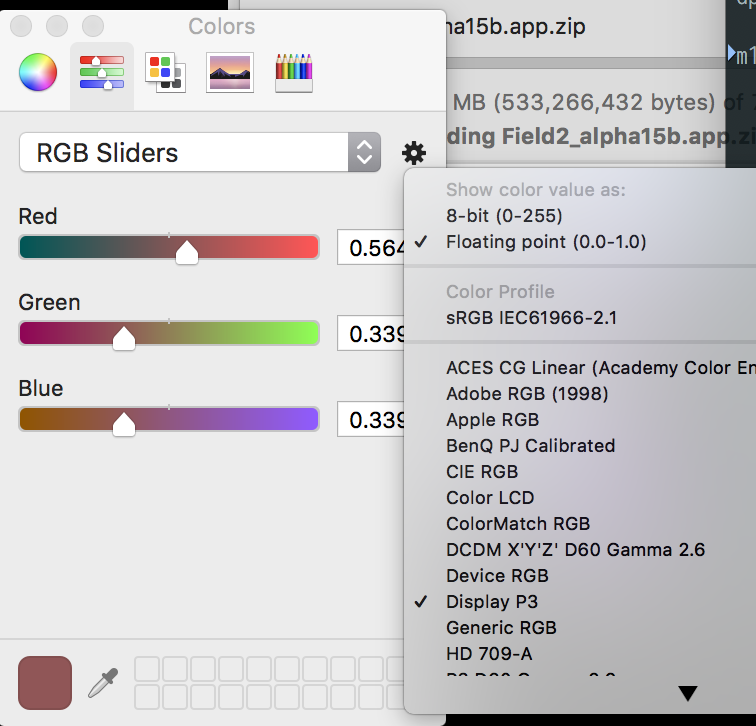
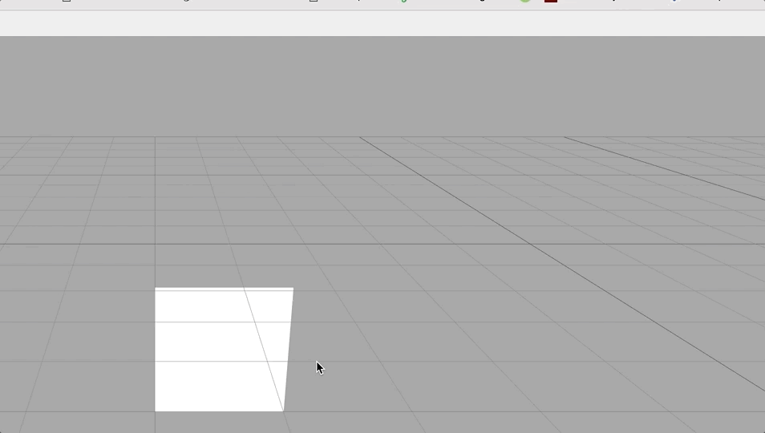

## FLines

### **new** — `new FLine()`

An `FLine` is a container for geometry. You can construct an `FLine` with `new FLine()`:

```diffstatic {data-lang=javascript}
:::static
var someLine = new FLine()

someLine.moveTo(40,20)
someLine.lineTo(200,50)

stage.aName = someLine
```

### **stage** — `stage.name = myLine`

### **stage** — `stage.add(myLine)`

`stage` is a place to add `FLine` once they’ve been made. If you add an `FLine` to the stage that’s already there it gets updated. If you fail to add an `FLine` to a stage, you’ll never see it.

### **moveTo** — `fline.moveTo(x,y,z=0)`

Adds a ‘moveTo’ instruction to a line — this moves the ‘pen’ without drawing. `z` defaults to `0` if you don’t include it. `.moveTo` can also consume vectors:  
`fline.moveTo(vec(1,2,3) + vec(3,4,5))`. Instructions can be chained together thus:  
`fline.moveTo(0,0,0).lineTo(1,1,1)`.

### **lineTo** — `fline.lineTo(x,y,z=0)`

Adds a ‘lineTo’ instruction to a line — this moves the ‘pen’ without drawing. `z` defaults to `0` if you don’t include it. `.lineTo` can also consume vectors:  
`fline.lineTo(vec(1,2,3) + vec(3,4,5))`. Instructions can be chained together thus:  
`fline.moveTo(0,0,0).lineTo(1,1,1)`.

### **cubicTo** — `fline.cubicTo(cx1, cy1, cz1, cx2, cy2, cz2, x,y,z)`

Draws a [cubic spline curve](http://mathworld.wolfram.com/CubicSpline.html) to a new position using control points `c1` and `c2`. `Vector3` and `Vector2` are also accepted. Returns this FLine so you can chain calls together.

### **filled** — `fline.filled = false`

Controls whether an `FLine` is filled in (that is: turned into solid shapes) when it is drawn. Defaults to `false`.

### **stroked** — `fline.stroked = true`

Controls whether an `FLine` is stroked (drawn with an outline) when it is rendered. Defaults to `true`.

### **color** — `fline.color = vec(1,0,0.5, 0.25)`

Sets the color of a line. Colors in Field are `Vector4`, that is `vec(Red, Green, Blue, Opacity)` with each component ranging from 0.0 (black/transparent) to 1.0 (white/opaque). This is an [additive color space](https://en.wikipedia.org/wiki/Additive_color). You can also find a good additive color picker built into OS X:



### **fillColor** — `fline.fillColor = vec(1,0,0.5, 0.25)`

Sets the color of a fill of a line (which otherwise defaults to `fline.color`). Colors in Field are `Vector4`, that is `vec(Red, Green, Blue, Opacity)` with each component ranging from 0.0 (black/transparent) to 1.0 (white/opaque). This is an [additive color space](https://en.wikipedia.org/wiki/Additive_color).

### **strokeColor** — `fline.strokeColor = vec(1,0,0.5, 0.25)`

Sets the color of a stroke of a line (which otherwise defaults to `fline.color`). Colors in Field are `Vector4`, that is `vec(Red, Green, Blue, Opacity)` with each component ranging from 0.0 (black/transparent) to 1.0 (white/opaque). This is an [additive color space](https://en.wikipedia.org/wiki/Additive_color).

### **byTransforming** — `fline.byTransforming( (x,y,z) => vec(y,x,z*x) )`

Returns a new, independent `FLine` that has had all of its positions transformed by the supplied function.

### **+** — `fline + vec(1,0,0)`

Return a new `FLine` translated by the added vector.

### **-** — `fline - vec(1,0,0)`

Return a new `FLine` translated by the subtracted vector.

### **\*** — `fline * vec(1,0,0)`, `fline * 0.2`

Return a new `FLine` scaled by the added vector or scalar.

### **\*** — `fline * rotate3(vec(0,1,0), 0.2)`

Return a new `FLine` rotated by the supplied transform.

### [advanced] **fill** — `fline.fill -> Mesh`

After a line has been added to `stage` the `fill` property contains the [Three.js Mesh]() object that holds the geometry. You can use this to do all kinds of advanced Three.js tricks.

### [advanced] **stroke** — `fline.stroke -> Mesh`

After a line has been added to `stage` the `stroke` property contains the [Three.js Mesh]() object that holds the line segment geometry of the outline. You can use this to do all kinds of advanced Three.js tricks.

### [advanced] **mouseDown** — `fline.mouseDown.myhandler = (event) => {}`

`FLine` can have `mouseDown` handlers associated with it:

```diffstatic {data-lang=javascript}
:::static
fline.mouseDown.myhandler = (event) => {
    print("clicked!")

    // the position of the camera and direction of the mouse / touch
    print(event.ray.origin)
    print(event.ray.direction)

    // the (optional) hit position on the nearest AR plane in the environment 
    print(event.hit)
}
```

This means that you can make buttons that do things:

```diffstatic {data-lang=javascript}
:::static
clearAll()
var f = new FLine()

f.moveTo(0,0,0)
f.lineTo(1,0,1)
f.lineTo(1,1,0)
f.lineTo(0,1,0)
f.lineTo(0,0,0)

f.filled = true

f.mouseDown.justAStepToTheRight = (event) => {
    f = f + vec(0.1, 0, 0)

    // and a random color
    f.color = vec(Math.random(), Math.random(), Math.random(), 0.5)
    f.filled = true
    
    stage.f = f
}

stage.f = f
```

This will send a button that changes color when you ‘click’ it and scurries slightly to the right.

## Field things

### **print** — `print("hello world")`

Print sends something back from the web-browser into the text editor (typically at the bottom or near where you executed something from). If `print` gets a complex JavaScript object it will try really hard to format it correctly in a way that you can explore using the mouse. Sometimes, if the object is too long or complex it will give up. When this works this is a great way to investigate complex Three.js objects.

For browsers where `print` is hardwired into a request to actually print the page, you can use `log` instead.

### **clearAll** — `clearAll()`

Removes everything Field related from the scene.

### **clearAFrame** — `clearAFrame()`

Removes everything A-Frame related from the scene.

### `_.banana = 10`

You can set properties that are conceptually ‘inside’ boxes using the `_` symbol. For example `_.banana = 10` sets `banana` equal to `10`. This is a *lot* like `var banana = 10` however properties set on `_` can be seen by boxes that are “downstream” of this box. That is: they have arrows coming from this box. You have already seen one example of this. Our AR/in-web-browser boxes are “downstream” of our web-server box.

### `__.banana = 10`

You can make properties globally available by using double underscore `__`. Once `__.banana = 10` has been set somewhere, then `_.banana == 10` in all boxes everywhere.

### `_.begin('peach')` [syntax might change]

This is equivalent to “beginning” a box called “peach”. That is, option clicking on it. You can use this to trigger boxes in callbacks for example.

### `_.end('peach')` [syntax might change]

This stops a box called “peach”.

### `launch( function*, name)`

Starts a *generator function* running. This is a little like if you inserted a `_r` into a new box, but of course doesn’t require you to make a new box and pass all of the variables you need for it to run into a new place. By far the most common use for `launch` is actually inside `over`—making little animations that smooth over changes.

But, by way of example, this code here launches a little function that animates the opacity of a line `f`:

```diffstatic {data-lang=javascript}
:::static
launch( function*() {
        for(var q = 0; q < 100; q++) {
            f.color = vec(1,1,1, 1 - q/99)
            stage.f = f
            yield 
        }
})
```

The key difference here is the *yield* keyword and the asterisk after the `function` declaration. This makes a different kind of function—one that, when it’s called again, execution picks up from after the most recent `yield` rather than starting again at the top. Now we have a function that runs 100 times and then ends, smoothly animating the opacity of `f`. An easier way to do this code though is to use `over`.

The `name` parameter requires some explanation—only one launched function with a particular name can be running in a box at a time. This helps prevent the case where your code starts spawning long-running launched functions that all stomp over each other in strange ways. But if you want to run two at a time, give them different names.

### `over(seconds, name, callback)`

Calls `callback(a)` with `a` moving from 0 to 1 (inclusive) over the next `seconds`. For example, the example given for `launch` above is better written as:

```diffstatic {data-lang=javascript}
:::static
over(2, "myOpacityAnimator", (alpha) => {
    f.color = vec(1,1,1, 1 - alpha)
    stage.f = f
})
```

## Loading files

### **mapDirectory** — `mapDirectory("/Users/marc/Desktop", "/assets")`

The `mapDirectory` function exposes some part of your desktop computer (the machine running Field) to devices connected to our webserver. For example, if we had a file on our desktop called “fantastic.gltf” then this works:

```diffstatic {data-lang=javascript}
:::static
mapDirectory("/Users/marc/Desktop", "/assets")
loadGLTF("/assets/fantastic.gltf")
```

On Windows you might want something like:

```diffstatic {data-lang=javascript}
:::static
mapDirectory("c:/Users/marc/Desktop", "/assets")
loadGLTF("/assets/fantastic.gltf")
```

### **loadFBX** — `loadFBX(url, name [, callback])`

Loads an FBX file stored on the server from `url` and adds it to the scene. *After the fbx file is loaded* an object called `"name"` is filled in with `name.animations` as a list of data in the file and `name.objects` representing all of the loaded geometries. This object also gives you animation control over the material that’s loaded. Furthermore, the root node of the object tree you load will be called “name”.

You can call:

```diffstatic {data-lang=javascript}
:::static
loadFBX("/assets/wonderful.fbx", "great")

// ... sometime later ...
great.play() // starts the animations playing
great.play(false) // starts the animations playing, but doesn't loop
great.stop() // stops them
great.pause() // as it says

// loadFBX automatically names the root object with
// the name you pass in
findByName("great").position.x = 10

great.apply(0.5) // skips to 0.5 seconds into the animation
great.currentTime() // what time are we currently at
great.apply(great.currentTime() + 0.1) // skip forward 0.1 seconds
```

Since almost nobody remembers to wait for the model to load (and it’s a pain to architect your code such that this happens) there’s an alternative syntax using a `callback`. Think of this a little like `mouseDown` and friends—a way of arranging for some code to be called later.

```diffstatic {data-lang=javascript}
:::static
loadFBX("/assets/wonderful.fbx", "great", (great) => {
    great.play() // starts the animations playing
    great.stop() // stops them
    great.pause() // as it says

    // loadFBX automatically names the root object with
    // the name you pass in
    findByName("great").position.x = 10

    great.apply(0.5) // skips to 0.5 seconds into the animation
    great.currentTime() // what time are we currently at
    great.apply(great.currentTime() + 0.1) // skip forward 0.1 seconds    
})

// other code goes here, but it might get executed
// before the callback
```

If you don’t mind a little more syntax the above code is much clearer about making sure that things are executed at the right time.

### **loadJSONScene** — `loadJSONScene(url, loaded)`

Loads a JSON Scene file (exported from the editor) stored on the server from `url` and adds it to the scene. *After the json scene file is loaded* an object called `"loaded"` is filled in with `loaded.animations` as a list of data in the file and `loaded.objects` representing all of the loaded geometries.

You can call:

```diffstatic {data-lang=javascript}
:::static
loadJSONScene("/assets/wonderful.json", "great")

// ... sometime later ...
great.play() // starts the animations playing
great.stop() // stops them
great.apply(0.5) // skips to 0.5 seconds into the animation
```

### **loadGLTF** — `loadGLTF(url, loaded)`

Loads an GLTF Scene file stored on the server from `url` and adds it to the scene. *After the gltf file is loaded* an object called `"loaded"` is filled in with `loaded.animations` as a list of data in the file and `loaded.objects` representing all of the loaded geometries.

You can call:

```diffstatic {data-lang=javascript}
:::static
loadGLTF("/assets/wonderful.gltf", "great")

// ... sometime later ...
great.play() // starts the animations playing
great.stop() // stops them
great.apply(0.5) // skips to 0.5 seconds into the animation
```

### **findByName** — `findByName(name)`

Finds the first Three.js object in the Scene called “name”. Case sensitive, “Scene” is not the same as an object called “sceNE”.

### **findBySearchingFor** — `findBySearchingFor(pattern)`

Finds the first Three.js object in the Scene with a name containing “pattern”. E.g. `findBySearchingFor('ear` matches an object called `Pear`.

### **addPointLight** — `addPointLight(name)`

Adds a point light to the scene (called “name”). You can move this around with `position`, e.g:

```diffstatic {data-lang=javascript}
:::static
var light = addPointLight("myLight")

// move it over
light.position.x = 10
```

_Asking for completion (ctrl-period) on `light.` will give you all kinds of interesting things to set (the color of the light for example…)._

### **addVideoPlane** — `addVideoPlane(url, name)`

Adds a plane with video on it into the scene called “name” (replacing anything else called “name” that’s already there). The video is preloaded, but not started. On iOS video and sound can only play as a result of *user interaction*. Therefore, currently, you need something like:

```diffstatic {data-lang=javascript}
:::static
var v = addVideoPlane("/someplaceIveMapped/sample.mp4", "myVideoPlane")

mouseDown.startTheVideo = (e) => 
{
    v.video.play()
}

// other things you can try:
v.video.pause()

// move playhead
v.video.currentTime = 0.3

// blending
v.material.opacity = 0.2
v.material.transparent = true

// don't play audio
v.video.muted = true

// change position
v.mesh.position.x = 1.0
```

`addVideoPlane` returns an object containing `mesh`, `video` and `material` which refer to the Three.js and [HTML5 video objects](https://www.w3schools.com/jsref/dom_obj_video.asp). It also contains a `mouseDown` array which you can use to run code when people press on the plane containing the video (see the example for planes below).

Multiple video playback on iOS is supported only on videos that don’t contain sound (or, better yet, explicitly marked as `muted=true`).

### **addImagePlane** — `addImagePlane(url, name)`

Very similar to `addVideoPlane` above (but lacking the `play` and `pause` functionality). Also includes `mouseDown`:

```diffstatic {data-lang=javascript}
:::static
mapDirectory("/Users/marc/Desktop/", "/Desktop/")
var v = addImagePlane("/Desktop/myimage.png", "myVideoPlane")

v.mouseDown.clickery = (e) => {
    print("you clicked on the image!")
}
```

### **addBox** — `addBox(name, size=1)`

Adds a box to the scene of a certain size. For when you just need to mark a spot in space. It returns something very similar to `addImagePlane` and `addVideoPlane`. For example, to set the position of the box:

```diffstatic {data-lang=javascript}
:::static
var v = addBox("myBox")

v.mesh.position.x = -2
// or
findByName("myBox").position.x = -2
```

## Events & Interactions

Field installs some handy uniform event handlers so you can run code when certain events happen. Information about the event is passed to your code as an argument. Note event handlers only fire when there’s nothing selected in the editor.

Event handlers are combined using the same kind of style as the `FLine` `stage`:

### **mouseDown** — `dblClick.myHandler = (event) => { ... }`

### **dblClick** — `mouseDown.myHandler = (event) => { ... }`

### **mouseUp** — `mouseUp.myHandler = (event) => { ... }`

### **mouseMove** — `mouseMove.myHandler = (event) => { ... }`

Called when the mouse (or finger) is pressed, “double-clicked”, released or moved. As well as globally you can also find more focused event handlers on video planes, image planes and `FLine` instances. Note that `dblClick` can’t go back in time and prevent the first `mouseDown` from having happened.

`event` contains:

### **event.coordinates**

A `Vector2(x,y)` ranging from -1.0 to 1.0 from left to right, bottom to top.

### **event.ray.origin**

The position of the camera.

### **event.ray.direction**

The direction of the mouse click/finger from the camera position.

### **event.hit**

If this isn’t `undefined`, this is the position in world space where the event hits an AR plane.

### [mouseDown only] **event.intersects**

This is a list of Three.js objects that this mouseDown/touch intersects. The list contains elements like:

```diffstatic {data-lang=javascript}
:::static
[{ distance, point, face, faceIndex, object } ...]
```

### **getCurrentCamera** `getCurrentCamera()`

Just like the name suggests, this function returns all of the information that you need to know about the current “camera”

```diffstatic {data-lang=javascript}
:::static
getCurrentCamera().forward // is the direction of the gaze
getCurrentCamera().position // is the position of the 'head'
getCurrentCamera().up // is the direction 'up'
```

e.g:


Use this inside your callbacks and `_r` to control things based on where the camera is.

For example:

```diffstatic {data-lang=javascript}
:::static
var f = new FLine()
f.moveTo(0,0,0)
f.lineTo(1,0,0)
f.lineTo(1,1,0)
f.lineTo(0,1,0)
f.lineTo(0,0,0)

f.filled = true

stage.f = f

_r = () => {
    a = getCurrentCamera().position.length() / 5
    f.color = vec(a, a, a, 1)
    stage.f = f
}
```

Yields:



## Three.js trapdoors and escape routes

Field’s web rendering engine is actually a wrapper around [Three.js](https://threejs.org) — strictly, the live-coding, running, animation, variables, linear-algebra and `FLine` part is Field and the actual drawing things is Three.js. Often parts of Three.js show through, and this is deliberate. This offers a trapdoor, away from Field into a bigger, broader, more complex graphics system. We (or you) can wrap these things up in tighter, simpler functions if they end up being useful.

Trapdoors include `fline.fill` and `fline.stroke` which return `THREE.Mesh` objects, `addVideoPlane( ... )` and `addImagePlane( ... )` functions that return objects that contain `mesh`, `material` etc., and the `findByX( ... )` series of methods which return whatever `THREE.Object3d` happens to match that name. Sometimes when somebody asks how to do some certain rendering thing the answer really ought to be, “look at this Three.js code.” This section compiles these miscellaneous recipes.

### Adding texture / fixing broken Texture Maps

Missing a texture map on an object (perhaps because your FBX file isn’t quite loading textures correctly):

```diffstatic {data-lang=javascript}
:::static
myMesh.material.map = new THREE.TextureLoader().load("/myfiles/greatImage.jpg")
myMesh.material.needsUpdate = true
```

Remember: that’s a URL—not a desktop path—it goes through the `mapDirectory` logic.

We can extend this syntax to other image parts of the material. This is how you alpha mask a piece of geometry—useful for videos!

For a video plane `v`:

```diffstatic {data-lang=javascript}
:::static
v.mesh.material.alphaMap = new THREE.TextureLoader().load("/desk/mask2.jpg")
v.mesh.material.transparent = true
v.mesh.material.needsUpdate = true
```

### Deleting particular things

As you know, `Object3D`s exist in a scene-graph/hierarchy. To remove parts of the scene, call `.remove` on their parent:

```diffstatic {data-lang=javascript}
:::static
findByName("Lamp").parent.remove(findByName("Lamp"))
```

_Removes “Lamp” from its parent, and thus from the scene itself._
