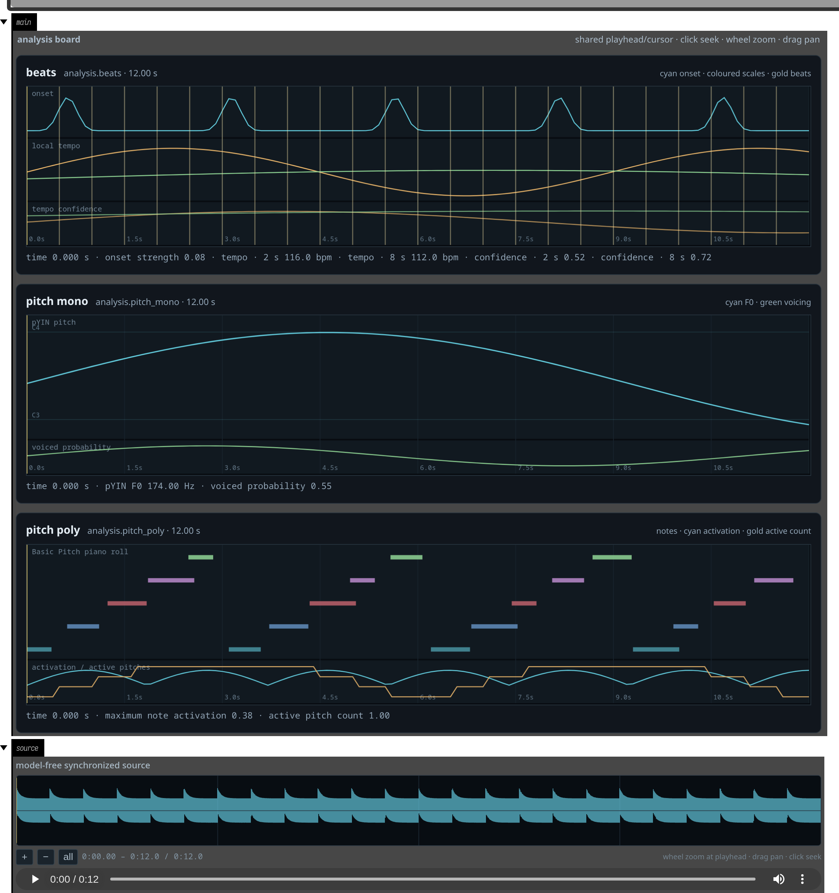

# Beat and pitch analysis: from source to synchronized views

Field Audio's analysis path uses the same durable, cached job system as generation. The source
recording remains immutable; a request names an exact `AssetRegion`; progress is available both as
WebSocket events and in the embedded job monitor; the completed result points to a compressed NPZ
asset rather than placing a large tensor in Field's output JSON.

The current isolated worker contains three operations:

| Field operation | Implementation | What comes back |
| --- | --- | --- |
| `analysis.beats` | librosa beat tracking and multi-window tempograms | onset envelope, beat markers, local BPM and confidence at every requested scale |
| `analysis.pitch_mono` | librosa pYIN | monophonic F0, MIDI pitch, voiced flag and voiced probability |
| `analysis.pitch_poly` | Spotify Basic Pitch | note events, activation tensors, pitch bends and a MIDI artifact |

Essentia is not yet imported into this worker. Field4 and Field Audio AI are AGPL-3.0-or-later, so
Essentia's AGPL license is compatible; a separate worker remains useful for dependency and runtime
isolation rather than licensing avoidance. The model-neutral operation and result types below do
not need to change when it is added.

## The views

Every panel uses a bounded preview of at most 4096 points. Full-resolution arrays stay in NPZ. The
beat view separates onset, tempo and confidence lanes; pYIN shows pitch against a note grid with its
voicing track; Basic Pitch combines a piano roll with maximum activation and active-pitch count.
Hover, zoom and pan one panel and the others follow. A live board can join the source player on the
same shared timeline: playback drives every analysis cursor, hovering either surface highlights the
other, and clicking an analysis plot seeks the recording.

```diffstatic_runner {data-lang=kotlin screenshot="assets/audio_ai_analysis/synchronized_analysis.png" wait="2" capture="box" open-outputs="true" padding="18"}
:::static
import afield.stdlib.*
import afield.stdlib.noir.audioai.*

val demoSync = "analysis-doc-demo"
val demoRate = 8_000
val demoAudio = FloatArray(demoRate * 12) { i ->
    val time = i / demoRate.toDouble()
    val pulse = .32 * kotlin.math.exp(-18.0 * (time % .5))
    (.38 * kotlin.math.sin(2.0 * Math.PI * (174.0 + 22.0 * kotlin.math.sin(time * .34)) * time) + pulse).toFloat()
}
display("source", AudioVisualizer.renderSamplesHtml(
    demoAudio, demoRate,
    AudioVisualizerOptions(width = 1100, waveformHeight = 95, syncGroup = demoSync),
    label = "model-free synchronized source",
))

val t = (0..120).map { it / 10.0 }
fun s(name: String, label: String, values: List<Double>, unit: String? = null) =
    AnalysisSeries(name, label, unit, t.map { it as Double? }, values.map { it as Double? })

val beats = AnalysisPreview("analysis.beats", 12.0, listOf(
    s("onset_strength", "onset strength", t.map { .08 + .8 * Math.pow(kotlin.math.max(0.0, kotlin.math.sin(it * 2.5)), 8.0) }),
    s("tempo_0_bpm", "tempo · 2 s", t.map { 116.0 + 14.0 * kotlin.math.sin(it * .7) }, "bpm"),
    s("tempo_1_bpm", "tempo · 8 s", t.map { 112.0 + 5.0 * kotlin.math.sin(it * .22) }, "bpm"),
    s("tempo_0_confidence", "confidence · 2 s", t.map { .52 + .34 * kotlin.math.sin(it * .4) }),
    s("tempo_1_confidence", "confidence · 8 s", t.map { .72 + .15 * kotlin.math.sin(it * .18) }),
), beatTimesSeconds = (1..23).map { it * .5 })
val mono = AnalysisPreview("analysis.pitch_mono", 12.0, listOf(
    s("frequency_hz", "pYIN F0", t.map { 174.0 * Math.pow(2.0, 7.0 * kotlin.math.sin(it * .34) / 12.0) }, "Hz"),
    s("voiced_probability", "voiced probability", t.map { .55 + .42 * kotlin.math.sin(it * .57) }),
))
val poly = AnalysisPreview("analysis.pitch_poly", 12.0, listOf(
    s("maximum_note_activation", "maximum note activation", t.map { .38 + .5 * kotlin.math.abs(kotlin.math.sin(it * 1.7)) }),
    s("active_pitch_count", "active pitch count", t.map { 1.0 + kotlin.math.floor(4.0 * kotlin.math.abs(kotlin.math.sin(it * .52))) }),
), notes = (0 until 19).map { i ->
    val start = i * .62
    AnalysisNote(start, start + .38 + (i % 4) * .11, 48 + (i * 5) % 25, .45 + (i % 5) * .1)
})

display("main", analysisPreviewDashboardHtml(
    listOf(beats, mono, poly), width = 1100, panelHeight = 220, syncGroup = demoSync,
))
```



## Submit, monitor, await, visualize

This is the complete live-coding path. It deliberately shows each boundary rather than hiding job
submission in setup code. The source waveform appears immediately; the persistent monitor and
three replace-in-place status cards remain useful while the worker runs; only terminal successful
jobs are turned into an analysis board.

```diffstatic {data-lang=kotlin}
import afield.stdlib.AudioVisualizerOptions
import afield.stdlib.noir.audioai.*
import java.util.concurrent.CompletableFuture

val client = FieldAudioClient()
val start = 18.0
val duration = 24.0
val timeSync = "nancy-analysis"
display("all jobs", fieldAudioJobMonitor(heightPixels = 330))

client.assetByFilename("*Nancy*").thenCompose { source ->
    val region = AssetRegion(source.id, start, duration)
    val canonical = source.representations.first { it.role == "canonical_project" }
    display("source", canonical.audioVisualizerHtml(
        label = "Nancy · 18–42 s",
        options = AudioVisualizerOptions(
            initialStartSeconds = start,
            initialDurationSeconds = duration,
            initialPositionSeconds = start,
            syncGroup = timeSync,
        ),
    ))

    val requests = listOf(
        "beats" to multiScaleBeatAnalysis(region, requestedBy = "field:analysis-example"),
        "monophonic pitch" to monophonicPitchAnalysis(region, requestedBy = "field:analysis-example"),
        "polyphonic pitch" to polyphonicPitchAnalysis(region, requestedBy = "field:analysis-example"),
    )
    val futures = requests.map { (label, request) ->
        client.submit(request).thenCompose { accepted ->
            display("$label job", fieldAudioJobStatusHtml(accepted))
            client.watch(accepted.jobId) { event ->
                display("$label job", fieldAudioJobStatusHtml(accepted, event))
            }
            client.awaitAnalysis(accepted)
        }
    }
    CompletableFuture.allOf(*futures.toTypedArray()).thenApply {
        futures.map { it.join() }
    }
}.thenAccept { results ->
    display("analysis", analysisDashboardHtml(
        results, panelHeight = 250,
        syncGroup = timeSync, timeOffsetSeconds = start,
    ))
}.exceptionally { error ->
    display("analysis error", error.cause?.message ?: error.message ?: error.toString())
    null
}
```

An unchanged request still goes through `submit` and `awaitAnalysis`, but the service resolves it to
the content-addressed cached result. Change the source range or an algorithm parameter to create a
new operation. `AnalysisResult.data` is the complete NPZ representation;
`AnalysisResult.artifacts` includes Basic Pitch MIDI where applicable; `client.download(...)`
copies either immutable asset when local numerical work needs the full resolution.

The loadable `audio_ai_analysis` operation transcript contains this live box, a persistent monitor,
and a model-free synchronized gallery. Continue with the [general audio visualizers](visualizers.md#beat-and-pitch-analysis-views)
or the [gesture board](audio_ai_gesture_board.md).
