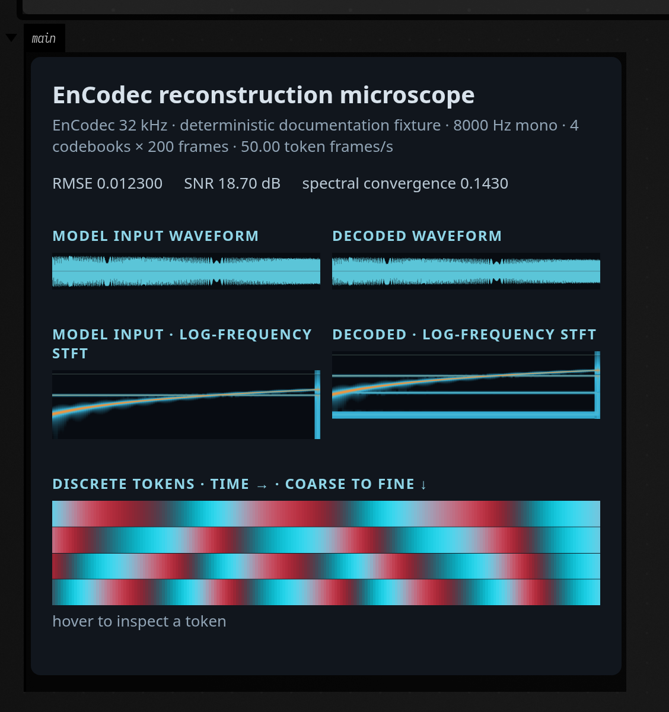

# EnCodec reconstruction microscope

Field keeps codec tokens visible as compositional data. A `codec.reconstruct` operation produces an
immutable model-native input, an NPY token tensor, a model-native reconstruction, a 48 kHz audition
proxy, reconstruction metrics, and full model provenance. The renderer below is the same
`afield.stdlib.noir.audioai.CodecVisualization` used for service results; this executable example supplies a
deterministic fixture so the public documentation does not require a GPU worker.

```diffstatic_runner {data-lang=kotlin screenshot="assets/audio_ai_codec/reconstruction_microscope.png" wait="3" capture="box" open-outputs="true" padding="20"}
:::static
import afield.stdlib.noir.audioai.*

val sampleRate = 8000
val seconds = 4.0
val source = FloatArray((sampleRate * seconds).toInt()) { i ->
    val t = i / sampleRate.toDouble()
    val chirp = sin(2.0 * PI * (180.0 * t + 110.0 * t * t))
    val room = 0.28 * sin(2.0 * PI * 720.0 * t) * exp(-0.16 * t)
    (0.62 * chirp + room + 0.025 * sin(2.0 * PI * 3100.0 * t)).toFloat()
}
val reconstruction = FloatArray(source.size) { i ->
    val softened = source[i] * 0.91f
    val codecTexture = (0.008 * sin(i * 0.173) + 0.004 * sin(i * 0.037)).toFloat()
    softened + codecTexture
}
val tokenFrames = (seconds * 50).toInt()
val tokenValues = LongArray(4 * tokenFrames) { i ->
    val codebook = i / tokenFrames
    val frame = i % tokenFrames
    ((frame * (31 + codebook * 8) + 173 * codebook + 97 * sin(frame * 0.11)).toLong() and 2047)
}
val data = CodecVisualizationData(
    source = source,
    reconstruction = reconstruction,
    sampleRate = sampleRate,
    tokens = NpyIntTensor(intArrayOf(1, 4, tokenFrames), tokenValues),
    metrics = ReconstructionMetrics(rmse = 0.0123, snrDb = 18.7, spectralConvergence = 0.143),
    frameRate = 50.0,
    cardinality = 2048,
    codecLabel = "EnCodec 32 kHz · deterministic documentation fixture",
)
display("main", CodecVisualization.renderHtml(data, width = 1100))
```



For a live result, submit `codecReconstruction(region)`, await it with
`client.awaitCodec(accepted)`, then call `client.codecVisualizationHtml(result, cacheDirectory)`.
The comparison uses the 32 kHz mono model input and native reconstruction so the waveforms and
log-frequency STFTs remain exactly aligned; the 48 kHz proxy remains a separately labelled audition
asset. Both waveform players use the general `AudioVisualizer`: click to seek, drag to pan, use the
wheel to zoom, and follow the optional vertical playhead during playback.
