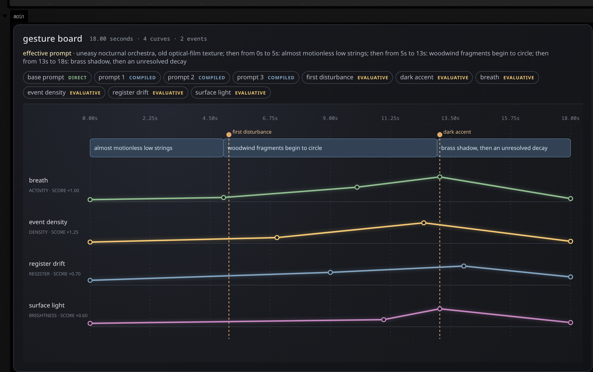

# Gesture board: drawing toward a sound

Eighteen seconds of a piece nobody has heard yet: low strings that barely move, woodwind fragments
circling in around the fifth second, a dark accent pinned at 13.1, a curve for how busy the middle
gets. That drawing, typed, is a `gestureBoard`, and a generator works toward it from a few seconds
of a recording that already exists, one candidate per seed.

Only some of the drawing reaches the MusicGen-Style worker as a condition. The rest is measured
against what comes back:

- the base prompt is a **direct** global text condition;
- prompt regions are **compiled** into time-worded global text;
- activity, density, register and brightness curves are **evaluative** targets;
- events reward an onset near the marked time.

After each candidate is generated, the service measures its waveform, compares the measured
trajectories with the board, and stores an overall score plus every lane score in the candidate's
provenance. The candidate browser exposes those scores without removing manual listening, rating
or selection.

```diffstatic_runner {data-lang=kotlin screenshot="assets/audio_ai_gesture_board/gesture_board.png" wait="3" capture="box" open-outputs="true" padding="20"}
:::static
import afield.stdlib.noir.audioai.*

val sketch = gestureBoard(18.0, "uneasy nocturnal orchestra, old optical-film texture") {
    prompt(0.0, 5.0, "almost motionless low strings")
    prompt(5.0, 8.0, "woodwind fragments begin to circle")
    prompt(13.0, 5.0, "brass shadow, then an unresolved decay")

    event(5.2, "first disturbance", strength = 0.45)
    event(13.1, "dark accent", strength = 0.92, weight = 1.6)

    curve("breath", GestureCurveKind.ACTIVITY) {
        point(0.0, 0.08); point(5.0, 0.16); point(10.0, 0.55)
        point(13.1, 0.94); point(18.0, 0.12)
    }
    curve("event density", GestureCurveKind.DENSITY, weight = 1.25) {
        point(0.0, 0.05); point(7.0, 0.22); point(12.5, 0.78); point(18.0, 0.08)
    }
    curve("register drift", GestureCurveKind.REGISTER, weight = 0.7) {
        point(0.0, 0.18); point(9.0, 0.48); point(14.0, 0.72); point(18.0, 0.31)
    }
    curve("surface light", GestureCurveKind.BRIGHTNESS, weight = 0.6) {
        point(0.0, 0.13); point(11.0, 0.27); point(13.1, 0.68); point(18.0, 0.16)
    }
}

display("main", gestureBoardHtml(sketch, width = 1100))
```



The shared vertical cursor reports time across every lane. Hover event needles and curve points to
inspect their values. The delivery pills above the timeline show whether a mark is direct,
compiled, evaluative or transformative.

## Generate from the sketch

Use the same typed board in a normal Field request:

```diffstatic {data-lang=kotlin}
val client = FieldAudioClient()
val source = client.assetByFilename("*Nancy*").get()
val region = AssetRegion(source.id, startSeconds = 18.0, durationSeconds = 4.5)

val operation = gestureCandidates(
    source = region,
    board = sketch,
    seeds = 0L until 8L,
    controls = MusicGenStyleControls(temperature = 1.08, topK = 180, cfg = 3.1),
)

client.submit(operation)
    .thenCompose(client::awaitCandidates)
    .thenAccept { candidates ->
        display("gesture", gestureBoardHtml(sketch, candidates = candidates))
        display("audition", candidateBoardHtml(candidates))
    }
```

`client.compileGesture(sketch)` asks the server for its authoritative compilation before spending
GPU time. Re-evaluating an unchanged operation reuses the same content-addressed candidate family
and its stored gesture measurements.

The loadable starting document is recorded as the `audio_ai_gesture_board` operation transcript.
Continue with the [EnCodec reconstruction microscope](audio_ai_codec.md) for token-level material.
