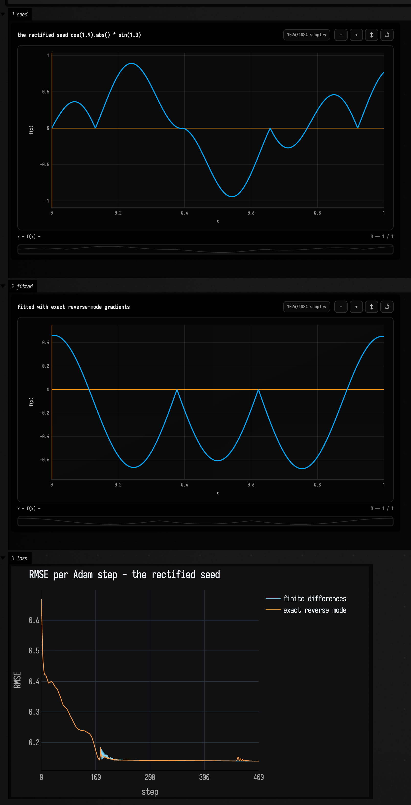
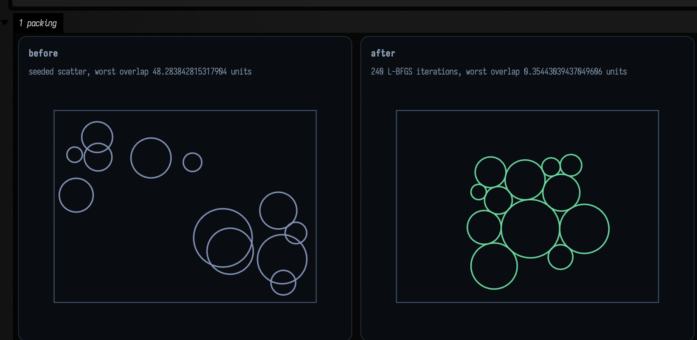

# Differentiating Functions

Field computes exact derivatives of the code you write, by automatic differentiation. Reverse mode
over `Double` gives gradients, second-order forward mode gives curvature, and SGD, Adam and L-BFGS
minimize using either. An `Fn` built from stdlib parts can be differentiated too, with respect to
its own numeric parameters.

## One expression, three ways of differentiating it

`AD` is a `Double` that remembers how it was made. Arithmetic on it appends to a tape; a single
backward sweep reads off every derivative at once. `grad { }` returns a function, so you can hand it
straight to an optimizer.

`Dual2` works the other way around, carrying a value with its first and second derivatives
`(v, v', v'')` along a single direction. Use it when there is one input and many outputs; it is also
what makes `hessian` exact. The second derivative comes with the forward pass, so all three curves
below come from one sweep.

```diffstatic_runner {data-lang=kotlin screenshot="assets/autodiff_examples/derivatives.png" wait="2.5" capture="box" open-outputs="true" w="1000" h="600" padding="16"}
:::static
// The same expression, differentiated by a tape sweep, by a Taylor number, and by a central
// difference. If any two of them disagree, one of them is wrong.
val xs = (0..300).map { it / 300.0 * 2.0 - 1.0 }
val taylor = xs.map { x -> taylor2(x) { u -> exp(-u * u) * sin(6.0 * u) } }
val reverse = xs.map { x -> derivative(x) { u -> exp(-u * u) * sin(6.0 * u) } }
val oracle = xs.map { x ->
    val plain = { u: Double -> kotlin.math.exp(-u * u) * kotlin.math.sin(6.0 * u) }
    (plain(x + 1e-6) - plain(x - 1e-6)) / 2e-6
}

// The exact Hessian of Rosenbrock: one Dual2 pass gives vT H v, and polarisation recovers the
// off-diagonals. Not a finite difference of a gradient.
val h = hessian(doubleArrayOf(-1.2, 1.0)) { p -> (1.0 - p[0]).sq() + 100.0 * (p[1] - p[0].sq()).sq() }
val g = grad { p: List<AD> -> (1.0 - p[0]).sq() + 100.0 * (p[1] - p[0].sq()).sq() }
:::fold draw the three orders and report the agreement
showSignals(
    "f" to taylor.map { it.value },
    "f' (reverse mode)" to reverse,
    "f'' (forward mode)" to taylor.map { it.second },
    x = xs,
    title = "exp(-x^2)*sin(6x), its slope and its curvature - one sweep, three orders",
    xTitle = "x"
)
val worstPair = xs.indices.maxOf { kotlin.math.abs(taylor[it].first - reverse[it]) }
val worstOracle = xs.indices.maxOf { kotlin.math.abs(reverse[it] - oracle[it]) }
val agreement =
    "grad Rosenbrock at (-1.2, 1.0) = " + g(doubleArrayOf(-1.2, 1.0)).toList() + "\n" +
    "exact Hessian there            = [[" + h[0][0] + ", " + h[0][1] + "], [" + h[1][0] + ", " + h[1][1] + "]]\n" +
    "forward vs reverse f', worst of 301 samples: " + worstPair + "\n" +
    "reverse vs central difference,  worst of 301: " + worstOracle
markdown("agreement", """
    ~~~
$agreement
    ~~~
""")
:::endfold
```


Check it by hand. `∂f/∂x = -2(1-x) - 400x(y-x²)` and `∂f/∂y = 200(y-x²)`, so at `(-1.2, 1)` the
gradient is `[-215.6, -88]`, which is what the panel reads. The Hessian is
`[[2 - 400(y-x²) + 800x², -400x], [-400x, 200]]` = `[[1330, 480], [480, 200]]`, which is what
`hessian` prints. Forward and reverse mode agree to rounding error. The larger disagreement with the
central difference on the last line comes from the finite difference.

## Three descents, one valley

`minimize` runs SGD with momentum, Adam, or L-BFGS with a line search, on the same exact gradients.
Each run is deterministic and records its loss at every step, starting from the initial guess, so
you can plot it directly.

Rosenbrock's curved valley shows the difference between them. L-BFGS builds a model of the
curvature from its last few steps and walks along the valley; SGD and Adam have no such model and
zig-zag across it.

```diffstatic_runner {data-lang=kotlin screenshot="assets/autodiff_examples/optimizers.png" wait="2.5" capture="box" open-outputs="true" w="1000" h="600" padding="16"}
:::static
val rosenbrock: (List<AD>) -> AD = { p -> (1.0 - p[0]).sq() + 100.0 * (p[1] - p[0].sq()).sq() }
val start = doubleArrayOf(-1.2, 1.0)
val quiet = OptimizeOptions(iterations = 300, showProgress = false)

val sgdRun = minimize(start, quiet.copy(method = OptimizeMethod.SGD, learningRate = 0.0012, momentum = 0.92), rosenbrock)
val adamRun = minimize(start, quiet.copy(method = OptimizeMethod.ADAM, learningRate = 0.05), rosenbrock)
val lbfgsRun = minimize(start, quiet.copy(method = OptimizeMethod.LBFGS), rosenbrock)
:::fold plot log10 loss - the range spans 30 orders of magnitude
fun logLoss(values: List<Double>) = values.map { kotlin.math.log10(kotlin.math.max(it, 1e-32)) }
showSignals(
    "SGD + momentum" to logLoss(sgdRun.losses),
    "Adam" to logLoss(adamRun.losses),
    "L-BFGS" to logLoss(lbfgsRun.losses),
    title = "log10 Rosenbrock loss per iteration, from (-1.2, 1.0)",
    xTitle = "iteration",
    yTitle = "log10 loss"
)
fun report(label: String, run: OptimizeRun) =
    label.padEnd(15) + " value " + run.value + " after " + run.iterations +
    " iterations / " + run.evaluations + " evaluations (" + run.reason + ")"
val results = report("SGD+momentum", sgdRun) + "\n" + report("Adam", adamRun) + "\n" + report("L-BFGS", lbfgsRun)
markdown("results", """
    ~~~
$results
    ~~~
""")
:::endfold
```


The L-BFGS curve ends early because it converged. `OptimizeRun.reason` says why a run stopped:
`gradient`, `step`, `line search` or `max iterations`. Check it before trusting a result, since
`max iterations` means the run ran out of budget.

## Differentiating an `Fn` graph

Every `Fn` the stdlib builds carries a graph of the operations that made it, and Field can
differentiate that graph. So when you fit an `Fn` to a target, the gradient of the error with
respect to its numeric parameters is exact.

The example runs the same `fitGradient` twice, once with finite-difference gradients and once with
exact ones. The optimizer, step size and target are the same.

```diffstatic_runner {data-lang=kotlin screenshot="assets/autodiff_examples/exact_fit.png" wait="3.0" capture="box" open-outputs="true" w="1000" h="1000" padding="16"}
:::static
with(Functions) {
    val target = cos(2) * sin(1.5, amplitude = 0.8, offset = 0.2)
    val seed = cos(1.9) * sin(1.3, amplitude = 1.0)

    val fd = fitGradient(target, seed, iterations = 400, lr = 0.05)
    val exact = fitGradient(target, seed, iterations = 400, lr = 0.05, gradient = FnGradientMode.EXACT)

    // The exact path never trusts itself: it re-checks its own interpretation against Fn.eval on the
    // loss grid before switching over. Ask it why a piecewise oscillator is refused.
    val refusal = exactFitRefusal(target, valueNoise(3L, 2.0, 0.8), Functions.Domain.DEFAULT)
:::fold draw target, fit and both loss trajectories
    plot(target, channel = "1 target", title = "target   cos(2) * sin(1.5)")
    plot(exact.fitted, channel = "2 fitted", title = "fitted, exact reverse-mode gradients")
    showSignals(
        "finite differences" to fd.losses,
        "exact reverse mode" to exact.losses,
        channel = "3 loss",
        title = "RMSE per Adam step - same optimiser, different gradient",
        xTitle = "step", yTitle = "RMSE"
    )
    // The refusal names every differentiable op in one long line; wrap it at commas.
    fun wrap(text: String, at: Int = 96): String {
        val out = StringBuilder()
        var column = 0
        for ((i, piece) in text.split(", ").withIndex()) {
            val token = if (i == 0) piece else ", $piece"
            if (column + token.length > at) { out.append(",\n     ").append(piece); column = 5 + piece.length }
            else { out.append(token); column += token.length }
        }
        return out.toString()
    }
    val numbers =
        "finite differences: RMSE " + fd.initialError + " -> " + fd.finalError + " in " + fd.evaluations + " loss evaluations\n" +
        "exact reverse mode: RMSE " + exact.initialError + " -> " + exact.finalError + " in " + exact.evaluations + " loss evaluations\n" +
        "a valueNoise seed is refused, with a reason:\n  " + wrap(refusal ?: "(none)")
    markdown("4 numbers", """
        ~~~
$numbers
        ~~~
    """)
:::endfold
}
```


The exact run reaches a lower error with an eighth of the loss evaluations. It is somewhat faster,
though not eight times faster, because recording the derivative costs time too. It also leaves no
`fdStep` to tune, and it needs one sweep per step however many parameters there are, where finite
differences need two evaluations per parameter.

The last line of the figure shows a function being refused. Only 41<!--count:differentiableFnOpsOnExamplesPage-->
of `OpRegistry`'s 127<!--count:canonicalFnOpsOnExamplesPage--> canonical ops have a derivative; the
burst and pattern pulse generators, the seeded noise generators, the table-backed interpolants and the windowed
numeric operators do not. `FnGradientMode.EXACT` throws with the reason, `FnGradientMode.AUTO` falls
back to finite differences, and `FnFitRun.usedExactGradient` tells you which happened.

An op can be differentiated when its formula is stored in the graph. One built with
`Fn.mapY { … }` cannot, because `mapY` stores a Kotlin lambda that Field cannot look inside. So
`abs` is differentiable, while a `mapY { … }` of your own is refused however simple it is.

At its corner at zero, `abs` reports a derivative of `0`, halfway between the slopes on either
side. A central difference reports the same value there, so the two methods agree at the corner too.

A differentiable starting function can still fit badly. Swap the seed above for
`cos(1.9).abs() * sin(1.3, amplitude = 1.0)` and the exact path runs, but the error levels off
around 0.14, where the smooth seed reached about 0.01, and more iterations barely help. The `abs`
creates a local minimum, and gradient descent cannot climb out of one.

```diffstatic_runner {data-lang=kotlin screenshot="assets/autodiff_examples/abs_seed.png" wait="3.0" capture="box" open-outputs="true" w="1000" h="900" padding="16"}
:::static
with(Functions) {
    val target = cos(2) * sin(1.5, amplitude = 0.8, offset = 0.2)

    // The seed from the figure above, rectified.
    val kinked = cos(1.9).abs() * sin(1.3, amplitude = 1.0)

    val fd = fitGradient(target, kinked, iterations = 400, lr = 0.05)
    val exact = fitGradient(target, kinked, iterations = 400, lr = 0.05, gradient = FnGradientMode.EXACT)
:::fold plot the seed, the fit and both loss curves
    plot(kinked, channel = "1 seed", title = "the rectified seed   cos(1.9).abs() * sin(1.3)")
    plot(exact.fitted, channel = "2 fitted", title = "fitted with exact reverse-mode gradients")
    showSignals(
        "finite differences" to fd.losses,
        "exact reverse mode" to exact.losses,
        channel = "3 loss",
        title = "RMSE per Adam step - the rectified seed",
        xTitle = "step",
        yTitle = "RMSE"
    )
:::endfold
    "refused now? " + (exactFitRefusal(target, kinked, Functions.Domain.DEFAULT) ?: "no - accepted") + "\n" +
    "finite differences: RMSE " + fd.finalError + " in " + fd.evaluations + " loss evaluations\n" +
    "exact reverse mode:  RMSE " + exact.finalError + " in " + exact.evaluations + " loss evaluations\n" +
    "sign is still refused: " +
        (exactFitRefusal(target, cos(1.9).sign() * sin(1.3), Functions.Domain.DEFAULT) ?: "no")
}
```



In the previous figure, exact gradients reached a lower error. Here the two loss curves lie on top
of each other and both flatten early; the exact run just gets there with far fewer loss
evaluations. The last line of the panel shows `sign` being refused: its derivative is zero
everywhere it exists, so a fit would never move.

## Inverse kinematics on a chain of links

The position of the tip of a chain of links is a running sum of joint angles and link vectors, which
is differentiable. So finding the joint angles that put the tip on a target is L-BFGS on
`|tip - target|²`, and the result is an `FLine` you can draw.

```diffstatic_runner {data-lang=kotlin screenshot="assets/autodiff_examples/inverse_kinematics.png" wait="3.0" capture="box" open-outputs="true" w="1000" h="560" padding="16"}
:::static
val chain = IkChain(vec(120.0, 300.0), doubleArrayOf(90.0, 80.0, 70.0, 55.0))
val target = vec(330.0, 150.0)
val solved = solveIk(chain, target)
val smoothed = solveIk(chain, target, options = IkOptions(smoothness = 2.0))
:::fold three poses in one shared window
fun marker(p: Vec2, r: Double) = fline {
    moveTo(p.x - r * 1.7, p.y); lineTo(p.x - r * 0.5, p.y)
    moveTo(p.x + r * 0.5, p.y); lineTo(p.x + r * 1.7, p.y)
    moveTo(p.x, p.y - r * 1.7); lineTo(p.x, p.y - r * 0.5)
    moveTo(p.x, p.y + r * 0.5); lineTo(p.x, p.y + r * 1.7)
    for (i in 0..40) {
        val a = i / 40.0 * Math.PI * 2.0
        if (i == 0) moveTo(p.x + r * kotlin.math.cos(a), p.y + r * kotlin.math.sin(a))
        else lineTo(p.x + r * kotlin.math.cos(a), p.y + r * kotlin.math.sin(a))
    }
    color = vec(1.0, 0.42, 0.3, 1.0)
    thickness = 2.0
}
fun pose(line: FLine, r: Double, g: Double, b: Double) = line.apply {
    color = vec(r, g, b, 1.0); thickness = 3.5; pointed = true; pointSize = 3.0
}
val cross = marker(target, 26.0)
showPlaneGrid(
    "start pose\nall four joint angles zero" to
        listOf(pose(chain.toFLine(DoubleArray(chain.linkCount)), 0.45, 0.55, 0.72), cross),
    "solved\nreach error " + solved.reachError + " units, " + solved.run.iterations + " L-BFGS iterations" to
        listOf(pose(chain.toFLine(solved.angles), 0.42, 0.86, 0.58), cross),
    "smoothness = 2.0\nstraighter, and it costs " + smoothed.reachError + " units of reach" to
        listOf(pose(chain.toFLine(smoothed.angles), 0.98, 0.86, 0.32), cross),
    columns = 3, cellWidth = 280, window = Rect(40.0, 60.0, 400.0, 320.0)
)
:::endfold
```


The tip lands inside the reticle. The third panel adds `IkOptions.smoothness`: the pose straightens,
but the tip lands further from the target, which is why the default is `0.0`. Near the base, where
reaching needs tight folds, a smooth chain will stop short. `IkSolution.reachError` tells you how
far.

## A packing that descends instead of relaxing

Circle packing is usually written as a relaxation loop: look for overlaps, nudge them apart, repeat.
Here it is written as a loss and minimized instead. The overlap of two discs is
`relu(r₁ + r₂ − distance)²`, zero while they are apart and growing quadratically once they overlap.
The walls work the same way. Every term is differentiable, so L-BFGS can minimize the whole thing.

```diffstatic_runner {data-lang=kotlin screenshot="assets/autodiff_examples/packing.png" wait="3.0" capture="box" open-outputs="true" w="1000" h="620" padding="16"}
:::static
val radii = doubleArrayOf(38.0, 32.0, 30.0, 26.0, 24.0, 22.0, 20.0, 18.0, 16.0, 14.0, 12.0, 10.0)
val boxWidth = 340.0
val boxHeight = 250.0
val packing = packCircles(radii, boxWidth, boxHeight, rngSeed = 5L)

// run.initialX is the seeded scatter the descent actually started from, so "before" is not a re-roll.
val before = radii.indices.map {
    PackedCircle(vec(packing.run.initialX[2 * it], packing.run.initialX[2 * it + 1]), radii[it])
}
:::fold draw both states in one shared window
fun frame() = fline {
    moveTo(0.0, 0.0); lineTo(boxWidth, 0.0); lineTo(boxWidth, boxHeight); lineTo(0.0, boxHeight)
    close(); color = vec(0.36, 0.44, 0.56, 0.7); thickness = 1.2
}
fun rings(circles: List<PackedCircle>, r: Double, g: Double, b: Double) = circles.map {
    it.toFLine(52).apply { color = vec(r, g, b, 0.95); thickness = 1.8 }
}
fun worstOverlapOf(circles: List<PackedCircle>): Double {
    var worst = 0.0
    for (i in circles.indices) for (j in i + 1 until circles.size) {
        val d = kotlin.math.hypot(
            (circles[i].centre.x - circles[j].centre.x).toDouble(),
            (circles[i].centre.y - circles[j].centre.y).toDouble()
        )
        worst = kotlin.math.max(worst, circles[i].radius + circles[j].radius - d)
    }
    return worst
}
showPlaneGrid(
    "before\nseeded scatter, worst overlap " + worstOverlapOf(before) + " units" to
        (rings(before, 0.52, 0.58, 0.72) + frame()),
    "after\n" + packing.run.iterations + " L-BFGS iterations, worst overlap " + packing.worstOverlap + " units" to
        (rings(packing.circles, 0.42, 0.86, 0.62) + frame()),
    channel = "1 packing", columns = 2, cellWidth = 380,
    window = Rect(-20.0, -20.0, boxWidth + 40.0, boxHeight + 40.0)
)
:::endfold
"worst pairwise overlap " + worstOverlapOf(before) + " -> " + packing.worstOverlap + " units\n" +
"worst escape beyond the wall: " + packing.worstEscape + " units\n" +
"loss " + packing.run.initialValue + " -> " + packing.run.value +
" in " + packing.run.iterations + " iterations (" + packing.run.reason + ")"
```



A little overlap remains, because a gentle pull toward the centre works against the overlap term and
the result is where the two balance. Set `pullWeight` to `0.0` and the overlap goes, and so does the
compactness. The halfway derivative at a corner, described for `abs` above, matters here: when two
discs just touch, the discs settle into contact instead of bouncing in and out of it.

## Where to go next

- The [`autodiff_worked_example`](agent_transcripts.md#autodiff_worked_example) starting point is
  this page as a document you can edit and re-run.

??? aside "Developer notes"
    [`dev_docs/autodiff.md`](https://github.com/OpenEndedGroup/Field4/blob/main/dev_docs/autodiff.md) covers the tape layout, the corner convention, how `Fn` graphs are
    differentiated and when that returns `null`, and what is not covered.
