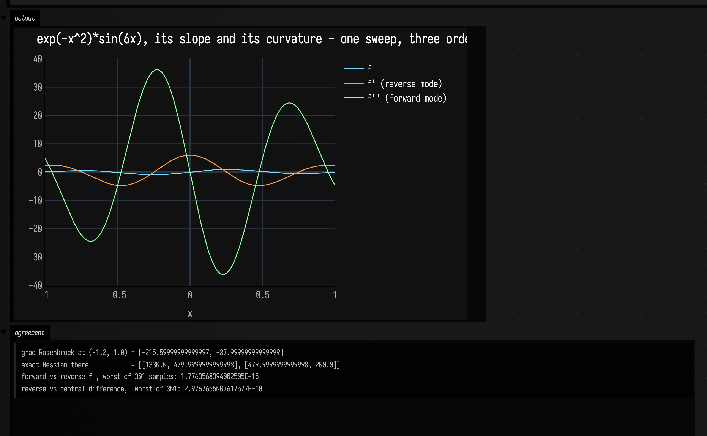
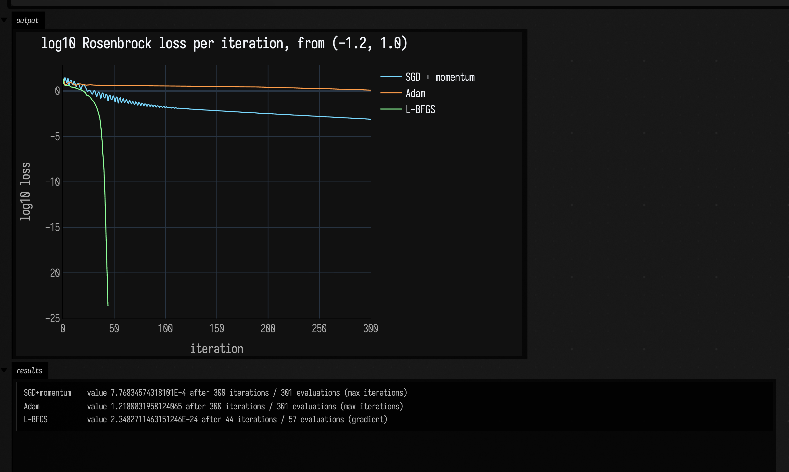
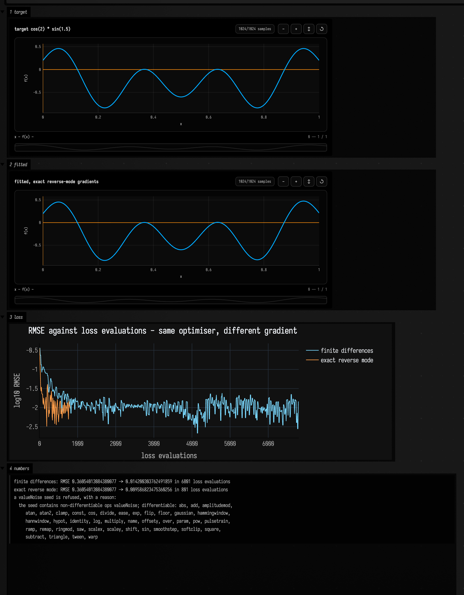
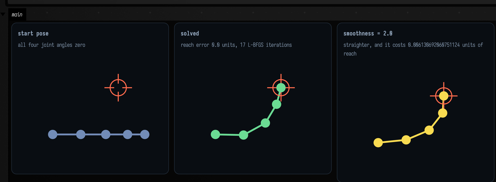

# Differentiating Functions

Field's gradients used to be numerical, all of them. `fitGradient` central-differenced its loss and
`leastSquares` central-differenced its Jacobian — `2n` extra evaluations per step and an `fdStep` you
had to guess. This page is the layer that replaced that: reverse-mode automatic differentiation over
`Double`, second-order forward mode beside it, three optimizers on top, and — the part that makes it a
*Field* capability rather than a library — the ability to differentiate an `Fn` graph itself.

Every figure below is executed when this page is built, so the numbers under each one are what the code
actually produced.

## One expression, three ways of differentiating it

`AD` is a `Double` that remembers how it was made. Arithmetic on it appends to a tape; a single
backward sweep reads off every derivative at once. `grad { }` returns a *function*, so it composes with
the optimizers rather than needing a wrapper.

`Dual2` is the other direction — a truncated Taylor number `(v, v', v'')` carried along one direction.
It is the right tool when there is one input and many outputs, and it is what makes `hessian` exact
rather than a finite difference of an exact gradient. Because the second derivative comes free with the
forward pass, all three curves below are one sweep.

```diffstatic_runner {data-lang=kotlin screenshot="assets/autodiff_examples/derivatives.png" wait="2.5" capture="box" open-outputs="true" w="1000" h="600" padding="16"}
:::static
// The same expression, differentiated by a tape sweep, by a Taylor number, and by a central
// difference. If any two of them disagree, one of them is wrong.
val xs = (0..300).map { it / 300.0 * 2.0 - 1.0 }
val taylor = xs.map { x -> taylor2(x) { u -> exp(-u * u) * sin(6.0 * u) } }
val reverse = xs.map { x -> derivative(x) { u -> exp(-u * u) * sin(6.0 * u) } }
val oracle = xs.map { x ->
    val plain = { u: Double -> kotlin.math.exp(-u * u) * kotlin.math.sin(6.0 * u) }
    (plain(x + 1e-6) - plain(x - 1e-6)) / 2e-6
}

// The exact Hessian of Rosenbrock: one Dual2 pass gives vT H v, and polarisation recovers the
// off-diagonals. Not a finite difference of a gradient.
val h = hessian(doubleArrayOf(-1.2, 1.0)) { p -> (1.0 - p[0]).sq() + 100.0 * (p[1] - p[0].sq()).sq() }
val g = grad { p: List<AD> -> (1.0 - p[0]).sq() + 100.0 * (p[1] - p[0].sq()).sq() }
:::fold draw the three orders and report the agreement
showSignals(
    "f" to taylor.map { it.value },
    "f' (reverse mode)" to reverse,
    "f'' (forward mode)" to taylor.map { it.second },
    x = xs,
    title = "exp(-x^2)*sin(6x), its slope and its curvature - one sweep, three orders",
    xTitle = "x"
)
val worstPair = xs.indices.maxOf { kotlin.math.abs(taylor[it].first - reverse[it]) }
val worstOracle = xs.indices.maxOf { kotlin.math.abs(reverse[it] - oracle[it]) }
display("agreement", "<pre style='font-family:monospace;font-size:11px;color:#7f92a8'>" +
    "grad Rosenbrock at (-1.2, 1.0) = " + g(doubleArrayOf(-1.2, 1.0)).toList() + "\n" +
    "exact Hessian there            = [[" + h[0][0] + ", " + h[0][1] + "], [" + h[1][0] + ", " + h[1][1] + "]]\n" +
    "forward vs reverse f', worst of 301 samples: " + worstPair + "\n" +
    "reverse vs central difference,  worst of 301: " + worstOracle + "</pre>")
:::endfold
```



Check it by hand. `∂f/∂x = -2(1-x) - 400x(y-x²)` and `∂f/∂y = 200(y-x²)`, so at `(-1.2, 1)` the
gradient is `[-215.6, -88]` — which is what the panel reads, to the last ulp. The Hessian is
`[[2 - 400(y-x²) + 800x², -400x], [-400x, 200]]` = `[[1330, 480], [480, 200]]`, and that is what one
`Dual2` pass per axis plus polarisation produced, exactly. Forward and reverse agree on `f'` to
1.8·10⁻¹⁵ despite sharing no code, and reverse agrees with the central difference to 3·10⁻¹⁰ — which is
the *oracle's* accuracy, not the gradient's.

## Three descents, one valley

`minimize` runs SGD with momentum, Adam, or a line-searched L-BFGS over the same exact gradients, all
deterministic and all recording a start-inclusive loss trajectory that plots directly.

Rosenbrock's curved valley is the classic separator, and the picture is the whole argument for a line
search: L-BFGS builds a curvature model from its last few steps and walks *along* the valley, while a
first-order method zig-zags across it.

```diffstatic_runner {data-lang=kotlin screenshot="assets/autodiff_examples/optimizers.png" wait="2.5" capture="box" open-outputs="true" w="1000" h="600" padding="16"}
:::static
val rosenbrock: (List<AD>) -> AD = { p -> (1.0 - p[0]).sq() + 100.0 * (p[1] - p[0].sq()).sq() }
val start = doubleArrayOf(-1.2, 1.0)
val quiet = OptimizeOptions(iterations = 300, showProgress = false)

val sgdRun = minimize(start, quiet.copy(method = OptimizeMethod.SGD, learningRate = 0.0012, momentum = 0.92), rosenbrock)
val adamRun = minimize(start, quiet.copy(method = OptimizeMethod.ADAM, learningRate = 0.05), rosenbrock)
val lbfgsRun = minimize(start, quiet.copy(method = OptimizeMethod.LBFGS), rosenbrock)
:::fold plot log10 loss - the range spans 30 orders of magnitude
fun logLoss(values: List<Double>) = values.map { kotlin.math.log10(kotlin.math.max(it, 1e-32)) }
showSignals(
    "SGD + momentum" to logLoss(sgdRun.losses),
    "Adam" to logLoss(adamRun.losses),
    "L-BFGS" to logLoss(lbfgsRun.losses),
    title = "log10 Rosenbrock loss per iteration, from (-1.2, 1.0)",
    xTitle = "iteration",
    yTitle = "log10 loss"
)
fun report(label: String, run: OptimizeRun) =
    label.padEnd(15) + " value " + run.value + " after " + run.iterations +
    " iterations / " + run.evaluations + " evaluations (" + run.reason + ")"
display("results", "<pre style='font-family:monospace;font-size:11px;color:#7f92a8'>" +
    report("SGD+momentum", sgdRun) + "\n" + report("Adam", adamRun) + "\n" + report("L-BFGS", lbfgsRun) + "</pre>")
:::endfold
```



L-BFGS stops on a *tolerance*, not on the iteration cap — the curve simply ends where it converged.
`OptimizeRun.reason` says which of `gradient`, `step`, `line search` or `max iterations` it was, so a
run that merely ran out of budget cannot be mistaken for one that arrived.

## Differentiating an `Fn` graph

`Functions.Fn` is a closure over `Double`, so it cannot be differentiated by overloading its
arithmetic. But every `Fn` the stdlib builds also carries an inspectable graph, and that graph is
re-interpreted in tracked arithmetic — so the gradient of a loss with respect to a graph's numeric
leaves is exact.

The call below is the *same* `fitGradient` twice. Same optimizer, same step size, same landscape; only
the gradient differs.

```diffstatic_runner {data-lang=kotlin screenshot="assets/autodiff_examples/exact_fit.png" wait="3.0" capture="box" open-outputs="true" w="1000" h="1000" padding="16"}
:::static
import afield.stdlib.Functions
import afield.stdlib.FnGradientMode

with(Functions) {
    val target = cos(2) * sin(1.5, amplitude = 0.8, offset = 0.2)
    val seed = cos(1.9) * sin(1.3, amplitude = 1.0)

    val fd = fitGradient(target, seed, iterations = 400, lr = 0.05)
    val exact = fitGradient(target, seed, iterations = 400, lr = 0.05, gradient = FnGradientMode.EXACT)

    // The exact path never trusts itself: it re-checks its own interpretation against Fn.eval on the
    // loss grid before switching over. Ask it why a piecewise oscillator is refused.
    val refusal = exactFitRefusal(target, saw(1.0, amplitude = 0.8), Functions.Domain.DEFAULT)
:::fold draw target, fit and both loss trajectories
    plot(target, channel = "1 target", title = "target   cos(2) * sin(1.5)")
    plot(exact.fitted, channel = "2 fitted", title = "fitted, exact reverse-mode gradients")
    showSignals(
        "finite differences" to fd.losses,
        "exact reverse mode" to exact.losses,
        channel = "3 loss",
        title = "RMSE per Adam step - same optimiser, different gradient",
        xTitle = "step", yTitle = "RMSE"
    )
    display("4 numbers", "<pre style='font-family:monospace;font-size:11px;color:#7f92a8'>" +
        "finite differences: RMSE " + fd.initialError + " -> " + fd.finalError + " in " + fd.evaluations + " loss evaluations\n" +
        "exact reverse mode: RMSE " + exact.initialError + " -> " + exact.finalError + " in " + exact.evaluations + " loss evaluations\n" +
        "a saw-based seed is refused, with a reason:\n  " + refusal + "</pre>")
:::endfold
}
```



Two things worth reading off that figure. The exact run reaches a *lower* RMSE for an eighth of the
loss evaluations — but do not read that as an eighth of the time. Measured separately, the same
400-step fit takes 31.2 ms on finite differences and 22.2 ms exactly: **1.4×, not 8×**, because
building the tape costs about what the extra graph evaluations did. The exact path's real advantages
are that it is exact, has no `fdStep` to tune, and costs one sweep per step whatever the parameter
count, where finite differences costs `2n`.

And the refusal line matters as much as the fit. Only 31 of `OpRegistry`'s 122 canonical ops have a
derivative; the piecewise oscillators, the seeded noise generators, the table-backed interpolants and
the windowed numeric operators do not. `FnGradientMode.EXACT` throws with the reason,
`FnGradientMode.AUTO` falls back to finite differences and `FnFitRun.usedExactGradient` tells you which
happened. Nothing here quietly returns the gradient of a function you did not ask about.

Which ops those are is a question about *representation* rather than about calculus. `abs`, `flip` and
`exp` were refused until 2026-07-31 — not because absolute value is hard to differentiate, but because
they were built out of `Fn.mapY { … }`, which stores an opaque Kotlin lambda in the graph node. There
was nothing to read a formula out of, so `log` was differentiable and `exp` was not, and `clamp` was
and `abs` was not. All three are now first-class graph ops with derivatives, and a genuine
`mapY { … }` of your own is still refused — which is the honest answer, not a gap.

`abs` has a corner at zero, and the subgradient reported there is `0`: the even split, which is also
exactly what a central difference reports at a kink, so the exact gradient and the finite-difference
oracle agree *at* the corner rather than only either side of it.

Removing the refusal is not the same as making the fit easy, and the numbers say so. Swap the seed
above for `cos(1.9).abs() * sin(1.3, amplitude = 1.0)` and the exact path runs — but it plateaus at
RMSE ≈ 0.137 where the smooth seed reaches ≈ 0.0096, and sixteen times the iteration budget only takes
it to 0.135. On that seed the exact and finite-difference arms finish within 0.1% of each other, so
what the exact path buys is the evaluation count (801 against 6801) rather than the accuracy it also
buys on the smooth one. Rectifying the envelope creates a local minimum, and no gradient argues a
descent out of a local minimum.

## Inverse kinematics, because it makes pixels

Forward kinematics on a chain of links is a cumulative sum of joint angles and a running position —
perfectly differentiable — so the *inverse* problem is just L-BFGS on `|tip - target|²`, and the result
is an `FLine` you can draw.

```diffstatic_runner {data-lang=kotlin screenshot="assets/autodiff_examples/inverse_kinematics.png" wait="3.0" capture="box" open-outputs="true" w="1000" h="560" padding="16"}
:::static
val chain = IkChain(vec(120.0, 300.0), doubleArrayOf(90.0, 80.0, 70.0, 55.0))
val target = vec(330.0, 150.0)
val solved = solveIk(chain, target)
val smoothed = solveIk(chain, target, options = IkOptions(smoothness = 2.0))
:::fold three poses in one shared window
fun marker(p: Vec2, r: Double) = fline {
    moveTo(p.x - r * 1.7, p.y); lineTo(p.x - r * 0.5, p.y)
    moveTo(p.x + r * 0.5, p.y); lineTo(p.x + r * 1.7, p.y)
    moveTo(p.x, p.y - r * 1.7); lineTo(p.x, p.y - r * 0.5)
    moveTo(p.x, p.y + r * 0.5); lineTo(p.x, p.y + r * 1.7)
    for (i in 0..40) {
        val a = i / 40.0 * Math.PI * 2.0
        if (i == 0) moveTo(p.x + r * kotlin.math.cos(a), p.y + r * kotlin.math.sin(a))
        else lineTo(p.x + r * kotlin.math.cos(a), p.y + r * kotlin.math.sin(a))
    }
    color = vec(1.0, 0.42, 0.3, 1.0)
    thickness = 2.0
}
fun pose(line: FLine, r: Double, g: Double, b: Double) = line.apply {
    color = vec(r, g, b, 1.0); thickness = 3.5; pointed = true; pointSize = 3.0
}
val cross = marker(target, 26.0)
showPlaneGrid(
    "start pose\nall four joint angles zero" to
        listOf(pose(chain.toFLine(DoubleArray(chain.linkCount)), 0.45, 0.55, 0.72), cross),
    "solved\nreach error " + solved.reachError + " units, " + solved.run.iterations + " L-BFGS iterations" to
        listOf(pose(chain.toFLine(solved.angles), 0.42, 0.86, 0.58), cross),
    "smoothness = 2.0\nstraighter, and it costs " + smoothed.reachError + " units of reach" to
        listOf(pose(chain.toFLine(smoothed.angles), 0.98, 0.86, 0.32), cross),
    columns = 3, cellWidth = 280, window = Rect(40.0, 60.0, 400.0, 320.0)
)
:::endfold
```



The tip lands *inside* the reticle in eighteen iterations. The third panel is `IkOptions.smoothness`,
and it is shown as the trade it is rather than as a free improvement: the pose straightens and the
reach error goes *up*. That default is `0.0` for exactly this reason — a curvature penalty competes
with the reach term, and near the base, where reaching at all needs tight folds, it will refuse to
fold and settle short. `IkSolution.reachError` always reports the truth.

## Where to go next

- `dev_docs/autodiff.md` is the developer-facing account: the tape layout, the kink convention and why
  it is the internally consistent one, the `Fn`-graph bridge and its honesty guard, the
  byte-identical-default proof, and an explicit list of what is *not* covered.
- The [agent transcript gallery](agent_transcripts.md) has `autodiff_worked_example`, which is this
  page plus a differentiable circle packing as an openable document you can edit and re-run.
- `packCircles` is the other geometry demo: overlap as a `relu(...)²` hinge, which is where the
  library's even-split kink convention earns itself — at the instant two discs touch the hinge's
  derivative is half a one-sided rule's, so the packing settles instead of chattering across contact.
