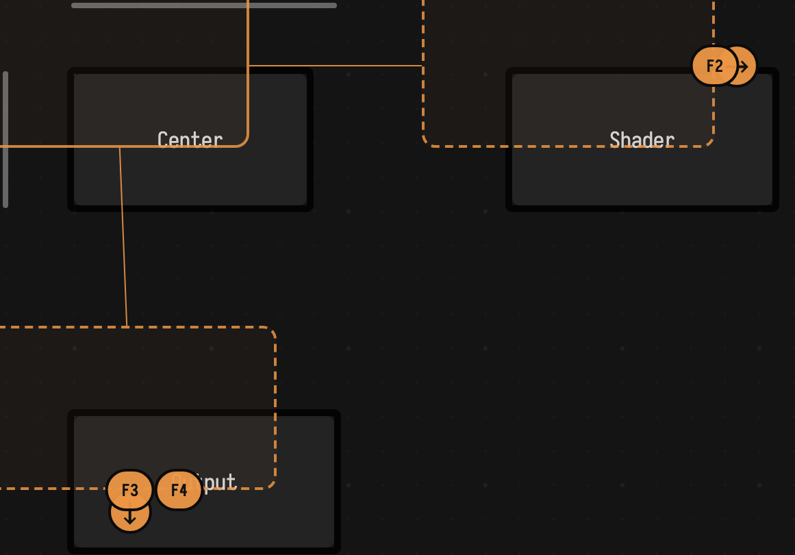

# Bookmarks

Bookmarks let you save a working view of a document and jump back to it later.

Each bookmark stores UI state, not just a box reference. That makes it useful for large documents where the important part is a combination of camera position, selection, editor state, and opened nests.

## Save and restore

Field provides nine bookmark slots.

Save the current view:

- `Shift + Cmd + F1` through `Shift + Cmd + F9` on macOS
- `Shift + Ctrl + F1` through `Shift + Ctrl + F9` on other platforms

Restore a saved view:

- `Shift + F1` through `Shift + F9`

The same actions are also available from the command palette as `Save Bookmark N` and `Restore Bookmark N`.

## What a bookmark remembers

The bookmark system currently captures:

- canvas pan position
- the selected box, when there is exactly one selected box
- the property open in Monaco
- the editor cursor line and column
- the open or closed state of nested disclosures

Restoring a bookmark reapplies those pieces in that order so the document returns to roughly the same working context.

## Typical workflow

Bookmarks work well when a document has several areas that you revisit repeatedly.

For example:

1. Save one bookmark for the overview of the graph.
2. Save one bookmark for the main code box you are editing.
3. Save one bookmark for a nested region or inspector-heavy area.
4. Jump between them with `Shift + F1` through `Shift + F3` instead of panning manually.

This is especially useful during live coding, demos, or debugging sessions where you need to move quickly between viewpoints.

## Persistence

Bookmarks are saved with the document. They live on the root box as the `bookmarks` property and are persisted with the rest of the document state.

That means:

- bookmarks survive reloads
- bookmarks are shared with the document rather than being stored only in the current browser session
- saving a document also saves its bookmarks

## Limits and behavior

Some details are worth knowing:

- only one selected box is stored; multi-selection is not restored as a set
- bookmark slots are fixed from 1 through 9
- restoring a bookmark does not change document content; it only restores view and editor context
- if a slot has not been set yet, restoring it shows a notification instead of changing the view

## Good uses for bookmarks

Bookmarks are a good fit for:

- large box graphs with several working areas
- documents with deep nesting
- switching between code and presentation views
- teaching sessions where you want repeatable jumps between examples

If you want to save the document's content state rather than the current view state, use [document_history.md](document_history.md) instead.
